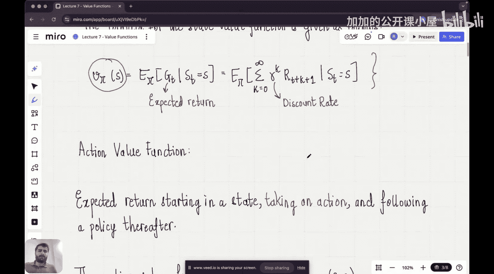

# Vizuara【中英⚡从零开始构建推理LLM｜Reasoning LLMs from Scratch】 p07 P6 Value Functions ｜ Reinforcement Learning ｜ Reasoning LLMs from Scratch [BV1N3xWzWETL_p7]

Hello everyone and welcome to the next lecture in the reinforcement learning phase of our course reasoning LLMs from scratchtch。

In the last lecture， we covered the concept of Markov property and we looked at how reinforcement learning problems can be described as a Markov decision process。

In particular， a state signal has a markov property if it retains all the relevant information from the past。

And then whichever reinforcement learning problems in which the state signals have a Markov property are called as Markov decision processes。

In today's lecture， we will build upon the concept of Markov decision processes。

And we will discuss a very important concept， which is called as a value function。

In my study of reinforcement learning， I have come to understand that。

The importance of understanding the concept of value function is at the heart of understanding all reinforcement learning type of problems。

And even in the large language models。Like deepse， for example。

Whichever models are using reinforcement learning for improving the LLMs。

To understand how that improvement is happening， understanding of the concept of a value function is extremely critical。

And that's why we are going to have a very separate lecture today on value functions I have not collaborated with any other concept。

So let us start to understand what is the meaning of a value function。

Remember in the first lecture of reinforcement learning， we said that what is the meaning of value？

In fact， values was one of the four elements of reinforcement learning type of problems。And then。

In the first lecture， we also said that the meaning of value is。Not the immediate reward。

 which the agent receives， but the cumulative expected reward in the long run。

 And there is a very nice analogy that we gave。To understand values。

 imagine that a team has chosen a player for a tournament。

Let's say it's a game of cricket and there are 14 matches in that tournament and let us assume that in the first two matches the player does not play well at all。

Now， as a team management。They are invested in the or they are more concerned about the value of this player。

 They believe that， even if this player。Has not performed well in two matches。

 The value of the player is high， which means that eventually the player will deliver in some of the upcoming matches。

 which means that if you add up all his scores over the 14 matches。

 it will add up to a good value so we can neglect the first two matches。

So value means the cumulative reward which the agent receives。In the long run。呃。

And this is similar to the concept of expected return， which we looked at in the last lecture。

 remember， we saw what is our expected return and how it is different from。Individual rewards。

So let's look at a state value function。A state value function is。

 let's say we start from this state right and then。

We jump from this state to the state and then again we jump from this state to the state and so on。

The value of this state。Is not the immediate reward which I receive over here but。

The addition of all the rewards which my agent receives in the future。

So basically you sum up all the rewards and then。You ask the question， okay。

 what is the expected value of this sum of this cumulative sum in the long run and then you will get what is the value of this state。

Okay， so the state value function is denoted by this symbol。Which is called as V。Subscript by office。

 this means that。We are calculating the value of this status。When the agent follows the policy pie。

We are going to stay consistent with this notation we by office。Actually。

 you can pause here and you can write down the expression for VI office simply based on the discussion on expected return we had in the。

Last lecture。So just pause this video， take some time to see if you are able to come up with an expression for this。

 if not， let's try to understand it together。So the formula for the state value function is given as follows。

V pi of S is equal to。呃。Okay， before I go that let's try to understand it without looking at the formula。

 So remember we saw that G of T is the expected return。And then what was this expected return。

 this was R T plus1。Plus。Gammer times Rt plus 2 plus dot dot dot。Where gamma is the discount rate。呃。

And this formulation we saw is especially suitable for tasks which are continuous。Not episodic tasks。

 but nevertheless we will look at。This formulation of the expected return itself So now this is the expected return and what I am trying to say is that Im trying to find what is the expected value of this。

So what I do is I simply put a E before。And then I say， what is the expected value of G of T？Given。

My。State is S。Alex see if that's correct or not， yes， that's correct。

But then I missed one symbol at the bottom， which means that the agent is following the policy pie Okay。

 and then after you write this， you simply sum up。GFP。Where you say that it's this expression simply。

 which means that it's going to be sigma k goes from zero to infinity。Gmma is2 k R of T plus K plus1。

Try to expand this by yourself， you will see that you will exactly end up with this expression。Okay。

 so this is the expression for v pi of s don't get too bothered by the mathematics。

 the intuition behind the value of a state is straightforward essentially what we are doing is that。

We are seeing that if an agent is in one status， then what are the possible future rewards that it will get？

In the future。 And then we。Say that， okay， if you sum up all these rewards。

 what are the expected value of the what is the expected value of the entire sum of the rewards？

And then we have a discount rate there because we are saying that future rewards are not as valuable as immediate rewards。

Remember the discussion we had where we said that if you have 100 rupee note。

 then the value of this 100 rupee note five years later is much less compared to the value of this 100 rupee note right now and the concept here is very much similar we are saying that。

Rewards， which are more immediate are more valuable compared to rewards which you receive in the future。

 and this intuition is incorporated very nicely in the discount rate which is denoted by gamma。Okay。

 so this is the value of the state or this is the formula for the state value function。Okay。

 let us move ahead after we have discussed what is the state value function。

 we have to now go ahead and we have to look at what is the action value function。Okay。

 so the action value function means that。We are still calculating。The expected return from a state。

But the only difference as compared to a state value function is that。

Here we are calculating the expected return。After the agent takes an action and then follows。

The policy pie。So the main difference between the state value function。

And the action value function is that， let's say。You have got an agent， which is。

Which has reached to the status。