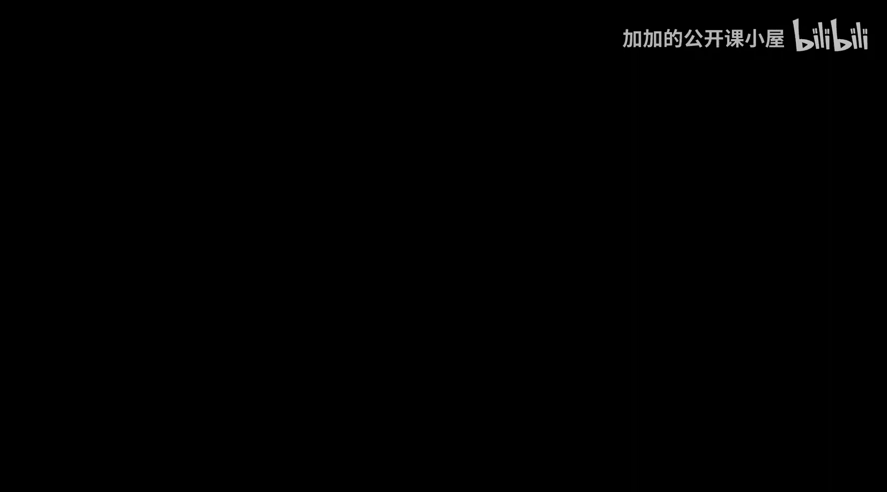
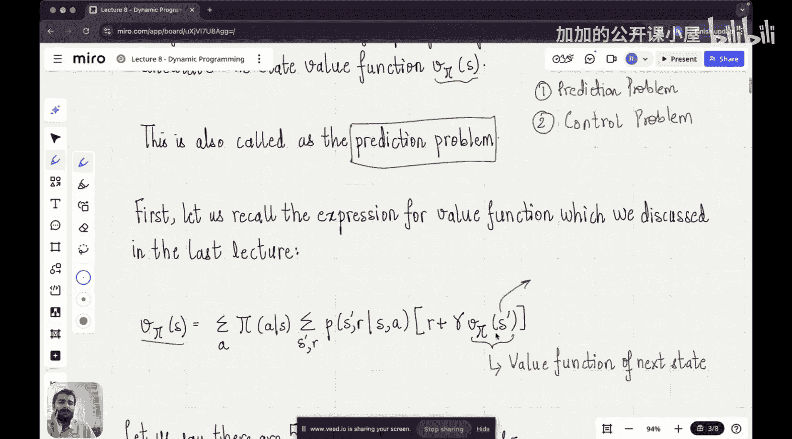

# Vizuara【中英⚡从零开始构建推理LLM｜Reasoning LLMs from Scratch】 p08 P7 Dynamic Programming ｜ Reinforcement Learning Phase ｜ Reasoning LLMs from Scra [BV1N3xWzWETL_p8]

Hello everyone， and welcome to the next lecture of our course， Reaing LLM from Sctch。

All of you might be aware that we are in the reinforcement learning phase of our course。

And we have been making steady progress in this field。In the last lecture。

 we looked at the concept of value functions and we also looked at the Belman equation and the Belman optimality equation。

These equations are used to write down equations for estimating the value function。

For a reinforcement learning problem。And today we are going to start looking at the different methods which can be used。

To actually solve for the value function in a reinforcement learning problem and to actually find the optimal policy for an agent。

So far we have lookt structures， agent environment interface， the Markov decision process。

Then we looked at water value functions， how you can write down equations for value functions。

Et cetera， but we haven't yet。Started to understand how we can solve these equations to actually find the optimal policy for the agent and this is exactly what we are going to start today。

The methods that we are going to cover starting from today's lecture will equip you with an understanding of。

How you can develop or use tools to solve。For reinforcement learning problems。

 depending on the problem type。Okay， so let's get started and the the topic for today is。

Call as dynamic programming， some of you might have heard about dynamic programming weeklyly in some different context。

But we are going to define it from scratch over here and use it in the context of reinforcement learning。

So dynamic programming is a collection of algorithms which helps us to find or calculate the optimum policies for an agent in a reinforcement learning problem。

So the final aim is going to be to find the optimal policy for the agent。And。

The lecture will be organized in such a way that will slowly cover the different steps which are involved in dynamic programming algorithms。

So let's get started， the first step or the first phase of dynamic programming methods is called as policy evaluation。

And the meaning of。This term is that。For a given policy pie。

Can we estimate the value function we pi of。Remember， in the previous lecture， we had looked at。

This notation in detail and what we said was the meaning of this notation is that if you give me any state。

Then I am going to calculate the cumulative rewards。Obtained。

By the agent starting from that state and then moving towards the end of the episode。

 so I'm going to add all the rewards which the agent is receiving。

So that's called as the value function for that particular state。And。

In policy evaluation what we are doing is that we are already given the policy which the agent is following and for a given policy our objective is to estimate the value function for that particular policy。

Okay， so this is the definition of policy evaluation。

 The name is slightly misleading because it might。Lead you to think that the meaning of policy evaluation is maybe we are evaluating the policy。

 but that's not the case， it has a very specific definition which we have looked at a while back。

So this is also called as the prediction problem。So dynamic programming methods or in general any method to solve for the optimal policies are divided into first is the prediction problem。

And second is called as the control problem。So we are going to look at the control problem also shortly。

 but first will。Develop a very nice understanding of the prediction problem。Okay。

 now let's start to develop an intuition for how we can evaluate the value function for a given policy。

The first starting point。Might have already come to your mind is to use the Belman equation。

 which we covered in the last lecture。What the Belman equation essentially says is that。

Let's say I have a state S。And from this state。There are multiple actions I can take。

And after taking those multiple actions， I can transition into different states， right？So these。

 these states are called as S dash。 So the Belman equation says that you can estimate the value function of。

State S by looking forward to the next state。So essentially。

 I can estimate the value function of status in terms of the value function of the next state。

 which is S dash。That's the primary intuition behind the Belman equation。

And then what you essentially do is that you。You have a have a factor with which you。You know。

 associate the relative importance to all of these different next states。And。

That that factor is what you do is you multiply it by the discount factor v of S dash and you add the reward。

 which the agent gets along the way， and then you multiply it by the probability of reaching the state from the previous state as dash comma are given as comma。

This means that what is the probability that the agent reaches？

The state establish dash and receives the reward are starting from this state and taking action A。

And then what you do is you sum up this for all the possible next states which the agent can encounter。

 starting from the previous state。And then you can write this down in the format of a mathematical expression which looks like this。

So this is the current state this is the next state as dash。

 so the value function of the current state can be expressed in terms of the value function of the next state which is S dash。

 it is discounted by a factor of gamma and there is a reward which is added along the way and then this is just the transition probability。

I want all of you to get familiar with this expression because we are going to use it multiple times later as well。

So this is transition probability and this is。This is the policy。

 which states that what's the probability that。The agent。Takes an action A while being in the status。

So this is the Belman equation which we have where now。We are asked the question that。

Given this policy， this this policy is given can I predict the value function for all the states and the moment you see this equation you realize。

There is one issue。 The issue is that。We are saying the value function of the state is dependent on the value function of the next state。

AndThen similarly， we can write down the equation for the value function of the next state。

 which is going to be dependent on the value function of the state which follows that state。

In every single equation， we are going to have。Value functions， so it it's a recursive problem you。

So there is no straightforward solution to this just by looking at this the first thought which runs in my mind is that okay for。

Every equation that I write down， I am going to encounter。Value functions for the next state。

 which are not known to me either。So it's going to be。

A system of equations with unknowns in every equation。And。

Our main focus for solving the prediction problem in dynamic。

