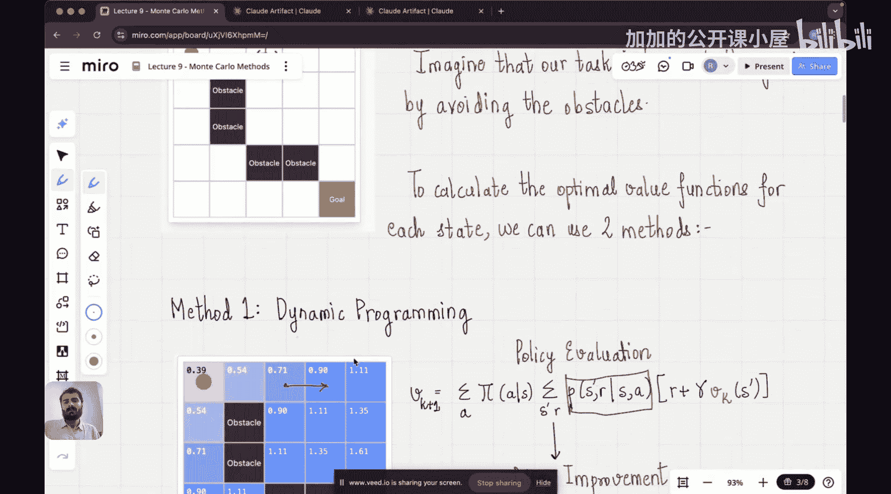

# Vizuara【中英⚡从零开始构建推理LLM｜Reasoning LLMs from Scratch】 p09 P8 Monte Carlo Methods ｜ Reinforcement Learning Phase ｜ Reasoning LLMs from Scra [BV1N3xWzWETL_p9]

Hello everyone and welcome to this lecture of our course， Reasoning LLM from Sctch。

We are currently in the reinforcement learning phase of the course。

And we have started to look at methods which you can use。

To estimate the value functions for a given policy and subsequently find the optimal policy for a reinforcement learning problem。

In the previous lecture， we looked at the first method to do this。

 which is called as dynamic programming。In dynamic programming， what we do is that。

We take the values of the states。And then we update the values of the states based on the values of the states which follow that particular state。

This process is called as bootstrapping because we are using the values of subsequent states to estimate the values of the states which have come before that。

In dynamic programming type of problems， we looked at there are。

Prediction problems and there are control problems。In the prediction problem。

 we are given a policy and we are trying to predict the value function for that particular policy。

And remember how we did this。What we said was that， let's say there are five states。

Which the agent can go through。 So let's say these are the five states。And then what we say is。

Let's say， let's initialize the value functions。For all these states to be0。

So this value function we call as v0。And then what we do is we use this value function to estimate the next value function v1。

Then we use V1 to estimate v2， etc。And then eventually this method converges to the true value function for the given policy。

Now， how did we estimate v1 from v0 and v2 from v1 we use the Belman equation for that remember what the Belman equation says it gives you a way to express V pi of s。

In terms of。We buy off alash。Whereas dash is the next state， so this is the bootstrapping。

Which is at the core of dynamic programming methods。

And then what we are essentially doing here is that we are changing here and we are saying that this is V K+1。

And this is a function of V， K of S。Where K+1 is the next update， for example here this will be v0。

 well use v0 to calculate v1， then we'll use v1 to calculate v2 etc。

This is the policy evaluation step of the dynamic programming method。Then after that。

 what we do is we say that okay， I was given a policy， but that policy is not optimal。

So now I want to improve my policy and to do that， what you say is okay fine let me do this thing。

 let me take my state from my state I have all possible actions。And lets say。

 my current policy is giving me that， okay， you follow this particular action。But I find out that。

This action is not optimal， but instead of that， this action。Is yielding me the maximum reward。

So then what I do is if this happens， I say that my policy is not optimal and whenever my agent reaches status it should move to or it should take action A1 instead of action A。

And I do this for all the different states， I check whether my policy is optimal or not。

 if not I change my policy for that particular state。So essentially we use pi0 to calculate v pi0。

 this is policy evaluation。Then what we do is we use v pi0 to calculate。The improved policy by1。

And then subsequently we do this so that。You get the optimal policy and you also get the optimal value function。

 So essentially what happens is you start with a policy。You get a value function。

 then you update the policy， you update the value function。

 and then these two processes go on simultaneously。Till you get the optimal policy。

 this process is called as policy iteration， or it is also called as generalized policy iteration or GI。

But one of the core learnings of the last lecture was that。

This function is heavily dependent on the model of the environment in other words。

 we cannot solve dynamic programming problems unless we know the complete model of the environment。

Remember you are teaching or。Let's say， you're teaching。

And a reinforcement learning agent to play the game of chess。Now。

 before even we start playing the game of chess， how can I know the exact probabilities of winning from our exact probabilities to transition from one state to another state？

And this happens in a lot of cases in most of the real world cases。

 you do not have the model of the environment available with you， but this model has to be learned。

Through experience。And Monte Carlo method is our first learning method because these methods require only experience。

They do not require any prior knowledge about the dynamics of the environment。

So Im interacting with the environment I'm experiencing with the environment。

And then I am getting better and better and better This is the essence of multi carlo methods and this is how it differs significantly from dynamic programming。

Let's take an example， imagine we have an agent which is or a rover， which is sent to Mars。No。

Would you use dynamic programming to calculate the optimal trajectory or optimal policy for this rover or would you use Monte Carlo？

You cannot use dynamic programming because you do not know the model of the environment in Mars only when the rover interacts with the environment then you will get to know that okay this patch is rocky。

 I should avoid this patch etc so there would be a lot of learnings but all the learnings would happen only after you' experience interacting with the environment。

So this is why Monte Carlo methods are way more practical compared to dynamic programming methods which offer us。

A good。Window to find out optimal policies in a mathematical fashion which we saw in the last lecture。

Okay， so now。In real life， practical cases， Monte Carlo methods might be useful。

 but will also build our intuition by taking a very specific scenario。

Imagine that you have been given this task， all of us we are this yellow circle and。

Or let's say this is an agent and this agent has to reach this goal。By avoiding the obstacles。

 So it has to find the best possible way in which it can reach from the starting position to。

The goal by getting maximum rewards。So how start how will you start solving this problem？

Okay so firstly let's try to see which are the states here， which are the actions here。

 so states are if I'm here this is a state， if I'm here， this is another state， if I'm here。

 this is another state and actions are whether I want to go up。Down left or right。

 so there are four possible actions for every single state。And then。

You can calculate this optimal value functions using。Using two methods。

 the first method is dynamic programming。And as we looked at before in the dynamic programming method。

 you would need to know these transition probabilities。For example， if I am in this state。

Then what is the probability that my agent goes to this state？And in this case。

 since we are assuming that all actions are equally probable， the probability。

Can be assumed to be one by4 that is 025 so we do know the transition probabilities in this case and it will help us to solve this。

