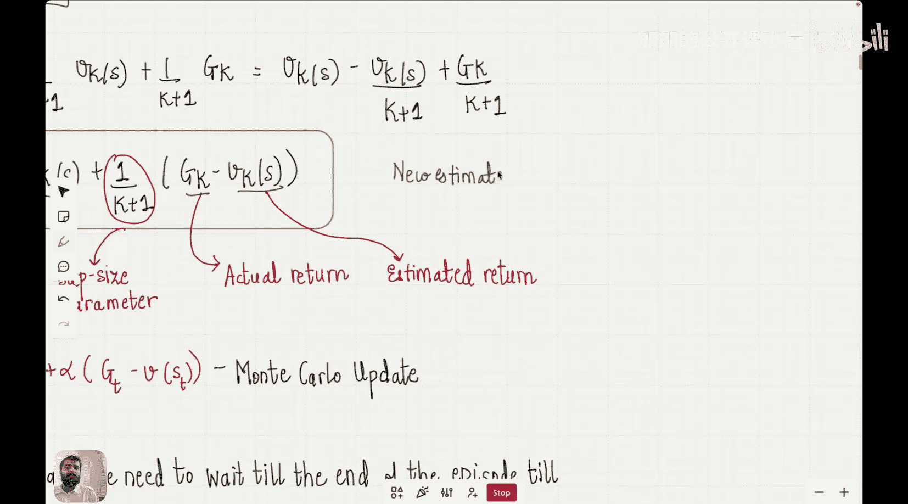

# Vizuara【中英⚡从零开始构建推理LLM｜Reasoning LLMs from Scratch】 p10 P9 Temporal Difference Prediction｜Reinforcement Learning Phase｜ Reasoning LLMs f [BV1N3xWzWETL_p10]

Hello everyone and welcome to this lecture in our series，Reasoning LLM from Sctch。

As you all know by this time， we are in the reinforcement learning phase of this series。

And in the last lecture， we looked at the method of Monte Carlo， the lecture previous that。

We looked at the method of dynamic programming and today we are going to complete the trio of these methods when we discuss about temporal difference methods。

Remember that in dynamic programming， we required a model of the environment。

Without the model of the environment， we could not solve the Belllman equation。

This limitation was addressed in the Monte Carlo methods where we did not require any model of the environment。

 the agent could simply learn from its own experience。This was a huge。

addvancement over the dynamic programming methods because it meant that even if you did not know the entire dynamics of the environment。

 you could just throw in an agent out there and allow it to learn from its own interaction with the environment and then slowly you can converse to the true value functions and then。

You can find the optimal policy， which the agent has to follow in that environment。

One of the limitations of Monte Carlo methods which we discussed in the last lecture was that。

Before you make any update you require the entire episode to be completed and why this is true。

 let's say there is an agent which is following a particular set of states now before you update the value of a state you need to know the actual return which you are getting from that state and to find the actual return you have to visit all the states till the end of the episode so you cannot update the value of the state until you have completed the episode this is one of the limitations of the Monte carlo methods。

Now， the methods that we are going to discuss today are a combination of。

Montic Carlo ideas and dynamic programming ideas。In other words。

 you will find a flavor of Monte Carlo and you will find a flavor of dynamic programming in these methods。

Some of the similarity of these methods to Monte Carlo is that。They learn from a raw experience。

And they do not require any model of the environment either。

And some of the similarity of these temporal difference methods to dynamic programming is that。

You are updating the estimates based on other learned estimates and you do not need to wait for the final outcome。

So these are the similarities to dynamic programming and these are the similarities to multi carlo methods。

And we are now going to take a deep dive into these methods。

 exactly how they work and why people generally prefer them over Monte Cargo and dynamic programming methods。

So let's have a look at temporary difference prediction problem。

Remember that the meaning of the prediction problem is that。Given the。Policy for the policy pie。

I want to estimate the value。Of all the states in the policy。

So I want to estimate the value of all the states which follow this particular policy pi that is the meaning of the prediction problem we have solved the prediction problem using dynamic programming and Monte Carlo methods but right now we are going to see what is the prediction problem in temporal difference methods。

So let us say that we want to use the Monte Carlo method to estimate the value of a state and。

Let's say， the previous estimate is。V， K of S。Now， what we want to do this is that we want to update this estimate。

After completion of an episode， which is giving us a return of GK。

These notations will become clear to you in a while but。

Just remember that the previous estimate is Vk and then we are interested to find out the new estimate Vk plus one。

So呃。Some of you might be thinking what is this Vk where is this k coming from so in Monte Carlo methods what we do is that we keep on updating the estimate of the value of a particular state。

As the episodes go on increasing。 So let's say for the first episode， you have。

The estimate as v0 ofs。Then for the second episode， you have the estimate as V1 office。

And then slowly the estimates keep on getting better and better and they start to converge to the true value of this particular state now we are assuming that we are following a specific episode and the previous estimate was VK of S。

And we now want to see what is the next estimate。So the question is that how will we modify the previous value function to get the new value function？

So let's have a look first， let us see what is the expression for the value function of。

This state for the previous estimate so。What we are doing here is that remember that。

Before reaching this key， the agent is completing multiple episodes， so for episode zero。

The return that the agent gets is g0 for episode1， the return which the agent gets is G1。

And for the K minus1 episode。The return which the agent gets is Gk minus-1。

And this is exactly what we are doing over here， we are adding all these returns and we are taking an average of them。

This is what is the meaning of Monte cargo methods。呃 you。You calculate the return for。

This episode and then what you do is that you add that return to all the previous returns from all the episodes that you have generated in the past and then you take an average。

Of all those returns。This is what we are doing right now。

Now the question is that we have received one more return。Which we are calling as G K。

And now the question is that if I have received this new return， which is GK。

 how will I modify my value function， how will my new value function look like？So again。

 what we'll do is we'll simply write down the formula for this。

 So V k plus one is exactly same as this， but the only difference is that we are adding G K term in the numerator and in the denominator we are。

Dividing it by the number of terms which are K plus 1。Okay， so now remember。

 our final goal is to write down the expression for。V k plus one。

 so we want to write down how V k plus1。呃。let's look at what our goal is。

So our goal is to write down Vk plus1。In terms of VK and to do that。

 all we are going to do is that we are going to look at both of these expressions and we are going to do a simple mathematic manipulation。

So what we are going to do is essentially we will multiply v K plus1 by k plus1。

So it gives us this first term。And then。We look at。

This about and we say that this is exactly the same as Vk into K plus GK。

And when you rearrange the terms， what you finally get is vk plus1 is equal to Vk plus。

1 upon K+1 into Gk minus Vk office now we will try to unpack this。

 we will try to understand what is it exactly that we are getting。

Remember that Vk is the previous estimate。And GK is the current return and1 minus k plus1 let us den that by alpha So what we are getting is that。

New estimate。

