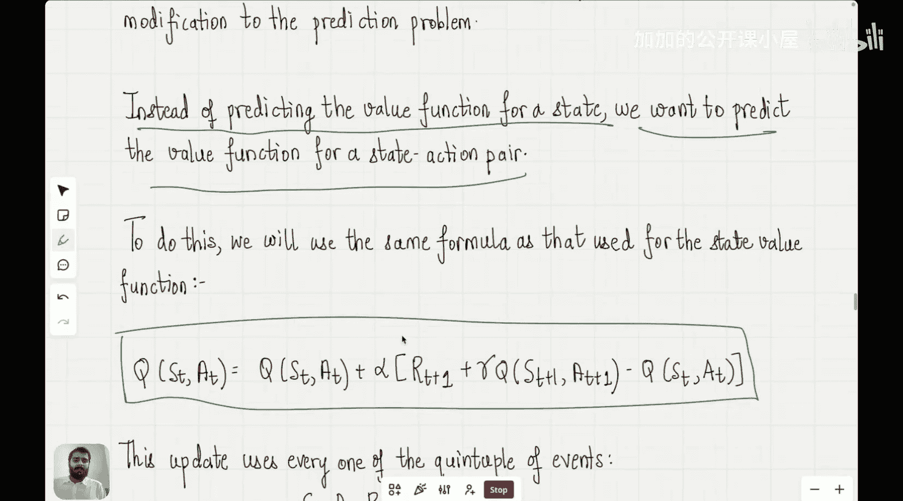

# Vizuara【中英⚡从零开始构建推理LLM｜Reasoning LLMs from Scratch】 p11 P10 Temporal Difference Control ｜ Reinforcement Learning Phase ｜ Reasoning LLMs [BV1N3xWzWETL_p11]

Hello everyone in today's lecture we are going to build on the previous lecture and we are going to discuss about the control problems in the temporal difference methods。

Remember that the prediction problem is where given a policy。

 we are trying to determine the value function。For the policy。

And this we saw in the previous lecture about how temporal difference methods is used to write down an update rule。

 so the update rule is written as follows。V of s plus alpha times。

Now here you have Rt plus 1 plus gamma times v of S D minus v of s where v of S D is the next step and this update rule is used to update the values of all the states。

And this is exactly how the prediction problem is solved for using the temporal difference methods。

 we also looked at how TD methods offer a significant advantage compared to Monte Carlo methods especially that you don't need to wait the length of the episode for making an update and they are quite similar to dynamic programming in some ways because there is an element of bootstrapping which is involved in the temporal difference methods。

When we bootstrap， we use the values of the next states to update our values of the previous states。

 and this is exactly what we do in both dynamic programming and Monte Carlo methods and temporal difference methods。

 but we don't do this in the Monte Carlo methods。Where we use the entire return of the episode。

Now what we are going to do is that we are going to understand how to solve the control problem and remember that in the control problem。

 what we are trying to do is that we want to find out which policy is the optimal policy。

So now that we have understood how to estimate the value function for a given policy using temporal difference methods。

 can we en nudge the policy towards the optimal policy？And。

We looked at it in dynamic programming as well as in Monte Carlo methods， usually this process is。

Is recursive in other words you update the policy， then you again change the value function。

 then you again update the policy and this back and forth methods or this back and forth algorithms continue until you get。

呃。A conni is optimal policy and the value function for that optimal policy。

In the Monte Carlo methods， we looked at。好诶。Exploration and exploitation can be used in the control problem。

we saw that instead of。You know， parallelly computing the value function and。The policy。

 we calculate the action value function instead of the state value function。

And there we understood how an epsilon 3D policy were the best。

So let's do a quick recap of that so that it will build some foundation for us to discuss this。

In the Monte Cargo method， what happens is that the agent follows a specific number of states。

Till the end of the episode。And then you update the value function of the states based on this entire episode based on the return from the entire episode。

然后呃。When you are trying to optimize for the policy。From this state S。

 let's say there are three possible actions even。A2 and a3。And。If。Let's say a3 is the action。

 which is， you know， giving you the maximum returns。But your agent has only explored A1。

Then it's not going to help you because the agent has not explored A2 and A3 at all this program did not happen in dynamic programming because all the actions were explored because it we knew the model of the environment。

So that is why we have to do a process which is called as exploration。And exploration means that。

Even if。Your。Even if your action value function， which is Q of Sma a。

 even if this action value function is telling you that action A1 is maximum。

Action A1 is having the maximum value， so if even if let's say Q of S comma a1 is maximum。

What you say is that with a probability epsilon， I will take an action which is completely random。

So that random action can be A3， which will allow you to explore more actions which are not explored previously and this policy is called as Epsilon 3D policy。

What the epsilon greeny policy allows you to do is that it allows you to explore the actions which have not been explored previously and eventually update this Q function in such a way that。

All possible actions are explored， so for every state you know which action is the best because all the actions are explored by the agent。

So this is the epsilon greedy policy which we used for updating the action value functions for the Monte Cargo methods so what what our strategy was。

We first calculate。The action value function using the prediction methods。

So I am using the word action value function several times in case you don't remember it from the previous lectures。

 what it simply means is that if I am in a specific state and I take an action then what is the expected reward for me in the future so whenever the policy is optimal it will always choose actions which have the maximum value for the action value function。

Okay， so the first step was to estimate this action value function and then after that we use。

Epsilon greedy policy。To choose actions。To choose actions for each state。

And then we again update this。This action value function。 So this process continues recursively。

 We have first。When policy， which we assume to be an initial policy， which is a random policy。

 then we estimate the action value function for that policy by repeatedly going through the episodes。

And then。Then what we do is that we update that policy based on。Epsilon 3D actions。

 which means we look at the updated Q values and we find which Q value is maximum for each state at action and。

Depending on these updated key values， we decide our actions for each states。

And then once in a while， we take actions which are random， So we follow an epsilon greedy policy。

 So this is also an iterative。This is also policy iteration in a way which is what we looked at in dynamic programming but this is much more implicit so you don't explicitly say that you are itating the policy but essentially you are because the queue functions these Q values are being updated after every single episode and your Epsilon greedy policy is deciding actions based on this Q function so they are also getting updated every single episode so that is why these two processes are happening simultaneously。

So。In a nutshell， what we are doing is that we are using an Epsilon 3D policy。

 we are updating the action value function by repeatedly performing the episodes multiple number of times and what we see is that if you perform the episodes enough number of times。

 the action value functions converge to an optimal action value functions and the policy also converge to an optimal policy。

Now， in， in the on policy or。In the control problem for the temporal difference methods。

 we are going to use a very similar approach instead of predicting the value functions for a state。

 we want to predict the value function for a state action pair。

Whi means that if I am in a state and I take a specific action。

 then what is the value of that action in other words， what are the cumulative rewards？

Which the agent will receive in the future after taking that action。

And then this formula is exactly the same as the TD update we saw for value functions。

 the only difference is that the S V is replaced by the S queue。

