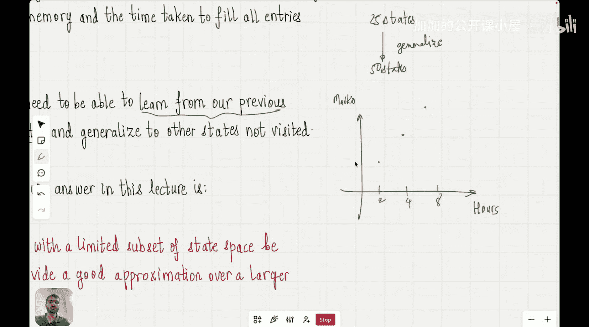

# Vizuara【中英⚡从零开始构建推理LLM｜Reasoning LLMs from Scratch】 p12 P11 Function Approximation Methods｜Reinforcement Learning Phase｜Reasoning LLMs f [BV1N3xWzWETL_p12]

Hello everyone and welcome to the next lecture in our course， Reasoning LLMs from scratcht。

We are currently in the reinforcement learning phase of our course。And we have。

Covered a lot of concepts in the reinforcement learning in the last several lectures。

The last three lectures have focused on the trio of methods used in reinforcement learning。

To solve for value functions and to find the optimal policy for a reinforcement learning agent。

This cry of methods includes firstly dynamic programming。

 second Monte Carlo methods and third temporal difference methods。In all of these methods。

 we looked at a way of。Measuring the value function for a given state。

In the dynamic programming methods， the value function was estimated using a set of equations called as Belllman equation。

So we had the exact solution for the value function of all the states。

The drawback of dynamic programming is that we need an entire model of the environment。

We need to know exactly what is the probability that the agent moves from one state S。

To the next state as dash。And in most of the real life cases。

 this information is not readily available to us。That is why we need to change our algorithm in such a way that the model learns from experience the model learns from interacting with the environment。

The agent gets better and better as the agent interacts with the environment。

And Monte Carlo methods and temporal difference methods fall in this category。

These methods do not require an explicit model of the environment。

Suppose I am an agent and I'm navigating through an environment and I go from the start state to the end of the episode。

In Monte Carlo method， what happens is that。If I start from a state。And。I go to the next state。

 I go to the state after that and I complete my episode。I update the value function of my state。

Only after I complete the entire episode。This is one of the drawbacks of the Monte Carlo methods because if I want to update immediately as I interact with the environment。

 it doesn't happen。You need to wait till the entire episode is completed。

We saw a very interesting example in the last lecture where we discussed about temporal difference methods we looked at if you are going from。

Your office to home and there are seven junctions in the middle。

And you want to approximate the time taken from each junction to your home。

Which is the value of that ju。Now， if you are stuck at a junction every single day and there is a huge amount of traffic。

Let's say on one day you go outside your office， you move and youre stock at number three。No。

Montic Carlo method says that。Don't update the value of Junction 3 until you complete the entire episode and reach your home and cover all the seven junctions。

Which is， which is not very efficient， right， I would ideally like to。

Change the value of generation 3 immediately。In particular。

 I would like to increase the value of junction 3 to indicate that I have faced traffic here today。

 which means that the time taken from this junction to my home is going to be higher than my earlier estimate。

But Montegalo Me does not allow you to update instantaneously。

This problem is solved in the third method in the tri of methods。

 which is the temporal difference methods in the temporal difference methods。

 if we don't calculate the entire reward in the entire trajectory。

 all we do is that we calculate the subsequent reward and。

The value of the next state is used to approximate the overall reward or the entire return。

Of the trajectory。So this allows us to not wait till the end of the episode。

 but use an approximate estimate for the return。This approximate estimate is the combination of immediate reward and the value of the next state。

So that is the difference between temporal difference and multi cargo methods。

These tri of methods are what constitute as classical reinforcement learning。And。

In all of these methods， you might have realized that what we are doing is。

We have a state and we have a value function of a state。All our methods。

 all our discussion has always focused on。Calculating the values of each states。Remember。

 the first example we saw was a recycling robot where the states were high and low。

And then we are calculating the value of each of these states。

 similarly in the last examples with the junctions。

 we have seven states which represent the seven junctions。

When 27 and then we calculate the values of all of these states。

These are what are known as tabular methods。Essentially you are representing a number。

 you are calculating the values of all the states and you are listing that down in a table。

That is why these class of methods are called as aular methods。Now tabular methods are good。

 they are efficient， they allow us to calculate the value function of all the states。

In the prediction problem and in the control problem。

 they allow us to even calculate the optimal policies。The major drawback of tabular methods is that。

In practical cases， the number of states are enormous。Consider the game of chess as an example。

 so chess is a game which has a lot of different combinations there are pieces and every piece can move in a specific way。

So it turns out that there are 10 race to 46 states in the game of chess now if I want to train a reinforcement learning agent to。

Learn from experiencing the game of chess。Then。There are 10 race to 46 states over here。

 so if I use tabular method then I have to enumerate the states 10 race to 46 times and I have to calculate the value of each of these states。

Now this is an incredibly hard task which takes a huge amount of memory and also time to do these kind of computations。

That is why tababulary methods， although they are。They are easy to understand they are easy to discuss in academic settings。

 they are good as a precursor to modern reinforcement learning。They are not very practical。

 they cannot be used for practical use cases。And that is why today we are going to understand how can we learn from our previous encounters with the states and generalize to other states？

Which we have not yet visited， for example， if there are 50 states which my agent will possibly encounter in the future。

I will visit only 25 states。Let's say and then I will generalize to 50 states。

So this is what we are going to look at in today's lecture we are going to understand。

How can we use our knowledge from a limited subset of state space and generalize to provide a good approximation over a larger subset？

Now， this is a problem which。Which which is definitely something we need to solve if you want to tackle these modern problems with a huge number of state spaces like the Game of chess we saw。

What is the first thing which comes to your mind when you hear about this word generalization？

When some information is given and you' are trying to generalize to data which is not available to you。

The first thing which comes to mind is this is familiar， this sounds a bit like regression。

 doesn't it？Let's say you are given marks of a student。And you're asked。

And the X axis have the number of hours which the student has studied。Now the data。

 which you have is let's say， for two hours。4our hours。And。Eight hours。

