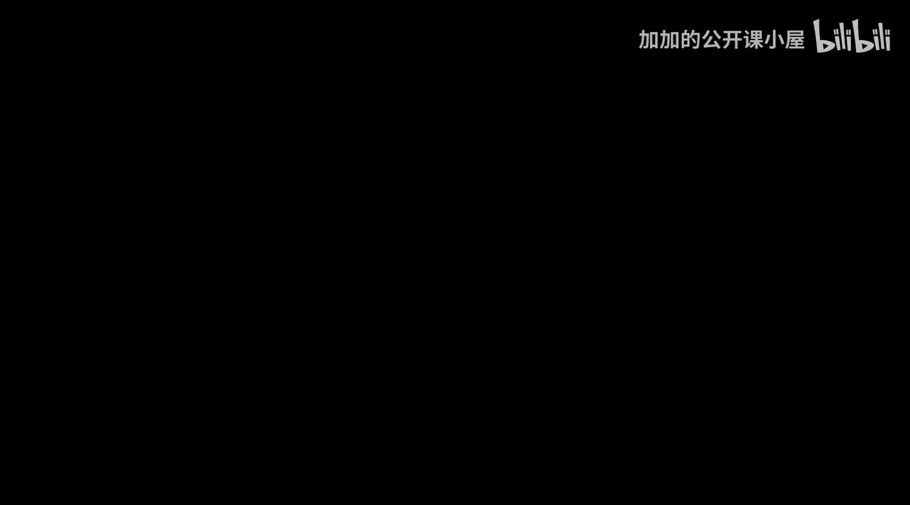
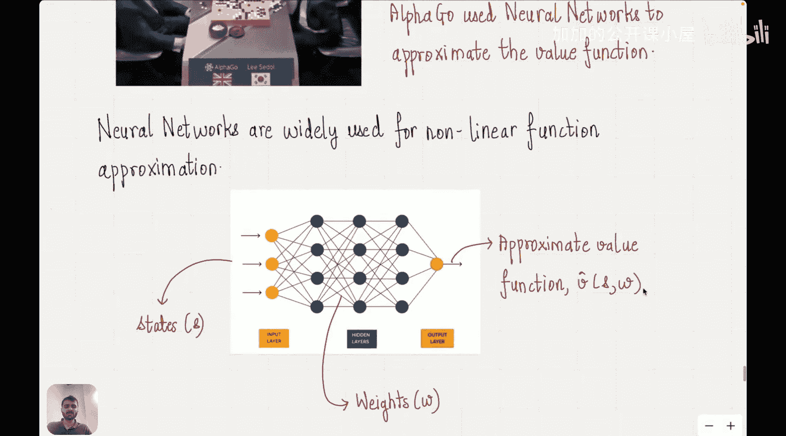

# Vizuara【中英⚡从零开始构建推理LLM｜Reasoning LLMs from Scratch】 p13 P12 Policy Control using Value Function Approximation ｜ Reasoning LLMs from Scra [BV1N3xWzWETL_p13]

Hello everyone and welcome to the next lecture in our course，Reasoning LLM from Sctch。

In the last lecture， we took a significant。Mental shift。In terms of。

The representation of our value function。Previously。

 we were using aular methods for representing the value function。

The problem in the tabngular methods is that。If you have a problem with a large number of states。

 for example， in the game of chess。There are more than 10 race to 46 states。

 it becomes impossible to write down the value function for each and every single state。

And it consumes a huge amount of memory。That is why in all practical cases。

 tabular methods are not referred。Then we looked at okay， if not tabular methods。

 then what is the solution to this？The solution is that of the ability to generalize。

If we look at a certain states in our agent environment interface and we say that okay。

 Im going to find the values of only these states and then I' am going to use these values to estimate the values for all other states。

Now， if we are able to achieve this generalization。

 it will give us the capability of observing only few states。

 understanding the values of those states， and then extrapolating from those states to all other states in the state space。

This is exactly what we have been focusing on in the last lecture and when I say generalization the first thing that might pop to your mind is well traditional machine learning does exactly the same。

 isn't it very similar to function approximation approximation？Yes， it is。

 but the only difference is that in reinforcement learning problems。

 the target is not known to us beforehand。The value function is not known to us beforehand。

 and also the target is non stationary。Which means that the target is continuously changing in a lot of problems。

So because of these two issues， we cannot use traditional ML techniques directly in the reinforcement learning problems。

In the last lecture we build a very nice structure where we understood， okay。

 first let's define a loss function。And this loss function is going to help us train our approximate value function such that it matches the true value function as much as possible。

Now to do this training process， we need an algorithm。

 how do I modify the weights of my value function， the weights of my approximatexiy value function？

We denoted these weights by w and we saw that well gradient descent comes to the rescue here as well。

 we will use gradient descent to update the weights of our approximate value function and gradient descent gives you the。

Most steepest direction for any given weight parameters such that。If you go in that direction。

 the objective function changes by the maximum amount， which is exactly what we want。

So we used the gradient descent technique and we wrote down an update rule。Now。

 the issue with that update tool was that。The update rule is written。

 but the update rule depends on the true value function， for example。

 this is the update rule that we hoped。Just forget about or don't look at the green text which you see in the figure in the update rule we can see that there is this perm which is the true value function now the problem is that the true value function is not known to us beforehand。

We looked at how to solve this problem， we replace the true value function by an approximation whose expected value is the true value function。

 there are two such approximations one is the multicarral return and the second is the temporalial difference return。

With the Montefalo return， we can use the exact same formulation because it does not depend on the value function or the weights。

But the temporal difference target involves the value function estimate itself which depends on the weight。

 so ideally we cannot use the same gradient descent update rule。

But people ignore this variation of the value function of the next state with the weights and we use a semi gradient tool to solve this problem。

Wwhich allows us to keep the existing update and neglect the variation of the value function of the next state with the weight parameters and so at the end of the last lecture we covered all these methods。

Now we have not yet discussed how do we represent the value function exactly in terms of the weights？

Let us understand that。There are two methods broadly speaking。

 the first are a type of methods which are called as linear methods and the second methods are called as nonlinear methods which use neural networks。

The linear methods， as the name suggests， use a very simple function to represent the value function and this function is given by。

The weight the multiplication of the weight vector with a vector which is called as x。

 which is called as the feature vector。So if there are two weights， if we have w1 and W2。

 then and if the feature vector is given by x1 and x2。

 then the value function simply becomes w1 x1 plus w2 x2。

Which becomes a very simple way to write down the value function and then。

X1 and x2 are known to us beforehand， we use some approximations to them based on the information that we know about the problem and all we have to do is then estimate W1 and W2。

No。What what about the gradient of this value function。

 remember that in all these update rules we have a gradient。

So some of you might be unfamiliar or uncomfortable with the gradient that is completely fine。

But essentially what the gradient is doing is calculating the derivative with respect to all the weights。

 so if I calculate the derivative with respect to w1 Ill get x1。

And if I calculate the derivative with respect to the W2， I'll get X2。

So the gradient for the linear case then only becomes x1 and x2， which can be represented as x of。

So in this case we had was written as w or x1 plus w to x2 and if I take the gradient I get x1 of s and x2 ofs which is x of so its a very simple way of representing the problem because I will then substitute x of over here and I have a simple update rule what I do is。

let's say I am in a state and I get a reward。So what I do is I。I add that reward to。

My previous estimate of the value function of the next state and I subtract it from the estimate of the value function of the current state and I is multiplied by the feature vectors which is x of S because my grad is given by x of S。

So for the case of two weights and for any weights for that matter。

 the gradient descent update rule can be written for Monte Carlo can be written as this and for temper difference method it can be written as this。

Because of its very simplistic nature， the linear method is very preferable for a lot of problems in fact。

Within the linear method itself， there are multiple subtypes there is a method called coarse graining。

 which allows you to very efficiently estimate these feature vectors。

So depending on the type of problem， usually people use different feature vectors if it's a periodic function。

 then you use feature vectors， which are periodic。We are not going to look at the different ways in which the linear feature vectors can be written。

 however if people are interested you can take a look at the certainturn andbarto book in which there are five6 pages devoted on how do I calculate the feature vectors but the linear methods offer a very simple mathematical way of updating the wings and this is how now our entire analysis using linear methods is complete。

Now okay lets let's look at nonlinear methods for many interesting use cases。

 linear methods are not used because。It's very limited with respect to the functions that you can approximate。

 they are linear in terms of the weights。But。Problems like let's say Algo be the human go champion here Alphago used neural networks to approximate the value function。

 so nonlinear methods were used。Even in the。Reinforcement learning through human feedback or。

reasonaing models is like。GRPO algorithm which is used in deepse all of these algorithm sort methods are Algo system systems like that。

 they have used neural networks to approximate the value function。

And neural networks are very widely used for non nonlinear function approximation。

