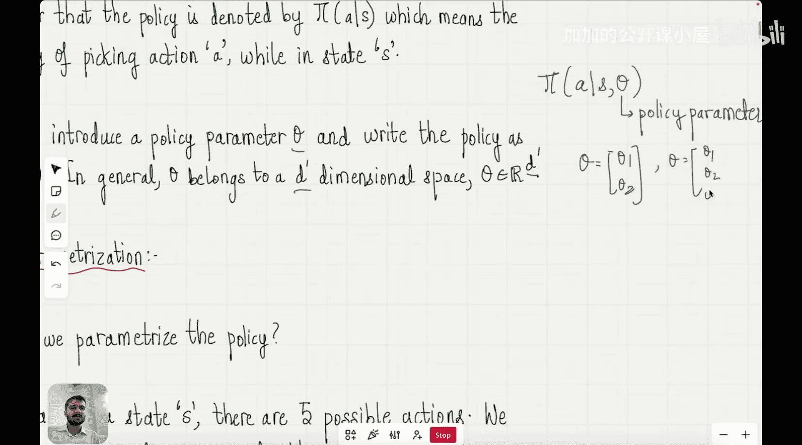

# Vizuara【中英⚡从零开始构建推理LLM｜Reasoning LLMs from Scratch】 p14 P13 Policy Gradient Methods ｜ Reinforcement Learning Phase ｜ Reasoning LLMs from [BV1N3xWzWETL_p14]

Hello everyone and welcome to the next lecture of our course， Reaing LLMS from Sctch。

In the last few lectures， we have looked at the reinforcement learning phase of our course。

And for a while， it might seem that are we disconnected from our main objective of understanding how reasoning LLms work。

Well， all the lectures that we covered in the reinforcement learning phase。

Have been leading up towards understanding of。Providing reasoning for large language models。

And today we are one step closer to that understanding。

All the concepts that we have learnedt in the reinforcement learning phase so far。

All of them have come together in today's chapter， which is about policy gradient methods。

This chapter is an extremely fundamental chapter to understand。

How reinforcement learning is used to impart reasoning to language models。

All of the reinforcement learning applications in language models involve policy gradient methods。

And these are at the heart of。The policy or the algorithm used in deepse。

 they are at the heart of the algorithm used in open eyes reasoning models like O1，03， etc。

Every reasoning LLM， which has used reinforcement learning， has used policy gradient methods。

So today's lecture is extremely important from that point of view。

 and we are slowly and steadily marching towards understanding how reinforcement learning exactly provides reasoning capabilities to a large language model。

So let us get started。不是。Firstly， let's try to understand。

Why do we need policy gradient methods in the first place？Well， remember。

 the objective of reinforcement learning is to find the optimal policy。Now， so far。

 the methods that we have looked at for finding the optimal policy have all been kind of similar。

 What we do is we。Look at a particular state。We look at one status， and。

Let's say there are four possible actions at this state A。A2。A3 and A4。

There are four possible actions and then we say that okay， Im going to find out。What is the。

Expected return， which my agent will get after following each of these four trajectories。

And then I calculate this expected return for all these four cases， let's call it Q1。Q2。Q3 and Q 4。

And then we make a table out of it， we say that。On the left hand side you have actions and on the right hand side you have the expected return which the agent gets after following that action。

 so here we have four actions A1 A2， A3 and A4。And we have four different expected returns。

 which are Q1。You2。Q3 and Q 4。Remember that these are also called as。Action values。

But for the sake of。Explaining from scratch I'm going to refrain from that notation here and I'm going to just say expected return and then what you do is you rank these four returns and you find the value which has the highest。

Expected return， let's say it's Q2 and then you select the action Q2 when the agent is in the state S。

Now to get this table itself in the first place。There are。

There are multiple algorithms which you can use and we have looked at some algorithms in the past。

 we have looked at Monte Carlo。We have looked at temporal difference and we have looked at dynamic programming as well。

So。Whatever I have written right now， you can see it's a form of a table。It's in the form of a table。

 so this is called as tabular method。For finding this table itself。Now in the last lecture。

 what we saw is， well， if you have a lot of states。

 then it doesn't make sense to have a table because。You would have a huge number of table。

 you would require a lot of memory。The game of chess has 10 race to 46 states。

 so you will need a huge amount of memory to get this table in this form。

 So instead what you do is you say that okay I'm going to build a function。

Whi is going to take in the state and the action as the input and it is going to tell me what is the expected return。

So in many cases， this is a neural network as well as we looked at in the previous lecture。

In this lecture we are not going to focus how to get these expected return values as I have said there are two broad categories the first is the tabular method and the second is using function approximations but the idea is that once you get the table or the function you find the action which gives you the maximum expected return and then the agent will take that action。

Now this is what we have been doing so far。呃。And。呃。These kind of methods are useful in a way。

 but they are not directly evaluating the policy。What we are doing is that we are first calculating a number for each action and then we are checking which number has the highest value。

The question is that can we directly optimize for the policy instead of optimizing for a function which serves as a proxy for optimizing the policy？

And that is exactly what policy gradient methods do。

So we are going to have a step by step look at how do these policy gradient methods exactly work and how are they different from this approach on which we have been so fixated so far。

So let's have a look at it。Now， what we are going to look at is we are going to learn the policy。

 learn the optimal policy， which the agent has to follow。Without。

Considering the action value function that is without considering these Q values。

So we are going to get rid off that formulation。So let's see how we can do that。Okay， so firstly。

 we are going to denote our policies by。By of。A given as。

This indicates that what is the probability of。The agent taking action A behind the agent is in status。

So it means the probability of picking action A vi in status。

We are going to stick with this notation for several subsequent lectures， so I want you to be。

Quite comfortable with this notation。And then what we are going to do now is that since we want to evaluate this optimal policy。

 we are going to introduce one more parameter which is called as theta。

And we are going to write down。The policy has buy off。咦。Giveniveness。咁嘛铁た。

This is called as the policy parameter。The reason why we introduce the policy parameter theta is that。

呃。Depending on the value of theta， our policy is going to change。

So we are going to represent the policy in terms of this policy parameter theta and then。

We are going to try to find out the value of theta， which gives us the best policy。

So it's a way of parameterizing。The policy itself。ok， so呃。

This is how we introduce the policy parameter theta and theta belongs to a D dimensional space。

So let's say if。呃。It belongs to D dashash dimension in a space， if D dashash equal to2， then we have。

 for example theta is a vector of two dimensions， we can write it as theta 1 theta 2 if D dashash equal to 3 then theta will become theta 1 theta 2 and theta。

