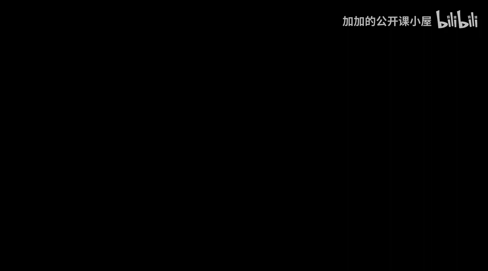
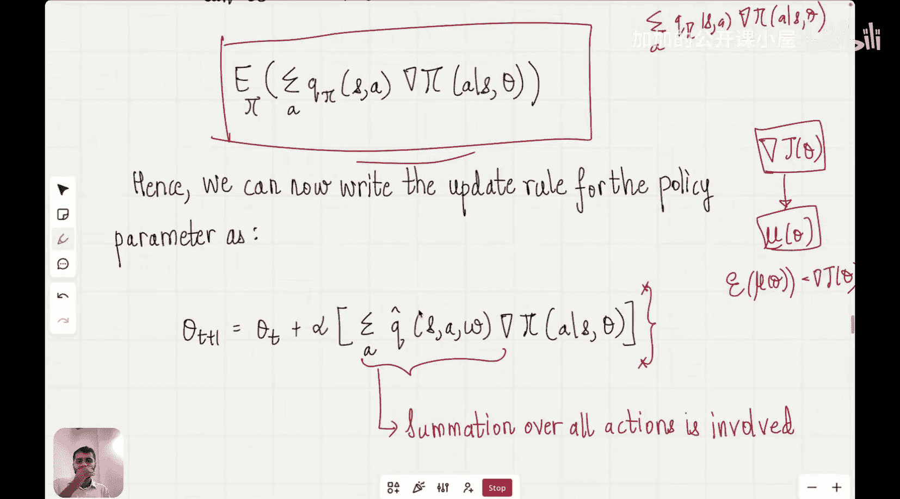

# Vizuara【中英⚡从零开始构建推理LLM｜Reasoning LLMs from Scratch】 p15 P15 Lecture 14 - REINFORCE ｜ Reinforcement Learning Phase｜Reasoning LLMs from Sc [BV1N3xWzWETL_p15]

Hello everyone and welcome to today's lecture in the series， Reaing As from scratchch。

In the last lecture， we looked at the policy gradient theorem。

 which told us that the gradient of the performance measure of the policy is directly proportional to the state distribution。

 the action value function and the gradient of the policy。

We also looked at this gradient does not involve the gradient of the state distribution itself。

 which might have been very cumbersome to calculate。

And this allows us an easy way of calculating the gradient of the performance measure itself。

In today's lecture， we are going to build upon the policy gradient theorem and look at our first algorithm。

In which we are going to use the result of the policy gradient theorem。

Our expression for the parameterized policy。And the gradient ascent algorithm。Do a。

Find out the policy parameter which maximizes this performance measure。

Let's start with our first policy， which is called as reinforce。

Now remember that in the gradient aent method。What we saw was that we let's say start somewhere around point A。

 which is not an optimal policy and slowly we want to ascend along the direction of the gradient and move slowly and steadily towards point B and every step of the way we are going to update our policy parameters。

Towards the direction of the gradient at that particular policy step so for example here now theta t is the policy parameter at the current time step we are going to say that the policy parameter at the next time step is theta t plus alpha times。

Gradient of the performance measure， which will ensure that we are moving towards the direction of maximum performance measure。

Now here， the policy gradient theorem tells us that this gradient is proportional to。

The summation of the state distribution for all the states summation of。Action values。

For all the actions and then multiplied by gradient of the policy。

Now what we had neglected in the last lecture was these summation signs which we are going to focus in detail in the reinforce algorithm。

 so this summation sign means that summation over all possible states and this summation sign means summation over all possible actions。

Now we are going to simplify this expression using some concepts in probability。

 which I'm going to explain below， the first concept is that of expected a value。

So let's say we have a random variable x。And each possible outcome has a probability of P of x。

So then the question is， what is the expected value of this random variable x？

The formula for the expected value can be written as。P of x into x or x into P of x。

They expected a value。When given by this expression gives us。If。

A random variable happens and we know the probability of every event of that random variable then we can find out the probability the entire probability of the event let's say I roller dice and every single phase value has a probability of 16 I ask you what is the probability of the event so what you will do is you will say 16 into1 plus16 into2 plus 16 into3 plus dot dot。

So you will multiply this and then you will tell me which is equal to one6 of。

One plus2 plus3 plus4 plus5 plus6， which is equal to6。3 plus。6 plus 4，10，21。

 so this is the expected value， which is 3。5。So in a similar way， expected value of any。

Any random variable can be calculated if the probability of every event in that random variable is known。

Similarly， we can if you replace this x with p of x with f of x。

 we can calculate the expected value of f of x also by multiplying the probabilities of each event not by x。

 but by a function of x。Now， what we are going to do is that we are going to consider this expression。

 which is sigma mu of s into y of s。Now， MuA face is telling us what is the probability of the agent being in that state？

Remember， this is the state distribution and if we have values of S1。

 let's say there are four states。And every state is visited， maybe this is five times。

 10 times 15 times 20 times。So then mu of S1 is equal to5 divided by addition of all these。

 which is equal to 2050 which 1 by 10。Mu of S2 is equal to n0 divided by 50。

 which is equal to 1 by 5。Mu of S3 equal to 15 divide by 50 and muu of S4 equal to 2020 divide by 5。

So these are nothing but the probability of the agent reaching that particular state。

 and we have multiplied that with a function of the state。

Which is very similar to this expression you see。P of x into F of x here p is replaced by mu and F is replaced by y。

 so this can be written as expected value of y of。And hence the above expression in the policy gradient theorem can simply be written as expected value of whatever comes inside。

 so basically this is y of S now。So it becomes sigma mu of s times y of s。

 which is equal to expected value of y of s， which is the expected value of whatever comes inside。

So what you essentially say is that。You say ok呃。有。I want to remove the summation of all the states outside this equation and I want to say that this expression is equal to。

They expected a value of。The summation over all the actions multiplied and then inside the summation we have the action values and the gradient of the policy。

So this is how the policy gradient theorem can be written as。

Now how how can we write the update rule for the policy。

 remember the update rule was given by theta t plus 1 equal to theta t plus alpha times gradient of the performance measure and we just saw that gradient of the performance measure can be written as like this。

Which means that。The quantity inside the expected value， which is sigma a。Q pi of asma a。

Grab a pie of egg unes comata。This is。Something， this is a distribution whose'。

Expected value is equal to the expected value of the performance measure。

Which means that we can directly use this as a proxy for the gradient itself。

And this is what we are doing over here。呃。Its you might be thinking where did the expected value go here I'm not writing the expected value here anywhere the reason the expected value is not coming is in the policy or in the gradient asend theorem we have gradient of J of theta。

Now， this。Can be replaced by。Let's say another function mu of theta。

Only if the expected value of this。Is equal to gra of j of theta and we did get that expression expected value of this is equal to gra of J of theta that is why we were able to replace the gradient with this value。

And now the update rule for the policy parameter can simply be written as this where we write theta t plus 1 equal to theta t plus alpha times summation of notice that we have written Q hat here。

 which is the approximate。

Action value function。And we have written W here， which are the weights。

So if I am at a particular state and there are Phi actions I'm seeing in front of me。

 what I will do is I will calculate Q hat for all of those actions and then I will take a summation and I will multiply it by this grad of pi a US comma theta。

