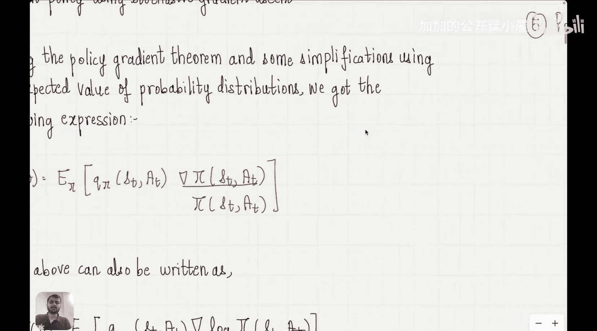

# Vizuara【中英⚡从零开始构建推理LLM｜Reasoning LLMs from Scratch】 p16 P16 Lecture 15 Generalized Advantage Estimation｜Reinforcement Learning Phase｜Rea [BV1N3xWzWETL_p16]

Hello everyone and welcome to the next lecture of the course，Reasoning LLM from Scratch。

In the last lecture， we looked at policy gradient methods。

Let us do a quick recap of policy gradient methods and move ahead to the chapter which we are going to cover today。

 which is called as generalized advantage estimation。So in policy gradient methods。

We looked at two steps。Step number one was。Parameterterizing the policy。

This meant that from the notation， pi of。Sテ commma or bio。S。Given a。Which is the probability of。

Should be reverse P of a given S probability of taking action A while being in status， this was。

Converted to pi theta of a givens。Which means that we have a policy parameter。Which is used。

To parameterize our policy。So we are going to express our policy in terms of this policy parameter。

 which is called as theta。We also looked at one simple way of。

Expressing this with which is soft max in preferences。Now， once we have parameterized our policy。

Our main objective behind any reinforcement learning problem is to make sure that we are getting maximum rewards。

 The agent gets maximum rewards in the long run。So we have to define a performance measure。

Which we want to maximize。Now the performance majorr is denoted by J of theta。

And we said that the performance measure can simply be。The value function。

The value function for the initial state of the episode， which is V。By theta S of 0。

This essentially means that。Let us look at the initial state when the agent begins and let us sum up all the rewards which the agent is receiving in the future。

 calculate the expected value of all these sumter rewards。And say that we are going to maximize。

This expected value。And I am going to find the policy parameter， which maximizes this。Now。

 once we define this， the natural challenge which lies ahead is。

 let's say this is the curve which we have for J of theta。Where on the y axis。

 you have J of theta and on the x axis， you have theta。 So your aim is to basically climb up this。

Steep mountain。And reach the maximum of this curve。

And to climb this mountain at every point I need to know what is the slope。

What is the slope at each and every point？And this is， in fact， the gradient asset method。Which。

We will to。Find the policy parameter which maximizes this performance measure。

Now the question is that how do we find the slope， how do we find the gradient of this performance measure with respect to the policy parameter？

And this gradient is denoted by。So I'm going to go down a little bit and write it over here。

This is denoted by Grd of。G ofテta。Which is the gradient of the performance measure with respect to the policy parameter。

Now。We said that this performance measure is going to be。A combination of two things。

The first thing is。呃。Let's try to think about what will happen if I change this policy parameter。

If I change this policy parameter。The decision which my agent takes for every state will change。

Which means that if I go to any state S。The action which I am taking at that state will change。Now。

 a consequence of this is that。The state distribution of the agent is going to change。

So this is the state distribution， let's say these are the states and on the Y axis I am counting how frequently are these states visited by the agent。

That is。Affected by the policy， and。The second is。The gradient。ある。Let's replace the gradient by。

The change in the policy itself。So this week did not buy a grad pie of Theta。

So now the challenge that we faced while calculating this gradient was that the gradient。

Involves two independent gradients， the first is the gradient of the state distribution and the second is the gradient of the policy itself。

And then this is a tough problem to solve。Because it's hard to find。

How will the state distribution change as the policy parameter changes？

But then we saw that there is a very nice theorem， which is called as。The policy gradient theorem。

Which told us that。Don't worry about the state distribution and how it changes。

Only worry about the change in the policy。So only worry about the change in the policy and this made the calculations easy。

And we looked at。呃。How the gradient of the performance measure is proportional to。呃。

So essentially what we saw was。The gradient of G of theta is proportional to the state distribution mus。

And then we sum over all the actions and we do Q pi。Of。S comma a， and then we do grad pi。일기。

So essentially it only depends on the gradient of the policy。

 it does not include the gradient of the state distribution itself。

And this was a very powerful result for us。😊，And now with these five steps。

 we have a complete picture， we can now write down the gradient ascent rule as follows。

Tta T plus one。Equal to theta T plus。Alpha， which is the learning rate times。

Grad of J of theta and within this gra of J of theta you can now substitute this expression。

So this is how the policy gradient methods work。And then we looked at， okay fine。

 we substitute this expression and then we did some manipulations with the expectation sign。

And finally， we saw that the expression for。The gradient of the performance measure， which can be。

Directly used as an input in the policy parameter of lead rule is given by this expression。

Which is the expected value over the policy。Of multiplication of two parameters， the first is。

What are the expected rewards you are going to get after choosing action 80 while being in state S。

 this is the first。Term and the second term is given by grad pi divided by pi。Now。This is this。

