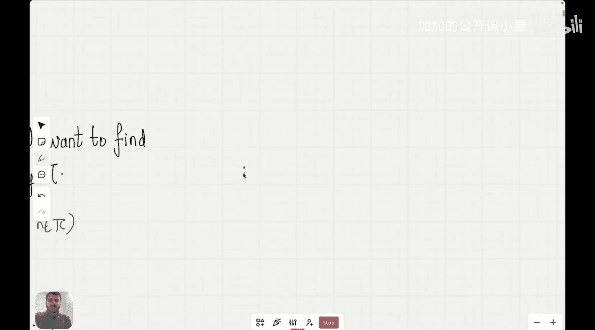

# Vizuara【中英⚡从零开始构建推理LLM｜Reasoning LLMs from Scratch】 p17 P17 Lecture 16 Trust Region Policy Optimization｜Reinforcement Learning Phase｜Rea [BV1N3xWzWETL_p17]

And welcome to today's lecture of our course， Reasoning LLM from scratchch。In the last lecture。

 we looked at a function which is called as advantage function。

And what we saw was the advantage function denoted the difference between。The state。

The action value function and the state value function， which is denoted by。Q倍。Of S。讲 a啲。

Minus v pi of ST。Intuitively， this means that how。Better or worse。

 your current action is compared to the default behavior of the policy。For example。

 if you start with a state ST。And you have a number of actions to take from that state。

And let's say your policies default behavior at the moment is to choose this action。

 which is known as a0。And then what you do is you look at all these other actions。

 which is A A2 and A3。And。You make a table。And try to see。Let's say the value of a0 is。

So this is the value function。50。And you try to look at。

The expected cumulative rewards for all these other actions。 and let's say these are 30， 40 and 60。

So the observation that we make is that for action A3。The expected rewards are。Higher。

 compared to the。Rewards， which。The agent is expected to receive。

For the policies default behavior and thus we know that there is scope for improvement。

Which means that the current policy is not optimal， but there exists an action。

 which is better than the current action which the agent is choosing for that particular state。

And this intuition can be mathematically represented in the form of an advantage function which is given by this difference。

 so the advantage function for all these different actions would be minus 20 minus 10 and this is positive 10。

So the sign of the advantage function is telling us a lot about。

How optimal the policy is or how much scope there is for improvement。

 And that's why this is a popular。Terminology， which is used in the lot of。Policy。

 gradient algorithms。And then we looked at a method for estimating the advantage function as well。

 which is using the generalized advantage estimation。

 which is GAE remember the advantage function is generated by a of ST comma 80。And。

The most simple way to approximate this is。By using a temporal difference target for the action value function。

 that is we do Rt。不less。Gammer times。Value function of the next state。

This is a simple way to estimate the advantage function。

 but the problem with this estimation is that it can be biased。

Because we are only using one term for the estimation it can be biased。

 that's why what we do is that we use composite returns。

 we use not just a one step backup that we saw here but we use a combination of one step two step three step up to an end step backup and that is exactly what is done in generalized advantage estimation。

But for the purpose of understanding。A broad level understanding of these two concepts is enough for us to move ahead to the next lecture。

So now in today's lecture， we are going to understand about a technique which is called as trust region policy optimization。

This paper came out in the year， 2015。And from there on， to 2025。All the modern developments。

 which include algorithms like PPO。GRRPO， which is used in deepse。All of these。Are built upon the。

Derivations which were made in the TrRPO paper and it introduced a very important concept of trust region。

 which is at the center of all the algorithms that we are going to see subsequently。

And that is why TrRPO。Concept or the understanding of trust region policy optimization is going to be crucial for us as we move ahead to the next part of our courses。

Now， before we move ahead， I would like to emphasize that this lecture。

 unlike the other lectures that we have seen in this course， would be a little bit theoretical。

 that means that it would involve some amount of mathematics at the start。However。

 once you go past that mathematics， we will look at。

Some intuitions to remember what all we have seen so far so that even if later you forget all the mathematics。

The intuition stays with you generally what I have seen that if we go through the mathematics。

 it gives us a fair amount of confidence when when we look at all these symbols。

 we don't get intimidated by them。So when you read this paper or when you look at any other algorithm which comes out。

 you can see that oh， there is a trust vision here I can see that because。

I remember it from either the mathematics or the intuition that I have built from this lecture so the first part。

Will it be a attribute theoretical， but please stay with me because the reward is going to be pretty interesting later on as well。

Okay， so let's get started。We are going to start with some notations first。

 So let's say we denote the performance measure of the policy as。N of pi。 remember。

 we had a notation for this called J of theta。 but the reason why we have。

Denoted it now as n of pi will become clear shortly。And remember how G of theta was defined。

 it was defined as the cumulative expected rewards。

 which the agent is going to get starting from the initial first state of the episode which is denoted by as0。

So essentially what you do is that you add up all the rewards which the agent is going to receive in the future and you take an expected value of them。

Which is the definition of the value function for a given state。

So the only thing we have changed here from G of theta is n of pi。Now。

 what we are going to understand is let's say that there is another policy P。

The crucial question that we will answer in this entire lecture is。For the policy P。

 let's say I define the performance measure as n of P。The question is。Can we write。En of B。

In terms of and of pie。Which means that I want to understand whether the。

Performance measure has improved or not compared to one policy。So I have two policies， pie and P and。

Since both of them are different policies， their performance measure is going to be different。 Now。

 the question that I am asking is that can I write down。

The difference between these performers measure in terms of a simple mathematical equation。Okay。

 so now。With this question in mind and with our earlier discussion of。Advantage functions。

 Can you think of some kind of。呃。Intuition for this difference or。N p dash minus n of pi。

 Can we think of what will this term be proportional to。So lets let's try to understand this。

 then we will get into the formula as well， so let's say this is status， right？

And。According to the policy， by。Let's say the policy Pi tells me that I want to take action A for this state。

