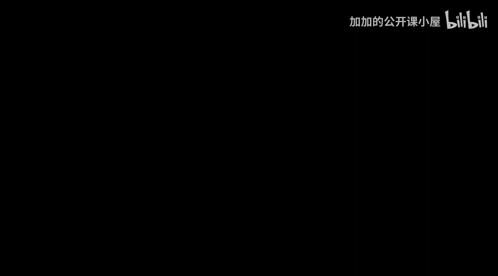
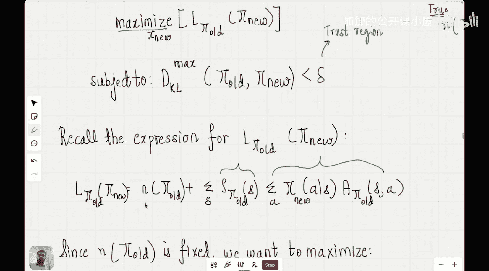

# Vizuara【中英⚡从零开始构建推理LLM｜Reasoning LLMs from Scratch】 p18 P18 Lecture 17 - TRPO Solution Methodology ｜ Reinforcement Learning Phase ｜ Reas [BV1N3xWzWETL_p18]

Hello everyone and welcome to the next lecture in our course， Reasoning LLM from scratchtch。

In the last lecture， we looked at an algorithm called trust Region policy optimization。

We started by looking at。The performance measure of an objective of a policy。

 which be denoted by n of pi。Our entire goal。In TrRPO is to find the policy which maximizes this performance measure。

Now， the question is。How do we maximize the performance measure of this policy？Well， to do that。

 initially we looked at what if we have another policy by dash。

Whose performance measure is given by N of Badeash？Now。

 the question we asked is that can we write the performance of this new policy？

In terms of the performance of the old policy。And the reason we think of this approach is that if we are able to write n of B dash in terms of n of pi。

We will get some idea of in which direction should we make our updates so that it moves。

Towards the direction of an optimal policy。So then we saw， okay。

 n of Pdash is the performance which I want to maximize and。It can be written as n of pi。不us。

Two parameters or two terms。First is。The state distribution。And。The second is。

Summation over advantages。So， what we saw was。To find the performance measure of the new policy。

Let the agent visit。Each and every state。In the environment， and。Let the agent choose an action。

Based on the new policy。And then for every state the agent has visited。

You calculate the advantages for every state and you sum all those advantages over。So now。

This was our intuition and this is our true objective function， which we want to maximize。

So I am going to give a label of true over here。Next。

 what we looked at is it's hard for us to find the state distribution。

Because the state distribution under the new policy is not known。So we thought of， okay。

 if the state distribution is not known， what can we do？And。

We looked at an interesting approach where we considered this function。

Let me draw this function here right now， so let's say we consider this function。

Whose maximum I want to find out and I do not know this function I do not have the expression for this function。

Where on the Y axis， you have enough p。Okay and on the x axis is we have theta。

 which is the policy parameter， so what we do is let's say we are somewhere here。

Which is obviously not the most optimal policy。We construct the surrogate function which is always less than the true objective function and which matches the objective function at one point。

 and then we calculate the maximum of that surrogate function。So we get the next point。

 then we again calculate the serogate function， find the maximum of the surrogate function。

Then we get the next iteration， then we do that， and we gradually move towards theta which maximizes our true objective function。

Now the main question is what is this surrogate objective function and we looked at a very interesting expression for this surrogate objective function。

 which turns out to be。En of by。Piiedes。Minus。C， D， K， L， Max Pi of P Dash。By call up bylash。

The first term is。Exactly same as the true objective function but with the state distribution calculated according to the old policy and the second term measures the K dis between the old policy and the new policy。

So it turns out that we can prove that this term is less than the true objective function。

 which is the true performance measure of the new policy and we can see how it matches。

The objective function at exactly pi equal to P so for pi equal to P。

 both the distributions are the same and the K divergence is going to be zero and for pi equal to P the state distribution of the old policy equals the state distribution of the new policy so this simply becomes n of P。

So this way we found a policy iteration algorithm which sequentially calculates a better and better and better policy。

但。We continue this till the point we reach。The optimal policy。Now。

 towards the end of the last lecture， we also discuss how we can decompose。

This objective function into this。Where we maximize。

Only the first term and the second term is added as a constraint。

So this is called as the trust region， which is datata。And the trust feature ensures that。

The new policy does not deviate much from the old policy。

 it always remains within the trust region of data。

Now the question is that how do we solve this constraint optimization problem？

And we will look at that in this lecture and it will。

The final expression will actually be very similar to policy the vanilla policy gradient expression。

Which we were looking at in the previous two lectures before we started covering the RPO。

So it would appear that why did we go through all these length to come up with that expression if it was so straightforward and that was my reaction when I reached till the end。

 but oftentimes it happens that，The most powerful expressions are simple when you reach。

Towards the end of deriving those expressions。And you find out an intuitive way of。

Coming to that expression。Through a simpler route， so we are going to look at that how it can be related to policy gradient as well。

Okay， so for now the task for us in today's lecture is to solve this constrained optimization problem where we are given an objective function and we are given a constraint。

So let's see how we can start this problem first we have to simplify this objective function。

 which is there in the brackets of the maximize function。

So let's expand this L old by you this exp looks like this as。I had written over here。

 it's a combination of two terms， this is the state distribution。

According to the old policy and this is the summation of all the advantages which the agent encounters for every single state。

 the intuition of why these advantages appear in the expression is that。If the advantage is positive。

 it means that there is scope for improvement， it means that there exists an action which is better than the policy's default behavior at that state and if the advantages are positive for all the states it means that the performance of my new policy is indeed better than the performance of my old policy。

So this is quite similar to the policy iteration step that we did in dynamic programming。

The only difference is that at that time we had not introduced the termmiology of advantage functions。

Okay， so now we have this， so n of pi old does not depend on。

The parameter theta because it is fixed。This is already known to us we know the perform。

