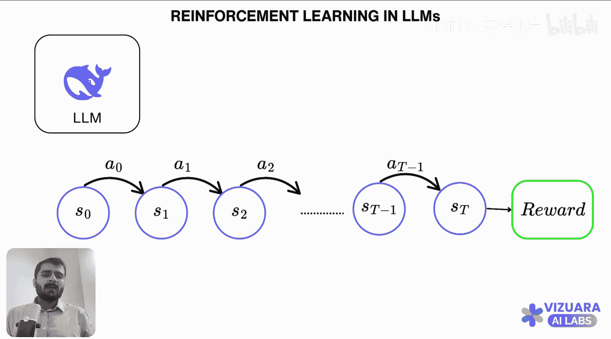

# Vizuara【中英⚡从零开始构建推理LLM｜Reasoning LLMs from Scratch】 p19 P19 GRPO Explained under 40 Minutes [BV1N3xWzWETL_p19]

Hello， everyone。In this video， we are going to understand。How does。ジアピオブルク。

GRPO is the reinforcement learning algorithm， which is used。To prepare the model deep seek。Now。

 GRPO is an algorithm which builds upon。Years of research in the reinforcement learning field。

And in this video， I am going to condense everything down so that you understand how GRPO works from scratch。

We'll start with classical reinforcement learning and slowly we'll build our intuition to understand why GRPO was so effective and why it became so popular after it was introduced by deepse。

And why it remains one of the most popular algorithms for building reasoning large language models。

And let's get started。So in a typical reinforcement learning problem。We have an agent。

 and we have an environment。The agent。Interacts with the environment。

Typical notations which are used in the classical reinforcement learning are that of states。

 actions and rewards。The agent is in a specific state， imagine a room or robot going around the room。

 trying to clean your room。And。Depending on the state。In which the agent is。

 the agent is going to perform certain actions and going to get rewards from the environment。

Now what are these actions if you consider the rum or robot， the actions can be。

Movement in the room or going back to the charging station and recharging。And what are the rewards？

Well， lets say we give the robot a reward of negative00。

If the battery discharges while moving in the room。At all other times。

 let's say the reward is zero and when the robot collects。Some trash。

 then we give it a positive reward。These are states actions and rewards you can represent any reinforcement learning problem as a function of these three variables and they are quite intuitive as well if I am playing a chess game or I am teaching an agent to play a chess game then the state is the current configuration of the pieces on the chess board。

The action is。The movement of the pieces on the chess board and the reward is negative one if I lose the game。

 if I win the game， the reward is positive one。So these are the state's actions and rewards for an agent as described in a typical agent and environment interface。

Now， the main question is that what happens if we apply reinforcement learning to large language models？

What would be the state's actions and the rewards？Well， firstly in large language models。

 the agent is the LLM itself， which is either a deep seek。AGPD。Ama， etca。

And the agent is the LLM and the environment with which it interacts its either。

A Python interpreter or it's a data set or they are humans。But essentially。

 the environment is something which。Gives you the answer。After you type in the prompt。

So the LLM is taking some action and you are seeing something on the screen and in between what happens is carried out by the environment。

It is kind of fuzzy， but just stay with me right now， it will become clearer as we go along。

Let's start to understand what are states and what are actions。Let's take a simple example。

Imagine that we have a prompt， which says。Roger has five tennis balls， and he buys two more cans of。

Tennis balls， each can has three tennis balls each。 How many tennis balls does Roger have now。

We know that the answer is 5 plus2 into three that is 11 tennis balls。

Now let's try to understand what are the states and the actions in this case。The state。

 the first initial state which my LLM receives is simply the prompt itself。Now， given the prompt。

 my LLM is taking the first action and。Giving me the first token which says Roger。

Now this Rogerger is passed back to the environment and now the next state is my initial prompt plus Roger。

Now， this state is passed as an input to my LLM and then it takes the next action， which is has。

You see what's going on here。So for every single iteration。I get my previous date。

As an input to the new state plus the previous action as an input to the new state。

So my first state is just prompt， then I have S0 comma Roger， then I have S1 comma has。

Then I have S2 comma 11， and then I have S3 comma tennis。So， whatever is being。

Output by the L LM is past。In the state。Space for the agent and at every single iteration Im performing an action the first action is Roger the second is has 11 tennis balls so this completes my answer and I finally get Roger has 11 tennis balls。

These are the state selections， which we have。When we represent large language models as agent environment interface。

Typical to classical reinforcement learning problem depictions。

Now this is how the states and the actions are represented， what about the res？

Remember that after these initial one， two， three and four iterations。I am not getting any reward。

 I am only getting reward。When the entire answer completion is over， which is。In this last iteration。

When I， when my LLms。Takes the action as balls。 and I get a reward。 If this answer is correct。

 then my reward is one。 If the answer is wrong， then I get a reward of 0。 So if。

 if the answer is 11 here， I get a reward of  one， otherwise I get a reward of 0。

So this is this is very unique to large language models in traditional reinforcement learning problems。

 we get rewards after every action。And this， this we see in all kinds of oral problems， but。

In large language models， for a longest time， you do not have any reward。

 but only when the answer completion is over you get a reward and then that becomes the reward which is applied to the entire answer。

Which is kind of strange and unique as well。For all these initial iterations， the reward is0。

0000 and then finally you get a reward of0 or1 depending on whether the。

Answer is correct or the answer is wrong。So this is how you can represent large language models。

In the format of an agent environment interface。So what happens is that you get the first。Token。

 take an action， then combine the previous token with the action， you get the next state。

 take an action， combine the previous state and the current action you get the next token etc。

 you continue the process till you reach the end of the answer at which you will get a reward。

So this is how it happens there are a series of states and actions and finally you get a reward。Now。

 the question is， if the reward is positive， then I have to。You know。

 trace back through this entire chain and update my LLM。And if the reward is negative。

 I again have to trace back through this entire chain and update my LLM。😊。

Which is quite a journey right because。Sometimes your answers can be very long。And。

The major challenge here is how do we make these updates to your large language models？

By。