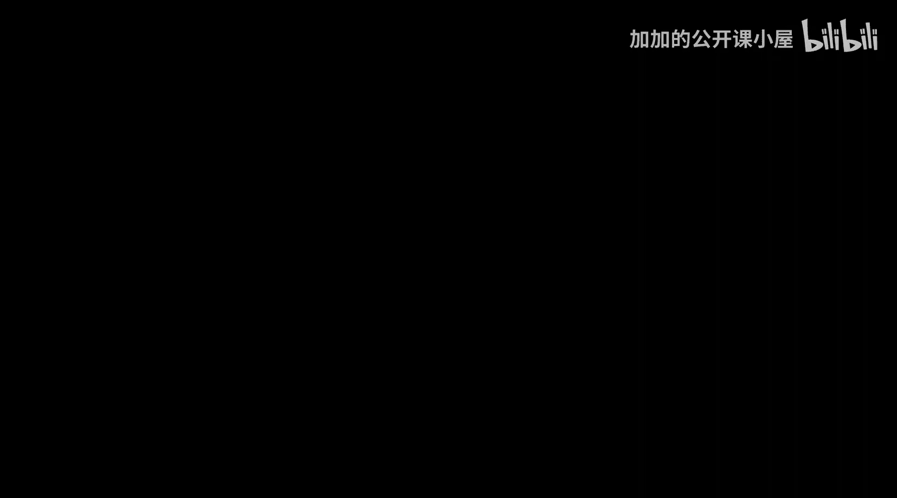
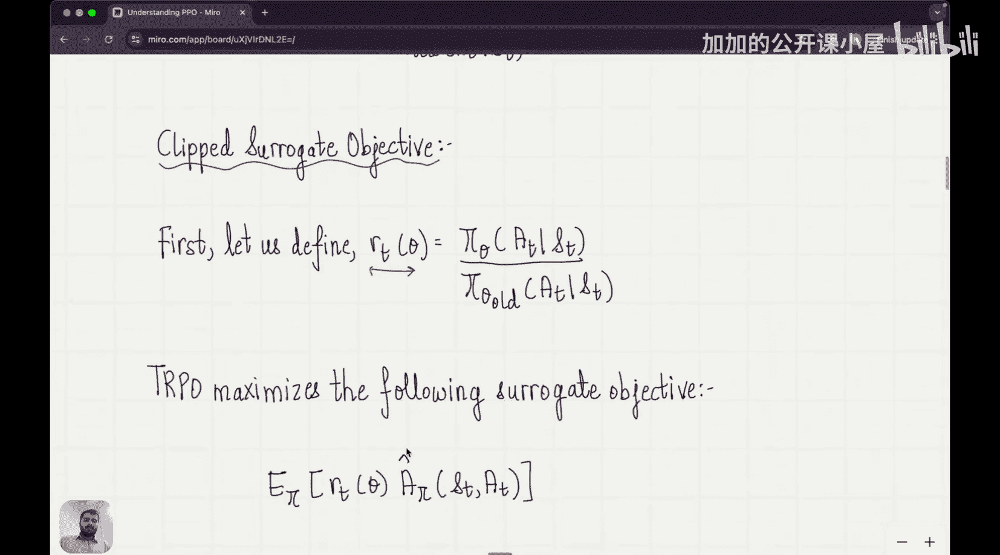

# Vizuara【中英⚡从零开始构建推理LLM｜Reasoning LLMs from Scratch】 p20 P20 Lecture 18 - Proximal Policy Optimization｜Reinforcement Learning Phase ｜ Rea [BV1N3xWzWETL_p20]

Hello everyone and welcome to the next lecture of our course， Reaing LLM from Sctch。

In today's lecture， we are going to cover a new algorithm which is called as proximal policy optimization or PPO。

This algorithm is at the heart of reinforcement learning using human feedback or RLHF。

Let us start to understand how this algorithm came about。

By leveraging the understanding from our previous lecture on trust region policy optimization。ok。

So to start off。For vanilla policy gradient methods。

The gradient of the performance measure of the policy is given by this expression。

We had seen this three to four lectures back。Where we saw that。

The performance measure of the policy is something that we want to optimize。

 so imagine you have a parameter space which is two dimensional。Tta1， N， Theta2。诶。You have。

This curve， which is projecting out of。The surface。Which is denoted by G of theta。

 which is the Per measure， and we are interested to maximize the performance measure of the policy。

And to do that， we will apply the gradient decent rule。

And for the gradient decent rule to be applied， we need to know the gradient type each and every step so that we can climb this mountain of performance measure。

No。We also saw that the expression for the gradient looks like this。Which means the expectations。

Over。The multiplication of gradient of the log of the policy times。

The advantage estimates for every state action pair。Now。

 what are these advantage estimates and why are they coming into this equation right now。

 so the advantage estimates are。Estimates which help us understand how better or worse the chosen action is compared to the default behavior of the policy。

If the advantage is positive， it means that we want to reinforce the action and if the advantage is negative。

 we want to penalize the action。So it makes sense that we have the advantage function directly proportional to the gradient。

Because if the advantage is positive， I want to climb the mountain and if the advantage is negative I want to go down the slope towards the base of the mountain。

Now， an objective function whose gradient is above can be written as this。在以新区里。This function。

If you take the gradient of this function。You get the above expression。

 so the curve which I had shown over here， this curve is given by this equation。

 which is expectations。Expectation over the policy of multiplication of log of pi。

 which is the policy itself and the estimated advantages。

So this is all the formulation which exists in vanilla policy gradient。

 and you might as well apply gradient a central land solve for your optimal policy。

But what happens in practice is that people don't use this as it is。

 and especially after 2015 we had this new class of methods， which is called as trust region methods。

Now interest region methods。What we do is that we maintain。This objective function， let's say。

But we impose a constraint on the policy such that。You make updates on the policy。

 but you do not allow the updates to go beyond a specific value。And this is something which。

Introduces additional constraint。Do your objective function。

So let's look at how the constraints are modified。Usually what happens is that in perfuassion methods。

We have a surrogate objective function。Wwhichch is maximized。

 subject to a constraint on the size of the policy updatet。

Now this surrogate objective function can be written like this。Which is quite similar to the。

Objective function for vanilla policy gradient。 The only difference is that。Instead of。

Log of pi here you have pi Theta divided by pi Theta old。

Now how we get to this derivation we have covered this in detail in our TRPO lectures。

 you might as well refer to that， I have given the link in the description below。

And then we have a additional constraint which restricts the policy to move far from the original policy。

 which is given by this。The K dirgence measures how different are the two policies from each other。

 so we are restricting the policy update within a periphery of deelta。

And now we have to solve this constrained optimization problem in the trust region methods。

We also saw that the actual theory suggests the penalty instead of using the constraint。

And the unconstrained optimization problem looks like this instead of adding this constraint。

You have this。So this is the entire surrogate objective function which we looked at in the TrRP lecture。

 which was also called as L pi of Pash。Or。诶。Byy old by。Minus。

C DKL max so this was a notation we had used but it' is quite similar to what we have written over here。

 the only difference is that we are using PEta here instead of the notation which we had used previously。

 so this is the actual surrogate objective function which we want to maximize the above formulation is just a simplification of this where we have taken the second amount and instead of that we have added a constraint which constrain the K leverages to go beyond the value of de。

But you might as well write those two equations as this single optimization problem。

 which is the unconstrained optimization problem。So this is how in the literature。

 people moved away from vanilla policy gradient methods to these methods which introduced a trust region。

And we saw this change around 2015， 2016。The problem with TrRPO methods is that if you want to actually solve this constrained optimization problem。

 it includes。The inverse of a matrix which has to be calculated and this inverse is very hard to calculate even though there is a method which exists to do that。

 so the computations are very tedious。So people naturally ask the question that can we get the best of both worlds。

 how can we get the best of both worlds？Can we have a method which so this let's say this is vanilla policy gradient？

And this is trust region methods。So can we have a method which gives me？Simplicity。Of these methods。

 and。The concept of trust region。So penalizing very large updates from trust region methods。

 can I have a method which gives me the best of both the worlds and this。点劲。Is where the algorithm。

 proximal policy of imization or PPO was born？And PPO essentially uses。

A concept which is called as clipped surrogate objective。

Let's try to understand what that means first let us define this ratio which helps us to understand how much is the current policy deviating from the old policy。

 which is denoted by RT of theta。So if RT of theta is very large， it means that。

Pi Theta has deviated a lot from pii Theta older。So this notation allows us to capture the relative magnitudes of pi theta and pi thetaode。

Where pi theta is the new policy and pi theta order is the old policy。

So now TrRPO maximizes this objective function。

If you look at the constraint。