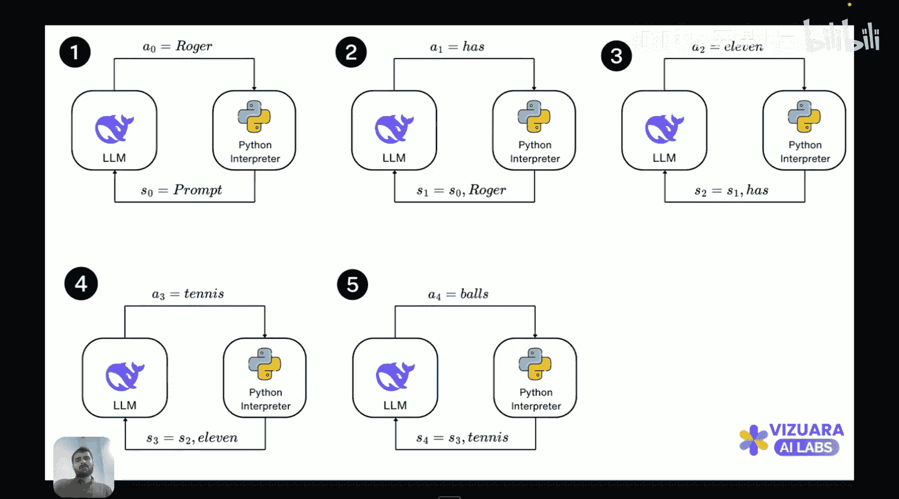

# Vizuara【中英⚡从零开始构建推理LLM｜Reasoning LLMs from Scratch】 p21 P21 Lecture 19 - Applying RL in LLMs ｜ Reinforcement Learning Phase ｜ Reasoning [BV1N3xWzWETL_p21]

Hello everyone and welcome to this lecture of our course， reasonasoning LLM from Sctch。So far。

 we have looked at。What is the meaning of reinforcement learning。

What are the different methods used in classical reinforcement learning which are the tabular methods。

 then we move to function approximation， how we can use function approximation methods if there are a large number of states and it is impossible to keep a tabular record of the value function of all these states。

Then we slowly moved into policy gradient methods where we looked at can we directly find the optimal policy instead of looking at indirect methods which optimize the policy by using the action value function。

And。In the policy gradient methods， we first looked at。The policy gradient theorem。

 which allowed us to calculate the gradient of a performance measure。

And then that became the baseline from which everything else emerged。 What is this everything Well。

 firstly， we looked at our first policy gradient algorithm， which was reinforced。

 Then we looked at actor critic methods in which there is a baseline subtracted from。

The Monte Carlo return and this baseline can be the value function itself。

Next we looked at how can we modify these policy gradient methods so that we don't allow our policy to deviate that much from our old policy or the base policy？

And the first algorithm which introduced that was trust region policy optimization said that。

 okay policy gradient approach is fine， but what happens is that if you don't allow the policy to restrict itself。

 sometimes you might have updates which can make the learning unstable。And this。

 this was being observed increasingly by researchers。

 and this trust t policy optimization became popular because it could impose a bound on the。

Under the change。In the policy。And then building on the trust region policy optimization。

 we had proximal policy optimization which said that。呃。

TrRPO complications are more because the computations are tedious it involves the inverse of a matrix which is hard to calculate so can I have a best of both worlds can I have the simplicity of vanilla policy gradient methods and can I have the trust region bound which was introduced by the TRPO algorithm and then this is where PPO was born PPO essentially used a clip function to not allow the policy to deviate that much from the base policy but it did not involve the KL divergence metal so the calculations became much simpler。

In case you have not。Gone through some of these previous lectures。

 I encourage you to look at the previous three lectures which discussed on PPO and TrRPO as well。

Now we have come to a transition point in our course where up until now we were talking about reinforcement learning as a general method。

Now， what we are going to do is that we are going to understand how to use that method or apply that method to large language models。

And。How reinforcement learning can be used to improve LLms is an extremely interesting problem statement in itself。

 because at first glance it's not really obvious that LLms。

Can be represented as reinforcement learning problems and the reason is that in the reinforcement learning problems you have an agent which is interacting with the environment。

 receiving rewards and then improving。But how can LLms be represented as reinforcement learning problems when I was first thinking about this concept。

 it was not straightforward to me， in fact I。wa not able to get through to understanding what are the states。

 what are the actions， what are the policy， what is the environment even in this case。So呃。

But afterwards， it became very much clear to me and。Even though non intuitive。

 if you would have asked。The authors of the classical book reinforcement Learn and introductionuction Saturn andberto that。

Do you think LLMs can be modeled as。An agent environment interface， probably they would have said no。

 10， 15 years back。Because the problem itself is not very intuitive to cast it as a reinforcement learning problem。

 but as we will see it's really not very difficult it's straightforward to im these LLMs。

In this particular framework。Now I'm going to move to a slidehow to help you understand how reinforcement learning problems。

Can be represented。How large language models can be represented using reinforcement。

As a reinforcement learning problem。Okay， so呃。In a typical reinforcement learning setting。

 you have an agent which is taking an action and the agent is receiving a reward from the environment and。

Before the agent takes any action， the agent。Has a specific information which is called as the state of the agent。

So depending on the state of the agent or the information which the agent has received。

It takes actions actions and receives a reward。So this is the agent environment interface imagine if I'm a chess player and I'm making a move then I am the agent and my action is the move that I am making and the state is the current configuration of the chess pieces on the board and the reward depends on whether I win the chess match or I lose the chess match if I win the chess match my rewards are positive otherwise my rewards are going to be negative so this is the agent environment interface and these are the typical notations that we have been seeing from the beginning of this series。

Now the question is that how do you adapt it to large language models？

And we are going to look at what are the states and actions particularly now firstly here the agent is the LLM itself。

The large language model is receiving some information， which is the state。

 this information can be received from either the user or the Python interpreter and then the action is the。

Next word prediction which the large language model is predicting so we are going to look at this in detail。

 lets consider a specific example， let's consider the prompt Proger has five tennis balls and he buys two more cans of tennis balls each can has three tennis balls。

And the question is， how many tennis boards does Roger have now？Now。

 the information which the agent has received is the prompt。

 so the first state which is S0 is just the prompt。

And then after the agent receives this information， the agent is going to take an action。

 which is the next word prediction。So here the next word the agent predicts is Roger。

Then Roger is again passed to the environment and now the information is updated now the LLM has the initial prompt and Roger so the action it takes is has so the next action is has similarly you can complete this for all the states state S0 is prompt state S1 is。

S0 and Roger state S2 is S2 and has state S3 is S2 and 11 and state S4 is S3 and tennis。

 so basically what you are doing is whatever action the agent is taking。

 that action is getting added into the information which the LLM receives for the next iteration。

So this is also like an iterative problem where the agent starts from state S0 takes action a0 moves to state S1 takes action a1 moves to take state S2 etc ce What we have done here is that we have cast the。

The act of answer completion as。An agent environment interface where the agent is the LLM itself。

And the answer completion is cast in terms of states and actions。

 So states is whatever information the LLM receives until the up until the iteration so。

Information is the number of。Word resort tokens which have been completed by the LLM up till that iteration and the action is the。

Next token are the next word which the LLM is predicting。So this way。

 the answer completion can be thought of as a series of。

