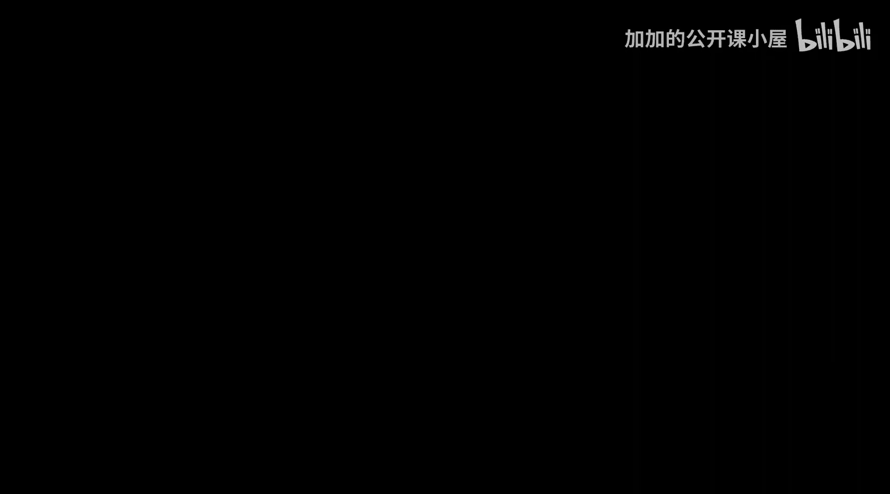
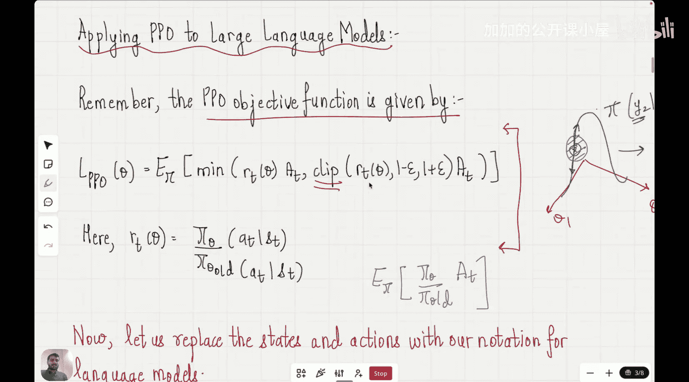

# Vizuara【中英⚡从零开始构建推理LLM｜Reasoning LLMs from Scratch】 p22 P22 Lecture 20 -GRPO ｜Reinforcement Learning Phase｜Reasoning LLMs from Scratch [BV1N3xWzWETL_p22]

Hello everyone and welcome to the next lecture of the course， Reasoning LLM from Sccarch。

We are in the final phases of completing the reinforcement learning phase in our course。

And we have come to a very critical junction where we are looking at one of the。The first algorithm。

 which was responsible for。Inducing reasoning in large language models。

 using reinforcement learning and。That algorithm is group Re policy optimization， which is GRPO。

Before GRPO was released reinforcement。Learning was used as a method for aligning LLms as per human preferences。

 but。There was no real link between reinforcement learning and reasoning。

 and this link was established after the GRPO。Algorithm was。

Releaed and the kind of results they obtained。This was at the beginning of the year 2025。

In the paper of deepsek Ar。So today we are going to understand GRPO and whatever we have learned in the reinforcement learning phase up until now has been building up for us to understand this lecture。

So let us dive in and understand what made GRPO unique and。

Why has it become the standard norm for building large reasoning models？

So firstly in the last lecture we looked at how LLMs can be represented using the reinforcement learning framework as an agent environment interface so we know the states the actions the rewards and the policy so I'll just do a quick recap of that consider this example pillow the prompt is Roger has five tennis balls he buys two more cans of tennis balls。

Each can has three tennis balls， how many tennis balls does he have now。

 and the answer is that Roger has 11 tennis balls。No。

The answer itself can be considered as a series of state at actions。

 the first state which is the state S0， the information which the LLL receives is the prompt。

After that the LLM takes an action which gives the output as Roger。

 then the state is updated to include Roger along with the prompt。

 the next action which the LLM takes is has and this continues till the end of the sentence completion。

Now we understand the state's actions。What about the rewards？In large language models。

 rewards can be pretty much subjective。And objective as well， but if if we ask a question。

 write a poem， then different people can have different opinions for the same poem。

 so that's why we do not have any standardized rewards as such for LMs but people make use of reward models and these reward models are trained on human preferences。

诶。In Chat GT， other image generation apps。The app is always trying to understand which response we prefer。

 sometimes it explicitly asks do you like preference one or preference2 all that data is used to train the reward model so that it understands the human preferences。

Now what about the policy？The definition of the policy is it tells the agent which action to take for a given state and the way we have represented the statess and actions。

 our policy is simply the LLM itself because by definition the LLM is a model which。

Is trained to predict the next word of probability。So。

This is a unique case where our agent is the same as our policy。Okay。

 let's move ahead now and understand some notations which we have discussed in the last vector。

 the first notation is that of the prompt which is renoted by x。

 it is made up of a bunch of tokens x1 x2 dot dot dot xp， and the completion is renoted by y。

 which is the output text that is generated by the large language model in the response to the given prompt。

And then the policy is denoted by pi theta， which is nothing but the LLM itself because LLMs are trained to predict the next word and give the next word which has the maximum probability of occurring after the given sequence。

So essentially this whole step can be represented like this。The model is receiving the states。

 which is the information。呃。Output by the LLM so let's say the state S1 is received which is the prompt and roger and it has to predict the next word。

 so our policy is the LLM which is giving us the probability for all the actions。

And we know that has has the maximum probability， so that's why the output we get Roger has。

And this is denoted by pi theta y2 given x from a y1 where x is the prompt。

And whyn is the previous output， which is Roger。Okay。

 so this is what we are doing and then we are doing it for all the states which are encountered in the sequence。

Before the entire answer is completed， so this is the probability distribution for second token prediction and the policy notation for the teeth token prediction is given by pihi theta yt given x comma y less than t is all the output tokens which have been generated at this point。

For example， if we had。Had to predict after Roger has， so y3 given x comma y1 comma y2。

Where y1 is Roger and y2 is has and y3 would be 11 then in that case。

 but the probability distribution would be different， 11 would have the maximum probability。

Now the question is， how do we apply the algorithms that we have been learning so far to this？

Two large language models which have been represented as agent environment interface。

 so the first algorithm we are going to see is proximal policy optimization and how exactly was it applied。

To fine tune large language models。So remember what did the PPO objective function do。

 what PPO did was that PPO told us that okay， you have got a given policy。

Which you have to improve based on the rewards that you are getting。

 so you construct an objective function in such a way that does not allow your policy。

To deviate that much from the old policy。So it constructed a clipping operation， which。

Did not allow the policy to deviate that much from the old policy。

So if you don't remember this formula right now it's okay。

 we'll understand the intuition what's happening over here is let's say you are in this parameter space。

 theta 1 and theta 2。And。In policy gradient methods。

 what you are trying to do is that you have a surface which is given by let's say we action。

 we consider the same action pi y2 given x comma y1。And let's say we are somewhere here。Now。

 if the reward is positive， then I want to traverse up this mountain to maximize this probability。

But if the reward is negative， I want to go below this mountain。诶。Whether to traverse up or down is。

And how to move along this mountain is given by the gradient along this trajectory。

 so this term should be included gra by。And we use a gradient gradient ascent method to travel up or down the mountain。

So these are vanilla policy gradient methods， what PPO did was。

PPO said that it's okay you can traverse up or down the mountain depending on the sign of the gradient but。

Don't allow the updates to move beyond this region if it moves beyond this then just clip it。

 clip the updates， don't allow the policy updates to get too large。

 so it imposed a bound to stabilize the training process for the policy。

So this is what the clip operation does， it basically clips your objective。

The vanilla policy gradient objective actually looks like this。Byi theta by pi theta old。

Time is the advantage so80 here denotes the advantage function and here what we are simply doing is that we are imposing a clipping function over here otherwise its very similar to the。

