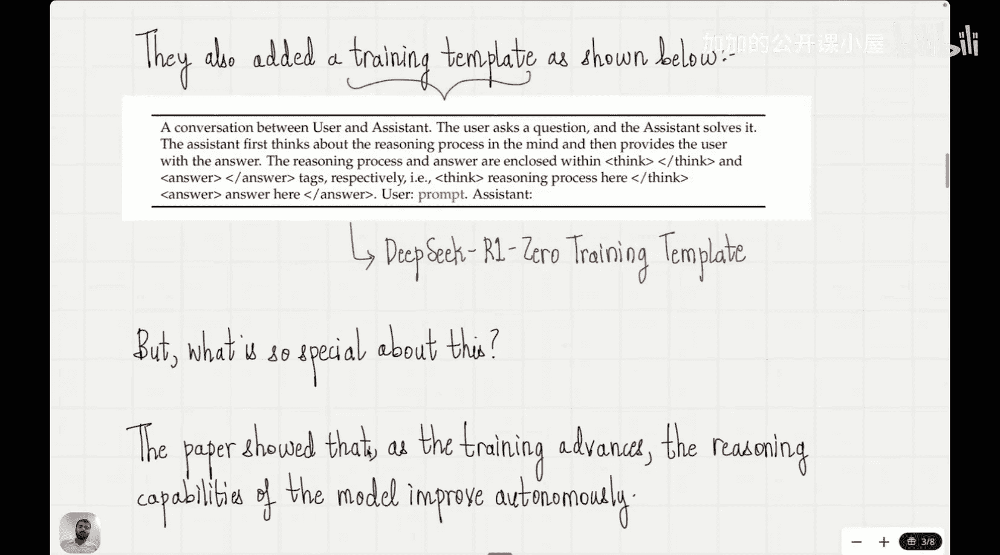

# Vizuara【中英⚡从零开始构建推理LLM｜Reasoning LLMs from Scratch】 p23 P23 Lecture 21 - Build your first Reasoning Model using GRPO ｜ Reasoning LLMs fr [BV1N3xWzWETL_p23]

Hello everyone and welcome to the course Reasoning LLMs from Sctch。

We have completed about 20 lectures right now， and。We have。

Almost reached towards the end of the second section of discourse。

 which was focusing on pure reinforcement learning。

Before we cover the last lecture in the second section。

 let us quickly understand what are the goals we set out with when we started this course。Remember。

 the objective of this course was to understand how do reasoning models exactly work and how they are built？

And what we saw is that there are four broad methods to build reasoning models。

 the first one was inference time compute scaling。Our first three lectures were dedicated to this。

The next module was。Using pure reinforcement learning。

 the next 15 to 16 lectures were devoted to this method number two。In which we。

Saw from the basics of classical RL to modern reinforcement learning， TRPO PPO and GRPO。

But we have not made the connection between GRPO and reasoning models yet。

That connection is missing from our approach right now in today's lecture。

 we are going to form the bridge between GRPO and reasoning models。

So this will mark the completion of the second module which was focused on pure reinforcement learning。

Towards the end， we will also see how we can build our own reasoning model by convertverrating a non reasoning model into a reasoning model using the GRPO technique。

So using this， we will see the。Power and the beauty of reinforcement learning。Okay。

 without wasting any time， let us。Quickly dive into this lecture。So today。

 our primary objective is to form a connection between GRPO and listening models。

All that we have seen in the reinforcement learning phase of this course has been finally building up towards this lecture。

This connection was first established in January of 2025 when the deepsk R paper came out。

This paper came out on 22nd Jan。And it completely changed the LLM development process。呃。

And then afterwards， the progress in the reasoning models has been very fast， one after the other。

 there are more reasoning models。Coming out because Deep sea Caran gave a viewprint for designing reasoning models。

Okay， but before deepepy R1， the first model which they came out with was deepepy R10。

Now the interesting part of this model is that the model used GRPO as the reinforcement learning algorithm and。

It did not use any supervised。Training examples。It will become clear you why why that is important。

 but just keep that in mind that the Mori deep sea carbon0 used pure reinforcement learning without。

Without relying on。Trained input output paths on which the model could be fine tune。

Now the following is the GRP process， remember from the last lecture we get rid of the value function model and。

The LLM gives。Different outputs， multiple outputs are sampled and these outputs are used。

To calculate the individual rewards and finally the advantage is calculated from these rewards itself。

 we do not need a separate value function model， so the simplicity of the GRPO process is very appealing。

Now notice that here we still have a reward model to estimate the rewards and the question which was asked in while developing deeps  R0 and0 was can we even get rid of the reward model we have already gotten rid of the value function model。

 can we get rid of the reward model too。And the answer was yes。

They got rid of the reward model by using rewards for which a model was not necessary。

 but which could be verified using external tools。Now， what does that mean？Imagine this example。

 we are giving an input solve of5 into 3 plus 4 and our model LLM gives this answer 35。

Now to cross check whether this answer is correct or not。

 you don't need a reward model which is traineded or input output put data， but you can simply。

We verify it through a calculator and see whether the answer is correct or not。

Similar with coding examples， if you have an input which tells you to sort these numbers and you write the code。

 you don't need a reward model to verify whether the code is correct or not。

 the paper used the lead code compiler to check whether the answer is correct or not。

 so using external tools we can figure out rewards which are objective in nature which come in specific values there is no subjectivity to it。

 and we do not need to train a reward model for these datas。Now without the reward model。

 the modified GRPO process looks as follows。Now we don't even have a value function and we don't even have a reward model。

 so the the the process has gotten even more simpler by removing the need for having a separate reward model。

Okay， so now this is the pipeline which was used in deep sea R10 but and they added one more extra element to this。

Along with these accuracy rewards to check with calculator， lead code compiler， etc。

 they also added something called as format rewards。Now。

 format rewards you were added to make sure that。The thinking of the model。呃。

Is enforced between the thing tags。So if a model gives an answer which does not have the think tags。

It was penalized， that is it got negative rewards， so the model learned to provide answers which could fit inside these tags。

So these are called as format rewards and deepse R10 the reinforcement learning algorithm。

 which was GRPO the rewards were of two types accuracy rewards which were checked against。

Tools which could verify these rewards and second over format rewards。

This process is also called as RLVR， which is reinforcement learning through verifiable rewards。Okay。

 so now。After this， they added one more element， which was a training template。

The training template reads as follows a conversation between user and assistant。

 the user asks the question and the assistant solves it。

The assistant first thinks about the reasoning process in the mind and then provides the user with the answer。

The reasoning process and answer are enclosed within the think。

Opening and closing tags and answer opening and closing tags respectively。

That is think opening tag reasoning process here， closing tag。Answer opening tag， answer here。

 answer closing tag。 So we are basically giving a training template and。Asking our model to。

Follow this template while writing the answers， we are not telling it how to think。

 but we are giving a broader training template we are。Just telling the model， okay。

 first think about the reasoning process in your mind and then give the user with the answer and make sure the formatting of the answer is correct。

So this is the DeepS R10 training template， so essentially they introduced three things first is they got rid of the reward model。

 second they introduced format rewards and third they added a training template。Now， okay。

 at the heart of it was fill the GRPO algorithm which was used to calculate the advantages。

So what was so special about this？it turned out that as the training advances。

 the reasoning capabilities of the model improve。

Autonomously， that is。