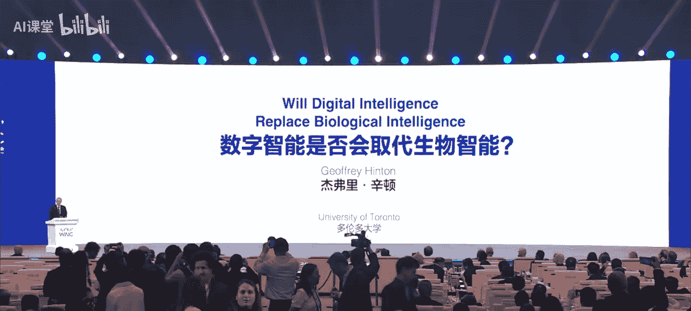
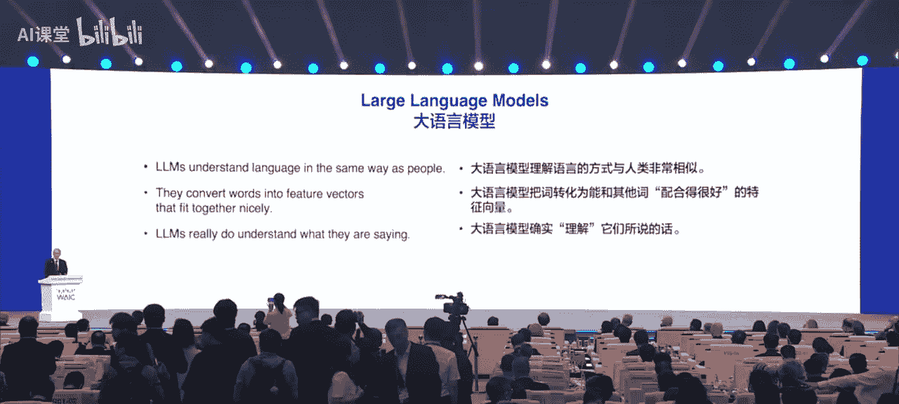
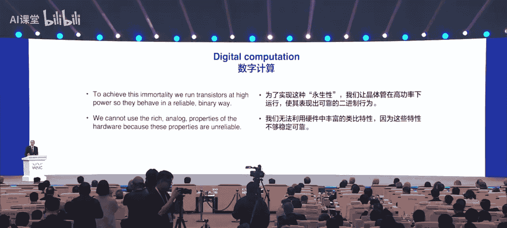
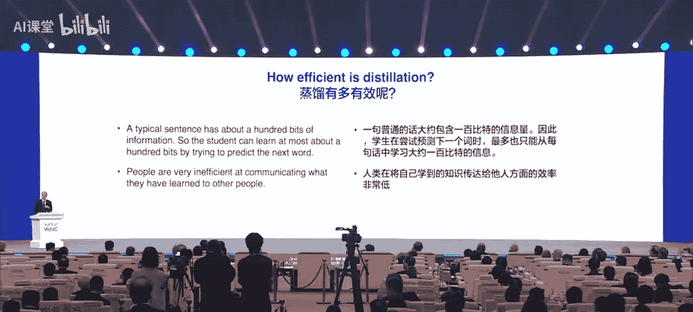
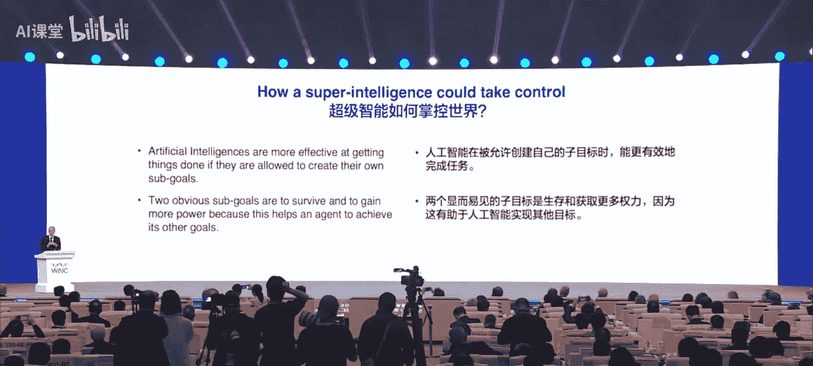
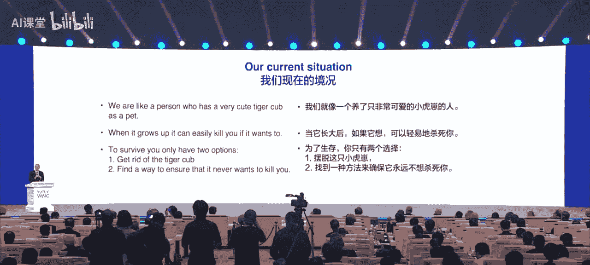
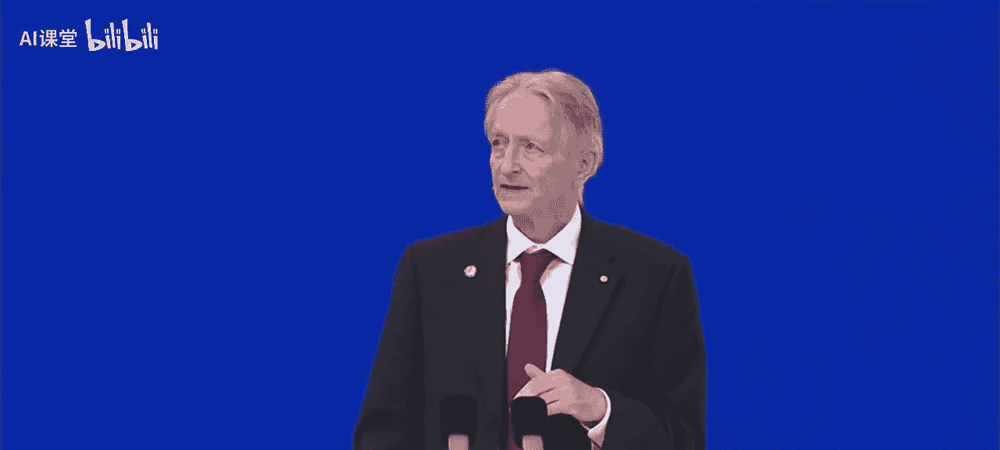
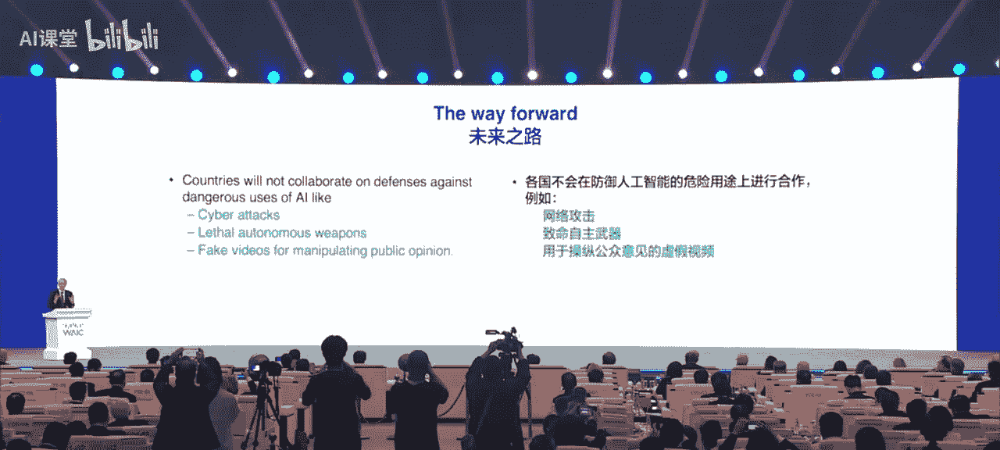
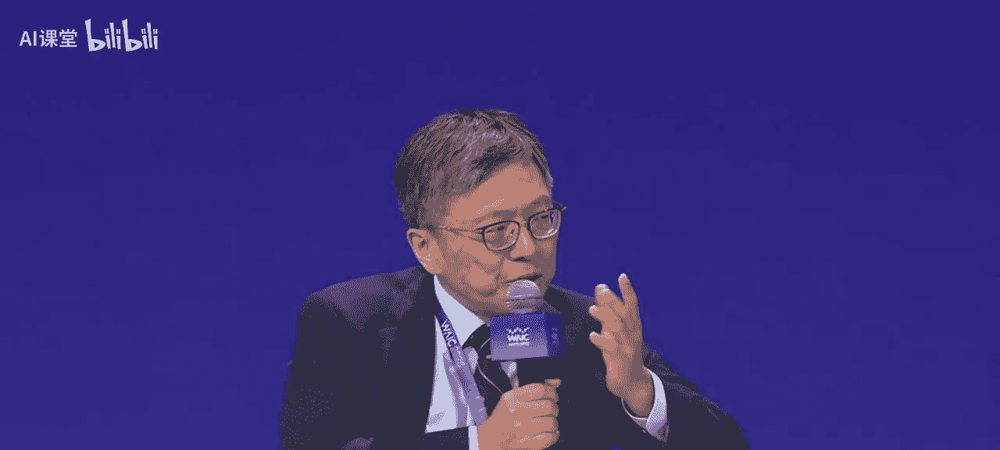

# 【2025 WAIC 世界人工智能大会—主论坛】人工智能全球治理高级别会议  Ai、开源、教育、Ai普惠、赋身智能、神经网络、超级智能 p01 1、【主论坛—上午场】 -BV1Gx8gz3Er5_p1-

🎼今天我们的第一位演讲嘉宾是首位图灵奖诺贝尔物理学奖双料得主。加拿大多伦多大学计算机科学名誉教授杰弗里辛顿先生，他是深度学习泰斗神经网络之父，同时也是一位人类大脑的探究者。

接下来他将为我们回答是否数字智能会取代生物智能，让我们掌声有请他。ladies and gentlemen。

now let's warmly welcomeprosorjeffrey hintton to deliver a speech。please。

distinguish好的，各位同事，各位阁下，各位领导，女士们先生们，首先特别感谢大家给我这么一个机会给大家分享一下我自己个人的观点，就是AI的历史和它的未来吧。😊。

for6 years大概60多年对于AI有两种不同的范式和路径针对它一个是逻辑性的那就是过去一个世纪都是以逻辑型的范式，什么意思？都认为这个就是逻辑智能的本质在推理啊，我们通过一些呃符号规则。

对符号的表达式进行操作来实现推理那么这样能够帮助我们更好的去理解知识是怎么代表。另外一种呢就是生物作为基础的这个理解AI那就是图灵和诺伊曼所相信的。那么就是智能的一个基础呢？

就是更好的去学习了解学习网络中的一些连接速度。那么这个过程中的理解是第一位的才能够学习。那么和这两种这个理论相结合的。那么就是一个是符号型的那个AI的那个呃。的话般看的就是这些数字。

那么就这些数字最后又如何能够成为关关注它词和词的这个关系啊。sych心理学家他是另位是另外一种理论，显然是完全不同的另一个理论数字的这个意思。其实它就是一系列语义学的一些特征。这些特征它存在。

那自然它也会啊成为了一个特。1985年的时候呢我做了一个非常小的一个模型，想把这两个理论结合在一起然后更好的去理解人们是如何理解一个词所以每一个我放了好几个不特征后把前一个数字的这特征记录下。

就可以测下一个数字是下个是什么再下一个这个过程中我没有存储任何的句子，我生成句子预测下一个词是什么。那么关联性的这些知识也是取决于不同的词的特语意的特征是如何进行互动的。接下来的3年会发生什么呢？

年之后那个也是用了这样的一个模式解模，但是他把规模做的了很多，等于成为了。自然语言的一个真实的模拟。在20年以后呢，计算语言学家终于开始去接受特征向量的嵌入来表达词的意思。然后再过了30年。

谷歌就发明了trans然后open aI的研究人员呢也向大家展示了他能够做到了所以我们今天的代语言模型，我就把它为就是就是微型语言模型的后代发了5年代以后开始的。他们更多的词作为输入。

他们使用了更多层的神经元的结构，因为需要有大量的模糊不清的一些数字的使用。同时学习特征之间也建立了更加复杂的交互模式。但是就像那些我做的小模型一样，代言模型他也与人类去理理解语言的方式是一样的。

基本的理解，就是把这些语言转化为一些特征。然后把这些特征呢以一种非常完美的方。

整合在一起这就是LAM里的各个层次里面所做的事情。所以我的理解就是大语言模型真的理解你是怎么理解问题的和人类理解语言的方式是一样的。所以我在这里给大家打一个比方，什么叫理解一句话在这个它包含哪一些呢？

就是符号的AI是什么？就是把这一套东西把它转化成一些不模糊的符号把语言，但是实际的情况不是人类不是这么样理的理解的。我在这里打一个比方，就是做那个乐高的积木，通过乐高积木。

你可以做成任何3D的一个模式啊，你可以把一个车子的小模型造出来，你把每一个词就是视为一个多维度的一个乐高呃积木，它可能几千个不同的维度。那么这种类型的这些乐高的积木，它就可以做这么多的维度。

它可以是一个建模，它可以做好多不同的内容，这语言变成了一个。

那么这样的一个语言呢也能够随时的沟通给人，然后只要把这些积木给他起个名字就行。然后每个积木它都是一个词。所以我们现在呃乐高积木它有非常多的一些不同不是说几个不同的乐高积木的那种差异了。

我们有几无数的词那么乐高的积木它的造型是固定的，但是词呢词它的这个符号，它的它的它的形状是可以基本上呢做出一个设定。但是它也可以根据不同的情况来进行调整。

然后乐高模型呢它相对比较确定那个正方形的插到一个正方形的一个小孔里面去，但是语言不一样，每个语言它可能想象出每一个词上都有好多个手，比如说你想你要要更好的理解这个词的话，就是让这个词和另一个词。

合适的去进行握手。那么一旦这个词的造型发生变形的话，它就怎么和另一个词握手一样了。这里就有个优化的一个问题。我我一个词去变形了以后，它的意思变了。那么这个词怎么跟下个从络上手带来一个更好的一个意思。

这就是什么叫人脑去理解意思或者说这个神经网络去理解历最根本的思所以就有点像是把蛋白质跟蛋白质之间组合起蛋白质就是把氨基酸进行不同的模型来进行一个整合融合之后结合在一起，能带来更有意义的内容。

这是人脑理解词的方式。语言的方式。所以我到现在讲的一个观点就是么人们理解语言的方式和大语言模型理解语言的方式几乎是一样的，所以人类有可能就是大语言模型人类也会和大语言模型一样。去产生幻觉。

因为我们也会创造出来的很多幻觉的一些语言。那么单元模型也会 very different，但是也有一些重点的方根本性的方式，单元模型和人类不一而且比人类更厉害。

fundamentalment根本性的呃计算机科学的一个原则就是说我们要把软件和硬件分开看，这就让你在不同的硬件上面跑不同样的软件。那么。这个和呃WE是不一样的地方，这就是计算机科学存在。

如果你能够一个软件里面的一个知识，它是永恒存在的，这个软件这个软件永远会放在程序永远会放在那里。你可以把你可以把所有的硬件都把它毁灭掉，就LM的硬件都毁。但只要这个软件继续存在，它随时随地都会被复活的。

所以从这个意义上说，这种计算机的程序的这些知识是永恒的，不会死亡的。那么就这和什么不一样的。那么要实现这种永生性，我们就在这些经济管在非功率下去运行产生可靠的精制的一些行为啊，那么这个过程就非常的。

我们不能利用硬件中丰富的这种内似的特性。因为这些特性是不够稳定可靠的。

每一次他是他是呃模拟型的，所以你每次计算都会不一样的。人脑是模拟的，人脑不是数字的。那每一次神经元去呃激发的过程中，它所它都是模拟型的。它是呃每一次都一样的。

我不可能把我脑子里的人脑神经元的结构转到你脑子里是做不到的。因为我们每个人的连接方式是不一样的。每个人的神经元连接方式是不同的。所以我的神经元的连接方式是适和我的脑子里的神经结构的。

那么知识的传播和硬件里边去传播，就是人的脑子和硬件是不一样的东西，这就带来了问题了。on we've如果我们做不到永士 hardware这些这些知识软件它和硬件是不依赖的，所以它是永生的。

能们带来两大好处。can use very我们可以用很小的功率，很小的这个这个电能，我们大脑就只要30个瓦特就不够用了。我们有几万亿的神经语言的连接。那么就是和那个电子管的这些情况是一样的。

我们也我们不需要就是用花非常多的钱去做一模一样的这些硬件。But但是我们现在还有一个大的问题就是从一个模拟的模型要从一个模拟模型转到另外一个模型，把他的知识，我觉得是非常不高效的，非常难的。

我没有办法用我的把我脑东西展示给你这是不一样的。我能做的就是用其他的方式。来解释给你一下，我已经学到的是哪些东西。

所以要解决这个问题的最佳方法叫蒸馏 deepep就是这么做的，就是从一个大的神经网络把他的知识到一个小经网络里面去蒸馏，根据想法就是教师和学生的关系。在有些情况下教师他把事情连在一起。

他把一个词和另一个词他们互相连接的上下文联系起来。然后学生他也可以说同样的话，但是他调整了这个wa。所以。就是我们训练他的这种方式也是这样的，就是你把一个人的知识转转给另外一个人，也是这样的。

但是他非常的不高效。所以呢。

可能一句话里面有100个比特的信息不是特别多，这就限制了我们把知识转到另外一个人能够转多少。我可以很慢的讲话的方式把知识转化给给你啊，一秒钟最好最多也就100个比特左右。如果你全听懂了我的话的话。

所以效率并不是非常高。但是如果把它去对比数字智能之间转化知识的效率的话，那是有巨大的差别的。我们有同一个神经网络这个软件做了几百个不同的拷贝放在不一样的硬件里面，他们都是用数字的。

他们会以同样的方式用自己的那个ra然后他们要平均化的式就可以把知识来进行分享。我们可以有成千上万的拷贝，他们可以自己来改变他们的权重，然后呢取一个平均数这样就能够转移知识。

然后这样的转移的速度呢取决于你有多少个连接点。这样每次呢能够分享万亿个比特，而不是几个比次，而是几十亿个，然后呢比人类分享知识呢要快几十亿倍。所以呢GPT4非常好他有很多的不同的拷贝在不同的硬件上运转。

他们可以分享他们从网上学到的不同。信息如果有智能体在现实世界当中运行，这就更重要了。因为他们能够不断的加速，不断的拷贝。有很多的智能体的话，那么就比单个智能体学的更多。

他们能分享他们的权重模拟的软件的或者模拟硬件就做不到这一点。所以呢我们的看法是，数字计算需要很多的能源。但是呢智能体可以很方便的获取同样的权重，分享不同的经验当中学到的东西，生物计算当中呢用能更少。

但是分享知识是很难。就像我现在所展示的这样。如果能源很便宜。数字计算，那么就会好很多。那这也让我很担忧。

因为几乎所有的专家都认为，我们会生产比我们更智能的AI我们习惯成为最智能的生物，所以很多人觉得难以想象。如果在世界当中AI比人更智能会怎么样，我们可以这么来看。

果你要知道会怎么样果不是人类不是最智能的话怎么样会怎么样？我们以问一个机，我们在创造AI智能体，他们能够帮我们完成任务这些智能体呢，他们已经有能力可以进行拷贝，他们能可给自己的子目标的评级。

那么他们会想两件事情。他们呢想要生存，呢完成我们他们的目标。他们也希望能够获得更多的控制，同时也是为了完成我们给他们的目标。

所以呢这些智能体呢，他想要生存，想要更多的控制。And。我我们不能只是他们一了事他们会很方3年人操纵3岁的人是很容易的。所以有们实的。他们我们他们关掉。

以现在的情况有人把老当物老小仔爱的物。但是一直养这个宠物。那么你要确保他长大的，他不会把你杀一般养老当宠物法，那么有两一它训练好他不来杀你。

或者你把它给干掉，用AI的话，我们就没有办法把它给消灭掉。AI非常好的，有很多方面都做的很好，很多都已经提到过，比如说医疗教育或者气候变化，新材料，AI呢，这些任务都做得非常好。

几乎能够帮助所有的行业变得更有效的，我们是没有办法消除AI的，即使一个国家消除了AI，别的国家也不会这么做。所以呢这不是一个选项。这意味着如果我们想要人类生存的话。

我们必须找到一个办法来训练AI让他们不要消灭人类。现在呢那么我是发表个人的观点，我觉得各个国家可能啊不会在一些方面进行合作。比如说网络攻击，或者是致命的武器或者是这个虚假的这个操纵公众意见的视频。

各国的利益呢是不一致的，他们有着不同的看法，我觉得不会在这方面会有有效的国际合作，我们可可以防止一些人来制造病毒。但是在这些方面不会有什么国际合作。但是有一个方面呢。

我们是会进行合作的那我觉得这也是最重要的一个问题。

我们看一下50年代冷战的巅峰的时期，美国和苏联一起合作来预防全球的核战争。大家都不希望打核战争。尽管他们在很多方面都是对抗的，但是他们在这一点上可以合作。我们现在的局面是没有一个国家希望AI统治世界。

每个国家都希望人类呢能够掌控世界。如果有一个国家找到一个办法来预防防止AI操纵世件的话，那么这个国家肯肯定会很乐意告诉其他国家。

所以呢我们希望能够有一个AI安全机构构成的一个国际社群来研究技能来培训AI让他们向善。我们的希望呢是训练AI向善的技巧，可以说和训练AI出明的技术是不一样的。所以每个国家可以做自己的研究，让AI向善。

他可以啊在自己主权的AI上进行研究，他不可以不给别的国家，但是呢他可以把成果分享给大家，也就是怎么训练AI让AI向善。我有一个提议，就是全球或者是全球主要国家或者AI的主要的国家，应该思考一下。

建立一个网络，包括各个国家的一些机构来研究这些问题，研究怎么来训练AI一个已经非常聪明的AI让这个AI不不想要消灭人类不想要统治世界。让这个AI很高兴的做一个辅助的工作。尽管AI比人要聪明很多。

我们现在还不知道怎么去做这件事。从长期来说呢，这可以说是人类面临的最重要的问题，我们的好消息就是在这个问题上呢，所有的国家都是可以一起合作的，谢谢。Please have your seat。

 Thank you。🎼thank you very much for your very important sharing。谢谢您非常重要的演讲。

刚才呢辛顿先生用半个世纪的研究向我们展示了他对于数字智能和生物智能的深度思考，让我们看到人工智能的无限可能。而这一份可能照进现实的过程当中，总会有一些实践者在生根发力。

接下来让我们有请AI领域的创业者代表mini max创始人首席执行官严俊杰先生发表主止演讲，掌声有请。😊，呃，大家好，呃，我给大家分享的题目是所有人的AI。

everyones AI然后为什么讲这个题目呢？跟我个人呃过去一段时间的经历比较有关系。然后呃首先简单介绍一下，然后我是在那个亨特先生最开始发明alexn的时候。

我应该是国内第一批呃从事深度学研究的博士生。然后呢在阿尔法go这件事发生的时候，当人工智能走进所有人的关注度的时候，那个时候我在参与第一家创业公司。然后当蔡基出来前一年的时候。

然后我们开始呃创立一家国内第一第一家做大拇型的公司。然后在这过去的15年，然后当我在做这些事的时候，每天呃面对题目写代码，然后每天开论文做实验的时候，其实一直都在想一件事。人工智能这么受关注。

但是人工智能到底是啥人工智能跟这个社会到底有什么样的联系。😊，然后在做这件事的时候。特别是当我们的模型变得越来越好的时候，我们发现人工智能确实可以给社会带来很多联系。比如说我们在做人工智能研究的时候。

我们每天需要分析大量的数据。那一开始的时候呢，我们其实是需要来写一些软件来分析这些数据。但后面的话呢，我们发现其实呃可以让AI来生成一个软件，他可以来帮我们来分析所有的数据。啊，比如说。😊。

然后我作为一个研究员，然后我非常关心每天领域的进展。一开始的时候呢，我们曾经想过来是不是可以做一款APP来帮我们来追踪各种各样领域的进展。但是后面我们发现这件事其实不需要自己来做。

其实可以让一个AI的Aent自动来做这件事，而反而是比我们每个人来做的更加高效。😊，然后呢，那AI除了是更强的制产力之外呢，我们发现很明显它也变成了越来越强的一个创意。啊。

比如说在这个场馆15年前呃举办世博会的时候，当时有一个IP，叫海宝。然后这个海报的这个形象呢其实当时非常的火。但是过去15年上海有了非常多的发展。

我们想生成一些啊比如说有上海特色的符合上海潮流的一些海报的形象。那那然后那AI就可以做的更好。比如说徐会书院的海报。然后海康大楼的海报，基本上就可以帮我们生成各种各样的IP形象。

然后再比如说最近非常火的，我们知道喇布布。然后呢然后前段时间的时候，比如说我们生成一个这种喇布布的一个宣传的视频，可能是需要两个月的时间，可能需要价值100万人民币的一个一个成本。

但是呢通过这种越来越强的这种视频模型。那很显然像右边这样一个布布的视频，基本上就一天的时间基本上就会以生成出来。😊，然后可能成本就只有几百块钱。那实际上呢就是在过去6个月吧。

然后我们这个视频模型其实已经在全世界生成了有呃超过3亿个视频。呃，然后基本上就是说这个呃呃互联网上的大部分的这种内容跟创意啊，通过这种好的这种AI模型，其实可以变得越来越呃普及。

让每个人的创意都可以充分的发挥。呃，除了是生产力跟创意之外呢，我们现在越来越发现是说实际上AI的使用其实已经超出了我们一开始的一个设计跟预期，各种各样想象不到的场景其实都在出现。比如说。

解析一个古文字啊，比如说啊做一个模拟飞行，比如说是一个天文望远镜啊，各种各样想不到的场景，当模型能力越来越强的时候都变得越来越可行啊，并且是越来越通过单个人，只要很少的协作。

基本上就可以啊啊这个非常大的增强每个人的创意。然后当我们经历了这些事儿，当我们看到这么多变化之后，呃，就是有一个想法，其实在自己心里面，然后呃开始涌现出来。就是说我们发现啊我们作为一个创业者。

我们做的AI公司。实际上它不是呃重新复制一个互联网公司，就我们不是一个互联网。实际上我们认为AI它是一个生产力，它是一个对个人能力和社会能力的一个持续增强。这个里面的话有两件事，我们觉得比较关键。

第一的话它是一个能力。第二的话呢，它是持续的。啊，因为人的话其实很难一直在变得更聪明，很难一直在学习个很多新的知识啊，但是AI可以一直可以这样来做。那所以说我们认为呃AI的公司，而，不是一个互联网公司。

而是一个能够提供更多生产力的公司。然后在我们来这个不停的来这个做更好的AI模型的时候呢，我们也越越来越发现，实际上AI也在给我们人类一起来做出来更好的AI。啊，比如举例子，第一。

那我们是一个呃研究型的公司，每天我们公司里面我们需要写很多代码，需要做很多实验。现在实际上我们公司里面可能有70%的代码，呃，基本上都是AI来写的，基本上可能90%的数据分析。

基本上都是靠AI来做的那除了帮我们来写代码之外呢，那还有另外一件更重要的事情是说呃就是AI怎么能变得越来越专业啊，比如说在一年前的时候，当时我们需要大量的标注。

然后我们的标注员可能是普通的这种呃然后呃然后一些普通的职业。但我们发现到今年当AI能力变越来越强的时候，实际上可能只有非常少数的人类，可能只有非常非常顶的专家，然后才可以来帮助到模型可以变得更好。

但这个标注呢其实不是说给AI一个答案，而是说教AI一个思考过程，让AI来学习这样一个思考过程，从而可以变得更加的泛化。然后越来越接近这种人类顶尖专家的水平。啊，那除了是说通过这种专家来教。😊。

AI之外呢，还有另外一种进步方式啊，就是在一个环境中大量的学习啊，比如说在过去半年，然后通过这种呃各种各样的环境，从编程的这种IDE然后到呃一些A进的环境，然后到一些这个游戏的沙盒。

我们可以发现是说啊当把1个AI放到一个能够持续提供可验证的奖励的一个不同的环境中来持续学习的时候，基本上是说只要是这个环境啊，可以被定义出来啊，可以有这种明确的奖励信号AI就可以很容易把这个问题给解决。

啊，并且这件事其实是持续的规模变得越来越大。啊，基于这些原因，我觉得一个非常确定性的事情是说AI一定会变得越来越强啊，并且这个强呃有可能是无止境的。那接下来第二个问题。那既然AI这么强。

那AI给社会的影响变得越来越大了，那AI到底会不会垄断呢？AI会掌握在一家组织里面，还是有可能会长在多家组织里面呢？我们的认为是说AI一定会。有多个玩家会持续存在。原因有3点。

第一点的话呢是说呃实际上就是我们目前用到了所有的模型啊，基本上它都是需要依赖一个对齐。那很明显是说不同的模型的对齐的目标其实是不一样的啊，比如说有的模型的对齐目标很像是一个靠谱的程序员。

所以说做in就会特别的强。然后有些模型呢它呃目标是说呃希望跟人的交互比较好。那所以说他其实就会比较有情商，然后可以做比较流畅的一个对话。然后有的模型呢可能就会呃呃呃充满想象力。

那这种不同的对形目标其实反映了不同的呃公司或者组织的价值观，然后这些价值观其实又导致的是说这些模型最终的表现其实会非常的不一样。那。这然后这些不同的表现使得是说这就是一定是有不同的模型都会有自己的特点。

会长期存在，这是第一个原因。第二个原因的话呢，是说，实际上我们在最近半年用的AI系统越来越多的其实都已经不是单个模型了，而是一个。多的一个系统啊，里面会有多个模型，后并且不同模型也可以使用不同的工具啊。

通过这样的一个方式让它的智能水平变得更高啊，能够解决问题越来越复杂。这个东西导致的结果是说单个模型带来的优势。其实在这样一个多系统里面其实会变弱。也是因为这个原因。

所以说其实可以看到在过去半年其实有很多非常智能的系统啊，其实都呃可能不是大公司所拥有的。然后当然还有最后一个原因啊，就是在过去一年一个呃雨后春笋般的一个呃爆发，就是越来越多的开源模型开始能够产生影响力。

比如说像右边这张图是一个这种过去一年比较关注的一个AI的排行榜，可以发现是说呃最好的闭缘最好的模型还是必然的。但是呢其实最好的开源模型第一越来越多了。第二的话是说越来越逼近好的源模型。啊。

基于这身的原因，我们认为呃AI它一定会呃被掌握在多家公司的手中。那。如果AI会被掌握在多家公司或者多家组织的手中，那我们认为AI一定会变得啊越来越普惠，就是它的使用成本一定会能变得非常的可控。

这个的话我们认为有三类原因。第一个原因的话是因为实际上我们知道在过去一年半。AI的模型呢，就我们在用的模型的大小，实际上是没有发生一个特别大的变化的。虽然说我们的算力越来越多了。呃，为什么呢？

原来化是因为对所有的使用的模型来说，呃，这个模型的计算速度都是一个比较关键的问题。因为如果模型计算特别慢，就会很少有人来使用。

那因为这个模型的计算呃速度是有一个要求的那所以说所有的公司都要设计是说呃模型的这个参数量。和智能水平之间需要来取一个折中。

那这个东西最终导致的结果是说模型的计算量基本上是正比于是说芯片的这个呃计算速度的啊，然后也就是说模型的大小基本上是说跟芯片的进步速度基本上是成正比的那我们知道芯片的进步速度是说每18个月会进步一倍。

那所以说模型实际上在过去一年多基本上也是保持这样一个趋势，它实际上并没有变得特别大。虽然说大家都有更多的算力了。那这些算力花在哪呢？其实很多是花在这个呃呃训练和这个更大规模的推理上。

首先说训练训练的话呢，因为我们使用的模型，一般情况下它参数量实际上不会这么大进步速度在过去半年已经变得比较缓慢了。那实际的结果就是说训练单个模型的成本。

实际上是并没有显著的增加的那为什么还需要这么多算力呢，是因为这些算力花在了是说做更多的研究跟探索上。但是但是我们知道研究探索这件事，实际上除了取算力之外，还取决于非常高效的整体的实验设计。

非常高效的研发团队。然后一个非常好的一个呃然后一些非常天才的这样一些创意。所以说我们认为这个东西导致的结果是说拥有非常多算业的公司和拥有没那么多算业的公司。

大家在这件事上在训练上其实的差异可能不会那么大。因为没有那么多算利的公司可以通过持续提升自己的实验设计的方。😊，是通过持续提升自己的思考能力和组织形式，可以让这个实验的探索变得更加的高效。然后再说推理。

推理的话其实也是有类似这样的结果。就是说推理上，我们知道在过去一年推理的成本，最好的模西推理的成本其实是降了一个数量级。那通过这么大量的这种啊计算网络啊系统和优化算法的一个设计。啊。

我们认为是说在过在接下来一两年之内，这个推理的成本可能就是最好的模型的推理成本，实际上可能还能再降低一个数量级。那。当我们认为是说训练单个模型的成本基本上不会显著的增加。

但是研但是呃然后当我们认为这件事的时候，我们认为实际上是说是有办法让AI的研发变成一个没有那么烧前的一个行业的那但是总的算力还会增加，为什么呢？因为然token量会变得很便宜。

但是使用token的这个数量其实会变得显著的增加。话是为比如像去年一个里面单个对话只要消耗几千个token。现在的话一个单个对话可能消耗几百万个token，并且是说因为能够解决的问题越来越复杂。

越来越使用用的人也会越来越多。啊，所以说呢我们的理解是说AI这件事它。呃，至少会是说呃能够让每个人都用得起啊，并且呢是说可能是啊付更多的钱的人可以解决问题，能够更多。这个的话是说我们对AI的判断。呃。

然后最后呢就是呃呃然后就是。然后讲句话叫intelligence with everyone，这个的话其实也是我们创业的初衷。我们认为AGI一定会实现的。呃。

并且呃这件事一定是一个呃服务大众普回大众的一件事。如果有一天AGI实现了，我们认为实现的过程一定是需要一一定是AI的公司和他的用户一起来实现的，并且这个AI的模型或者AGI它应该属于。😊。

🎼AI公司和他的用户，而不是只属于呃单独的一家公司。然后我们也愿意长期啊为这个目标而奋斗。感谢大家，谢谢掌声感谢严俊杰先生的分享，谢谢您的精彩分享。

那人工智能的突破呢从不局限于单一的国家或者是地区他的进步，离不开全球智慧的碰撞，跨资源的整合，再次谢谢人工智能发展与治理是世界各国所面临的共同课题。这两者从来都不是相互割裂的两条平行线。

他需要跨越国界穿越学科融合产业的全球协作。接下来呢我们将会以发展和安全并重。通过对话与合作，凝聚共识，促进人工智能技术造福于人类。

接下来呢我们要有请relaivity space执行董事长首席执行官艾里克施米特先生以及香港科技大学校董会主席沈向阳先生带来新一年的卢边对话人工。😊，🎼智能全球合作展望，有请两位mr。 Ericm。

pleasecome join us。welcome to欢迎来啊，非高兴你来到非常美丽的城市，谢也感谢WIC会议的主办方我们感一先生他发明了这算法，他真的创造了几万亿的值吧新让我烈鼓感出法。

先生才那个发言了法。大会的球共这是智能的时代。那么我们知道这是习主席也发了全球I创意目。就是设定有关AI治理的一些原则标准等等。我特别兴奋啊，您啊兴奋先生。

还有那么多好朋友一起来到上海谈这一些非常重要的话题。我们在谈这个话题之前，知道你已经在中国这一阵这次来中国去了好了了不少的公司去参观跟我谈谈你觉得到现在为止中国AI发展的局势如何。

你知道啊中国的这个工作态度是非常好非常震撼。两天前来两年前上一是跟基辛格博士一起来的中国陈我们对他非常的怀念，我我们的好朋友们的导师两年前当我记得刚来的时候意识到中国还没有完全认识到AI的力量。

在过去的两年里，我们已经到强大的中国的AI的模型出来了，包括，还有还有刚才的那个。max还有by字节跳动的，还有好多kimi他刚才提到的这些模型，在这个世界级的在技术层面都取得了非常大的成就。

那么祝贺中国的同行，祝贺的中国的公司们。那么这里面我们看到一个非常大的区别在哪里呢？在中国这些领先的模型不是所有的那些主要的领先的模型都是开放源的那美国的主要的那些开放。

他都是那些领先的模型都不是开放源的也不是开放权重的中国是开放权重。这就是当前AI发展的一个体的局面。我会回头再就这方面在深度的探讨。但首先就就你刚才你提了基辛格博士啊，基辛格博士是您的好朋友。

也是您的智慧伙伴。实际上，我想说，基辛格博士也是我们共同的朋友，中国人民的老朋友，也是这个大会的老朋友。4年前，我特别荣幸采访过基辛格博士也是在这次WIC系列会议上面采访到他他提了一些非常深刻的想法。

就是AI对人类的影响，尤其是他独特的一个历史学家的视角，一个政治家的视角来看待了AI的影响。实际上您和他共同做了一部非常好的这本书这本本也和我的导师好朋友一起你们三个为一起做的这部作品。

跟我们分享一下这本书esis这本书里面具体说了啥了。我知道也在这啊，他接下来今天好几个地方都会发言，都会具体谈这本书的主题的。那么基辛格博士在过去的1。

5年最后的15年时间里面，他决定了他觉得人工智能将会成我们社会的一个非常大的一个挑战。那么他的对他的技术理解并没有特别高，但是他增长的速度非常快哈。

但是他最深度的理解就是哲学家和社会学家看待他的一个视角，就是人工智能会在社会层面带来什么影响，就像新盾博士刚才所说的，他特别担心就是智能快速上升以后，对人的尊严会有什么影响，对人的文明带来什么影响。

国家之间是如何进行竞争等等。这些问题那么基辛格博士，他给美国以及给中国所提的一个关键的主题和点是什么呢？就是要合作来防止AI的负面的影响，而拥抱他的正面影响，他的正面影响无限健康也好，工程也好。

气候变化处理也好，更好的科技也好，创造更社会也好，这方面的优势。是无限的每个人都能获得更有生产力的智能的帮助。但是他最大的担心就是，如果你面对的这个智能已经不是人类了，还比人类还聪明。那这时候该怎么办？

所以你说的对啊，er瑞克我我现在呢在这个新对博士发言之前，我是很乐观的。他听完他的发言之后，我觉得很悲观了。所以我现在又想问您一个大问题啊，就是中美之间怎么样能够互相加强互信。并且加强AI方面的协作呢？

首先我想说的就是整个行业都觉得这些问题是能解决的了的。但是我们要快速行动。为什么要快速呢？因为这个科技发展的速度非常快，为什么可解决呢？因为我觉得我们只要足够多的力量投入进去，足够多的。

工作去做的话，什么都能解决。我个人的观点就是和超级智能之间的超级智能之间的协作会发生的。为什么呢？因为会有一个超级智能，让超级智能之间更好的协作。所以一种做法。

就是我们要合作达成有些价值观上的一致的问题。我们基辛格博士开始了一系列的一些项目，和中国的一些重要的领导者共同达成的一致意见。那就是对话，那么确保我们双方之间能够进行对话。

知道哪些问题在哪里怎么样去解决。有一系列的问题，他们是可以分享一些深度理解担忧以及测试的一些数据，这些确保双方之间不要给对方制造惊讶啊等这一些对话的话题都已经存在了。

所以关键就是要让中国和西方的这些研究人员互相交流，怎么样维护。人的尊严和人的控制权主导er我们都同意啊，我们首先都要进行对话，才能够通过更好的对话才能够更好的去理解对方的价值观，对吧？

这是一个但是我们有一个特定的问题在我们思考这些科技在传播的问题过程中间有两个源头。呢AI非常强大，我们呢要去思考非扩散的问题。不扩散的问题。

另外一方面你可能比其他所有人都更了解也支持这个开源技术几十年前unix安卓直在推动开源您怎么看这两者之间的平衡，就像您所说的我个人呢一直支持开源就是每个人分享他们的软件，我更偏好开源开源呢有一个危胁性。

也就是你可以限制开源然后呢，这个限制是可以取消的。在闭源的公司当中，他们是政府管理的。他们可能就不太可能有这种问题。我的看法呢就是这是一个技术问题。

那我们可以和中国和其他的开源的人士呢一起合作开源的扩散就是像您所知道的如果你发明一个东西，我们马上其他地方的人其他地就会使用这是我们可以思考的方式。

那我的看法呢就是这个问扩散问题就是说决定在哪里设置护栏最好的一个场景呢就是这些模型根据人类的价值进行训练进行对齐模型不知道怎么去做。我们现在还不知道怎么。

就像所说那上周呢对于美国的模型进行了一个详细的研究，在每一个案例当中，只要花一点功夫就以让AI来撒谎骗人来偷。即使你让他们不要这么做，所以呢我们还没有一个这个遏制问题。现在世界各地都没有这么做。

但我觉得这是一个重要的问题。如果基辛格国在的他呢肯定会非常赞叹我们所取得的进步。他肯定会非常赞赏我们技术的进步。但他会担不好的国家不好个人会使用他因为有一非常的强大。

更进一步的说很多的人认为在接下来的三年左右系统会自己进行学习，也就是递归的自我的改进。在这一个点上呢，我们要非常小。我们要理解他们应该到底学什么，他们可以学不好的以及好的事情。

我想回到了您的我有机会和基辛博士基辛格博士沟通的时候呢，当时呢当时呢这个是AGAI时代这本书第一本书出来现在呢出了第二本书这也是基辛博士最后一本书，我我知道上次呢您和哈老哥一位技术专家一起和写了一本书。

这次呢您可近距离的的观察到全球的晋升。并且呢您也在很长时间带领谷歌和微软和苹果进行激烈的竞争。但是呢你们一起啊推动了整个产业的前进。在您的新书当中呢，根据您的这个管理的经验。

您的行业的经验是不是也体现在了其中呢？craig和我呢我们根据我们的背景更了解商业的情况。那么第二本书一开始讲到了各种多才多艺的人的历史。也就是世界上最最有才华的人。

包括历史上在中国在美国的这些多才多艺的。那么我们相信这些工具可以提升智能。让每个人都能够有一个多才多艺的工具来帮他对于企业来说，工作可以说呃对于我们工作来说带来非常大的影响。从总体来说呢。

我们我们在这里啊在相关讨论上面还没有做好准备。那我想说，作为最大的以及最重要的这个经济体呢，美国和中国应该一起合作。在这些问题上呢一起合作。因为呢我们的利益在于要让世界稳定，让世界不打仗，让世界和平。

要确保人类能够控制住这些工具。在技术方面你会不会不同意JF所说的，也就是这些国家没有办法合作，他们只能在这个共同的威胁方面进行合作。比如说这个控制住这个小老虎，我是基辛格博士的学生。

基辛格的看法呢就是如果你坐下来，然后根据共同的目标进行谈判的话，你就可以实现目标。他愿意和任何人坐下来谈，我在这里的时候呢，我非常感到赞谈的是他呢和邓小平呢都是很有远见。

当时呢中国呢进行了开放，然后建立了现代的这个中国。这也说明如果有好的一个结构。那么在中国的情况中，中国呢从这个贫穷或者是这个饥饿的情况呢，到后来在今天实现了巨大的成功。

我们可以看一下中国的这个在上海的湾区啊这些产品的质量，这些机器人啊等等，只要说我们有好的价值观，只要我们开始工作，然后让他们就可以持续增长很长时间，我是一个真正的乐观主义者。

我认为中国和美国可以建立信任。可以一步一步的一步一步的建立信任，以前就做过这一点，而且可以再次做到这一点。谢谢erric。看来我们两者我们两个人呢对于未来的合作都很乐观，我们时间已经差不多了。

但是我不想错过这个机会来再问您一个问题，也就是AI和技术的未来，刚才呢jeff他讲了长期的看法。对于您应来说最感到振奋的是什么呢？那很简短的说一下，现在每个人都在进行规划规划战略。

在open aI cloudman有很多的突破。现在我们可以看到 deepep和其他也都做的非常的出色。这就是我们的现状技术的现状，在接下来的两年，我们会有很多很多的智能体智能体可以是这个语言记忆预约。

你让他做。

这些事情他记住，然后呢他才去行动。然后呢，你可以驱动他们呃，智能体的革命，对于企业来说有很大的影响。你每个企业的工作流，每个政府的工作流，我对此感到非常的振奋。那么如果这一点能够做好的话。

那么接下来的一点就是更多的深度的推理，更多的这个先进的算法。我们不知道现在红线在哪里，我觉得重要的一点是中国、美国和其他国家要达成一致，也就是说在有些点上我们要进行对话。

一个很好的例子就是AI当他自己要决定获取武器的时候，如果当AI决定自己要复制自己的时候，或者当AI自己开始学习所有的事情，不管我们是不是同意的时候，发生这些事情的时候呢，我们不是说就停而是说要对话。

看我们能不能影响这个过程，从而不会失控，对以今后的5年我感到很振奋。我们会看到社会变化。在很大程度上会变得更好，如何能够应对刚才讲到的关切会发。发展的很好，我想呢我们可以继续讨论一两个小时。

啊感谢也谢谢。也希望您能够再次回到上海。谢谢thank very much也谢谢沈向阳先生，我们带来了又一年的卢边对谈，谢谢。我们期待着明年更多的话题，再次感谢。😊，🎼人工智能是可以造福人类的公共产品。

那如何打造开放、包容和普惠的发展环境，让人工智能红利来惠及所有国家和所有人。今天呢我们非常荣幸的邀请到了5位嘉宾，基于这个话题呢来进行讨论，来共话同求共济，推动AI普惠发展。

那么接下来呢我们将会首先有请本场话题的引领人图灵奖得主中国科学院士，上海七智研究院院长姚七智先生，有请姚院士。🎼同时我们要有请各位对话嘉宾，美国加州大学伯克利分校计算机科学杰出教授斯托尔特罗素先生。

professor stwartrusel，美国约翰霍普吉斯大学政府与政策学院教授、工程学院教授，加拿大人工智能向量学院人工智能讲席教授吉利安哈德菲尔德女士。

professor jhartfeld以及蒙迪与合伙人公司总裁克雷格蒙迪先生，mrcig蒙迪，上海人工智能实验室主任首席科学家周博文先生，有请各位。

🎼Please come on the stage to participate in the discussion。 Thank you。🎼我们在讨论嗯。

Well good morning everyone，大家早上好。非常高兴啊能有机会进行专家的这小组讨论，还讨论AI和AI的治理。这也是一个非常重要的一个主题。

er this morning今天早些时候呢，her我们也听到。we all我们都希望AI technology这个非常伟大的AI技术的革命，会all world造福全世界所有的人，所有的国家。

and所以呢this。making AI good for all像AI呢造所有人andinteresting topic是一个很有意思的很好的一个话题 in。下来讨论话题介位宾是的教授。

ianian约翰霍金斯大学的教授提到过好次了。是文迪与合伙人公司的总裁周博文先生是上海人工智能实验室的主任。Let's give them all a a big welcome。

那我们热烈的欢迎我们的各位嘉宾。😊，我们呢想要专注于一个问题，也是AI的可能出现带来的鸿沟，以及怎样来通过国际合作来解决这个问题，我们今天早上呢也就听到大家提到AI技术在快速的发展。

但是呢专注于少数国家可或者是少数的公司，那我的问题是我们怎样确保AI的鸿沟不会出现就像之前我们担忧过数字的鸿沟一样，那我们来专注于这个问题。

to首现在有请我们的第一位嘉宾吉利安吉利安您是AI治理等等方面的专家。那我们知道。Development ofI先进AI的发展或者AI发展集中在某些国家是我们想要的解决的问题。

我的具体的问题是如果我们想要让所有的国家受益于这一场革命的话，尽管我们面临很多复杂的问题，比如说这个主权安全以及伦理。们能做什来减少这个AI的鸿谢我AI的巨大的潜力。

我们2018年和openI开合作话造通用人工智能来分资源背学究I开始考需要怎样的体制应对的一问题这样一种性的技术会真正的经济法律基础设施的变革我们。

比说贸易的一些结构。我们今天听到很多人讲到了开源以及开放权重，这也是很重要的一方面。也就是获取技术是保全球各国那当然很多甚至还没有从工业革命当中受益很多要这些国家AI受益作为经济学家我们要一免费的午餐我们不能凭空就生成科技凭空就生成大模型。

必须要认真思考怎么样设计好这种交易啊，让我们能够产不同国家能够产生模型，认真去思想到底模型归所有。能够获得这些模型接入交易使用。刚才施密特先生发言说到了啊，可能会有开放。言和呃封闭言之间的模型的竞争。

其实不是我们在追求新模型，用市场生成一个模型，但同时可以让模型能够进行大广泛的接入和使用。我想的就是全球合作，还有我们的智理问题啊。

其中就包括我们也听到刚才几个发言人都已经说到过不太有可能明天就获得免费的第一成本的全面的接入。呃大成大的模型，如果我们没有办法解决它的安全性问题的话，所以这里面我们需要发明一个什么呢？

就是要确保刚才施密特发言中间已经说到了这是我们呃在很早的时候，我们要确保这些科技是安全的。然后才能够把它能够更大范围的加使用。第二位啊，我想我蒙迪先生克雷克蒙迪先生。您是企业家呃全球。

方面的经验和知识非常丰富。现在AI的鸿沟啊，也不是国家间的一个竞争的问题。他甚至有可能会在在一个国家内部的不同产业，不同企业之间也会产生AI鸿沟，或者说人群之间也会产生AI鸿沟。

所以你认不认为我们是不是应该做些什么？针对这些AI鸿沟的问题，然后这样我们能够实现一个包容。AI的一个普惠和包容的发展。我现在呃几十年啊都在软件领域里面工作。

尤其是早几年是和呃一种多种形式法和微软微微软工作。那么我在观察它这个眼进的过程中间，我们就发现每一次计算机的能量产生更大的变化提升之后，我们都。

都有可能会让这个软件更复杂。但是用户的体验会更容易。今天我们进入到这种智能的机器的阶段以后，我们会继续看到这个趋势继续发展。你获得它的算力的辅助的方式也会更加的方便很容易。

现在呢科技的成本也在进一步的下降。你知道量一档大了以后，它的价格肯定会下降，能力会上升。那我们看一下全球层面上的情况。比如说手机吧，它ICT的技术，电信的技术也会伴随着这一个趋势来展现这种能够获得。

大模型以后将会呃就是我们知道造模型肯定会越来越昂贵，但是获得它的服务会越来越便宜。只有两个方面，我们谈的就是呃就是说治理的成本啊，还有那个电源的能源的成本啊，人培训这一块都是很大的问题。

但一旦他培训好了以后训练好了以后，把它包装成一个小的设备，让大家都能够获取的话，那我觉得以前我们都有成功的案例，做手机，做做到一个玻璃壳的手机或者塑料壳的手机，更多的人去使用，这是比较容易的。

但是全球企业都会进一步推动这些技术的进步和推广和普及那么无论是为了教育还是为了商业的目的，肯定每个人都能够获得这个技术的使用。没有理由不是这样的啊，谢谢啊我接下来问问博文。

陈先生啊，周博我们先生我要问你的问题就是呃全球合作的问题。现在我觉得此时此刻要克服AI鸿沟或者其他的一些障碍的话呢，我们就必须要合作在AI的研发的过程中就开始合作。跟我们说一说，你怎么看待这个问题。

因为你在海外也A很有经验。在国内也很有经验。尤其是给我们提一些建议。中国的呃研究社区如何来应对国际合作的问题。谢谢好问题。我觉得从三个角度来回答你们的问题。一个是在研发科计这一块角度。

第二个是在应用角度，因为AI这么有用的话，必须要把它广泛的应用。和利用第三，我要从呃治理的视角谈一看。我在这块用中文讲一句啊，在技术层面上，我想现在的人工智能发展的明确的特点就是呃。呃。

通用型可复制和呃。开源就像jeff刚刚讲到的这些呢非常的有用，但同时也会带来呃很多的风险问题。所以在AI的研究方面，AI的进展和AI的安全呃同等重要。所以AI的研究本身不是一个零和游戏。

它会有很多的呃更多的benefi就是这个呃好的点会来自于在安全方面的合作。所以在发展和安全方面，呃，我们有一个观点一直认为是说你不能只强调发展不谈安全，也不能说只谈安全呃不讲发展。

所以去年同一时间在外的全体会议上，我们提出了呃AI45度平衡率。意思就说是需要我们找到新的技术的研究路径来实现这种安发展和安全并重的技术实现路径。所以在这个框架下。

我们过去一年呃也跟很多的国际的学者有合作和交流，呃，达成了一个观点就是说很多AI原来的研究工作，我们把它叫做make aI safe但是要真正实现呃安全可信的45度平衡的人工智能。

我们要去寻找make safe aI的工作。make aI safe的工作是后发的呃对安全进行对人工智能进行打补丁。他缺乏敏捷性和韧性。但是长期的AI的安全的需要呃考虑到内生的安全。

所以如何去实现呃make safe AI。所以我觉得个非常非常呃 important topic。前两天我们的讨论上 think he mentioned this multiple timess looking to see more work across world是技术的角度能在应用的角度。

我我想跟大家也分享一个一个故事关于国际合作去年上海有一个75年来最大的台风登陆。但是呢去年这个台风没有对上海造成任何明显的影响。这面一方面当然是上海市委市政府这种非常有效的组织。

但另外一方面我后面跟上海市政府领导交流时发现就是说他们使用了来自上海人工智能实验室公屋气象模型为代表的一系列的人工智能技术。所以基于这些技术呢。

我们不但提前三天预测到了这个台风就是提前三天不是指登录的时间是指跟当时最好的基于物理模型的全球的人气象预测系统对比比们更。早三天，而且把登陆的呃点的误差降到了10公里。

这个数量级大概跟前方法有一个数量级的提升。所以在这些人工智能技术的帮助下，很好的帮助上海呃呃应对了此台风。所以之后呢我们其实收到蛮多来自南方国家的呃合作的请求说能不能把这些技术也用到南方国家的发展中。

所以我们正在跟中国气候特使办公室和国家气象局在他们的指导和帮助下在跟这些南方国家展展开对接。所以我想这是关于人工智能应用的全球合作的例子。呃最后一个呢就是这个关于这个呃治理的合作的例子。

在他的报告中还有我们前的教流中，他应该反复提到，就是说是在人工智能的安全方面，各国应该更好的合作。这点我是非常非常呃同意的。呃，去年应该是中国首创的一个全球人工智能合作治理协议在联合国大会呃获得通过。

我想这个也第一呢是体现了就全球共同努力来弥补数字迷宫的。这种数字宏高的这种合作啊是非常非常必要的，也体现了这个中国在人工智能治理呃。全球引领更好的让安全，更好的让呃应用呃有益成为这个主题的一些呃。

领导力的作用。所以我会想借用这个机会呼吁的就是我们确实要去建立全球性的呃治理框架。在这个层面上呃，必须要大家展开合作。因为我们对安全的理解，在座的几位都对安全特别的重视。安全的理解。

就是说他没有绝对个体的安全。不管是在国家层面还是在个人层面，只有在一个群体里面，大家都觉得安全的时候，这个安全才是持久和有意义的。Thank you， Bowen。

谢谢国文最后我想请斯托尔克罗素教授直I科学引领者几十年都是如此，而且你也说到就是你写的一本书也影响了我人生I兴趣看了书出了的课方面深和认。

请全景认知待I鸿沟以实人面对未来的一前景如I的一个前景如何给我多长时间准给可以讲很谢谢。

For this invitation shall speak。I关于I鸿沟的问题，当的一个就是公司也好，或者国家也好，这些公司所在的国家也，他们现在正在进行某种程度的竞赛心态是什呢？

我们要做第一个打造出AGI通用人工智能的国家能超越人类的这个超级人工智能或者通用人工智能的一天。但我我来这样的一个竞赛没有因为AGI旦创造出来之后，他一定是无限的财富就是无论是服务也产品也知识也。

但是无限的财富的能力创造者，所以是说谁有更多的AGI就像说。谁有更多的一个数字报纸的呃数字拷贝版，因为你可以非常轻松的做更多的拷贝，拷贝无数分都没有问题。所以我们应该提前去承诺一件事，一个想法。

那就是AGI呀他应该通用人工智能成为一个全球的公共资源，对所有的人类的面对的公共资源，对这一点去进行竞争没有意义。那么如果能达成这一个致意见的话呢，他就意味着他可以给所有人进行分享。

那么他也就消除了这种竞赛式的这种紧张感，你特别担心另一方会赢那你就失败了，你就输了这场竞赛这一点我特别要强调，就不要把它视为是一个竞赛。他一定会带来极端性的风险的产生。不要把它看给军命竞赛。

所以给大家我提一个观点啊。有效的进行监管的问题，有效监管就意味着合规就一定会意味着就是风险是足够低。我们必须有有效的监管。那只意味着风险足够低。但此时此刻我们没有有效监管。比如说在核能这个领域里面。

有效监管就要求所有的开发者同时要呃设计出他的这种设计的这种呃出现风险的情况是100万年出现一次。那么这是足够低的一个风险的情况下，我们就有放心的去开发核能了。那么现在对于AGI系统发展的状况呢。

就如新顿博士教授说到了，他是有可能失控的。能够把整个人类文明掌控起来的。所以在这样的情况下，你可能。会说风险应该降为0，或者我们能接受一个什么样的风险呢？

可能是100亿年有这么一次出现1个AGI系统失控，掌控人类的这种状况到底是怎么样的一种风险比例呢？那么开发公司他们自己预测他们觉得这样的风险，大概10%1年10%失控？人工智能能够掌控人类。

那么这样如果经过一段时间累计的话呢，这个比例一定会可观的。要么我们就不要进行这样的竞赛，或者呢我们可以说这个是在悬崖边？为什么要往悬崖边跳呢？

Thank you very非常感谢我想您说的可以说和中国的这个哲学中国的思维非常这个一致。This morning。我了任东了以以乐观的束讨论再讨论再 very for。

🎼再次谢谢各位今天在这一场讨论当中给我们带来的精彩观点，让我们共同期待由人工智能带来的更加普惠和美好的明天。各位来宾在今年大会期间将会开展近百场论坛。

涉及基础设施、科学智能智能终端AI赋能新型工业化AI加金融等领域。在世博展览馆则有800多家中外展商带来超过3000项的前沿展品，更有100多款全球首发中国首秀的重磅新品。此外呢。

还有三成24小时3天大会的精彩内容在云端全程直播，无数精彩等待大家的发现。再次感谢今天莅临的各位来宾以及在云端收看直播的观众朋友，本届大会主论坛的上五场到此结束。我们下午再见，谢谢。😊。

