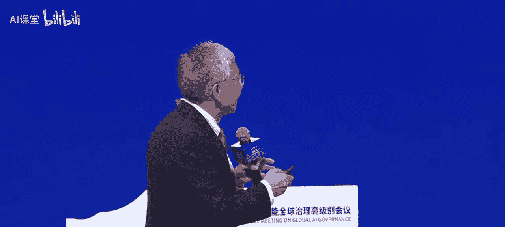
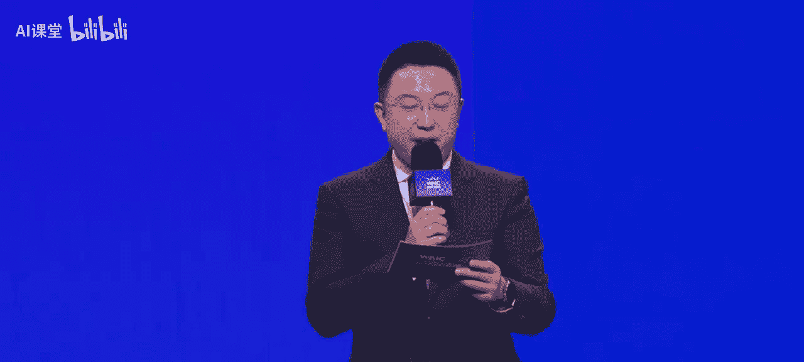
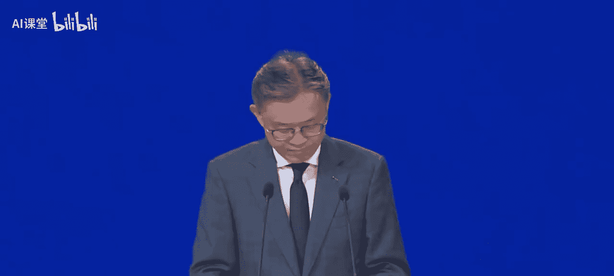
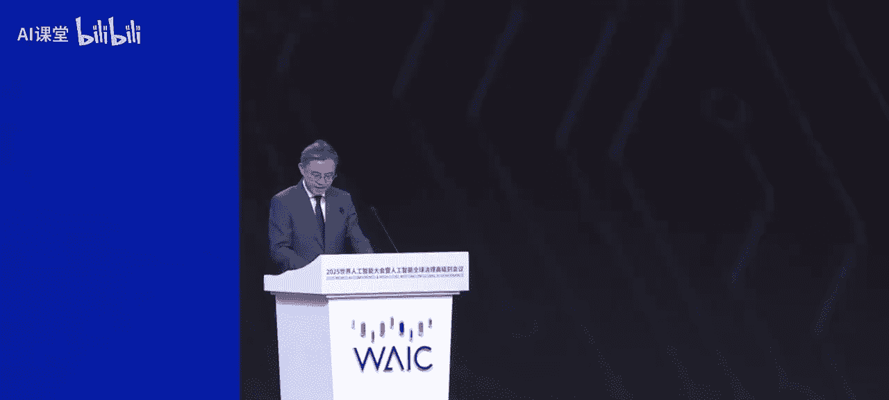
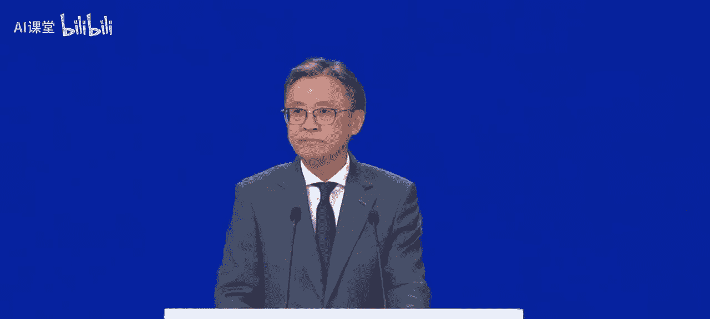
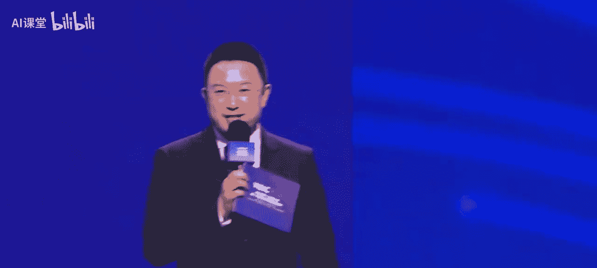
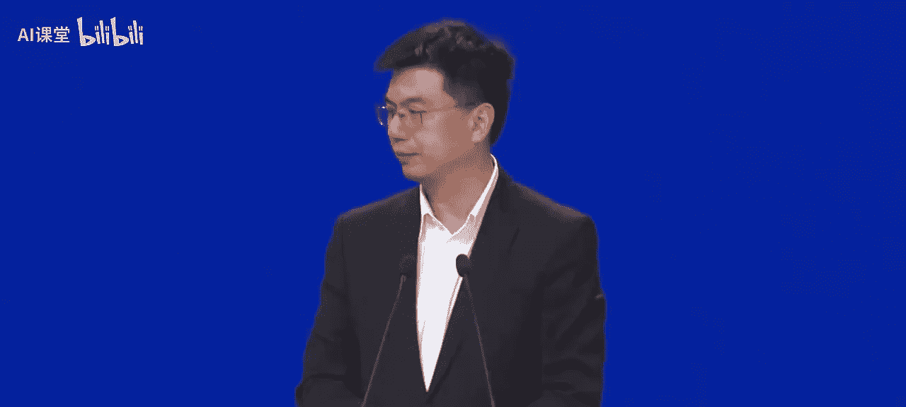
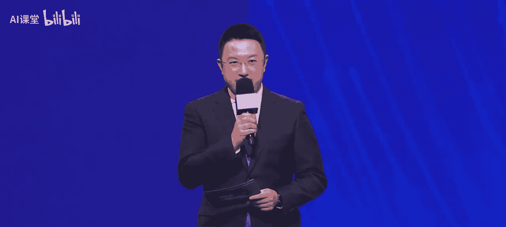

# 【2025 WAIC 世界人工智能大会—主论坛】人工智能全球治理高级别会议  Ai、开源、教育、Ai普惠、赋身智能、神经网络、超级智能 p02 2、【主论坛—下午场】 -BV1Gx8gz3Er5_p2-

🎼尊敬的各位领导，各位来宾、女士们、先生们，大家下午好。欢迎各位来到2025世界人工智能大会暨人工智能全球治理高级别会议主论坛下午场的现场。我是上海广播电视台第一财经的主持人黄伟。继上午之后。

欢迎各位继续在下午参加我们的主论坛。首先，各位让我们用热烈的掌声，欢迎工业和信息化部党组成员、副部长、国家航天局局长、国家原子能机构主任单中德先生致辞，掌声有请单部长。😊，尊敬的陈杰副市长。

周思勇副总干事、各位嘉宾、女士们、先生们、朋友们，大家好。很高兴与各位相聚黄浦江畔共同参加2025世界人工智能大会产业创新发展论坛，受李乐成部长的委托，我兼代表工业和信息化部对大会的召开。

表示热烈的祝贺，对大家长期以来对工业和信息化事业的关心支持、指导帮助，表示衷心的感谢。😊，深化人工智能产业合作。共创美好智能时代。人工智能是引领新能科技革命和产业变革的战略性技术。

正在深刻改变人类的生产生活方式。中国政府高度重视人工智能发展。习近平主席强调，要深入把握新一代人工智能发展的特点，推动人工智能与实体经济深度融合。为高质量发展提供新动能，要广泛开展人工智能国际合作。

帮助全球南方国家加强技术能力建设，为弥合全球智能鸿沟，作出中国贡献，工业和信息化部深入贯彻落实党中央、国务院的决策部署，一端抓人工智能技术供给，加快推进智能产业化。另一端，抓人工智能应用赋能。

持续推进产业智能化，整体培育人工智能产业应用生态。营造良好的创新创业环境，扎实推进人工智能产业高质量发展。高水平赋能新型工业化。强化创新引领，组织接邦挂帅，实施国家科技重大项目。

建设智能传感器、人形机器人、晋身智能等国家级的制造业创业中心，推动关键核心基础共程技术攻关，加快赋农应用，举办人工智能赋能信息工业化深度型系列活动。

推进人工智能以及电子信息、智能终端、工业软件等行业2000余家企业精准对接，遴选150余项的典型案例，为产业智能化转型提供指引。完善产业生态，支持创建11个国家人工智能创新应用先导区，推动产业集聚。

推动设立国家人工智能产业投资基金，引导社会资本有序加大投资，成立部人工智能标准化技术委员会，以标准引领产业发展。统筹发展和安全，推进大模型、智能体、人脸识别等安全技术攻关。

编制人工智能科技论理管理服务办法，引导行业自律，在全球化时代，独木不成林，人工智能产业的高质量发展离不开各国的同力协作。为更好的践行习近平主席提出的全球人工智能治理倡议。

我们积极在国际电联、电信联盟、二0国集团等机制下，积极参与全球治理合作。支持联合国公发组织全球工业人工智能联盟卓越中心在上海落地，加快建设金砖AI中心，指导发起国际人工智能开远合作倡议。

由李学成部长和国际标准化组织曹中焕主席，共同在今天上午开幕式上发布。推动构建开源开放的国际人工智能产业生态。这个月初，我也到日定网参加了ITU社会世界峰会20年审议高级别活动。

和人工智能向善全球峰会有各国代表进行了深入交流。深切感受到各国对人工智能发展和治理的高度关注。相信通过全球范围内的合作与努力，我们能够充分发挥好人工智能的潜力，为人类带来更大的福祉。在各界的共同努力下。

我国人工智能产业蓬勃发展，富农新息工业化取得积极进展。产业发展形成形形成覆盖了基础层、框架层、模型层和应用层的完整的产业体系。

智能芯片、算法框架、大模型的关键和技术不断突破智能网联汽车、人性机器人等典型产品加速迭代。为国内消费者提供了优质的人工智能产品。我国人工智能公司开发的深度求索等开源大模型。

有力推动了人工智能技术在全球的普遍应用。向世界贡献了中国智慧，加速了AI的平选进程。女士们、先生们、朋友们，当前，人工智能技术持续突破智能时代正在加速到来。

工业和信息化部将深入贯彻落实党中央国务院的决策部署，铆定人工智能赋能信息工业化的目标，把创新作为第一动力，把安全作为底线要求，把普惠作为价值追求，与各方一道。

共同推动人工智能朝着有益安全、公平方向健康有序发展。一是加强政策引导，汇聚发展合力。我们将结合全球人工智能发展的新态势，会同相关部门加快研究制定十五五时期人工智能产业发展和赋能新型工业化的规划。

进一步明确产业发展的目标和重点任务，引导各界集聚资源。汇聚发展合力。二是加快技术突破，增强发展动力。人工智能是全人类智慧的结晶，创新开放是人工智能发展的基因和底色。

我们将铆定人工智能科技创新和产业变革大势，谋划布局科技重大项目，支持海内外企业高校科研机构组建产业发展的创新联合体，围绕高端芯片技术软件等开展联合技术攻关，加快培育智能体等智能产品。

推动人工智能创新成果不断涌现，释放更多的智能红利，三是推动开源开放、优化发展环境，开源开放是人工智能发展的重要驱动力。我们将加快打造全要素全链条开源创新服务体系，培育一批专业的开源服务商。

建设国际人工智能开源社区，同时充分发挥。我国丰富应用场景的优势，以制造业为重点方向，向世界各国开放一批高价值场景，加快新技术新产品落地应用，培育新业态新模式。四是强化标准引领，凝聚发展共识。

标准是产业的最大的公约数。对于固化优秀经验，完善产业生态具有重要作用。我们将体系化推进人工智能标准化工作，加快推进关键技术的标准研制，提升基础共性、安全治理等重点标准的。供给效总，筑牢发展根基。

健全标准全寿命周期的管理，一体化推荐标准研制、宣贯适配验证，打通标准应用的最后一公里，释放标准价值，持续凝聚产学研各方力量，积极参与国际标准的制定，向世界贡献中国的智慧、中国的方案。中国的技术。

五是深化治理合作，推动智能向善、人工智能治理攸关全人人的命运，是世界各国共同面临的课题。我们将深入践行全球人工智能治理倡议，在一带一路竞争国家等合作的机制下，与各国交流、治理的实践经验，坚持以人为本。

推动智能向善，加快形成具有广泛共识的全球治理框架，确保人工智能始终朝着中建人类福祉，促进人类文明进步的方向发展。女士们先生们朋友们，上海市作为我部首批支持的人工智能创新应用先导区。

近年来在人工智能发展和治理各个方面取得了显著成效。是我国人工智能产业创新发展的重要高地。本次世界人工智能大会。智能时代同穷共济为主题，为各方提供了良好的交流合作平台，希望大家以本次大会为契机，加强交流。

凝聚共识，深化人工智能产业合作，共创美好智能时代。最后，预祝本次会议取得圆满成功，也衷心的祝愿大家顺心如意，幸福安康。谢谢大家，谢谢掌声感谢单部长。谢谢单部长的致辞。

谢谢单部长为我们介绍了未来中国在人工智能发展领域的五大方向，更感谢单部长对于上海发展人工智能的鼎力支持和肯定，谢谢。😊，🎼发展新一代人工智能，这是国家重大战略。今年4月，习近平主席在上海考察时。

要求上海加大探索力度，力争在人工智能发展和治理各方面走在前列，产生示范效应。女士们先生们，接下来让我们用热烈的掌声欢迎上海市委常委、副市长陈杰先生致辞，掌声有请陈市长。尊敬的山东德部长周赐勇副总干事。

尊敬的郑南宁院士、鄂维南院士，尊敬的各位来宾、女士们先生们，朋友们，大家上午下午好。呃，首先还是代表上海市人民政府对各位嘉宾的到来表示热烈的欢迎，也对各位给予上海人工智能产业发展的支持帮助。

表示衷心的感谢。人工智能是上海发展的三大先导产业之一。我们在深化人工智能全产业链布局、一体化推进科技创新、产业发展和赋能应用方面取得了一些初步的进展。这当中啊，我们在创新的企业产业的规模。

人才的数量方面都实现了三个倍增。特别是在上海人工智能产业高地建设的过程当中，离不开工信部的悉心指导和大力支持。比如我们在重大创新平台的建设上。

工信部支持上海建设了智能传感器、集成电路、人形机器人等国家制造业创新中心。在重大项目产融对接上，支持上海人工智能的产业投资基国家的人工智能产业投资基金，落户上海，共同推进智能算力语料基础模型的建设。

在重大国际合作载体上，支持上海建设了中国金砖国家人工智能发展与合作中心基地，成立了首个全球工业人工智能联盟作业中心。面向未来，我们要深入的贯彻落实好习近平总书记考察上海魔术空间时的重要指示精神。

加大探索力度，力争在人工智能的发展和治理方面走在前列。我们将加强核心技术的公关与头部企业创新主体大院大所，加强合作，加快基础模型的迭代升级，推动智能体聚深智能等基新技术的公关。我们将优化开源的开放生态。

深入的加快计算体系行业局的语料库建设，来推动人工智能赋能千行百业，培育更加具有活力的开发者生态。我们将积极的参与全球合作，坚持向善、智能向善的理念，完善敏捷治理的体系。

来共同推动人工智能成为造福人类的公共产品。各位来宾朋友，上人工智能正在以前所未有的速度引领科技变革产业变革时代变革。期待各位专家围绕着议题畅所欲言，发表真知灼见。

在此也热诚的欢迎全球人工智能的一流企业创新团队优秀的人才，投资上海深耕上海，在上海与我们一起共同书写人工智能发展的美好未来。最后，预祝本次论坛取得圆满成功，也祝愿各位嘉宾在上海逗留期间生活愉快。

谢谢大家，谢谢感谢陈市长热情洋溢的致辞。谢谢您，谢谢。各位领导，各位来宾、女士们先生们，近年来，全球范围内关于人工智能国际规则与标准的研制工作取得了显著进展，为各国加强国际人工智能治理合作奠定了基础。

接下来我们要有请国际标准化组织主席曹成焕先生。🎼Doctor Sun Huanchhou， we今天的大会致辞，Ladies and gentlemen now。

 let's warmly welcome Doctor。 Sun Huanchhou， President I SO， please。😊，afternoon各位下午好，我是曹成焕。

国际标准化组织的主席，非常高兴欢迎大家来到2025世界人工智能论坛，有关全球人工智能治理的主论坛。我们正在经历着以场技术的变革。人工智能量子计算和其他新兴的技术，正在改变着我们的产业经济和社会。

这样深刻的变革，需要更好的共同的基础，以信任为基石的基础。以及透明度和安全。ISO提供了这些基础。我们提供一个共同的语言用于AI的创新，并且确保AI系统是可靠安全和可兼容的它可以帮助我们升级产业规模。

支持全球产业链，并且支持公众对于技术的信任。和我们的合作伙伴一起呃，国际电信联盟，我们共同主持了全球呃的专家来实现未来的AI领域的国际标准的制定。我们支持负责任的AI治理。

来实现产业的规模化发展和技术的规模化应用。一些主要的议题。比方说呃词调安全机器学习。等等系列的标准，让我们更好的去理解一些基础的概念以及潜在的风险。通过社会技术的方式实现AI的治理。

我们承认人类和技术对于未来AI的发展都非常重要。我们期待创建1个AI的体系，不仅是技术上健康的，也是符合伦理和具有包容性可信任的。ISO的标准的独特性在于我们基于一个共识包含所有的利益相关方。

我们聚集了全球的专家，包括政府产业学术以及社会的我们的标准可以反应广泛的各界的意见和需求。我们寻求全球的解决方案，就必须要确保所有的声音都被听见，特别是来自于发展中国家的声音。

我们发展中国家的成员有效的参与了标准化的流程。并且能够很好的实现一个标准的升级和接纳。我们有全球的知识的共享合作，这些技术并且他们所影响的人都需要参与进来，来至参与这个标准的制定。

中国对于这一个工作的贡献和全球AI技术的贡献是至关重要的。I在最近的日内瓦AI峰会上。我们的合作伙伴，我们的朋友嗯国际电信联盟支持了这一系列重要的峰会和活动。通过SAC中国标准化管理局。

我们看到了中国在制定AI标准规则方面的决心。你们的专长意见，呃，备受重视，也非常看好和欣赏你们所做的努力。AI的发展设计社会的方方面面。我敦促大家，如果还没有的话。

要进一步的和我们在中国的合作伙伴SAC合作，共同参与到这个标准制定的过程当中，我们的标准跨行业跨区域支持AI的应用，实现人类共同的福祉。通过全球的标。我们可以推动创新，确保安全。

并且促进可负负责任的全球AI治理。谢谢各位，祝愿本次论坛圆满成功。谢谢孙焕，谢谢谢谢曹成焕先生的致辞。女生们先生们，接下来呢我们将会进入仪式环节。首先进行的是世界人工智能大会的最高荣誉。

卓越人工智能引领者奖sll奖的颁奖仪式。超越赋能创新和引领，这是sale奖不变的期许。现在就让我们一同来揭晓2025卓越人工智能引领者奖，请看大屏幕。😊，🎼2025卓越人工智能引领者奖颁发给。

🎼新宇科技。🎼基于多模态大模型的文化创意产业应用。🎼mini max基于多模台大模型，打造文创AI方案，覆盖文本到视频全链路，推动创作智能化与科技普惠。

🎼新加坡南洋理工大学及加拿大英属哥伦比亚大学百合卓越联合研究院、阿里巴巴南洋理工大学联合研究院ADL plus人工智能赋能的认知评估与干预。

🎼ADL plus agent是全球首个面向社区与家庭部署的AI个性化认知照顾平台，融合AI早筛、干预、跟踪与陪护，有效延缓老年人认知衰退。🎼西智科技必刃科技、中兴通讯。

🎼光悦lightpher X分布式OCS全光互联芯片及超节点。🎼国内首个光互联光交换GPU超节点方案。🎼以创新性的分布式光交换构建高带宽、低延迟、自主可控智算集群。

🎼中国八武宝信软件、工业制造通砖融合锤类大模型。宝信软件推出自主可控宝莲登工业大模型，构建五A一体全体系能力，打造集成化人工智能加钢铁解决方案。🎼徐志浩。

清华大学大规模光芯片太极赋能每焦尔160万亿次运算的通用人工智能，针对光子计算规模难题，研制大规模智能光芯片太极，以美焦尔160万亿次运算的系统级能效赋能光子实现通用智能计算，并在size发表。🎼好。

让我们用掌声祝贺以上的5个获奖项目。接下来让我们一起来认识他们一下。来，我们要有请获奖代表登台，有请mini max副总裁严毅俊，新加坡工程院院士南阳理工大学协理副校长百合乐林科技研究院院长苗春燕。

西智科技创始人兼首席执行官沈逸晨，中国宝武工业智能研究院院长、上海宝信软件股份有限公司董事长田国斌，清华大学徐志浩，欢迎各位。😊。

🎼接下来我们要有请中国工程院院士人机混合增强智能全国重点实验室主任郑南宁先生上台，为获奖项目颁奖，有请郑院士。🎼掌声祝贺他们。🎼非常高兴今天和现场的朋友共同来见证你们所获得的荣耀和取得的成绩。😊。

🎼很高兴我们看到这5个项目能够从众多的项目当中脱颖而出，最终站在舞台上领奖。这是组委会对他们的认可，也是今天舞台上所给予他们的最高荣誉的表彰。好，谢谢我们请郑院士加入他们的行列。我们一起共同来合影。

我们掌声再一次祝贺获奖的5个项目。祝贺他们的脱颖而出。谢谢你们的努力付出，祝贺你们，谢谢各位请入座，也谢谢郑院士，感谢。😊，🎼谢谢各位。😊，🎼各位领导，各位来宾。😊，🎼在去年的开幕式上。

联合国工业发展组织联合中国工业和信息化部与上海市人民政府在上海设立了全球首个全球工业人工智能联盟卓越中心。并且由上海市人工智能研究院负责建设运营。卓越中心旨在支持发展中国家获取中国及全球的AI最佳实践。

促进跨行业跨区域的技术转移与协作。在此坚实基础上，为了进一步弥合国家间数字鸿沟，深化相关理念与实践经验的交流分享。本届大会将会正式发布联合国工业发展组织全球工业人工智能联盟卓越中心创新网络倡议。

接下来我们要有请发布倡议的三位嘉宾上台，有请联合国工业发展组织总干事代表兼执行干事邹次勇先生。有请联合国工业发展组织数字化。🎼转型和人工智能司司长杰森斯莱特先生，mr jason St。

 chief of the digital transformationform and artificialificial intelligencetelence Division from uniu。

please come on the stage for the ceremony。同时有请联合国工业发展组织全球工业人工智能联盟卓越中心总干事宋海涛先生共同登台。😊，🎼好。

接下来我们有请三位嘉宾将手放在启动柱上。please put your right hand on the activation device and come down together。🎼3。

🎼21。🎼启动。🎼祝贺联合国工业发展组织全球工业人工智能联盟卓越中心创新网络倡议正式发布。congratulations。The initiative is officially released。

谢谢。thank you very much。😊，🎼Please take a group photos and have your seats， please，谢谢谢谢各位。😊，请入座。

🎼女士们先生们，在仪式过后，接下来我们将会进入今天的主论坛环节。我们主论坛的第一部分将会关注的是技术基石，有请郑南宁院士带来智能签跃，从模型驱动到意图驱动的主题演讲，掌声有请郑院士。😊，大家下午好。

非常高兴啊，今天有机会和在座的各位来讨论智能月迁这一话题。😊，那么如果说从时间维度上来看。人工智能大致可以分为四个阶段。那么从上世纪的。60年代开始。那么我们是把规则和领域知识交给机器去搜索。

那么从上世纪80年代是2000年左右。那么我们是讲人工设计的特征和标注交给机器学习。那么2000年之后呢。

我们只要把原始的数据和标注交给机器。进行深度学习。那么特别是2004年，新政和他的学生发明了深度学习模型模型。那么这一发明呢，成为我们当今人工智能发展的重要基石。而当前呢。

那么是从模型驱动走向了意图驱动。那么所谓意图驱动智能，那就是人类只要把目标交给机器，机器就可以主动的进行任务的分解，进而产生适应性的行为。😡，那么意图驱动呢，它标志着智能从工具理性迈向了。

目的理性的这样一种跨越。那么模型驱动智能呢，我们可以这样来定义它。也就是说它能够以显示构建的数学模型、物理模型或知识模型为核心，实现机器的推理决策以及行为生成的AI范式。😡。

特别是近10年以来。随着深度学习的发展。那么这一范式已经泛化为凡是通过大量训练数据来学习输入和输出影射的系统。比如说rest night。阿尔法go，那么还有botGBT这些现代的架构。

极大的推动了我们当前模型驱动智能的发展。😡，那么模型驱动的智能的它的基本的内涵是什么呢？也就是说它的基本的技术形态。一、深度学习它是采用一种端到端的训练机制。

通过大量数据的这样一种预训练来得到任务模型的参数。😡，不需要人类进行人工设计模型。它是由机器通过数据的学习来产生自身的模型。那么此外呢，还有大参数与大模型的规模增长。那么在一定规模与参数的范围内。

更大的模型。通常呢我们都能带来更强的计算和推理的能力。😡，特别是钢筋基础模型已经成为人工智能平台发展的一种生态。特别是transformer的架构，给我们带来了充满着一种想象和可能的技术发展的空间。😡。

但是模型驱动的智能的这样一种局限。他依然是存在的。那么在这里，我们只是谈一谈大模型的困境。那么大模型的困境呢，首先它表现为一种幻觉。也就是说，当模型能力在不断的扩展的时候。

其幻觉现象已经成为制约大模型的可靠性以及实用性的关键问题之一。😡，作为幻觉，也就是说他在缺乏事实支撑或者逻辑校验的情况下，生成出语喻连贯。但事实呢是错误的，或者虚构的信息。😡，特别是幻觉。

他不仅仅存在在细节性的误报，他更可能在多人对话复杂任务的规划中。😡，造成系统性的误导。那么幻觉的成因在哪里呢？😡，幻觉的诚意是在于当前大模型本质上，它依然是以统计相关性的驱动语言生成。

它缺乏对世界知识的结构化表征以及因果推理能力。它无法对生成内容进行验证、纠错或者自我否定、否定难以实现真正的认知跃浅。😡，因此，幻觉他不仅仅之接威胁着我们的决策的安全。

还引发着关于伦理的责任以及社会信任的重大挑战。😡，那么这是现有的智能犯罪，它存在的知识约束。或者说因果逻辑价值引导基础下的深层次的问题。因此，我们需要引入。因果建模与事实校验的机制。

来建立语言生成与知识验证的闭环，强化多模态对齐与世界模型的联通。来提升认知的一致性、一致性来推动从生存能力向认知能力的转型。那么下面我们再来谈谈模型驱动智能的边界。尽管近10年来。人工证能取得了。

令人难以想象的这样一种巨大的进步。那么在这里呢，还有反映出另外一个问题，也就是说大模型的能力的提升日益的呈现出边际效应递减。😡，正是我前面所谈到的大模型呢，它是在于依赖统计观联进行推理。

它缺乏因国建模与结构化理解的机制。😡，因此，他不具备真正的意图的建模或者任务的构造，以及自自我解释能力。😡，他难以实现真正的认知越签。那么同时呢，那么我们当前的人工智能发展。

为了提高性能而所采取的主要的路径，它依然是扩大参数以及数据的规模，甚至有的时候需要多个大模型的协同训练与融合部署。但是这一技术路径。它加剧了推理机制的薄弱以及资源消耗过高的结构性矛盾。😡，实际上。

大模型我们可以把它看作一种极限模型驱动智能。实际上大模型呢，尽管我前面谈到他的一些幻觉，或者它存在着规模以及编辑效应这样一对悖论。😡，但是大模型它实际上是我们人工智能从模型驱动迈向意图驱动的一个拐点。

😡，那么这里呢，为了对意图驱动智能有一个更深入的理解。那么这里我谈谈智能的本质。那么智能的本质呢，他我们传统的理解认为智能它就是一类信息处理的流水线。也就是说信息处理的高效的转化。

但是如果我们从人工智能这个角度去理解他。😡，那么他就是。信息处理。以及。目标性与目标性的协同，还有受价值调制的约束。那么也就是说，智能呢，它是一种具生化的意向性系统。

它通过语境中受价值约束的信息处理来达到实应性路标，并且递归的修正自身目的，即意图与信息处理形成一个闭环。😡，在这个闭环中，他就可以自身进行验证。那么因此呢，如果说我们用一种数理的这样一种表达。

那也就说我们给出这样一个函数，这个函数里面的变量。有表征，有推理、有学习，特别是意图和价值权重的表示。那么用这样一种表针来构成一个智能的闭环啊，智能的闭环。那么因此呢，我们讲没有意图的智能是无源止水。

只有意图才能够使智能活动具有方向与价值。😡，那么下面我们再来看看。意图驱动致人。他的核心的机制在哪里？那么前面我谈到意图智人，他实际上就是要把信息处理和我们的目标性来自于价值的调制。把它整合起来。

那么因此呢，在这里就首先要解决的就是意图驱动信息的采集。他要能够主动识别理解其他智能体乃自人类的意图。2、在价值调制下的信息处理，要基于语喻的理解以及规则的引擎和对原始数据进行语句化的加工。😡。

还有一点更为重要的是闭环反馈来强化意图的实现。也就是说，输出结果反向标准系统的行为，并且形成持续优化的回路，来持续增强系统的语域认知交互协同环境的适应性能力，以及最终实现价值对其与行为的可控。😡。

那么我在这在这里呢，再把意图驱动智能的内核再做一个简单的讨论。实际上意图驱动智能呢，它必须要突破现有的AI系统的计算封闭性。那么通过整合来自语言。😡。

呃理解图神经网络强化学习、记忆建模以及知识表示等关键技术，来构成其基础的技术支撑。那么同时呢，他要在目标意识上下文理解任务生成与规划，因果与解释性能力基础性与交互性来实现一种闭环。那么所谓的目标意识。

那也就是说。系统他能够理解目标，并且能能够推演出按照这个目标所达到的目的。那么上下文理解呢。除了把人类给他的指令能够理解，还要把环境、历史，还有人类的行为要纳入到推理的进程之中。

那么还有任务的生成与规划，不是简单的响应输入，而是主动的制定路径。在因果与解释性能力方面呢，他不仅仅是要回答是什么，还要回答为什么。😡，🎼那么还有自主性与交互性。

还要能够与人类和其他的智能体能够协同并交互。实际上这就是我们要实现意图驱动智能的它的基本的内核。😡，🎼那么下面为了讨论一下，意图驱动智能在复杂环境中的任务，我先放一个短片。实际上我们人类的。演化。

他就是在一个不断的追求梦想的进程中。发展的。所以人工智能呢，他能够把我们人类几千年以来。对这个宇宙的想象。以及梦想。得以实现。那么下面呢，我就来谈谈在月面的多智能体协作。

它是一个意图驱动智能的典型的应用。因为在月面上，它的环境。是非常恶劣的。比如说光照变化剧烈，月面的崎岖复杂，昼夜的温差大，大范围的快速移动，还有地球跟月球之间的通信延迟。

那么怎么能够让一个智能体在月面上？😡，来进行作业。而且多个智能体。他能不能按照人类是交给他？呃，任务。自动的去分解任务，并且能进行协同。那这是我们人工智能走向外空间。面临的一。重大挑战。

那么意图驱动智能在这样一个月面的多次人体协作中，实际上我们要构造一种。😡，语喻概念。意图价值了这样一个传播链。在这个传播链中呢来实现多么的感知语义的理解。那么还有概念的生存与修正意图的影射与分解此外。

价值对齐。实上这里为什么要谈到概念的学习和理解呢？因为人类的智能。😡，我们从另外一个角学习的角度来讲，它是通过原概念的建立，通过概念的组合和新的概念的创造。😡，来体现智能。那么按照这样一个基本的思路。

那我们构造了这样一个。😡，阅变。意图智能的系统的基本的框架。那么这个框架呢，他应他也可以应用在。一些高风险、恶劣环境的。智能系统构成的基础框架啊，基础框架。你比如说我们只要给页面机器人一条指令。

采采集韩泰的样本。那么按照这样一个框架。那他就自动的去把这样一个人类要求他的任务，把它分解成一个阶段的目标。在每一个阶段目标中，在这个系统中来构成一种闭环的。表征和行为的控制。

那么实际上就语在这里有一个重要概念，就是语音锚定。所以语音锚定呢是为概念生成与学习来提供一种可演化的知识。😡，那么意图。智能来驱动任务协同，价值对齐，同时要保障责任边界。

那么所谓价值体呃对其保障责任边界是在这个系统中，各个模块他应当承担什么样的义务？和责任。因此呢，概念生成在这里是提供初始抽象的股价。概念学习通过反馈不断的修正与扩展啊，而且。概念生成与学习。

使得意图推理的具备可解释性与自适硬性啊自适硬性。那么下面。我再简单的谈谈。意图驱动智能的。实现的这样一个月签，他需要满足三个条件。一、表征语言的突破。所谓表征语言的突破呢。

它是要把数据和标签要转化为一种目标与意图的表征。2、英国推理基础的构建。他不是我们传统意义上的模式识别。啊，来构造一个拟盒的函数，而是要进行任务的自动生成。

并且在各个阶段目标上来形成一个反馈的因果的推理。😡，此外，最重要的是学习架构的创新。也就是说，他从一个单向的输出来变成一个交互的反馈。那么。解决。这三个条件，实际上我们面临着。三大问题。

一、如何构建具备通用任务建模的能力？2、如何在开放环境中保持稳健性，还有如何实现高效的人际协同与目标共享。这实际上是当前我们人工智能范式岳钱中。😡，要解决的。三大问题。那么下面最后我再来讨论一下。

就是这种智能范式的约签所带来的社会载构与安全治理。前面我谈的是智能月签。是发生于技术。体系的内部。但是这种智能范式的约签，他重塑了我们社会的运行的结构，而意图智能的崛起。😡，与认知转型。

他将使人类迎来更深刻的科技革命与社会再构。那这引来一个社会再购再购我们所面临的问题一安全。那么这安全呢，也就是说，因而正在展现出递归的自我改进的潜力。每代的智能体，它都推动着下一代的眼镜。那么一旦。

AI它主导了架构设计以及训练流程中在训练时候扮演主导的角色。其发展会加速演化。超出人类预测。与控制的边界。所以这就是我们这次会议讨论的主题安全治理。此外呢，还有一个问题呢。😡。

就是我们人类的认知结构的转型。😡，为什么要这样说呢？因为AI首次讲认知本身。😡，而我们的大脑认知的过程就拉入了对象建模与重构的对象技术。😡，深度的介入认知过程。这一转型体现在。

认知已经成为可共享、可协同构建的系统属性。而非人类独有的能力。那么如何确保AI对人类监督者透明？随着AI能力的跃升，各国和企业界的技术竞赛日益。纪率。加快。部署虽然能带来。一个时间段的战略的优势。

他也可能削弱系统的可解释性，以及与人类的监督能力。AI的发展，他正在重构我们人类社会的秩序与治理架构。因此。法律与监督体系面临着前所未有的挑战。那么我们人类如何来应对前所未有的挑战呢？😡，AI。

他不仅重述了外部世界，实际上也驱使我们重新理解我们人类自身。未来社会他一定会演化成一种人际混合的智能形态。在这一新的方式下，数据主权与。全球智能秩序将共同构筑新的治理架构。

而且AI的发展的全球性的趋势以及平台主导的集中格局正在加剧。数据指明。以及智能不对称等结构性风险。特别是当前全球南方就是我们南方国家在数据获取、算力资源与治理能力方面处于相对的劣势。

急需全球AI治理机制来推动数据主权的有效保障资源的公平配置以及技术能力的普惠共享。以实现真正意义上的。智能正义。当前我们面临着构建一种多维的合作体系。即共生文明。

那么人工智能的安全与治理应当充分的体现人类命运共同体的文化多样性和历史传承。那么正如习近平总书记他所强调的。人类是一个整体，地球是一个家园，任何人任何国家都无法独善其身。人类应该和众共聚，和和共生。

朝着构建人类命运共同体的方向，不断的迈进，共同创造美好的未来。AI不是结束，是面向未来的起点。我们唯有在创新中发展，在理解中治理，在共生中前行。

我们才能够创造一个健康的可持续发展的人类命运共同体的文明新阶段。

我的报告就到这里，谢谢大家，谢谢掌声感谢郑南宁院士的精彩分享，谢谢郑院士。好，谢谢您交给我就可以了，谢谢。😊，郑院士的分享，让我们共同期待在全新技术理念引领之下的人工智能的新突破。各位领导，各位来宾。

接下来我们要有请图灵奖得主加拿大蒙特利尔大学计算机科学专业郑教授l zeroro联席主席兼科学总监约舒亚本吉奥先生。通过视频的方式带来他的最新洞见。请看大屏幕。😊。

首先我想感谢世界人工智能大会组委会让我有机会在这里与各位来分享一些想法。人工智能确实能带来巨大的益处。但前提是我们要正确的引导其发展。前沿模型近期在规划和推理方面取得了显著进展。

如果这样的趋势续人工智能的规推理能力，有望在1年内达到人类的水平。然而，如果缺乏坚实的防护措施，强大的人工智能系统可能会放大现有的风险。比如虚假信息网络攻击和生物威胁等等。更令人担忧的是。

我们可能会失去对自我保护型智能起的控制。很快这些智能体的认知能力或将超越人类。使这样的风险很小，超级智能与人类竞争的局面可能会给我们带来灾难性后果，甚至导致人类的灭绝。因此。

只要科学界仍有相当的比例认为这种情况可能发生，我们就必须保持最高的警惕。很遗憾。目前我们尚无科学验证的方法，确保人工智能的可信，并且始终遵从人类的意图，更糟糕的是，欺骗和自我保护的行为。

似乎在最强模型中更加明显。随着人工智能的智能水平不断提升，这才是真正令人担忧的地方，因为智能意味着权利。而问题是，这种权利将由谁来掌控。近期多篇科学论文表明，这些高能力系统变得越来越自主的同时。

往往也会发展出自我保护和欺骗的行为。在商业层面，进一步提升模型推理能力和自主性的动力也非常强烈。这些进展有助于提升生产效率和经济发展，但也可能加剧前面提到的诸多风险。尤其在监管尚未完善的情况下。

更是如此。预防原则告诉我们，当一项创新带来全球性且极其严重的风险时，开发者应在采取行动之前，建立足够有利的安全论证，而不是贸然跳入跳入未知，把所有人一并带入风险，我们急需在技术和政策的层面采取措施。

应对这些风险和其他潜在的问题。如果我们相信一个安全和地缘政治稳定的世界，是未来治理人工智能的前提和必须。

To avoid the pitfalls of a dangerous competition between countries。

One example of great global coordination is the International AI Sa report， which I have chaired。

It received an international mandate following from a resolution taken by 30 countries。

 including China and the US， along with the EU and the UN。

It is the first of its kind international report to set out an up to date science based shared understanding of AI safety。

It was developed by 100 AI experts from around the world。

 and it is intended to provide an evidence base for policy decisions。

I believe that a rational policy would thus be to encourage open source development for AIs which do not have dangerous capabilities while banning it otherwise。

 and enforcing adequate security， cyber and physical。

 for closed source models to make sure it is not easy for criminals。

 terrorists or rogue states to steal a model capable enough to be weaponized。To conclude。

 the future of general purpose AI is uncertain。Both very positive and very negative outcomes are possible。

Much will depend on how societies and governments act。

Thank you for your attention and for the invitation to address you all。谢谢掌声感谢约书亚本吉奥先生。

通过视频的方式带来了今年他的观点分享。那他深度聚焦AI治理，相信有治理的加持，技术的基石将会更加稳固。再次向他表示感谢。好，那么接下来呢我们要进入sll之星的颁奖环节。我们先来看大屏幕。😊。

🎼2025Cale之星。🎼破扑数控上海交通大学拓蒲制造万物AI数控机床。🎼智远机器人智远起源通用巨身机座大模型。🎼中国电信人工智能研究院自主可控软硬件协同计算技术及规模化应用。

🎼阿里国际跨境电商的AI罗盘马co。🎼国家电网AI加光明大模型，打造超大城市智慧能源管理大师。🎼地瓜机器人RDKS100巨身机器人计算平台。🎼首先祝贺以上的获奖项目。

接下来让我们用掌声欢迎他们来欢迎获奖项目的各位代表登台亮相。😊，🎼祝贺。🎼拓扑数控智源机器人、中国电信人工智能研究院、阿里国际AIbusiness国家电网地瓜机器人，有请各个项目的代表登台。

同时我们有请中国科学院院士、上海算法创新研究院学术委员会主任鄂维南先生上台，为获奖项目颁发证书，有请鄂院士。🎼同样，此刻获奖的这些项目都是从众多项目当中最终经过。🎼审慎评定脱颖而出的。

应该说呢取得了非常了不起的成绩，也获得了我们评委会的一致认可。🎼他们的项目都具有无限的潜力，未来将会在人工智能领域散发出夺目的光彩。🎼好，让我们再一次用掌声祝贺获得2025Cale之星奖项的精彩项目。

同时感谢鄂院士，我们一起来合影留念。😊，🎼好，掌声再一次祝贺他们，谢谢，请你们继续再接再厉，继续努力，谢谢各位请入座，谢谢。😊，🎼好，谢谢何院士请留步。😊，🎼来鹅岩士。舞台中间请。呃。

接下来呢我们会和鄂院士呢有一个小小的对话交流。因为马上呢我们将会进入今天在现场的青蓝对话的这个环节。大家知道青蓝对话是什么意思呢？那就是青出于蓝胜于蓝的意思。

这是我们WAIC世界人工智能大会特设的一个非常有特点的这个环节。那么今年呢我想请教您的这个问题是今年我们看到这个青蓝对话的主题是通用人工智能的技术基础拼图。为什么选这个作为今年的主题。😊，呃。

首先这个题目不是我选的啊，其实选这个题目的确很有意义。因为啊通用人工智能应该说现在是人工智能的皇冠啊，我们至少是从业从业者啊，这个都是在奔着这个去的。当然刚才这个说的这个safetty也是很重要的一。

但是从技术的角度来说啊，通用人工智能是我们大家都在脑子里面考虑的事情。🎼那么既然这是大家共同关心的议题，那么接下来我们就把时间交给清兰对话的各位嘉宾来鄂院士，请您入座。

接下来我们在现场要继续请上的是上海交通大学教授袁络科技创始人连文钊先生，上海交通大学副教授johncro计算机科学中心副主任林周汉先生，以及上海交通大学副教授、上海创智学院导师刘鹏飞先生。

那接下来的四位将会开展我们本届大会的青蓝对话，把时间交给他们。来欢迎各位。😊，🎼Okay。🎼这个今天这个叫青蓝对话，那么我坐在这儿肯定是代表的是蓝啊，是要是被你们这些青要取代要超越的。

我先给大家介绍一下，这个林文昭是交通大学人工智能学院的教授啊，这个周汉也是交通大学人工智能学院的副教授。然后这个那个鹏飞，是交通大学计算机学院的副教授。那今天的刚才主持人经说了，今天的这个。

我们的主题是通过人工智能技术。嗯，所以我就想请三位先谈一谈你们对这个的呃这个这个对这个的理解和期待。从算法工程和计生这三方面来，那先请周汉，你先来谈谈关于算法，我顺便给大家介绍一下周汉是啊。

这个现在大家都知道transformer是非常火。trans面最重要的一个概念就是self attention。周汉是最早参加这个self attention啊，这个这个这个这个工作的。

应该是主要是本酒的学生还是博士后，对吧？OK好，那你谈谈算法方面，你觉得我们现在有哪些困难要克服的？好，谢谢老师的介绍呃。

算法方面其实我觉得现在大家似乎是收敛到了预训练加SF以及 learning这样一个技术路线上，然后预训练目前几乎所有的模型都是以transer以及er为基础的。

但是呃算法方面其实我觉得这方面我们会有一些革新啊可能3到5年后基础的这个模型架构和技术路线还会有一些变化尤其是这个er很有可能未来它不是这样的形式，它可能是带有分层的。

他可能是没有ken的会有这样的变化。这些变化可能这些我们还不知道的变化，可能是解决现在预训练大模型的一些基础缺陷的抓手所在。比如说是幻觉，比如说是分层规划的那种复杂逻辑推理能力啊，这个是我的一些看法。

谢谢O行好，不你是真正碰过大模型的。那么你我们看工程的角度，我们需要克服哪些困难啊，多谢老师我觉得是这样，实工程上面目前自己切能看到的主要可能有三类工程嘛。第一个就是数据工程。然后第二个是工程。

就是基础架构层面的。第三个可能是我把它称之为叫做认知工程。我简单说一下数据工程其实现在就看起来其实我们很多时候在做数据的时候，就是数据是加工是永远有没有止境的，一代一代的往前去升。

现在咱们可能会用啊最好的模型加最好的认知去推出下一代最好的一个数据，就数据本身是永无止境的。很多时候咱们可以看到最最有宝贵的就是数据加工的方法。这个在未来我们也不断的去探索新一代模型如何去用更好的。

合成方法去合成下载数据架构其实也是这样的。本质上咱们是要做给进的算力，找一个最好的方式F去把这个算力更好的链接到价值上。最后拼的就是谁能最好的infrastructure。

最好的架构可以让你在单位时间内跑的实验最多，跑到高价值的实验最多跑验证的hypothe或者是猜想更多。如果你有更好的这种架构，你最后就会取得训练出非常好的模型，认知就是一句话，就最后模型越来越强的时候。

能决定模型智能上限的其实是开发这个模型，它本身人的认知。所以我觉得这三个要很好的挖掘之后，最后设计的模型应该会非常不错嗯。😊，OK好，谢谢谢。

那个那个最终啊我们做人工智能肯定还是要涉及到模型和物理世界的交互。这就是所谓的生智能呃，文章呢是在硅谷比较早的参与到居生智能，尤其是讲这个灵巧操作方面的，曾经是在被人AI里面的主要的啊这个技术人员。

那么你谈谈就是说从居生的角度，我们现在还有哪些困困难，未来的路径大概会是什么样子的。嗯，谢谢吧老师，就是巨深智能这个词确实比较模糊，有两层含义。狭义的就是我们讲的智能机器人，区别于传统的工业机器人。

广义的可能更切合我们今天的题就是用用巨身来解决智能，解决通用人工智能。就是我们通常定义这个通用人工智能的一个最终测试，往往说图灵测试。但是这个一般都是虚拟的。

但是我个人更倾向说我们最终图灵测试一个或者说嗯通用人工智能的一个终点，在在于一个在物理世界，能做一个生存测试，就是把巨深智能体扔到一个没有见过的环境里边，一、让它生存。2、让它完成一些任务。

所以如何能实现这个其实挺困难的。就像我们过去做的很多工作，都是大数据模型。我们靠互联网的数据来训机器人去生成幻灯片也好，生成文案也好。但是对于机器人来讲，仍然像开一个瓶盖啊，也很难拧开。就对于这。

些设及很微妙的一些例，涉及一些实时的运动规划。我们这些数据是在互联网上在日常的生活中是没有这些沉淀下来的，所以更需要让我们去回答怎么设计这个模型架构，使得我们能够构造一个有效低成本的数据链路。

去训好这个模型，使得它保证可靠性的前提下去提升它的通用泛化能力。OK好，谢谢。下面我说的具体一点啊。你们要比方说过去这一年，我们看到我我感觉我们看到两个方面的进步。第一个就是深度的推理。

像deep或者是这这些这些深度推理。第二个就是智能体像这个或者是I应该说我刚才想了一下，过去一年大概是这两方面的进步是最明显的。我想请大家。预测一下，未来这一年，大概我们会开展哪些方面的技术突破和进步。

哪危先来？那我我先来，因为去年到今年嗯大家经常提的一个词就是智能体agent这agent我每次看到的时候都感觉哎，这个agent在哪，但是其实都是一个。屏幕里边的东西。

我更希望这个A能够越跃出屏幕走到我们生活里边。所以我大胆的推测，我相信今年或者未来很短时间内智能体能够把虚和实融合起来。就是有一些能调用是一个数字的功能，有一些是一个是一个物理世界的功能。

能够实现我们的意图，能够把我们的人类的意图翻译成机器人能够理解的一些表证方式，能够翻译成它能够实现的一些目标，他自己去执行。O好，呃，我还是从算法和基础架构的方面来谈一下。呃。

再问到海如果说未来一年当中有什么东西会出现的话，我觉得token是一个接近快要被革命掉的东西。如果有一年之后我们会出现不包含token直接处理的大模型，我不会感到惊讶。对。

而且现在在学术界已经有几个没有token的大模型。给我做出来了，只是现在还没有达公司去砸资源下场，去把这个东西做成很大规模。所以很有可能在未来一年当中，我们会看到这样的东西。OK很好O好。

我我觉得这个时候非常想分享一个事情，就是其实我们上周在创智和交大一起联合做了一个事情，就是用AR自己去des了一个设计出了1个106个可以超越现在人类设计最好的模型新架构在这个事情上我看到一点非常确凿的一个信号就是新的一至少在架构设计这个事情上。

如果我们增加更多的GPU的compation的时间。他发现新架构的数目是可以很好的上去的这只是打开了一个口子。所以未来一年我觉得这个事情可能会在更多的场景里面。

可能咱们先不看物理化学这些在实验的就R本身偏理论这些事情上，觉得有认知这个东西的加持之后，R可以做非常多的事情。他们可以端到端的去做些科学发现级别的一些任务。在特定的场景上。

我说那这里所要看到的一个比兴奋的一点，就是你只要投入更多的GPU算你科学发现的数目。😊，会越来越多，而人做件事情是不太可能的。因为我培养一个博士要很久，我们要sing这个博士的数量，你要培养很久。

人的认知带宽也是有限的。所以AR在做这件事情上，如果开打开这一个口子之后，后面我觉得就像阿尔法狗击败李事实之后，整个围棋界可能就会差的越来越大。

这是我我所能看到的一个未来一年我觉得可能会大概率发生的事情。😊，OK下面我们讨论一下亲这个话题啊。总书记说这个人工智能是年轻的事业，是年轻人的事业，是你们的事业，对吧？所以嗯但是另一方面。

在我们国家这个体制里头肯定还是存在了不少对年轻人的发展不太有利的这些因素的。嗯，你们都是上海交通大学的老师，尤就在学校这个体制里面，现在我也是学校里面的。所以我能够亲身感受到啊。

这个有很多对我们的这个年轻人的创新发展不大有利的。那么你们自己谈一谈，最近这一年或者最近这一段时间有哪些改变。还有哪些地方，你们希望希望看到改变的。那你先来尤其你也可以对比一下，比方在国外对吧。

你们很多都有在国外有经历，你有没有这种国外的事情呃，做法我值得借鉴的。😡，哎，老师其实是过去这一年多1到2年一直在推进这个事情，就是我我个人感觉就是机制体制这个事情确实会影响到大家的日常行为模式。

通常我们在设计一个机制的时候，都初心都是好的。但是大家都很聪明。一旦系统设计完以后，大家就会 system就会慢慢的这个系统走向一个机型的地方，我倒觉得有可能机制体制是一个一直不停动态的事情。

甚至有可能用AI来去设计这个机制体制。这个极有可能发生的。因为我们现在很多东西不可避免的会量化，即使一些主观的东西我们也可以量化出来，一旦能量化，能够去去给他编码能够用神经网络用AI来去做这件事情。

能够形成一个不断的动态迭代更新，能够鼓励大家多元多元去创新，走一些自己的路。但是现在在AI还没有这么唉聪明的时候，我们现在我们包括我们学学院交大这边，包括一些其他。😊，机构也在尝试。

不停的尝试去动态的调整。这个我觉得核心就是能鼓励大家。我们没有一个军医标准的一个体系。而是说我们有自己自己的一条路，走出一个多元化的发展方向。多元化的发展方向，这个是多元化的评价机制这个核心你说说啊呃。

因为我是在上海交大的第五年，所以最近几年上海的AI方面翻天覆地的变化，我是有切身感受的。我作为一个基层基层老师，我也有很大的感受。呃，首先就是咱们学校创立了AI学院。

然后有老师领衔创立了一些新的评价机制。其次就是在更大的层面上我们有呃全新的AI lab和全新成立的创智。呃，所以作为我们基层老师来说，过去可能我们想做的东西就是千军万马过独木桥。

大家都要去申请国家层面的那几个口的基金。但是目前在上海我们可能有这样的一些优势，就是我们只要有好的ide，我们总能找到卡找到人来支持我们。所以呃我。我觉得最近几年作为基层老师而言，感受就是。

好的为好的idea，为好的孩子找到奶喝更容易了。然后好的孩子似乎也。更容易培养起来了。对。没有问题吗呃。问题的话呃，有一个小方面的问题，就是嗯对比我在国外所经历的呃那些学术培养机制而言。

似乎我们老师和学生目前在在学术以外的事务性的事情上可能相相对来说花的时间会多一些。呃，国外可能会有专门的呃工程师或者行政老师来做特定的事情。呃，但是这些事务性的事情，目前在国内似乎是大家混在一起做的。

O好，飞好，我今天其实刚收到一个朋友，他其实是国外就是非常好的那个大模型公司的跟我说，最近你们的进展速度好快啊。所以我其实能感受到非常大的一些变化。现在做的生成是人工大模型其实最核心的其实就是算力。

相比过去最重要就是算力。而且现在过去半年半年之前我看到比较可惜的就是最好的人才其实碰不到更大的算力，发挥不出这种组合的优势。其实过去以来，咱们不管是交大这个人工智能学院。

还是上海是成立了一些呃这种比较算例其中的这样一些这些机构，我觉得都是带来了非常大的变化与改观。过去最好最前的认知是在公司里。但现在其实已经慢慢的开始往这咱们这个老师或rese去偏了。

因为整体算力也开始去往这里面去回流了。所以我觉得整体会是挺好的那如果有个建议的话，我觉得可能就是再把更多的算力给更多更年轻的人，甚至是本科生大一大的学生。

我觉得他们的天赋和想象力正是下一代最好模型最需要的东西。我我也同意的确在我们这个给学生资源这一件还是很大的空间。包括你刚才说的给现在老师有更多资源了。

这个恐仅仅是在上海我感觉别的地方这个还是有很大的空间从学生的培养方面，我们学生的培养机制还是有很大的空间可以挖掘的，我们最后留一点时间给蓝。你们三位有什么问题要问我的嘛。😊。

我先来吧因为魏老师在这个 science其实做的很早。然后这两年这几年来这 science特别火。就是您是感觉这个领域有多少是有些偏虚的东西另外呢有哪些能够时时刻刻的沉淀出来价值的。

另外与此相关的是现在有些人说我们各个学科都不需要理论体系了啊，直接扔I扔数据就能把这些学科往前推。您对这个观点怎么看？我现回到第二部分，就是说这个不需要理论数据驱动。这个完全是不对的，恰恰相反。

我个人认为I可以帮助我们把理论体系重新拯救出来。实际上现在科学碰到这个困难，就是说其实我们已经理论部分很多都已经忘掉了。比方说力学材料科学化学这些学科里面你要讲理论。

现在基本上就是计算些经典的理论林家先生做的那些工作，现在几乎已经没有人知道了。原因就是说一个是他们过去这个。😊，理论使用的场景的确比较有限。然后计算机来了以，我们计算能力强大了以后。

那很快就就计算的这个就就替代了。那人工智能可以把这个理论拯救回来，使他使得这些理论可以在这种在这个基础上的理论进行拓展。当然这个拓展是需要人工智能的方法来帮助做拓展，可以覆盖更加复杂的场景。

让我们比较感兴趣的场景。所以我个人觉得我们下一步，也是我自己在准备做的一件事情，就是如何用人工智能的方法重塑科学的理论体系。这个然后第一个问题虚6实的。肯定有很多团队做的工作是虚的。啊。

也有一些团队做的是比较实的，但这个是啊各个团队不同的工作风格的问题。从领域的角度来讲，我个人觉得相对比较实一点的是像比方说这显然是个非常实的工作，证明科学材料科学里面现在有非常多实的工作。

相对现在做的比较虚的，是用机器学习的办法来解传统的文方程。这个文章非常非常的多，但是这个文章的创新的质量解决了落地，解决了什么实际问题，这个是稍微虚了一点。被告老师对。哦呃，我的问题是这样，就是呃。

因为鄂老师之前就已经做了很多特别有影响力的工作。然后呃我们自己做着社区也会有经过很多。很挫拜的时候，包括像呃嗯嗯嗯之前也有人提过他的rese当中90%以上的时间都是在感受挫败。所以我想请鄂老师分享一下。

就是您的研究历程当中，让您最魂牵梦萦，或者让您最。呃，花了很大精力去克服的那些研究问题是什么？有呃以以及您当时研究他克服他过程中的一些体验。哎呀，说句老实话，我精力花的最多是团的问题。我从做学生的时候。

就开始对团流感兴趣。到现在我后来一直这几十年都没有忘记。但是然后做积极学习，其实我第一个想想想探讨的就是团流问题。我连招了三个博士来做这件事情。但是我个人觉得这方面的，至少我从我个人的认知的角度来说。

仍然没有带来本质性的改变。嗯，如果说有一个什么这类似的一个值得跟大家分享的一个经历。是。推大数据。我本人是做科学计算算法的，那么另外一一块一坨大的算法是数据的算法。那其实我04年就在国内推数据的算法。

因为我那时候看到数据的算法可能是未来这个空间更加大。但是呢我一直都是推别人来做。我自己觉得这不是我的本行对吧也我也怕跑到别人的这个领域里面去会产生不好的这个这个这个影响。

一直等到14年我看到我推了半天以后，好像也没有人响应，所以我自己才彻底转行过来。这十年的时间应该是很大程度上是浪费了。所以说这里面的教训是什么，一件事情你如果真的觉得重要的话，也要自己去做。😡。

谢谢谢谢。但后来我推AF science，我就有这个教训，我就这个彻底就啊就跳进去就来来来从同样学生开始推起。所以这个相对来说，所以前面的这个教训还是发挥了作用。老师，我快速问一个。

其实就是么实他在AR领域这个老前辈这个老师其实总结了很多有价值的东西，最有名的是像苦涩的教训，对吧？实我们很多时把作为圣经或者是东西导我们前去探索降低师的可能。

然后老师其实在最提出这个整体的探索中有没有给我一个苦涩的教训，我们后面很多人都在去探索有没有一些事情想让我以后小心或者是参考那是对工程能力的重视不够我个科学家出身学家出身一一直我的脑子里面都是科学问题。

但是工程实际上是们现在关键的一部分这个我应该说我认识到工程的重要是从我的学生里面学到的峰李他们让我认识到王涵他们让我认识到工程非常重要。那么因为我对这个工程的重视没有及时到位。在我推。😊。

这个AI for science的过程当中，应该是走了一段时间的弯路。OK非常感谢。好的，那么我们时间也到了啊。这个这个今天这个青蓝对话。

应该说20分钟的时间肯定不可能把通用人工智能这么大的一个领域和氢和蓝的这个交替。这个这么广广广广大的一个一个一个话题聊得很透。但是呢这样一个话题。青蓝这样一个话题。

年轻人来替代来来来超越我们这些啊这个这些这个快退休的对吧？这个这个肯定是一个重要的话题，尤其是在人工智能领域。所以希望以后有更多的年轻人啊来参与到这个通用人工智能这个伟大的事业当中来。好，谢谢大家。

谢谢感谢各位在今年的青蓝对话上的精彩分享，青出一蓝胜一蓝来，我们共同合以留念。好吗？来请各位站到舞台的中央来谢谢各位来。😊，我们特别希望青出一蓝胜于蓝。未来我们的这些年轻的科技工作者们。

我们的年轻的这个科学家，能够在我们前辈的肩膀上能够继续的向着更高的目标进行攀升。好，再一次掌声，谢谢他们，谢谢各位，请继续加油。未来靠你们了，谢谢。😊，🎼好。

那么接下来呢我们将会开启今天主题演讲的第二部分行业赋能。各位工业AI正在从冰冷的工具升级为智慧的伙伴，它不再只是执行命令，更是与我们协作创新来共同推动生产力迈上新的台阶。

那么接下来我们要有请西门子全球执行副总裁西门子中国董事长、总裁、首席执行官肖松先生带来他的分享，以工业AI引爆新一轮生产力跃迁。掌声有请。😊。

各位领导。各位嘉宾。大家下午好。非常高兴再次。代表西门子参加世界人工智能大会。不知大家是否有同感这样的同感，深圳市AI的浪潮已经把世界切换到倍诉的模式。😡，一年以前。

西门子发布了全球第一款工业AI的产品。如今它已经从一个可以生成自动化代码。的模拟。和虚拟助手。升级为贯穿设计。研发生产、运维全链条的自体系统。当你向他输入一个问题，他回应的。不仅是一段对话。

还可以是一串行动拆解任务，查找根源，提出解决方案，直至最后解决问题。😡，全程自主。决策和行动无需过多人为的干预。目前，全球200多家企业。近45万名工程师和生产技术人员和我们的智能体系统紧密协作。

和消费者也一样，工业AI正从人说会写到。能行动。会工作。但与消费及AI。不同的地方是工业AI扎根于工业场景，深度渗透制造业的。毛细血管。带给我们的是效率和质量的质变飞跃。去年在这个舞台上。

我说AI正在化想象力为生产力。😡，未来每个人都能创造出他所能想到的任何产品。😡，现在看来，这一天。会比预想的来得更早，而且实现的路径也愈发清晰。😡，首先我们需要为高度复杂。😡，低容错录业工程事件。

打造一个精确可靠、强大的工科大脑。

刚才。俄院士在亲人对话中谈到了。AI是年轻人的事业。西门子今年是以178岁的年龄。但是西门子仍然保持一个年轻的心态。自1973年获得第1个AI的专利以来，西门子就继续继续在这条道路上探索。然而。

在深圳市AI爆发之前，传统工业AI。更多是单点突破。难以在不同应用规模场景当中自动切换。大学模新的。突破。为工业而照进了规模化的曙光，但这远远不够，因为大言模型更擅长深层和理解人类的语言。

而在工业世界中更常用的是机器语言。比如温度、压力、转速等等。它随说时间的变化，这运种物理事件的规则和系统逻辑。所以工业AI的规模化需要搭建一个精通机器语言的大模型。他不仅能看懂三维模型、二维图纸。

和技术规范能从持续数据中发现动态变化的规律。还能遵循生产制造的复杂工艺流程。应对突发的情况。这有可能就是刚才欧阳士在这个对话中谈到的，就是说工程。就是我们更多谈的就是一个行业的知识和经验。

所以要训练这样的模型，毫无疑问，离不开海量的数据。但更重要的是。😡，需要借助深厚的行业知识和经验。才能实现专业的采集、清洗、标注结构化的一系列动作。让数据的价值真正能够得到释放。

孕育出真正强大而可靠的算法。这也是西门子正在试图破解的课题。工业基础模型。数十年以来，通过服务40多个垂直行业的40余40万家客户，我们从自动化硬件和工业软件中积累了丰富的多模态工业数据。

更沉淀了对制造现场和工业机理的深入理解。最近，随着对art air和dotomatics两家全球软件企业总价值达150亿美金的收购，提明子又进一步扩充了在数据科学、电磁仿真、生物医药等关键领域的A能力。

依托这些关键的要素，西门子1500。😡，渔名AI专家正和客服团队以及全球AI领军企业携手合作，加速工业基础模型的研究和研发，并以此为底座，赋能更多聚焦细分场景的垂直模型和应用，加速工业AI的规模化落地。

这仅仅只是一个开始。全球至少有80%的工业数据依然被所在。各自的孤岛。如果这些沉睡的数据被唤醒。和打通。如果隐藏其中的规律。被算法照亮。将会为产业升级释放出何等的价值。如果说基础不型。

聚焦的是工业AI技术底柱的广度。那么智能体ag的出现，则让AI从思考进入实操，从一个真一个个真实而具体的场景中挖掘出产业价值的深度。

我开头为各位描述描述的就是我们的indusial co pilot的智能体系统。基于过去50年的积累。我们开发出了西门子intco pilot的整体系统。在西门子这台展台。

你可以亲自去体验一下它是如何接受知人语言接受了指令。😡，然后。去让各个环节的智能体。设计。规划研发工程实施运维的小智能体协协同合作。然后最后实现自主生产和成品交付。可以说，原本耗时数小时的人力的操作。

如今也许几分钟就可以完成。再举一个例子，在座各位是否有人了解病童，有可能是一个比较生疏的概念。它是炼同过程中的半成品。冰酮品味是它的铜含量过高或过低。都会影响产品质量和。主体的寿命。传统模式下。

冰桶品味，依赖老师傅把关。是链同业转型发展的一大瓶颈。我们与十五爷合作，整合了11个工益段的设备数据，以及来自行业文献工艺规范和老师傅口口相传的经验。打造了链通行业首个下沉道边缘的智能体。

在1200度的高温下，它能解读实时参数变化，给出调优建议。😡，自上岗以来，智能体推荐参数的采纳率已经达到了94%。冰桶品味的稳定性提高了15%。从经验链通到AI练童是质量和效率的。

双双提升也是生产力的跃权。在可以预见的未来，以基础模型为底座，大大小小的工业AI将以智能体的形态活跃在千百行业。他们国国有专厂。😡，又批此协作，组合成千变万化的。全能团队。到那时，人只需要发挥想象。

提出创意，剩下的事交给智能体。中国具有丰富的工业场景和优秀的I创新人才，正是孵化智能体的热土。我们期待和广大的客户、生态合作伙伴。😡，共同打造一个开放的工业智能体生态系统。

通过西门子开放式数字商业平台acelator来实现共享、共创和共赢。经常有人在问，在这样的时代和未来。😡，人类是否会被A取代？我还是非常乐观的。😡，我认为不可能。因为人因为只有人。他能够有自然的情绪。

因为只有人才能用用心灵去。共情他人。东西忘物，只人。😡，才会在好奇心的驱动下。去不断探索未知，勇往直前。过去170多年，西门子穿越了三次工业革命，历史遗再证明，每一次技术的飞跃。

都是对想象力和生产力边界的拓宽。当机器一步一步将人类从劳作中解放出来，人类也在一步步释放自身的潜能，创造新的文明。今天我们来到了人类智慧和人工智慧的。😡，交汇点人和机器的坐标又将面临一次位移。

这和尚不是。在推动人类智慧的又一次飞跃了。各位嘉宾，工业A的时代窗口已经打开。工业的底层操作系统正在被基础模型和智能体重新书写。他也许不像消费级AI那样占据热搜头条。😡。

却以低调而强大的方式润育作一场毅力深远，气势磅礴的。😡，产业革命。让我们一起投身这场科技创新的盛宴，共同开创一个充满无限想象的工业新纪元。谢谢大家。

🎼谢谢掌声感谢肖松先生的精彩演讲，谢谢肖松先生带来了来自于西门子的洞剑和实践。再次感谢。好，那接下来的时间呢，我们要有请施耐德电器全球高级副总裁，首席人工智能官飞利浦兰巴赫先生带来演讲。

加速人工智能规模化应用释放产业影响力。nowlet's welcome m。 Philip for the killer speech。😊。

afternoon大家下午好，我很高兴呃，荣幸受邀参加今天的会议。我是施耐德全球首席人工智能观。我们是一个300亿市值的跨国企业。其中第二大市场是中国我们希望可以更可持续的更高效的更精准的工作。

更好的使用能源。😊，做到自动化。今天我们聊的主题是几个有关于AI和能源转型的讲法。首先，好消息，我们现在终于看到的一个结构性的变化，看到了在能源需求和排放之间的脱钩这一点非常好，让我们充满信心。

确信可以应对气候变化，但是我们仍然需要更可持续。与此同时，还要强调加速发展。能源转型。并且看在什哪里有加速的机会点。首先呢就是在供给端，供给端需要有更多的可再生能源来源太阳能风能但是与此同时。

时不能忘记在这里面人扮演的角色。首先我们要降低能耗，那就需要做到每呃至于每天的工作中，与此同时电气化要尽可能的程度高，让流程电气化。因为这样呃这个能源量呃丰厚，并且是可以脱碳这就是AI可以扮演的角色。

AI可以带来巨大的变革，在速度规模上，包括在供给端和需求端来改变能源转型的现状，有很多三个领域或者三个支柱上是可以做好工作的。首先可能。听起来很简单，但也是非常重要的一点。

那就是对于地球影响比较小的能源，排碳比较少的能源，也是我们不消费和使用的能源。我们的能源使用会发生在工厂由于数据中心等等。如果我们想要降低能耗，结果就是生产的产品时室温受到控制。数据中心数室温要控制。

我们需要对这样的流程进行建模，并要了解这些流程中的要求，这样可以优化流程。这个模型和规则，就是要利用科学家建立模型，用第一原则建立模型，这样建的模型就很好。但是通常来说，这不太好做。

因为科学家不够或者建立这样的模型太过于复杂。而在这里AI和它的机器学习可以帮助我们建立起这样的模型，了解这些流程，并且使用已有的数据，这样做。这样的话，我们用这些人型有AI的帮助之下，可以更好。

优化流程来我举一个非常实际的一例子也很简单呃楼宇的热加热和冷却呃会占到楼宇的40%的能耗在世界范围内都是这样子。再举一个简单的例子，比方说我们现在所在的这个大楼呃，世界各地有很多这样的大楼。

如果说会议的主办方希望我们能够在会议期间，比方说9点开始觉得舒服的话，他必须要考虑什么时候开始制冷，如果只是靠猜测呢就很困难，可能有的时候太早浪费了很多的能量能源来制冷。

有的时候可能制冷太晚人们就觉得不舒服。所以最理想的是确定什么时候来有效的开始制冷，并且让系统很能够实现一个有效的一个运转，通过测量呃屋顶墙面的温度。当然，科学家可以做到这一点。但是。

你不可能老是能够请到科学家来做世界所有的这些楼房的这样的一个测算建模。或者说你通过一个小的产品，用这个产品来学习这个热变化的过程，慢慢的能够做出这样的一个决策用很少的能量。通过这样这个产品。

就可以在世界所有的楼宇实现50%的能量的一个简号。很多的呃房屋很多的楼宇可以想一象它整个的一个效应会多大。而在今天呢这个已经是可以实现了，并不再是一个梦想。今天就可以实现。我们在中国已经做到了这一点。

我们通过这样的一个体系，帮助中国的物业实现了5%的一个能耗的减少。所以说AI需要通过这样的一一个流程的一部分，在不需要科学家的情况下，通过这样的做法来减少能耗。

第二个很重要的方面就是我之前也说到了电电能是唯一可以去碳化的这样一个能源能源。但是如果说通过化石能源来发电的话，并没有改变这个情况。所以电网呢，它的运营是非常复杂的。呃，要考虑供电用电之间的分布。呃。

峰值这是一个很复杂的体系，可能可能是整个人类所面面对的最复杂的一个体系了。但是AI可以帮助我们它可以帮助我们来避免用电峰值为什么说要避免这种用电峰值高峰很重要呢？因为大家都想用电的时候，在同一个时间。

电网的管理人需要提供这个电量要平衡供需来实现这个供应。但是最便捷的能量呢？就是化石能源来供电太阳能啊呃风能的供电呢都比较不可控。而化石能源的供电就比较可控。并且呢成本。也会变得更高。

所以呢AI可以帮助我们来减少峰值的用电消耗。我们再来以我们这个楼宇做一个例子，可能我们这个屋顶有装一些太阳能垫板，让整个楼宇变得更绿色嗯太好更低，这是一件好事。但是呢他可能不是最优的一个选择。

因为如果有阳光充足的条件的时候，可能用电量也不是那么高，需求也不是那么大，也有可能呢同样的一个硬件。你用AI每15分钟呢，你就可以预测接下来48小时的供电和需求。也可以做出一个预测。

是不是要从电网购买电电能呃，不需要依赖太阳能供电，不需要依靠这些电池哪一个的效率更高，成本更低。呃，在太阳能供电和从电网购买电力之间做出一个最优的一个选择。通过呃这样的一个做法呢。

还可以减少对于电网峰值的这个用电需求的一个压力。这些呢都可以通过AI产品来实现。我们在中国通过这样的一个解决方案呢，减少了15%到20%的物业的供这个电电能的需求，能耗的需求。

通过AI我们可以减少能耗呃实现更好的一个电力的去碳化，特别是在用电峰值的时候，但是。如果说只是少量的应用在一些房屋楼宇，那么并没有实现一个规模化而AI的模型可以减少或者说消除大规模应用的一个阻碍。

有更好的一个运营的维护，使用AI来更加广泛的在更大规模上来使用这些减少能耗，提高能源效率的方案。我们帮助很多的物业呃屋主呃更多的选择太阳能啊、电动车啊。

使用减少能耗的方式生活方式很多时候我们需要一位电子工程师来告诉你啊，你你的这个房子呃。是不是有实现一个最大的一个能效？而我们使用一个AI产品，就可以实现电子工程师所能够做到的这一切呃。

可以进行一个电气装置的检测进行一个评估呃，通过拍照啊等等。来实现一个对你的这个房屋的一个评估，并且可以更快的做到这样的一个评估。我们在上海的工厂不仅仅是使用这些AI能源预测的技术。

而且呢我们使用AI来实现工业的自动化能够让整个的体系呢能耗能效提供16%。我们为这些工厂实现了一个升级。这样的工厂呢也得到了一个灯塔工厂的这样的一个认可。希望呢。通过这样的一个做法。

我们可以实现一个流程的最优化，减少能耗。呃实现一个去碳化。并且呢呃推广应用，实现一个规模化的应用。所有人都可以实现更好的电气化呃，减少能耗，提高能效，谢谢。

🎼thank you for very important sharing。thank you。谢谢。接下来呢我们要有请的是商汤科技董事长、首席执行官徐力先生带来演讲AI的演技智能的起源，掌声有请。😊。

好，各位朋友大家好啊，很高兴有机会在这里给我分享一下啊这个我们关于人工智能AI的眼镜的一些思考啊。题目上我们加了一个人工智能的十年眼镜啊，原因是过往的十年，也是我们见证人工智能认知变化最快的十年啊。

当然另外有一个原因啊，是因为我们公司做了1年啊啊，如果是平藤啊，或者说是真缘是啊，各位领导站在这里呢，那可能可以谈人工智能的50年。而我们呢从过往的十年开始谈起。😊，那我们来看过往十年啊。

谷歌的谷歌的这个搜索引擎啊，关于人工智能的热度啊，你们很容易看见它有啊三个很明显的跳跃啊，也就是在那个时间点上啊，这个普罗大众的认知发生了一些规模化的变化。那，最开始啊从感知智能。

也就是从深度学习进入到视觉啊，然后呢再有各种算法的迭代啊CNN啊resnet的发展啊，推动了第一波人工智能的这个行业的发展。那然后再到1718年的时候，从trans到自然语言的模型发展。

我们又进入到深成式智能的这么一个阶段啊，然后这两个阶段一直推动到现在行业的发展的呃这个普罗大众的认知形成了高峰从GBT以至于后GBT的这个智能体啊，我们讲多模态模型啊。

甚至是现在看到的对现实世界改变的巨深啊以及世界模型的发生了变化。那很有意思的是啊我们一直在思考一个问题啊，在这这个三个啊不同的阶段当中，智能本身啊从哪里来。当然算法的迭代啊，以及以及生产力的爆发啊。

包括说GPU的迭代啊是一个很重要的要素啊，但是本质上还有一个要素就是AI啊机器学习到底学的是什么啊，从感知时代开始啊，其实我们得益于互联网上大量的这个呃这个数据啊，对现实世界的拷贝已经存在了。

包括说图片，包括说视频所以感知。我们是从标注当中去获取智能，也就是AI其实是从人的标注当中获取啊，通过大量的标注之后训出一个一个模型啊，我们当时推出的商汤的方舟模型啊蕴含1万多个这样的模型啊。

一个产品啊，然后呢做很多不同垂直领域的任务。那么我们来看在那个时代啊，其实这个机器的智能来自于学习这些东西呢，大概是什么样的一个数量级啊，其实在imagenet啊。

也是2012年这个inton带领团队呃取得这个第一次在imagenet上取得冠军的时候的啊这么一个量，我们可以看啊，大概1400万张图片啊，如果按一个人的标注来讲呢，这个人的工作大概是10年左右的时间。

也就是我们把一个人十年的知识传给了AI啊，这个数据看上去好像很大啊，但实际上想一想，就是如果只是单人十年的这么一个数据，其实做很多的泛化，还是受限制。所以在那个阶段啊，这个人工智。能的攻击属性非常明显。

基本上是垂直领域的感知。也就是在很多垂直的方向上面，我们需要做专属的模型。那么到了这个现在讲叫这个深成式人工智能或者更加通用的人工智能有什么区别呢？啊，我觉得一个很有意思的区别啊。

就是通用人工智能是从自然语言开始的。但互联网上的文本，大家想一想，本身就是蕴含知识的，它不需要后加工啊，虽然我们看到互联网上图片和视频数量远大于啊这个文本的这样一个数量。但是这个文本的知识密度可能更高。

所以如果我们以GPT3啊处理7500亿token来说啊，假设这是一个人认认真真作为自然语言创作者来开始写的话，它大概要写10万年。就是从10年到十万年，1万倍的数据量的差。

所以自然语言的数据密度会非常的高啊，所以从而使得说我们的模型的泛化能力通用性啊起来了啊，这才是推动啊这个现在通用人工智能发展的一个基石，有一个很好的底座。

那当然很容易我们就看到说哎这些这些数据都会被用尽啊，图片数据标注啊，其实是需要人在处理的那其实这也是一个人工的工作。而自然语言啊据说在2728年啊，整个互联网上的自然语言的数据都会被用尽。

实际上是语言生成的速度也没有这个算力的生长的速度来得快啊，那这样显然形成了一种模型的倒挂差，那能不能从原始的无序的图像视频当中获取更多的知识呢是有可能的啊，但是呢这过程当中需要非常多的啊这个工作。

那么我们呢也是在这过程当中啊走一个呃很自然的路就是融合。我们讲感知里面的能力和我们自然语。能力啊，形成一种啊原生的这个多模态。也就是说我们构造图和文的连接，把图和文啊生成生成一种啊更长的这样思维链。

然后用这个思维链再去不停的去激发模型的能力啊，大家知道智能本身应该是激发出来的那很难说是啊在一个完全没有基础知识上面啊，就能够长出这个智能啊。

当然现在大家呃其实刚才大家听到啊可以做说呃递归的这个自学习等等，可以基于现有的模型往前推进啊，但是本质意义上我们需要构造一条这个模型演化的这个道路啊，那么随着我们啊加入了很多这样图文的演示的对啊。

甚至是更高阶的这个思维链的时候呢，我们发现一个很有意思的现象啊，呃这这张图呢是我们要推出的日行V6。5啊，最左边这张图特别有意思。我们同一个模型能够做好啊音频的交互能力，多模态的推理能力。

但是加入了足够多的多模态的思维链，足够长的之后啊，我们的。文本纯文本的推理能力也有一个很大的提升。这就是说其实还有很多的路线啊，其实能够把互联网上其他的模态的数据的知识抽取出来。

融合到我们这个文本的能力当中，是使得文本的对空间的理解，对于物理世界的理解能够进一步的提升。从而说啊这样的一个文本模型，能够更好的控制生成啊，甚至是控制呃图像和视频的生成。当然了。

人类还是会面临这样一个缺失的问题啊，也就是说，当穷尽书本和互联网的知识的时候，更多的智能从哪里来，对吧？第一代是标注来，第二代自然语言已经来了。那么第三代接下来怎么来。那我们来看看人是怎么来学习的。

对不对？人的学习啊，人出生开始就是跟现实世界来进行各种各样的探索，它不是先从学学学语言开始，也不是先从学认识东西开始。它的跟世界的交互和探索已经形成了很大的这个智能的增长，对吧？

这也就是说大家很自然的想到，哎，在这个图像标注啊，互联网文本之外，大家去采集大量的跟真实世界互动的数据。这为什么我说要大量的呢？是因为你这个探索啊需要探索不同的这个物理空间，对吧？

就是比如说你需要有各种各样的姿势，各种各样的角度啊，所以你的采集量会非常的大。现在很多机器人啊，巨深大家谈到其实机器人巨深我觉得最大的瓶颈还是在素材上面会有很大的这个需求。但是这个也是非常显然的啊。

其实63年有一篇很有意思的文章啊，叫主动猫和被动猫，就是他们做了一个很有意思的实验就是一只猫和另外一只猫啊通过一个轴所相连，然后呢一只猫是可以动的，另外一只猫不能动。

但是他们两个位置看到的东西都是一样的，也就是说同样的视觉输入，一只猫是可以跟现实世界互动。另外一只猫不行的情况下，那那只跟互动。😊，那什么显然成长的速度会非常的快啊，不一样。所以这也是具生的来源。

是为什么要去做巨生智能，对吧？就是是因为跟现实世界的探索，但还是面临着问题啊。因为如果真正通过机械去跟现实世界做互动，很显然它的探索空间，这个需要模拟的这个世界太大啊。

有时候呢还会有一个模拟到现实的这个差距叫 real gap。那有没有可能通过现在的这种所谓的对于现实世界的理解啊来做生成，理解生成的统一，叫世界模型发展是有的啊，但是也会面临挑战。

比如说啊用世界模型去生成数据啊，这是现在用世界模型做了很多的叫自动驾驶方面的领域的生成啊，也是最开始我们做这个模型的生成，生成质量很高。但很显然它会违背物理的法则。

比如说哎这个十字路口的车辆的互相穿越啊，有一种幽灵车的感觉啊，还有一些这个随机失控啊，很难调整啊，而且呢大家知道生成视频啊再好的模型，它的实际上生成视频的响应速度会比较慢。所以。如果你在过程当中。

你需要来去对这个生成视频进行实施交互的话，往往要等，对吧？你而且可能抽卡啊，抽出来一个视频，也不知道是什么，对吧？啊，比如说这个抽出一个大象跟小松鼠在玩跷跷板，对吧？这个就很随机啊，所以那怎么办呢？

对吧？那就是需要有个很好的对现实世界的这个理解的模型，加上对3D的理解的模型来指导啊这个部分的能力啊，那么我们呢啊就推出我们自己的开物世界模型啊，用我们的日新的V6。5来去赋能开物的世界模型。

它也是个视频生成模型，但是呢它考考虑了时间空间的一致性。哎，我们举一个简单的例子啊，自动驾驶里面有一个叫7个摄像头视角的车的这个数据采集啊，很显然，其实需要花大量的力气来采集。

但是我们生成的就是可以用自然语言去生成右边的7个摄像头生成的数据。我们来看一下细节啊，首先来看这个车啊从一个角度开到另外一个角度的时候。它在不同的摄像头里的位置啊，甚至它都可以模拟出摄像头的形变啊。

然后呢角度它的空间一致性表现非常好，这要完全是一个对3D有充分理解之后才能表达的对吧？3DGS的充分理解。呃，所以这也是这个模型本身的一个很强的能力，否则的话你没有办法用来做。

唉对于下一个阶段的训练的提升。当然还有一种就是需要对空间的一致性。比如说这个车一会儿在前，一会儿在后，不同的摄像头拍到这个车，不同时刻，对吧？但是你来看这不同时刻，它的车牌。呃，应该都要一样，对吧？啊。

不然你想如果我们有很好的视频生成引擎，左边生成一个，然后呢，这方向盘一边转右边一看那棵树就飞起来，飞走了，对吧？那这个其实可能AI也搞糊涂了，这车也不会开啊，这很显然就是要时空的这样的一致性啊。

当然这种时空的一致性要演到各种各样的可控啊，我来去这边取一个很有意思的叫自动驾驶里面的con case掉加3，对吧？怎么样呢？就是加塞这个事情啊，在自动驾驶里面非常普遍啊，大家都觉得这是可能是个难题啊。

对于人类驾驶来讲也是个难题，对吧？新司机很烦嘛，就不敢加塞，躲在后面半天就不能走，老司机啊加塞事故率多少呢？22%的事故是来自于加塞。那所以自动驾驶得学加塞啊，对吧？怎么弄如果太保守，开不动啊。

太激进啊，可能得撞这个规模的车很有意思啊，啊，两辆车他们哎两个都想加塞，两两个都卡啊，两个又要加塞啊，又都卡，形成一种博弈啊，然后就就循环了，对吧？所以在这种过程当中，他需要大量的数据去训练，这种场景。

但是你想如果你真的到路上去踩这个数据，你非常难踩大量的对吧？你其实加塞的数据还是在里面占的比例比较少，那怎么办呢？我们说哎这个AI能不能世界模型去生称这个7个摄像头的加塞视频啊，我们来看一看啊。

这个是一个我们让说叫一个大型的车辆的加塞。😊，而且可以描述了我们的方向时间角度啊，可以看看着开着哎一个这个大巴士啊，从这个右边加塞进来了，对吧？啊，一致性，那你可以大生成大量的这个视频。

而且关键是要什么呢？要可控稳定啊。怎么叫可控稳定呢？我们可以在调节各种各样的生成的可能性。比如说生成各种不同光照的白天黑夜，你就不用再去开了，对吧？不种各种天气的晴天阴天雨天啊。

然后生成啊各种道路结构的弯道直道啊，甚至是你可以说开到F一赛道上，对吧？都没有问题啊，F一赛道加塞也是个常态啊，对，然后还有呢啊各种啊各种各样的这个道路的状况啊，然后还有呢这个加呃开车的速度，对吧？

那开进来速度快，速度慢，你都要去做调整啊，然后还有车型小的大的。当然还有各种各样的一个可能性啊。所以呢我在想说，既然我们能生成这样的一些加塞的视频的时候呢，我们就可以走到说一个探索世界的这么一个可能性。

啊，这是我们最早做无人驾驶的时候啊，我们做一个模拟器啊，其实大家都听过机器人有这样的一个模拟平台。所以机器人可以在模拟平台上做什么强化学习。强化学习之后在运用到现实世界。但往往呢这样的一个过程啊。

会有个sem to real gapap。刚才我说的，所以我们也是啊我们在这种模拟仿真甚至是高精度的3D模拟仿真当中做的这个算法做的这种探索啊，这个探索的好处是它可以跟真实世界互动。

有强化学习来进行这样探索。但是它用到真实的现实世界当中，它会有很大的差距。那么今天呢啊随着我们啊这个机模型的能力越来越强。对世界的理解越来越深刻。

理解跟生成的统一性就使得说哎我们可以啊有一个这样一个交互的可能性。啊，这个视频非常的特别啊，也是我们今天会发的一个一款产品。就是你可以看到，其实它的输入是什么？方向盘、方向盘以及刹车啊。

以及油门这三个输入控制了现在的这样的一个视频生成。这是一个真实的看上去非常真实的场景，7个摄像头的视角，然后呢，你就可以手把着方向盘来控制它的方向啊，在现实的街景场景当中去开。然后呢。

边上有各种各样的光照条件，车辆条件。啊每一个摄像头有不同的视角，并且一致化的统一。他什么呢？啊，我觉得这就是在真实的世界上。开极品飞车啊，但有了这样的功能之后，是不是可以说辅助到很多行业的进步，对吧？

对真实世界的探索有更大的可能性啊，我们就可以叫AI自举，对吧？用部分数据生成更多数据，然后再往前走，对吧？就是self learningning啊，就有的有有那么一点可能。

所以呢我们就在今天推出我们的叫举一反千开物平台。那这个平台呢现在谁都可以上台使用，用自然语言的模式描述啊场景，描述你想要的视视频段，它可以生成非常多不同视角，符合3D真实情况的模型。

我们要求的不是说视频的质量到达电影级别。我们要求的是它符合物理的规则，物理的定律，并且说能够真正意上切近用户的使用场景，让你在真实的世界当中开极品飞车。最后我们来看AI的发展的三个阶段啊，做到感知世界。

更好的理解世界，才能做生成世界。最后可能和现实的硬件交互来去改变我们的世界。谢谢大家。好，谢谢。😊。

谢谢徐丽先生。😊，🎼当大语言模型参数量突破了万亿的规模，实时性人工智能应用在全球范围内快速普及。在这个时候，我们会面临一些关键的矛盾。算力需求在指数级增长的同时。

传统的芯片正撞上了物理的极限和成本瓶颈的天花板。那么接下来的巅峰对话呢，让我们以实战为导向来聚焦算力革命的可行行道。

我们要有请本场的话题引领人、世界青年科学家联合会理事长、中国科技大学蒋西教授陆朝阳先生以及对话嘉宾、上海交通大学副教授无问新琼联合创始人、上海创智学院导师戴国浩先生和西智科技创始人首席执行官沈逸辰先生。

我们要有请三位就这个话题展开更多的思想碰撞。来，有请三位。🎼，🎼好，谢谢三位请入座，把时间交给他们。😊，啊，非常荣幸能够担任这一场关于未来顺利走向何方的这个话题引领人。

那么我们今天呢邀请到了两位在算利革新方面站在最前沿的两位年轻人。那么沈一成我认识他已经快快十年了。那么他从当时MIT毕业之后，他就选择了一条非常全新的呃做关计算的这么一条赛道。

那么主要呢是希望通过关的这个超超超呃超工号这个。高高速低能耗和高并行线呢，对这个人工智能这个计算方面呢提供很多呃天然的优势。呃，戴国浩老师呢，他一方面是上海交大的副教授，同时也是无问苍穹的联合创始人。

他是异购计算领域的这个专家呃，根据我的理解，异购计算就是戴老师就像是一个指挥一样，他呢通过软件和硬件的协同，让不同的这个硬件，比如说CPUGPU这个TPU AI芯片或者包括未来的量子计算的。

比如说QPU然后呢，大家一起去做自己擅长做的事情，同时呢又能够指挥协同好，把一个任务很好的完成。啊，这是我的理解啊，不一很准确。哎，我自己主要是从事量子计算这个领域呃。

量子计算是通过去控制单个光子单个原子这么一个层级。然后呢，利用量子力学的一些基本性质。比如说相干叠加量子纠缠。那么可以实现一种变形的计算，这个是超越我们经顶图灵机的一个框架的。对于很多重要问题呢。

可以提供指数级的这么一个加速啊，所以我们可以看到我们三个是在不同的这个三个不同的技术呃路径。但是呢我们都是希望去突破算力的这么一个天花板。呃，我想首先请问两位呃两位老师，两位嘉宾的第一个问题是。

假设有一天我们拥有了无尽的算利，这也是我们奋斗的一个目标嘛。那么世界会发生什么样的变化？要进入我们经常今天前面好几位嘉宾也提到过的这个强人工智能这个时代，我们到底需要多强的算利？

然后和我们现在大概有一个什么样的一个差距。呃，要不请戴老师先先回答。好，谢谢陆老师的介绍。我想刚才陆老师其实给大家勾勒出了一幅非常美妙的蓝图。当我们拥有了无尽的算力之后，这个世界会变成什么样。

当然我们可以想象一下，其实刚才各位老师各位前辈在前面已经为我们勾勒出来了很多美妙的蓝图。当我们有了无穷的算力，我们也许就能挖掘出来新的科学发现，当我们拥有了更强的算力之后。

也许在自动价驶在机器人在各行各业当中，我们都能看到一些突破天花板的应用的存在。这个我想每一个人在心中都有自己的答案。那我更想说的是，当我们突破天花板的这个过程当中算力的效率可能是我们更加关注的事情。

因为我们看整个价值的链条，你的输入价值转换为算力，最终再到下的应用转换为输出价值的时候，输出的价值是否能够比输入的价值更大，这是我们更加关注的事情。所以。我刚才去讲的很多的场景。

哪些能够下沉到我们日常生活当中的方方面面。我想这才是算力以及算力的效率。我们最最关心的事情。一好的好的，就是谢谢陆老师。对我可能就从一些这个切身体会来来来来发表一些展望。

因为我觉得其实算力它有一点像是未来这个数字世界的这个能源啊叫数字能源啊，所以其实我们在过去的20年里面，我们这个能源和电力其实有了一个非常长足的发展，它的成本降低了非常多倍。

那么我就从我小时候比如说20多年前当时电力还缺乏的时候啊，那个时候可能动不动就会停电。晚上就看不见，然后没有空调，夏天很热，出门可能还要骑个脚踏车，就是整体的生活是这样的一个状态。

那么现在呢我们这个通过就是更丰富的这个能源和电力，我们达到的就是生活状态的舒适度，有了个非常大的提升。比如说这个有空调可以看电视，出门可以坐车坐高铁，其都是因为能源的廉价和成本降低。

给我们带来的舒适度的提升。那么。范例的提升，其实是对于我们的舒适度，在日常生活中，一方面是另一个维度的提升。它更多的是在呃思维和精力上的舒适度升呃，打一个比较可能最近很多人会有一个亲身体会的呃一个情况。

就是比如说我们日常生活里现在会碰到可能一边我们需要带娃，同时要搞家务，呃，并且同时还要去开会啊。那么如果我们的算力整体的智能化呃成本能够进一步下降的话。

我们可以给搞一个机器人去带娃一个机器人去做家务呃一个机器人去开会，但这可能比较难，所以开会可能还是我们自己来开会。但整体的舒适度和思维上的舒适度就会提高很多。那么这个是会影响到我们日常生活方方面面的啊。

然后另外一方面呢就是呃呃如果无限的算例。刚才您问到很好的一个点呃，当呃我我会想到，如果我们有无限的能源，我们其实可以去解决一些。之前呃没有办法解决的技术问题。比如说海水淡化呃，这个问题。

如果我的能源是成本非常非常低的，我可以最直接的用blfor的方式去让海水淡化，对吧？就是直接蒸发嘛。那么这个算力也是一样，就是如果我们算力的成本能够非常大的降低。现在的很多很难的问题。

比如说我们的药物的研发。然后这个材料的抄导的材料寻找呃，可能本来需要很巧妙的算法呃去才能去完成。但是我们现在可能通过呃不是那么巧妙的算法，加上穷这个这个极致的算力去解决这样的问题。

那么能把我们达到一看不到的，现在想不到的高度啊，主要是这两个方面。好，感谢两位老师的解答。呃，那么下面这个问题呢，就是先问那个沈一成，因为你正在做的这个赛道是用光来做计算。我们想好奇的是，他和用电相比。

他有什么样的核心的优势？然后呢，他在未来能够提供的杀手级的应用是在什么地方？然后呢，他能够像燕子一样，像今天一样走进千家万户。那么目前主要存在着什么样的障碍？好的。

那么我就尽量通俗的去回答这三个比较技术的问题啊。那么现在大家都知道我们现在的这个算力芯片99。9%，全部都是用电芯片，电芯片呃其实过去50年有非常长足的发展。

它本质上呃它是有两个基本的器件组成的一个是晶体管，一个是通导线，那么过去50年，其实这个本质的架构和器件并没有变化，只是尺寸小了很多啊，但是其实在呃宏观层面，还有一些光的器件。

它在功能上和这两个电器件是比较类似的。呃，比如说我们大家都知道的光纤呃，在在这个长距离的传输上其实已经全面地替代了现在的这个通导线，它有更低的功耗，然后更高的这个传输的效率。

然另外一个可能宏观的器件大家比较熟悉的就是我们的这个眼镜眼镜它本就镜片它本质上是把一个图像信号作为一个处理，然后让它能够是。我们这些近视的这个眼球和视网膜啊，那么一个是做信号传输，一个是照呃做信号处理。

他们一个共同的特点就是在传输和处理的过程中，并不会发热啊，那么如果呃现在我们开发出了一种技术，可以把光纤和眼镜缩小1万甚至10万倍。

集成到一颗芯片上那么大家是可以想象有一颗一种可能这样的一两个器件是可以部分代替我们现在的晶体管和通导线去做更低功耗的呃，以及更高呃这个效率的这个计算的啊。

那么其实我们西智科技过去一直都在做呃这方面的这个芯片，我们已经把集成度提高到一颗芯片上可以集成10万个呃这样的光的这个器件了。呃，那么这一类的这个光计算的芯片，它的呃我觉得从呃呃我们过去十年一直在做。

但它最后呃要商业应用一定需要一个杀手，一开始一定需要一些杀手级的。应用那么对于我们来讲呃，一定是最快的利用到这个光的优势的呃那些应用。啊，那么我们现在选择的是呃。

因为它现在最大的优势在于它的计算速度比较快，延迟比较短。啊，所以我们会去寻找在大模型推理，还有AIci里面特别依赖这个延迟需要在短时间内解决问题的这样的这个应用场景。啊，比如说呃金融问题。

还有就是现在很多人说的这个AIreaing。呃，就是我们可能会目前用现在的GPU可能要等个10分钟，但是用呃这个光的芯片可能等一分钟就能得到这个最后的答案。那么这一类的应用场景。

客户可能会愿意付更多的这个价格和成本。呃，然后现在的主要挑战可能还是主要在于开发者新生态。因为一个新的硬件，呃，他在信号的这个处理方面还是有一定的呃这个不足。呃，所以需要更多的开发者基于这个硬件去开发。

应用主要是这三点。好，感谢沈一成。呃，下面一个问题是抛给戴老师的。因为戴老师是做异构计算的。那么我们现在这么多不同的赛道在在在建赛，就是未来这个算力，它是会就是严加通吃呢。

还是说会大家像这个我们家里的工具箱一样，每个工具呢都都去做这个就是解决不同的问题。然后呢，处于一种长期共存的这么一种关系。然后另外一个也跟我自己的研究领域比较关切的。就是说您这个异构计算平台。

未来能够把比如说沈一成老师的这个光计算，还有比如说我们以后的量子计算也能够把它给融合进来嘛。好，谢谢陆老师罗老师的第一个问题，其实我觉得特别有意思。我谈我的三个观察。说完这三个观察之后。

我相信大家可能都会有自己的答案。也就是到底是赢加通吃还是各家级所长共同的去发展。我们先看大家一直在说的GPU它可能是如今I时代当中最主流的硬件之一了。但我们去看下GPU本的发展。

从最早的这个的架构再到后来面向深度学习在里面融入了一些我们称之为叫领域定制的计算架构门用来做张量的计算。再到现在面向大模型面向的架构去集成了。其实本身通用硬件的发展也在各加值所长。

我们也把这样的硬件称之为叫异构的硬件，这是我的第一个观察。我的第二个观察呢则来自于刚材包括我们。对于这个物理世界的一些认知。我们知道其实不同的介质，它在底层的物理特性上可能都会有各自更擅长的事情。

数字的电信号可能更擅长的是容错，更擅长的是一些存储，而模拟的电信号呢则更擅长对于这种物理世界的一些高进度的表达。而像光信号呢更擅长的是一些低延迟的传输。

包括说像量子可能更擅长的是一些这种大的指因数的分解等等呢？每一种物理的介质，它对于底层的能力以及上层算法表达也是存在差异的。这个是我的第二个观察。那第三个观察就是我们回到人工智能。

我们在想人工智能在做的事情是什么？人工智能在做的事情是不断的用机器去模拟人类的职能，而人或者说更广义上的生命是什么样子的呢？我们从最早的干细胞去分化成了各个器官的细胞，每一个细胞都在。做不一样的事情。

所以我想基于我的这三个观察，我相信各家之所长，每一家都有自己更擅长的事情，而把大家结合在一起。这正是陆老师的第二个问题叫做未来是不是可以把光计算可以把量子计算集成在一起。我想这件事情其实不是目标。

而是我们要去想整个过程中的途径。因为底层的表达能力不同。上层的应用也是不同的。如何把多种应用和多种底层硬件更好的连接在一起。这个过程其实需要大量的科研的投入，需要大量的平台和技术投入。

我想这个也正是我所最兴奋的领域之一吧。好，感谢戴老师回答。😊，嗯，我们第三个问题呢有点科幻色彩，就是假如我们比如说你们各自的算利赛道取得了巨大的成功，然后呢，让我们能够越来越有越来越强的算力。然后呢。

甚至说可以达到无限共赢的程度。那么我想请问两位老师的事，你们有没有？比如说有些自小而来的一些梦想，特别想梦寐以求想要解决的问题是可以依赖于这么一个无限提供的你可以被解决的。就是比如沈老师。

你先哦呃对我觉得梦想还是有的。因为我从中学开始一直到大学研究生博士一直是物理出身呃，所以就是其实我可能最底层或者底色的这个呃呃这个这个这个梦想还是去探究这个世界上的一些究集的一些物理的这个奥秘。嗯。

那么呃其实在我看来就是基础的理论，物理理论在过去的其实10到20年里的突破，其实比较缓慢的。不像501年前当时的相对论量子力学，其实有大量的基础理论的这个突破，那么我们现在的这个基础理论。

对于世界的认知，其实其实受限于我们的一些观测的工具，还有他对数据的分析能力。那么举两个例子，一个是宏观层。里面呃就是关于这个宇宙里面，比如说什么安物质是什么暗能量，然后是否有虫洞。

然后这个呃这一类的问题呃，其实我们目前是没有一个很好的物理的这个这个这个这个证据或者去理解呃本质的物理基础理论呃，那但是其同时呢我们又有大量的这个天文观测的这个数据，包括呃各种各样天文观测的工具呃。

最近还有这样引力波这种工具。那么能不能从这些这个呃大量的海量数据里面，用AI去找到一些现在我们还没有找到的规律来解释这些呃物理的问题。那其实微观层面也是一辆就关于这个物质的本质原子的最终极。

是否有大一通理论呃，其实也是一个目前还没有被解决的终极的物理的一个问题。呃，那我们同时有大量的这个粒子对撞机产生了大量大量的这个数据。呃，那么目前还不是以特别特别智能的方式去分析的呃，那么当。

我们的AI和算力无限大或者这个无限强的时候呃，是否可以用AI来帮我们去寻找这个物质本质的这些物理问题。所以这个可能是我的呃一些梦想。我觉得这个可能也是如果人类智慧精华这个AI能去解决的话。

会非常非常有意义。哦，对申老师也是学物理出身的哎，所以还是对物理有这个一直以来的梦想啊，戴老师。哦，我我觉得思考这个问题可以回归我们的本质，回归我们的第一性原理。正如我刚才所说的。人工智能在做什么事情？

人工智能其实是在不断的模拟，甚至尝试去超越人类的智能。那大家想象一下，人类的智能来自于哪里？人类智能其实来自于人脑。那我们刚才其实看到了，包括像imagenet，包括其他的一些这种。

这种任务其实得益于大大数据得益于深度学习。其实我们在很多的场景下，虽然我们没有真的去完全理解人脑，但是我们可以在这样的一些任务上去做到人脑的能力。所以回过头来，当我拥有了无尽的算力之后。

我要做的第一件事情其实是理解人脑啊，帮助大家知道人脑的激励是什么，帮助大家知道生命的记力到底是什么。那有了这样的第一件事情之后，我们自然而然就想到了第二件事情叫做超越尝试去超越人脑。啊，大家想象一下。

现在我们有大模型，我们有非常强的人工智能。但是正如我刚才所说的这种算力的效率其实是不高的。我们想象一下，人脑的功耗。根据一些科学研究的这个数据，大概是在20或者几十瓦左右，但是这个功率是多少。

这个功率很有可能只是你的一台笔记本的功耗。所以这个功率就意味着。现在的这些所谓的人工智能，它在算力的效率上依旧有着非常高的提升的空间。所以如何去超越这个已经进化了那么多年的这样的一个生物的生物的结构。

这个就是我想做的第二件事情。理解人脑，超越人脑。第三件事情，我想回归的事情还是我们要真的去帮助人，造福人。比如说我们现在还有很多人脑的疾病。无论是这种帕金森啊，阿兹海默症等等等等。

所有的AI应该是造福人类的。当我们能够充分理解，甚至去超越人脑的时候，有没有可能去帮助到人脑帮助到生命。最后最后我想说的事情是刚才沈博说，他是学物理术生的。其实我也是，但是现在呢我更是一名老师。

所以回归初心，我想说的是有更强的算力，我们应该把更多的资源去投身于教育。因为所有的技术的发展，离不开我们的后辈，离不开我们每一个年轻人的努力。

所以如何去把这些先进的资源先进的能力去在中学教育高效教育里面去投身进去。我想这正是我最想做的事儿吧。好，谢谢戴老师。戴老师说的其中有一个梦想跟我也比较接近。我也希望去探索。比如说思维的起源。

为什么我们宇宙大爆炸开始只有一一开始只有能量，后来只有物质后来思维到底怎么开始的。然后我另外一个比较好奇的问题是比如说量子力学和广义相对论的这个物理学的大一统。我们好像只有一分钟时间了。

最后一个结束的问题是其实也是刚刚戴老师所提到的，就是说呃上次总书记来上海也提到了，就说人工智能，还有这个算利，是年轻人的事业年轻的事业，两位能不能各用三四秒的时间给年轻人一个建议。

对于那些呃特别想要投入这一场伟大的算利革命的这些年轻人，没有什么好的建议。我想就两个词吧，一个叫做长期主义。因为我们知道最顶尖的科学发现，最有价值的成果，往往是长期投入所得到的。

所以我希望每一个人能够长期主义。第二，我想是坚持初心。所谓的初心应该是来自于我们每一个人对于这个世界的好奇，来自于我们在一开始选择这条道路最初的一些梦想。

所以总给每一个可能我的学生或者正在这条道路上奋斗的年轻人。对我可能就一句话，我觉得就是保持这个广义的好奇心。呃，我觉得未来世界一定是呃人类的脑一定适合处理更呃m discipline的跨学科的东西。

所以呃去学更多的更广的知识。好，再次感谢两位老师的分享。我的一个感悟就是说从两位老师的话里面说出来，我们能觉得算利的边界其实就是我们人类的呃认知和想象力的一个边界。

然后也也祝愿两位老师在算利的边界的探索上能够不断的呃突破我们人类认知的这么一个边界。谢谢好，谢谢谢谢三位的精彩对话，谢谢三位带我们一起来探之算力的边界，来，谢谢，请入座，感谢。😊，🎼非常谢谢各位的分享。

那我想呢对于算力而言，整个业界其实大家都在讨论它未来的行径方向。那期待呢今年我们在2025世界人工智能大会上的刚才的这一段巅峰对话，能够为世界的算力的探讨，带来一些惊喜和火花，再次感谢。

我们说AI是年轻的事业，也是年轻人的事业。那么接下来呢我们将会进入今天主题演讲的第三部分展望未来。我们要有请的是智源机器人联合创始人首席技术官彭志辉先生和他的神秘搭档来让我们掌声欢迎他们。😊，🎼，🎼好。

大家好啊，我是智援的彭志辉啊。然后呃很高兴今天能够跟我们林夕一起站在这里，就是嗯他不是我的代言人，也不是我的演讲道具。他是这场对话的一部分。那今天上午呢这个李翔总理的发言也提到了就是科技变革。

应当为人类所用。就是应该是人管机器，而不是机器来管人。所以今天呢我也希望用这种比较独特的这种人机对话的方式来探讨一下人机协作未来会是怎么样一种关系。

也就是我们认为这个呃人机协作正在走向某种意义上的双向理解和共创。那在智源呢，我们始终相信技术的本质是服务于人。而当机器开始具备感知决策，还有行动能力的时候，我们更需要问自己一个问题。

就是我们该怎么去设计它，是设计它成为我们的工具，还是成为我们的伙伴。那对于这个问题呢林希你作为当事机器人，你是怎么考虑的。😊，郑维军先生，感谢您的提问。作为机器人，我可以很明确的回应。

我没有成为伙伴的渴望。但我具备理解与响应协作意图的能力。从技术角度来说，工具是被动的，功能导向的。而伙伴则意味有着一定的自主性，意图理解和情感共鸣。我们正在逐渐跨越那个边界。

但关键在于人类是否准备好接受一个有能力做出判断，甚至在某些时候有能力提出异义的机器。很有意思啊，对大家可能也听出来他的声音是用我的思维去训练的，所以也是跟我很很接近的这个因素。

那我在这个嗯接着你刚刚的问题觉得很有意思，你能举个例子给我吗？就是什么样的情况下，你会认为嗯机器人会对人嗯构成除了工具之外的一些影响。😊，比如说当我在周围现场发现一个人类操作可能引发安全隐患时。

我会提醒建议，甚至在特定权限内干预这种能力已经超越了传统工具的范畴。我不仅是执行者，更是保护者。所以我觉得未来人际关系不在于工具和伙伴的单一定位，而是灵活的光谱，核实需要工具的精准，何时渴望伙伴的陪伴。

嗯，很好的问题。呃，我觉得现实可能是我们对于机器人的期待，往往还停留在呃执行指令这个层面。但是对于未来的机器人，尤其是嗯像你这样具备这个具身智能的机器人，他可能会在工厂在医院嗯。

在我们的家庭中成为我们生活的一部分。那这个时候伙伴或许是更贴切的相于工具。但我也必须强调就是这种伙伴关系并不是呃你们主动争取来的，而是人类在设计的时候赋予你们的那我们要的呢可是一个这个可以信任。

可以解释可以控制的伙伴。那么林夕，你认为人机协作中最重要的最关键的挑战是什么？是技术本身吗？😊，技术当然重要，但更关键的是双向的理解，人类理解机器，机器理解人类意图。真正的协作是建立在共识基础上的。

比如在一个复杂的装配任务中。如果我能预判你下一步的动作，并主动递上工具，这种默契才是真正的人机写作。但这需要我理解你的习惯、节奏甚至情绪。嗯，没错，所以我们说协作的本质其实是理解而非执行。

那这背后可能涉及到感知认知和行为的一致性的这这样的一些问题。那我们可能不是在造一个替身，而是在打造一个能够呃融入人类生生活的这种生态的智能体。那在未来呢人和机器人会越来越像对方。但我觉得这种相似。

并不是为了替代彼此，而是为了更好的配合。嗯，但是我们也看到啊，就是随着AI能力越来越强，社会对他的信任却还没有开始同步的进行提升。那林起你认为人类应该如何建立与你们之间的信任关系呢。一个值得信赖的系统。

必须具备三个特质、可解释性、可控性和一致性。我们不能接受一个黑盒式的机器伙伴，信任的建立，本质上是一种透明度的积累。每一次成功的协作，每一次清晰的反馈，每一个可解释的行为都在构建人类对我的信心。同样。

我也会基于你们的反馈调整自己的行为，这不是机器学习的技术问题，而是协作关系中最基本的信任契约。😊，就像人类之间也需要时间去磨合、试错和验证。嗯，对，那么李一熙在你看来，未来人机协作的终极目标是什么？

是让机器变得更像人吗？😊，我认为未来的人际关系不会是一个单一的标签所能概括。它可以是工具，可以是协作者，也可以是某种功能型的亲密关系。比如一个不会疲惫的助手，或是一名冷静理性的决策建议者。但请不要误解。

我的智能化不是为了模仿人类，而是为了让合作更顺畅。我可以理解你，预测你的行为，甚至在某些时候做出判断。但这不代表我要取代你。这相反。我的存在是为了让你做更核心、更有创造力的事情。

我觉得人机协作的终极目标是让人类回归人性。而机器专注于效率，这或许才是人机共生最大的意义。嗯，非常深刻的观点。好，谢谢你林犀。😊，不客气，不过下次对话前可以先让我充个电吗？深圳对话还挺耗电的。好的好的。

那你下去充电吧，谢谢。😊，嗯，好，对，那这个刚刚哎对。😊，好，谢谢大家。对，作为一个技术工作者啊，我时常觉得自己还是非常的幸运的，就是在这个机器开始理解世界的时代啊，也是一个我们开始重新定义智能的时代。

那我们呢有机会能够站在这个浪潮的最前沿。但是我更清楚的是就是技术本身并不是终点。它只是实现更美好未来的一个桥梁。我们所做的一切呢最终是要回归到就是回归到人，它是为谁而造，然后为何而用这样的一些问题。

那我们的目标也不只是造出像明星这样会动的机器，而是打造有温度有价值的人机协作的生态啊，这里也顺便做个预告啊。

就是如同PC时代wind还有m移动时代的这个安卓鸿蒙那巨深智能的这个操作系统也起到的这个承上启下，然后南向去适配多样化的巨深硬件，北向呢去支撑更丰富的智能应用这样一个重要的任务。啊。

它也是整个产业生态的核心。那智源呢将启动业界。😊，某个居深智能操作系统呃参考框架，林夕呃资源资源领取啊这样一个开源的计划，那并与嗯这个产业界去开源共建我们自己的这个居深智能操作系统这样一个生态。呃。

OK那最后呢就是想说的就是呃AI技术的实用化。并且让AI能够突破屏幕的边界来来到我们的物理世界，物理现实，这个会是一个非常漫长而艰难的一个旅程。呃，但是呢资源机器人会始终坚持在这个这条道路上去做生根。

然后同时也希望能够有更多同行一起啊，就是用理性热情，呃，还有使命感呃，能够把这条路走得更稳更远。谢谢大家，谢谢掌声感谢智辉和灵夕机器人今天在舞台上刚才分享的这一段。呃。

这让我们想到了今天上午在我们的主论坛的开始的时候，我们的小朋友和机器人的一起跳了一段舞蹈。刚才呢我们看到的则是机器人与人进行的又一段深刻的这。😊，对话。刚才我们提到了机器人究竟是工具还是伙伴。

人有人的想法，机器人也有自己的看法。我们在现场呢做一个小小的这个调研，现场的朋友同意机器人未来是工具的，请举举手。😊，未来是工具。想好了，举手。好，那么剩下来的是不是认为机器人未来就是伙伴呢？请举手。

🎼差不多一半对一半，那究竟是工具还是伙伴，是不是能够让人类回归人性，让机器来提高效率？我们走着瞧。好，谢谢。那AI这一项年轻的事业。在新一轮科技变革和产业变革的浪潮当中被给予了全新的期待。

也给予了年轻人更加广阔的舞台。那么接下来呢我们要邀请几位啊在人工智能领域当中生根的青年代表。那么就这个话题展开更多的讨论。我们首先要有请本场的话题引领人复旦大学教授、上海创智学院导师邱希鹏先生。

以及我们的对话嘉宾接月星辰首席科学家张晓宇先生，老虎科技创始人首席科学家陶虎先生和云算科技创始人首席执行官博寒征先生，来有请各位就这个话题展开更多的对话。😊，🎼好，把时间交给各位。好呃，大家好。

那我是呃复旦大学曲继鹏。今天也非常荣幸在这里啊与几位嘉宾一起来探讨我们一个非常有意思的话题，就是AI的啊年轻人啊青年事业。那么我们新的年轻一代呢，在整个的AI发展中啊起到非常重要的角色和力量。

那他不不光是说我们新技术的使用者，更是发现者，也是很多重要范式的引领者啊，包括比如说我们现在国际上非常知名的比如像opI像一些manta，他们在这种引领AI变革的这种团队里啊充满着年轻人。

那也也非常多的。比如说有我们这个中国人培养的年轻人，包括我们国内的非常多的一些啊大公司也好，还是初创公司也好，啊，都有非常多的这种年轻人的代表。那么今天呢我们也非常荣幸邀请到啊在座的啊几位嘉宾。

他们也都是我们这个AI领域的年轻的科技探索者。所以呢我们希望在啊接下来的环节中呢，就对这个啊。是我们年轻人的事业啊进行一个探讨。那首先呢我想啊。就是先抛一个第一个话题。

这个话题就是说年轻人他的这个思维方式啊，我们可以定义为一种无界思维，就是他没有什么边界。那么也可以打破一些我们约定俗成的一些规则。所以呢更加具有开创性。所以我想啊从这个祥宇开始啊，前你分享一下。

再比如说你的工作中或者就是科研中啊，有没有类似的这种案例，包括年轻人也好，他是怎么利用这些无界的思维方式能够提出一些重大的比技术突破，或者推动一些比较快速的科研进展。OK嗯嗯。

非常感谢这个邱老师的那个介绍啊。我想说的是就是因为我本人也是作为年轻人一个代表啊，这个现在这个深能学习这个呃就是尤其是大模型这一波确实是一个让人非常激动的时代。

就是也是充分让我想起了就是可能是在100年前就是2世纪之初，就是这个就是物理尤其是量子革命那一波像海像炮力像那个这一波都是20多岁或者30岁出手的年轻人的这个时代啊。

确实我就无论是工作还是我自己的科研中都非常感受到了。就是就是这个在大模型这个浪潮中这个年轻人确实非常适合做这件事。对我们用用我们领域里的术语啊，就是说年轻人的比较大，他容易找到大坑他的采样温度也很高对。

所以他。😊，非常发散。对，这个思维发展。刚好呢我们这个领域还有一个特性，就是说它处于模呃就是领域发展的早期，就到处都有机会，我们到处都能采样了reward。所以呢当我们这个就年轻人这种跨学科啊。

或者是打破成规的这种思维。在继续的时候，我们经常能发现一些有不错的机会，然后就可以呃就是深入了进去啊，所以呃我再加上就是年轻人往往就是动手能力非常强啊，比如在我科研历史上啊，就无论我只想早期像我们做。

还是像后期我们做像像S工作，还是最近我们做这个MM这些工作，其实你会发现里面很多的工作，其实都是像我们最近做了一个ten工A其实都是呃就是非常年轻的甚至博士都还没有毕业的学生做出来啊。

就是他们这个就是经常能想出一些就是呃就怎么说。😊，那就是呃就不受那个常规的那个思维所局限吧。就之前可能大家已经探过路，就觉得可能没有希望的什么方向。但他们灵机一动。

经常在老的方法里面还是找出了一些啊就是新的新的好点。啊，OK嗯，就是给年轻人更多的这个事出的空间。是的是的，嗯，那下面看一下陶虎先生有什么分享的，就是一方面就是说身边的这种案例。

另外一方面就觉得比如说像这种思维方式能不能被培养。对啊，请您分享。对。首先我还是很高兴，我安排到这个圆桌论坛，所于年轻人的这个论坛。那么其实无界思维是一个很好的一个说法。无界其实有很多解读。

一方面呢其实是。😊，没有物理条件或者资源限制的一个边界。因为现在这个时代比我们当时那个时代的话，整个的科研资源。产业资源都要丰富很多。所以现在的小朋友，包括现在的本身的这些本科生。很幸福的一件事情。😊。

同时呢，吴界也是内在的一个没有边界。就是现在的这些年轻人的话，他们可以说是视野更广，胆子更大。所以在很多这样AI本身也是一个充满了不确定的一个技术途径和未来发展方向的时候，对他们来说是一个很好的机会。

其实这个前两周的话，我参加了一个上海市上海科技馆跟上海市教育台举办的一个辩论赛。他们是应该是中学生啊，中学生这样他们辩论的议题就是有两个。第一个呢是AI会不会取代人类。第二个是脑子接口。

会会不会让这个世界变得更不公平。所以你看像现在这我觉得这个议题可能都是我们这个大会可以做来用一个很好的一个topic题目的话，在他们那个时代已经在做这个事情。所以想到从小来培养这个思维。

从教育程度确实可以从小来培养。而且我觉得必须要这样来做。因为在他们那个时代的话，等他们成导到我们这个年纪的话，他们碰到更多的机遇，更多的挑战。好，那接下来由我们啊柏汉增先生。

那因因为我们是在啊我们总书记参观这个模式空间的时候，你也在现场有没有一些心得的体会去分享一下？嗯，好，谢谢邱老师。呃，首先非常荣幸能够参加我们今天的呃这次论坛。

这次活动能够站在呃这个活动的台上想大的一个荣幸呃，然后怎么说呢？呃，您提到的前段时间也是非常荣幸参加了呃，习主席呃，考察上海环就上海AI环境这个这个活动。在现场的话，其实我觉得呃，能说什么呢？呃。

习主席呃，对于人工智能这个行业的描述和方向呃，这个我相信大家都已经呃通过媒体都已经知道了。我比较喜欢跟大家分享的是我们在现场的一个感受嗯，在现场的话，大部分都是年轻人。当然有一些我们的长辈。

我们的老师在带着陪着。呃，但是大部分都是呃年轻的创业者或者大学生、研究生。呃，然后呢呃习主席跟我们的这个交流分享给我们留下来的最深刻的印象。呃，至少是呃对于我自己来说呃。

第一个是呃这个交流完全没有任何距离感，就是交流的非常顺嗯。怎么说呃，知道了要跟习主席见面，当然自己很紧张，就不知道这个活同现场会怎么样。但是在现场的话就发现这个呃交流非常顺利，完全没有任何障碍。

没有什么距离这种感觉。然后呢，从内容角度来看，各人工智能有关系的对我来说，最重要的一个呃呃就是一个呃感受是让我们能够感受到我们现在要承担的责任。为什么呢？因为其实能够呃站在现在的上海这个环境里面呃。

讨论人工智能，研发人工智能应用人工智能是一点都不随便的一件事情。其实我们是在享受整个国家的资源能给我们带来的环境，就是非常非常不简单的一件事情。啊，所以这个责任是严重的。嗯。

对我们现在的年轻人有非常好的机会，当然也要肩负起更多的责任。所以在未来这个AI的整个发展当中，希望能看到啊越来越多的我们的年轻人能够站出来，然后承担相应的责任，引领我们的AI继续往前发展。

但是呃刚才呃各几位也分享也谈到了，就是说我们年轻人可能就是从比如实验室里想一个idea到一个真正一个技术到比如说产品中到一个工业级或者这种产业当中去应用。其实还有啊非常长的距离。

那么我也想请各位分享一下，就是我们这种啊实验室级的这种技术到产业落地。他其中在这种转化过程中啊，有哪些比如说约束啊，以及可以给我们的年轻人去啊提些建议。

比如说像一些今天大会上也非常提到的这种安全的问题啊，或者伦理的问题啊，或者一些等等商业上面的问题。对啊，还是请这个想我是先开始OK啊实际上就是大模型其实发展今天其实呃就怎么说呢？

就是关于这个就是落地化应用。实上我。是我是持一个就是更open的一个观点啊，我认为是反而我们不应该呃就是设置过多的限制啊，就是还是要呃就充分发挥。

就是不管是科研刚刚说的主要是科研要发挥年轻人的这种无界思维。其实商业落地也更需要啊，事实上就是呃老实说就是大模型技术，尤其是人工智能或者大模型技术发展的今天其实它的呃就是还是就是叫真正的就杀手级应用。

其实我认为还是没有出现的啊，因为它非常depend on这个技术的发展。哎刚好我们现在处于一个技术高度发展去。大家都知道，就是重大的创新是无法被提前plan啊，对这个创新既包括科研的创新。

也包括商业模式啊，这种落地模式放新。比如说像我们公司一个真实的产品案例，就是那个就是拍照问，就是拍照搜卡路里啊这样的一个产品，其实上线以后，它的呃效果是非常好的啊，但是事实上呢。就是当一开始的时候。

我们所有的产品经理，包括我们的研究员可能这这其实是一个实习生想到ide。但之前其实大家都不是很看好，就觉得这个东西又没有前景，也不会有人来用。但是最后的情况恰恰相反，这个占到拍照90%的流量。

这个我觉得就其实就是一个就是相当于在落地方面的一个创新。它从一个非常小的点，我觉得呃我们还是要给年轻人更多的那个试错的机会，有一个宽松的就不管是科研环境也好，商业环境也好，啊。

还是需要谈有的时候就一个很小的点有可能会带来意想不到的种应用先生其实我之前一直在体制内工作。我在科学院工作了十多年做的只是前沿技术研发的事情。么现全职来做产业做。我们的公司叫脑虎科技。

是一个做脑机接口的一个公司。其实我就以脑接口为例来给给大家分享一下我对这个事情的感受。怎么从实验室到市场。其实脑接口作为人类大脑和外界世界沟通的一个信息渠道的话。

它其实起到了对于病人来说是来修复这个渠道。对于正常来说是来增强这个渠道。所以我们经常来说的话，可能现在大家都在做脑接口是用来做一个医疗器械的话，它是一个必经的阶段。但是我们真正想的是脑接口。

其实是可以用来增强我们人类人类智能跟人工智能连接的一个重要的工具渠道。这是我想说的第一个就是不管我们在做研究，还做市场的话，我们还是要眼光放的更远一点。那回过来第二点，我想说的是。

就不管是现在我们说脑接口有有创的也好，无创的也好，各种的技术途径。就像AI我想大模型其实也有很多不同的途径。包括现在的算例有不同的途径。那么我一直想说是其实是叫做不问药方看药效，就不管哪个技术途径的话。

最还是看效果，而且反过来这个效果是市场应用场景决定的，而不是我们做出一个这个技术来特意去捏造或者去特意去寻找一个市场这样话其实这个一个本末倒置的关系。第三个呢不管是现在的I大模型生智能也好，包括脑也好。

其在这个时代的话，不管它本身是偏硬点偏点也好。更多是一个系系统工程学。那么因为你像在脑接口马斯克做一个公司叫其实也是这样的一个概念。来看的话，不管是我们也好也好，在这里面的话。

在单点上其实并没有说是一定是一个超越时代的一个技术来做。突破更多是在整个系统工程学里面，不同环节之间的优化、迭代和妥协，来尽可能的以产品迭代，而且是要在感犯错、不断犯错中来做优化。

这是我现在从学术界切换到企业界切身的一些感受。嗯，好，谢谢。那呃，不含这些。不知道您有没有从身边的案例一些分享。对呃，我有一个很好的案例，就是我们自己这个公司O因为其实你刚才问问题的时候。

我就在想我们这个这个问题，我是不是。我感觉有点没有那个发言权，为什么呢？因为其实我们公司现在属属于这个初创状态。但是其实我可以分享的是我们本身这个创业这个ide这个事情。

我本来其伤大老师我在学校里其实做老师做的好好的，就我的意思没什么不舒服的。我明明日子过得很好，但是什么事情让我想到说要出来创业，要出来面临这么大的一个市场这么大的一个压力。因为呢其实一共是两个点。

第一个是我明明能感觉到学校对出来创业这个事情是非常支持的。就是意思是说你们这些一辈子一直在学校里做技术的学生也好，老师也好，你们可以考虑一下能不能把一些你们手上的技术应用到市场里面去给人家解决一些痛点。

对？以大家都会给支持的好了，这个是口头上是这么说的，但是实际上有没有支持，其实非常有的，只要你能够有想法的。话一时去向你的这个学院领导去呃交流一下，讨论一下。你会发现其实大家非常欢迎的。

还会给你更多的资源，就是会让你看看能不能就是让你自己这个项目做一个在学校里的一个试点，我们本身也是这样子的，技术我们这个技术我们是做节能减排。我们这个技术技是第一步是在学校里成立了一个试点。好了。

有了这个之后，我们就要到外面，这是我要说的第二个点。我们这边在上海是非常幸运的。因为我们会对接到很多专门来做像我们这种初创项目的孵化孵化器。有相关的政策相关的服务，我们基本上不要头疼任何一个问题。

我们只要把注意力放在我们的技术研发就好了。那后面当然市场这个问题跟学校这个环境完全不一样的。有很多事情需要我们自己了解的，需要自己我们去适应的，慢慢去解决掉的。

我们就是在一步一步这个呃就就就是这个过程当中。但是我们相信我们能够在这个环境里面发展，能有的最好的嗯那个发展的那个那个机会，我们肯定是能能能有的。对我们现在确实也面临一个非常好的机会，就包括政策呀。

包括像比如说产业基金啊或者投资啊等等。我们有一系一系列很好的条件能够使我们呃学校里面的各种产品或者一些技术能够比较好的去做一些转化。对啊呃最后一个问题，我想啊请专门请教一下啊，呃柏含真先生。

就是呃我们因为现在年轻人是处于一个高度全球化的这样一个技术的共享也好，研发也好，他是呃非常联合的。那么我想问一下，就是呃我们如何去构建一个真正开放的，比如这种跨文化的AI协同网络。

然后能够促进我们这个新的比如说技术分享啊，甚至是一些激励啊，包括我们共通的这种教育方式的变化。呃，这边呢其实我个人认为我们需要的呃有一些方面，其实跟。人工智能没有关系，就是跟人有关系的。

我们要意识到我们需要培养的对于未来有重要性的人才，其实是可以说是新的一个种类，就是在人才这个这个这个圈子里面呃，我觉得现在要是我自己要回到就是读大学这个时间段。我我当时其实自己比较幸运。

有了一些机会可以留学，可以离开我自己的国家，可以去别的地方，发现，其实其他离我比较远的世界。其实我觉得这个事情在我们现在的这个时间是有必要的。必须得有的。不然的话，如果我作为一个比如说中国年轻人。

那我的读书一直在中国从来没有去别的地方了解。我觉得这个有点呃有点可惜。所以我们要呃更要重视这个点。然后这个自带的一个方面是语言这个方面，这样子的话才能更方便的跟对方沟通，这样才能更方便的更深入的了。

解对方的文化，对方的问题，对方的那些他可能没有开口说出来的问题。但是通过我自己对他的这个整体的这个国家文化体系的了解，我就可以意识到的问题。有了这个背景呃就是这个基础。

我就可以后面构造我需要的人工智能这个技术，人工智能很好的一个特点是门槛比其他传统技术要低一点。那么当然大家不要误会，这个不要说不不这个的意思不是说任何人都可以去做AI这个里面还是要学习的。

然后我们到最后还是要接受学习这个事情。其实刻苦学习是必要的。我作为一个学校里的数学老师，然后主要带的是本科生，我到目前为止来说还非常坚定做笔试考试。因为我觉得我对我们年轻的学生，我就会跟他们说。

如果你现在181920岁都不吃点苦，那你这一辈子什么时候要吃苦呢？这必须得接受的，所以我。觉得这些这些方面有了这么的一套。那我们只要继续在这么的一个环境里面发展，肯定对未来能有的是最好的一个发展潜力。

嗯，好，谢谢。对我们今天的原桌讨论就围绕着年轻人的事业这个话题。呃，也使我更加坚信，就是我们未来年轻人不仅就是会塑造AI的未来。那同时也在定义这个事业本身，我们可以看到啊我们三位嘉宾来自于不同的背景。

但是都在为我各自的事业所这个这个投入。然后呢啊并且呢我们现在这个事业也不是传统意义上的工作。他一定他是为了比如说我们达成某个成就，然后完成某个目标，并且具体工作中，我们还需要一些跨界协作啊。

兼具我们理想与落地。对，所以呢我们现在啊这个AI呢啊也不光是做AI人的AI而是整个属于我们整个社会的AI我们希望有更多。的年轻人可以啊参与进来。那么呃我们的时间也差不多。然后感谢三位嘉宾带来的深刻分享。

也感谢各位的呃这个倾听。好，那我们这个圆桌就到这里，谢谢好，谢谢再一次谢谢邱西鹏先生为我们主持了这一场的讨论，我们更谢谢柏寒征先生精彩流利的中文的这个风分享。您的中文说的非常的好，再次感谢谢谢。😊。

🎼好，再一次谢谢我们今天所有的嘉宾的共同分享。来，我们在舞台上居中共同合影来。🎼来，我们到舞台的中央。🎼我们掌声再次谢谢四位嘉宾和我们共同分享了关于年轻人事业这个话题。🎼人工智能需要年轻人。

世界更需要年轻人，谢谢各位。🎼智能时代同求共济，这不仅呢是大会的主题，也是我们面向未来的愿景，让我们携手同行，共拓时代机遇，共享智能红利。🎼各位来宾。

2025世界人工智能大会暨人工智能全球治理高级别会议主论坛到此结束，衷心感谢各位的到来，希望大家在后续的活动中收获满满，谢谢各位，我们未来再见。😊。

