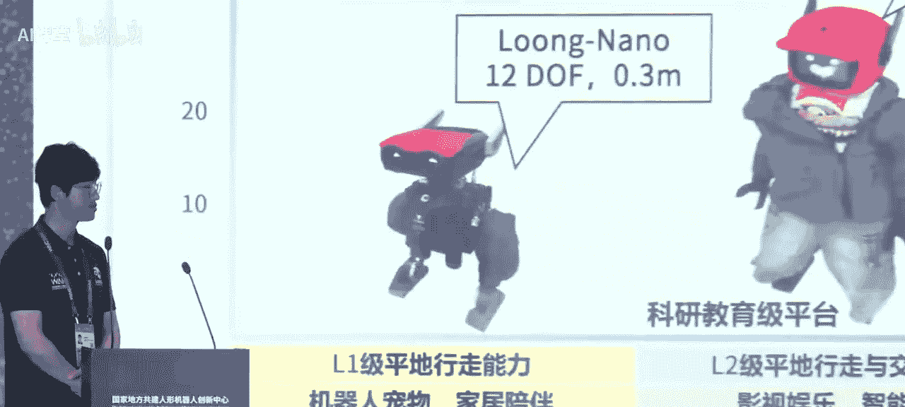

# 【2025 WAIC 世界人工智能大会—主论坛】人工智能全球治理高级别会议  Ai、开源、教育、Ai普惠、赋身智能、神经网络、超级智能 p04 4、人形机器人 与 具身智能 创新发展 -BV1Gx8gz3Er5_p4-

🎼尊敬的各位领导，各位专家、企业界同人，以及我们现场所有媒体朋友们，大家下午好。😊，大家好，我是本次论坛的主持人，我叫韩琴。非常荣幸与各位相聚在上海世博展览馆共同参加，由世界人工智能大会组委会指导。

国家地方共建人形机器人创新中心，与中国电子学会联合承办百度智能云中国联通上海分公司联合协办的2025人形机器人与巨深智能发展论坛。在这里请允许我代表主办方向莅临现场的所有领导嘉宾表示衷心的感谢。

以及诚挚的欢迎，欢迎各位播容光临。😊，🎼谢谢。首先请允许我为大家隆重的介绍莅临现场的各位领导和来宾，让我们准备好热情的掌声来欢迎，并且认识一下他们。

他们是全国政协常委、致工党中央副主席、全国妇联副主席、中国电子协会理事长徐晓兰，欢迎您。😊，🎼上海市人民政府副秘书长、浦东新区区委副书记、区长吴金城，欢迎。😊。

🎼中华人民共和国工业和信息化部科技司副司长杜广达，欢迎。😊，🎼上海市经济和信息化委员会二级巡视员吴志奇，欢迎。😊，🎼国家地方共建人形机器人创新中心负责人孙岩，欢迎您。😊。

🎼国家地方共建人形机器人创新中心首席科学家姜磊，欢迎。😊，🎼中国电子学会副秘书长王天虹，欢迎。😊，🎼世界数字科学院国际首席人工智能官广东省人工智能产业协会创始会长杜兰，欢迎您。🎼百度集团副总裁袁福玉。

欢迎。😊，🎼欧盟智慧产业联盟主席陈志辉，欢迎。😊，🎼中国联通上海分公司副总经理姚建，欢迎。😊，🎼让我们再一次用热烈的掌声，欢迎各位领导嘉宾的莅临，欢迎大家。😊，接下来让我们正式进入今天的议程。当前。

人形机器人与巨身智能正迎来技术突破加速期与产业落地的关键期。从实验室的算法迭代到工厂的场景实践。从核心部件的自主创新到开源生态的全球协同。这一领域的每一步跨越都离不开政策的引领生态的支撑与全球的协作。

国家战略的精准布局，为行业锚定方向，地方政府的创新实践，为产业注入动能，而学界与企业的深度协同，则让技术突破成为可能。那么接下来让我们用最热烈的掌声。

首先有请全国政协常委、致工党中央副主席、全国妇联副主席、中国电子协会理事长徐晓兰上台。😊，🎼为本次论坛致辞，掌声有请。😊，尊敬的吴金城副秘书长。各位来宾呃，各位专家。首先呢也非常抱歉啊。

这个会呢由于交通的问题啊，这个有些拖延。看来人工智能啊要率先在交通让交通领域更加的智能化。很高兴来到上海参加2025人形机器人与巨深智能发展论坛。在此呢，我仅代表中国电子学会对论坛的召开。

表示热烈的祝贺，向长期以来支持人形机器人的技术和产业发展的社会各界表示衷心的感谢。2014年，习近平总书记在两院院士大会上指出，机器人是制造业皇冠顶端的明珠。

其研发制造应用是衡量一个国家科技创新和高端制造业水平的重要标志。2015年，习近平总书记在。😊，至首届世界机器人大会的贺信中强调，随着信息化、工业化不断融合，以机器人科技为代表的智能产业蓬勃兴起。

成为现时代科技创新的一个重要标志。今年是习近平总书记向首届世界机器人大会致贺信十周年，也是人形机器人巨身发展等未来产业、扬帆起航的关键之年。今年政府工作报告也明确提出，建立未来产业投入增长机制。

培育生物制造、量子科技、巨深智能、6G等未来产业，大力发展智能网联、新能源汽车、人工智能手机和电脑、智能机器人等新一代智能终端以及智能制造装备。

人形机器人是芯片、传感器、人工智能、机械材料等诸多技术的及大成者，是巨深智能的最佳载体和智能机器人的高阶形态。有望成为计计算。机智能手机新能源汽车之后的又一颠覆性的产品，走进千家万计。

在家政服务、生产制造、仓储物流、边防、海防、教育、医疗等场景发挥着重要作用。人形机器人还可有力的带动产业链的上下游蓬勃发展，其研发、生产、检测、维修、保养等环节，也会提供大量的就业岗位。

拉动新的消费、催生新的产业，扩大新的就业。近年来，在工业和信息化部的指导下，中国电子学会发起成立了中国人形机器人百人会，举办了人形机器人大赛及未来产业接榜挂帅活动，建立了为共需双方牵桥搭线的平台。今后。

学会也将在以下四个方面，持续的发力，继续推进巨身智能和人形机器人的创新发展。一是强化创新完善生态。发挥好中国人形机器人百人汇高端智库平台的作用。在工信部科技师的支持下。

研究编制了人形机器人核心技术框架体系，凝聚共识。汇聚力量引导行业加快突破无框力聚电机、六为力传感器、行星滚珠丝杠等关键的核心技术。当然，还有我们说的人形机器人的大脑、小脑肢体等核心技术。

推动开源社区和开源生态的建设。二是要加强对接开发场景，深化人形机器人应用场景图谱研究，全面梳理人形机器人潜在的应用场景，拉动链上的企业和用户要加强协同。

共同挖掘在生产制造、仓储物流、教育、医疗家政等等领域的典型场景，拓展应用市场，助力人形机器人的产业快速发展。三是完善标准培养人才。联合企业、高校科研院所共同落实人形机器人标准体系框架。

开展相关标准的研制和推广工作，通过制定实施巨深智能产业人才培养计划。巨深智能机器人实训平台建设推进计划，加强国内内外的相关专家人才队伍建设。四是。深化交流，促进合作。

充分发挥好世界机器人大会国际交流合作的平台作用，加强与国际机构沟通和协调，强化巨身智能和人形机器人领域的国际科技交流与产业合作，促进新技术新产品新场景，在全球共创共享。女士们先生们朋友们。

上海科研资源富集产业基础扎实应用场景丰富，也为人形机器人的发展，提供了很优越的条件。特别是本届的世界人工智能大会啊，也开创了许多的先和，也取得了很多丰硕的成果。在各方共同努力下。

人形机器人也呈现出加速奔跑的势头，衷心的希望大家借助本次论坛集思广益、增进共识，加强合作，为开创人机共荣的。智能时代携手奋斗。在此呢也盛情邀请大家参加8月8日至12日在北京召开的第十届世界机器人大会。

那十年来呢，世界机器人大会呢已经成为全球机器人领域的创新引领的盛会、产业推进的盛会、国际合作的盛会。最后呢，我们预预祝本次论坛圆满成功，谢谢大家。谢谢，非常感谢徐理事长的精彩致辞。谢谢。

那么接下来让我们继续用热烈的掌声，有请上海市人民政府副秘书长、浦东新区区委副书记、区长吴金晨上台致辞。有请。😊，尊敬的小兰理事长。广达副市长。志平副厅长，各位领导、专家、企业家朋友们，大家下午好。

非常荣幸受邀参加人形机器人与巨生智能创新发展论坛。首先，代表浦东新区向论坛的举办表示热烈的祝贺，向各级领导和各界嘉宾长期以来对浦东改革发展的关心支持，表示衷心的感谢。呃。

讲到国家地方共建人心基程创新中心啊，当时我还在市经信委工作啊，我们小兰理事长是工信部分管的领导啊，也是在小兰副部长当时的指导和支持下啊，上海的。这个国家地方共建人心机器创新中心啊，才得以顺利的落地。

而且我也经常这个去创新中心去调研学习啊。我也可以呃跟小兰部长说，我们创新中心的人真的是很卖力。啊，在张江也属于灯火通明啊，我们说打造张江不夜城啊。啊，能够灯火通明，一直看着在加班，在研发的啊。

我们创新中心是最努力啊最勤奋的一个团队。但也取得了非常显著的成绩。当前，人形机器人和巨生智能加速演进成为科技竞争的新高地、经济发展的新引擎。浦通作为全国首个人工智能创新应用先导区。

作为全市重点布局的巨生智能机器人集聚区。出台了人形机器人产业高质量发展的三年行动计划，也推出了模力社区。张江机器人股等产业空间，汇聚了智源、富力业、开普勒等整机企业和50多家产业链相关的企业。

2024年，人工智能产业规模超过1600亿元啊，占到上海的40%。去年，全国首个国国地共建人心机器人创新中心在浦东街牌。共同致力于技术突破、产业化加速、标准制定和生态协同。

积极打造国家战略科技力量的核心节点和全球人形机器人的创新制高点。目前已经形成了多项成果，发布全球首个全站全尺寸、全自由度人形机成开元社区欧鹏龙。推出了青龙等代表性的产品。

构建国内首个易购人形机器人训练场，能够满足超百台人形机器人同时训练。预计年内完成500万条的数据采集。今年4月份。习近平总书记在上海考察时，要求上海强化科技创新先头部队的兼兵部队使命担当。

浦东将抢抓科技革命和产业革命产业变革的新机遇，全力推动人形机器人和自身智能产业发展壮大。我们也将进一步的加快优质企业的集聚，扎实的推动产业链补链、固链强链，丰富多元的空间载体支持。

加快补齐人形机器人产业发展拼图，加强与整机龙头企业，带领上下游融合发展。我们将进一步的支持关键技术攻关，围绕大模型感知系统、运动控制系统等关键核心技术突破攻坚，加速大脑、小脑肢体等技术发展。

推动端到端、多模态、空间智能等算法、模型研发应用。我们将进一步的优化产业发展生态、制定聚生智能的产业专项支持政策，用好青年创业15条等人才政策。啊，我们青年创业15条，现在效果和含金量啊都是非常高的。

效果也很好啊。我们主要2个100万推出100万平方米的创业空间啊，平均租金在1元每平米每天以下。也推出了100万平方米的人才公寓。啊，平均每个月的租金在上海啊，在浦东2000元以下。啊。

这个比原来的是大大的降低。同时呢，对于优秀的创新企业落地，我们一落地就支持100万。连续支持3年。所以最近清创15条出来之后啊，我们荣才公寓。这个需求量还是非常大。啊，创新企业已经落了70多家啊。

效果非常好。同时呢，我们也建立巨森智能产业发展基金，发挥基金的赋能作用。首期是10亿元的巨森智能基金，20亿元的种子基金，20亿元的天使基金。还有100亿元的未来产业基金和250亿元的引领区基金。啊。

政府撬动的基金啊超过2000亿，加上市场化的基金各类在一起啊，接近1万亿。啊，所以我们说在浦东。好好项目不缺土地。好产业不缺空间。啊，好的企业，好的团队。啊，不缺资金支持。同时呢。

我们还加大应用场景的政府采购。努力实现巨深智能机器人，赋能千行百业。走进千家万户。今天的论坛大咖云集，希望大家充分交流，寻找新灵感，发现新机遇，突破新技术。啊，找到新伙伴。

借此机会也诚挚的邀请更多的创业者、企业家、投资人来浦东创新创业，共创人形机器人和巨生智能产业的美好未来。最后，预祝本次论坛取得圆满成功，祝大家身体健康，工作顺利，谢谢大家。谢谢。

非常感谢吴书记的精彩致辞，请回席落座。😊，🎼接下来让我们继续用热烈的掌声，有请工业与信息化部科技司副司长杜广达上台致辞，掌声有请。😊，尊敬的。徐晓兰，理事长。吴金城秘书长。尊敬的各位领导，各位专家。

大家下午好。很高兴在2025世界人工智能大会期间，与各位在人形机器人与巨深智能论坛相聚。我谨代表工业和信息化部科技司向长期以来关心和支持人形机器人和巨深智能产业发展的各位朋友表示衷心的感谢。

人形机器人是未来产业的典型代表。是人工智能、赋能新型工业化的高级载体。世纪计算机、智能手机新能源汽车之后的新一代超级终端。将深刻改变人类的生产生活方式，重塑全球产业发展格局。近年以来。

人形机器人技术加快迭代，中国人形机器人产品不断取得创新突破，实现站得住，走得稳，跑得快，正从舞台动起来，转向工厂用起来。即将从实验室迈入规模化量产和商业化应用的井喷期。习近平主席强调。

要积极培育未来产业，加快形成新智生产力，增强发展新动能。今年政府工作报告也就推进人工智能加做出部署。并首次写入巨深智能智能机器人的概念。未来，工业和信息化部将深入贯彻党中央国务院决策部署。

按照智能驱动场景带动、生态协同的思路，加快产业创新发展，以人形机器人小切口带动巨深智能，乃至人工智能大产业发展、高水平赋能新型工业化。一是加强技术供给，夯实发展底座。技术创新是产业发展的重要驱动力量。

我部围绕人形机器人等方向组织开展接榜挂帅攻关，支持建设巨深智能、人形机器人等国家级制造业创新中心，加快前沿和共性技术突破。后续将围绕智能决策与控制、核心零部件等方面，加大支持力度。

加快突破视觉语言、动作大模型、高性能一体化关节、端测、高算力芯片等关键技术。推动人形机器人技术迭代和产品升级。二是拓展多元场景，加快应用落地。应用场景是产业发展的重要支撑。

我部积极开展典型案例、深度型等工作，打造汽车消费电子、养老助残、应急救援等高价值应用场景，加快人形机器人在制造业、民生、特种等领域进厂打工、服役上岗。后续将推动人形机器人行业分级应用。

支持先导区央国企开放场景，打造人形机器人应用的样板间。开展新技术、新产品中式熟化，引导产业规模化落地。三是做优产业生态，营造良好环境。产业生态是产业发展的重要土壤。我部指导电子学会成立人形机器人百人汇。

推动设立国家人工智能产业投资基金，引导社会各界加大对人工智能、人形机器人等重点领域的投入。后续将发挥开放开开放原子开源基金会等作用，建设人形机器人开源社区，加快人形机器人标准体系的研究。

参与国际标准制定和技术交流，深化全球合作，共建安全治理体系。各位来宾，各位朋友，人形机器人和巨生智能产业发展前景广阔，使命光荣。希望大家以本次论坛为契机，深入交流，凝聚共识，深化合作。

推动全球人形机器人技术突破、伦理共建与生态繁荣。最后，预祝本次论坛取得圆满成功，谢谢大家。谢谢，非常感谢杜司长的精彩致辞。😊，我们坚信，在政策与技术的双轮驱动下，中国必将成为全球人形机器人的创新高地。

政策赋能天动力、产业协作正当时。接下来我们进入隆重的签约仪式环节。今天我们将迎来一项倡议书的发布两项意义重大的签约以及新产品举阵的发布，他们分别从数据标准、产业协作、产业生态维度为行业发展架梁立柱。

首先，我们进行第一项重磅的发布。有请大屏幕共同见证人形机器人与聚深智能数据采集、合作倡议书的发布，请看大屏幕。人形机器人与巨深智能数据采集合作倡议隆重发布。🎼当前，巨深智能技术加速突破。

高质量数据已成为推动人形机器人产业落地的核心动力。🎼中国人情机器人百人汇联合国家地方共建巨深智能机器人创新中心、国家地方共建人情机器人创新中心，共同开启改变行业格局的深度合作。

🎼这是一次区位优势与产业优势的战略融合，各方将通过数据共享、标准互认、训练场共享服务等三大维度，共建中国巨深智能数据基座，抢占全球人形机器人技术高点。数据标准互认。

🎼共同推进人工智能巨深智能数据采集规范、人形机器人关键技术训练、数据管理要求等行业标准发布。依据人工智能巨深智能数据质量规范。🎼实现从数据格式到安全脱敏的全流程统一，并建立数据集评估互认机制。

避免数据重复采集。🎼数据与工具链共享。🎼开展超过10类实体训练场景的数据合作和开源共享，推动数据集规模与质量实现质的飞跃，为产业发展注入强劲动力，共同开发数据格式转化、批量、上传、下载等工具。

倡导全行业数据共享互通，为开发者搭载优质高效的桥梁纽带。🎼数据训练场开放赋能，依托于建设的训练场定制化采集多场景运行数据，为垂类应用研发提供数据支撑，按照统一格式封装，打造可直接调用的数据产品。

降低企业和科研机构的数据处理成本。🎼这场跨越南北的产业协同，将重塑数据生态，为全球人形机器人产业发展提供中国方案。发布成功，掌声祝贺。

此项倡议由国家地方共建人形机器人创新中心和国家地方巨深智能机器人创新中心两个中心共同发起，通过数据标准互认，为行业数据流通、技术协同筑牢基础，让我们期待在统一标准的引领下，实现更高效的创新协作。

推动人形机器人与巨深智能技术的加速发展，致力于构建开放合规共享的数据生态基座。紧接着我们进行第二项签约训练场合作生态签约，在签约前，先让我们来了解一下此次签约，请看大屏幕。😊。

🎼数据是巨深智能技术突破的源头活水，对人形机器人而言，没有高质量的场景数据，就像人类失去了感知世界的经验，无法理解环境变化，更谈不上精准执行任务。2025年1月。

由国家地方共建人形机器人创新中心建设的全国首个易购人形机器人训练场投入使用，计划在工业制造、公共服务。民生重点等多类场景，全面开展规模化数据采集的探索。通过不断技术探索和积累。

已经形成完善可靠的数据采集方案和规模化数据管理工具链，为进一步加快数据采集规模，使巨深智能快速赋能产业。国际中心携手江苏常熟和河南郑州打造人形机器人巨深智能分训链场，聚焦地方优势产业共同建设高。

🎼高质量规模化数据集，成熟聚焦纺织、高端制造、郑州发力智能物流、新能源汽车采集细分场景数据，助聚深智能、快速赋能产业。本次联合签约汇聚7家核心单位。

包括国家地方共建人形机器人创新中心、河南分训练场、常熟分训练场以及中国联通、上海人工智能实验室、百度智能云、华为云共同构建人形机器人训练场合作生态。那么接下来让我们用热烈的掌声。

有请国家地方共建人形机器人创新中心副总经理刘宇飞先生，有请。😊，🎼有请河南投资集团创新投资集团党委书记、董事长宋向军，有请。🎼有请常熟城投集团总经理吴志贺，有请。🎼有请中国联通上海分公司副总经理姚建。

🎼有请上海人工智能实验室巨深智能中心负责人庞江淼。🎼有请百度智能云。🎼泛科技业务部副总经理郝以东，有请。🎼有请华为云巨深智能产品总监张静，有请各位上台签约。🎼好的，请各位拿起签约饼。

在你前方的签约台上郑重数下你们的姓命。😊，🎼请签约。🎼签约成功，掌声祝贺。🎼请各位签约嘉宾向中间靠拢，面向前方镜头，共同合影留念，为我们此次签约竖起右手大拇指。🎼面向前方镜头。🎼好的。🎼321。

谢谢感谢各位领导嘉宾，谢谢有请回席落座，谢谢你们。😊，🎼感谢各位领导嘉宾，有请回席落座。😊，🎼训练场是技术迭代的练兵场，江苏制造业底蕴深厚，河南在多领域应用场景广阔。此地。

两地训练场布局将成为技术转化的关键枢纽。借助江苏的产业协同力，河南的场景多样性，助力于人形机器人在多元实景中打磨迭代，更快从实验室走向苏域大地，乃至全国的实用舞台。而生态合作伙伴的加入。

更是为训练场的全国布局过程，保驾护航。最后，我们进行第三项签约。国地中心开放基金签约仪式，有请以下高校及科研院所的项目牵头人上台签约。有请国家地方共建人形机器人创新中心。

🎼有请浙江大学、香港科技大学广州。🎼有请复旦大学哈尔滨工业大学、中国科学院微系统与信息技术研究所。🎼有请北京建筑大学。🎼西安交通大学。🎼上海交通大学。🎼中国科学院重庆绿色智能技术研究院。

有请各位代表上台签约，掌声有请。🎼国地中心开放基金面向国内高校科研机构、企业的优秀青年者，为那些前沿探索的技术保驾护航，请各位拿好签约笔，在我们前方签约台上，郑重的数下你们的姓名，请签约。😊，🎼。

🎼签约成功，掌声祝贺。🎼好的，请各位领导嘉宾向中间靠拢，面向前方镜头，竖起右手大拇指，为我们此次签约。🎼点个赞。🎼好的，谢谢，非常感谢各位领导嘉宾，有请回席坐座。😊，🎼期待在基金的助力下。

催生出更多颠覆性创新成果，点亮产业未来。这一系列的签约是合作的开端，更是产业协同奋进的号角。再次让我们用热烈的掌声感谢各位签约嘉宾，感谢各位。😊，期待各方携手书写更多的精彩篇章。签约剧式新品起新。

接下来我们将进入新品发布环节。在技术迭代浪潮中，国际中心的技术布局与产品创新，将为行业发展注入新活力。新品发布前。

让我们首先用热烈的掌声有请国家地方共建人形机器人创新中心首席科学家姜磊带来主题为国际中心技术布局及产业发展思考，掌声有请。😊，好的，尊敬的徐理师长、杜市长，各位领导呃，各位来宾。

那么下步面呢是一个发布环节。我就我是觉得在发布之前，我还想借这个机会表达一下各各位领导对我们国际中心的关怀与关心。那么也汇报一下，过去我们中国人形机器人。在这一整年的一个发展。

所以我改了一下我的标题叫从能走跑到能干活，通用人形机器人的下一个风口。这好像。或者谁帮我迁移。就是呃我自己的感觉，上午我们也在总结，中国人形机器人在这三年间发展非常的迅猛，中国的跑跳能力取得领先。

这个是非常来之不易的。那么我们如果做过人形机器人都是在知道在过去的二三十年，我们一直在追赶，追赶到今天，我觉得在今天这样一个有纪念的历史性时刻，走票走走跑跳啊，我觉得它不是一个炫技。

是对人形机器人控制水平硬件平台的一个综合考验。而且在这里我觉得要替我们全国做人形机器人的说句话，我们取得了世界领先。第二个呢，我们在23年工信部发布的大脑小脑肢体写进了创新发展指导意见。根据我们的收集。

大脑小脑肢体基本上已经成为世界的呃被世界广泛引用的技术跟标准体系。我们从232425整个发展周期来看，大脑当时我们都说哎charGPT这个是不是很神秘啊。当时出来我们也成为成成功的。

这个把自己的疑虑打消了，一直到25年，大家发现没有？de一个中国的应用，甚至我们的家人都在下载。那在小脑呢，我们就发现从去年的8月份开始到今年促进了整个巨生智能的急速发展。

但小脑我认为就是下一个竞争的要点。而在肢体呢从这个特斯拉的人形到现在我们发布的包括语数到今天我们发布的智源跟重情。那么24年25年，我觉得我们国家机器人整机平台的历史是被我们中国在刷新。

所以这三个技术来讲，大脑跟肢体技术部分技术是取得领先。由一些原创性技术还少，但小脑技术呢一定是一个下一个风口。那么从整个人形机器人的智能控制变迁来看，我觉得还是非常呃激动的，从2000年我们的运动控制。

到2010年，我们用动力学来探索。到2000年，我们开始用强化学习。可以看到，今天巨生智能开始全面的赋能到人形机器人。我觉得整从整个的变迁史来看。动力学之前是我们国外的学者在引领整个机器人。

从强化学习阶段，我们国家的学者已经开始走上了世界一流的水平，画上了一个圆满的句号。在在下一步呢，机器人如何进入我们的工厂跟生活。巨神智能如何去打造。我觉得是我们这一代人一个重大的机遇跟挑战。

也是我们这一代人何其有幸的一个机遇。那么从整个巨深智能发展的阶段来看，我们说巨生智能是什么？是AI加机器人，就是有身体的机器人。那么我们机器人有几个能力呢？感知认知决策执行。

那么我认为这四个能力感知到执行，我们经历了一个阶段，其实叫0。0，大家如果研究过巨生智能的 intelligence发了一个模型，大家有没有想过，为什么为什么叫派灵。

就是因为它的感知数据还来自于仿真世界，我们如何把它推进。那这个阶段呢，VOMVOAON大模型就在纷纷的起来。然后刚才我们那么多数据训练场，大家都意识到巨生智能现在的问题就在数据瓶颈。那么我们再往后畅想。

从认知直接到执行。那么我们是不是除了要把精力放在预训练下一。阶段挑战是不是在后训练？我们如何运用视界模型来打造我们虚实融合的数据场景。那么最后呢决策到执行。

我相信我们人类大脑小脑肢体本身就是一个分层架构。那么未来的像越来越多的基础通用模型，像双系统将是往巨生智能往认知行为能力拓展一个最最重要的标志。所以我觉得从分析路径来说。

有些时候我觉得我们中国的学者能不能从一开始就构建决策到执行的这样。呃，解决终极解决方案的一个原创模型，而可以很负责任的说，到今天这样一个架构依然没有开始。那我们都在探索。

所以也给我们一个非常好的一个机会。那么总体来说，巨深智能家解决能干活这件事的三个痛点，就是要解决它的感知局限，决策诞生跟泛化瓶颈。所以我一直强调的我们做人形机器人巨深智能家，不光是夹在大脑。

不光是加在小脑，而且夹在我们的肢体上。我们老说我们的手能不能变成肢体，呃，这个智能的器件，我们的传感器能不能变成只有这样打通大脑小脑肢体的巨深智能家的这样一个技术路径。

我们才能真正取得这场革命的一个胜利。那从整个产业链来看，巨深智能赋能的机器人已经发生明显的改变。我们从过去的老四大件感知、控制、驱动跟传动发展到今天，我们会突然发现老四大件除了高重载高精度的。

我们基本上解决了国家供给问题。但是我们的新四大件的高端芯片、动力电池、高性能材料连接器跟标准器，以及我们的新四大组件、感知头、零巧手、机械臂、电子皮肤是何其重要。我跟很多的做传感器的说。

我们做人形机器人的特别希望直接能用到感知头，而不是用你的视觉传感器，用到零巧手，而不是直接用到你的硬变片的传感器。我们能不能为人形机器人打造出新的组件。所以还是前面我的个观点。

巨深智能是有身体的AI我们不应当只关注。而而忽略身体是软硬一体化打造。那在整个的引导之下，过去一年，国际中心从十八金刚像今今天早上我给媒体去呃这个汇报的我们人形机器人的技能大舞台。

那么我们真的用VOA的数据底座来驱动整个人形机器人。去年我们也搭建了我们的呃开放的这样的一个阵列。那也是邀请各位可以一进入我们的整个展馆的第一个就是我们的劳动技能展。

可以看到有11家全国的机器人公司有24台用VOA来改变作业的习惯，从它的整个开发范式，而且也希望呢但邀请大家到我们的展台去进行呃观看。那么我总结过去我们人形机器人国际中心的发展，以及面向未来。

我们其实一直在干这5个平台技术的研发平台中式平台数据平台，公共服务平台开源平台。我跟很多领导也汇报，我们不是又一家整机公司，我们是希望通过我们的努力跟大家一起这里所有的生态技术。

不光是我们一家公司在打造，是联合了国内的所有热爱机器人热爱我们生态构筑的一群人在联合打造。嗯。那么下一步呢，国际中心我觉得发展了3年了。呃，创新指导意见25年又一个阶段。

我前面有个PPT总结过25年是个什么状态。那面向27年呢，我认为国际中心在这个新的三年征程里要重点面向标准跟开源生态，去进一步打造好上面所说的五项服务平台。刚才我们也发布了标准，也发布了我们的生态。

所以也邀请各位加入到我们整个的生态的打造活动中来。呃，以上所有呢我觉得总结一下，我觉得走跑跳这个能力，绝对不是献技，而是给过去的20年，画了一个圆满的句号。这个句号的终点就是打在了我们中国。

就打在了我们所有做人形机器人的厂家。呃，今天我觉得我们的能力是可以挺起摇盘，说超过了。动力超过了特斯拉。但是下一个呢机器人是如何去能干活，是一个风口。

那么我们面向27年呢想去做的就是围绕标准创新开源跟生态这四件事来打造。所以下面我的同事呢还是围绕能干活这个主题，打造我反复强调的巨深智能是AI加机器人的新开发范式。所以两个主题。

一个我们的新的机器人产品系列。第二个，我们巨深智能的底座。首先有请我们第一位我们的呃刘宇飞总经理。感谢蒋总呃，尊敬的。😊，尊敬的各位领导呃，我今天呢因为。呃，我今天因为在去年其实24年7月。

我们发布的青龙公满机，也就是在左侧我们的这这个平台。在一年的努力下呢，我们其实形成了我们的青龙pro青龙light，还有我们的青龙view整体的一个产品家族。然后我今天带来的呢就是给大各位介绍一下。

我们现在整体的一些技术的进展，还有产品的一些进展的情况。呃，首首先呢是我们的青龙pro这这块。呃，我们呃这这一款呢其实我们从场景的场景出发，我们我们觉得我们发现青青龙的这个呃全尺寸的机器人。

它在智能工厂，还有智慧园区等等领域智智能赋能。我们现在的工业和生活。特别是像特斯拉和不动力等等，都在工业的汽车的产线的场景里边，在智能工厂的智能工厂的里面在在生产一线里承担了很多具体的一些操作的任务。

包括智慧园区，我们提到的安保巡检的任务，也是目前我们在做的一些刚需的一些场景，都是可以用机器人甚至人性机器人，甚至是类人型机器人能够去做的一些场景的替代。呃，我们的青龙pro的机器人呢。

其实是完成了全尺寸和全升级的一款呃，它其中呢包括也沿袭了我们我们我们公版机的1。85的身高85公斤，38个自由度，包括关节扭矩达到36。😊，96牛米，其中比较特点的呢是5个板块的升级。

第一个呢就是模块化复用的升级。呃，我们其中呢这在感知头的领域，我们涉及到的多模态感知的一些融合的传感器的搭载，也包括我们无自由度、七自由度等等机械臂，包括我们算力背包等等的一些支持快拆快换的一些结构。

第二个呢就是多模态感知的一个升级。我们自己自研了，包括我们融合的感知头，包括集成可见光红外热成像，还有气体传感器等等。我们也有自己轻轻量化的包呃集成雷达，还有还有雷达IMU。

还有视觉传感器一体的这种多多维的传感器的融合。在能够实现我们现在的一些场景的，包括场景的导航的一些一些应用的需求。第三个呢就是快拆电池的一个设计。我们也完成了续航达到2小时。

能够实现抽取更换的连续作业性的一个一个一个升级。第三个呢就是云端协同的算力的升级。我们现在设计了一个算。😊，背包其中就包括我们可以做算力的扩容，然后做端侧的推理和端侧的部署。

第五个呢就是我们时空智能定位的升级，不光是在室外的，也在室内环境下能做无无缝的切换，能够做RTK的定位加视觉融合的导航。整体的未来是主要是面向于园区厂区，还有室外的一些环境。

进行复杂的一些智能的时空智能的一些定位。呃。呃，其中呢我们主要还是在新龙pro的版本上，我们在打造两大能力。大家也是在于打造进入物理世界的一个场景本体和模型的一些拓展。

第一个呢就是边端一体化的时空智能的呃算力背包。这里边呢我们在华为的支持下，我们集成了310P的算力。然后还有个定位的芯片的模块，它能够在形成了我们基对于机器人本体的算力的拓展。

我们相当于在在176G的算力的支持下，能够做边策推理和鞭策的鞭策的部署。第2块呢就是我们基于千寻的定位定位的模块，能够在我们的户外的环境下，能够做呃外外部的RTK的一个TK的一个定位的信息收集。

也以及在室内的位的收集这个就是我们的一个我们发布的一个呃基于定位的信息和室内环境，能做的物流物流的搬运物流的。🎼分解包括能到送到室内的环境的一个视频。🎼人机系统打通物流最后100米配送电。第2块的能力。

其实我们在刚才刚才训练场的签约板块里面，其实我们在训练场的工作中，我们大量积累了大量的数据。这里面既包括一些真机的数据，也包括一些仿真的数据。在在我们在与华为的一些工具链的支持下，在clorowdro。

还有在miow等的平台下，我们形成了很多基于真机数据的一些仿真的合成数据。在这样的加持下呢，我们可以形成了对于外界的环境环境的一些变化，包括外界的一些纹理，还有外界的一些光线的变化情况下。

我们能够实现对机器人的整体的部署的一些效果。😊，🎼这个这个视频呢就展示了我们当时在基站的这种场景，真实的场景里边，我们里边有一些行差，有一些公开，还有一些其他的线数。在这个在这个真实的环境里面。

我们做了一系列的采集，包括任务。但是在仿真里面，我们其实生成了非常多的在不同的光光照和纹理下支持的数据。这样的话就便于我们在整机真机部署的时候，我们数据量的一个多样性。其实第二个板块呢。

我们我们在跟包括上海人工智能实验室，也在基于我们白虎600万的数据集的基础上做了很做了我们的一个in特VRVAE的一个模型。在这个是1。8B的参数量。然后我们在这个里边呢。

其实是主要是单体的一些机器人的一些训练里边呢涉及到的就是我们场景，还有任务。🎼包括场景的任务的理解，还有一些action的动作。这里边呢就我们收集到了这些文本的信息和图像的信息。

再转变到我们现在的这个场景里面，然后再去做真集的部署。这里面涉及到我们拿了非常多的像马克杯插花等等。在我们训练场里部署，包括训练这个过程里积累了大量的数据来训练1个1。8B的模型。

所以在在整体的我们两在青龙pro上面，主要是在在场景在数据上在本体上在核心部件上，也在操作大幕引擎上进行了很多的迭代。呃，第二个呃第二个板块呢是我们青龙light的机型。

这个也是我们青龙pro的一个呃呃一个延伸。其实这样的一款产品呢，我们希望能够未来在开源教育和科研上能够有更大的助力。我们未来呢也希也希望能够推到百校型的这样一个未来的一个一个工作。

这里边呢其实在开源这个板块，大量的现在人性机器做了很多的很多的一些开放，包括京东技元、语数、福利业，包括智包括智源等等，包括我们青龙在去年其实也做了公版机的一些开源的发布。😊，呃。

整体呢就我们我们我们的理念是硬件一硬件通用和一脑多机的一种方式。其实硬件通用呢，我们整整体是基于青龙pro的一些底层的底层的控制，底层的芯片来形成了我们现在青龙let一个机器人。

然后现在它整体的身高是1。45米，整体的重量是45公斤。呃，我们我们总结就整体的开发，在开发这样的一个平台，我们是一个轻量化的一个开发和部署。这里边呢我们现在用在两个月左右的时间内。

其实就完成了我们现在青龙let机器人的整体调试，还有整体的行走。它整个的运动性能更更加稳健，而且能够更利于更利于开发者快速的上手。再一个呢它是跟青龙一样，是底层底层完全通用是一个低成本的平台。

我们认为现在像类似于let这样的一个些平台，它的成本绝对不会超过10万。未来呢它的整整个场景里面包括在导览教研。我们我们会做一些新做新场景的一些拓展。这里边我们会在后期加一些我们的。语音识别。

包括包括拟人化的动作，包括自然语言的对话，然后再升级到它，包括我们加加一些算力导航等等方向的一些一些一些背包。呃。

未来呢我们会在很快的很快的阶段呢让青龙let也入驻到我们工信部开发演基金会的op鹏龙的开源社区上。然后通通过两个方式的推进，一方面呢是坚持坚持高校百校型的这样一个基于青龙let作为轻量化版本。

在在高校里面进行落地进行实践。第2块呢，我们会在op鹏龙开源社区上。让它成为开源社区里边的一个轻量化的成员，继续延续我们青龙的一些技术优势和技术迭代。第三个版本呢是我们的青龙view。

也就是呃下面的一个平一个平台。其实在整体的在青龙view这样的一个平台。今年我发现这个展会里边，展会也有非常多的这样的新的平台家族出现。里边呢其实涉及到我们总结来看，包括结构化的工业环境。

室外的成服的环境，以及训练场的一些素材的环境，都是这样的一个一个智能体，它能够应用的一个环境。这里边呢其实我们有我们的视频里也展示在这种物流的场景，它的搬运的场景。

包括室外能够推推送垃圾桶这样的一些场景里边，这样这样的一个轮青龙view的平台都能够去做这方面的工作。呃，当然我们整整体其实呃左侧左侧的这个照片就是我们大概8月份会发布的我们的vipro版。

现在呢我们是将在是一个 vivo1。0版，它的整体重量呢大概是240公斤，全身自由度22个4四转四驱的一个驱动。未来呢我们会基于现在我们的底层底基于我们现在底层的一些控制和底层的参数做快速的落地。

能够形成我们不同的自由度的机械臂进行进行搭载。然后第二个呢是多维感知聚焦我们现在的场景。这里边我们涉及到的雷达超声波传感器传感器和多维相机进行一个整体的融合。呃。

再一个呢我们会形成这种云边端协同的一些架构。就是机器人在室外或者室内在在作业的过程中，我们会逐渐的去收集它的数据，包括在做云边端的一些训练。然后把我们的具身智能一些操作大模型等等。

在我们的这样的一个一个更这样的一个平台上更检验的平台上。😊，进行部署。第四个呢就是我们会持续迭代。在在基于场景的数据，基于素材的数据，在在训练我们具身操作的一个模型。

提升现在目前机器人的这种泛化能力和工作效率，逐渐扩展我们现在的作业技能库。呃，最后邀请大家看一下我们整体的呃一个产品发布的视频，面向实战场景的高性能巨深智能平台。青龙V3。0。重磅发布。作为平台型产品。

青龙V360高度模块化设计。支持基础行脏、上肢作业、环境感知等核心能力自由组合。适应多行业应用需求。🎼依托格物置知平台，新龙V3。0实现大模型与文体协同训练。🎼可快速开发场景任务，加速AG落地入设。

🎼185厘米、85公斤，全身最多60个自由度，金融母自由度与七自由度机械臂适配凌胶收玉假爪。🎼满足作业与交互需求，感知头、背包、电池与末端执行器全面模块化设计。

🎼支持按需升级与维护关键核心部件自主研发折扣。🎼精准步态控制，适应复杂地形。搭载云平台支持远程任务调度。状态监控与OTA远程升级。🎼借助格物置知平台，向导师任务开发办事，加速实战场景部署。🎼青龙V3。

0构建场景智能落地的坚实支点。兴龙不止一款产品，而是一个持续进化的巨深智能平台。青龙n轻巧灵活，开源可拓展，面向文旅与教育行业。🎼打造智慧全级新体验。🎼青龙院专为工业场景应用。

城市环卫作业、大规模数据采集等场景打造，实现智能识别、稳定搬运、高效作业。🎼从科研开发到场景实战。🎼青龙矩阵已全面启航。好的，谢谢各位。下面邀请我们邢梦阳博士来带来我们分享聚深智能开发平台的板块。😊。

呃，非常荣幸呃，能代表我们团队和公司做一我们叫做核心组建和通用平台开发的这样的一个汇报。那呃再次感谢各位领导、技术专家能莅领我们这次的论坛发布内容。嗯，首先呢我相信如果去年了解我们团队的同事呢。

可能会觉得我的形象会和去年不太一样那这正如今年人形机器人整个板块的发展一样。在二楼的论坛们也看到有非常多的这个技术企业出现。但是从我们的团队的角度观讲来说，人形机器人和身智能的落地。

仍然充满非常多的挑战，我们现在可能非常多的团队是需要有一款像语舒一样，走的非常稳定又像一叉一样，有大模型加持，能实现精准作业啊，同时呢又跟特斯拉一样，通过训练场能非常快的会更多的技能啊。

同时也具有像派林模型通用化大模型，包括这个长城任务的能力。那打造这样一个终极的挑战的问题呢，实际上我觉得它的本质就跟我们今天讨论的议题和发布内容非常相关。一个首先得需要有一个具有高动态高可靠的硬件平台。

保证模型的迁移，是具有最小的gap的。另外一个就是均身智能模型要赋能人形机器的上肢，甚至是全身的动。作实现这种精准的抓取。第三是训练场在发育技能过程中是非常关键。它产生了我们啊标准化的数据。

包括我们今天也完成了数据的互通互认。最终的目标呢，我们还是要把这个模型数据转化成真正的应用。那这里面我们观察到实际上国际中心也围绕目前我们提出的可能目前巨身技能不是一个模型那么简单。

而它变成了一个巨身系统。我们进行了三项尝试的和创新探索。首先针对像国外或尔动力，我们知道一直在做这个传统动力学控制是非常厉害的一个团队。

那他们针对的目标的是人形机器人双足机器人的全身移动上下料的一个难题啊，当我们团队真正接触这个问题的时候呢，我们是在呃研风汽车这个场景去完成这个上料下料，在它的激光弱化的设备里面去做这个放置。

我们发现这过程中，实际上人形机器人通过双足形态争取完成这种上下料作业任务有非常多的问题。完成。比如像我们刚刚那个江总最早提到的大小脑的模型，怎么融合，小脑的技能，怎么赋能到边端的模型。

这一块都是有非常多的技术环节需要去解决。另外一方面就是可能大家关注到今年非常多机器人已经开始进入到场景，特别是工业分拣场景。比如像fi AI他在之前嗯有一个非常炫酷的视频，就是做这个分拣。

那我们也在刚刚提到劳动展展区也做了尝试。我们通过这种VRA的集身系统来解决这个2小时的自主分拣，而就完全是通过模型驱动。那这里面最大的问题就刚刚说到了，是怎么通过合成的数据。

通过我们这个VRA的架构来完成赋能到机器人真正快速的先解决呃应用的这个初步的一个问题。那最后的话呢可能就是我们现在离产业化落地比较贴近的一个状态，就是商超这样的场景。那商超场景这一块的话。

包括在很多展区都有展示。那里面可能我们觉得下一阶段解决的不只是单智能体的这样的一个问题。更多的。比如说是用伦臂的平台，怎么通过多智能体协作，快速的完成。无论是在医疗场景，还是在呃超市场景中的这个上下料。

那围绕这三个场景的问题呢，实际上我们发现人形机行人包括或者说我们叫做聚身系统，还是以大小脑呃聚身小脑聚身大脑，甚至我们加上智能体这个概念来提出。这过程中，除了需要完成行走操作和这个感知之外呢。

更重要的是把大脑的长城任务结合和泛VRAA的泛化能力能作用到。我们认为是需要解决真正的移动操作任务。比如说像我们今天看到很多机器人可能就在单工位上完成呃推理任务。但是可能真正在场景应用落地中。

它是需要在一个工位完成5种原子技能的组合。而且在一个非常广阔的厂房空间内要实现4到5个工位的转移。比如说我们之前尝试的这个汽车场景。另外一个就是整个的开发流程。

肯定是跟原来的我们那种组态式或者说代码式的开发完全不一样。而是要面向下一代巨生agent这样的一个概念。围绕这一块的话呢，我们是也希望呃国际中心也一直在希望能集聚全产业的这个能力。

一起来构建一个一站式的协作平台。这也是我们今天这个报告最重要的内容。我们是希望能为行业来提供一个通用本体与通用呃计身智能系统这样的一个综合性的赋能方案。

包括我们前期也在持续搭建的这个格物置智这样的一个工具箱。啊另外的话呢，围绕计身本体的贯通，是需要有操作系统硬件控制器预控制器来支持的。我们在推动啊基于自主可控。

包括op红模这样定制化操作系统的这样的预控制器来赋能到机器人。同时的话呢，青龙公版机经过一年的研发，它除了变成一个标准化设计之外呢，我们也把它赋能到了易购的具身本体的，形成了系列化的衍生的平台。

那通过格物之知呢，我们是希望能变成一个未来是万物俱生，而且能具备一脑多性的智能体的这样的1个IDE开发平台。格物平台为我们提供仿真训练的这个能力来实现原子技能的快速的生存。那自知平台的话呢。

是把这个能力真正赋能到进前本体，而不是停留在仿真虚拟体里面。同时它要解决大小脑模型和具身本体如何沟通如何执行的一个问题。最终通过智能体平台把整个的技能力和这个工作流整合起来。

变成面向用户和应用侧的这样的一个开发范式。在至上至下呢，我们把它可能打造成真正的具身系统中台。通过AI工能流串起来我们的原子技能，再进一步通过我们具身本体。构建的操作系统，计算芯片、执行单元、传感单元。

真正的解决一脑多行的问题。目前的购物置系统实际上已经完成了4个功能的开发。第一个是云端的训练仿真。那通过在云端，我们能快速的完成对人形机器全尺寸，包括不同技能的训练。

同时的话呢依托我们前期格物外部的这样的一个开源仿真平台，能进行全链路的模型验证和仿真。支持平台是将机前的技能通过低代码的开发，快速的部署到易购的平台。这里面通过操作系统的支持。

打通本体和模型部署的一个难题。同时，通过agent的开发，我们来结合多模态的ag，满足具身本体工作流的开发需求。下面做一个详细的介绍。在全链仿真这一块的话呢，我们联合乔械15搭建了云端训练仿真平台。

在平台上，我们能快速的新建任务，面向机器人强化学习泛化性所需要的多课程技能组合，进行模型训练和快速的技能训练。比如说我们前期在该平台上完成了全身大尺寸机器人的这个复杂动作。那依托全链闭环呢。

我们前期是开源了购物仿真平台，这个仿真平台可以通过构建我们训练场的数字资产，在仿真里面加载我们的技能模型，进行快速的全链路闭环，实现对交互操作导航行走，多种技聚身技能的一个全全链路验证。

支识平台呢是要加速本体迁移模型的这样的一个难题。我们通过open龙软件框架和多软计算这样的一个具身中间件来完成对模板构型的配置，解决硬件本身在关节执行器参数配置复杂，组态技能开发难的一个问题。

同时我们现在也联合包括开源的mo法和阿里云这样的居身智能体开发平台，打通现有智能体AI工作流和巨身技能这样的一个接口，实现真正的智能体开发。通过操作系统加持呢。

让我们这个具身智能体的开发变成了有可能的现实。相比于传统的MPMCP这样的一个模型上下文协议，我们希望能提出叫做CP就是机器人上下文协议。它相比原来的上下文单轮对话。

能真正的获取机器人端侧的这样的一个实时数据，并通过工作流的开发范式，让云端的智能体能调用机器人的巨身技能。那这里面呢是离不开我们聚身中枢中间件，包括我们定制的操作系统。

以及端侧自主可控算力的一个全面支持。同时的话呢，居身本体我们也专注于开放高性能的电机动啊，电关节设计标准。我们也同时在今年在展区内发布了我们自研的高低自由零零巧手。

也实现了在内人小尺寸下的一个精确的紧偶和设计和现场的demo演示。中心将持续推动我们巨生智能生态体系的建设。回顾刚刚格物这只两个平台，它构成了我们聚身系统整个的开发中台。同时，依托生态单位的合作。

我们现在已经构建了仿真端计算不组件多样的合作生态模式。我们重点布局三硬三软，包括操作系统CP居生中间件open控制软的框架预控制器电关节合无之手。我们希望在上游生态呢进一步跟云平台的团队一起合作。

解决机器人在端侧算力不足云端MCP技能调度这样的一些难题。通过模型的加载训练场提供多样的VRAA模型，最终来解决包括我们现在希望能实现的接待迎宾园区巡逻货物转运，以及在工厂中的流水线分界。

跟我们的合作伙伴一起将人形机器人和集算系统加速推进到应用场景中。那我们的合作伙伴已经有非常多的团队，也希望也进一步邀请在座的各位领导专家和技术团队一起加入我们。

那下面呢就是我们整个发布环节最重要的一个内容，有请我们的青龙3。0全谱系的公版机设计系。呃，来上场。🎼我们掌声欢迎。😊，🎼好的，同时呢有请我们国家地方共建人性机器人创新中心首席科学家姜美江总上台。

有请国家地方共建人线机器人创新中心副总经理刘宇飞刘总上台。

大家好，我是青龙pro，面向全场景应用的人形通用化身，身高185厘米，具备自主行走语音交互与灵巧操作能力，自研多模态感知头识别异常危险，快速角色判断响应处置。搭载时空智算背包边无端算力，协同共享。

标准化接口设计，实现头B背包自由组合依托格物智知巨深智能平台，加速海量原子技能，不断学习适配场景应用。未来的智能世界，我准备好了。接下来欢迎青龙衍生系列一起登场。

那青龙呢我们在这次发布也专注到我们不是一个细呃单一的平台，也希望通过公版机的设计，我们赋能到低成本开源的小手平台，希望以居身智能为牵引，以人心机型为最佳载体来定义公版机的标准，感谢大家。🎼好的。

来请留步，请江总、刘总，还有我们邢博来到我们的机器人旁边，我们一起合个影来有请。🎼好的。🎼来，我们面向前方来打个招呼。对，打个招呼，来面向前方。我们摄影老师用镜头记录下此时此刻。好的。

我们再为我们的三位机器人竖个大拇指来合个影。好的，面向前方镜头，跟随摄影老师的指引，共同记录下此时此刻。😊，🎼好的，谢谢，非常感谢。😊，🎼好的，现在请各位领导从舞台右手边依次退场。

请机器人从左手边依次退场。🎼从技术蓝图规划到产品矩阵落地，从核心组建突破到开发平台搭建国际中心的新品发布，彰显着行业创新的实力，也为场景应用拓展提供更多可能，让我们共同期待他们赋能千行百业。

接下来我们休息10分钟，休息结束后，众多院士专家也会在主旨演讲和圆桌互动环节带来更多真知灼见，敬请期待。谢谢。😊，🎼现场亲爱的各位嘉宾，欢迎大家来到2025真心机器人与巨身智能创。😊。

🎼现场亲爱的各位来宾朋友们，欢迎大家回忆到2025人形机器人与巨深智能创新发展论坛。技术创新浪潮涌思想碰撞火花然。下面进入标准数据产业环节。多位行业大咖将为大家带来主旨报告，解码前沿趋势。

首先让我们用热烈的掌声有请清华大学计算机科学与技术系教授孙富春上台分享人形机器人与行为学习掌声欢迎。😊，尊敬的各位嘉宾。女士们先生们，大家下午好。今天非常。😊，荣幸来到上海。

给大家汇报一下我的人形机器人。包括他如何借鉴人的行为学习，提高他的剧深操作的能力。其实我们大家都看到了，我们人类呢。从爬行。到站立。花了。百万年的时间。那么机器人呢却用到了短短的30年。那么为什么呢？

我想呢从三个方面给大家回答这个问题。我想第一个重要的问题，我们仍是高负重比。就是两个脚占非常小的面积，承受的重量在所有的动物当中是最高的。第二个是高度的形态致适应，就是两条腿的结构，再加上人的脊柱构型。

那么这种构型可以做出无限可能的动作行为。你比如说我们的艺术体操运动员，包括我们的杂技运动员，可以把我们的这种形体描述的是惟妙惟肖。那么第三点，两条体走路最需要智能。这就解释了为什么我们的孩子。

要经过一岁半到2岁的时间才学会行走。难道我们人哺如动物吗？其实就是因为两条腿走路，需要大脑的发育。这种发育有两个方面，一个是结构方面，就就说解释了为什么要百万年的进化，在结构方面的进化。

那么最近大家看到上次发了一篇非常重要的文章，就是家里的狗经过百万年的进化，跟野生狗的老结构是不一样的。第二个部分就是皮层的发育，包括肌肉的发育。小孩必须要经过皮层的发育，包括肌肉的发育。

到一次一半才能支撑这种高度的这种负重比。那么这就解释了两条腿走路，它要调节平衡和稳定，最需要智能。这也是我们今天在讲说人形机器人是最具挑战的人工智能的验证平台。如果说你说你人工智发说的好。

你用的人形上怎么做的好？这也解释了4条腿的狗为什么跑的那么快。为什么人形机器人。他就那么难呢。今天我看发布会上讲了一个特别重要的概念，说要从运动要过多的人干活，这个能干活。实际上就需要什么高超的智能。

包括结构上的智能。好，其实我们讲30年里面，很多一段路是日本人在前面走的。其实大家记道日本的阿西姆。其实我们大家还见到了l这个机器人是法国产品。这个产品在我们很多的单位，包括科研机构。

最早就是捞aw机器人，它也是呢视觉听觉触觉。另外呢他用到了像操作系统啊，也用到了很多AR的算法。那么我们今天看到了飞哥03，也就是5月27号。🎼那么这个太快了，大家看到机器人他可以做分解。

真是越来越熟练。飞的人形机器人正在工厂里工作。我觉得啊这个人形这个动作做各种不同类型包管的分解，我个人认为国立的机器人可能跟他有一拼。但是呢我没看到国立的报道看起来和真人没什么区别。

对大家知道它有两个什么系统，系统一是本体，系统二是什么思考啊，他能够思考。好了。那么其实我们经常感到一个非常重要的问题，就听大家讲说人形出现以后啊，那么智能体这个概念呢我们要改变了。

我们过去智能体说它是一个软件。能够通过感知数据去学习。感知通过什么决策到action之间的映射关系。那么今天的智能体呢，它也在物理实践里面，它就必须有物理的感知部分，物理的什么行为部分。

还有一个像人脑一样的什么大脑。那么今天我看到上海提到了VRAA。其实的话呢，目前大家觉得呢应该是触觉加VLA可能是最现实的。如何你判断一个操作是不是稳定，你没有触觉。你怎么去判断呢？所以说呢知识。

加端到端的触觉VRAA可能是行为操作里面非常重要的部分。所以在我们这篇文章里的话，已经发表了今年4月份在工程上面就谈到了物理的部分，物理的行为部分。那么自能体如何在知识引导下去感知。

在知识引导下是什么去行为？那么感知和行为过程在物理实的交互过程当中，如何完成大脑知识的更新发育？这里面特别重要的部分就是感知和行为部分的常识层增强。什么叫长识性增强呢？大家都知道的。

如果我们能反反复复做一件事，做多了以后呢，你闭上眼睛都知道怎么做这种长识性增强，如何在自人体当中去实现呢？那么呢这篇文章的话呢，就考虑到这样一个知识引导下，如何实现这样一个增强技术。好。

那么最近有一个非常热门的是叫实件模型。那么它和我们现在的空间智能的话呢，正好形成了什么鲜明的不同。那么搞计算机视觉和机器学习，他们擅长于从视觉角度出发。然后通过大模型做VRAA，然后做操作。

而这个操作的大量的样本是专业提取的样本，而不是什么实际场景的样本。啊，或者说刚刚走向世纪样本这个阶段。那么第二个部分我们讲叫时间模型。所以前一段时间我在合肥的报告里讲到了说空间智能基本上是搞机器学习。

搞计算机视觉。他们从空间智能以视觉为主导来做。其实搞机器人的人来做巨生智能，他们是从物理世界。也就说我们叫世界模型。那么这个世界模型的话呢，它以动力学、运动学，包括跟感知学叠加去构造这个世界。

你比如说我们如何了解物理规律，如何总结物理规律，如何应用物理规律。再一个就是如何构建内部表征。来理解世界的机制。也就说做预测。这里面有一个非常重要的部分叫反事实分析。

就是如何让自能体在物理世界探索物理轨迹的过程当中，如何把两个要素之间的相关关系变成因果关系。比如说咱们讲一点说基叫了，跟太阳从东方升起是相关关系。但它是不是因果关系呢？我们说如果下雨的话。

这个关系就不存在了。所以它仅仅是一个相关关系，它它并不是一个什么因果关系。所以我们通过反事实分析，就能判断事物之间的因和果。好。那么其实大家知道，我们人经常把它跟通用操作关联在一起。

那为什么人是通用操作呢？就是我们人每个人从小到大是学习了各种各样的技能。什么叫技能呢？就是经过练习或者试教巩固下来的自动化完善的动作方式。它是有机源组成的。我们举了一个例子，比如说让机器人插孔。

它是一个任务，它需要三个技能抓取地准和插入。啊，抓取呢也包括了。接近。这是一个运动技能。到家，然后到题。然后呢，到地转啊，就对准那个孔口，然后通过调节，然后呢接近这个孔口，最后到插入。

这实际上就是一个技能到机缘的知识表达。其实的话呢，我们能做任何事情都可以把它描述成知识，然后建立大量的知识库。那么机器人就根据这种知识库就知道怎么去学习，怎么去优化它的突破空间。

其实我们人何尝不是这样呢？我们人其实际上就是这样的。但是人的学习过程里面，他一定要考虑物理过程。我们现在讲一个例子啊，这是一个蝶泳。那么知道的蝶泳呢包含的确实是一个比较难，各种技。

我发现有很多人连基本的动作都做，而且他的执行环境呢会一步步非常非常的复杂。在水里面想要有好蝶泳的朋友们一定要我们既要分析要友好蝶泳，首先要做蝶泳需要哪些技能，哪些机缘，虽然包括在水里遇到各种阻力。

检查一下，包括水动力两个过程。那么教练员还要做什么呢？他要测量一下，我要形成这样一个突扑运动，我用到哪些肌肉。你比如说我是不是用到和叫像背间的大肌肉群，就是我们这个臂部的和后面的大肌肉群。

那么这个肌肉群需要承担多少的什么力量那么我们要测一下这个运动员他的肌肉群能够达到多少运动的运动量这样呢我们就对他什么进行构建四件模型。我们就能判断出这个运动员究竟能有多远，究竟能够有多好。

所以大家看到一个问题，说肌能学习的话呢，实际上在物理没物理环境里面有关，同时跟他什么会调用哪些肌肉群有密切的关系。所以说呢我们人的学习过程的话呢，实际上分为三个重要的阶段。第一个阶段呢。

我们认为叫论职阶段。就是教练去试教。自己去学习。我们把这个干脆叫模仿学习。但是我待会会讲到这个模仿学习跟我们现在做的模仿学习它不一样。第二个我们叫联想阶段。

就是把这个运教练教的运动过程把它上升为知识表达。那么第三个部分呢，我们叫自主阶段。那么这个自主阶段呢就要经过大量不同场景，不同任务的训练和学习。并且的话呢要反复学习，形成长识针增强。

那么如果说把那跟人工智能要关联的话，我说第二个过程我们叫持续学习。那么第三个过程叫言学习，就是构造任务词，让在这些环境里去学习好了。那么看看我们人是怎么做的。其实我们大家说人的动作行为过程呢。

第一个阶段叫论知过程，就是教练去试教啊。然后呢，自己去学习。这个学习过程里面的话呢，大脑会不断的理解行为过程跟环境的作用过程。包括动作的准确过程，在反复的体验这个过程的体成功率呢大概是20%到30%。

所以呢我们的学生呢最近在这个基础上做了一个人力反馈的模仿学习。所这个模仿学习跟传统模仿是不一样的，是在学习过程里面到了什么？有介入。第一行为的调整过程当中去。我们觉得第二个重要的过程，刚才我谈到了。

要把动作行为把它抽象成知识表达。任务。技能肌缘形成突扑。在这个突扑过程里话呢，这个是要研究像人体肌肉的调用啊，背部肌肉啊，肩部肌肉的调用。然后呢，不断的通过人力反馈去纠偏。那么通过这种学习呢。

成功率会上到了50%到70%。那么第三个阶段，我们叫自主阶段，这个阶段就要大量学习。就像我们经常讲到的反复学习。那么这个时候就形成感知的神经元和行为神经元之间，形成一种叫长时生增强效应。

那么这个时候的话呢，他的成功率会上升到9%。90%到100%。那么在这个地方的话呢，教练会安排什么实战的环境，就跟真正的跳回啊，实战环境是一样的去训练。那么在这个方面的话呢，他会通过。

摄像机各种传感设备去节议它的图谱。然后给他去评判。好。那么这里就提到一个很重要的问题。那么人工智能。能帮助运动员提取他的知识表达吗？答案是肯定的。比如说我们现在就研究了一种方法，通过视觉。通过触觉。

通过听觉。就可以的话呢，解易出。他的知识表达。哎，他一个动作下来以后，我们就知道他有哪些技能组成的，哪些突谱组组成的啊，就哪些机缘组成的。他的突扑整个优化的过程啊，这个过程呢当然也用在什么？

像巨身智能里面向人性当中去。你比如说我们就构建了一个图神经网络啊，来构建一个人的从肢体。到肌肉到关节，到小腿这样一个图神经网络。再加上呢，通过马尔可夫过程，模仿人的小脑怎么发出指令，咱们通过中枢神经。

到脊髓到阿尔法贝塔神经元，再到外周神经到肌肉这样一个过程调节过程。那么这里呢我们研究一下。文状体如何去构造奖赏函数？包括多巴胺神经元如何不断的来优化？行为的这么一个过程。好。

那么这种行为学习对咱们有什么用呢？我觉得很重要的一点，即用在我们未来的制造业、服务业。包括呢像。像军事反恐各个领域。你比如说我们可以研究机器人。那么人尤其是人形机器人。

我们如何模仿他跟人的行为学习之间的关系？那么我们人做游泳的时候，用到了我们的臂部啊，我们的肩部那些大型肌肉。那么我们就设计哎，我们的人心是不是也在这些方面增加它的力量呢？这就引出一个重要问题。

其实我们今天上海人心中心展出的人形机器人都是第一代人形机器人。什么机器人呢？没有智能。那么未来的人心计算机设考虑到肌肉这种力的分布，包括神经的尝试性增强。所以说的话在这个情况下呢，我们就把人。

人心机器人做各种动作行为的知识解析出来。包括模仿学习，包括迁移。包括增强最后用的人形机器上面，然后让机器人性机间像人一样做行为学习，不断的提高他们的动作行为的能力。那么当然另一方面呢。

大家看到的就是我们把动作解析的过程，也用在将来体育里面的如何指导运动员的训练。包括体育比赛的什么。这种判分当中，评判当中过过程当中去。总之呢我个人认为，那么人形机器人的话呢。

一定是未来巨生智能本体的最主要的部分。而他将来的话呢，必然会经入我们的工作。包括我们的制造业的生产车间，因为我们所有的生产车间都是按人的结构来设计的。去人型的话呢，必然会在这些方面大有可为。

最后呢我做过广告啊，其实我们人工智能学会啊有一个非常重要的期刊，叫artificial tech research。这个期刊的主编是戴中海院士，我是执行主编。最后呢谢谢大家。😊，非常感谢苏教授的分享。

有请惠西落座，谢谢您。😊，接下来让我们用热烈的掌声有请百度集团副总裁袁福玉带来加速巨深智能技术及产品研发。掌声有请有请袁总。😊，呃，各位巨神智能领域的嘉宾和朋友们，大家好，我是呃百度袁福玉。

今天很开心在呃WAIC人形机器人的呃分论坛哈，我想这是当下最受关注的呃一个领域。😊，那在前面呃多位嘉宾的这个分享中哈，以及大家平时这个看新闻哈，都能看到是说中国的巨神智能产业处在一个非常受关注。

很多的资源流向，也在一个非常关键的机遇期机遇期。啊，我想到会场的这个很多的朋友都是生性这个领域的这个潜力和可能性的。但是我们也很清楚哈，这里的难度非常大哈。不管在研发上还是在这个。应用落地上。

特别是刚才看了这个孙教授这个蝶泳的视频。我在下面想象，有一天巨生智能可以降去蝶泳，这中间可能还有很多的这个呃卡点哈很多的这个难点。那那天当然也是非常值得期待的。那么百度在这个产业里哈，我们在做什么？嗯。

刚才呃国际中心的这个姜总讲说，他理解巨生智能是AI加机器人。啊，那么百度在这里面呢主要就是做AI。我们是呃希望说基于百度自身啊。

十多年在自动驾驶在AI to B在很多互联网行啊业务上这个AI优先的实践经验，能够支持到呃巨生智能领域的企业和开发者去连接智能，用好智能更高效哈也更低成本的啊，把智能用到这个最核心的业务里面去。

我们也希望说能够支持啊这里的很多企业去解决一些真实的问题。那我们团队是从23年嗯就开始深入巨生智能这个赛道的那时期那个时候其实非常早哈，很多的这个判断和技术方向也还没有收敛。

那么那个时候我们呃思考的就是呃我们在其中啊到底能做什么？呃，那也是经过跟很多行业呃从业者的深入交流和很多企业实际的这些呃业务的理解啊，我们给自己两个定位啊，一个是技术赋能，一个是呃场景链接。

那在技术赋能方向哈，百度智能云基于百度自己啊训练大规模的啊文型大模型的这些经验，我们可以在迅推算力啊，在大模型能力。在呃我们基于啊自动驾驶啊等等业务呃积累的数据采集标注安全啊。

也基于小度积累的一些呃语音对话的能力上，我们有一些技术优势，可以呃合作和支持到啊我们巨生的企业。那么在呃场景连接方面，因为百度在这个AI to B哈智能云的方向。

我们也有很多年的把AI落地到各行各业的方案案例，以及我们呃积累的一些经验哈，踩购的坑。我们也希望说可以啊通过这些经验的分享方案和场景的共享。

可以支持啊巨生机器人进入到呃更核心的哈更有这个业务价值的场景里去做一些验证。呃，那么首先我们来看说在呃用巨生啊的这个工作哈来看技术赋能。那巨生的这个企业哈有几怪啊很重要的工作。

包括呃巨生大脑运控小脑呃巨生智能的这个数据集的建设，还有整机本体的研发啊，在这些呃重点方向上，在过去两年多和呃这些企业的合作里面，我们建立了一些比较成熟的方案，也有比较多的呃这个企业的合作案例。啊。

比如说在巨生大脑的这个呃训练上哈，我们可以提供像我们的算力平台啊，我们的呃仿真我们的数据彩标啊等等的这些呃下面我们具体展开来讲一讲。在巨生大脑的这个模型研发上哈，我们有一个叫百度百鸽平台。

我们内部的呃模型训练啊，我们呃to B的很多的企业的算利管理也是在这个平台上，它可以提供高性能稳定可靠的这个AI的算利的服务，实现上利的高效调度哈，尤其企业在早期哈很多时候我们的需求不是那么确定哈。

它可以有更大的这个啊灵活性，它也可以显著的提升模型的这个讯推性能。那当下我们的白个平台哈也在跟我们国际中心合作来进行这个巨生模型的研究。那为了更好的支持哈巨生企业的工作。

白个平台已经针对巨生主流的模型啊，包括VOA多么态VOM和世件模型都做了大量的训练和推理加速的这些优化工作。

那百度智能云其实也是第一家哈全面在GPU上利平台上适配了啊巨生领域三个主流开源模型的呃云厂商哈，目前也是唯一的一家，包括RDT派林group。N啊1。5啊这些主流模型的厂商。

我们希望说能够让这个呃整个企业啊巨生企业的算法工程师可以更过快速的啊进行这个技术的探索。那在这个屏幕上我们也列出了一些呃我们这个平台上哈性能的这个指标的提升啊，相对于呃社区的这个呃开源版本而言。

所以的话在我们的平台上，大家还是能啊有更大的这个效率和这个成本的优势的那这些优化哈，一方面当然比较直接的是降本哈。但我们认为更重要的还是提效和加速这个开发的进程。

现在我们看到有很多的趋势是说啊未来这个最智能的这个研究可能是少数天才啊的这些机构去完成的哈，那我们既然这个天才的科学家，我们希望说能让他们的精力哈越来越聚焦在最核心的工作上。那其他的工程哈成本上的工作。

我们可以支持和帮助到大家。那么在呃数据采集方面哈，实际上百度智能云是呃在这个数据采集和标注服务上，我们是国内市场份额第一的云厂商啊，这当然因为百度自己哈，在呃自动驾驶哈这些业务上。

我们要大量的这个采集和标注啊，包括我们的小度哈的这个智能设备，在大量的这个家庭里面，我们也有很多这样的一些工作啊，包括我们对外提供to B的服务。所以有很多很好的这个机制啊，平台和经验哈。

我们沉淀了专业化规模化的多种类型的数据采集和标注服务，并且有这个数据一体化的这个软件平台。那它可以在具生领域哈，它可以涵盖多任务场景的数据采集、人形当地等多类型的主体的要操作图像视频啊。

多数据类型的标注元素框选框选视频切分标注啊等多标注形式的内容可以帮助我们在这个呃。易购基券高质量数据集的这个建设上哈层呃更有呃。效率。那我们跟国际中心目前也在这个数据采集方面有合作。

我们希望说能够共同参与去解决哈巨生领域这个数据稀缺的行业痛点哈，当然成本也很高啊的痛点，加速整个呃巨生模型的研究。呃，前面提到的算力和数据哈。

实际上是我们现在接触这个巨生的呃核心的企业哈当下最关注的几个方向。呃，接下来哈随着整个行业的发展哈，实际上大家会逐步的在包括大小脑，包括人机交互安全能力上也会非常的重视。啊在这几个方向。

我们也提供了啊方案哈，包括行业领先的视觉原模型啊，云上的哈嗯高效的低成本的仿真平台啊，包括小度在多种这个应用场景下啊。

包括这种酒呃酒店文旅哈等等的场景下积累下来的原厂人机交互的成熟的方案以及云广端的这种安全的方案啊，未来我想随着这个行业的发展，也会是呃大家所需要的。那么我们再简单的讲一下呃场景链接哈。

实际上人工智能落地行业呃它是一个想起来很美，但做起来并不是特别容易的过程哈，这跟模型本身呃的能力发展跟这个泛化性哈，这个通用性有很大的关系。所以百度其实在AI to B这个方向上有超过十年的积累哈。

目前这个屏幕上列出的场景啊，都是我们跟呃行业里面比较领先的企业有落地，有复制啊，也认为为呃企业创造了真实的价值啊，经济效益的啊这些场景呃。

我们在跟去生行业的交流里面也看到整个产业里各方其实都在既积极又很务实的啊，希望推进这个场景落地的验证。希望科研和应用和商业化哈能形成啊互相的这个推动。那么我们也。提供这样的方案。

希望说把百度过去啊成熟的AI的落地方案，在这个方案里面融入巨生的平台啊，让巨生的平台跟其他的这个AI的要素哈，AI的能力能够共同的在这些啊产业去落地哈去提供价值啊，或许这也是一一条哈比较呃务实的选择。

那目前我们和呃和百度合作的很多的巨生啊企业哈，也在做这样的探索啊，我们也非常呃愿意啊跟更多的这个企业合作，去加速哈整个呃巨生智能行业的这个发展和验证哈，去一起跨越这个创新的鸿沟。嗯。

所以呃最后呢就是说整个行业我相信大家都是非常兴奋的，也有很多的畅想啊。但呃我认为它仍然是一场长期的接力哈，仍然有很多这个可能波风波谷啊，需要大家更理性的呃去看待。那百度在人工智能方向。

其实是一个长期的信仰者哈，长期在投入啊，也在经历不同周期的挑战。啊，未来我们还是会继续坚定的投入啊，也会更坚定的跟我们聚生的这些核心的企业合作。我们会打造更先进更高效的人工智能基础设施。

我们希望让大家用智能的代价啊越来越低啊，用智能的门槛也越来越低。那我们也会持续的携手产业里各方啊一起去加速整个产业的技术突破啊，加速整个产业，从研发到应用的啊这个啊推动的过程。那今天我就分享这么多。

谢谢。😊，谢谢，非常感谢袁总的精彩分享，有请回熙落座，谢谢。😊，接下来让我们继续用热烈的掌声有请心动纪元创始人、清华大学助理教授、博士生导师陈建宇上台分享关于构建通用大脑及通用型机器人体系的思考。

掌声有请。😊，好的啊，感谢主持人的介绍。那么今天呢我给大家带来的呃演讲是构建人行通用智能机器人，以及啊怎么样去构建这样的整个一套呃技术和应用的体系。可，那么首先先打个广告哈。

这个是我们这个刚刚呃上周刚刚发布的咱们最新一代的全尺寸双足人形机器人心动L7啊，我们把它称之为是人形机器人中的全尺寸人形机中的六边形战士啊。然后大家感兴趣可以上我们官网看我们的视频。

然后也可以在我们的这个展台啊，我们可以做到比较强的这个动态的性能，包括360度空中的旋转跳，包括非常快速的跑步跳街舞。同时呢它也能够去不光是整活，也能够干活啊，包括这个物流的分拣扫码叠衣服打螺钉啊等等。

😊，那么为什么咱们要做呃这个事情呢？啊，非常重要的是我们坚信，那么未来通用的机器人啊将能够成为即个人电脑、智能手机智能汽车之后的下一个最重要的终端产品啊，那么刚才这个嘉宾也已经提到了。

那我们看到其实是有这么一个趋势。那么从个人电脑到智能手机，那么我们逐渐的发展出来了AI那么AI帮助我们人类进行思考。那么接下来重要的一个趋势就是说AI将从思考走向行动。

那么我们的智能汽车就是其中一个例子。而我们的通用型机器人呢将是进一步的拓展AI它进行行动的一个边界。它不光是能够载人去从A点，然后开车到B点，它还能够帮我们OK比如说帮我们呃这个呃进行生产力。

然后包包括帮我们做家务等等，这都是未来可能去发生的。而我们认为为什么要做通用型的机器人呢？是我们认为传统的机器人，它的这一套软硬件的体系啊是不具备这样能够去scale的这么一个可能性的啊。

原因是在于对传统的机器人来说，如果我们要做100种场景。那么我们需要去重新建立100套，完全不几乎完全不同的独立的系统，软件和硬件都是我需要针对这个场景去设计我们的硬件的形态。然后把这个硬件产品造出来。

那么做硬件的这个朋友们会知道这个这是挺长的挺漫长的一条路。然后第二个就是说那么对于软件体系来说，那么传统的机器，我们可能需要针对这个场景针对这个任务甚至这个动作都进行非常细致的编程。而换了一个场景之后。

我们可能需要重新写一套。所以说我们认为这样的一个硬件的堆析的话，是没法帮助我们真正进行智能的进化的。而这样的专用的系统，实际上它会成为一个商业的牢笼。所以这个是我认为为什么到目前为止。

我们依然机器人领域是没有巨头存在。だ。OK那么通用型机器人一个非常最简单的一个公式，就是它就等于通用的大脑加通用的本体。那么我们这儿把机器人和人进行了一个对比。OK那么而这个大脑和本体。

它一定是耦合同步去发展。所以这是我们为什么从day one开始，就坚持一定要做软硬件一体的去发展。嘿，那么呃先讲一讲通用的大脑这一端。

那么我们给出来的这个解决方案呢啊我们把它这个是我们通用大脑新动纪源通用大脑的名称叫做ar42，啊，42大家了解是银河西曼游子流里这个指南里面的一个梗哈，代表着宇宙的终极答案啊。

所以我们也希望去探索巨生智能的终极的答案。那么ar42是一个什么样的，它是一个端到端的巨生的大模型。那么通过一个统一的模型，把我们跟巨生智能相关的非常重要的这个功能，包括视觉从视觉到理解。

再到规划再到执行用一个模型直接去完成。为什么要这么去做呢？因为只有你用统一个模型，并且找到足够好的一个架构之后，O你能够通过呃这个足够多量的一个数据，然后把智能去真的去scale去涌现起来。

其实语言模型，它也是一个端到端的这样模型。然后它靠足够多的这样一个语料的数据，当然也是找到了非常好的。这样的一个呃能够scale的架构，最终涌现出来这样的一个智能。

我们希望并且一直在致力于找到这样的一个架构。🎼OK那么这样的一个模型，那么我目前能做到怎么样呢？那么这个是我们跟呃当前这个美国的figure hex，左边是这个fire的 hex模型啊。

fire是目前这个美国顶流的这样一个人性机器人的呃公司。啊，那么他能够做到用一个模型驱动全身的灵巧的这个操作啊，整个有35个自由度啊，他用大概500个小时的训练数据，然后也做了各种各样的任务。

这是在他啊物流的场景下面做的一些呃事情OK。🎼啊，时间关系可能这个呃视频不多放了。然后右边是我们的ever42的模型，那么我们也是可以用到一个模型驱动全身灵巧操作啊。

相对来说我们甚至我们的这个自由度会更高一些，并且我们可以用更少的数据啊，甚至学到更多的一个任务。我们接下来会讲我们具体怎么去呃做的啊，那么这个这页PPT呢展示了我们的这个研究的一个训列的一个过程。

那我我们一直在努力持续去突破巨身模型的研究的范式。那我们把巨身模型的发展的范式分成了4个阶段。那么第一个阶段最左边的这个阶段呢，是说我们让机前人让具备像人一样的认知。

那么这个阶段发展在大概发生在大概2023年的时候，啊，GPT刚出来的时候，那么那个时候呢我们还没有太去做端到端的一个具深的模型啊，我们主要还是说把语言模型借过来用了啊，那么语言有很好的认知能力。

那么他做一些行为的规划，做一些思考，做一些推理。完了之后行动还是用我们此前的机型的，不管是编程还是一些小模型的方法啊来去做。那么我们其实这个时候就在开始这个带你的关注，包括这个我们发布了哆那么。

是呃世界首款结合语言模型以及这个人形机器人的这么一个工作。大概在23年中的时候。当这个时候呢就开始出现23年下半年呢开始出现这个端到端的巨深大模型的这么样一个雏形。

那么非常有名的就是呃google的RT two的模型啊，它是一款基于viM的视觉语言模型的这么一款巨深的大模型。但是它呢不再只是输出我们的一个文本，它还可以输出机器人这样的一个动作。那我们是在这个阶段。

我们呃非常快速的去复现了google的这么一个模型。那么在接下来呢，我们就开始进行一些创新性的一个探索啊，那么这就接入进入到了我们的第二个阶段啊，就是实时做，并且深思考啊。

那么第一个阶段是说O我们用语言模型，它可以去像人一样认知。然后我用一个分层的一个模型，再去做具体的一个动作。而第二个阶段呢，我们是把这样一个行动和深度思考的能力结合在了一块啊。

我把它命名为分屏的啊vivoA或者是我们认为快慢系统。的这么一个机前的VA那么我们实际上提出来了全球首我们是全球首个提出来了这样一个在机前的VA领域提出快慢系统的啊，是在去年9月时候。

我们发布了一篇论文叫arch robot transform啊然后这个模型呢是在vi m的基础之上，我们进一步拓展了一个action专门处理行为动作这么一个模块。并且这2块我们是端到端串在一块去训练的。

所以虽然是双系统，但它跟此前的商线的不一样，它是一个端到端训练的模型，所有梯度全部是回传过去的。并且我们进行了一个分屏的一个处理啊，所以这也是为什么叫快慢的系统，就是关于行动的部分。

我们处理的非常快频率非常高。而关于思考的分，它可以慢一点，这样思考的更准确一些。那么接下来呢我们发现包括刚才我们展示的fire它的模型。

还有google的 robot后这个physical intelligence它的模型。包vidia的 one模型也都在。接下来的几个月陆续的去发布。

他们其实大家我们大家都不约而同的选择了类似的这样一个模型。OK这是第二个阶段。那么基本上也是大家目前所认可的说ta的这么一个state的这么一种方法啊，但是我们没有止步于此，我们进一步的再去探索。

那么到第三个阶段就是基于生成式模型预训练的这么一个模型。那么如果把前面的模型啊，类比我们大语言模型的这个AI模型的发展的话。

前面的模型类似于是GPT的啊这一条训列那么它主要是处理语言和处理这样一个语的理解啊，而这条阶段呢，那么一个类比就是s或者是现在的这个世界模型啊。

那么它主要是能够生成非常复杂的栩栩如生的这么一个呃这个发生在真实世界的这么一个视频啊，为什么这个事情非常重要呢？有两个重要的点。那么第一个点是说对机器人来说。

机器需要在我们的真实物理世界跟这个物理世界进行非常细节的一个交互。而前面的语言模型，它主要还是在比较虚拟的。啊，这样的一个空间下面去做理解，去做语义层级的这么一个理解。而视频的生成的模型啊。

如果大家看的比较多的话，会发现它对我们这个物理的具体的呃非常很多的细节都能够捕捉的非常的清楚啊，所以说我们认为这个模型实际上对于机器人的行为模型来说，也是啊非常重要的。

所以我们在全球范围内首次提出来了融合这样的生成式模型。这样世界模型的VOA的大模型。而这个大模型带来的另一个非常重要的好处，就是帮助我们进一步解决了数据稀缺的一个瓶颈。然后比如说前面的这一套模型的话。

你可我们对训练机器人来说，我们可能需要通过摇操作的方式去收集大量的这样的一个呃行为数据的这么一个trajectory的数据。而对于后面这一个阶段模型来说，我们可以直接从互联网的视频数据。

直接无监督的去做大量的一个训练。和学习来形成这样的一个基座的模型。啊，这个这个后面我也介绍到它实际上对我们的数据利用效率，包括它的性能都带来非常大的一个好处。

那么最后一个呃阶段呢也是我们探索的最新的一个阶段，就是进一步的提升学习的能力啊。那么这一个对比就是dep啊，包括歉这有一个比误哈，这应该是说强化学习的这么一个呃范式。

那么前面的不管是我们通过这个深圳训练，还是说前面的分屏A等的模型，它都是模仿学习的这么一个方法。而模仿学习的这样一个呃问题是说你无法超脱我们的数据的性能所在。而dep为什么 deep one啊。

为什么它能够一下把性能提升这么多。就是当我们把数据已有的数据用完了之后，它可以进行自我的强化，进一步的去学习。那么这里呢我们也是提出来了全球首个针对机前vivo a的强化学习的这么一个呃方法啊。

也是发表在了今年的上面。😊，OK那么总体来说，在我们的一系列的方法技础上，可以总结来说，我们的训练范式大概分成了两个大的步骤。那么第一个步骤呢。

我们把它叫做开卷口看会啊啊你怎么说我们会看大量的无标注的互联网的视频数据啊，包括当然很多其他的机前的数据，我们也会一起放在起来。但这这个阶段呢，这个起到非常多的一个贡献的就是无标注的互联网的视频数据。

它会通过看这些视频数据，然后去学得那么这个真实的物理世界，它会怎么一步一步去演化。相当于在脑中建立了这样一个世界的模型。啊这个能力呢会非常好的帮助它进行举一反三的这么一个能力。

而第二个阶段呢才是到现在大家所常用的啊。通过真机数据的这么一个模仿学习来去学习它具体的一个动作啊，那么第二个阶段呢，我们叫做呃真实践啊，真的去把它去学好啊，那么这个也类比人类学习的一个方式。

OK那么左边相当于是说我在学一个技能之前，那么我先通过看大量的视频啊，然后来去进行初步的一个了解。而右边呢才是我真正进一步上手的去学。而现在呢大部分的这个智人智能的方法。

它其实只只有右边第二个阶段这么一个呃方式。那么直接上真机的这样摇操作的这么一个数据，然后进行相应的一个训练，这会导致我们需要对数据的这个需求啊变得非常的巨大。OK那么在这样一个呃范畴之下的话。

实际上我们是比较好的把这样一个数据的金字塔，巨身智能数据的金字塔很好的去利用起来。那么这金字塔的最顶端呢是这个真机的要操作的数据啊，那么这个数据当然是非常质量非常高的。因为它是完全一比1。

按照我们的机器人，它自己去完成这样的一个任务。但是它的数据量也是最少的，获取的成本也是最高的。那么下面依此类推，这个按照数据量的一个多少和多样性的一个多少。那么再下面有人类行为。

比如说我们第一人称视角啊，通过我们的智能眼镜，通过我们的VR眼镜直接收集人类直接去干活的这么一个数据。那么再往下呢就是互广泛的互联网的数据，这里面包含了人的第一人称第三人称数据。

甚至也包含了我们整个人类世界的所有其他环境，不一定是人在里面了啊只要是发生在这个人类世界上面的任何的事情。我们都可以进行学习。那么我们刚才所讲的融合世界模型等等这样的一套方式，能够比较好的支撑。

把整个金字塔全部的数据都能够去利用起来。那么这样的话才会使得我们对真记的数据的需求量会大大的去减少。那么这儿做了一个类比哈，那么最早的像这个google的RT的系列，它大概用了13万条的真记的数据。

那么这儿呢它大概用了十几台机器人花了这个很长的一个时间收集到。那么phys intelligence呢，它大用了大概1万个小时真数据，也是用用了这个非常呃大的一个这个规模来去采集相应的一个数据。

而相比来而言呢，我们呃在实验中会发现，我们仅仅用1万条，也就是大概10个小时的数据，就能够实现上百种任务的一个学习。那么平均下来几十条真集的数据，不到两个小时啊，就能学会一个新的一个任务。

那么随着呃伴随着模型的提升，还有数据的这么一个提升。那么第三个维度，就是我们进行跨本体的迁移的一个提升，以及更高自由度的一个打通。那么这呢我们也看到像从去年最早的话啊，包括在前年的时候。

我们最早是单个的自由单个这个手臂的这样一个假爪啊，单自由度的假爪这么一个去打通。那么在去年底的时候呢，我们把灵巧手去打通了。那么我们的端到端模型可以端到端的去输出我们每五5个手指头，每一个指节。

它的这样一个关节啊这个这个转角的这么一个指令啊，大概到这样的一个程度。那么我们也是全球首个去做出来端到端的呃巨身大模型直接控制五指灵巧手。那么进一步的我们去提升它的任务环境和物品的这样一个泛化。

那后并且呢进行跨本体的一个迁移迁移到了我们的人形机器人上面。那么从上半身的双。臂再加上把腰和头也加起来，再加上把腿也加起来，完成一个完整的人形的一个模型驱动，人形全身。

OK那么刚才是讲的我们的通用大脑的一个构建。那么通用本体的一个构建，我们认为非常重要的一个就是要做全尺寸的大的人形机器人。它包含我们双零巧手，还有包括我们的这个双足。同时呢进一步的通过模块化和通样化。

能够使得它的这个硬件的形态，能够非常容易的进行拓展。那么这为什么我们要做人形机器人呢？啊，大家可能呃很多人都会同意人形机器人会是我们的一个终局啊，会是我们通用机器人一个终局的形态。

但我想说的是人形机器人，它不光光是这样一个终局形态。它既是目的也是我们做巨生智能的一个手段。那么为什么呢？因为我们知道我们很多的这个数据，你你需要通过我们的这个机器人去获取。

那么数据本身它的格式就跟你的机器人形态是绑定的。那么对于我们的人形机器人来说，它很大的一个好处是由于它足够的通用。那我们的零翘手可以像人一样的去使用各种各样的工具，做各种各样的事情。

我们的双组可以像人一样进行移动到各种不同的一个路面上面去。那么所以它所能接受到的数据是多样性最高的啊，那么第二呢，就是说因为它跟人类本身非常的接近。所以我们能更容易的利用好，直接人类不管是第一人才。

第三人称的各类的视频数据。啊，这是更加容易的啊。如果说我们的形态差别比较大的话，那么数据之间的这个呃可迁移性就会变得非常的弱。OK呃那么呃当然我们知道就是说对于商业化来说。

我们还需要去在意它的成本和对场景的一个适配性。那么我也理解人形机器虽然会作为未来这种完整的全程程人形机人，虽然会作为未来我们非常重要的一种形态，可能是比例最大占比最大的一个形态。

但是也必然有其他各类形态的机器人所在。所以我们在构建我们人性机器人的过程中，我们采用了这样模块化的那个方式。所以我们看到最底层呢是我们的这个零件层和部件层。啊，那么包括我们的关键模组，包括我们的零巧手。

我们其实都作为单独的一个模块化的一个部件来去进行我们的设计和生产。然后这些不同的部件，又会构成我们不同的机器人。我们看到我们有我们的双组人机成，我们也有我们的轮式的机器人，那么未来还可以有更多形态机器。

这个根据场景，我们来去定义。O所以说这个程度的话，通用它不仅仅是说我们有一个形态的机器，它能通用的做各种事情。而且更多是说我们有整个这个底层通用的这么一套模块复用的这么一套硬件的体系。嘿。

那么这个是我们的这个呃全站全自研的核心的模组和零部件啊，那么通过我们的自研核心的呃这个零部件的话，其实非常好的帮助我们去适配我们的新一代的算法和AI的这个智能的这个算法。

然后以及帮助我们很大程度的进行大幅的降低成本的作用。而且模块化的一个设计的话，会使得因为模块我们的模块会在各个不同的产品之间去复用去通用。甚至我们自己的零部件包括零销售。

是会直接去进行单独的产品进行售卖的。所以说它的量会拉的比较大，然后帮助我们进行规模化的一个降本。对，所以总结来说的话，那通用机器人。包括呢通用的大脑和通用的本体，我们通用的大脑。

它用一个大脑能够快速的去迁移到我们各类不同的本体上面，并且通过微调的方式去适配到不同的场景和应用。而我们的本体呢通过模块化的一个方式，先构建专先构建最通用的人形的形态。

然后通过模块化的方式去拓展到其他的这个基限上面，满足多样化的市场的需求。那么我们也是通过这样的一个方式构建起了物理世界AI的这样一个闭环飞轮，包括最上面的模型，然后以及它能赋能的各个不同的本体。

然后各个本体再触达到不同的这样一个场景，获取相应的数据，所有的数据会回上回来，进一步的帮助我们的模型进行进一步的一个进化。OK那么最后关于三化层面呢啊就是最后一页哈，那个呃我们也是取得了不错的一个进展。

目前全球市值啊，前十的科技巨头中有9家都是咱们的客户。那么目前也已经累计交付了超200台的啊产品啊，也有超过500台是正在量产交付之中啊。

并且在今年的这个CS上面也被英维达列为全球十四强的人形机器人啊之一。😊，呃，可能时间关系的话，后面的视频我就呃不多放了。大家感兴趣可以在我们的这个官网上面去查看，然后也欢迎到我们的展台上面去观看。

谢谢大家。谢谢。😊，谢谢，非常感谢陈博士，请回去落座，谢谢。😊，非常感谢陈博士和大家分享关于构建通用大脑及通用型机器人体系的思考，再次感谢。😊，从神经科学启发的计算架构到巨身智能的协同眼进。

陈教授不仅为我们勾勒出通用智能体技术蓝图，更揭示了人工智能与人类文明共生发展的哲学思考。这些跨越学科疆域的智慧碰撞，让我们看到，当机器人开始理解苹果从树上掉落的物理规律，与牛顿被苹果启发的认知跃迁时。

真正的通用人工智能时代获将到来。让我们再次想起热猎的掌声，感谢陈博士，谢谢您。😊，思想交融起心智，国际视野拓新局。接下来我们将进入圆桌讨论环节，聚焦晋深智能国际化应用展望，共划全球协作与发展。

现在有请圆桌讨论主持人，世界数字科学院国际首席人工智能官、广东省人工智能产业协会创始会长杜兰女士，有请。🎼同时有请对话嘉宾晴朗智能创始人兼CEO李通先生。🎼有请智诚AI联合创始人徐明强先生。

有请东盟智慧产业联盟主席陈志辉先生，有请诺视机器人创始人徐阳先生，有请各位领导嘉宾上台开启精彩对话，有请各位。好，大家下午好。

非常高兴能够在世界人工智能大会期间和大家共同讨论人形机器人和巨生智能的国际化合作发展。那么今天呢也是呃迎来了很多的专家齐聚一堂。我刚才听了非常多的专家给了很学术化的一些见解。

那么今天我们也请到了几位在巨生智能这个方向上给我们做了非常多的实践和思考的专家和嘉宾来参与这场对话。那么其实大家看到我们今天是已经站在人形机器人的一个非常突出的即将爆发的一个临界点啊。

刚刚看到这个摩克斯坦利的一个报告哈，他全球大概70%的这个巨生智能的企业都是集中在中美的。特别是中国呢有36家这样的一些领军企业。啊，让我们看到了他们的身影，也希望在座的各位啊能够尽快的跻身其中。

那么今天呢我们。😊，请来了四位在人形机器人，在巨生智能这个方向上做了很多实践的企业家，还有一些专家的代表。那么我也是第一次认识大家。首先我们想用这个简单的每个人一分钟的时间介绍一下自己和所在的企业好吗？

好。嗯，好，那我简单介绍一下，我是来自上海晴朗的李通。然后我们是一家叫巨深服务的独角兽企业。然后今天的话我们总部在上海，然后我们在全球6个国家有全资子公司。

然后我们晴朗已经在全球范围内销售了超过10万台的这样一个巨深服务机器。啊进入我们常见的餐饮啊、酒店呀、医疗啊、教育啊，各个场景下的大规模普及。是这样，谢谢大家。好的。

李通总刚才介绍了他的很多机器人已经落地了，在全球啊，而且是集中在餐饮酒店，相信可能各位都接触过哈。好的，欢迎李通总。好，下一位啊，我是徐明强智成I是一个什么公司呢？就是我们大脑小脑机器人本体一起做。

那我们最近是一年的功夫，7个月就研究出来以后，世界可以把第三的高性能机器人，每个腿的承重量800公斤啊，加起来1。6吨。那这样强大的一个机器人。那全球而且是仿生状态造的，就是跟人体一样啊。

不是种转动的电机，而是直线电机，直线电机的爆发力强，全球只有3个机器人大概3到4个可以走起来。我们是对标特斯拉的opimus啊，所以我们呢在这方面而且是以一年。😊，年前。

我们的创始人胡总在中国最早提出世界模型啊，但是很多的呃投资人都不知道什么东西，直到前一阵ja two啊mattter发了以后，大家才知道世界模型，就是今后努力的方向。好，谢谢。好的。

我看到徐博士哈是微软的前CTO。而且在物理智能架构这方面有非常独到的一些研究。等会技术环节请徐博士再多和我们沟通一下。好。嗯，大家好，我是诺视机器人的创始人徐洋。嗯，我和徐国世有一些互补。

我们是做灵桥手上全球最小行星滚珠丝杠的发明家。那么我们现在能够把行星滚珠丝杠应用到灵桥手上，去替代灵巧手不能做到重负载，或者说寿命非常短的这个现状。嗯，那么我们呢是一家23年成立的公司。

但背后呢脱胎于一家30年的丝杠的制造公司。那现在呃其实我们也是对标特斯拉，或者说是为特斯拉下一代做好准备。因为特斯拉现在呃神区结构，它整个用滚珠丝杠的方案放在手腕里，还是过于粗壮了。

那么下一代呢有可能我们能够通过一些渠道走进特斯拉，那也是呃把自己打造成一个车规级的企业。谢谢。好的，我们机器人行业啊比较少有女性的这个创业者，我觉得特别的欣为。好，下一位。OK啊，我是陈陈志辉。

是是东盟啊智慧产业联盟的的主席，是来自马来西亚啊，我本身也是吉隆坡科技大学的副校长，我一直以来是在推动这数字化转型啊，在在东南亚是推动这那个数字化转型。对好的，欢迎陈博士哈，也是一位专家型的学者。好的。

那么其实今天我们在讨论巨深智能国际化合作的时候，我们都会感受到哈就是各种呃限制，包括我们的一些呃机器的一些性能，包括一些算法，一些技术的壁垒。同时呢我们也感受到各个国家在此之间也有一些保护的一些措施。

那么我们对人形机器人，包括巨深智能的发展，其实充满了很多想象。但是前不久的像呃北京的亦装的办码，对吧？然后还有像深圳的搏击机器人，各种比赛一下子打破了特别是普通老百姓对于巨生智能这个发展，啊。

对于人形机器人真的什么时候能够走到我们的生活中啊，打破了很多的这样的一些神话，所以这种现状，我想呢希望通过更多的交流，能让我们看到巨生智能发展的。😊，一个真正的技术的边界。

和他什么时候进入我们的这个千家万户，进入我们工业生产的方方面面。所以呢我们今天呢会从几个角度来去跟大家展开一个讨论哈。首先第一个会从整个战略合作发展上。因为我们有东盟的代表，也有我们在全球有6个国家啊。

这样子的一些机器人企业，在实际的过程中，肯定会有很多全球合作上的一些战略布局的一些思考，以及遇到的一些困难。我想这是第一个需要去讨论的话题。第二个呢实际上我们是聊聊技术啊。

各位技术专家对于啊这里面像我们说呃非常多的一些数据的一些困境啊，还有我们能量的暴击。还有我们呃很多的悖论哈，机器人和人之间的这样子的一些能力的互补。我觉得这里面有非常多技术上的一些关心的点。

那么第三轮呢实际上是。是呃，希望大家能够去就整个产业的生态标准如何去落地啊，确实我们遇到很多呃数据的一些安全以及接口的一些问题等等。啊，这些其实都是呃在居身智能发展过程中，大家非常关心的一些话题。

那么首先呢我们就看一看哈呃从整个现在科技的繁荣的背后看到的这个呃高能高能低质的一个困境哈，就是我想先跟大家聊聊这样一个话题，就是像我们看到的机器人分了这个大脑小脑，还有身体。那么大脑今天有了大模型。

让我们看起来好像是应该能力很强了。但是这是一种大语言模型，它和我们实际接触到的物理空间的这种概念，包括呃物理AI，我们接触到的空间智能，希望能够达到的这个状态还是有一定的距离。那么AI的看起来。

来给机器人赋予的这种智商的能力不足啊，特别是呃我们看到他的协同能力很弱。我身边就有朋友去买了某某机器人，然后希望去花时间训练它做家务。但是现实就是很残酷，打碎了8个碟子以后。

看着这个机器人围绕一叠碎片去跳科目三。那么机器人特别是人心机器人进入家庭，有可能比造火箭还难。所以从各位的角度来看啊，特别是已经做出来这么多有应用场景的机器人的厂商来说，您觉得在这个过程中。

我们需要更加关注什么方面的些能力的拓展。特别是在国际合作的时候，一个呃拥有全球语言或者是全球发展这样一些能力的机器人应该怎么样去更加拓展自己的。空间。那么从李彤总开始哈，李彤总很有经验了。

在这一块OK呃，那我们就跟大家分享一下什么是一个真正落地的这样一个机器人。然后的话他的机器人今天我们谈很多技术的时候，那是在研发的领域。但你真正走商业领域。大家知道我们是一家叫机器人公司，对吧？

那不是个机器人研究院，也不是个机器人研究中心，那本质上来讲，我们做出的产品是要满足客户的需求，解决客户的问题啊，他到底你能帮他解决什么问题。并且你对客户有什么样的这样一个呃价格。

然后他决定的说你是不是能够真实的这个替代客户的劳动力。😊，这个是很基本的。这跟今天你说的说不管的智能好还是坏都没有关系。更多的还是说他你是不做的工作是不是能满足真实解决客户的问题，满足客户的需求。

如果可以然后你的RY的国来账，那这个就可以大规模去落地。如果不可以，那可能就很困难，是这样对，就是我理解李通总的这种感受啊，作为一个科技创新，其实我们的很多需求一定要来源于真实世界。

而且一定要为真实世界服务。所以您现在就是抓住了这样一个痛点，在酒店和餐饮的这种机器人。那么这个机器人在出海的过程中，有没有遇到一些高能低质的一些反应啊，包括用户的一些反馈。

特别是在别的国家有遇到过这样子的一个状态。然后您是怎么样去处理的。OK呃，其实我没遇到过这种情况为什么呢？因为如果说像这种情况的话，可能就根本就走不到客户的这。个这个这个他的面前倒在实验室里就被摁死了。

样啊，所以说我们能够真正走到客户面前的，一定是说根据他的需求去设计，解决他的问题的产品是吧？不管是他还有那句话，高能还是低能，他有没有解决客户的问题，这样就是需要去解决一个相对垂直小而美的一个需求。

这样可能使得你解决问题的能力会强很多。呃，我们当然特别希望的是比如说走进家庭，就去解决一个呃呃嗯机器人保姆是吧？希望他去洗衣做饭带孩子什么都能干啊，这个是我们的希望，然后但是大家刚才说的很好。

现实是呃今天可能还是很难去实现和达到，是这样啊，你刚说的特别好，就包括说机器人的AI并没有发展到一个呃今天的这样一个情况。刚才的博士也说的很好，他的物理世界的数据的缺乏，导致说他训练出来的身智能。

实际上目前还做不到OK那在今天那我们在今天的情况下怎么办呢？要么选择躺平是吧？要么选择在今天的这个技术条件下，怎么样的去呃缩小他的这样一个能力的边界，我找一个岗位化的工作，让他先能够做起来。

当然我们选择岗话一定不是量小的小而美的，一定是属于说这个这个岗位是有大量的呃这个工作可能几百万人甚至上千万人在做这个工作的。那么我们在这个岗位上去用机器人来取代调查。

我们认为这是一个非常实用化的一个选择。对，那您觉得像这个酒店和餐饮类的机器人啊，他这种同质竞争非常多。您是怎么脱颖而出的。O您说的这点非常好。然后比如说在2015年的时候。

然后做就像今天的人性机器人一样。然后的话那个时候做这样餐饮酒店的机器人没有说100家也有80家。但今天其实活下来的人大概。只有可能两三家。啊，今天真正落下来，活下来只有两三家。

基本上另外的可能90多家都死光了，是这啊，那么这个变化的区别，它的核心是什么？就是你是不是真的进入商业化。啊，是不是真的进入商业化，是不是你的这个可持续发展，我们认为这是一个核核心的点。

所以这个商业化是一个大家非常关注的聚深智能落地的一个重要的话题。所以我们今天看这个国际化的这个发展的时候，我们要需要关注战略协同。所以我想问一下这个陈主席哈，就是当时我看呃黄仁勋教主他曾经说过一句话。

他说粤港澳大湾区是世界上唯一一个把机电技术和人工智能技术耦合在一起的。那么有这样一种优势哈，您作为东盟的这块的联盟的主席。那么我看到东盟是有非常好的这个2。6万亿美元制造业的基础。

但是呢机器人的渗透率很低，这个数据呢是0。3%啊，看起来的话，我们是不是应该有机会把像粤港澳大湾区这样一些耦合AI加机电的模式复制到这个东盟去复制到东南亚啊，你觉得这种方式是哪一种。

您觉得是在您的实践过程中最可行的OK谢谢你的。你问题啊，在东南亚传统以来是以人工为主啊。这是这个跟中国以以前的模式其实是一样的。所以有如果你要让他呃这个这个东南亚的的工业转型啊。

它需需要啊实践的的改变啊。所以某些国家啊比如是新加坡，它是最呃发展最快的国家，也是在东南亚里面用机械并用的最多的一个国家啊，其次为马来西亚，其实马来西亚现在有呃很多政府的政策啊。

尤其是去年呃才呃开展的一个叫新工业发展蓝图啊的计划，也是要推动整个呃工业的转型。然后马来西亚现在也是很很注重那个半导体的呃行业啊。所以这个AI加啊。AI加啊啊那个那个机电的模式啊。

其实一个很很有战略性的一个政策。在在在大湾区。所以我觉得如果是这个政策在啊多然要推推的话，一定要有一个本土化一个模式。啊，去了解啊每个国家的工业的需求，然后也是要要推荐啊一些可用的模式啊。啊。

所以可就就说让当地可以接受的模式呃，然后也是要整合了，这个整合也是很重要。比如某些机器机呃呃。机器人要用在呃这个这个动能一化，它一定要呃本土化的。要跟那些本地的当地的呃公司企业合作，把一些模式去本土化。

给比如一个很好的例子，就是那个DJI大疆无人机。其实我们在多南亚很难去做到大疆无人机那种模式啊。所以有很多企业，他们就呃利用这种硬件大疆无人机的硬件，然后开发出呃当地所需要的软件。去应用。

比如一个在呃在农业方面。呃，大疆容人机的应用，比如是那个我叫啊。GPS啊呃matic information system GIS这个应用去测试呃测量这个这个区域等。

然后我觉得也是呃很重要的把一个中国与东盟合作一个模式。啊，很好的利用去。因为现在呃比如马来西亚，现在我们很注重那个数据的的独立性。就说我这台机机机器人啊的数数据的后端。他是去哪里？啊，所以独立性很重要。

某些机低端的还行，我我无所谓。可是高端的话，我要保持那个数据的敏感度啊的的的安全性。所以这个是很重要。谢谢。所以这个巨生智能在这个东南亚的这个发展落地啊，会不会有点像新能源汽车一样。

比如说我们是输出硬件来换算法呢，还是共建一些联合的实验室，然后应该有一些可以借鉴的经验嘛。对主要是我们觉得如我是应用在呃做东然要主要是应用比较多，研发很少。啊。

如果你要真正的把一些科技应用在落地在在东南亚，一定要很以开放式的一些呃平台啊open source的平台呃去让当地的去应用，然后把这块做起来搞起来，以应对当地的需求。因为我我看法是你不能只是打价钱。

那价钱站啊把价钱降低，可是你要真正的跟当地合作，去开发当地所需要的应用场景，也是能让你呃得到一些数据啊。因为刚才专家也所说数据。很重要，如果没有数据话，你很难去训练这个这个机器人的对。好的。

那我们接下来聊聊技术哈，这么多技术专家在这儿，我们肯定得让他们说出一些真心话哈。我想问问徐博士哈，因为您提出这个物理智能的这个架构，但是现在其实我们很多巨身智能是面临一些黑洞的。

比如说像数据的这个饥渴是吧？因为我们其实的数据的训练量是远远不够的，包括像训练一个洗衣的动作，我看特斯拉是需要20亿美金，而且呢呃可能是人的手就是40个关节，但是我们的大模型只能模仿200个动作。

所以我们训练一个洗衣的机器人的时候，他没有办法感知这个服装的材质和它的重量采用什么样的方法来应对，那么同样的这个能耗也是暴击。一个小时好像要耗三度电，对吧？整个这个人形机器人。

他如果要做这件事比人的这个能量要多5倍。那么这个也是一个很大的一个呃痛点。😊，那么还有呢就是我们机器人就是呃经常呃倒地了啊，扶不起来，然后或者要完全去重启。所以这些呢都是很多的一些问题。

从您这个技术专家的这个角度来觉得，我们当前是着重需要去解决这个机器人的小脑的问题，还是大脑还是协同。我觉得总要去挑这个比较棘手的，然后能够快速去发展的一些问题，给我们很多创业者多一些指导思路。嗯。好的。

那个人认为，首先要让身子无稳。啊，然后呢要让大脑灵光，但这个是要是一个串联，是个并联的动作，不是一个串联。什么意思呢？就是这两个要同时做。那怎么去弄呢？啊。

尤其在我们今天这个讨论在全球化这场景下如何去做呢？那我要讲两个S。第一个S surfaceface表面。那就是回到我们小脑，就是必须在任何的surface啊，今天很多在这个平台上走的好。

不代表你在其他的surface。就可以走得好，站得稳。但一旦是弄不稳，没有俩毫米精度的控制的话，一旦一摔跤，一个机械臂就毁了，再多的数据都是白费啊，所以在任何surface上能够稳住身体。

这是非常重要的。这个要求相当的高。对，其实说起来很简单，我们人都会这个经常会滑倒是吧？然后您说的这个一旦摔倒以后，这种逻辑断层，那么就是很多的问题。嗯，那怎么去做呢？我觉得今天我们在讨论呃这国际化。

如果有这种开发联合实验室，那我觉得在数据上这种沟通啊，在我的理想状态中，多个实验室，他们底层的一些数据呢都可以即插即用理想状态啊，但是我们知道数据之间可能没有这个兼容性compatibility。

那我们制成AI在我们过去一年的实践当中，我们开。发了很多的数据采集工具，数据之间兼容性的转换工具。而且我们也发表了paper。大家可以关注我们的呃我们的公众号啊，可以索取这些paper。

所以这第一个S第二个S是什么呢？是space。所以当你站稳了大地你才能在你的空间里头啊，我们叫laen space里头，毛主席的话大有作为啊，那大有作为到底能哪些作为呢？今天谈到100个动作。

几百个动作，那下面做的是我们的我强烈推荐下面一个就是我们世界物理智能啊，我们胡总会讲，一年前它是中国第一个讲世界模型，那世界模型对我们来说是什么意思呢？很多人说是VLA啊。

什么很多人有说是cosmos对我们来非常清楚的一年多来世界模型最重要的一个功能就是能预测下一帧，包括你采取了行。😊，动以后的下一针会是什么样？若不能预测怎么作为呢？啊，所以呢如何去做啊。

如何联合全球这样去做呢？那我觉得数据毫无疑问是一个那数据我来对我们来说的话，几个有有这个仿真的数据有自己采的数据，还有一些通过模型啊，通过这个很多视频，在我们一年前的时候。

刚才说的很多这个投资者不知道啊世界模型是什么，直到啊最近ja这个mattter发布了一个模型，同样就是我们的技术路线是预测下一帧，所以预测好下一帧。

我觉得才是真正做好我们下面在你的空间里头大有作为的一个必要条件。所以总结甚至要稳。然后呢在你空间当中，你要理解发生的事情才可以大有作为。我觉得刚才徐博士讲的这个要求是真的是挺高的。

因为现在我们要想获取这种多样性的和复杂的智能体和这种物理空间发生关系的这种数据，尤其是室内空间的数据还是一个难题。那么我想问问呃徐杨总哈，您这一块在呃从事的您的这个机器人的这个方向上，有遇过这样的难题。

并且怎么样去解决它吗？呃，我们算是机器人上游核心零部件。呃，因为我们做的行星滚珠丝杠搭载的执行器，它是站在巨身浑身关节30%包成本的那个大头。也就是说呃除去AI算法大脑，它占据高昂的成本之外。

硬件零部件，可能4杠和执行器是前三名的一个呃大头。所以我们是呃包括楼上三楼欢迎大家去看里面有一半呃。林巧手都是我的客户。其实我们是巨深智能的排头兵，因为我们是最能够在一线接触到巨深也好，林巧手也好。

他们的方案。因为我们得给他做硬件，提供让手指动起来的这个电钢。所以我们也很清楚，就是有些林巧手，他可能就是一个硬件公司，他拿了我们的电钢。他其实并没有算法。他搭载好一个林巧手以后，还得卖给巨深公司。

让巨深公司去运用他的林巧手。这个困难呢让我们这样的零部件厂很难发挥出量产的优势。因为大家太雷同了，你也是这个方案，他也是这个方案。最终呢大家的算法都不能达到精准控制。我举个很简单的例子嗯。

比方说打羽毛球。我们知道林丹很厉害。有林丹的大脑，但是你打你的你的手臂，你的肌肉，你打的这个动作就是硬件，他并不能支持你的大脑执行到那个动作。可能徐博士这边发明出一套非常厉害。

精准度非常高的控制算法系统，或者或者我们叫做呃控制。但是我的硬件非常差，我的精度非常糟糕的。你是无法训练出来的。比方说间隙过大，比方说你的装配尺寸并不能呃真的达到车规级的。

为什么现在这么多的车企在搞人行俱身，他们是有实力的。且他们是有国际化的16949的体系。那么这样的体系是拉齐了世界的水平，你任何一个国家的标准，你说你中国的标准，人家是不认的。

唯独16949体系是国际认证哦，特斯拉来审你的厂的时候，他也是按这套思路来看。那这样的硬件厂家，他做出来的硬件有可能是可以的。那么最终在我们大家的协同下，大脑完成他的运算控制，我硬件做的到位。

那最终你的精准的信号，我执行到精准，你才能捏薯片捏鸡蛋捏撕出一层薄薄的膜。你才能感知到这个物理事件，我们是遇到这样的问题。对呃，徐杨总跟大家聊聊您这个林巧手主要是服务于哪一些行业啊。

因为我知道人眼这个手眼协同的能力啊，其实是一个机器非常难去克服的一个能力啊，包括像我们做手术啊，包括甚至理发师对手眼灵活性，他的这个协调程程度比较高。那么您这个林巧手用在哪些领域。明白，嗯，呃。

我们其实是上游零部件，做电钢，大家都会听到林巧手自由度自由度。那其实很多呃林巧手的公司说自己有22个自由度。你得去问一下，他是几个主动自由度。但凡是主动自由度的，我们就就得提供一个电钢，一个电机。

一个电机或者说一个电钢就是控制一个自由度。那么正常来说，呃，我们好的，最低是6个自由度。五个是这样，还有一个是这样，一共是6个。那么最高呢呃楼上有一家是做到21个自由度。

是我们全套供应的21个主动自由度，包括他的指付指节里面都有我们的执行器，这种高度的自由度，你才能做非常多的动作。当当然啊，现在你那么多的自由度，你非常依赖他头部的算法和和大语言模型。

因为我能够给你执行到硬件到位，我都具备了你每个自由度能动的那个状态。但是真正能够做到灵活，并不是取单单取决于我我的硬件数据都已经到位了。是这样一个情况。嗯，确实啊这个莫拉维克悖论啊，我们AI能写诗。

但是很难拿得起这个玻璃杯。我觉得这个林巧手啊，还有我们在这个领域上的这些研发，确实是有一个非常重要的一个路径要去走。那么我们聊完技术以后，其实也想跟大家聊一下，在这个国际发展过程中。

落地应用肯定要涉及到标准的问题。那么陈主席，您作为这个东盟的这个代表哈。您觉得这个落地的时候，我们的巨深智能啊，怎么样去打通最后一公里。OK谢谢啊谢谢啊啊啊主持任的问题。

刚才徐老师所说标准是非常重要的一一环啊，如果一一个一台机呃机器人要在国际上立足，一定要有一个国际的标准去支持这个这个这个GCB。OK这这这个这个机器人。所以在东南亚立足的话。

我主要呃针对性的话就是要有很好的一个合作。跟东南亚呃国家的合作，因为这个是很重要的，然后一起去推动。机器人的标准。啊，这标准化。啊，因为美国家也是有自己的国家的的标准的的机构。呃，一起合作。

然后与当地的呃政府研究呃的的机构或是学校也共同去啊开发啊，这些人的机器人的应用啊，这场景啊读取数据啊，刚才我也是说呃有说到啊数据的安全性也是很重要的。

因为这个每个国家也开始看看看在这这方面成为一个很重要的一个一个一个一个点啊啊，如果数据不安全的话，他们觉得这个是这个应用的话也是不安全。比如现在半导体的行业是很高度敏感的一个行业。

所以机器人的应用在这个里面也是很高度敏感啊，所以他们也是很注重这个呃数据的安全性啊。K，谢谢。好，那么李通总，您的这个机器人啊，在这个走出中国之外的时候，有没有遇到过这些标准介入的一些问题？当然。

这个机器人出海标准是第一个最要解决的问题。所以秦朗今天是两项国际标准，三项国家标准，16项标准呃团体标准的标准委会委员。呃，不光是我们通过了全球62个国家的各种各样的认证和标准。然后同时的话。

我还参与了全球国际标准的制定，是这样。所以说今天这是一个整个的机器人的一个你可以理解成还是一个早期。那么在早期的过程当中的话，你还有这个时间，你还有这个节点就参与一些这个这个早期标准的建设。

这点这个关键过了这个点可能就没这个没这个机会了。我举个例子来讲，比如说当时我们想去北美啊，然后北美大家知道一个很著名的标准UL标准。然后我们就跟标准委员会沟通，说，哎。

你能不能让我们的机器人去做一个认证UL标准的认证。然后结果UL回头回复我们说，哎，对不起，我们没有一个关于这个服务机器人的UL标准。那最后他给我们个建议说哎，要么我们一起共建一个这样的个标准吧。

这样因此的话，秦朗就参与这样的国际标准。因此的话，当的标准发布之后，所有在北美发布的服务机器人必须要通过这样一个中国企业参与制定的这样一个标准。我相信这个就是个很好的一个时间和机会。

来使得这个中国企业参与这种全球化的标准的工作。所以期待更多的这个中国企业能从标准入手，然后来推动这样一个巨深智能在国际落地的一个发展的一个势能。那么我想最后呢，在这个对话的时间呢，给大家出一道题。

就是用一个词来形容在你们心目中未来巨深智能，它发展最重要的一个点是什么？你们觉得最需要去解决的一个问题，或者你最期待的一个未来的一个状态，也可以用一个形容词来给大家去描绘一下。

每个人用一分钟的时间说出你心目中的一个感受。好，我们从徐博士，您先说啊啊，我觉得是透明。啊透明并不代表着代码和数据以及模型的权重要公开。我们应该把聚焦点放在可验证的结果和可验证的过程。

这就意味着很多人拿到了开源模型，但很少人写出paper说哎，这个到底做了有哪些风险啊，这个到底是应该是什么样去验证，或者说还有未知的东西怎么样去验证啊，所以我觉得要开权责。公开权责任的责权利的权。

但不一定要开权重。开权重意味权责就意味着要把一些日志可以公开啊，这些风险安全证书可以公开。当我们去这样去定义的话，可以参考UF4600啊，我们自动驾驶当中。

这样才真正的把我们机器人的这些安全的这些过程变成可验证啊，而且可预测。好，谢谢。好的，关键词透明。好，请徐杨总嗯，我觉得是泛化泛化就是指他的泛化能力。其实我们根本不缺自动化。

如果在座的有制造业的创始人或者呃老板的话，大家知道制造业是高效率且自动化程度非常高的一个行业，包括德国1年前就宣称的工业4。0，不但互联而且物联。所以我们一点都不缺自动化。其实。说呃。

花20亿美金去洗衣服。其实我们早就在洗衣机里面解决了。我们觉得其实机器人并不是让他真正的说呃，你机械臂不能代替吗？呃，你智能假爪做不了吗？其实真正机器人要做的是泛话。

是你可以既做这个又做那个就是既要又要还要。所以这才是机器人真正下场干活也能走进老百姓家里，他必须具备的泛化能力。谢谢。好，泛化能力非常重要，我们也非常期待。好，陈主席。O我觉得呃现在是呃现在现。

那个中国是是东盟的最大的合作伙伴。所以我觉得呃性能很重要啊啊也是共同的去创造一些呃有更高价值的生态。啊，共同开发一些事。在动人一样应用的场景。谢谢信任啊，让更多的技术和场景在全球范围内能够耦合落地生根。

这样我们才有可能成为一个共生共荣的一个产业生态圈。好，李彤总。嗯，给我一个定义的，我觉得是呃针对今年的主席我要真干活。要真的干活，不是唱跳科目三是吧？对。

所以说看我们今年的人工智能大展和去年的大展有什么区别。去年是18楼还站在那儿，但今年的话就有很大的一个变化。我们看到我们的一楼的主展厅，有大量的机器人在各种样场景下，真实的去落地干活。

这是一个巨大的变化。所以说只有真实的去干活，真实去落地，真实去商业化。我们认为说这个巨神智能才是真正的走进家庭的生活。😊，非常期待哈，其实我们希望的巨深智能不光是帮我们吟师作对哈。

不光是在这个网上可以帮你谈情说爱。更重要的是他能够来到我们生活中，帮我们去照顾老人辅导孩子做功课，帮我们做家务，甚至来到我们生产线和我们千行万业的生产线相连接。

我想这才是巨深智能未来非常重要的一个发展的一个方向。那么同时呢今天和各位哈这个创业者呃，企业家甚至是科学家们在一起讨论的时候，其实我们就是发现技术的突破。在人工智能。

尤其是巨深智能这样一个产业生态发展过程中占据一个非常重要的一个位置。因为只有技术实现了这个突破，我们才能够跨越从早期的尝鲜者到后期很多人愿意追随去用巨深智能这样一个鸿沟。那么同时呢大家也都非常深。😊。

深刻的感受到我们需要把真实的需求带给我们的产业去解决。科技永远要为我们真实的需求去服务。所以非常的感谢各位，也感谢呃参与我们今天讨论的观众。希望大家能够在不久的将来。

虽然我的预测要到2030年家庭服务机器人才真正的进入我们的每一个人的生活中。但是我们期待有在座的各位，让这一天早日到来。好，谢谢大家。😊，谢谢。😊，非常感谢主持人，也感谢我们四位嘉宾的精彩分享。来。

我们面向前方合个影，向中间靠拢，面向前方。😊，🎼合个影名。🎼好，有请我们摄影老师用镜头记录下。🎼此时此刻。🎼我们一起为我们人工智能人形机器人的未来竖起右手大拇指好吗？各位嘉宾来竖起右手大拇指。

为人形机器人点赞。😊，🎼3。🎼21。🎼好的，谢谢感谢各位领导嘉宾，有请回席落座休息。😊，🎼谢谢非常感谢各位热情的支持，也非常感谢各位精彩的分享。

各位嘉宾用多元视角为我们勾勒出巨深智能技术无国界应用有温度的国际化蓝图。这些针知灼见，不仅让我们看到了全球协作的广阔空间，更让我们坚信唯有开放互鉴优势互补，才能让巨深智能真正服务于全人类的美好生活。

那么接下来让我们用热烈的掌声有请前facebook首席工程负责人智诚AI创始人CEO胡鲁辉博士带来主题为物理智能融合巨深大数据，掌声有请胡博士，有请。😊，各位领导嘉宾下午好，我是来自资诚阿。呃。

今天我要分享呢主要是三个方面。第一呢，首先给大家分享一下物理智能呃，现人工智能这个快速发展。那么物理智能呢也是慢慢的受到大家关注。第二个呢就是我们公司所做的一些事情。就是说聚焦于人工智能或者说机器人。

最后呢我想借此这个机会啊来发布我们最新的一款产品。呃，其实本来呢在另外一个场合里头，但是由也以ipad的关系呢，呃今天来发布这一款产品。那首先呃回顾一下人工智能发展。我想呢人工智能也不是新东西。

但是呢大家已经比较熟悉，人工智能是第四次工业革命也好，第四个计算时代也好。这里呢我想主要分享了两个方面。第一方面呢。其实一个时代或者说比上面一个时代越来越快。呃。

其实我们知道就是说互联网比以前的PC时代发展是越来越快。然后人工智能呢也是一样，对不对？另外一个呢，这个影响面或者说价值是越来越大。呃，我们可以看到互联网比以前的PC时代应该说是影响力或者价值更大。

那么我们所展望的人工智能也可以说价值会越来越大，或者说影响面会越来越广。那说到这里啊，我们可能要维顾一下人工智能这个发起这个历程。呃，其实我想真正有意义的人工智能，也可以说是从2012年的ex开始。

对吧？那么他的拐点应该是go。那么这次人工智能呢，应该来说是从trans这么开始，然后真正有影响力的拐点，应该是DP对不对？那么这是几个关键点，但是你看嘛这里头有一个很有意思的事情，我觉得上次人工智能。

我们往往说什么A1。0，就是说2012年到2022年对吧？那么22022年。开始我们叫呃AR2。0。那么有什么大的一个区别呢？上次人工智能，我觉得更多就是垂直性很强，对吧？我们可以应用这个人工智能。

提高我们生产力。那么这一次是什么呢？这次我就主要是繁花性和通用。也因为这种方花性和通用，给我们提供了更多的广阔的应用人工智能地方，也让我们这个人工智能可以高效的闭环。

那么下一个是什么最大的闭环的场景是什么？我觉得是机器人是不是？所以我想展开这个机器人，那么机器人其实本身也不是新的东西。呃，我想至少时年生的更久，对吧？人性也好，非人性也好，不同的机器人。

那么我们很少就叫智能机器人。那么现在我们也意识到了，我想大家听了很多分享要看到现实当中机器人，对吧？那么机器人呢其实说真正的要把它用起来，那么目前有一点挑战，那么怎么来改变机器人现状呢，我。

也主要通过三个方面，也就是我们怎么能改变机器人好用或者说泛化和通用。那么这应该是三个方面，就是说环境的泛化，本体的泛化和任务的繁化，是不是啊？因为只有任务的泛化呢，这个机器人他既能做这个又能做那个。

也就是我们所谓的通用。还有就是环境，也就是说哎我的机器人既能在你家干活，也能在换个家也能干活，而不是说我换个家就干不了了，对吧？那另外一个呢就是本体，也就是说对模型对数据，我们必须要做到解耦。

那么这样的机器人呢才能够在模型的帮助下快速的量才，或者说达到真正的产业落地。那说到这里啊，然后说哎那人工智能怎么发展，机器人怎么来结合起来？我觉得关键一点就是理解物理世界的通用人工智能。

那么我呢在去年4月份呢，在中国生称市人工智能大会，也提出了理解物理事业物理智能。很巧呢就是李飞菲老师应该是去年5月份呃提出了空间智能的创业。这个。

然后去年6月份的话是因为呢王仁新开启了这个物理智能这个演讲。因为他作为一讲人工智能相当于代表性的一个企业。他应该某种意义上说，应该说有这个义务呢，其哎说明这个人工智能发展方向。

那么我们也可以看到人工智能下一个浪潮，或者说展望是什么物理智能。我想上面这个。上面这个图大家都比较熟悉啊，应该说从去年6月份开始，王任新在每次峰会上都会重复的展展望人工智能发展。

就是说我们现在是深市的人工智能呃，智能体，然后是物理智能。那么到。今年这个时候呢，差不多有一年左右，10个月左右，对不对啊？那么物理智能到底是什么？物理智能是不是就是空间智能，物理智能哎。

到底怎么能够让我们人工智能走向终点，或者说真正的人工智能，那什么AGI是不是啊？那么也就是说最最近的几个月之内呢，呃国际上或者说无论在科技界也好，或者说学术界也好，对吧？或者说工业界也好。

发生了很大的变化。也就是说世界模型有很大一个突破。那么世界模型呢模式上就是一个很有代表性的理解物理世界或者是说物理智能的一个核心技术。呃，这里大家也能看到，就是说meta也好，谷歌也好，呃。

包括学术界的斯tan福的李飞菲老师也好，对吧？然后右下角呢，我是从去年开始不断的讲，理解物理世界帮助推动人工智能，帮助机器人的闭环。那说到这里，来后来分享一下我们公司在做什么，对不对？我刚才也提到。

我们公司呢是一家。通用人工智能公司。对不对？首先我想要强调一下，我们是讲通用人工智能公司。我们愿景呢是让通用人工智能互能物理世界，服务每个人每个组织。也就是说让人工智能真正的跟机器人结合起来。

那么我们从今年开始呢，我们呃有两个重点，呃，因为我们公司成立不久发展的比较快，对吧？从这个有愿景的人工智能到我们今年有两个重点，或者两个核心竞争力。那么一个是什么呢？打造理解物理世界的世界模型。呃。

第二个呢，我们推出高性能通用人型机器人。那么我们的机器人呢，大家可能是哎现有很多机器人，对吧？多一个少一个，或者说你的模型可以跑到不同的机器人的商务机，我觉得是没错。

但是有一点就是说如何能够让这个模型广泛应用，如何能够推动这个生态打造平台。那么作为一个企业来说，我觉得闭环是很重要。呃，大家可能经常就说，哎对标特斯拉或者对标fi盖I，对不对啊？

那么他们养家是比较典型的，有大脑，有本体的一个企业。那么我们公司也一样，同时推出了高性能的通用人形机器人。那么这个特点是什么呢？高性能、高质量、高价值。就是说我们这里打造一个呃大家可能比较熟悉啊。

这个手机。因为我们一些我觉得我们现应该还不处于机器的时代。我们一些还属于移动互联网，或者说汽车这个时代，对吧？或者无人驾车。那么大家很熟悉，一说手机知道哎，苹果是代表了什么样的手机。

那么我们公司呢相当于打造一个苹果的。记起来。那刚才也说到了，我们的人形机器人，对吧？我们今年呢有两款，一款叫TR4。呃，我们的产品的名字呢叫TR。意思就是说transform robot呃。

就是改变机器人是个动识啊，我们希望呢改变这个机器人的现状，推动机器人事的到来。TR4呢它是个物理智能符合性人性机器人。那这一款呢你们能能够看到它是一个移动底盘能够自动生效。它的关键核心呢。

它的上升就能做一些理解物理世界的一些事情，我们叫操作，对不对？其实你看嘛我们说人工智能跟机器人结合起来。那么人工智能主要是哪些关键点跟人机器人结合呢。我想三个方面，一个就硬控。呃。

我想谢谢你们在三楼看到了很多机器人表现的状态，就是硬控，是不是啊？第二个就操作。因为在操只有机器人具别操作的情况下，那么这机器人能够干事做事情。第三个就交互。对吧那么我们公司核心理解物理世界事界模型。

就是说让这个操作动起来。对吧因为我们已经看到了硬控。我们已经看到了交互，交互，我觉得多模台大模型就能做的很好。但是如果没有操作，机器人无法闭环，无法落地。呃，先给大家展示一下啊，我们这个。🎼天市。

这个是我们自己拍的一个视频，我们在3月底的时候造好以后，然后自己拍的。🎼那这里您看到我们是没有采用力传感机或者触感传感器。我们仅仅呢用低性原理，通过模型和软件。

🎼那这个场景呢可以应用到无纯无尽的生化场景里头。呃，我们这个动作啊。🎼呃，因为当时有有个领导来采访，然后呢，我们在动察上了CCTV第一频道。对，刚才说到呢我们公司的两个核心竞争力，对吧？

就是物理智能和这个高性能人型机器人。然后这个TR4呢就展示了这个物理智能。那且同时呢，我们公司也是打造整个平台或者生态。呃，那包括什么呢？就是说数据方面，还有就是智能工程，还有就是怎么能够产业化落地。

那么我想这数据层面呢给大家分享一下，哎，我们这数据方面做了哪些事情，呃，刚才那个徐总也提到，我们有自裁的数据，有核心的数据。那么最近呢我们跟杭州的六小龙之一的琴和有个战略合作。

我们共同来打造这个生层数据。那么下一个视频呢给大家展示一下，就是说他们琴和呢提供这个三维空间的静态的数据。我们打造了这个仿真平台和机器人的这个操作。嗯。不好意思啊。对，这个没有加快呃。

是我们两家公司合作来做的。那么我们的愿景是什么呢？我们就是用静态的这个数据和我们仿真器和这个机器人。那这只是个GDB的一个展示啊，机器人结合起来，然后呢生成这个三维的动态的数据。

那这其实也就是比如说斯tan福李飞菲老师呃，或者其他一些学者在做的一些事情。那么我们是实际的数据跟我们这个仿真环境结合起来来打造这个机器人的数据。所以我们经常说哎，我们需要多少多少的这个呃机器人。

那采集数据这个平台。那么这是一个从虚拟空间可以扩展的采集这个数据。因为物理场景毕竟有这个限制性，对不对？那么这个呢可以就是说很快能够产生高质量的三维的这个机器人数据。好呃，借着这个机会啊。

我想重磅类发布我们最新的一款产品就是T25高性能通用人身机器人。呃，大家先开个视频。🎼The。我想这次正式发布我们这个TR5高性能通用人型机器人。那么大家看到是什么呢？我想应该是有两个方面。第一。

我们这个机器人强调速度与力量，这也就是呢跟其他机器人所不一样的地方，呃，你们能够看到我们的机器人，无论是这个承受力量也好，或者说他那个。响应速度或者说爆发力，那完全是不一样。第二个呢。

它就是展示就是物理智能，就是人工智能跟机器人这个结合这方面。呃，最后我想给大家分享一下我们这个应用场景。呃，目前呢我们是从短期和长期来看，我们这个机器人落地呃。

主要呢就是说我们怎么能够专住来和极致打造好我们的机器人。近期呢我们有to B和to C。然后长期的话会更广泛的来应用这个机器人。好，谢谢大家。谢谢谢谢，非常感谢胡博士的分享，请回心落座，谢谢。😊。

最后让我们用继续用热烈的掌声，有请中国工程院外籍院士、德国国家工程院院士张建伟院士分享数据与模型协同驱动，可靠通用机器人。那么。

