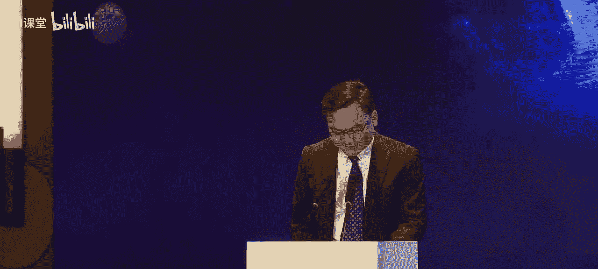

# 【2025 WAIC 世界人工智能大会—主论坛】人工智能全球治理高级别会议  Ai、开源、教育、Ai普惠、赋身智能、神经网络、超级智能 p06 6、AI赋能 自动驾驶 创新发展“模数引领，智行未来” -BV1Gx8gz3Er5_p6-

。加油，冷静讲。尊敬的各位领导，各位来宾，大家下午好。感谢您在百忙之中莅临2025世界人工智能大会魔术引领智行未来AI赋能自动驾驶论坛发展论坛。😊。

智能汽车正经历一场由系统驱动迈向模型驱动、智能进化的过程，以技术创新重新定义全球作价新坐标。此刻的上海以10万凯奇计算中心7000亿产业规模，为自动驾驶铺设感知决策控制的全站创新沃土。今日。

让我们以开放之志，共探技术深水区，以协作之力，共筑产业新生态。本次论坛由世界人工智能大会组委会指导上海市经济和信息化委员会、上海市交通委员会、上海市公安局、中国上海自由贸易实验区临港芯片区管理委员会浦东新区人民政府等部门大力支持。

上海临港新片区投资控股集团有限公司、上研智联智能出行科技上海有限公司、上海金桥智能网联汽车发展有限公司联合主办上海市车联网协会强生交通享道出行亚信安全联合协办论坛聚焦模型驱动数据赋能进合重构三大篇章。

全面展示上海在高阶自动驾驶产业生态构建制度体系建设等方面取得的最新成果。我仅代表本次论坛的主办方向各位来宾的。到来表示最衷心的感谢以及最热烈的欢迎。😊，🎼下面请允许我介绍莅玲今天论坛的领导。

他们是上海市经济和信息化委员会副主任汤文侃。🎼上海市交通委员会副主任张鑫。🎼上海市浦东新区副区长毕桂平。🎼上海市经济和信息化委员会二级巡视员、汽车产业处处长韩大东。

🎼上海市公安局交通管理总队副总队长季颖秋。🎼再次感谢各位领导的莅临。😊，🎼首先，有请上海市经济和信息化委员会副主任汤文凯为本次大会致辞，有请汤主任。尊敬的张新主任、桂平副局长，我们尹秋副总。

各位企业家朋友，各位媒体朋友，大家下午好。非常荣幸呢能够参加今天的魔术引领，自行未来的论坛，与各位啊共聚一堂，共同探讨AI技术如何赋能自动驾驶的产业，实现跨越式发展。

首先呢我代表市经信委对远大而来的各位嘉宾表示热烈的欢迎。

大家知道近年来啊，上海呢在深入贯彻总书记一系列的重要讲话精神，推动智能网联新能源汽车产业方面呢也取得了积极进展。首先呢我们的产业规模竞中提次。去年呢全市的汽车产业规模突破了7000亿。

新能源汽车的累计的推广量呢也达到了164。5万辆，稳居全球城市的第一名。第二呢是创新的动能，激活城市。已经形成了上游的零部件。中游的。整车的研发制造以及下游的检测认证服务。这样一完完整的产业链。

集聚了呢包括上汽、特斯拉、雷克萨斯在内的9家整殖企业以及600余家全球著名的零部件企业。我们在汽车领域里的复合型的高端人才啊，已经接近了15万人。第三个呢，这是在自驾的模型方面的加速迭代。

以单车智能为基础。车录营协同为关键支撑，打造自动驾驶的数字完成训练场，也助力自动驾驶到目前迭带以及闭环环仿真的评测。100辆的数据采集车呢已经规模化的上车运行。

累计已经采集的数据量呢已经突破了200万个cps。大家知道，当前呢人工智能啊正在经历前所未有的飞速发展期。汽车行业呢也作为整个技术革新的前沿重点，正在迈向软件定义智能决策的新时代。下一阶段呢。

上海呢将紧抓人工智能的发展机遇，以更加开放的视野、更加强劲的技术创新和更蓬勃的产业活力，加快构建全球领先的自动驾驶引领示范区。一法方面呢是要继续强化政策的支撑。

我们将聚焦应用创新、基础设施的提升、产业发展和政策突破等方面，我们也会尽快要编制出台上海高级别自动驾驶引领区的行动计划，并修订好智能网联汽车的测试应用管理办法，进一步的优化测试应用的流程。第二方面呢。

我们则是要打造应用场景。在这一次的论坛上啊，我们一会儿啊就要发布了我们上海首批的无驾驶人的智能网联汽车示范运营牌照。这一次我们会有5个联合体。

8家企业有23辆车将率先获得我们上海第一批啊这样的一个运营牌照。我们也会呢分序。有步骤的进场推进一些场景的开放工作。第三呢，则是要提升自驾的水平。我们要推动软硬协同的高级别制仓自驾自控的芯片自主开发。

要建设大规模。多模态，多类型多场景的高质量的雨库语料库。我们到年底的时候呢，要实现500辆素材网约车的落地运行，这个还是有挑战的。我们现在只有100辆。到年内的时候呢。

我们的数据的采集规模要达到1000万克里布斯，这1000万个克里布斯就能为我们上海甚至全国的汽车业界可以共享。我们并且要建立自动驾驶的大模型的评测体系，要实现一段式的端到端。自驾大模型要量产上车。

各位来宾朋友们。我们期待大家呢在今天的论坛上面啊畅所欲言，共谋发展之道，共探技术前沿，共建开放生态，让我们一起来努力，共同推动AI赋能自动驾驶，早日建成上海的高级别自动驾驶引领示范区。

最后呢也衷心了我们这一次的论坛能取得圆满成功。谢谢大家。非常感谢汤主任的致辞。作为全球智能网联汽车产业的高地，上海正以政策、技术、场景三重引擎驱动产业跃迁。

接下来我们将共同见证上海高级别自动驾驶引领区发展行动方案的发布。有请上海市经济和信息化委员会二级巡视员汽车产业处处长韩大东先生，为我们介绍行动方案的主要内容和重点任务，有请韩菊。尊敬的汤主任。

张主任也毕区长李继总，各位领导，各位同事以及我们媒体界的朋友，大家下午好。我下大家。介绍上海市高级别自动驾驶引领区魔术自行的行动计划。分为三个方面，第一，方案背景。全球人工智能技术快速引进。

正深刻推动自动驾驶的。创新重构，为抢抓人工智能发展机遇，破除行业痛点。市经信委会同市交通公安等部门制定了本行动计划。按照。四个总体思路。

模型驱动引领、应用示范带动、产业协同发展、政策举措支撑这样一个总体思路，推动自动驾驶技术创新，向产业竞争力加速转化，将上海打断成为自动驾驶产业与应用的创新高地。总体目标。到2027年。

上海高级别自动驾驶应用场景实现规模化落地，公共服务平台有力支撑行业创新、关键技术和产业规模达到国际领先水平，形成具有国际影响力和竞争力的智能网汽车产业集群。基本建成全球领先的高级别自动驾驶引领区。

在以下三大领域发力。一是在应用场景规模化，探索创新商业运营模式，培育智慧出行数字化的公共服务平台。在智能公交、出租、重卡等应用场景规模化，实行L4场景的自动驾驶技术，实现载客超600万人次。

载货超80万。基。在创新要素的体系化方面。建成自动驾驶的数字孪生训练场等一批公共服务平台。全市自动驾驶开放面积达2000平方公里，道路长度超5000公里，道路类型和场景更加丰富。

实现交通枢纽产业园区以及文景区的跨域发展。可联通。在产业能级高端化方面，培育具有行业领先水平的自动驾驶大模型。L2级。和L3级的汽车量产车占新车生产比例90%以上。

L4级的自动驾驶汽车实现量产关键技术自主可控，建立涵盖整车零部件、数据、地图、安全服务等完整的产业链。主要内容，我们聚焦应用场景、创新要素构建、产业生态培育等三个方面，推进9项重点工作。

第一方面是推进建设多样化的应用场景。一是稳步扩大乘用车的应用规模，有序开展L4无人商业化的运营，并探索面向个人开放L3级的自动驾驶车辆。二是持续深化商用车的示范场景建设，打造自动驾驶接驳重卡。

智能BRT等场景商业化的模式。第三是有序推动无人驾驶装备的应用落地。探索无人配送、巡检、自助泊车等运营的标准及模式。第二方面是加快构建高能级的创新要素。有3点，第一是搭建自动驾驶数字孪生训练场。

是采用石材和虚拟生成等结合的方式，积累千万级的。数据片段搭建全场景的模型训练及闭环仿真测试环境。第二是完善自动驾驶的数据监测平台，统一全市智能网联汽车运行数据的采集传输。

对智能网联汽车运行情况进行实时监测。第三是有序扩大自动驾驶的开放区域，实现浦东新区。权益开放。同步推动奉贤、闵行等区域开放，并连通本市四大测试区域的开放道路。三是加速培育创新型的产业生态。

一是提供关键技术的公关工程。组织开展软硬件技术和解决方案的公关，培育一批优质企业。二是打造世界级汽车产业集群，建设整零协同、各具特色规模领先的智能网联汽车和关键零部件的生产基地。三是加强验证。

测试的能力建设，搭建智能网联汽车、交通安全、重点实验室等第三方的平台，加强自动驾驶的系统验证及应用服务能力建设。第四是最后方面是保障措施。我们将加大政策支持，完善智能网联汽车数据采集的管理机制。

优化完善智能网联汽车的相关。技术能力把自动驾驶大模型能力呢那能够纳入统一的测试流程。第二是强化金融支持和支撑。鼓励社会资本积极投资，并加快研发适合自动驾驶的相关的保险产品。三呢是深化人才教育和隐喻。

鼓励引进高高层次的国内外相关人人才与高等院校开展。智能网联汽车的相关学科建设。四是加强区域协同，统筹全市智能网联汽车的测试应用管理，并推进长三角互联互通。各位同事。

上海的智能网联汽车工作生态和完全的建设都需要我们每个行业，每一个部门和共全体的企业，完成产业链企业，上下要共同努力。我们要聚焦上海建设世界级的汽汽车产业中心共同发力，也希望得到在座各位的进一步的支持。

我们一起努力。谢谢大家。非常感谢韩菊，韩菊请留步。😊，接下来我们将迎来行动计划的正式发布时刻，韩菊请移步到舞台中央。同时我们有请上海市交通委员会副主任张鑫。

🎼上海市公安局交通管理总队副总队长季颖秋共同上台，一起发布行动计划。🎼请三位领导将手放置在我们的启动球上。🎼请全场和我一起倒数。3。2。Yeah。上海高级别自动驾驶引领区行动计划正式发布。

🎼请三位领导留步合影留念。🎼感谢三位领导，请一步就坐。😊，🎼在刚才的发展行动方案中，提出多场景应用、多平台支撑、多生态培育三位一体的推进架构，也标志着上海的自动驾驶征程，从道路测试向规模运营的战略跃升。

基于浦东立法2024年，上海发布了首批无驾驶人、智能网联汽车示范应用许可。一年来，车辆经历数百万公里的道路实册与海量数据锤炼，主驾无人探索行稳致愿。此刻，让我们共同迎接一个崭新征程的开启。

接下来将隆重举行的是新一批无驾驶人、智能网联汽车示范运营证发放仪式。首先，有请获得示范运营证的联合企业代表上台。有请上海强生交通党委副书记。🎼总经理杜慧。

🎼赛可智能副总经理戴娟、上海锦江汽车总经理史德明，小马之行副总裁黄俊，赛可出行首席执行官倪丽晨，智己汽车L4首席技术官李萌，有道之途首席执行官王瑞，大众交通总裁办总经理葛磊，百度自动驾驶首席专家吴琼。

🎼接下来有请为示范运营企业发证的领导上台，有请上海市交通委科技信息处处长李哲良。🎼上海市公安局交管总队车辆管理所政委褚海峰。上海市经信委汽车产业处副处长陈可乐。🎼临港新片区管委会数据处处长陆森。

🎼上海市浦东新区科经委副主任王刚。🎼请各位领导为企业授牌。🎼这份成果来之不易，多方合力共同铸就了今日的突破。🎼请领导与企业嘉宾一起合影留念。🎼好，再次感谢各位领导和嘉宾，请一步就坐。😊。

如果牌照是准入证，能力建设则是根基。上海率先启动建设自动驾驶实训场，为高阶自动驾驶技术发展提供了核心引擎，让我们一同观看大屏幕短片，了解实训场平台的建设背景与功能布局请看大屏幕，🎼当前。

自动驾驶技术快速发展，以特斯拉FSDV13为代表的自动驾驶端到端技术，引领全球最新发展趋势。🎼国内车企面临数据成本高，场景分布不足，模型闭环测试验证不够等痛点。🎼根据市委、市政府的统一部署。

上海以人工智能大模型为核心，正在加快建设自动驾驶时训场，建立数据采集与应用全流程闭环模式，加速端到端模型、世界模型技术公关与应用，着力提升单车智能化水平。🎼自动驾驶实训场由智能汽车创新发展平台牵头。

联合合作伙伴，聚焦数据闭环、算力共享、技术协同三大突破。🎼数据采集汇聚智能汽车创新发展平台首创网约车自采加企业车共享模式。2024年底，已投放30台智启L6网约车上路运行。

2025年底将累计投放500台。🎼同时，积极推动企业数据共享。9家车企联合发布数据共享应用倡议，3家成为首批数据共享接入企业。🎼目前已初步建成自动驾驶数据平台，预计年底达到1000万cs。

🎼数据处理服务库帕斯数据服务工具链，按照采洗标测用五位一体布局，实现数据处理与应用全流程标准化。世界模型应用。🎼商汤绝影，打造全球领先的世界模型。🎼通过模拟真实世界驾驶场景。

生成真实、可控、多元、常识一致的高清仿真数据。🎼赋能训练数据生成和闭环仿真测试。🎼模型训练上车，智己汽车采用基于端到端和多模态大模型的L2L3L4一体化技术路线。🎼在实训厂的支持下。

初步验证制驾模型的性能。🎼在环岛通行和机场密集车流场景下得到提升。🎼公共基础底座。🎼一电集团构建的实训厂底座，打造集算力、存储、模型与工具于一体的智算云服务平台。🎼目前。

自动驾驶实训场已打通数据采集汇聚、数据处理、世界模型应用、模型训练上车、公共基础底座的技术链路，取得阶段性进展。在上海创智学院前瞻技术支持下，下一步将引入奇瑞、吉利等车企，参与实训场建设。

打造全球领先的自动驾驶产业创新高地。实训场不仅是建设成果，更是上海在构建未来出行核心竞争力的关键一月。接下来就让我们共同见证上海自动驾驶识训场建设成果的发布。让我们以热烈的掌声。

有请以下领导与企业嘉宾上台，共同参与推杆发布。🎼有请上海市经信委二级巡视员、汽车产业处处长韩大东。🎼上汽集团副总裁、总工程师祖四杰。🎼上海一电集团副总裁刘山全。🎼智能汽车创新发展平台总经理邱国华。

🎼智己汽车副首席技术官郭辉。🎼极科汽车副总裁陈琦。🎼奇瑞汽车全球技术创新中心制驾中心总监赵淑妍。🎼商汤绝影首席执行官王小刚，上海库帕斯科技首席运营官施佳良，上海创智学院教授张丽。

🎼请各位嘉宾将双手放在推杆装置上，准备启动发布。🎼现在全场和我再来一次倒数。3。2。🎼一请推杆。🎼好，请各位嘉宾，我们合影留念。🎼这是上海在引领自动驾驶道路上的高度与速度。🎼让我们再次以热烈的掌声。

感谢各位领导嘉宾共同见证这一重要的时刻，请各位领导嘉宾就坐。😊，🎼当本土场景趋于成熟，全球化布局成为必然。下面要发布的是智能网联汽车出海行动方案，为中国智能驾驶数据出海。

提供了一条合规安全高效的上海路径。现在请看大屏幕。🎼为加快构建高效便利、安全的汽车数据跨境流动机制，推动汽车出海产业高质量发展。

临港新片区构建了围绕跨境合规数据加工、传输通道、算利统筹、企业载体等核心服务，实现全链条贯通、全要素融通、全球化联通的汽车出海服务保障体系。🎼建立汽车数据跨境合规绿色通道。🎼发布了数据出境操作指引。

🎼形成以负面清单加操作指引相结合的跨境数据管理制度。🎼有效解决企业数据跨境可归性问题。🎼打造汽车高端数据标注生态。🎼集聚了高端汽车数据标注企业。🎼依托国际数据加工枢纽。

🎼助力企业加速海外自动驾驶数据加工模型训练。🎼打造联通世界的汽车数据跨境专线。🎼推动国际数据中心和业务办公专区建设，支持企业利用高速便捷的国际数据专线、安全合规、低成本的开展国际数据业务。

🎼打造汽车智能算力资源统筹平台，统筹调度临港新片区优质算力，灵活匹配汽车出海企业需求，降低企业算利的沟通和使用成本，为汽车出海企业提供全类型算力。🎼打造智能网联汽车特色集聚区。

🎼建设覆盖智能网联汽车研发测试。🎼应用。🎼出海全链条的数据产业基地。🎼营造低成本的合规发展环境。有请参与本次发布仪式的领导和企业代表上台，有请上海临港投控集团总经理王威。

🎼临港新片区数据跨境服务中心主任丁瑞，中国电信临港分公司总经理田翔，中国联通临港分公司总经理董晓，中国移动临港分公司总经理李张明浩。🎼上海临港跨进术科总经理李晶，商当绝影战略总监周全。

上研智联总工程师吴海飞。🎼请各位将手放在大屏幕的启动印记上。🎼让我们一起来倒数。3。🎼2。🎼一。智能网联汽车出海行动方案正式发布。🎼请各位领导移步台中合影留念。🎼这一时刻。

标志着上海加快构建智能网联汽车走出去能力体系，迈出了关键的一步。🎼再次感谢各位领导与嘉宾的参与，请一步就座。😊，实训场为技术助机，场景则为创新提供舞台。下面发布的是智能网联超级场景，请看大屏幕。

作为全国智能网联汽车发展的排头兵，浦东新区与临港新片区以制度创新加场景应用双能驱动。全力打造自动驾驶产业高地，实现跨域互通的海陆空一体化运营网络，重点推动三大超级场景，超级场景一、自动驾驶创新高地。

依托无驾驶人立法优势，浦东临港已开通无驾驶人出租示范运营，打造浦东机场、迪士尼、天文馆等特色接驳场景。洋山港智能重卡，实现无人化运输、开通医疗通勤等多场景智能公交线路。

金桥、张江、泥城环滴水湖等区域开展清扫配送及巡检等无人装备应用。超级场景2、智慧交通数字底座浦东金桥建成全球首个中心城区5G杠A车联网示范区，通过红绿灯信息融合等创新，形成可复制可推广的上海样本。

临港新片区建成100公里高等级车路协同设施，搭建全域时空数据感知网络及分级云控平台，支撑智能网联汽车规模化运营与智慧交通服务。超级场景3，数据要素产业枢纽金桥以地上一座城地下一座城云单一座城框架。

整合全域数据资源，推动交通数据要素流通。临港依托云控平台，算力平台，临岸数据中心，提供算法模型训练支持，打造智能网联汽车国际数据枢纽。下面我们进入发布仪式。

超级场景的发布将集中呈现上海在自动驾驶创新、数据要素流通、无人装备应用等领域的系统探索与工程落地，形成从自助先行到技术验证，从基础设施到城市级运营的全面闭环。

接下来有请参与本次发布仪式的领导与企业代表上台共同完成发布。🎼有请中国邮政上海分公司副总经理陆岩、金桥集团党委书记、董事长郭荣，浦东公交总经理陈琳，上港集团科信部总经理邹英。

上海浦东发展集团新产业发展部总经理孙颖，上海强生党委副书记总经理杜慧、翔到出行首席执行官倪丽晨、锦江出租总经理史德明，大众交通集团总裁办总经理葛磊。

临港公交党委书记张春光、临港数字基建总经理刘经理、圆通快递上海圆通办公室主任张杰，韵达快递无人化模式推广总监高孝振，申通快递车辆研究院负责人王张涛。

顺丰速运上海无人化模式推广总监徐海涛、吕城天谷执行董事张文强。🎼下面有请启动仪式的领导。🎼上海市浦东新区副区长毕桂平。🎼上海市自由贸易区金桥管理局局长吕东胜。🎼上海临港新片区管委会数据处处长陆森。

🎼请领导将手放在启动球上，各位嘉宾将手放在光柱上，准备启动，让我们再来一次倒数。🎼3。2。🎼Yeah。🎼智能网联超级场景正式发布。🎼请各位领导嘉宾移至台中央，我们合影留念。

🎼感谢各位领导和嘉宾的共同见证与推动，请一步就座。在一系列激动人心的发布仪式之后，接下来将进入同样精彩的第二篇章秩序。不知道大家刚才是否注意到，在牌照发放的环节。

有一款车型同时支持了两家运营公司申领牌照。那就是我们的智己汽车。这是怎样的实力能够获得多家运营公司的青睐呢？有请智己汽车副首席技术官智能驾驶首席科学家郭辉先生。

为我们分享面向量产的L2L3L4一体化智能驾驶技术路线，有请郭总。尊敬的各位领导，各位嘉宾，各位同行朋友们，大家下午好，我是自己汽车郭辉。

今天很荣幸代表上汽集团代表自己汽车在2025世界人工智能大会与大家交流。今天我分享的主题是面向量产的L2L3L4一体化智能驾驶技术路线。在过去的十0年中，智能驾驶从实验室走向量产。

从基础的辅助驾驶走向组合辅助驾驶，乃至更高级别的自动驾驶算法和模型技术在快速迭代。自己汽车始终坚信，智能驾驶不是单点的技术突破，而是人工智能加量产落地的结合。

接下来我从技术演进的趋势和上汽自己的实践两方面分享我们对智能驾驶技术路线的一个思考。首先介绍证驾驶的技术眼睛方向。随着人工智能技术的发展。自动驾驶技术在这十年有了快速的进步和突破。

完成了从规则驱动到数据驱动的一个转变。那么大家可以看到，就是从呃发展阶段来看的话，我们可以分为三个阶段。在1。0阶段来讲的话，是我们在感知啊方面采用了深度学习的神经网络。那么在归控方面呢。

使用规则化的呃这个呃归控模型。在自家2。0时代呢，是采用了BV加transformer的神经网络。同时来讲的话呢，在规控方面使用数据驱动、深度学习的方式。那么在自驾3。0是我们今天啊在行业里面。

大家在量产啊，同时在开发了迭代的这样一个技术路线。那么呃端到端的全数据驱动方式呢，已经成为行业的一个共识。那么基于端到端来讲的话呢，能够通过数据驱动的方式持续的提升智能驾驶的性能上线。

那么在整个端到端的呃量产和落地应用过程当中呢，呃一方面啊我们发现这对于呃端到端来讲的话，能够啊更好的处理复杂场景。但是另一方面来讲的话，也发现对于模仿式学习的端到端技术来讲的话。

仍然需要解决分布偏移、模态坍塌和英国混淆等问题。那么对于模仿学习来讲的话，其实还是存在着这个局限性的。其实依赖于我们大量的长尾场景的这个数据。那么我们呃在开还的情况下。

往往会遇到这个开还的指标和实车表现不一致的情况。所以针对呃模仿式计学习来讲的话，其实是需要解决前述的三个问题。那么从行业的发展来看的话，其实大家纷纷在探索的就是从模仿学习到强化学习的这样一个过程。

那么这个呃路线图呢是在学术界，包括行业里面，大家在探索的这个路径。那么呃如果从强化学习的这个原理出发，大家可以看到，其实强化学习啊两部分啊，关键技术。第一部分来讲的话。

就是啊我们有一套强化学习的策略以及奖惩机制。这个来讲的话是下面这条线啊。那么另外一个来讲的话，就是强化学习需要环境模型啊，这也是我们经常在说的世界模型所要解决的问题。

那么针对呃分布偏移和模态坍塌来讲的话，其实呃强化学习是我们用来解决这两个问题的呃很重要的一个手段。因为今天从呃数据角度来讲的话，我们从实车采集的数据啊，哪怕是我们通过影知模式。

或者是通过筛选器回传的数据仍然不能完全的覆盖百分之百的覆盖用户在真实场景当中啊，所能遇到的情况。那么在呃模仿学习当中呢，采用的解决方式呢是持续的增大数据的啊这个量啊，那我们去找到各种长位场景啊。

的它的一个数据。那么在这个过程当中也是呃我们在这个过程当中会持续的迭代这个模型的性能。但更重要的是一个范式的转变。从这个模仿学习到强化学习。啊，那么通过强化学习来讲的话呢。

我们可以把我们的端到端的模型当做是一个智能体，它可以和环境啊，比如说基于世界模型的环境进行一个。交互。那么从错误当中进行学习。这样来讲的话呢，就可以解决。第一个在这个呃我们说的分布方面。

我们的实际面临的数据，在实车运行的情况下所面临的场景和我们测试的数据有偏差的情况。第二个来讲的话呢，就是我们采集的数据，因为是基于啊这个驾驶员的行为。那么驾驶员的行为来讲的话，可能在同一个驾驶场景上。

实际上我们可以有多种驾驶这个路径的一个选择。甚至对于同一个司机，其实在不同的时间点可能他也会做出不同的选择。所以对于模态来讲的话，其实是需要多样性的。那么针对呃这个我们说从从这个方法论角度来讲的话。

强化学习是可以帮助我们解决这个问题啊。那第二个来讲的话，强化学习啊是非常依赖这个世界模型的啊。因为对于环境来讲的话，我们要有一个足够好的模型，足够逼真的模型。

才能够使得我们的强化学习能够啊能够提升我们的模型上线。所以来讲的话，从今天来看啊，世界模型也非常的重要啊，我们把它分成三个阶段。第一个阶段来讲的话呢，是能够使用世界模型的基础，帮助我们进行仿真测试。啊。

帮助我们准出模型。第二个阶段来讲的话呢，实际上是利用世界模型啊，当它的性能足够好之后，能够生成数据，能够和我们真实采集的数据形成合成数据集，来帮助我们进行啊这个模型的迭代。这个时候来讲的话。

它就可以解决掉一些长尾场景。在我们现实世界当中啊，比较难获取到这样一个问题。啊，那么第三个可能是长期发展的这个路径。那我们希望是说啊当这个世界模型进一步迭代以后。

它能够作为一个环境模型跟强化学习进行一个闭环。那么在这个过程当中就可以实现我们说强化学习的本质是需要能够能够跟环境进行交互，能够自主学习啊，我们可以向啊阿尔法 go一样，对吧？

在这个环境当中可以学到很多在真实设计当中，可能目前还有没有碰到的情况。但是最终来讲的话，可能世界模型是不是也可以作为端到端模型的来进行使用，这也是大家在探索的一个方向。

所以呃除了我们要解决前面这个两个两个两个问题啊，包括这个偏移的问题。包括我们说这个呃坍塌的问题以外，其实我们还有第三个问题要解决啊，就是呃我们在这个因果关系上，如果是基于模仿学习可能会出现混淆。

因为大家都知道这个模仿学习来讲的话，往往学习的是结果。啊从学习结果角度来讲的话，对于怎么样得到这个结果的过程，其实是他没有进行一个很好的这个学习的。在这个过程当中来讲的话呢，其实啊通过从数据驱动啊。

向这个知识驱动这个方向进行演进。那么通过加入多模态大模型的方式可以帮助我们解决这个问题啊，我们前面呃讲了就是关于强化学习相关的啊，它的这个策略也好，包括啊前面讲的世世界模型或者环境模型也好。

那么下面其实更多的讲是说我们利用多模态模型可以帮助我们解决这个因果混淆的问题。那么大家可以看一下左左下角这个图哈，这个图来讲的话，其实展示的是呃我们在蓝蓝框里面和橙色框有两个框。

橙色框呢其实代表我们理想的就是自架模型能够达到的这个性能啊，但是蓝色的框呢是代表我们在实际的这个开发过程当中，我们的模型能够达到的一个状态。那这些过程当中，我们始终是希望这个蓝框朝着这个橙色的框去演进。

啊这里面一方面我们可以通过增增大数据量，对吧？使得我们的这个呃蓝框啊能变得越来越大。另一方面来讲的话呢，是在分布上在这个呃我们通过强化学习的方式，通过多模态大模型的一个方式来增强这个模型的能力。

特别是引入大语言模型之后，能够帮助我们能够利用好这个大模型当中的嵌入的常识和思维链相关的这些技术。能够增加我们自架模型在复杂场景下的一个因果推理能力，从而解决啊因果混淆的这个问题。

所以从技术路径上来讲的话，其实在呃自己是在上级集团来讲，我们部署的也是一条就是呃从数据驱动走向知识驱动这样一条技术路线。那我在模型上来讲的话，会包含一段式的端到端。

以及说多模态大模型这样一个组合的方案啊。那么从长期来看呢，这两个模型还会进一步的可以进一步的融合，形成视觉语言动作模型。那么这个来讲的话，那么在这个模型的效率上。

能够覆盖的这个啊场景上能够得到进一步的上线的提升。那么针对呃VOA的这个模型来讲，其实行业里面呃之前也有不同的企业啊，大家都在呃这个定义自己的路线，也有很多的介绍。

那么我们的观点呢认为啊对于VOA模型来讲的话，在复杂场景的高层级理解，以及说跟驾层人员的交互当中能够发挥重要作用啊，这里面我们举了一些例子。比如说对于一些复杂场景，包括像施工场景这种标牌文字的一个识别。

比如说对于在地库啊，在没有指呃指引方向情况下，能够啊进行一个方向的推荐。在复杂路口的时候，对于这种啊环岛啊，对于这个我们说的这个呃可变车道啊等等。这些来讲的话，能够啊进行一个智慧的通行等等。

那这些来讲呢都是我们认为VOA能够发挥重要作用的地方。当然另外一个很重要的方面是我们今天的这架模型其实该人交互的时候，仍然是啊存在弱项的。因为可解释性一直是我们说神经网络模型的一个一个弱点。那么。

基于VY模模型来讲的话呢，能够增强就是跟人类之间的这个交互的能力啊。那么我们把自动驾驶技术发展趋势总结为三个阶段。第一个阶段来讲的话是今天啊大家都在做的啊，基于呃端到端的模型。同时来讲。

对于自己和上汽的发展路线来讲的话，我们会啊增加这个多模态的大模型啊，然后基于和世界模型的这样一个闭环啊去进行仿真的验证。那第二个阶段来讲的话呢，是把这个呃多模态大模型和我们一段式的端端大模型进行融合。

进一步的提升模型的能力。那这个时候世界模型呢是可以作为强化学习当中的环境模型来进行使用，进行闭环的这样一个训练。第三个阶段来讲的话，我们可以甚至把世界模型进行融合。当然这个需要两方面。

一方面是车端算力的持续提升。第二个来讲的话，也需要我们的这个世界模型的这个性能要达到这个能够在车端应用的这样一个要求。那这样的话呢，我们认为是迈向未来智能驾驶通用人工智能的一条道路。呃。

前面更多的是讲我们对于这个技术眼睛方向的一个判断和我们的一些思考。那下面我简短的介绍一下上期在面向量产的呃，面向我们看到的这个智能驾驶技术眼睛方向所做的布局和一体化技术路线。

那么上汽集团自己汽车呢在智能驾驶领域里面也在做持续的投入，并且今天为止已经经历了三代的技术迭代。那我们通过开放合作啊，同时来讲的话，这主探索的方式在布局自动驾驶的业务。

那么在全国来讲也是首个同时具备L2L3L4自驾量产能力的品牌。那么今天我们在L2和L3L4都取得了很多的成果。比如像L3来讲，我们是全国首批进入到智能网联啊呃呃这个上路通行试点的首批名单，在L4来讲。

我们也打造了上海市最大的这个的车队。啊，接下来讲的话，我想都是我们过去所取得的成果。那么结合前面所讲的技术趋势来讲的话，我们把我们在模型开发的这个方面啊总结成三个阶段。今天我们是在我们叫我们叫3。

0阶段。因为我们前面已经经历了像规则，然后演进到这个端到端的这样一个模型。那么接下来我们会有4。0和5。0的这个模型。那这里面。非常重要的日极和前面讲的多模态大模型，以及融合世界模型的能力。

能够打造一个大模型，最后来满足智能驾驶啊，上线持续提升这个要求。当然，在这过程当中，不能呃仅仅只一类神经网络。同时来讲，还要保证安全。所以在这个过程当中来讲的话。

我们也会有基于规则的冗于安全系统来确保达到功能安全和预器功能安全的要求啊。那么当然前面讲的都是模型啊的眼进啊，对于模型的这个进化来讲呢，很重要的一个底座就是我们的算力啊。

我们在这个呃智能驾驶的预工这器方面来讲的话，啊，我们今天也有三代的技术的迭代。同时来讲也有双线的策略啊，一方面来讲，在高性能平台来讲的话，会采用行业最先进的啊大算的芯片。同时来讲。

我们要探索高性价比的解决方案，与国产芯片的供应商呢一起展开紧密合作。同时来讲呢就是啊把这个L2L3L4的技术堆战啊，那么形成一个共同的技术底座，能够在这个不同级别的啊智能驾驶能够进行技术的复用。

那么这个图来讲的话，就讲我们在系统方面来讲，我们是如何做到L2L3L4一体化的这个开发的。大家可以看到，依托于L2量产的经验，以及在L4方面，我们所做的这个模型的探索。

那么我们在L2的基础上增加冗余安全系统。那么赋能L3的这个这样一个技术的开发和量产。第二呃第二方面来讲的话，就是在L3基础上，在保证安全的基础之上，增加面向呃城区的呃全面的冗余安全。同时面向运营。

增加类似于像呃云端的安全呃接管，以及包括面向用户的面向乘客的这样一些运营呃APP或者是SDK这样一些方式，能够使能我们能够进行安全有效的的运营。当然在传感器方面也是采用了可扩展的方式啊。

包括从L2我们11V啊EREL扩展到L3的12V啊，5R1个1个L啊。那么再到这个L4来讲的话，增加这个捕盲的激光雷达，这也是形成了一套可扩展的传感器的解决方案。所以最后做一个总结，就是综上所述啊。

上汽集团在坚定的进行量产驱动技术引领的这个研发。同时来讲的话，在自动驾驶石运厂的赋能下呢，我们打造的L2加加L3L41体化的技术底座，不仅是技术架构的创新。

同时来讲的话也是实现高阶智能驾驶规模化落地的关键引擎。那自翼汽车作为呃上汽集团在智能驾驶技术的先锋载体呢，也会持续的引领这一变革。真正的智能驾驶不仅要做到像人一样思考，其实还要做到超越人的安全。

那这条道路上呢其实需要开放和共创。所以来讲的话，我们也愿意与行业的合作伙伴一起携手并进，共同推动智能驾驶产业的发展，谢谢。非常感谢郭总为我们带来的精彩演讲。郭总说了，高阶支架自动驾驶需要全行业共同探索。

我们在了解了自己汽车的强化学习以及模仿学习之后呢，接下来我们将有请到的是吉利控股集团首席制架科学家及科科技副总裁陈琦先生，为我们带来演讲高阶支架驱动整车迈入全域AI智能时代的核心引擎，有请陈总。😊。

尊敬的领导，各位嘉宾，大家好，我是陈奇。呃，非常感谢组委会的邀请，也非常荣幸能代表吉利参加这次大会，与各位分享我们对制家行业的呃AI应用的一些发展和思考嗯。😊，我记得就说那个我身边有好多朋友。

就是甚至行业内的朋友跟我聊天的时候，经常会提到，就是在他们在一年多前买车的时候。选择买的基本上是都是不带城城市NOA的车。他们觉得未来几年。未来他们觉得未来几年自驾最多可以开开高速，最多可以开开高速。

城市会很挑战。他们觉得很难应用起来。但让他们想不到的是，才一年多的时间，自架技术就真的突飞猛进。连城市为这种呃这种这种这种非常复杂的功能都已经到了非常好用的地步。那其实也就差不多在这一年多的时间里面。

AI大模型的一些理论研究，开始在自驾领域里面得到了大规模的应用，加快了整个自驾行业的体验的升级和迭代。😊，那虽然目前仍然还处于那个辅助驾驶阶段，但很多人用了之后。很多人用了之后。

就是让让让让用户在不知不觉中，就是说那个他们在他他们带来的体验收益收益。如那个如降低驾驶疲劳，还有提升驾驶便捷性和安全性方面等等。他们让他们在不知不觉中就形成了对自驾的依赖。😊，那么未来自驾会如何发展？

作为主机场应该如何布局？那今天我也是借着这个WIC大会也和大家分享一下，就是我们对这个自驾的一些思考。呃，当今当今汽车的发展早已从我认为这早早已从电动化的时代迈入了智能化的时代。

我们甚至认为汽车的智能化已经开始步入了深水区，进入了智能化的2。0阶段。汽车智能化1。0阶段，我们认为是单域的智能化各领域自各自垂直整合向终式纵深发展的一个阶段。那比如在智能驾驶领域。

以我们吉利的千里浩瀚为例。在技术上，我们在过去不到两年的时间内，从刚开始的小模型加规则时代，到去年年中进入了两段式的一个端刀端的一个阶段，到今年3月份，我们进化为一段式的端刀端。

那预计在后面的几个月里面，面向L3的全新的技术架构，云端的我 model事界模型加基座大模型和车端的VLA加端刀端的对抗安全模型也将逐步落地。那实现AI训练AI AI检验AI。那技术的快速迭代。

也帮助我们实现了丰富的产品功能。在过去一年不到的时间。我们的行车场景实现了无图城市OA的全部全量上车。那今年4月份。车位到车位在极客007GT的量产，环岛ETC像收费站等等难点场景员全部都上线。

那泊车也得到了全能全能泊车网的美誉。那在主动安全领域，千里浩瀚借助着我们那个GAS的B站，还有连续的ASB站等等一个个新的成果，也会用户避免了数百万次的碰撞风险。那本次全球人工智能大会。

我们也带来了面向L3级智能驾驶设计的吉客9X。就在我们的吉利展台上面，也希望欢迎大家去打卡。那这个可以看到。😊，对于这家单单领域来说，这是一条明确的道路，正在快速的发展并迈向顶峰。

翻的有点快了而汽车智能化的2。0阶段。呃，是各领域横向紧密的融合，共同推进。共同推进汽车全域A压的发展，实现汽车往AI智慧生命体方向蜕蜕变的一个阶段。那这里所说到的1。0和2。0，也许概念不一定准确。

就定义不一定准确，只是我自己做的一个概括，以方便和大家一些分享。但一个但一个当下正在发展的趋势是我们智能驾驶技术正在作为一种AI的根技术，在赋能自驾自身快速迈向L3L4的同时。

还在更多的赋能整车其他领域。推进的汽车往智能化2。0阶段发展，真正使汽车智能化签越式的迈上一个大的台阶。那在这个过程中，吉利选择了那个我们自言自驾，这是一种对于自身未来清晰的战略定位下。

自然而然形成的一个事情。除了更好的响应用户，实现差异化的竞争力，更是为全域AI融合打下了坚实的基础。我们也是截止到目前为止，原来传统主机厂中唯一家能真正全站自研并量产，具备高阶支架功能的企业。

当然也有好多朋友在问我，就是车企到底要不要自研行业里面其实也是一直在争论这个问题。那我也其实也一直在思考这个问题。那我认为呢就自言自假也并不是一个非黑即白的问题。

那车企应该根据自身的优劣势做适合自己的选择。这涉及到企业当下所处的发展阶段，未来的定位、资金的投入，还有人才的储备、技术的布局，市场的体量、入局的时机等等等等都有关系。

当然我也认为就说一个很好的一个好的自驾团队最好发基车企，他会比任何团队更懂整车，更懂整车智能化的需求。也更懂得怎么研发自架。那吉利未来也将更加的开放，我们也愿意把这些跟技术赋能给各个需要的车企。

通过这些跟技术的开放赋能，最小化的浪最最小化行业资源浪费，助力行业伙伴实现的商业成功。那么在智能化2。0阶段，自甲作为根技术，要如何进行横向的跨域融合跟赋能呢？面对智能汽车的2。0时代。

我们首先从算利层面让汽车拥有更高的天赋。在车端大算力是智能驾驶向上突破发展的重要重要衡量标准。看看过去大概5到10年的车端算利的一个变化，我们也观察到那个摩尔效应其实仍然存在的。特斯拉在2014年。

上搭载的自架芯片算利仅仅只有0。256个tops。只能处理像车道保持啦、自动刹车啦这些最基础的场景。而而到今天，500tops的配置已经是很多高端和旗舰车型的标配。那我相信未来1到2年，很快。

像700topss1000tops的配置也将再次被突破，甚至更多。那比如像我们的千里浩瀚，像我们的9极客9X搭载了那千里浩瀚，我们H9方案。自研的双十二芯片的预控带来了1400tops的超强算力。

我们也将为其运行互为冗余的双端到端大模型。带来面向L3级智能驾驶的极致安全的自驾体验。所以说在这个智能汽车时代，我们认为购车只是一个起点，需要用成长性的眼光看待购购车和用车的全过程。

一个车的智能化是否能在未来持续演进，成为衡量衡量一个车企能否能否持续赢得未来用户满意度的重要标准重要方面。但对于吉利来说，我们千里浩瀚，无论是哪一个级别的配置。

相比行业大多数有商基本上都实现了同级别最高的算利配置。那再来说说我们的云端基础设施，储备更多的云端算力，是为了训练具备更好体验的大模型。是自家支持汽车网AI智慧生命体发展的奠基石。那么在过去几年。

人工智能领域AI大模型参数量均以每年200%的复合AI的参数啊，大模型的参数以200%的复合增长率在月前。从50的2000万参数到GPT4的1。8万亿参数增长了近万倍。那有一车所GPD5。

参数量就达到百万亿的规模。那同样在自驾领域，这一现象同同样存在。早期在2020年左右，大家用到的那个C安等网络参数量也就不到10亿规模。到如今，随着端道端的崛起和多模态的融合，参数量已经接近了千亿规模。

年均增长率超过了50%。所以，吉利千里浩瀚所拥有的23。5亿fop的算力储备，不仅仅是为了满足大模型本身参数规模的爆炸式增长，以获得更优的体验。同样也是为自驾更多的创新留下了无限的可能。

那有了车端和云端的算理基础，智能驾驶通过AI的跨域融合，会带来哪些智能化2。0时代的创新体验和进化呢？那长期以来，大家对不同厂商的自驾评价其实差异是很大的。即使同一套制驾方案。

不同人开的感受和体验也会不同。造成这种印象的差异，本质的核心就是每个人的驾驶驾乘习惯、成员的考量因素和安全承受能力都不一样。所以造成造成非常大的体验差异。

那所以我们认为无感的人机共价将是近期重要的一个发展方向之一。我们可以通过自驾跟座舱跟底盘的跨域融合，实现诸如向清波方向方清波方向盘控车、语音控车和甚至眼神控车等等。跨越融合的智能驾驶。

可以实现根据周边环境理解用户意图，实现对车辆的控制，最终实现用户的便利性和舒适性。比如在面对一些低速的车辆，系统有时候比较保守跟车的情况，你只需跟车说给我超车。那系统的大语言模型理解用户的语义之后。

然后通过自驾的视觉研发模型。识别周边的情况，并在合适的时机做出符合预期的超车行为。类似场景也也还很多，你可以通过语音让车开的慢点，左右转，就近泊车等等。当然，除了语音，还可以有很多其他模态的输入。

比如给方向盘一个轻微的力道牵引，车辆就能理解人的意图，自主的完成剩余的自主完成变道的剩余动作。那这个过程这个交互过程会比波杆变道更及时，更快捷，严格也更自然。

那无感的人机共架通过跨域来缝合交互体验的割裂感，让人价和自驾进一步协同。那吉利千里浩瀚目前也正在进行这方面的努力。给大家分享一下我们最新的一些研究成果。这些能力。在未来也将陆续推送给大家。

🎼就大家看一下那我们的这个。🎼无感人机共奖的一些视频。🎼爱一晚右转。🎼好的，前方右转。🎼太一吧，我在就近停车。好的，正在寻找车位。😊，接下来我们讲一下那个第二阶段。

那个第二阶段是让汽车作为AI的智慧生命体，具备自主意识。那人区别机器的一个显著特征，就是人拥有自主意识。拥有自主意识，就能发挥主动智能，而不是被动的等待人的指令。如果说无感人机共价是汽车智能化2。

0发展的一个阶段。而具备自主意识，就是汽车智能化2。0发展的另一个重要阶段。所以，具备自主意识的自驾正在迈向L3L4的同时。另外一个重要的发展方向，也是成为AI智慧生命体的衡量标准。

车辆能否在车主不在的时候，自己去补人，车辆能否在遇到危险的时候更加自主的。主动安全的实现更加主自主的主动安全能力等等。那像比如视频中所示的。我们通过自驾域和三电域的AI融合。

车辆自己在停车场寻找机械臂充电桩进行自主充电补能，而且无需车主陪同。那预计在不久的将来，我们千里浩瀚的H9L3级智能驾驶解决方案就会具备这样的能力。在主动安全方面，大家也都知道。

沃尔沃早就在2008年就在全球率先实现了AB功能的全系标配。那我们千里浩瀚之家，也把主动安全能力作为我们最核心的基本功能。以极客品牌以极客。以及各品牌为例，从自驾推送以来。

我们的主动安全功能已经为用户避免了超过412。2万次的安全风险。而在智能汽车的2。0阶段，更为极端的功能场景，更复杂的跨域融合，必然对自驾的可靠性和安全性提出了更高的要求。

比如通过指架和底盘域的跨域融合，我们即客9X极客9X可以瞬间感知到侧面入侵的危险。在快要发生事故的前0。7秒，抬起一侧的底盘，用最坚固的门槛梁来抵御碰撞，通过仿真对比，它可以让侧方的碰撞入侵量。

减少最高可以达到27%，极大的降低了侧碰侧碰后的伤亡率。那另外今天很多智能汽车的在停放状态下都有哨冰功能。那随着汽车拥有自主意识，它还可以自保。那比如在南方的雨季，经常有很多洗澡车。

那未来我们的车辆可以自己感知到水淹的情况，主动的驶离涉水区进行自我逃生，减少车主损失。同样的还有火灾逃生等等。那以上这些能力也将在我们签呃我们的千里号函H9方案。L3级智能驾驶解决方案式一一落地。

通过以上这些例子，大家可以感受到自驾作为权益AI的根技术，一方面在完成从L3L2到L3甚至L4的自身进化。另一方面，从垂直纵深发展走向横向AI打通，更好的赋能整车成为权益AI协同的智慧生命体。

那在此我也呼吁一下，智能驾驶的星辰大海，那永远属于我们脚踏实地的探索者。在智能汽车高速发展的当下，只有通过对高阶自驾的坚定投入，对技术的求真务实，对体验价值的不断探索。

才能将更可靠、更安全的自驾体验带给用户，促进行业的良性发展。最后，再次感谢组委会的邀请，也吉利也愿意与行业共享经验共创可能，助力中国车企领跑全球自驾赛道。谢谢大家。😊，非常感谢陈总的分享。

在我们聆听了两家主机场的整车自驾方案落地以后呢，我们也不能忽略产业链中还有一个重要的组成部分。接下来让我们有请博士智能架控中国区总裁吴永桥先生为我们带来的演讲题目，数字化跃迁。

以安全与创新共拓智能化未来，共赢价值赛道，有请吴总。😊，呃，刚才这个郭辉总和陈继总讲的非常精彩啊。这个下面我代表整个供应链给大家分享一下我的观点。这个我讲的东西可能跟主流的观点不太一样。

这个我不太想都是一样的建议和方法。今天呢我想分享大概三个问题。第一个，在中国汽车如此内卷的情况下，在智能化这个赛道如何去破局？如何去打破这个类卷，真正走向价值创造的正常轨道。第一个第二个。

很多人在讲世界模型VRAA到底是一段式当刀端，短期是未来还是VRA是未来？😡，怎么落地？第三个就是整个汽车智能化未来的技术引进的路线是什么？😡，就三个问题。第一个问题。大家知道。

按照今年6月20几号国家统计局发布的官方数据，今年1到5月份，中国汽车工业营收增长7%，承运车销量增长14%，但是整个利润下滑11。9%。其实这个数据让我们所有的汽车从业者深入的反思。因为说句实在话。

在整个中国汽车零部件行业，只有两家优秀的同行，华为和林德时代。在主机厂面前有一定的话语权，议价的话语权。其他所有的中国汽车供应商，包括我们博士，都只能面临残酷的价格竞争。😡，这是一个不争的事实。

就是如何打破这样一个类局。我个人觉得像特斯拉在这个FS里的付费这一块，其实给中国所有的制架的行业，包括主机厂，包括零部件做了一个非常好的典范。😡，当你把这个置驾的技术做到极致的性能，极好的体验。

给用户带来极度的自信、安全舒适，用户一定会买单的，而且会高额买单。你看特斯拉这一套是非常贵的，6万多块钱。现在中国的这个华为做的也非常不错啊。

这个目前也只有华为能够和特斯拉在技术上能够并驾齐驱引领这样一个市场。所以我在此有个呼吁啊，在中国汽车的智能化产业，我们绝对不能再搞免费推广到所有的车型，制驾平权，免费发放的所有的车型一定要收费。这一点。

中国的所有的主机厂，所有的制架零部件企业必须向我们优秀的特斯拉和华为学习，一定要收费，高价支架。😡，让用户甘心愿意为这个带来高科技付出费用，这是最好的一个突破的方式。否则，如果我所有的高架支架都免费。

装到所有的车险上，会给中国的世驾行业带来一个灾难。呃，第二个，这个我就时间关也不讲了。再分享一下这个一段式，因为现在很火，刚才前面那个郭辉总讲的VRAA事件模型怎么落地？讲的人非常多。

VI是未来是一个方向。但是在短期内，我认为VR也很难落地，为什么？第一个。😡，VR这个多模态vis language action。这个几个多模态的这个特征的对齐。非常困难。现在第二个。

这个多模在数据的获取训练非常困难。第三个最核心的一点就是。如果1个VRAA模型要部署在一个这个芯片上，达到一个真正的达到行车安全和驾驶高度理论化本质的提升。它必须做到7B或者10B这样一个模型。

但是现在所有的支架芯片，它都不是为大模型而设计的。为什么呢？因为它存储的带宽比较小。如果把7B或者10B，就现在就3B吧部署在索尔上面，它的频率都很难做到10赫兹。什么概念呢？

就这个模型跑在这个支架的现在的芯片上面，它做不到实时控车，因为实时控车要达到一个高这个响应速度，所以现在的支架芯片都不支持VRA这个大模型的部署。

可能在3年5年之后真正能跑大模型的芯片才能够支持这个VRA这个模型的落地。这是VRA。所以现在呢我们一直坚定的在做这个一段式端道端，我个人的观点认为只有把一段式端道端做。😡，到极致的性能，极致的打磨。

让用户体验到和特斯拉一样的给人带来高度理人化、丝滑的驾驶，给人带来极度自信、舒适安全，这才是真正的智能驾驶。😡。

所以现在我们博士和我们的合作伙伴文员之行联合打造的基于英维达orin one200个tops芯片的一段式端到端，将于今年8月底在奇威的一个高端车型上批厂。这个我个人认为，因为我试驾过，每周都试驾。

我个人认为比较接近特斯拉的高度理人化的驾驶，上限很高。但是下线可能还需要更多的要处理，引入强化学习。特别是一些规则的兜底。所以这是一段段段段。

而且今年4月份我在北京的北人会上也讲过一次这个特斯拉领先的事情。呃，后来被网上骂的比较厉害。但直到今天为止，我依然坚信特斯拉无论是一段是端到端的算法的水平和它庞大的数据和强大的算力。

现在特斯拉依然是领先于这个所有的制架方案。当然，中国的华为。是做的最优秀的，在技术水平上可以说和特斯拉可以做到并驾齐驱。只不过在数据上或者算力上可能还有一点小小的差距。😡，呃，最后呃这个再说一点呢。

就是很多人在探讨世界模型VRAVRM一段端到端这些名词讲出来非常容易。这个PPT做的非常简单，但是怎么样把这么复杂的技术进行工程化落地和交付，就是极为挑战。在我看来。

这个高界支架的这个技术的工程化落地和交付，是汽车历史上最为复杂的系统化工程。没有之一。😡，很多企业，很多主机厂，很多供应商都倒在了工程交付和大规模量产上面。😡，很多他无法落地的，根本交付不出来。

现在我本人也有特别大的这个痛苦。现在我们接了很多客户项目，这为了交付日夜奋战，这个半夜现在睡不着觉。因为这种这么复杂的工程，把它能够交付出来，是要拖起层皮，比这个讲这个PPT不知要难到上万倍。

所以说工厂化交付和落地是决定的制架能否走向未来最核心的要素，并不是技术本身。😡，呃，最后我要讲一个什么呢？现在很多人的探讨说，到底未来汽车智能化走向何方。😡，每个人都有自己不一样的观点。

今天我个人分享一个我们研究过的一个方向。但是现在很多企业已经在做了。目前的置架。因为国家现在出台了很多的标准化的严格的措施。未来我认为随着技术的收敛和标准化，支架一定会成为像今天的安全带、安全气呢一样。

成为个标准器。特别是国家强法规监管支架，主机厂，未来的主机厂呢可能是45年之后，一定会放弃全站自研。为什么呢？不管是它的标准化，还是投入大量的人力物力，这个还是付出这种。

因为它不会给主机厂带来卖车的差异化的竞争优势，它就是制驾，未来不会给人带来情绪价值。😡，把人从A点送到B点，安全舒适，送达就可以了。他不会给人带来情绪价值，所以他不会成为主机厂卖车的差异化的竞争亮点。

😡，但什么事呢？😡，座舱等到支驾成为标配。比如说5年之后，L3L two plus plus成为标配之后，程序ANV成为标配之后呃，100公里无接管之后，座舱会迎来百花齐放，大放光彩的时刻。😡。

因为做餐是能给给人带来情绪化，现在的座餐呢其实是高度统质化，没有任何差异化。语音导航、手势、音乐卡拉OK没了。😡，最多集成一个Tep c个杜包没有差异化。😡，每家足球厂做商做的都是一样的。😡。

82958255877583978997没有什么差异。😡，怎么能做出这种差异化呢？现在的座餐是被动式的交互。我问一个，他回答，但是绝对不能给人盖带来真正的智能化AI的这种方向。

我们现在在跟跟一个主机上的研究，再做一个大概300个tops的座餐。😡，比如说为来这一个人走到这个座餐里面的时候。通过全身的扫描，知道今天这个人可能心情不太好，有可能失恋了。😡，马上车就会放一首歌。

当我想你的时候。😡，让你的身心顿时得到舒缓。但你今天可能拿了几个大项目，股票赚了几十万，马上车去放一手，向上天再借500年，豪情壮志，激情满怀。😡，就是他会真正的大数据通过这种感知。😡。

大数据的积累真正能成为你的灵魂的伴侣。😡，这个是我们现在和一个主机团在深度的思考，真正的打造这种真正的AI智能做餐的高地。😡，打破现在的这种统质化，把座舱作为最大的差异化，成为主机厂卖车的一个亮点。好。

这是第二步。最后会走向什么地方呢？就整车会回归到一个大佬，一定是一个大佬。现在整车几百个控制器到几十个控制器。😡，马上会引进为架餐一体，但是最终会走向一个大佬。😡。

所为什么现在我们但然可能每个人观念不一样，有的说是自驾引领未来，有的说是座餐。我的观点是做餐的这个大佬会统治整个的中间大佬。因为做餐未来可能会1000tops，200个tops。😡。

他为整合全车几十个控制器，把所有整车的控制器的控制策略全部善移到中江大楼。😡，让一个整车真正做到统一协调，全车布置，真正成为一个中央大佬驱动的一个整车的一个呃灵魂的未来。😡。

所以说这就是未来我们对整车智能化的一个分析的未来。好吧，这个因为时间关系啊，这个过去中国需要博士，现在博士需要中国，谢谢大家。

非常感谢吴总的分享。刚才的三位嘉宾深入剖析了大模型技术赋能智能驾驶的未来趋势与落地路径。但是这一切最离不开的就是数据。

接下来将进入论坛的第三篇章护航一起探讨世界模型安全体系与语料在智能驾驶发展中的关键作用。首先有请商汤科技联合创始人兼首席技术观商汤绝影首席执行官王小刚先生为我们分享世界模型、智能驾驶范式、眼镜新路标。

有请王总。😊，🎼好，呃，各位领导，各位嘉宾呃，大家下午好。刚才三位专家是呃非常清晰的解释了我们呃自动驾驶发展的一个眼进的路线。那么我在我这一部分呢，我会聚焦在世界模型啊，他也是给我们自动驾驶啊。

他的研发提供了一个呃非常坚实的这样的一个基础。那么我们说我们自动驾驶啊，它的发展演进而经历了几个阶段。那么第一个呢就是我们说啊就是规则式的。那么这是基于我们预先定义好的物理的模型啊和这个逻辑上的定义啊。

去制定各种规则。那么接下来呢就有了这个端到端的自动驾驶，它其实是在本质上是模仿我们人类的行价值的行为。那么需要海量的数据啊，大模型的驱动。那么想未来的话进入第三个阶段呢啊就是呃很重要的一个因素。

就基于世界模型，我们世界模型呢去学习了我们物理世界的各种的规则啊，包括人类驾驶行为的交通的呃交通的规则，通过强化学习，那么就有希望去突破我们的数据的瓶颈啊，突破人类驾驶行为的一个上限。

那么我们说端今天呢端到端时代的到来呢，它始终还是面临着两个比较重要的问题。第一个呢它是需要海量的数据。我们知道的特斯拉有啊700万台的量产车去呃回流大量的数据。

那么这个是远远超出啊我们的呃拥有的这个量产车辆数据回流的体量和规模。那另外呢它是需要高质量的去覆盖各种coron case这样的数据啊，那我们今天我们说人类驾驶的行为里面其实只有极少数的这部分的数据。

那么它是能够对端到端的训练，能够产生比较呃高的价值。那么这里面有数据的瓶颈。另外就是我们性能安全的边界，它有一定不确定性。那今天我们遇到一个问题场景。我们要用端到端的方式去解决它。

那么就需要采集大量类似的数据去训练模型。但是我们还是不能够去确保啊训练好。那以后的模型能够去解决我们当初提出来的一个特定的场景。呃，因为它是一个模型，是有一个概率性的问题啊。

那的场景也是不能够去进行复现的。所以说呢今天呢我们如果能够引入世界模型啊，引入世界模型强化学习啊，这里面会对我们的研究的范式会有一个新的变化。那么说在这个呃互动的过程当中。

那么首先我们的世界模型去能够模拟我们的大千世界的各种的变化，做到精准可控。那么我们端到端的模型呢去呃预测我们车辆未来的轨迹。那么基于这个预测呢，我们反映到世界模型上会去改变去模拟生成我们11个摄像头啊。

多模态的数据它会发生哪些变化。那么这些变化又反馈到啊我们的端到端的模型啊，通过我们的奖励机制啊，去纠正那些不恰当的这些价值的行为。那么在这些强化和呃学习的过程当中啊。

去不断的去提升我们端到端模型的性能啊，这样的话它就能够去大幅的去依赖啊减少。我们对啊corner case这样的这个数据的这样的一个依赖。那接下来我们就是啊以一个呃例子啊。

就是施工占道这样的一个场景去为例。那么比如说今天我们看到在这样一个施工呃占道的一个场景里面，我们自动驾驶呃，特实现了啊出现了这样一个沙停的这样的一个情况。那么我们怎么去解决这样的一个case呃。

能够让它顺利的去通过我们这样的一个场景呢？那么分为几个部分。那么第一个呢，我们首先啊我们通过这个3DGS对我们的静态的场景和动态的场景进行啊进行重建。然后呢，我们利用我们的世界模型啊进行修复和重构啊。

我们能够去得到更加高质量的高清晰的当时的一个场景的一个状态。那么基于这样的1个3D重建的场景呢，我们的模型就在可以在这个场景里面进行不断的这样的尝试。那所以接下来我们就可以看到。

我们去可以去啊穷举啊各种啊这个驾驶的端到端的驾驶行为，去改变我们的reward方式的这个系数。我们去看到的，哎，有的时候他冲向了对向车道啊，有的时候进入了自车道，有的时候实现了提前的杀停。

那么直到啊他通过强化学习，能够去找到最合适的这样的一个模型的方式，能够去啊通过我们这样的一个问题的场景啊，能够确保我们这个问题场景的解决。那么在此的基础上呢，我们世界模型还可以呃进一步的去进行去泛化啊。

我们是给我们带来各种说呃其他的这个呃占道的场景啊，这个遇到这个施工车的场景，遇到追捧的场景啊等等。这这一系列能够去得到这样一个泛化的性能。所以说呢我们说世界模型呢它会推动啊自动驾驶。那三个方面。

第一个呢是数据的瓶颈。第二个呢是我们有更加确定的这个技术安全的边界。第三个就是通过啊我们的强化学习，它能够去实现自主的进化，去打破人类价值行为的一个上限。那么这里面啊就是非常关键的。

就需要有一个我们强强大的世界模型，能够去预测世界的万千的变化，能够去实现精准的控制。那么今天我们对世界模型的要求呢，就是有几个方面啊。第一个就是它能够非常方便快捷，能够去一键生成面向量产的这些呃数据。

能够去覆盖各种复杂的场景。而且能够我们针对各种场景，实现自由的编辑各种的要素。另外呢，就在一个4G的空间里面，能够实现我们人啊和这个呃4G空间的一个实时交互啊，去提升我们训练的一个效率。

那这里面呢就给大家是以这个cartin的啊这样的一个场景为例啊。所以上面呢呃我们就是看到的是7个摄像头里面啊，这个呃观察到一个自动生成的catin的场景。那么接下来呃，我们说在各种的这个呃视频当中。

那各种视频当中呢，我们会去模拟啊，在不同的天气的情况下。嗯，那个PPT。看一下。好的，那么去我们去可以去任意去改变我们的天气条件，光照条件啊，不同的这个道路的情况，包括我们去变换车的类型啊。

包括我们卡in的距离，卡in的速度。那这样呢我们就可以做到举一返千啊，我们发现一个问题场景，我们能够反馈成百上千的类似的场景去穷尽啊，能够去解决这样的这个问题。那么这这个例子呢。

我们呃各种我们看到的是各种碰撞场景的生成。啊，这些都是有高风险。那么擅采取采集这样的数据呢，代价也都是非常高的啊，这些都是可以用我们的世界模型去产生。那么另外呢。

我们也可以去对我们的视频呢进行任意的编辑。啊。你比如说我们去啊我们想呃移除任何一个车辆去增加一个车辆，或者是改变我们车辆的类型啊，这个各种要要素自由的耦合啊，实现我们场景的一个任意的编辑。

那今天呢我们还能够实现在我们4D的场景里面的一个实时的交互啊，大家可以看到我们在这个7个摄像头里面，我们去呃人可以去随意的去控制刹车啊，转向。那么加速。

那么在这里面我们在一个虚拟的场景里面啊进行我们的驾驶的行为实时的反馈各种非常真实的这样的一个数据。那以前我们在游戏里啊3D渲染的场景里面。那今天呢我们可以在世界模型里面啊去进行各种的探索。

那么今天呢我们也是把我们的产品世界模型进行产品的这个平台化啊。那么在这里面啊把我们的API释放给我们的客户啊，我们能够去随意的去啊呃输入你想要的各种要要素，灵活的去定制啊。

一键去生成啊我们所想要的各种的这样的视频。那么我们也发布了啊100万个cs啊的去覆盖我们是呃几十类不同的50多类不同的光照条件，200多类交通标志啊，各种高保证的这个数据给到行业啊。

我们的worl seem drive。那在上海实训场的项目里面呢，我们也是也跟我们的合作伙伴。呃，我们上海一电平台公司库帕斯一起去合作，我们去呃提供我们的仿真和世界模型啊。

一起去支持啊呃上汽啊端到端自动驾驶的开发。那么最后呢我们可以可以看到，今天我们的世界模型也不限于我们的自动驾驶啊，它也能够啊向这个巨身智能进行演进。那么在这个里面我给大家举的例子呢。

那我们输入我们的这些人体的啊人形的骨架或包括这种机械手的它的骨架的这些一些序列和指令。那么右边呢给大家看到的就是我们生成的机器人啊，巨身智能机器人的它的第一视角。

还有在我们4D视界里面第三视角的这样的视频。那你有了第一视角和第三视角的视频呢，我们就可以给我们的这个巨身智能啊进行端到端VRAA的这个训练。那么下面呢是在机械臂啊，机械臂进行。

我们是呃这个切黄瓜这样的呃这样的一个指令这样的数据里面的话，同样是第一视角，还有这个第三视角。那么我们也看到他们都保持着非常好的这个时空的一致性。那在。剧神智能里面的这个数据更是他的瓶颈。

那么今天那么我们的巨呃世界模型也为其解决这个问题啊，去打开了一个新的啊新的一扇门。那好，那也是啊明天呢呃在大会上，我们也是是商趟也会发生发发布我们的巨身智能的平台啊，敬请大家关注啊，谢谢大家。

非常感谢王总的分享，世界模型需要海量数据，海量数据离不开安全保障。接下来为我们分享的是华为智能汽车解决方案BU产战略与产业副总裁贾飞先生。他为我们带来的演讲题目是构建安全的产品与技术体系。有请贾总。😊。

呃，大家下午好啊，非常高兴今天来做这次分享啊。我今天分享主题是构建呃安全的产品和技术体系。😊，呃。我们都知道过去几年这个新能源汽车有一个飞速的发展啊。

那个从呃最开始的这个个位数一直到呃这个最近的这个超过50%这样一个历历史性的这样一个数据。但其实如果说我我们把这个数据仔细打开看的话，其实这个数据真正的大发展，也就是从2020年开始。

国家各种相关政策出台，然后促进了新能源这个汽车的发展。换句话说就是过去5年这个是新能源从这个从无到有发展到了一个历史性性的这个这个时间节点。但是如果我们做智能化的这个来看的话，呃。

这个我我们更关注这个智能化的发展。同时的话我们看到这个智能化上面也是也是在过去5年一个从一个L2的这个个位数到了这个50%这样历史性的这个一个一个时刻。

那其实所以说如果我们未来展望一下我们未来这个国家的这个呃呃汽车产业的发展的话，其实我们也非常有信心的这个预测。在未来的一个新的5年周期的话，我们自动驾驶也会有一个飞跃性的这个这个发展。

就至少啊比如说L3的这个渗透率能够到达50%。同时的话这个L4这个呃呃这个大规模的商用是一个可以预期的这样一个事情。所以说所以我们这边可以有一个结论啊，就是说L3L4的发展是一个确定性的一个事件啊。😊。

呃，那作为华为来说的话，呃，我们非常有幸的参与到了这一波这个呃智能化的浪潮当中。所以呢我们基于过去积累的这个ICD能力啊，我们孵化了几个呃重要的产品啊，提供为我们的消费者。

第一块呢就是我们最重要的这个这个产品是我们的这个智能驾驶解决方案。第2块呢就是智能座舱。第3块呢是这个我们的数字底盘引擎啊，然后呢，基于这个这几个呃这个产品，我们提供了一些周边的能力，像融合感知啊。

包括激光雷达摄像头之类的。还有呢就是我们车云服务，还有我们的这个车载光的这样服务啊。然后呢我们构建了一系列的这个安全体系啊。

就是我们所有的这个产品和我们的这个呃这个解决方案都要围绕着安全和质量为前提来进行构建。这也是我今天特别要去跟大家分享了一些一些体系啊。嗯，这边的话我们有非常重要的几个体系啊。

比如说最重要的一块是我们的用户安全体系。就是不管在什么情况下，我们要提供一个安全的这个产品给给用户。然后呢，我们要这个这个构建围绕着这产品呢构建自己产品安全体系啊，当然还有几个呃这个支撑能力。

比如说我们的供应链能力，还有我们的质量安全能力，还有这个最后我们的数据安全能力。后面呢这个面向用户的几个两个能力，一个是用户安全体系和产品体系，我会具体打开来跟大家做一个分享啊，内部的几个体系呢。

这个这个呃我我后面就不会打开来讲啊。😊，那我们如何构建一个呃用户安全的这个这个体系呢？就是我们提出了一个5维的用户安全目这个目标呃，第一个就是全时速的这个目标。比如说这个AB的杀天能力。

其实我们可以基本上能够做到这个日常使用的一个上线来去构建这样一个这个这个杀尘的能力。同时呢这个全方向的这样一个安全能力啊，其实在我们最新的这个版本里面，我们其实是构建了这个负向和悬空的这样一个能力。

然后在以前的时候，在以前的这个版本迭代中呢，我们已经陆续把这个前向后向啊侧向的这些能力都已经构建完了。但在最新的能力里面，我们把这个负向和悬空的能力构建了。同时呢还有一个呃全目标的那个这个探测能力。

就是比如说一些这个小的一些障碍物啊，我们把它识别出来，并并且把这个风险规避过去。还有呢就是全天后尤其是在一些雨雾天气的情况下啊，这个这个这个能力非常非常。关键因为我们出行是是我们是没有办法挑选天气的。

所以呢在一些极端天气场景下，我们也要构建用户的安全能力啊，作为一块这个就是全场景的能力，包括了这个巡航泊车啊，尤然后呢就是这个还要确保用用户能够安全的使用啊，这样一个一个场景啊。

那这是我们最新构建的一个产品体系啊，就是我们如何去实现这个我们刚才讲的五达产品能力呢？就是通过我们这个我们ADS4最新构建的这几个呃关键的一这个这个体系啊，一个呢就是我们架构的升级。

我们把这个大模型真的用到了我们的车上去。然后呢，我们围绕这个这个用户安全，构建了这个自己独特解决方案。还有呢就是面向未来，我们实现了这个更多的这个场景的融合。

然后最后一块是我们尝试推进推动这个产业维度往更高的更高的这个下一步阶段去发展啊。哦，这个很重要啊，这个是我们这个所有所有产品的技术的支撑啊。

就是我们在这个云端和车端都引入了我们这个大模型的这个技术能力啊。在云端的话，我们构建了一个叫世界引擎的这样一个能力啊，就是说呃我们知道这个蓝力场景一直是这个做自动驾驶，最最关键的一个环节。

我们我们我们有一个有一个说法叫1%的这个蓝力场景，其实耗费了99%的这个成本啊，所以这个南力场景的构建一直是我们做做自动驾驶的一个一个最最重要的环节而最难的。但问题是我们蓝力场景的收集就很困难啊。

但目前的话，我们其实男力场景主要来自于两个一个就是消费者的这个这个男力的上报。还有一个就是我们另外一个就是我们研发这个蓝力场景的收集。但问题是这个南力场景它一直在哪里，一条路一直在哪里。

它的男力场景不是一直在出现。虽然这个东西就给我们在时间维度和成本维度上带来非常多的困扰。那我们呢就构建了一种这个云端模型的这样一个方式啊，通过这种让呃让那个AI训练AI的方式去提升这个。训练效率啊。

这样的话能够快速的进行版本迭代啊。那我们构建的第二个能力的话就是车端的能力。其实在车端的话，我们这个一方面就是改建了这个感知体系啊，就是我们能够对环境和周边的异常状况快速的感应，包括了激光雷达。

包括了这个我们各种这个这个摄像头啊，都有一种能力的探测和增强。然后呢，我们在车端大模型的话，我们是构建了这种呃原生机模型。😊，我们的这个原生机模型的构建和这个通用的大模型的构建。

这个它不是呃完全一个东西啊，我们不是基于通用的模型进行了一个剪裁，而是针对这种交通和自动驾驶的一个场景进行了一种专业化啊，是就这个一个专业的一个一个一个行业模型啊。然后呢。

我们通过这种数据的这个这个分析和大模型的这个能力，最后形成了这个呃车端的这个生成轨迹，还有对人的一些这个提示啊。呃，那刚才说了，我们有五维的这个呃用户安全的这个呃角度。那怎么样去实现呢？

那针对这些这个呃五维安全，我们提的目标的话，我们创新的发做了一些呃硬件和软件算法的这样的一些这个实现啊呃，比如说这个呃呃那个固态激光雷达啊。

这块呢就是说我们通过这种呃这这这个解决方案实现了这个呃负向的这个检测能力和一些悬空的障碍物的检测能力啊。呃，还有呢就是说面向雨雾天气的话。

我们通用通过这种分布式的这个这个这个毫米波雷达来实现了这个呃就是我们对雨雾天气的穿测能力啊，当然还有这个像呃这个我们为了规范用户用户的对这个这个系统的使用我们提供了这个安全的辅助能力啊这块啊呃其实这个呃我我们经常会会会问自己。

就是说我们提供这些呃解决方案或者硬件的话，啊这个我们是不是为了单纯的为了登堆砌硬件啊，是不是为了单纯的这个这个去提供一些技术上车啊，这个其实我们一一直觉得这些技术都是非常必要的啊。

因为我们并不是说单纯为了对硬件啊，对堆技术，然后把这些东堆上车去，然后推高了单程成本，而是这些这些这个呃方案，它确实能够非常这个高的提升用户体验。那比如说我们为这个这个为了解决这个预无天气的问题呃。

在南尤其在南方啊，大家开车出出去的时候，经常会遇到这个山里边突然就出现一片雾啊，还有一些汽车尾气的这样一这个一些场景。这这些场景是无法避免的，而且是消费者这个急需要华为去改进的。

我们就针对性的这种需求做了一些这个这个方案的提升啊。呃，我们下一个体验升级呢，就是说这个在行车场景和泊车场景，我们都对应的做了这个呃这个体验提升呃，包括了这种呃解决了过去一些断点的一些问题。

比如说收费站啊，比如说这种潮汐车道，我们在我们新的这个版本里面做了非常大的优化啊，另外一个呢泊车场景非常重要啊。呃，其实我个人为认为这个这个。泊车场景和这个这个行车场景，它是两个并列的场景啊。

这个因为我我自己开车很多年了，但是我每次在停车的时候，我都还是有一种紧张情绪。但是用到我们的这个这个停车的解决方案的话，这个就完全不用担心了啊，因为他这个探测距离几乎能够到厘米级别。

所以这样的一个情况的话，这个不管车头啊还是侧面的话，这个呃这个安全能力提提高的是非常非常的精准的啊。而且呃确实可以放心使用啊。那我们另另外一个这个能力提升的话。

就是我们尝试去推动这个产业往下一步的这个去去呃演进啊。呃，这些这个方案性的东西各种融合之类的啊，这个这个呃大家自己看就行了。但这里边我认为最重要的几个场景的话啊，比如说这个施工改道啊。

像这种极端恶劣天气之类的，这些都是我们需要在L3去解决的啊，而且我们部分上已经已经把这个问题给解决了啊，那我认为两个非常重要的一个场景呢，一个是交警手势的识别。还有一个呢就是这个靠边停车，为啥呢？

因为这个这个道理其实很简单，就是任何一个场我们在行车的时候，那对交警其实是有最高的执法权的，其实我们确实应该按照这个对交警的这个这个手势和交警指挥，应该作为一个重点的一个一个场景去把它给实现了啊。

另外你是旁边停车，因为不管这个这个什么时候就是安全的停到一个输那个安全区域，这是一个一个前提啊。呃，这边我把那个呃几个呃数字啊具体给大家这个看一下啊，就是呃华为乾坤这个解决方案我们做出来之后呢。

自从我们上车以后，我们累计的这个呃行驶里程经到了这个35。4亿公里啊。然后呢，我们累计的驳车次数已经超过了2。3亿次啊。呃，这个这个数据应该说是非常庞大了啊，他它已经不是一种什么测试能够能够体现的数。

你能够体现的数据了，而且也不是一个小规模的用户群，而是我们就有非常庞大的用户来去使用啊。到目前为止，我们积累的这个用户数就就上个月啊6月份活跃的用户数已经到了70万的级别啊。

所以我们预期预计到今年年底的话，肯定能够到100万级别啊。呃，这边给大家看稍微看一下，五一假期的一个数据啊，这个这个数据大家自己看看就行了。为什么会常会说的这个五一数据呢？因为大家很快十1就来了。

虽然7月份看来离离11还有好几个月啊。但是呢这个每逢假期其实都是车出行和这个这个呃使用的高峰期。所以呢这个我们在呃高峰出行的情况下，我们还是非常能够顺畅的守护用户去使用的啊。😊，那我们还有一块呢。

就是鸿蒙乐这个座舱啊，座舱场景的话也是呃用户非常使用多的一个场景啊，包括小易的这种这个人机对话的功能啊，这个也是经过了用户这个反复使用，而且是超大规模的使用啊。😊，呃，我们这边做了个预测啊。

就是说这个呃2024年的时候，其实我们第一款车上那个2024年不是第一款车啊，就是呃2004年时间节点的时候，我们有发展到了这个50万的这样一个用户水平。那到今年年底的话。

我们预计会新增超过100万这样用户。那到明年的话，我们预计会翻倍啊，预计会有我们新增用户会达到这个200万啊。呃。呃，最后的话，其实我们看一下我们ADS这个就是我们自己的这个研发和用户体验的改进。

我们第一个版本是呃ADS1那我们发布了以后呢，这个现在已经演进到ATS4了，差不多每隔一年的时间，我们都会去做一个版本的优化和升级啊，而且每一次优化都是能够这个非常极大的提升用户体验的。

那么面向未来的话，其实我们应该会持续去做这种啊优化和提升啊，就至少一年一个大版本我们是希望能够这个不断的带来一些新的体验和新的场景的啊。那现在我们说这个是走向了L3啊高速L3。

那未来还有很多的更多的场景，高速L4城区L3L4啊，甚至一些全5人的场景啊，我们在未来能够希望和我们行业主管部门还有这个我们行业同仁一起把这个给推进下去啊。呃，最后就是华为呃，把这个自动单任每一辆车。

好，谢谢大家。😊，飞行，非常感谢贾总的精彩演讲。刚才贾总也预测啊，未来5年将迎来自动驾驶的飞速发展。那这就需要我们产学研共同努力。接下来呢将我们将迎来一位学术界的大咖。同济大学交通学院涂辉钊教授。

他将为我们分享面向自动驾驶的交通数据语料生成方法，有请涂教授。😊，Okay。呃，首先感谢我们主办方的邀请啊，很高兴能来到这个会场给大家交流，分享一下我们对这个交通饮料的一些探索和想法。刚才主持人介绍。

其实是我是来自学界的。同时还有另外一个身份。刚才这个几个报告自己吉利呃，我们博士还有商汤，包括华为都在讲我们的智能体。那么将来这些智能体一定要进入到我们的交通系统。所以我想讲一讲。

就是说我们在交通系统里面，它的数据饮料，对于我们整个制驾系统有什么帮助哈。😊，呃，应该说高质量的交通语料建设不仅仅为自动驾驶，也确实是目未来啊智能交通发展的迫切需求。它体现在几个方面。

一个是比如说对于我们功能性，比如说我们制架的研发。第二个非常重要的，在这个生态中要进行基础性的需求，尤其是标准化，不能说你讲上海话，他讲这个客家话，然后我讲普通话，要在同一个引进下面。

所以要做很多基础性的需求。第三个呢，就是说我们要做好应用需求。实际上我们所有的智能体都要围绕着我们的业务系统来满足人的，如果从交通的角度来讲，满足人和物的移动。第四个呢就是将来还有很多新的技术会发现。

所以还会会拓展和发展。所以他要围绕着扩展这需求来做文章。那么显而易见，交通饮料对于我们自动驾驶来讲是能起到助力作用的。不管是对这个环境的识别，对啊，对我们理解环境交互呃，优化我们的人机交互。

同时也是加速我们整个的自架算法迭代的一个燃料。那如何获取这个交通饮料呢？这一个呢跟我们酷巴子公司前期做了很多讨论，也形成了这个叫数据来源行业应用知识体系的一个三维模方体系。所以大家会看到。

所有的这个交通其实它从自己的行业特征来讲，它的语要类型来源是非常丰富的。有我们的习术期纲协位论文会议认为，发明专利、软件著作、科技成果、专业书籍包括我们的专业通识数据库等等14类。

这些可能都是跟刚才我们前面五位老总讲的，不管是恶劣环境等等，都是可能从我们的语料类型里面能获取到的。第2块，交通它本身具有是一个小学科，当然它是一个大行业。这一块呢既有我们细分的交通行业。

比如说我们的道路交通轨道交通水路交通，包括现在大家非常讲讲的就是一个低空交通等等。还有未来的一些新型交通方式。今天我们这个无驾驶人发放的一个超级场景的发布。其实我也注意到，有一有我们传统的像强身出租。

已经进入到我们新这个自动驾驶行业里面，它属于未来我我估计会打造一种新型的交通方式。这也就是我们对交通行业的一个理解。同时行业应用方面也会有很多细分的业务场景。我们对于交通来讲，还还有规划问题、设计问题。

建造问题管理问题，运维和交通经济等等。当然还有一个就是三维体系第三个维度。实际上是一个核心的知识体系。在交通里面，它既包括我们的交通设施、交通流，我们的运载工具、交通参与者，还有安全环境。我不细讲啊。

所以我们形成了这么一个数据来源，行业应用知识体系和三维的一个模仿体系。这在酷巴斯这边进了非常多的一个讨论啊。那这个。交通娱料怎么获取呢？实际上它可以通过6个步骤来获取。当然首先就获取饮料。

也要统筹数据安全。同时也要共享这个原则。第一步呢，你要确定它的这个来源。比如说网站你的网站清单，第二步，你的语料的字段。第三步采集的方案。第四步你要对语料采集进行整理。然后第五步是什么呢？

实际上要形成一个非常细分交通行业的一个语料清单。你看我们这边前面讲的是8个细分的交通行业，每一个行业都有自己特点的，我们还要做进一步的梳理，我不在这里赘述哈。那么这个第五步形成的就会非常丰富的。

比如说我们对气刊论文要形成一个不同呃，比如说气刊的名称呃，ISSB就我们的国际标准气刊号网址等等。这些都是将来我们可以自动采集数据饮料的，非常重要的。前期工作。同时比如说我们的专业通讯数数据库。

也要搞清楚它的名称，网络开源是是否开源用途等等啊。有了这个以后，我们才能形成第六部的高质量的交通饮料集。前期在库巴斯公司合作的过程中，实际上我们对整个的交通这一块形成了非常庞大的一个饮料体系。

比如说我们收集到非常具有前威性、代表性的机纲论文6000plus对吧？会议论文专业的通知识库政策文件。尤其我们特别注意到的就是实际上对很多我们的培训材料教材等等这一块。

对我们整个的交通饮料收集也非常有帮助哈。有了这六步骤以后，我们就可以去用了。那么在应用的过程中呢，比如说在跟上海市交通委在合作过程中，我们上海市交通委是打造这个呃三通的这个交通应用场景。

叫数字通、速享通和数业通。那么这个数字是交通治理，速享是我们的交通的出行服务。然后我们的数业通是想打造一个交通产业。那在这一块的过程中，除了采集数据以外。

其实我们需要非常强大的交通饮料来辅助我们把数据转化成有价值的信CO的情报。那这一块刚才讲的这个交通饮料的采集，实际上可以大力推进。那么相当于就是他们两人对上号了。原来采集的数据通过我们的饮料的解析。

能够辅助它去做好我们交通的治理，交通的服务和交通产业的发展。当然如果刚才我们商当和华为都讲到了世界模型。当然这是因为我不专业，但是我我觉得它基本的价格其中一部分，比如说我们在这个感知模块。

大家都在讲很多，但实际上还有一个交通饮料模块，我们采集的数据能不能把它变成在我们强大的这个饮料和知识体系下面变成有效的数据集。啊，我们经纪委牵头的这个呃实训厂，包括我们平台公司牵的这个实训场。

实际上他也是在打造一个有效数据，把我们的知识体系和我们的知识徒谱。在语料的支撑下做的更好。在后面才会实现我们三通以外，其中有一块就是为了围绕着我们自动驾驶的在自动驾驶里面。

速假通在速驾通里面无非还是刚才围绕着一个人的出行和物的移动。人的出行以外，全是正在打造的八道场景。啊上午也刚才也发布了三大超级场景。那么这八大场景里面既有我们智能出租。

也有小巴、公交、地铁配送、重卡、清扫零售等等一系列的。好。我希我最后呢一个非常简单的例子给大家汇报一下，为什么饮料能够驱动我们自动驾驶啊，典型的现在都认为人类驾驶和机器驾驶会毁行非常长时间。

那我们就回到一个非常非常小的场景。假设在高速公路，我们有一个河流区，河流区里面只有人类开的车，也有经器开的车。他在合并过在会里。交汇过程中呢，实际上它是要遵循我们很多交通法规。

其实交通法规是我们交通饮料的一部分。一个场景，比如说我们法规是规定的，能见度小于200米的时候，车速不能每小时不超过60公里，同以同车道保持100米以上的距离，这是法规要求的。

那假设如果我们CAV就是我们的网联车给能够通过语料驱动它做更好的信息的输入，起到一个智能节奏作用的话。实际上对我们整个架构来讲，我们可以用比如说强化学习框架。在强化学习框架里面，我们加了一层。

我们这边做了一个探索，加了一层什么呢？就把我们的语料cos作为一个模糊系统纳入到它的深度强化学习的一个框架里面，对吧？我们还是借用了比如说这个Dq network对吧？DQN这个网络里面。

它的反真效果出来呢，应该说还是显而易见的，绿色的就是不考虑我们语料。蓝色的线就是我们考虑饮料的。那么你会发现在绿色线里面，如果不考虑里要，他初期他不知道这是一个什么环境，它在震荡。你看绿色线它在波动。

最最初开始的时候。因为他还不属悉这个语境，他不知道这是到是什么。但是蓝色因为你告诉他这是一个什么环境，在什么规则下面，所以他很快就能够进入到整个的。鲁班的系统里面。第二个，大家这个反正结果也看出来。

绿色线在一段时间，如果他碰到一些不合理的这个学习行为，它在震荡，它对我们整个系统啊影响非常大。但是由于我们有很好的饮料辅助他做驱动的话，刘伟芳他不会出现这种蓝色的线就是有饮料帮助的，他不会出现这种震荡。

因为他已经在现有的交通规则知识体系下，他知道应该做什么。所以我以这个简单例子来告诉大家，其实语料其实是对于我们自动驾驶的决策规划行动。尤其是在现有这个人类驾驶的交通规则下面。

其实能起到非常显著的一个作用。这是一个简单的一个我们做的一个分析案例哈。呃，给我的时间关系，我就非常简单的给大家汇报了一下，就是交通语料的数据生成的方法。主要包括这几个方面。从需求方面来讲。

既有功能性的，也有基础性的应用性和拓展性的。同时我们跟库巴斯公司一起合作的是理清楚了这个交通语料的从来源应用和知识体系三三维的一个模方体系。那么为了获取这个语料呢。

应该按照刚才说的统车数据安全与共享的这个六步骤的方法。同时，在未来的这个应用方面呢，既有对我们数字数想数业，就是整个交通数模交通的一个应用的一个建议。同时也对我们交通世据模型有个建议。

当然我们这个以试图一个非常典型的案例哈，说明未来语料驱动的这种一制交通是非常有帮助的。好，我的汇报就这解，谢谢大家嗯。🎼非常感谢涂教授的精彩分享，技术突破需与产业生态共振。

我们来到了本次论坛的最终篇章亦是我们将直面核心矛盾，在渐进式L2加加与跨越式L4的路线博弈中，如何通过生态共建实现商业闭环。下面就是精彩的圆桌对话环节。

我们也非常荣幸邀请到多位来自学术界企业技术服务机构的嘉宾，参与本轮对话。首先我们有请圆桌对话的嘉宾，有道之图感知部门总监深度学习专家尹晓川上海创智学院教授复旦大学教授张丽。

百度自动驾驶安全与政策首席专家吴琼上海教。🎼交通大学智能网联新能源汽车领域首席研究员殷晨良，通通达技术有限公司执行总裁郝冰冰。🎼中国移动上海产业研究院华东区域中心总经理华莹。🎼有请嘉宾上台。

🎼接下来让我们有请圆桌论坛的主持人，上海机动车检测认证技术研究中心有限公司副总经理苍学俊。🎼好，我将我的主持工作交给苍总。这个各位领导，各位嘉宾好啊，今天凡是能留到最后坐在这里的都是对智能网联。😊。

自动驾驶技术的真爱。今天呢我想大家留到最后，还有一个最大的愿望，就是听听我们各位大咖在台上坐的这位专家，他们对智能网联汽车发展的真知灼见。今天的这个圆桌讨论的主题是技术路线博弈与生态共建的破局之道。

围绕着技术路线和生态共建两个主题，来请各位专家发表真知灼见。同时呢我也向在座的各位嘉宾表示，我绝对不会轻易的放过这次向专家学习的机会，会代表大家向他们提出非常有挑战性的问题。如果大家觉得觉得不过瘾。

可以举手再给他们提问题。好吧，这个不好意思啊，各位老师，因为太难得跟大家交流一次，把大家请过来很不容易。所以这个我坐下跟大家讨论。😊，呃，大家知道啊。

今天很多的这个演讲嘉宾谈到了我们智能网联汽车发展进入到的一个新阶段。那么也就是从最早的规则性的这样的算法，自动驾驶的算法逐步的走到依赖数据的这样AI的算法，在车上应用。

这也大家能感觉到最早的那些测试车辆啊，在路口非常傻，拟人化非常差。那么现在呢感觉到越来越丝滑了。而且大家知道L2已经大规模量产。而且它的渗透率不断的增加，同时，R3和R4的技术探索已经向深水期在进行。

呃，很多的技术路线在不断的演进，也在不断的博弈。从规则性的这种算法到。AI依据依赖数据训练的这样的一个呃算法。同时呢从分段式的最早这个分段式的。

后来到transformer BV加transformer到现在端到端的模拟人类驾驶员，优秀人类驾驶员的这种算法，这个不断的演进。那么在这个过程中也存在着技术路线不同之间的博弈。同时呢。

也有行业当中有很多技术专家在。提到就是规则不能丢，他对整个的算法安全是有兜底的作用的。针对这个问题呢，我觉得应该首先请我们坐在当中的我们尹老师。殷教授这个殷教授等一下可以做一下自我介绍啊。

简短的自我介绍。这个可以有一分钟的广告时间啊，下面请尹老师广告不敢当。我来自上海交通大学呃，双重身份，现在既是上海交大呃智能网联新能源汽车领域的这个首席科学家首席专家，呃，行政职务现在不当了啊。

那个另外一个呢就是呃交大的推出的一个呃这个商业啊这个公司运作的董事长啊，是这个上海智能网联公司很厉害啊，不仅是有理论的造诣，而且有深入实践的造诣，不仅是教授还是董事长。这个我们一定聆听您的观点啊。

不敢当，实际上呢就是关于现在基于规则化的和后面这个基于这个大模型呃，人工智能的算法上头，这个呢应该是一个递进的过程。在今天目前的情况。😊，肯定是两个都这个呃并存的。呃。

首先基于咱们这个分段的这个规则是呃，今天是还是必须必要。而且是不可丢的。主要的我想原因有这么几个一个方面呢，就是现在呃毕竟我们整个这个呃演进的这个规则的，它是有一个安全这个兜底的。

人工智能呢它有一个大的。至少目前它是有一个大的问题，就是可解释性。这个可指解释性啊，因为你的很多很多的参数进行训练的过程之中，比如说出了一个重大的交通事故。有的时候你实在不知道是什么原因细分到哪个原因。

它导致它的。啊，这个是这个可追溯性各方面还是有问题。而现在这个真正的这个过程之中，包括我们的交通法规的制定，不断的这个完善的过程，呃，还有呢这个整个这个车啊我。我们逐渐的演进的过程中。

还是需要有这么一个基于规则的。因为有个因果关系，规则性的就是有因果关系。那什么原因会导致什么样的结果？倒过来我可追溯，出了问题是什么原因导致这个结果，因此这个规则性的是今天这个是绝对必不可少。

当然那个随着无人驾驶不断的完善的时候啊，这个。很难便利所有的这个场景。这个时候问题来了，就是说再好的这个驾驶员，他也不能说呃保证他所有的场景都那个呃都能识别。

那么就逐渐逐渐我们说这个vis language这个中间过渡再到 language action就是LM到L这个过程呢，实际上它就是可以泛化。

不断的把这些个性化的东西泛化成整个的这个可这个可不断这个迭代到最后呢能够像认知这个世界一样的这个像这个方面的转变。所以总的说来呢，这个是一个我想是一个三步走的吧。第一个今天的规则性的。

一定是呃还是最重要的。然后过渡到模型也好，这个VLM但是一定要有规则兜底，这是第二步。然后呢再到第三步不断的这个演进到以后的变成。这个呃人工智能世界通用模型已经结大成的时候，逐渐逐渐向那个考盘。

应该是这么个过程吧。我是这么认为哈谢谢殷教授啊，殷教授呢弹出了一个非常有代表性的一个观点，就是端到端的大模型，呃，虽然他的拟人化很好到达到一定训练程度以后，他的拟人化非常好。

但是呢他的整个过程是个黑箱存在着不可解释性。呃，虽然他的经过大量的数据训练之后，它是上限很高，但是他的下限啊，不能说他无下限，但是呢他的下限呢到底在哪里可能存疑，所以呢必须有一个规则给他做兜底。

给我们做最后的安全保障啊，这是一种非常有代表性观点啊，那个殷教授刚才在谈的时候也提到，就是在端到端的大模型当中呢，由于他的训练过程，它是采用的一种。数据这个赋能的依赖数据的这样一种训练的方式。

那么现在呢由于数据量的问题，训练数据量的问题，同时呢也由于在训练过程中，它没有这个大模型，依赖数据，它没有预测能力。那么。产生了很多在这个端到端之中啊。

呃融入了很多VRAAVRM以及世界模型这样的一些方式啊，它利用不仅是依赖数据的训练，更多的是依赖推理的深度学习。呃，那么。这里边呢我有一个疑问啊，想请教一下我们张丽老师呃，是这样的。

就是我们端到端大模型的这种训练。自动驾驶的训练都是。强监督学习下的训练。不管是分段式的，我要对所有的场景进行标注，还是端到端，我要用驾驶员的行为对我周围的场景进行标注。那么VRM呃，这个VRA也好。

世界模型也好，它呢更多的是采用推理的深度学习，往往是。无监督学习或者是弱监督学习。那么我想张丽老师呢呃来自创智学院，也是我们复旦大学数据学院的研究员。这个应该在这方面有很深刻的造诣和研究。

我想请问这个张丽老师，这种无监督的学习用在车上，他会不会产生幻觉。对安全造成一些影响，以及这一类的VRM也好也好，VRA也好，世界模型也好，他的发展的前景。他是一个噱头呢，还是真正的可以。

短期内发挥见到效果的这样的一个情况啊，请教张老师一样一分钟的广告。您可以。好好的，谢谢谢谢苍总。啊。对，那我就简单做一下自我介绍。我在这个复旦大学大数学院做教授。

然后也在这个我们去年刚刚成立的这个上海创智学院，也是在这个呃市委、市政府的支持下，我们做这个呃创作学院。那么呃回答这个苍总的问题哈，我们事业模型中用这种呃无监督或者弱监督的这种学习方式。

会不会有很多的幻觉。那么首先。第一点我们要呃其实这个问题啊，我想到就是说我们要知道我们的AI它是一个基于概率的一个学科。那或具体来讲，我们的AI是基于一个先验的一个学科。

我们我们在过去十几年我们的AI我们要看到我们的先验是什么。那我们在最开始我们的手工特征，这是我们的先验来去学习的验。后面我们到深度学习我们的先验是什么？是我们的网络架构。为什么这层是333。

这层是5乘5后来我们到了大模型，我们的先验变成什么？是自己乘以自己这种这种范式到我们现在深层式的这个呃人工智能我们的先验是什么？是你的一个条件概率模型预测下一个单词，你预测我真实数据分布的一个轨迹。

所以说我们这个自建度。我们的这个呃世界模型，我们用一个自监督学习的方，它其实是在去用自己的这个数据作为一个先验来去逼近或去寻找真实数据它自身的一个分布，以及如果我们用这个呃字回归呃 auto。

我来去简单的用一个条件概念面，我们用X预测Y用第一个单词预测第二个单词，用第二个单词预测第三第三个单词。我们再去找到做真实数据本身的一个分布。对那这是我觉得这是我们用呃他这种学习范式的这个。背后的原因。

那第二点就是说我们为什么会谈到这个幻觉这个词，这个词很fy。在没有深层式学习之前，我们的模型会不会出错，一样会出错。你用判别式你识别一只猫，它错把它判别成一只狗，这其实也是一个幻觉。

只是我们现在把它叫做幻觉，那么这种幻觉对深层式模型来说，会不会发生一定会发生，但是这个确实我们要去解决，对它确实也会对我们的增加值产生一定的影响。但是我们怎么去解决这个事情。

那么这里幻觉我们可以呃我认为可以总结出两点都刚才解一些专家也讲过这些事验模型，它有这种可控性，你想生成什么样的场景。第二种是一致性啊，视频真与之间的一致性以及这个3D结构中的一致性。

那么为了解决这两个东西，我们可以有一些的技术路径比如说我们。我们刚看到这个呃我商趟王阳刚老师，他们是先用这个高斯重建，然后再用这个视频生成模型来去补得一些不可界面。那我就用这个高斯用这个3D重建。

我可以去对这个场景的一致性做一个很好的建模。对，能够去解决某些里面之前的一些幻觉，一致性不一致性的问题，以及呃我通过这种生成和规划统一的一种学习方式也能够去获得一定的一一致性以及可控性。

我我的这个向前我是能向前向左，我才能向左。那么对这个一致性和可控性，我觉得也是可以解决的。所以说呃问题会一直有。但是我们要找到方案。对，好，我能回答呃，谢谢张老师呃。

他既谈到了问题同时呢也讲这个是呢有前途会有解决方案。刚才非常专业的一个解答呃。那张老师再追问你一个比较尖锐的问题，您觉得这个世界模型在自动驾驶上的应用它的前景怎么样？

是短期内就可以产生呃一些效果成果还是说需要一段时间的努力，是非常必要的呃，是非常有必要的。我们我我我们回过头来看AI是做什么的，AI是来帮助我们更好的理解这个世界的。但是我们训练我们AI的输是什么？

大家想想训练我们AI模型输入什么是图像视频，对不对？那么这个图像视频本身是对这个世界片面的一个获取。那我们这个训练出来AI模型，它一定是有上线的。一定是有上限的。那么我们要打造一个世界模型。

就是超越我们目前所拿到的图像和视频来拉伸我们AI的一个能力。那么这是包括我们的AI训练。那么测试我打个比方，我们来我们的车子来到一个路口，前面出现一辆自行车，我要预测我的车向左。

还是向右或者向右的后面会发生什么事情。但是很可惜的是，我在实验室里面的数据在你们的服务器里面数据在你们硬盘里面的数据只有向左的数据。因为当时采集的时候，那个那个司机就往左拐了，那个图像视频是往左的。

你怎么能够判断向右和向右后发生的事情，所以我们需要一个。世界模型来去真实复刻或者想象。一个真实的物理世界在我们里面，我们可以继向左，也可以向右来超越我们手里面所。现存的一些图像视频。

来做到这个闭环仿真啊，感谢张老师啊，他给我描述了一个非常美好的前景。也就是说呢，世界模型它可以把我们人类关于驾驶的所有的知识全能够挖掘出来，用到用于我们的自动驾驶上。😊，啊。

而且呢不仅能够对一个场景进行判断，还有能够推理的能力。下一步的预测和推理的能力。这是我们非常憧憬啊，希望这一天能够早一点的到来。呃。

大家知道我们上海啊有一个非常非常这个呃能够引人注目的一个自动驾驶的一个场景。也就是我们东海大桥的智能重卡。呃，智能重卡呢，它是一个L4级的基于L4级设计的这样的一个应用场景。那么在这个过程当中呢。

我们有道智途作为我们这个场景的实践者积累了大量的经验。同时呢在产品开发和技术应用上，也有了很多的探索。那么在这个过程中呢，就是我们有道智途啊，对L4级的重卡的安全边界的确定。

以及L4级需要的安全冗余的设计，来保障它的。安全做了很多的有益的尝试。下面呢我们也请我们尹小川总监啊给我们做一个介绍。呃，也想请你呢呃在介绍过完了以后呢。

给我们也分析一下L4级的应用的一些发展的场前景啊，有请我们尹总啊好，谢谢我是来自那个上汽旗下有道之处的那个那个感知部门的一个负责人。那我叫尹小川。那就是刚才主持人也提到了，就是我们在阳山港的一个项目嘛。

那么我们公司主要还是从事一个L4级的商用车代表，主要就是呃港口啊，矿山啊这种的一些商用车。那呃从落地上来看呢，到我们想就是说L4的这个场景呢，还是安全的，其实我们也是在尝试一些。

比如说现在说的一些端道端啊，或者是一些那个世界模型这些方案，目前也在预言中。但是从我们表现来。从我们的收集来看呢，就是现在确实还是要保证一定的安全。所以因为我们这这么多年的一个实际的一个积累。

那我们设计多了非常多的一个con case，然后有多少非常多的一个运营数据。那在这个基础上呢，我们设计设计了非常多的安全用例。那通过这样的一个场景呢，我们设计了非常多的荣余机制。

包括我们的硬件的硬件的失效的荣余啊，包括我们各种传感器失效的荣余啊这种对于这种荣余呢就是我们的系统架构就会设计的非常鲁。考虑了就是非常的就是能够保证我们因为我们7成24小时的正常作业嘛。

所以说在我们这边就是安全性和荣余性其实都是一个非常重要的一个前提。对。然后刚才您说的最后一二个问题是L4的一个自动驾驶的未来的应用。

那么我们认为就是L4未来的应用肯定就是在一些呃比较能够因为这是一个比较好的一个商业模式的话，首先就是要保证它是一个有比较好的商业模式。那么就是说我们认为就是广口啊矿山这种属于一个比较好的一个商业模式。

那么他就是能够支持我们公司能够持续不定的迭代技术。对，所以我们认为就是呃它是一个比较先进的生产力。对啊大概就是这些感谢尹总啊，尹总，我再追问你一句啊。

就是商您是不是认为商用车L4的应用是最有商业模式最有场景。这在矿山啊码头啊这个固定的区域啊，结构化道路上。对我们认为现在从落地的来看呢，从他的商业模式是比较清晰的。因为乘用车的自动驾驶呢。

其实啊因因为自动驾驶的量产落地嘛，我们我们认为大概是有两种，一种是分场景嘛，一种是出于普通普通的公路。另外一个就是这种的一个港口啊，矿山这种封闭的场景。

那前者呢就是输输出大量他们的那个需要大量的那个供应商来摊平他的研发成本。那我们呢就是主要是设计一些规则，还有一些那个主要规则和标准，那么输提供给客户。

那客户呢就是呃把这把这些客把就是就是通过这些规则和标准来赋能给客户，就是管口和矿山他们来进行一个实现自己的一个生产。对，感谢尹总尹总刚才谈到了一个观点，说L4级的应用啊，在商用车里边可能最有商业模式。

但是呢我觉得今天在场。嘉宾里边有一个人。他是不同意这个意见的。肯定认为不仅是在商用车上。那么我想我们在座的我们你看我们吴总笑了。

那我知道他他在他知道我在讲他的这个那么就请吴总谈一谈这个关于这个S4应用的商业模式，以及在百度在推广S4应用过程当中，呃，你们遇到的一些问题，或者说你们希望能够解决的一些问题。

在生态建设上的一些诉求点和痛点啊，有请吴总。呃，感谢这个苍总的这个问题哈。呃，首先呢我们也没有不同意说是在哪一个领域会先发展。其实从我们的角度上来说，如果从纯技术的角度上来看的话。

我们一直都认为呃自动驾驶的话，它其实也是一个大模型。那作为这样的一个大模型的话，它其实也分为通用模型和它的垂直领域。那从我们现在的实践上来看的话，我们是希望更先把我们的通用模型要做好。

那我们就需要选择应用场景最多应用频次最多的这样的一个场景去切入。那我们都知道在这个呃汽车领域的话，超过90%的车辆其实都是乘用车。所以的话我们从这个领域开始去切入去做我们的自动驾驶的大模型。

所以的话也在这个领域上面的话，大家看到我们的乘用车做的非常的多。但同时的话，我们其实还有一个开放的平台叫做appollo的开放平台。在这个平台上，我们已经开放了70多万行的自动驾驶的代码，也赋能。

那相应的包括我们刚刚提到的这个制卡，包括这个园区车辆、矿区车辆，还有一些新的呃像这种快递呀、巡逻呀这样的一些应用。那垂直领域的上面的话，也会去做很多的这个事情。呃。

我们其实更希望是所有的这些应用都能够早日的商业化，而并不是哪一个先商业化。那在我们整个的实践角度上来看的话，其实呃经过这么多年的发展，我们其实深刻的体会到这个里面的话，不仅仅是一个技术的创新。

更重要的话是需要我们的呃。社会理解的接受程度，以及我们的制度创新。某一种程度上来说的话，应用的深度和广度其实决定了我们。技术创新的力度和我们产业发展的速度。那到现在这个阶段上来看。

我们其实自动驾驶的试点示范到今年应该是8年了。我们经常说的一个就是八年抗战都胜利了。我们这个产业也应该可以胜利了。那但是在这个过程当中的话，我们会发现到现在这个阶段，刚刚也说到了嘛。新阶段。

那前面的阶段的话，更多的话是在论证这个技术的可行性、技术的安全性和社会的接受性。那到这个新阶段的话，其实更重要的是要论证。他在产业转化的这个阶段，我们的制度匹配性，我们的法规的匹配性。

所以这个阶段的矛盾，我们认为他已经从这个呃技术创新的这个矛盾转化为了我们的制度供给的这个矛盾。换句话来说，我们的制度供给的有效性。的重要程度高于了我们现在的这个技术创新的这样的一个程度。

所以我们也会看到，像今天呃上海发布了很多的新的场景，包括很多的新的行动计划。那包括还有像上海一样很多的城市都在推进和深化我们的试点示范，以及国家层面在推进我们的道交法的修订。

其实都是在增加这种制度性的供给来推进整个的产业化的发展。我相信在这样的一个过程当中的话，应该整个产业界都会有更好的这样的一个表现。那在这个里面的话，就回到前面那个话题。

大家其实还是很关注我们去怎么定义我们整个的自动驾驶的产业，它可以更好的向前发展。这里面绕不开的一个话题，可能就是呃刚刚汤总也提到的是个安全性的话题。那在这个里面的话。

可能会和传统的我们定义安全上面会有一些不太一样的地方。那在这个里面其实这么多年下来的话，产业界也形成了一样一个。国内国外都形成了这样的一个共识。那他第一个的话，对安全自动驾驶的安全的话。

它并不是以像传统的这样的一个安全性来看待了。那它更多的话是要求我们的自动驾驶的系统能够达到谨慎驾驶人类的这个水平。那这一点的话，其实呃国内外的实践也基本上证明了这件事情。

那我们会看到2324年的微某公布的它的这个安全数据的话，呃，它的这个自动驾驶的这个出险率已经比人类的话要低80%到90%。那像百度自身的话，我们的自动驾驶测试里程超过了1。7亿公里。

我们的出险率的话也是人类的14分之1。所以的话，在安全性上面的话，大家都认为这个事情已经到了一个可以产业化的这样的一个阶段。那第二个的话是对于它的整个管理制度和法律体系的设定。

那其实我们会说呃传统驾驶和未来的自动驾驶，包括辅助驾驶这里面可能会有个最大的区别的话，它其。是这个架势。义务的这个转移。那在我们的辅助驾驶阶段，包括我们的传统驾驶阶段的话。

他这个驾驶义务都是由驾驶人来保有的那在自动驾驶阶段的话，他的驾驶义务是由我们的自动驾驶系统来保有的。所以在后续的我们的法律法规，包括我们的制度的设定的时候，我们都会以这个。是由驾驶人来承担。

还是由这个自动驾驶系统来承担来做相应的这样的一个管理性的设计。那会更加的增纳整个社会对于他的这样的一个接受程度。同时在配套上我们的呃保险的这样的一个社会补偿性的这样的一个制度来推进我们整个的产业发展。

所以我相信在整个的这样的一个推进下的话，嗯，产业有痛点。但是产业更有亮点。感谢啊感谢吴总呃，从应商业模式的应用，谈到了实践过程中遇到的问题，更提出来现在制度供给的一个迫切性。呃。

制度供给啊和我们供应链产业链上下游融合发展以及我们技术标准等等啊，这都是我们整个产业生态当中重要的环节。呃，我想呢我们在座的这个各位对产业生态啊这块以及我们生态共建这块呢都有很深的体会。呃。

刚才我们谈到了商用车乘用车，还有不要忘了我们在自动驾驶过程当中，有一个非常重要的参与者，就是我们的无人装备。今天呢我们也非常荣幸请到通通达科技有限公司的郝总啊，郝总呢是等一下你来介绍吧。

还是给你一分钟走广告的机会。你们在做无人装备的时候呢，肯定也有很多很多体会，无论在技术发展上以及生态。😊，共建下，你们都可能有迫解的需求啊，有请郝总啊。好的，感谢感谢苍老师啊。前面这个呃很多位大咖。

各位大咖讲的非常好。然后呢，我先简单自我介绍一下，我们是通通达科技，我叫郝冰冰。呃，我们呢也是一家比较年轻的公司。我们呢是做呃无人驾驶的。

我们叫这个呃AI加巨生智能的这些设备的研发制造和销售运营的这样整体化的一个科技型公司。那目前呢我们的产品呢也是在市场已经量产了。在上海浦东，在临港在这个福建在浙江很多个城市都已经在去呃包括像快递配送。

包括像无人巡逻，包括像封闭和半封闭区域的这样的一个环卫。其实呢呃我觉得今天这个会啊特别特别好。就是帮也帮助我们在其实在这个会上，我去了解到很多新的概念，包括世界大模型。

包括这个人工智能无人驾驶的这个发展的方向。那我从几个角度来讲一讲，我们从。😊，就是产业这一块，我们的一些呃想法。呃，我们的这个无人驾驶的这些装备呢。

其实刚前面有这个有有这个领导说说这个可能无人驾驶商业化最多的是商用车，或者是像robo taxi这种这个呃乘用车。但是在我们的角度呢，因为我本身原来也是这个做乘用车，做过吉利啊，做过沃。

然后也做过供应链做过研发。所以呢从这个呃行业从这个整车厂的车机场的这样的一个角度来说呢，我们认为其实呃商用车呢叫像矿卡这种呢，它的规模量还没有真正的很大。

那像 robotbo taxi呢现在可能还是比较少的几个城市在在在大规模推广。但是像这个无人环卫车，无人配送车这种这个端到端的固定区域固定路线的这种无人驾驶呢，其实目前在全国已经有超过100个城市。

在开放了路权。而且呢我们进入这个行业呢主要原因就是因为呃我们利用这个端到端的这个无人驾驶的技术，可以真正意义上的帮助那些物流公司的老板，帮助那些。呃，环卫的这些园区的负责人。

帮助他们大幅度的降低他的用工成本，提高他的用工效率。那目前我们其实在路上已经看到很多了，包括平时大家这个各个方各个媒体上面可以看到，经常有这个低速无人驾驶的这些车辆去这个尤其是在这个三四线城市。

基本上呢已经招不到这种50岁以下的，就是愿意在这个外面去跑快递，愿意去分拣，愿意去上门的这些年轻人了。那未来呢想想去这个保持我们现在这样的一个生活品质。那肯定是要用这个无人驾驶。

用人工智能来去改变我们的生活的对，所以呢我们公司呢除了做这个呃无人驾驶的这个研发加硬件的制造以外，我们呢同时还做了一个我们认为可能是全国第一家就是叫AI加巨深智能的移动智能终端的一个运营平台。

我这个平台上除了我们自己的自己生产的这些无人化的这个车子以外，我们还会接入。比如像语数科技，像云深处，像一些可能其他的AI加的这个智能硬件。他们呢没办法去直接接触到最终客户的这些科技公司。

我们来帮他放在我们的平台上来去给到最终的客户去进行服务，来帮他找到应用场景。因为目前呢我们呃依托于我们的这个产业优势。😊，我们可能跟全国呃60%以上的这个三通一达的这些快递公司。

跟这些大量的这个呃物业有很深层的合作。那我们希望呢就是利用我们的一些优势，我们的平台能够跟更多的做AI做这个人工智能，做大模型的这些公司，能够深度合作。对，以上就是这样，谢谢。😊，呃。

今天呢我们谈到技术路线，其中有AI模型。呃，今天上午的今天这个嘉宾啊在介绍过程当中也提到，就是关于在整个技术路线当中，呃，AI的训练，大量依赖着算力啊，而且呢有些是车端的算力，还有一些云端的算力。

车云之间的一个配合的通信啊等等这样一些问题。那么今天呢我们特别的荣幸也请到了中国移动上海产业研究院的华总。华总呢，我印象中中移动呢是一个通信的一个供应这个介供应商啊。那么在整个的AI的这个发展过程当中。

我们中移动做了哪些的工作和哪些的转型。同时呢为我们自动驾驶这块做了哪些的赋能的准备啊，有请华总。呃，感谢苍总，各位嘉宾和专家呃，下午好。那中国移动我就不做广告了，大家都很熟，打开手机电视，因为都是移动。

那中移动上研院呢是18年落户在魔都，我们现在有1500号人是致力于中移动集团这个下属的全资公司集合了研发产品运营和服务一体化。那么我们聚焦呢就是在大交通方面。那么在大交通上面的智能网联和智能驾驶啊。

这个场景当中，也包括像轨交，包括港口，以及我们现在的城市高速路等等。那我想刚才各位嘉宾都探讨了很多技术的路径。那我们想说呃就排除了特殊场景之外啊，我们觉得城市交通和高快速路。其实呃我们不同的车型。

不同的这个场景，大家在实现过程当中的功能需求，以及软硬的配置，都是有很大区别的。那么我想说我们中移动在整个的这个大交通领域一直享有一个目标。😊，就是希望现在能够解决上路问题。

以及短期近期内能解决上路之后的车的一些共性的需求的问题。这是我们想要去做的一个一个目标。那么第二点呢，我想说的是我们围绕这个目标，我们其实做了几方面的实践啊，跟大家分享。一个呢是基于这个大连接。呃。

目前来说高可靠的低成本的广覆盖的，甚至于后续在运营效率上能够持续的来减少我们城市作为新型基础设施投入成本的这样一张网络。那么我们现在全面的有240万5G的这个网络，以5G为打底。

在CV twoX加上我们这次在金桥也是全球首个5级杠A的这个网络的基础上，其实我们一直在追求呃端到端50毫秒的99%可靠的网络。那么这张网络是给我们更多的商业闭环和技术路径的实现。有。更大的想象空间。

那么除了网络之外的算力，就是现在整个中移动的计算的规模已经达到了40万亿fps的这个规模。那么我们是希望能够打造一个车可用的用于人工智能验证和算法训练的这样一个算力的基础和保障。那么第三个是路测的算法。

因为刚才苍总提到了，不管是车车车路车人的这些通信。基于路测算法，我们是希望通过大量的一些网络的设施基础设施的一些建设。通过低成本的一些方案来实现我们路测的一些大小模型的感知体系的一些算法。

那么来解决什么问题呢，来解决我们交通元素的识别的准确性，和我们交通场景的一个感知的解读的能力。那通过这样的一些路测的算法。我们其实在很多城市，包括上海和无锡。

我们已经实现了局部和全程全域的这个整体的一些覆盖。那么。我们在呃城区范围内已经实现了2600多个这个路口的信号的整个的网联合这个联控。那么来实现我们是希望把车路协同的信息服务，真正的做到上车，上车之后。

能够服务给我们的最终用户打造一个我们用户能够好用能用喜欢用的产品和服务。所以以上这个三个方面呢是我们做的一些这个实践和探究。那么最后那个刚才苍总提到了AI呃。

我们现在周移动呢也是获批了国资委的一个国家级的汽车领域的人工智能的基地。那个这个中式基地呢，其实我们就是要解决刚才提到的共性的行业的问题。呃，刚才提到A2加加加，一直到AL4。

其实当中有很多我们车企要解决的共性问题，也包括刚才吴总提到的数据的合规呃，合规的处理，一直到自动训练的这个仿真等等。那这些共性。问题的背后，需要大量的高质量的数据集，也需要我们在算力上的补给。

更需要一些模型和共同技术的攻坚。那么我们现在基于这个国家的中式基地呢在做汽车的机器人的具生智能，这是一个模型。第二个呢是我们汽车设计的自动推理的模型。第三个呢是我们基于多模态的智能系统的这三个模型。

所以呢在整体的共性的解决的这个问题上，我们希望能够跟呃业内的各种生态和伙伴共同去把这些共性的问题解决完之后，让我们整体的这个产业能够真正的繁荣起来，让大家能够真正体会到我们智能驾驶的这个便捷。

以上是我们一些想法，感谢华总啊，这个会议费浅。这个还真的需要学习。这种机会太难得了。就是我们中移动不仅原来的传统的一个网络供应商。同时呢在算力。底座打造一个车联网的这个服务。

还有我们的算法模型上都做了大量的工作，为我们提供了很多公共服务的这样的一些底座。呃，刚才啊郝总呢谈的时候非常客气，他只讲了技术，讲了自己的发展。他就没有谈一谈自己遇到的痛点和呃对生态的一些破局的要求。

这个我想听一听到底有没有遇到的困难，希望周围的环境、政策的供给标准的制定，以及公共服务平台的建设，这方面有没有这样的诉求。郝总，感谢啊感谢苍总又给我一个机会。我正好这个刚刚想讲来着。

但是耽怕耽误大家时间啊。😊，其实呃我们这个低速无人驾驶的这个场景呢，其实是从去年下半年开始大幅度的去爆发的。包括现在我们可能做的比较快的几家呢。

在一块基本上每一个平台上都有个将近上万台这个低速无人驾驶的这个移动智能终端了。那我们遇到的最大的一个问题呢，就是还是在路全上面。其实在技术上面呢这个可以说因为我们的速度啊。

在咱们像咱们开放道路无人驾驶的情况下，我们低速的其实它的时速也就是在25码到50码之间。那按照现在咱们这个就是呃激光雷达加毫米波雷达加上摄像头的这种融合感知方案，其实我们认为是在技术上已经比较成熟了。

那无非就是你投入巨量的这个数据。那可能包括像未来有这个世界模型出来之后，这些世界模型这些数据能对到我们的这个算法里面，对到我们的模型里面。

让我们能够识别更多的这些物质事物来去做避让来去做这个自我的这个这个感知的调节。那所以技术。上呢我们认为是可以满足我们现在当前的一个运营场景了。所以现在呃来去困扰我们比较困扰我们这个行业。

我认为可能从1万台到100万台，甚至到500万台，最大的一个呃问题呢可能还是在路全上面，就是可能像长三角这个珠三角这些比较呃成熟的比较发达的一些区域呢，很多的政府领导对无人驾驶，他认为已经是比较成熟了。

它是可以放开的。但是更多的一些区域，它其实对无人驾驶还是认为是一个新事物，呃，我们也希望就是未来可能像这个低速无人驾驶，像低速无人驾驶的这些无人车能够像乘用车一样，我们在正式的上市之前。

我们可以有这个比如说车归级的生产工益的要求。你的工厂必须要有资质，你才能生产。你的车子呢要在开放道路无人驾驶。你不是说只是去拿一个测试报告就可以了。而是你要像乘用车一样。

你有车归级的像各种各样的一个测试。像我们原来造乘用车可能你要有一个30万公里的耐久性测试高低温测试。因为这个车子在路上。😊，好的，他对安全性对行人的这种保护其实还是有很高的一个要求的。

所以我们希望呢就是一个是路权，一个呢就是法规能够尽早的完善。这样呢我们才能实现从呃万台级别的这个低速的无人车的终端到100万台甚至500万台。对，感谢感谢郝总呃，路权和一些管理制度的创这个供给啊。

这个可能是我们无人装备企业的一个共性需求。呃，大家都知道，现在我们这个科技企业啊呃发展的遇到一个很大的问题。就是我们搞自动驾驶的科技企业，呃，有一种说法，要么被整车OEM吞掉，要么成为他的供应商。

呃么在。😊，科技企业和整车的这样的一个融合发展过程当中呢，我想有道之途应该有一些深刻的体会。就是你们怎么看这个问题，就是未来的科技企业和整车的OEM之间的一些协同一些发展。啊，首先我们就是整车场。对。

因为我们是就是整车场啊。对，因为我们是上汽旗下的那个有道之徒，就是我们自己是有自己自研的量产的一个方案的对，我们是全站自研的一个量产的一个自动驾驶。

包括我们的车也都是自己造的那本身就是我们我们觉得从因为我还是在一线开发嘛，从一个一线开发的角度来说呢，我们当然是希望就是整个的这个流程啊，包括这些传感器血型啊布置啊啊，都是非常可控的一个状态。啊。

这样的话就是我们在有一些现实的作业场景，我们能够很好规避掉我们的问题。包括在算法设计方面都是可以考虑的比较全面的一点。对，当然我们也会有一些比如说矿山的一个项目会选或者是那个上汽红岩的一些车进行改装。

进行一些进行改装了，就是深度的一些整合，但是就是说呃，我觉得这还是分场景分应用来看吧，对吧？我觉得还是从就是从主要是还是从开发角度来说，就是还是需要一些就是那个自己的一些掌握，包括一些对于传传感器啊。

包括一些包括一些那个我们电机控制一些东西的一些一些需求。我对这个是需要满足的。嗯，感谢呃，吴总这方面有什么体会吧。因为我知道百度呢本身和在车型的选择以及科行的运行过程当中，会这方面也有一些感触。嗯。

从我们角度上来说的话，我们一直是坚持赋能的这个路线。所以的话我们其实跟很多的这个企业都有相应的合作。包括我们的北汽，包括我们的其他的呃像我们现在用的这个江铃，还有一些其他的企业，其实都有这种合作。呃。

我们一直都觉得呃其实这是一个开放性的这样的一个生态。对于其实我们也会看到，包括还有另外一种趋势的话，可能是自动驾驶的系统和自动驾驶的车辆，它可能是互相融合。

互相的这个匹配的这样的一个我们也有一些同行的企业，其实也在做这样的一个事情，希望我们的自动驾驶的系统能够匹配到更多的车型上面。所以我觉得这个本身是一个开放的。

不存在说是谁要把谁一定要吃掉的这样的一个状态。同时的话大家其实都是各有特。长的在这个特长里面的话，像我们这些做自动驾驶的这个企业，可能对于我们的。呃，技术的自动驾驶技术的理解性会更多一些。

但是对于我们车辆的本身的这样的一些呃控制啊，还有我们的车辆的这些安全啊，还有一些我们的车辆的一些其他的这样的一些部件的理解的话，其实是包括制造工艺的这个理解，其实是不如我们的整车厂的。

所以我我们来看的话，它应该更好的状态，是一种强强联合共赢的这样的一个状态。感谢这个美好的时光总是很短暂啊，这个已经超时了。本来这个应该4点1刻结束，但是我们聊着聊着就不知觉中超时了。

那么最后呃我想请各位嘉宾啊用一句话来描述一下或者提呃谈一谈自己对技术路线、技术发展、产业发展以及生态共建当中的一些感受。那么先从我们话总这边。😊，好，谢谢好谢谢。呃。我觉得啊就是技术路径呢它没有最优解。

只有最世界。所以我想说的是这个智能驾驶的整体路径，需要行业生态大家一起来共赢。那么呃现在的技术发展的速度太快了。但我们的行业的认知还有差异。我们的一些包括测评和政策在内的一些制度。

还需要跟我们的技术迭代齐头共进。所以我也希望我们中国移动能够愿意也能够跟行业内的各类的合作伙伴共筑我们智能驾驶的一个新范式。谢谢。😊，郝总好的。呃，其实对我们这个低速无人驾驶来说。

我们认为呃现当下的无人驾驶技术呢其实已经比较成熟了。那可能对高速的无人驾驶啊，可能像最近可能比较火的像这个懂车地的这些这些测试但是呢我觉得呃这个咱们不评论了。

但是我觉得这个技术呢可能呃还是针针对于不同的场景吧。在我们这个送货低速送货低速环卫，低速巡逻的这个场景下，我认为技术是可以了。但然我们希望呢就未来比如说像世界大模型。刚才各位大咖说的。

能够有更多的技术来保证我们这个无人驾驶的安全性。这个通过性各方面的这个指标能够更更上一层。那对我们整个产业行业的推广肯定更有利。呃，就这样，谢谢。😊，殷教授啊。那个呃我的观点呢很简单，就是技术路径呢。

它不是一个固定的东西，是随时间演进的。呃，有一个有一句话不是我说的，那个我非常赞同，就是懒人引领了世界，推动了人类社会的进步。什么意思？用的自动驾驶？我的过去呢是是是自己走，后面我希望有个车我能开。

今天我连车都不想开了。哎，只有人越懒，那个越想舒适，这个社会才能不断的前进。所以在这个前进的过程之中，这个舒适也是一步步来的。今天是自动驾驶，明天就像那个谁前面说的那个又通讯又上来了。

他就智能座舱的不仅不驾驶，他可以躺在那里面舒舒服服的了。所以这个技术路径呢，一天都不再停的在演进啊，太好了，那个舒服的一天早点到来。吴总。嗯，百花齐放才是春。

所以我相信的话整个的这个产业会越来越往着这样的一个生态化的这样的一个发展。大家共赢共治共建。更希望的话使我们在整个的这个制度供给上面的话，能够跟上整个技术发展的步调和产业发展的步调。

能够更加有序的推进整个产业的发展。好，谢谢。哎，好的，呃，今天很多关键词啊包括端端自动驾驶VLA世界模型。我我前两天读过一个这个博客，我是看那个博克利大学一个教授，他是做机器人的一个叫做叫世界问。

他说了一句话，叫做呃在任何的。呃，可学习的一个系统里面，就是一个智能系统里面里面任何未经过学习而用是人工手动设计的一个组件，终将会成为这个系统的一个瓶颈。

所以说我觉得自动驾驶真的是最能够印证这句话的一个一个产业。对，从我们最开始的这个呃基于规则，后面到模块化，或者到端到端，后来到最后我们现在这个VIA和这个世界模型。对。

所以我觉得从这个VIV和世界模型的这个技术突破，真正的高阶的自动驾驶的争夺才刚刚开始。好，严总。啊，我。我就是从技术路线上来讲，我们就是见证了从BBtranser到端到端到VA这样的发展。

那可以预见的话，就是这些算法的提升，肯定会提升一下我们的这个支架能力的一个上限。但是最后还是安全和荣于，他才能守住我们的底线，对，尤其是对我们的L4自动驾驶而言。那这这些谢谢，非常感谢各位专家。

今天呢跟我们分享了很多真值着见。其实呢我还准备了很多有挑战性的话题。包括我在群里跟大家说的，就是最近那个某某某那个特别引人注目的一个测评，你们怎么看？但是各位专家呃时间不够了啊，呃没关系。

我们在座的嘉宾，如果需要指导，呃跟他们就可以私下交流，呃，包括跟我也可以私下交流，我们对这个还有很多话要讲的，但是今天不讲了，在这个台上不讲了。好，再次感谢大家，呃，请各位专家一步就坐。

最后把话筒交给主持人。😊，非常感谢苍总，也感谢各位专家的真知灼见。😊，感谢大家的聆听与参与。本次魔术引领智行未来论坛今天到此就圆满结束了。再次感谢各位嘉宾的智慧分享，感谢各位来宾的热情参与。

也感谢所有支持本次论坛的单位以及工作人员，让我们期待明年再会再聚生城再话未来。😊。