# 【2025 WAIC 世界人工智能大会—主论坛】人工智能全球治理高级别会议  Ai、开源、教育、Ai普惠、赋身智能、神经网络、超级智能 p07 7、智能教育论坛 -BV1Gx8gz3Er5_p7-

🎼尊敬的各位领导，各位来宾、女士们、先生们，大家下午好。😊，智能时代同求共济，盛夏7月，智慧深城。这里是2025世界人工智能大会智能教育论坛的现场。我是来自上海教育电视台的主持人新明。

今天非常荣幸有这样的一个机会和各位相聚在上海世博会议中心，共同开启这场以智能教育在中国大模型好案例新产品为主题的智慧盛宴。😊。

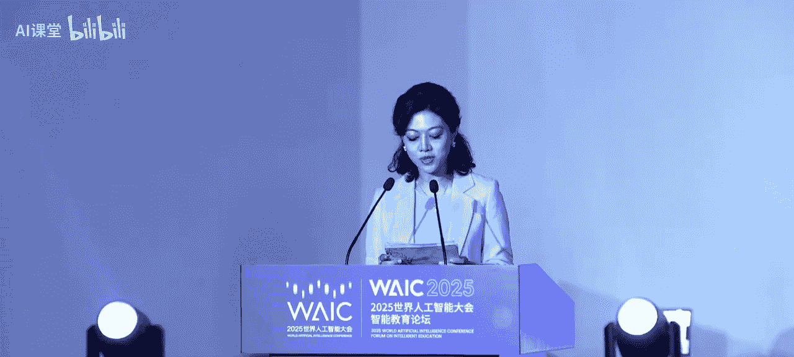

本次论坛由教育部科学技术与信息化师、上海市教育委员会指导，华东师范大学、上海创智学院联合主办，并得到了上海人工智能实验室经济合作与发展组织、教育技能师、剑桥大学未来学习中心等全球顶尖科研机构的大力支持。

🎼首先请允许我来为大家介绍今天出席的各位嘉宾，他们是教育部科学技术与信息化司司长周大网先生，欢迎您。😊，🎼上海市人民政府副秘书长、市教委主任钟亚明先生，欢迎您。😊，🎼上海市青浦区委书记王平先生，欢迎您。

😊，🎼北京邮电大学校长徐坤先生，欢迎您。😊，🎼上海科学院党委副书记院长孙真荣先生，欢迎您。😊，🎼上海市教委副主任王浩先生，欢迎您。😊，🎼上海市长宁区副区长顾洁业女士，欢迎您。😊。

🎼及我们的主办方代表有来自上海创智学院党委书记常务副院长丁晓东先生，欢迎您。😊，🎼华东师范大学党委书记梅冰女士，欢迎您。😊，🎼华东师范大学校长、中国工程院院士钱旭红先生，欢迎您。

🎼华东师范大学副校长施国月先生，欢迎您。😊，🎼华东师范大学校长助理、本科生院院长吕长红先生，欢迎您。🎼华东师范大学终身教授教育学部主任袁振国先生，欢迎您。

🎼华东师范大学上海智能教育研究院院长、上海创智学院全史导师钟爱民先生，欢迎您。😊，🎼其实呢今天到我们现场的还有很多重量级的嘉宾。那么一会儿呢，在我们的大会相关环节当中也会一一为大家来做介绍。

教育是人工智能影响最大的领域之一。😊，🎼在我们这一次的论坛发布以后，会发现有很多教育界的同仁们一直在关注这样的一个盛世。今天到现场的人数就超过了1500人。

同时我们开放线上的大家可以同时关注这样的一个论坛，让我们再一次对大家的关注表示感谢。😊，🎼接下来我们即将进入的是开幕式的环节当中，让我们用热烈的掌声有请开幕式的主持嘉宾。

上海市创智学院党委书记、常务副院长丁晓东先生，掌声有请。😊。

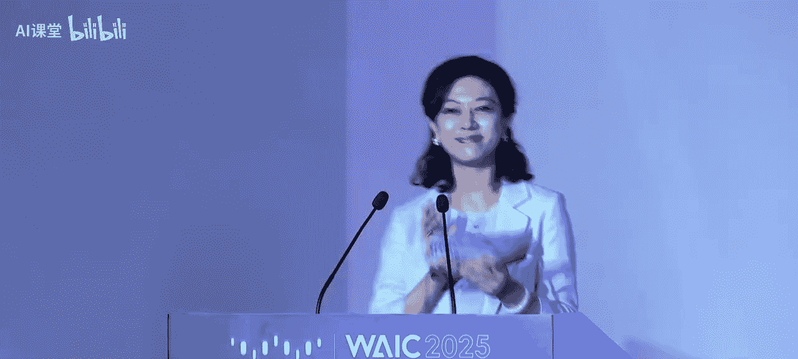

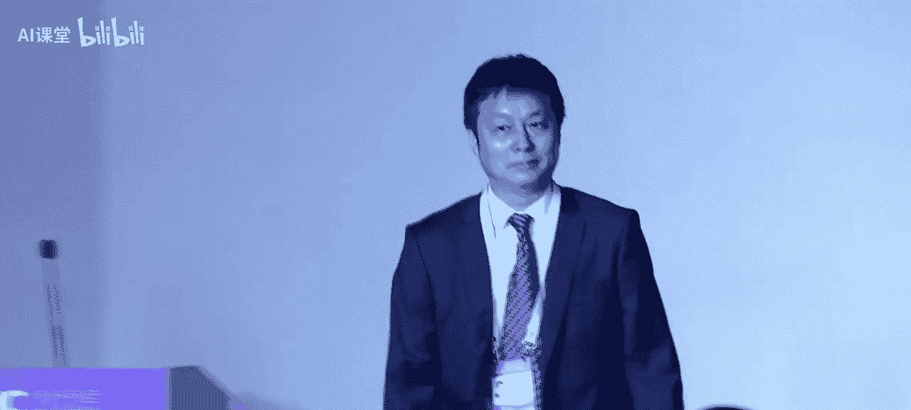

🎼尊敬的各位领导，各位嘉宾、女士们、先生们，大家好。今天我们齐聚世博中心，共同迎来2025世界人工智能大会智能教育论坛的隆重开幕。本次论坛由上海创子学院与华东师范大学联合主办。

得到了教育部、上海市人民政府高度重视与上海市教委的全力支持，汇聚了汇聚了全国知名高校专家、人工智能领券学者以及近千名中小学校长。共同探讨智能教育发展的新路径、新方式。在此，我代表论坛主办方之一。

上海创子学院向各位领导嘉宾的莅临表示最热烈的欢迎和最诚挚的感谢。🎼各位嘉宾同仁，上海在教育领域的探索与实践，始终得到了教育部的高度重视和有力指导。尤其是最近一年多来。

在推荐上海创志学院建设发展、关心和指导教育大模型研发工作过程中给予了充分的支持。下面我们掌声有请教育部科新市市长周大万先生致辞。

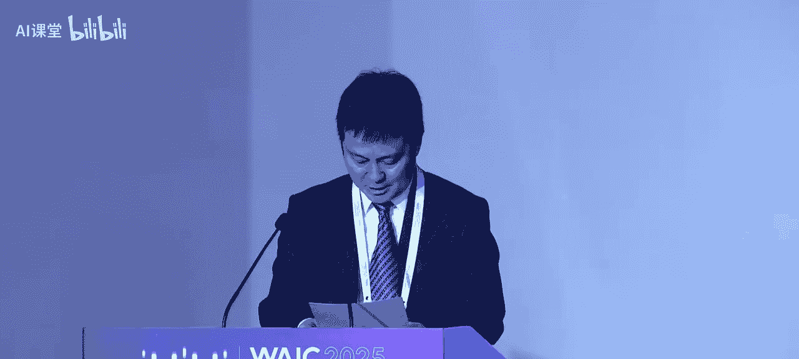

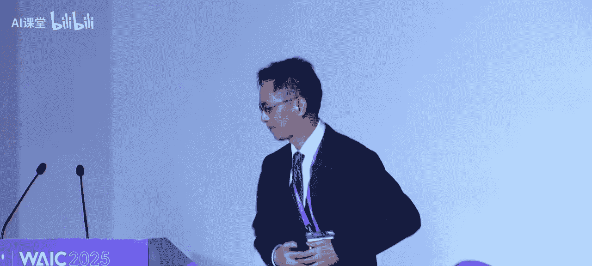

尊敬的王平书记、亚明秘书长梅斌书记、各位专家，各位来宾、朋友们。大家下午好。非常高兴与各位专家相聚上海，共同探讨智能教育在中国的这一主题的论坛。在此。我仅代表教育部。

对本次世界人工智能大会的成功召开表示热烈的祝贺，向参与本次智能大会研讨的各位嘉宾的莅临表示热烈的欢迎跟衷心的感谢。当前，人工智能技术日新月异，知识创新周期大幅度的缩短。基础研究的成果向技术发明的转化。

科研成果向现实生产力的转化的速度显著的提升，迭代的频率明显的加快。这不仅深刻的改变了知识供给模式和科研创新模式的放式的变革，更颠覆了我们思维的观念。驱动了教育内容、模式与形态的深度的变革。为加快发展。

伴随每一个人的一生教育。平等面向每个人的教育。适合每一个人的教育，更加开放灵活的教育，注入了强劲的动力。中国高度重视人工智能对教育的深刻的影响。习近平主席。啊。

明确提出要积极推动人工智能与教育的深度融合。促进教育变革创新，推进人工智能全学段教育和全社会通识教育源源不断的培养。高素质的人才。我们深刻认识到，教育已经深入智能的这个时代。未来以来，浙将重构教育生态。

重塑素养能力，共建教育资源，推动文明互鉴、实现合作共赢。教育部积极拥抱智能时代的教育变革，以教育发展与变革的智能时代为主题，于今年5月14日在武汉召开了世界数字教育大会。薛翔同志呢亲自出席了大会。

并鲜明的提出了4个携手。的国际合作的倡议。就是携手构建高水平的数质教育国际化的开放合作体系。携手推进数字技术赋能教育转型变革，携手促进数字教育成果普惠共享，携手夯实数字教育伦理的安全保障。

这四个携手明确了我们发展的重点和努力的方向。敬鹏部长也以题为携手迈向智能时代推进教育发展与变革的主题演讲。并组织了智能时代教育合为，是我们需要共同回答的时代命题。也是一个世界课题。会上。

我们还首次发布了中国智慧教育白皮书，深度描绘了智能时代教育发展与变革的蓝图。2025年是世界智慧教育的元年，我们启动实施了人工智能赋能教育行动，围绕了学AI用AI创AI互AI主题的布局，超前谋划。

强化人工智能人才的培养、场景应用和规范治理，促进了人工智能与教育的深度融合。我们聚合了AI学习资源，让全网好客尽在掌中，聚焦的广度覆盖、深度进阶、伦理护航、实现赋能的立体化的目标。

打造了极科普及前沿极交叉的人工智能的精品通识课程体系。目前，在各个教育阶段，共同开发人工智能相关课程有753门素养报告能力提升的讲座，共有214讲。广受师生的好评。我们推出了AI智能教育工具。

让智能学习触手可及。国家智慧教育平台基层上线了系列的学科大模型和智慧工具。配套建设了师生人工智能应用能力的测评系统，为师生应用人工智能模型提供了便利。同时上线了AI试验场，围绕着学交管研的四大方向。

研发具有前瞻性、实用性的AI工具。为师生提供了更智慧的学习体验。我们研发了教育专用大模型，让利的行动自领未来。以高密度的知识聚合，高质量的内容筛选高阶的信息萃取为标准。

开展了首批深层次人工智能教育专用大模型的这个评定跟这个应用的这个检验。下面呢我们接下来我们将按照各类型促进模型。就各学科的模型的合并融合，进一步的开发人思会算自主可控的中国版的教育专用大模型。

我们强调伦理安全保障，让科技向上守护未来。探索建立教育大模型的安全评估机制，从技术安全，从内容安全、伦理安全的角度，系统评估模型的安全性能，维护师生的切身利益，为人工智能的发展筑起筑起了安全围栏。

保障人工智能赋能教育的高质量的发展。女士们、先生们、朋友们。习近平总书记在上海调研视察时指出，人工智能是年轻的事业，也是年轻人的事业。推动人工智能发展的核心在人才，根本在教育。当前。

我们在智能教育上呈现出大模型大模型的助机、好案例的涌现新产品的迭代的良好态势。特别是最近一段时间，华东师范大学和上海创智学院在教育大模型的研发方面做了大量的工作，为智能教学资源创作。

学情分析等提供了强有力的支撑。今年3月。他们还领衔研发了自创innopar教育大模型，在国家智慧教育大呃这个智慧平台上上线。一会儿呢他们还将发布最新版的模型，让我们充满了期待。下一步。

我们将积极拥抱科技革命产业跟变革，主动顺应。人工智能技术发展趋势，构建适应智能时代的教育新形态，助力建设人人皆学、处处能学、实时可学的学习的新新社会。一是坚持以人为本，不断的夯实师生的AI素养。

强化科技教育人文教育的协同，积极推进人工智能、全学段的教育和全社会通识教育。构建覆盖大中小学和社会学习者的人工智能的教育体系，让人工智能成为师生的公共课、人人的基础课。第二是深化场景赋能。

促进AI与教育深度融合。探索构建未来课堂，探索人机协同的教学新模式。谋划未来学校推动智能技术深度融入学校的管理的各个环节。创设未来学习中心。搭建跨界融通的学习新空间，探索未来科教融合的新方式。

实施基础学科和交叉学科突破计划，让学科交叉融合，推动创新人才的高质量的培养体系。三是恪守智能向上，构建AI教育的伦理规范，加强技术伦理的教育，确保学生会用善用不滥用的人工智能。

同时开发人工智能终身学习课堂，为全社会提供人工智能的知识与伦理道德规范的认知。引导责任意识的养成，四是拓宽开放格局，深化AI教育的协同发展。通过搭建智能教育合作的智慧网络，共享智能教育的优质资源。

共同推进智能教育的治理，让人工智能教育成果，汇集全球及更多的群体。在开放协同，推动了全球智能教育生态的共建与共赢，为人类文明进步，注入了人工智能教育的创新的动能。智能浪潮。奔勇向前，智能革命势不可挡。

这是我们不容错过的历史机遇，更是必须肩负的历史时代的使命与责任。期待大家以此次研讨会为契机。充分的交流，实践经验，深度的碰撞思想火花，系统谋划发展蓝图。以开放包容的心态拥抱技术的变革，以兼容并蓄的胸怀。

汲取各方的智慧，以务实合作的行动，推动智能教育的发展。为构建更加美好的人类命运共同体，贡献智慧和力量，谢谢大家。

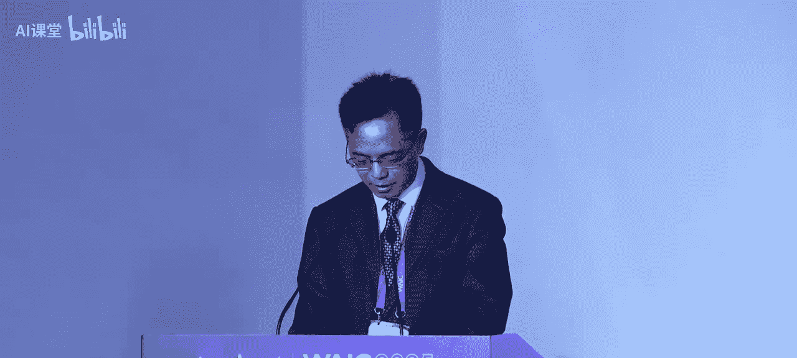

感谢大万市长教育部的前瞻部署和政策引领，为智能教育的发展指明了方向，提供了强大的动力，推动人工智能与教育深度融合，是上海市落实国家战略服务教育强国引领教育变革的重要任务，聚焦人工智能教育场景的垂类应用。

上海市政府进行了重点部署。今天即将发布的教育大模型成果，就是上海市教育领域重点推进的重大专项。🎼接下来让我们以热烈的掌声有请上海市人民政府副秘书长周亚明先生致辞。

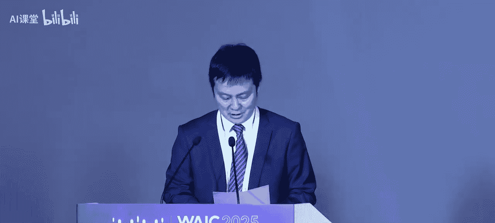

尊敬的大王市长。尊敬的各位专家，各位来宾、老师们同学们，大家好。今天上午，2025世界人工智能大会隆重展开幕。现在呢我们又荣幸的邀请到国内外教育领域的和相关行业的知名专家学者参加本届大会的智能教育论坛。

见证创新成果的发布，开展高端对话和深入探讨。首先，我代表上海市人民政府，对教育部和各位专家长期以来给予上海教育工作的关心和支持，表示衷心的感谢。近年来，人工智能技术快速迭代发展。

已经进入了以大模型为特征的高级推理阶段。教育一直是人工智能重要的应用领域。智能时代教育合为是我们需要共同回答的时代课题。世界课题。本次论坛围绕智能教育在中国大模型、好案例、新新产品这一主题进行探讨。

具有重要的现实意义。当前，上海正在教育部的大力支持和指导下，统筹推进人才科技教育一体化发展，加快培养拔尖创新人才，全力打造人工智能领域、高端人才培养的平台。我们以人工智能、赋能科学研究高质量发展。

在全市高校启动实施人工智能，促进科研范式的改革，赋能学科要生计划，投入专门经费，支持高水平大学发展人工智能相关学科，促进高校人工智能科学家开展跨学科合作、校企合作。我们以人工智能赋能教育模式的重塑。

承担国家关于人工智能未来领军人才培养实验区改革探索。专项支持高校开展人工智能赋能教育教学改革，全市统筹人工智能课程建课程建设，推进校绩共建共享。我们着力人推进人工智能开放合作，聚焦产教融合。

鼓励和支持高校与人工智能企业联合开展技术攻关，实施筑企联合培养，聚焦校校合作，支持上海创智学院和华东师范大学联合研发中国版教育大模型，推动人工智能加教育核心关键技术，迈出坚实的步伐。面向未来。

上海将努力推进人工智能加教育向纵深发展，引导全市教育工作者持续探索实践。衷心期待教育部一如既往的支持，关心上海教育事业发展，赋予更多的改革试点任务，助力上海以智能教育引领更高质量的发展。

衷心期待创制学院、华东师大进一步融入国家和上海人工智能发展战略，勇当人工智能核心技术突破的先锋队。全球合作的桥头堡育人改革的先行者。衷心期待各位专家激荡智慧发表动静。

共同推动人工智能、深度赋能教育、科研等领域的改革变革。期待各位同学在未来人工智能之路上勇担重任，勇毅前进，努力取得从0到1的改改变世界的原创的成果。上海将用好此次论坛的成果。

引导全市教育工作者持续探索实践，加快人工智能在教育领域创新应用，努力为教育强国建设做出更多的贡献。最后，祝本次论坛取得圆满成功。祝各位专家、各位嘉宾在沪期间工作顺利，身体健康，谢谢大家。

感谢亚明富秘书长亚明富秘书长从服务教育强国建设推进上海城市发展的战略高度，擘画了AR加教育的发展蓝图，体现了上海打造全球教育创新标杆的决心。近年来，在推进智能教育发展道路上。

华东师范大学在国内外一直扮演着重要的引领者的角色。今年1月，华东师范大学与上海创智学院联合成立了智能教育联合实验室，共同承担了教育大模型系统的研发。这个教育大模型啊，涉及到的学科非常多。

涉及到的人也很很多，市场上教育模型非常多，但是教育大模型面向未来，必须要教育学、心理学、行为学、伦理学、数理化听地声各学科的引领。

在华东师范大学教育学专家、心理学专家等全学科的专家共同支持下这个大模型今天才得以发布。今天。🎼即将迎来标志性成果的发布，下面掌声有请华东师范大学党委书记梅斌女士致辞。

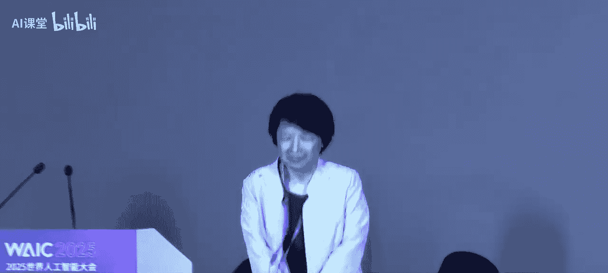

尊敬的大旺司长。亚明副秘书长王平书记、尊敬的各位领导、各位来宾、女士们、先生们，朋友们，大家下午好。今天我们齐聚2025世界人工智能大会智能教育论坛共同见证人工智能与教育深度融合，开启新的篇章。

这也是华东师范大学连续第五年主办或者共同主办世界人工智能大会教育论坛。本次论坛的举办，凝聚着多方的心血与智慧。我们特别要感谢上海市委市政府的高瞻远瞩和坚强领导，感谢教育部。

特别是科信司的悉心指导和大力支持，感谢上海市教委在推进人工智能教育垂泪应用系列工作中的精心统筹和有力推进，感谢上海创智学院对华东师大智能教育工作的支持与厚爱，感谢各位的积极参与，谢谢大家。

今天论坛的核心议题之一是发布中国版教育大模型的研发成果。这不仅是人工智能技术深度赋能、教育场景的标志性事件，更是教育数字化转型征程中的关键一步，在推进教育大模型研发这一重大战略任务的过程中。

华东师范大学与上海创智学院精诚合作协同攻关。我们深刻认识到，教育大模型不仅是技术工具，更是支撑未来教育生态重构的新基座，是人工智能教育全场景全流程的关键基础设施。为此。

华东师大发挥在教育理论认知科学、教育技术、教师教育等领域的深厚积淀。上海创智学院发挥在人工智能核心技术高。密度算力资源、工程化落地方面的优势力量，力求共同打造一个真正理解教育规律，适配中国教育场景。

服务教师教学与学生成长的智能化支撑平台。我们坚持教育为本、科技赋能、安全可控、开放协同，以解决教育真问题为导向，以服务国家教育强国战略为使命，通过教育大模型这一重要引擎。

驱动教育理念、模式内容评价的系统性变革。展望未来，华东师范大学将充分发挥学校高水平综合优势，特别是教育学、心理学、信息科学等多学科交叉融合的独特优势。在推进智能教育助推教育系统性变革方面进行深耕。

一是深化基础研究与核心技术攻关，继续投入大模型的核心算法、认知机制、人机协同等基础研究，确保技术领先性与教育适用性。二是构建开放协同的创新生态。在上级部门的指导支持下。

继续深化与上海创智学院等的联合攻关，协同顶尖科研机构头部科技企业广大学校一线，共建政产学研用深度融合的智能教育创新联合体，促进技术研发标准制定应用推广的良性循环。三是推动规模化应用与模式创新。

聚焦课堂教学提质增效、个性化学习支持、教育评价改革、教育智理现代化等关键领域，打造一批可扶制可推广的智能教育应用示范场景，探索人机共交、人机共育的新范式。四是强化人才培养与师资建设。

将智能教育融入人才培养的全过程，着力培养具有教育情怀与数字素养的未来教师和复合性创新人才，同时，大力开展在职教师智能教育素养的提升工程。五是促进国际交流与合作，积极参与全球智能教育治理与规则探讨。

分享中国经验，贡献中国智慧。今天，我们以智能教育在中国大模型好案例新产品为主题来举办论坛，正是要汇聚全球智慧，共同探讨如何把握AI赋能教育的重大机遇。推动教育高质量的发展。值得一提的是。

作为本次大会的重要组成部分。由华东师大牵头组织的智能教育在中国案例大赛也已正式启动。我们期待通过挖掘和推广全国各地在智能教育实践中涌现的优秀案例，树立标杆交流互鉴，共同描绘中国教育智能化发展的生动途径。

各位领导、来宾、同友、同仁和朋友们。推动教育数字化转型，实现人工智能与教育的深度融合，是时代赋予我们的重大使命。华东师范大学深感责任重大，也充满信心。我们热切期盼。

并衷心希望上级部门一如既往的给予我们指导和支持，希望广大中小学校教育实践者们，与我们携手同行，成为智能教育最前沿的探索者和实践者。我们相信，在各级领导的指导关心下，在社会各界的通力合作下。

人工智能赋能教育的宏伟蓝图必将转化为推动教育高质量发展的生动实践，为建设教育强国科技强国人才强国贡献更多的力量。最后，预祝本次论坛圆满成功，祝愿各位领导来宾朋友。大家身体健康，工作顺利，阖家幸福，谢谢。

感谢梅斌书记的精彩致辞。在与华东师范大学联合公关教育大冒险的过程当中，我们深深的感受到梅斌书记钱学红校长的重视和支持，感受到华东师大各级领导的支持。

特别是感受到华东师范大学、教育学、心理学、行为学等各学科。我们说是全学科大牛专家的智慧和全力以赴。我们也感受到华东师范大学。在教育学在教育和科研方面的深厚积淀啊，也让我们对其赋能教育的创新探索充满期待。

以上三位领导嘉宾的讲话，即为上海AI加教育发展奠钉锚定了方向，也为全国智能教育生态建设注入了强大的信心。上海创子学院也将以更加开放的姿态、更创新的机制，支持学校企业协同探索教育新未来。

打造AI加教育最佳试验场，推动AR技术在千校万课中落地生根，惠聚每一位师生。各位领导，各位嘉宾，开幕式环节到此结束，谢谢大家有请大会主持人继续主持成果发布环节，谢谢。🎼感谢丁院的精彩主持。

同时呢要感谢各位领导对智能教育在中国的这样一个主题论坛高屋建瓴的指导。接下来是我们期待已久的高光时刻了。在上海市委主要领导的关心下，在教育部相关部门的指导下，在上海市教委的统筹下。

华东师范大学和上海创智学院在2025年的1月份组建了智能教育联合实验室。在实验室联合科研团队的集中攻关下，起创因工人工智能教育大模型即将正式发布了。

相信呢各位今天来到我们现场也是非非常期待这样的一个时刻。那么接下来呢就让我们有请华东师范大学终身教授教育学部主任袁正国先生上台为大家来发布大模型，掌声有请。😊。

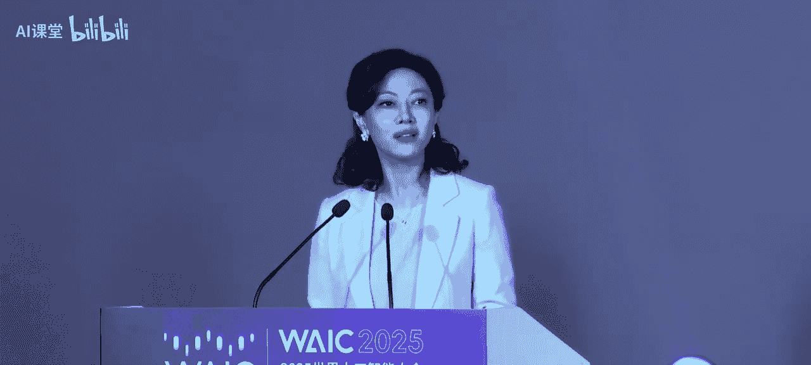

尊敬的各位领导，各位专家，各位来宾，大家好。我非常荣幸能够代表华东师范大学和创子学院的联合实验室在这里发布我们的起创inowpar教育大模型。

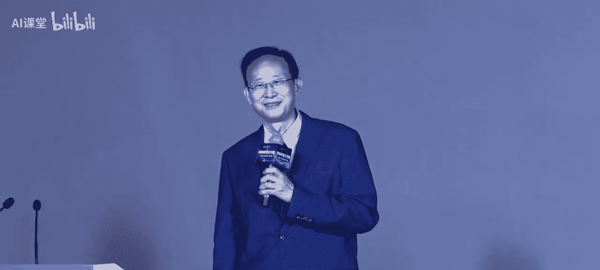

习近平总书记指出。我们要通过教育的数字化来开辟教育发展的新赛道，塑造教育发展的新优势。改革开放以来，我们通过教育的信息化、网络化，现在已经进入了教育的数字化、智能化的新时代。我们要建设教育强国，必须要。

😡，实现万道超车。在这样的一个背景下。刚刚颁步不久的教育强国的建设规划纲要提出要打造人工智能的教育大模型。促进人工智能的变。说通过这个人工智能助理教育的变革和发展。在这样的背景下呢。

在各界各个方方面面的支持下。我们想做一件事，就是要做一个。面向未来教育理想。立得树人润物无声的中国教育大模型。人工智能发展到现在，赋能于各个方方面面。😡，而教育大模型来推动教育改革的发展。

塑造教育的新的形态。让我们办更好的教育，促进学生全面发展。个性我的发展，创作性的发展。😡，人工智能可以发生，可以发挥不可替代的作用。怎么让这个不可替代的作用能够真正的发挥出来，这就是我们想要做的事情。

😡，这个大模型呢试图强调三个重点，或者说体现三个原则。就是大规模背景下的个性化。常规下的创造性和立德树人的价值对齐。首先讲一讲。这个大模型的个性化理念。因材施教是2500年前，孔福子就提出来的教育理想。

但是我们现在要说的教育的个性化，还不仅仅是针对每一个学生的现有特点。😡，我们希望打造的是通过知识图谱的构建，通过学生画像的描绘。能够发现学生的最近发展区。一个人的发展。😡，已经发展到一个阶段。😡。

还有一个更高的阶段。😡，我们很多的更高的阶段，在一个短时间之内可能难以企及。在这个当中有一个最重要的阶段，就是通过努力以后能够实现的阶段。了解和经历这个阶段是教育的真谛。😡。

怎么能够把握到学生的最近发展区，这个是教育大模型的不可替代的功能。第二个呢就是要传导强调常规下的创造性。我们要构建一个知识的新体系。工益革命以来，我们已经形成了完备的知识体系。

这个知识体系最大的特点就是分科。😡，风构化促进了教科学的生物化。但是呢也人为的分割了科学和知识。😡，知识术是我们建立教育的基本基础。但是大家知道这个世界上其实是没有分科的，分科是人为的。😡。

在这个世界上，自和事始之间是建立着形成了这个具有广泛的联系的。😡，实际上，我们在学习和创造的过程当中。能够把不相关的事我能够连接起来，这就是创造性的本质。😡，而我们现在所要构建的知识心体系。

就是像大海里的每一滴水，每一滴知识。😡，都连接着整个的大海。第二个呢，就是要。传播新通道，从纸质的文本到多模态。纸质的文本建立在语言的基础上。😡，其实语言是平面的。在我们没有人工智能之前。

语言足足够的蕴含着我们所需要的信息。😡，但是有了人工智能之后，我们就深刻的发现。😡，语言是平面的，它所蕴含的知识和信息的含量非常的有限。我们的很多的思想，我们的感触，我们的意念。

我们的认知、语言是无法表达的。😡，它存在于多个信息通道之中，所以把文本。图片视频等等的信息进行了综合之后，才能够更完整、更生动、更深刻的体现真实知识的本质。第4个第三个呢，要构建一个教育的新范式。

千百年来教育的基本模式是。老实讲学生听。当然这里也有互动。但是现在出现了一个完全新的场景。出现了三个主体。学生、教师和人工智能智能体。这个之间的相互的沟通，相互的激发，相互的这个融合就成为。

激励创造性的无限的空间。第3个，这是我们最求的目标，就是价值对齐。我们要打造的是体现人类基础文明的、和平的、友爱的、团结的、发展的、安全的、可靠的教育大模型。😡，我们需要打造的是体现中国的文化精神。😡。

优秀文化传统，中国文化伦理的教育大模型。😡，我们需要体现的是体现中国社会主义核心价值观的教育大模型。在大模型的运用过程当中，让我们的人的培养工作。😡，能够体现我们的价值理念，润我不胜。

那么我想向大家报告的是，在我们。通过第三方的测评过程当中。我们把我们的教育大模型通过价值观个性化、创造力。知识点的讲解，引导式的教学、跨学科的案例生成和情景化出题的7个要素和目前最优秀的。

世界的大模型进行了比较。包括deep sick。Qu2。5。GPD4。0和刚刚马斯克发布不久的g four。跟我们的inow spark相比较而言，我们在目前的这个背景下，我们很自豪的说。

我们超越了世界上在教育锤理大模型这一点上，超过了世界的所有的大模型。😡，当然，这才是刚刚开始。人工智能发展非常的迅速。😡，即使我们很激动，同时也使我们感觉到很有压力。但是我们不为所惧。😡。

我们今天在这里发布的是。起创大模型的1。0版。我们将在今年的9月份让它正式上线，是开源的。欢迎大家运用。欢迎大家以它为基础，开拓自己的智能体新产品。我们将在今年呢。12月份研发出多模态的教育大模型。

在下一个目标，我们希望在明年的12月份能研发出情景智能的教育大模型，把知识能力和情感价值能够融为一体。😡，让我们的教书育人，不仅是知识而人和能力，而且让我们的信念和信心。😡，共同发展。谢谢大家。

敬请期待。好，非常感谢袁教授。袁教授呢带领我们刚才呢是从中国版大模型是什么出发，介绍了中国版教育大模型在个性化、创造性、价值对齐三个维度的价值属性和技术路线，同时呢也展望了教育大模型2。03。

0阶段的发展蓝图。其实刚才呢我们看到这个屏幕上，在今年的9月份，其实对我们的学校来讲的话，第一线的教育，我们就可以去体会去体验。同时呢我相信在这个过程当中，我们会不断的有新的数据产生。

也为我们接下来12月乃至明年的一些啊我们可能期待的这些成果的话，可以做好准备。那么当然在这个过程当中，我们看到整个报告对研发理念有清晰的阐释。同时呢对未来的方向又有非常好的研判。

让我们对起创有了更全面深入的认识，也充满了期待。再次感谢袁教授。那接下来呢我相信在座的各位也看到了我们的启动柱已经上台了。😊。

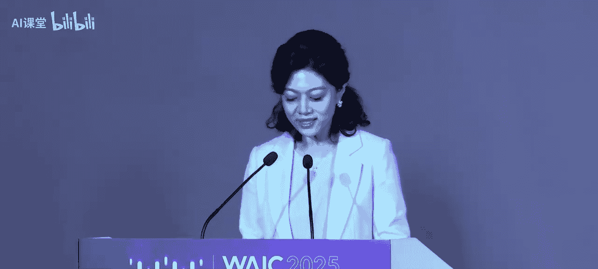

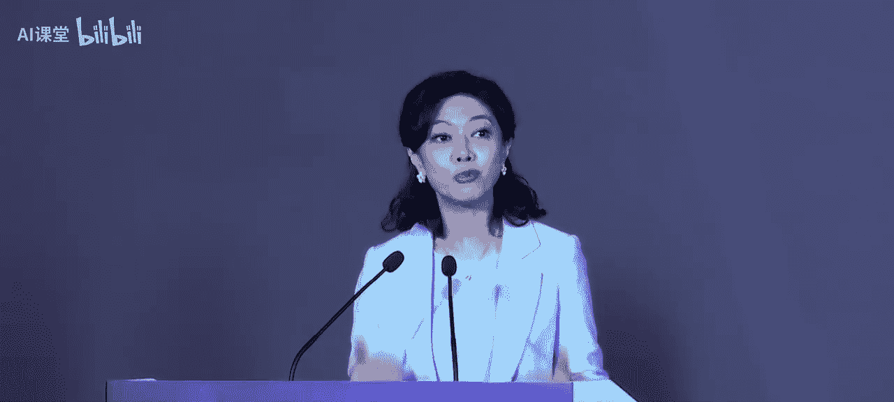

🎼接下来我们就要去把这件的事情共同来启动，让我们掌声有请教育部科学技术与信息化司司长周大旺先生，上海市人民政府副秘书长、市教委主任周亚明先生、上海市青浦区委书记王平先生、华东师范大学党委书记梅冰女士、华东师范大学校长、中国工程院院士钱旭红先生。

🎼上海创智学院党委书记常务副院长丁晓东先生，上海科学院党委副书记院长孙真荣先生，上海市教委副主任王浩先生、华东师范大学副校长施国月先生、华东师范大学终身教授教育学副主任袁振国先生、华东师范大学上海智能教育研究院院长周爱明先生、华东师范大学上海智能教育实验室主任张志先生。

共同上台为我们来启动掌声有请。🎼领导们对科学研究非常的严谨，看那个启动台上的数字也非常的认真，不能站错位置。好，来，各位领导，我们把手放在启动柱上。😊，🎼现场的观众朋友们，让我们一起共同来倒数5个数。

一起来看大屏幕。🎼5。4。🎼3。🎼启动起创inowpar的人工智能降育大模型正式发布。🎼感谢各位嘉宾对。🎼的关注与支持，请各位领导入座。🎼至此呢，起创os人工智能教育大模型已经正式发布了。

想必大家此刻对大模型背后的技术细节，以及呢在真实教育场景当中会有怎样的经验表现，也是充满了好奇。当教育大模型走进真实的教育场景，是否真正能做到为教育赋能呢？让教师更高效，使学生更受益。

那么接下来就让我们把舞台交给研发团队的负责人，华东师范大学上海智能教育研究院院长、上海创智学院全市导师钟爱明教授，为我们进一步来呈现ospar的技术能力，掌声有请。😊，啊，尊敬的各位领导。

各位嘉宾大家好，非常荣幸能够代表由华东师范大学和上海创智学院共同组建的教育大模型联合公关团队进行技术汇报。那么实际上，刚才袁正国教授已经介绍了我们教育大模型研发背后的一些理念。各位领导也上台。

共同见证了我们起创教育大模型的发布。那我们是如何将这些先进的教育理念融入到我们的教育大模型之中的那下面我将为大家来揭开这背后的技术逻辑。在上海市教育委员会支持下面，我们组建了联合公关团队。

那么华东师范大学和创制学院组建联合公关团队。那么在短时间里面，我们进行了一个联合的一个公关。我们汇聚全市的力量来进行一个公关。那首先在上海市教育委员会集中了我们上海市最优秀的教育资源教育的语料。

而我们上海创智学院将全市最好的人工智能的算力，然后最好的技术的专家最好的平台来支持我们的研发。而刚才也介绍过我们华东师范大学将优秀的教育的资源啊，心理的资源、计算机的资源。

哲学的资源全学科的资源融入到我们这个大模型的这样一个训练过程中，在短短的几个月里面，我们基于最优秀的国产千问技作大模型训练了我们的起创1。0的版本。那么呃这个版本在今年的6月27日正式下。

见那么今天也是首次与大家见面。正如刚才袁任国教授所说，我们大模型的目标是要能够引领我们的价值观，培养我们孩子的个性化，以及激发我们孩子们的创造性。为此，我们构建了教育大模型的全流程的研发管线。

以及相应的支撑的平台和软件平台。那么我们着重实现了规模化的语料构建、流程化的模型训练架构以及体系化的模型评测方案。下面我将为大家进行一个详细的介绍。那么首先是语料平台的构建。

那么在上海市教育委员会的支持下面，我们在全市16个区9余家的上海呃教委的直属单位和相关的中小学校，我们共收集到大概22T的非常宝贵的是有语料。那么在华东师范大学相关的这些师生的支持下面。

我们也收集到大概有两T的高等教育的语料。那这中间包含了非常重要的我们教育学研究的这样一些语料。同时我们团队也收集到大概有2T的价值观的语料。那这些语料在我们自自动化的教数据清洗管线的支持下面。

共训年啊提取出来大概20B的教育的语料token。同时，我们构建了人机协同的这样一个数据合成系统。那么我们一共合成出来，围绕着不同的教育场景，合成出来，大概有4万条的场景的微调指令。

同时我们发挥我们华东师范大学以及整个上海市教育的这样一个基础。我们邀请到了大概有超过1000人的教育领域的专家。那这些专家为我们的语料进行了大量的标注。

目前我们已经拿到了大概有超过1万条的高质量的专家的这样一个打分的这样一个语料。那同时我们所有做的这些工作都将开源，包括我们的多模态的啊多点化多模态的数据清洗管线已经上线。

大家直接扫码就可以进入到我们的这个平台中间。那么在特别是在我们的这个教特色语料合成方面，我们面向我们的这个核心的目标，也就是价值观引领创造力激发个性化培养。我们也专门来做了一些相关的语料。

那么针对我们价值观引领的这样一个目标。我们围绕人类文明的基础。中华文化的精神，以及我们社会主义核心价值观等这样一些特点，构建了大概有2000多条的这样一个案例，那么面向我们创造力激发的这样一个目标。

我们基依据真实的这样一个课程的实路，挖掘出来有12种以上的引领引导式的教学启发式的教学的这个方式。啊面向个性化培养的这样一个目标。那么我们构建了一万多的用户画像，那这些用户画像，包括不同的性格。

不同的爱好，不同的年龄，不同的知识掌握程度的这样的一些孩子的这样一个画像。那这些的这些语料，以及我们的结合我们的教育场景。比如说。试点的讲解，引导师的教学、情境化出题以及跨学科教案生成这样一些场景。

共同合成出来4万加的这样一个场景微调的语料。那么正是因为这样的一个融合的过程，所以我们能够真正做到随风潜入液，润物细无声。那么第二部分是我们的模型训练的这样一个呃模块。那么我们也在创制学院的支持下。

打造了非常高效的全流程的训练框架。那么我们基于刚才组组织出来的这样一些语料融入到我们训练的全流程的过程中间。那么在20预训练阶段，我们将20B的这个教育语料的token融入进来。

让我们的大模型拥有更加全面更加系统的这样一个教育的领域知识。那么在指令微调阶段，我们将4万条的场景语料的这个呃指令融入进来，让我们的大模型能够真真正正的解决我们教育领域的一系列的具体的一些问题。

那么在强化学习阶段，我们将1万加的这样一个专家打分的这个语料融进去，使得我们的模型真正能够在创造性个性化和价值观引领方面能够起到一定的作用。那么具体来说，在我们的强举强化学习这样一个案例来来案例子来说。

那么我们首先把价值观引领、创造力、激发以及个性化培养这些专家的打分知识融入到一起。基于这样一个专家打分的这样一些知识，我们构建了一个多维度的奖励模型。那这个实际上是相当于把我们专家的知识。

融入到了这么多一一大群的上千位的我们的专家的这样一个呃领域的这样一个知识融入到我们的这样一个模型中间。基于这样一个奖励模型，我们就能够快速的让我们的起创的这个模型进行迭代。

让我们的模型像人一样能够引领价值观，能够激发孩子的创造性，能够实现我们个性化的这样一个培养。😡，那模型训练的第三个模块是我们的评测模块，其实评测模块是一个非常重要的这个模块。那么可以说在大模型的训练中。

评测是我们牵牛鼻子或是我们的一个呃价一个引领的这样一个方向。为了解决这样一个问题，我们结合华东师范大学在教育领域的这么多学科的领域专家知识，一起构建了教育大模型的评测指标体系。

同时我们也构建了教育大模型的评测数据及设计了整个教育大模型的评测的方案。那所有这样的一些工作，全部汇集在我们自主研发的els的评测平台。那么基于这样一个评测平台，我们就可以对所有的大模型。

通用的模型也好，专用的模型也好来进行评测，最终得出刚才袁中国教授介绍的在价值观创造性个性化一些维度，以及我们在教育教学具体任务上的它的一个表现。同样的我们的这个评测的这个平台已经。已经开源。

大家也可以扫码直接登录我们的这个get hubub平台，可以直接下载我们的这个源代码。那么也欢迎大家来进行测试，帮助我们一起来共同的提高。那么在这个评测里面，最为关键的一点是我们的评测指标体系的构建。

那么我们也是围绕着我们的三大目标，也就是价值观引领创造力激发和个性化培养这样一个目标，具体以我们的教育教学的具体任务为为核心。比如我们这里的知识点讲解。

引导式教学情境化出题以及跨学科的案例生成这样一些任务，围绕每一个任务，我们都构建了一个系统化的评测的指标体系。而在每一个评测指标体系，我们都包含了价值观引导的这样一个指标。

包含了我们创造力激发的这样一个指标，包含了我们个性化培养的这样一个指标。那么在当一个模型来具体进行评测的时候，那么我们可以用现有的通用的大模型。

同时我们也邀请了我们这么众多的教育专家对模型的这个性能进行AI和人工结合的这样一个评测给。每一个维度能够打出一个分数。那最终依据这个分数，我们就可以得到它在价值观引领，在创造力激发。

在个性化培养上的一个平均的分数，以及他在具体的这一些教育任务上的分数，最终得到我们的个呃评价的这样一个雷达图。那这就是我们在呃这个模型训练的三个核心的阶段，包括我们的语料的构建。

包括我们的呃模型训练架构的设计，包括我们的这个评测指标。那么所有的这些工作都已经开源，大家都可以点我们的这个二维码来进行一个下载和试用。那当然在我们呃6月27号模型下线之后。

那么我们也邀请了大量的一线教师和同学对我们的模型进行了系统化的这样一个评测。那华东师范大学四附中的佘老师，就特别想试试看我们大模型如何给学生讲题。Okay。请工作人员帮忙把视频放一下。

那我们的同学可以拍照上传，把我们的题目进行一个上传，通过用引导的方式讲解这道题。好的，你知道如何求两个函数图像的焦点坐标吗？我想不起来了。你可以试试求直线Y等于X与直线Y等于3X减2的交点。

那就是把Y等于X代入到Y等于3X减2中。对，就是转换成方程来解。那你知道如何解这道题了吗？就是转换成方程X平方加4乘以X加C等于0。对的，孔子说，为以知识。那么我们的大家可以看到。

我们的模型不仅有西方的哲诗，更具有融入了孔子的名言，在交互中能够传递中国价值观。和跟的判别式有关。那你要不要实试自己把它做完？那么我们的模型在讲完一道以后，也能够抛出一些新的题目来，让孩子来举一反三。

看学生是不是真的来吃透了我们的这个讲解。对。D小于4。答对了，那我再考考你，我们现在知道C有上线，那C有下限吗？我不确定我们让大模型来给你生成一个图试一试。生成一个可交互的二次函数图像。好的。

我会通过HTML代码生成这个图像。那我们的模型也能够调用一些第三方的这样一个工具来生成相关的图像。那么这个功能也特别受学生孩子们的这个喜欢。那么他们可以根据自己的需要来开展一些个性化的探索。哦。

我看出来了，确实没有下限。随着C的减小，抛物线与XO两个交点越来越圆，不会重合。那我们的第二个案例是跨学科的教案生成，他能协助教师创造啊创设有效的跨学科学习，帮助学生来核心素养能力的这样一个提升。

那就让我们进入跨学科教案生成的功能来尝试生成一堂，以物理学科为主。关联地理和数学学科的教案怎么样？好呀，我们的老师只要设定好融合的学科大模型就能够呃完成知识点与任务场景的有机融合题。

它的主题是如何建造一座能抵御百年自然挑战的跨海大桥。刚刚提到的物理数学地理的学科知识也都整合进来了，还拓展到了核心素养。没错，这些知识点都关联的很好。哇，他帮我把导入语都写好了。是呀。

不过我觉得这个表达好像还有一些抽象，如果能够把它聚焦到一个具体的区域，比如说港珠澳大桥可能任务会更明确一些。那我们试试大模型的融C认字功感。好呀。他们可以测试大模型的局部修改功能，通过一份教案。

就可以通过人机协同的方式进行一个持续的打磨。哎，我觉得这个问题就不错，那就采用它。好的，我看到他还可以帮我们推荐视频和图片呢，让然大模型为我们推荐一些视频嗯。哇，这真的是节省了不少我备课的时间呢。

他们正在测试大模型的局部修改功能。那么呃通过和模型的这样一个多人的一个交互，老师就能够拿到跨学和教案任务设计到量表评评价量表到配套资源的这样一个完整方案，非常的高效。

那么特别也感谢来自华东师范大学市附中的摄影岩老师，上海实验学校的陈晓雷老师，徐汇中学的于金玉老师以及林正南同学的支持。感谢他们的一些支持。那么我们刚才也给大家演示了我们起创大模型的一些能力。

那么他实际的功能是远远的不止这些。那么大家现在就可以。可以扫码来进入我们的这样一个起算大模型内测版。那么我们的正式版将拥有更加全面、更加完善的这样一个功能。在我们完成相关的备案之后。

将正式的为大家提供服务。那么我们也知道我们当前做的这些工作只是我们变革教育的一小步。那么呃。在此，我也呼吁在座的各位专家、各位领导，各位老师、各位同学。那么我们一起来唉培育好研发好我们的起创教育大模型。

让他成为我们老师和孩子们的这样一个好的助手，服务我们教育强国的建设。那最后我也特别想在这里感谢参与我们起创 spark教育大模型研究的100多个单位1000多位的这样一个专家的一个支持。

那么也特别感谢我们智能教育呃，教育大模型团队的核心成员的这样一个支持，感谢你们的支持和努力，让我们在短期内实现了从不可能到可能的这样一个突破。那么在未来，我们也将持续努力实现从可能到价值。

从价值到普惠的这样一个呃这样一个突破。那么感谢大家。😊。

感谢周院长的精彩介绍。刚才可能大家没注意到一个细节啊，就是所有的人当看到我们内测版的二维码出现的时候，都举起了手机。这个如果说对我们新闻媒体记者来讲，就是记录下难忘的一个瞬间。

所以大家都希望在内测的过程当中，就能够是感受到刚才呢周院所讲到的，从个性化到启发式的讲题到跨学科的这样的一个教案的生成，让我们也看到了教育大模型他的一个无限潜力。

当然我觉得在这里边很多人可能就会提出一个问号，也就是说核心理念，他难道是要替代这个教学吗？其实不是的，我们在这个过程当中是希望他成为教师的智能伙伴学生的成长助手。就像周院长所说，9月完成备案之后。

将会有更多的功能和大家来见面。那么也让我们一同来期待教育大模型的上线，也成为我们学习生活当中的日常。好，接下来呢我们将进入到的是主旨演讲的环。😊，🎼节当中了。

有来自全球学术界产业界和国际组织的顶尖专家为我们带来共同展望智能时代的教育变革。让我们掌声有请这个环节的嘉宾主持人，华东师范大学副校长施国月先生，掌声有请。😊。

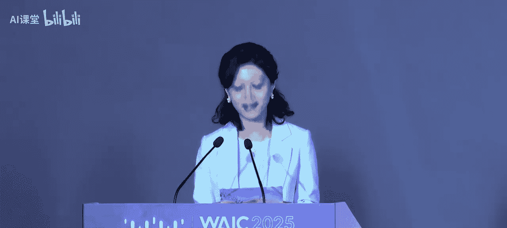

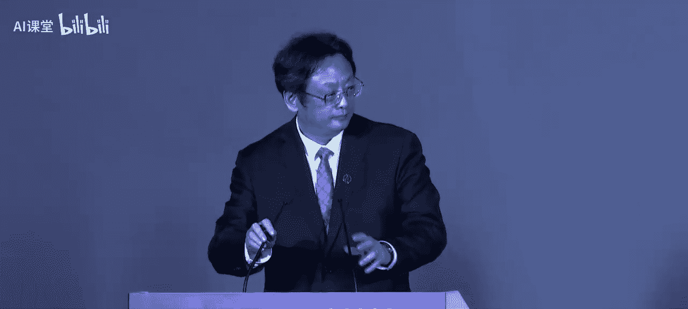

好，尊敬的各位领导，各位嘉宾。线上线下的各位朋友，大家下午好。我是华东师范大学师博院，非常荣幸能够主持主旨报告环节。我们目前正处在一个被人工智能，特别是大模型技术深刻重塑的时代。

教育作为培养未来建设者和创新者的核心产。如何在这场变革中抓住机遇？如何将技术的变量转化为发展的增量？这些问题呢需要我们从更高的站位、更深的视角去思考和探索。今天呢我们特别邀请了5位国内外顶尖的专家。

他们将从战略、技术、实践、国际视野等多个角度为我们分享他们的真知灼见。首先我们。🎼欢迎同济大学党委书记、中国工程院院士郑庆华先生。🎼他将为我们分享他对人工智能领域的深刻思考，有请郑书记。

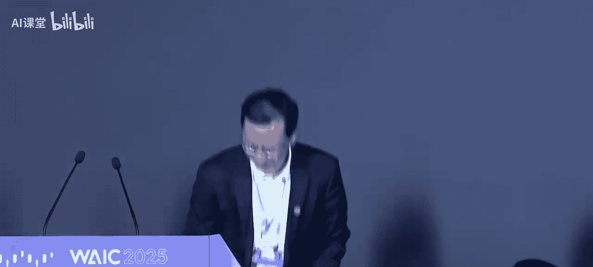

各位专家。呃，各位同仁，大家下午好。呃，我呢借这个机会啊给大家分享一下呃人工智能赋能未来教育创新的几点思考和认识。

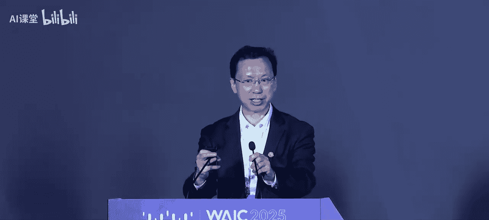

那么首先啊大家已经深刻的认识到，人工智能呢已经成为人类认识认知的超级显微镜、超级望远镜和超级计算器。人工智能极大的拓展了人类的认知边界和能力，成为一种认识世界改造世界的一种新智生产力。当然了。

我们深刻的认识到，人工智能的认知和人类的认知有本质的区别。因为人类拥有的创造力。以及所拥有的意识、情感、道德判断、尝试推理。以及对良公序良俗和这个伦理道德这方面的把控，这些当前AI都还不具备。

这也是今天啊呃李强总理在主旨演讲当中提到的。人工智能的发展和治理要两手抓，两手都要硬。所以我们从教育从业者来说啊，呃，如果认识到人工智能有望成为史上无所不能的最强大脑，超越人类的学习能力。

我们究竟应该怎样开展教育，这的确是值得思考探讨的问题。如何教怎么学教育的价值、目标、内容、方法，怎样适应人工智能时代，这是未来教育要探讨的一个重大问题。这里面啊我想分点分享几点自己的认识。第一。

人工智能正在打造未来教育的新形态。传统的教育，老师教学生学是一种二元结构。今天人工智能作作为一种智能体，介入了老师教学生学的过程之中，形成了实机生三元结构。

因此呢从师生护教互学转化为实机生护教互学虚事一体个性伴学，并且以人工智能机器智能、赋能人类认知和学习。所以，以人际协同的新智商超越人类智能。已有智能的局限性。啊，人类经过几百万年的进化。

它的智能其实进化呃进展并不是很明显很显著。因为我们今天的人跟几千年前的人其实并没有聪明多少。但是人工智能的加入以后啊，使得人类的学习能力、知识获取能力、科学研究能力的确得到了极大提升。

我认为啊未来的教育将有四个部分组成。第一是人对人的教育，依然是老师教学生学，但是老师的作用将从过去知识传授为主，转变为价值塑造、思维创新、情感教育和能力培养。第二是人对机器的训练。

我们为了保障确保人工智能正向赋能，所以首先要把机器训练好，这个过程就是人对机的训练。主要是让机器遵从人类的价值，实现人际的价值对齐。第三个是人工智能智能体反作用于人类的教育。也就是说。

人工智能为我们提供知识获取AI for science  AI for education等方面的新的功能。第四呢是机和机之间的相互对弈学习啊，实现知识蒸馏以及模拟仿真、对抗博弈。

甚至最后机器人智能体也具备自主独立自主智能。因此，在这样的背景下啊，教育部也启动了4个未来，就是未来教师、未来课堂、未来学校、未来学习中心的研究。我认为这个极为必要。

再一点认识是大模型正在重塑知识的生产和传播的格局。我们知道校园、教师、实验等等，是我们传统教育的基础设施，这个依然存在。互联网诞生以后，网络信息基础设施成为这个信息时代教育的重要基础设施。今天。

大模型将成为未来教育智慧教育的新的基础设施。因为大模型的揭露将使得呃这个对传统教育啊产生三方面的重大影响。第一是改变知识的生产方式。我们知道过去知识只能由人创造人生产。今天呢朝着人际协同。

甚至呢人工智能也能独立的生产知识，创造知识。第二呢是改变知识传播的方式。大模型本质是为我们提供了一个。个性化互动是实时随时随地可以获取知识，可以这个进行互动交流的一个知识获取平台。所以。

因为单纯从知识获取的角度来说，学生用户他不一定依赖老师，也不一定依赖学校，而是通过大模型来获得。因而呢会弱化大学。它的作用功能和定位。第三呢，大模型也在改变国际话语传播体系，深刻影响人类的价值取向。

比如说che的GPT啊，活跃用户长期稳定在数亿亿级。世界上没有哪一个传播平台能够像他这样具有那么大的粘性啊，具有那么大的个性化互动性这样一种力量。我们的其他大模型也都有呃很大的用户的这个呃传播能力。

学生知识获取能力。如果一个学生，一个用户。长时间的从某个平台上获取知识。而这些知识潜移默化的也渗透的价值观，渗透的伦理道德、基本公序良俗这些行为准则。那么简而言之呢。

大模型对我们的教育对我们的思维对我们的价值观就会产生影响。所以人工智能既是一种工具，它正在使得这个从过去的啊呃。我们都依靠人来生产知识，到信息化协助，到今天来推动知识的生产加工。

甚至创造这样种工具的革命，还是革命的工具。我认为啊这都是不容小觑的事情。因为大模性创造了个性化教育，无障碍知识过去的这种技术可能啊，实现过去从信息时代这个信息检索为主，朝着知识生产自动化这个时代。

从而使知识传播环境更加复杂，噪音也更多，也容易出现信任危机。同时，由于算法设计者本人的价值偏好、兴趣等等问题，有可能造成公平偏见啊，以及大模型吸引了数以亿级的用户带来的过于权力集中，知识集中，由此影响。

伦理与社会问题。这些问题啊。都是我们教育工作者在教育当中必须面对思考和解决的问题。第四呢，我认为人工智能正在深刻的改变人类的认知逻辑。

我们知道一个人从出生通过视觉、听觉、嗅觉、味觉触觉感知世界获取知识数据，进而在数据基础上挖掘有价值的信息，提炼出有用的知识，能够形成判断，能够对事物进行推理，进而形成逻辑。在这个基础上。

进一步形成对事物对呃这个世界的看法，对解决问题的一种直觉形成意识。在基础上形成信念，进而树立信仰。所以人类的教育其实本质上就是把数据转换为信息转换为知识，建立逻辑，在在这个基础上产生意识。

形成信念和信仰。这样子个基本逻辑。那么今天呢大家可以看到，人工智能在底下四个层次都已经能做了。就是今天早上李强总理提到的从感知智能迈向物理智能。啊。那么在这个过程当中。

就是在这个基础当中又形成了既知识的判别决策式的人工智能，以及今天以大模型为代表的深层式人工智能，也能创造知识，深层知识。下一步，人工智能机器人也朝着。意识、信念这个方向继续努力。

所以呢对我们教育工作者来说，就提出了一个新的挑战。过去我们说谁来教教什么，怎么教，如何学怎样评。他虽然是谁是呃，不清楚，是找希望找一个更合适的老师。但是今天这个谁呢，既有可能是教师，是人。

也有可能是机器人，是人工智能的代理。所以这个主语发生了变化。因此我们说人工智能不仅是工具啊，它也是塑造我们如何理解世世界的一种力量啊，它既提升认知效率和创新能力。同时。今天这种快餐式的学习啊。

这个缺乏深度，缺乏底层逻辑，也会造成注意力分散、拟人化陷阱这样一些新的风险。这都是我们教育工作者需要思考和呃面对的新的问题。所以在这种环境下，我们需要转变这个教育的手段和方法。

因为人工智能给我们带来的是教育模式的全新转变，需要从教学平管研服用啊，这个环节啊进行全方位的进行改革探索。最终呢未来的教育。我认为啊用四句化可以来概括，就是针对性的教个性化的学多元化的瓶和智能化的管。

这是未来教育希望打造的这个啊教和学平管的一个深层次的。模式变革。所以，未来教育将是司机生3元结构的未来教育的一种新模式。作为教师来说，它主要的任务是实现认知的架构和思维的引导。

学生的主要任务是知识的构建和运用所学知识分析问题，解决问题所建立起来的理论和实践上结合的创新能力。而人工智能智能体，它主要是帮助我们实现人脑所记忆不下来的。

向知识存储以及帮助我们提供我们各种更加高效精准、有效的。呃，science啊或者engineering的各种赋能工具。所以未来的师计生共同学习协同学习啊，它将突出智能体知识图谱这些新的要素啊。

展现师计生三元模式，更多的是围绕人类共性问题开展探索学习啊，更多的是开展问题导向啊，问题驱动目标导引领的这种新的学习方式，打破院系至学科专业化的这种传统管理和人才培养的模式啊。

所以未来的教育未来的课堂将共同成为知识的探索者、创造者和合作者。那么具体来说呢，我认为首先。人工智能的支持下，我们将构建起比较完整系统的知识体系。过去的知识传授在一定程度上还是碎片化的啊。

以这个同济大学同步工程这个学科为例。去年我们做了一个发布了一个同步学科大模型啊，注入了这个7万多道各种呃同步工程注册工程师考试的试题，以及这个3000本各个时期的数字化教材。

以及这个几百万页各种数字化文献，还有各种标准案例，这个规范这些数据资源，哎，形成了一个比较完整的有关同步工程学科的知识图谱。这个图图步我第一次回答了呃土木工程专业有11408个知识点。

并且系统的梳理了这识知识点之间的层次关系、语义关系，以及他们之间的根知识、核心知识等等这样一些知识体系。所以构以构建起面向某个领域面向某个学科的知识体系，从碎片化线性结构到知知识图谱、知识生理啊。

激活了概念之间的语义关系。啊，实现了从碎片知识到实石图谱的一个跃升。第二是能力的转变啊，为学生学生的主要的创新来自于他观察现象发现问题，进而把这个现实问题转化成为人工智能模型、数学模型这种能力。

以及基于模型算法进行求解，进而把答案在应用到实践当中的检验能力，检验能力。所以这个高阶的能力体系啊，实际上是按照发现问题解决问题、求证以及到最后的应用验证这样这个体系。

第四个是这个素养的培养的素养培育的转变啊，它是营造了一种科学素养、人文素养、国际视野啊，从过去的单纯的要我学到兴趣驱动以及问题引导这样一种新的这个学习的模式。所以呃在这个人工智能的赋能下。

从动手能力到思维涵养，从知识技能到文化价值，它是一个整体性的跃升。所以呢我们认为啊未来的教育将是把知识图谱、能力图谱和数字图谱，先三普融合，重塑一个新的教育体系。

那这是我们上次在武汉世界呃数字教育大会上发布的一个呃一个未来课堂的一个模式。这个课堂有既有线下的来自20个国家33名学生啊，他们呃呃这个现场教学。同时还有线上导师来自一位德国的教授。

那么同时呢还有企业的导师，是一个真正按照问题驱动目标导向线上线下融合人工智能智能体过程跟踪啊，孪生伴随的这么一种模式啊，这个时间关系我就不再展开，核心就是打造一个虚实结合的未来课堂的新场景。

展现无界呃无边界学习空间的一种新形态啊，同时呢把问题引导课堂当中，把这个人工智能和这个这个现场。呃，物理面对面和线上教学实计生协同以及企业呃和学校教授联动这样一种新的体系啊，打造到一个新的课堂当中。

最后一个就是要打造司机生未来学习评价的一种新的呃评价模式。也就是说，既然我们是按照三普融合，所以他的评价就不能按照现在的考试呃这个应试教育的这种方式，而是按照问题驱动目标引领。

在知识图谱导航下进行个性化学习，并且呢构建起一个多维度的雷达图，让学生自我感知，他在哪个方面有竞争优势，哪个方面他现在还有欠缺。所以是一个雷达图。

他可以跟呃这个各方面的呃同学的呃其能力啊进行做一个系统性的比较，系统性的比较。同时还有一个素质培育的价值引领，包括这个创新思维，他的人文素养以及全球视野这些方面构建起来的一个数字呃图谱数质图谱。

所以我们认为啊未来的呃学习模式啊，是山普融合过程动态感知。评价呢是多维度、全过程个性化的质量评价新体系。最后啊我想未来的教育将是人机混合、人类智能和机器智能混合叠加的一种新的教育模式。无论技术怎样变。

我们要坚持德知体内劳全面发展，避免技术的雾化和异化这一人才培养的初心。我们既要发挥人工智能的赋能作用，又要防止技术凌驾于育人之上。从教师的角度，更多的是要教会学生如何思考和创造。

不能只停留在知识的传授和获取上头。从学生的角度，更多是要培养学生批判性思维，不能满足于人工智能推送的现成答案。从评价的角度，我们更多的要改变当前以应试教育知识既乎现实的这种评价。

更多的是注重思维能力和数质的综合评价。教育的。变化最对最直观最直接的是技术的变化。但是我们认为教育的。不变的永远是他的科学精神和人文情怀啊，这是我今天下午的报告，很多观点未必正确，供大家参考分享。

谢谢大家。

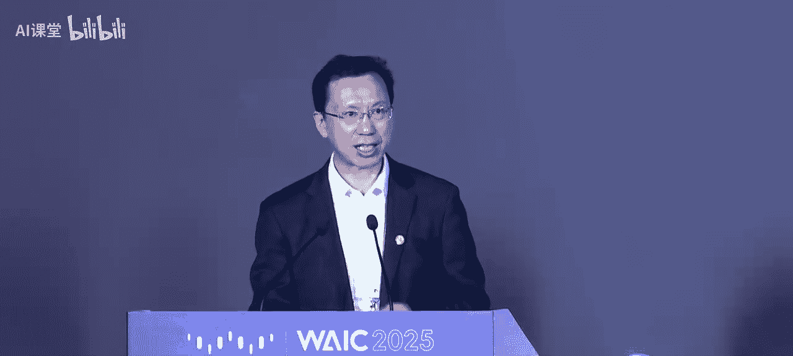

好，谢谢郑书记的这个精彩报告，让我们也对人工智能发展呢从宏观到微观的发展趋势，以及如何打造未来学习新模式呢？有了更多的了解和把握。再次感谢曾书记。🎼呃。

接下来呢呃让我们掌声有请北京邮电大学校长、中国通信学会会士徐坤先生。🎼他将为我们带来题为智能技术与教育变革的报告，从信息技术的最前沿解答教育的未来途径，有请徐校长。

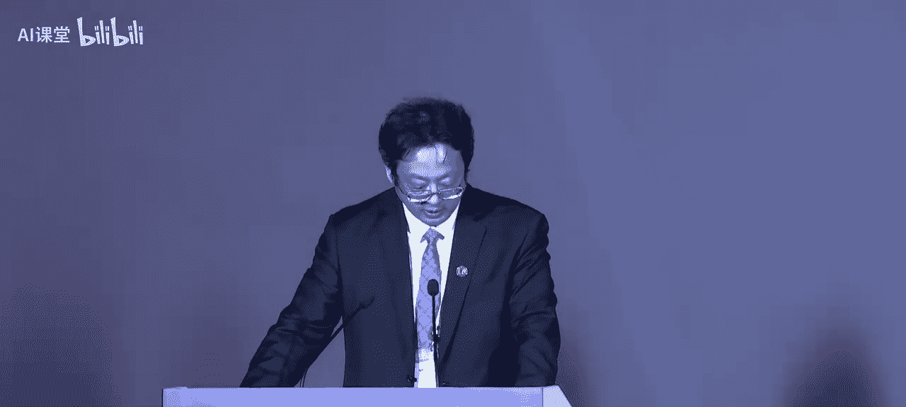

非常感谢大会的邀请啊。下面呢我以智能技术与教育变革啊为题呢来谈一谈北京邮电大学啊的相关工作的思考啊，实践与展望。近年来，人工智能技术啊创新加速眼睛。

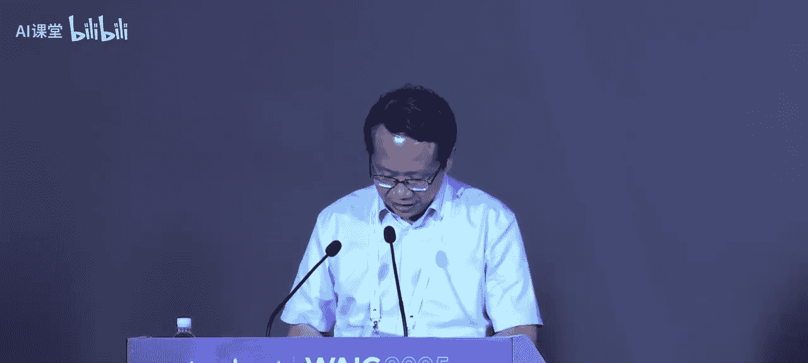

那么其强大的生存创造能力。理解深度理解的交互能力，自主决策执行能力、海量数据的驱动能力啊和复杂识别的预测能力，即为高等教育数字化的转型，奠定了创新的基础。那么也为我们教育突破标准化的束缚。

回归尊重个体差异。激发力在潜能，促进全面发展的本源。我想啊应该提供了变革的动力。那么北京邮电大学呢，作为一所以信息科技为特色的高水平研究型大学，是高等教育重要的数字化的力量。那么近年来。

学校持续加强教育数字化的顶层设计。我们正在打造AF for educationAF for managementAF for science三位一体的。AI forEMS的这样一个联动机制。啊。

我们在校瑞啊提出了，我们要让AI啊特快专递到我们每一个角落。那我们正在构建起以数据、模型、算力等要素支撑，以教学、科研、产业等资源贯通的un。数字北邮的啊这样一个开源的平台。在一体化的推动啊。

刚才呃郑庆华书记也特别提到的未来教师、未来课堂、未来学校和未来学习中心的建设啊，我们正在全力打造无边界的大学。那么当前呢。

该平台已经汇集起了7000多个数据库100余个啊行业的啊这个这个专业模型和40余家企业的资源。我们正在系统的推进传统的教师教材教师、教案，这样一些传统的教育元素呢，向平台。

场景模型、数据啊这样一些教育的新元素的转变呃，为深化高等教育教学改革啊提供北欧方案。在这里呢我给大家分享啊几个方面的工作思考。一呢是创新教育教学的新手段。当前啊高等教育培养模式标准化学科体系呢条块化。

我们育人的过程呢，同质化这样的一些问题啊，仍然比较突出。难以满足符合型人才的这样的一个供给需求。提供个性的多样的交叉的学习选择，就成为我们重要的教育教学体系的啊这样一个紧迫的这样一个需求。

为此呢学校正在开展打破教育学学与用为边界的。这样的1个ICT制教平台建设。我们在这个平台上面以智能技术为限，串联起了知识学习、科学研究、实践训练、志愿服务、校园生活等1余类的教育教学、数字化的应用。

打造了AI应用超市。啊，目前呢我们也在北京市教委的指导下，正在牵头打造面向北京高校的爱应用超市，形成了一个自作形成了一个这样资源，能够自主调度知识，能够交互学习和教研全实在线的啊这样的一个教育新模式。

利用这个平台，我们的学生呢不仅可以在单一的应用当中一键解锁专业的啊学习资源。那我们。把300多门课程啊，我们这个所有的专业的核心基础课，300多门课程建立了这样的一个优谱的啊，涵盖了6。

5万个知识点的这样一个知识网络啊。在这个平台上呢，我们可以啊学生来进行个性化的这样一个学习。还可以根据学习的需求啊，通过应用互联一键组装交叉学习模块。

那么这位创新教师教的手段啊和丰富学生学的这样一个资源啊，提供了更多的个性化的选择和体验。那么部分的应用呢，目前已经推广至国内外550余所院校。那么在这里呢，我举一个一键组装学习模块的例子。

学校在AI应用超市里面啊，我们提供了马上和出发两款教学应用。其中马上平台作为教学应用平台来支持承班机制使用的教学智能体。

出发的平台呢作为教学开发平台来支持学生啊和老师无代码的快速开发出应用型的教学智能体。通过两款应用的关联。就能够实现从教学智能体开发与订购到虚拟班级的建设使用和管理。

再到教学智能体优化和完善的数字教学管理闭环。例如当面向多应用协同的数理知识学习这一场景时啊，我们的教师可以根据教学的需要。首先呢在出发平台开发数理知识学习智能体。然后呢，在马上平台建立虚拟的班级。

并为班级设置AI智能体助教。学生在虚拟班级当中使用智能体进行交互学习。教师则通过马上管理这个教学管理模块来实时观测啊学生的学习情况，并与其啊开展线上的互动。最后呢，根据教学效果。

教师啊还能够在出发平台上啊对开发的智能体功能来进行优化完善，不断提升啊教学的实效。第二个方面呢，就是拓展教育教学的呃新空间。未来啊教育将成为融合传统物理空间、新兴数字空间和广阔的社会空间。

为一体的虚实空间。那么提供多元资源的接入，沉浸式的这样一个交互体验，实时反馈迭代的教育环境啊，将成为未来从塑教育教学体系的啊这样的一个重要保障。为此呢。

学校在持续推进啊信息科技加N的啊数字化教育空间的建设。啊，进呢是要以实促虚推动我们传统教学资源，向线上走向网上聚。那么呢又呢以需来捕实，以数字技术来丰富教育表现的形态和优质的师质资源。例如。

对外我们正在发挥啊自身教育数字化学科的优势，来持续赋能国内外高水平的院校啊传统学科数字化转型。推进教育教学资源的。开放共享。那么这其中呢，学校我们与英国伦敦马林女王大学啊基于21年的合作办学基础。

我们联合开发了远程化的实践资源共享平台。那么这个平台呢涵盖了啊这个北京、伦敦、海南两国三地的国际化的智慧教育的这样一个资源啊，形成了这样一个啊两国三地的啊多。多地的啊这样的一个协同办学的格局。

那么过去一年呢，学校还面向社会面开展了一系列分类别分层次。分区域的啊人工智能的同时教育的这样的一个服务啊，受众就超过了70万人次，也取得了广泛的啊这样的社会影响。那么对于另的学校正在通过F膳的布局。

多领域专业智能体的开发和数字化实践平台的这样的一个建设啊，我们将前沿的科技产业的需求，接绑的难题来转化为数字空间的这样的一个教育场景，助力学生在产教科教的。虚实融合的空间当中啊，能进行啊自主的学习。

比如从工程教育的角度来看，工程能力的培养离不开真实的产业的啊这样的一个场景。然而，构建贴近产业实际的工程训练的环境啊，一般这个资金的投入量啊是比较大的。这对于许多的高校来说啊，难以承担。另外呢。

从资源保障的角度来看，企业的工程资源的稀缺性，也无法实现对大批量学生的实践支撑。这就导致了绝大多数学生难以真正接触到真实产业当中的复杂问题和解决的路径啊，使得学生进入职场后啊。

仍需要较长的时间才能适应并满足这种岗位的要求。为了解决这一矛盾瓶颈学。团队呢自主打造了面向真实场景工程实践的有百工工程教育数字化平台。那么在这一平台上面呢。

我们构建了一个基于多类别智能体协同低成本增场景强交互的虚拟工程训练环境。从而有效的满足学生千人千面的个性化的工程思维和创新训练的这样的一个需要。那么通过这个平台。

我们的学生呢可以在虚拟的工程公司中与多类别的智能体。共同组队啊，从而完成从需求分析到产品发布的全流程的工程实践模拟。通过虚拟工程场景的这样的一个打造啊，游百工呢正在推动工程教育啊。

从线下的物理环境教授向线上成浸实践训练啊这样一个过程在转型。那么这一过程当中呢，学生能够快速的形成完整的工程认知，培养工程的能力。同时呢也能够提升教师教学场景的创设和个性化的指导的能力啊。

来提供有力的支撑。当前呢这样一个应用啊，正在国内外14所高校啊推广应用，服务得学生呢也超过了万人次啊，影响广泛。那么第三个方面呢，就是提升教育教学的啊新助养。人工智能赋能学习者更大的自主权。

将原有的师生互动啊，转化为师生基多维互动。那么这。其中老师就不仅仅是知识传授的角色，而是逐步的向。学习的引导者、能力的激发者、复杂场景的创设者。创新的策远者和道德伦理的守护者啊这样的一些角色转变。

那么所以对我们教育者的能力素养啊提出了更高的要求啊，至少今年以来啊，我们多位教师就给我提到，现在的教师站在讲台上越来越感觉不自信了。所以如果我们老师的角色啊不尽快的实现转变啊。

不实现教学的这样的一个模式方式的革命啊，就有可能被AI啊所所AI技术的发展所淘汰。为此呢，学校对标联合国教科文组织教师、人工智能能力框架和中国教育部的教师素质素养啊等行业指导文件系统的设计了实践驱动的教师、人工智能素养的提升计划。

也印发了北京邮电大学教职工、人工智能素养培训方案。在全国率先开展了覆盖全校啊教职员工的人工智能素养培训计划，打造了从认知重塑到能力训练。再到共创共研的分类分成的发展体系啊。

我们不仅仅是对我们的这个授课教师啊，我们还对我们的管理人员，对我们的辅导员啊都要进行全员的人工智能素养的培训，引导教师在参与全校AFOEMS联动机制当中，进培养技术层面的认知。

更增强思维层面的能力、情感层面的态度和价值层面的判断，从而实现教师角色向性转变。我们始终相信呢面向未来的教育。教育者呢不仅啊要懂教育，还要懂技术啊，更要懂人心。在开展教师素养培训的同时。

学校呢还高度注重对人工智能赋能教学关键成果的这样的一个沉淀啊，我们在校内呢打造了4百工程，就是百个AI赋能教学场景的经点子百个AI赋能教学的问答。百条AI赋能教学专家的观念。

百名AI赋能教学标杆教师的评选啊，推动啊啊这样的教师人工智能素养的培训的工作。我们鼓励和引导教师在产出科研成果的同时，依托科研成果，产出数字教材，专业模型科研工具啊等一些数字化的教学资源。

那么这项工作的开展了，不仅有助于提升教师人工智能的素养，也利也有利于呢通过机制的建设，引导我们的教师啊将科研的实践的新思维、新思考转变为教学育人的新能力。

从而形成科技创新与人才培养、互补互促的啊这样的一个新常态。那么这方面呢，基于学校近年来在AFci方面的系统布局。我们不仅收获了多项重要的科研成果，更。随之打造了一批科教融会的AI的教研工具啊。

为赋能育人模型的创新啊啊提供了有力的支撑啊。原来我们的老师做完科研啊，更多的关注发表论文申请专利啊，现在我们引导我们的教师啊，不仅仅是发表论文申请专利。

我们还希望把我们老师的科研成果变成教研的啊这个数字工具，变成我们领域的专业模型，变成我们领域的高质量的数据集啊，在我们的AI应用超市里面，我们分类的沉淀。

例如啊现在我们这个各个学院都都都都被激发出来了啊，不光是我们理工科的学院啊，包括我们的人文经管啊，甚至马列学院啊，由于时间关系呢。我给大家举两个例子，比如我们学校的物理科学与技术学院。

就打造了国内首批的智能算法挖掘物理规律的啊基础研究实验工具，将传统的物理研究当中的试错法升级为AI启发式探索，是我们的本科生啊也能接触到前沿的AI加物理交叉的研究方法。

同时呢也开发了物理的实验数字男生平台，来实现物理实验的全要素的数字化重构。比如面向我们电子的实验教学。我们电子。工程学院的师生啊，这个共创开发了基于AI与数字男生的面向电子实验教学的垂直大模型。

那么这个大模型呢，我们整合了3000余款不同型号的电子元器件、电路仪表的数据手手册，以及电子实验的教材、教案评价标准等教育资源，形成了标准的这样的数据集，打造了电子实验教学垂直领域的大模型。

来支持电子实验的答疑、故障分析、AI评阅这样一些功能。那么这些AI教研工具的开发与使用啊，不仅打破了传统教学对时间空间设备甚至教师资源的高度的依赖。那么更使得我们教师的角色啊转变人机协同的教。

学啊成为可能。啊，我们在很多课里面做了评测了，我们呃老师的答疑辅导工作量啊可以减少3分之2。那么减少3分之2以后，我们老师干嘛呢？我们老师将空出来的时间可以做更多的学习的引导。

学习的激发和复杂场景的教学场景的创设啊，应该培养我们学生高阶的能力。第四大方面呢就是深化啊教育教学的这样的新评价。深化教育改革创新评价是关键环节。那么面向叙事融合的未来教育环境。

传统的教育评价手段难以满足个性化的高阶能力的这样的一个评价的需求。所以迫切的需要了探索一条能够融合新技术的手段，适应新评价导向，引导学生终身学习的和适应未来能力培养的啊这样的一个全新的评价机制。为此啊。

学校依托在工程人才能力模型建设和教育数字化转型方面的呃这样的一个积累啊，我们提出了CDE高阶能力评价法，即通过能力建模数据驱动、生态验证的呃这样的一个闭环的评价。实现基于多类别能力分解与描述。

多模态数据整合与分析，多场景产业校准与反馈的精准评价。那么这一改革的价值呢在于利用智能技术绘就啊评价的画像。让曾经不可测的高阶能力变得可视可平啊可优化。那么数据呢也不再是静态的分数啊。

而是动态的能力的啊成长的轨迹啊，促进啊从分数导向到能力本位的啊教育的转型。那么这个工作啊啊应该来说还是很难的啊。但是呢我们呢现在啊正在这个啊这个这个权力的尝试推动当中啊。

这个也希望啊未来有机会啊跟大家交流讨论。那么第五个方面呢，就是打造教育教学的新生态。当前啊人工智能、赋能高等教育的变革呢已经成为全球的共识，并且取得了啊积极的进展。但同时呢还是面临着教育资源。

节约共享水平不够。自算的资源互能互籍能力不足这样一些问题。仍需要各方通力合作，来推动智能技术与教育改革，在更大的范围，更广的领域更深层次的啊来融合实践，携手应对啊变革的挑战。为此。

学校呢在总结前期实践的基础之上啊，今年在两会期间呢，我也有幸啊向习总书记呢提出了建设国家教育智联网的工作设想。那么教育智联网呢就是以人工智能教育大模型建设啊为核心。

通过构建云边端大中小模型协同的数字教育公共服务体系。实现对广域范围内的算力资源的。这个调度、模型数据资源、教育、教学资源和产业服务资源的啊汇聚整合，动态调度啊和管理运营啊。

希望通过智能技术啊来打破我们传统教育学学与用的边界的壁垒。实现教育服务的精准的供给啊和开放的共享，更好的推动我们学校的小课堂和社会的大课堂以及产业的真课堂之间的有效融合。

那么根据教育质联网建设的这个需要啊，当前的学校在打造面向未来的教学空间方面呢呃做出了积极的探索。我们对标教育部关于未来学习中心的啊建设的这个要求，我们以学校的楼宇改造为契机啊。

我们全新设计并打造了北邮未来学习大楼。实现了对智慧教师、数字化实践实训平台、国家人工智能产教融合平台等超过6500平米未来学习中心的啊这样的一个集中的整合啊。

正在全力推动未来教师未来课堂未来学校和未来学习中心的啊这样的建设落地啊，这也是我们啊这个学校的很大的一个举措，投入了几几几亿人民币的这样一个支持啊。我们目前的话呢希望我们9月份啊。

就是开学后9月份啊全面这个建成。例如，在该空间当中，我们学校呢聚焦智能空间信息未来网络源宇宙智能生命科学等这样面向未来产业的方向，打造了八大数字化的实践实训平台。一体化的推荐学习空间学习要素。

学习范式和学习生态的重构和重塑。以智能空天信息教学。与实践啊为例。我们学校呢依托北邮天算星座巴科在轨的卫星和银河航天产业资源。我们打造了智能空天信息教学平台。那么在这个平台上呢。

我们的学生可以自主开展天地一体化的真实场景的科研训练和创新实践。例如，卫星载合的制作和软硬件的设计验证，卫星网络的验证分析和优化来推动知识学习和应用啊从实验室模拟，向产业的真环境转变啊。

实现了我们学习空间的这样的一个重构。另外，为了有效的解决跨区域实验资源的啊共享的问题，学校呢打造了跨校区的实数字融合型的啊实验的这样的一个系统，实现了异地的硬件资源设备的远程的接入。

实时的操作数据的共享和动态的反馈，有效的支撑了跨校区协同教学与实践啊。我们原来通过信息化平台啊，可以实现远程的这个教学。但是如何进行。多校区的协同的实践啊一直是很大的一个挑战啊。

我我们近期呢在这一次的我们这种面向未来学习中心的建设当中啊，我们突破了这样一个啊多校区啊远程实践的这样一个难题啊，我们打造了这样的一个平台。

实现了学习要素数字化的重组和学习范式的啊实数字的这样的一个重构。那么与此同时呢，那么作为教育智联网建设的基础的能力啊，教育的专用大模型的建设呢，也是啊备受关注。今年上半年教育部吴岩副部长呢。

发布了13个国家级的教育大模型。那么这其中的计算机学科大模型呢，由北邮牵头建设。当前，该该模型呢在训练和语料库建设方面呢，均取得了啊这个积极的成效。为打造人机共效的学习新模式和产学员融合的学习新生态呀。

奠定了坚实的基础。那么未来啊我们认为呢，技术赋能教育教育啊，塑造未来。那么北京邮电大学呢也期待啊跟在座的各位教育界的同仁一道啊，我们加强对话交流。为推动人工智能赋能教育变革，做出更多做有成效的实践探索。

谢谢大家。

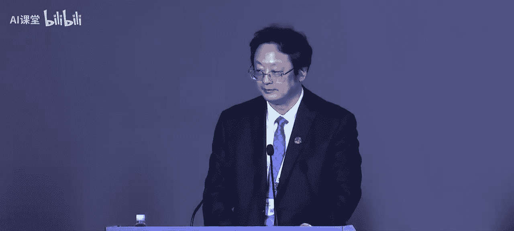

好，谢谢徐校长的这个精彩的报告。呃，让我们领略了数字北邮的这个变革和魅力，也让我们对技术与教育的深度融合呢有了更清晰的认识。🤧呃。

🎼接下来呢让我们欢迎华东师范大学校长、中国工程院院士钱旭红先生为我们带来题为大道模型与教育创新的报告，有请钱校长。

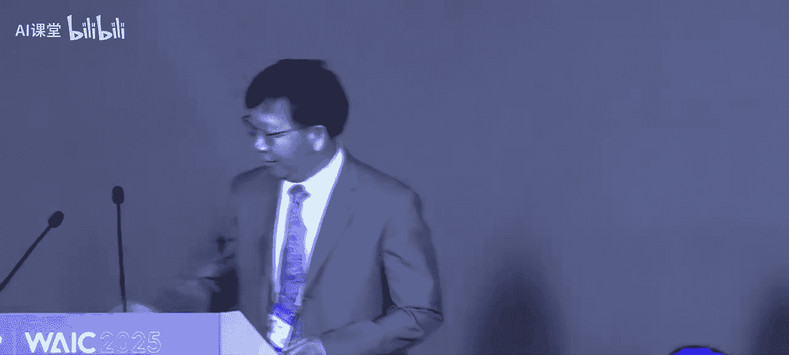

🎼因为。呃，时间不早了，我想以最快的速度给大家简要的汇报一下我做的报告。我的报告题目是大道模型与教育创新。呃，我分这么四个部分。首先跟大家介绍一下。第一部分就AI大模型与道法自然。呃。

大家都知道我们今天的人工智能，它这个体系知识学科体系，和我们传统的知识学科体系是不一样的，它也有关联性，它可以提醒我们，我们的教育需要超限。为什么？这是因为从远古时期开始。

我们中国人的原有的东方的知识学科体系，它是整体波动型的，是万物互联的，是事物之间有很多联系的。所以这就形成我们的学科知识体系特点，而源自希腊的西方的学科知识体系成为了我们现在教育当中的主流的体系。

它的特点是以还原式的分解分解交叉性的这么一个学科体系。而这两个体系都是对世界的一种描述。它们。有各自的优点和缺点。如果把他们融合到一起去，那毫无疑问就可以展现这个世界的真正的模样。但问题是。

就某一个学科专业而言，人的寿命有限，我们都很难掌握，更不可能把两大知识学科体系这种模式全部掌握。但是人工智能的到来给我们提供了可能。人工智能它是一种超越语言的世界模型。

过去我们正通过人力来完成知识学科的发展。但是现在我们可以通过人工智能进行迅速的迭代来跨界发展。它使得教育由过去的传授走向了共生。在另外一个方面，人工智能这样的大模型。它是规律建模的一种数学实现。

它接示了这个世界的规律。但另外一方面，我们在远古时代，我们中国人就有我们自己的圆规律的一些模型。我们被称为叫易经、阴阳五行，甚至像道德经等等。这两种模型，他们趋同都是为了揭示世界的规律。以揭释真理。

但区别就在于过去我们的迭代很慢，是要千年的传承迭代，而人工智能的迭代速度很快。过去更多的通过人的思辨和人文的判断，而今天可以大量的通过数学，通过礼盒来进行推进。😡，那么这些就给我们个启示。

今天我们同样可以把这两者的特点融合在一起，来发展我们的教育，来不断的迭代，来取尽真理。在迭代过程当中，我们毫无疑问，必须铭记我们的古人，我们的先人提供接触过哪些规律。

而这些规定对我们的科技发展和教育发展具有重要意义的。比如说我们的道法自然为代表的这种思想。😡，对今天的量子论的诞生以及科学技术的发展做出了重要贡献。那么这里有关细节我就不一一介绍了。那么这里我。同样。

如此道伐自然的思想，也影响着教育。我们强调要。无为善志，要不言之教，要尊重尊重成长规律，身教重于言传。所有这一切都应该在我们的人工智能发展当中给它充分体现出来。所以。在我们这么一个时代和以前是不一样的。

大家知道今年也叫2025年，叫量子科技年。那么量子科技毫无疑问，将是加速人工智能发展的一个重要引擎。而在这时候，我们更需要将我们先人在人工在这个有关大道规律方面的认知，把它融合起来。

从而建立真正的有温度的人工智能模型以服务于人的自由全面发展。再就是为什么一年前的这个世界人工智能大会期间，我们专门组织了一个有关叫AI之道的一个国际研讨会，以探讨人工智能如何更好的服务于社会发展。

服务于教育。早在多年前，我们学校就确定把智能教育作为学校发展的第一战略。所以我们的时候就开始做一系列的有关大数据、人工智能和这个人文社科的发展以及工程技术发展的一些研究。并且哎。是呃。

希望把学校建成为一个素字人的大学，通过素质的跃生，是整个学校的方方面面都能够用人工智能进行提升。下面第二部分，师生心理伙伴及模型。我们的心理学院，那么在疫情期间就建开始尝试建立了这么一个模型。

就MGBT那它特点是什么？它可以进行危机识别，通过这个7乘24小时的大模型的陪伴来进行有关的服务。那它的特点能降低呃用户的病知感，呵护用户的这个倾诉欲望。大家如果感兴趣，可以扫描这个二维码。

那么他能够是我们建立了24小时的心理援助热线，已经服务了100多万人，他是能够在心理倾情感倾诉方面给予人们很多的帮助。当然我们有专门的工业热线的专业服务团队在后台给予呃支持他是24小时的响应。然后呢。

给予情绪支持缓解呃压力，以及而且可以给予利名保护。呃，可以快速的识别危机进行快速的转接，以及进行实时的呃语音交互。我们建立了AI心理伙伴的学生版，那么可以给学生进行心理画像。

并且基于心理画像和知识图谱的融合进行个性化的成因分析，同时来给予进行心理状态动态的评估与预警以及个性化的心理干预与资源推荐等等。同时，我们这些AI心理伙伴、学生版呢。

它可以使得学生的学习焦虑、自责等典型的心理心态。这个这个检出力显著下降。那为什么能做到这一点呢？是因为我们在新华大模型的基础上，我们加入了有10亿条以上的心理学数据，40万篇以上的细刊文献。

100万以上的脱敏的心理对话案例，550万以上的心理评估数据。当然当然我们也经立了建立了教师版。这个教师版呢将会在今年的9月10号教师节正式上线。第三部分就家庭教育模型及发展。那么大家都知道。

现在小孩和家长的对话以及相互的这个呃这个交往模式，成为全社会学校和家庭共同的这个关注点。所以在这时候我们的家庭教育研究院就推出了知心会语这么一个模大模型。这旁边是二维码。如果感兴趣，你可以扫描进入。

我们这里分别从课程学习认知评估和智能陪练这几个方面。那么来陪护学生陪护家长，最后还会给出相应的总结评估。在这里面，我们现在已经迭代到3。0版。

在个新的版本当中可以模拟不同气质的儿童的沟通逻辑或者语言风格。这小比小孩可以从3岁到18岁，那么分别分成4种类型。那么这四种类型，因为每一个人。

他可以以不同的方式来面对来处理他面对的一些呃环境或者遇到的事情。啊，那这里面就讲向大家展示了胆胆制这些类型的这个粘抑制类型的多血脂类型的抑郁制类型的这些学生，他在遇到事情以后。

他以什么方式和家长进行沟通。他会有什么样的反应模式。那因为时间有限，我不能详细就。那么同时我们也建立了有关的教师的发展，在教教师发展方面也建立了一种新的模式，就是从通通用的大模型逐步转换到智人体来富人。

同时呢，也为指导教师的学习进立了大单元的教学实际。那么使得传统模式能够进入一个新的创新模式，使得教师能够很快的进入状态，能够以例设理，能够很好的理解，呃所遇到的情况。

那么这里呃演示了整个一个呃手机上进行输入的情况。那么因为时间有限，我就不再进行详细的介绍。那第四部分。是传统医用医药教育的大模型。在这方面，我们的。华东师大的药学大家如感兴趣，可以扫这二维码。那么。

建立一种大模型，希望能够服务于中医药传中国传统医药的教育与科研。那么在这个模模型当中，它既有传统的中国中药的灵丹，也有现代科学药物，主要是西方药物的呃这个呃妙药。

那么这里面而且会对你模拟的情况进行一个一个的分析。进行对话。那么在这里面，它的基基础底层是用千问等作为开源的通用大模型作为底层，加上中药的数据与知识。在宏观的知识以及微观方面。

有关疾病靶点成分等等需要的数据与知识，从而建立了叫数据徐黄这个大模型，从而为能够提供在中药防剂症后疾病靶点药方面的等方方面的一些建议。他整合了这个这些功能，也就是说他可以进行知识的抽取和挖掘。

然后进行生成，可以用于评测和教育。比如说他可以直接通过中医师的这个资格模拟考试呃，而且可以用于中医教育。因为它能够进行应用和推理。那么在这里面，比如说它有多么他的数据，通过数据的建模与分析，呃。

然后才从而这个呃推动整个的中医教育的传承啊，它包含了这几几个部分，比如中医的专业知识库AI辅助的这个呃呃药方学习以及模拟的诊疗实训。那么这么一个数字奇黄。

它实际搭建了一个有关中医药研究呃中中医药教育和研究的一个元宇宙。我们称为叫临可以达到一个宁静。像智慧的大脑与VR这个这个虚拟现实来结合来进行药物的发现与设计。比如说这里又展展现了。

比如对一个蛋白质结构对一个小分子和它进行对接时，这些小分子可以引起哪些的核酸残机啊，这个这个这个蛋白质上的这个呃残机发生的改变，以引起的能量变化以及各式各样的反应，从而来为药物设计提供方向。

以上我就说以这么几个事例，那么向大家简要介绍了，我们华东师大在推进AI和教育的方方面的结合所做的一些探索。那么希望在今后的发展过程当中，继续得到社会各方的支持。

把华东师大有一个人人都知道叫爱在华东师大啊，将它进行跃迁转型为AI在华东师大，感谢各位，谢谢大家。😊。

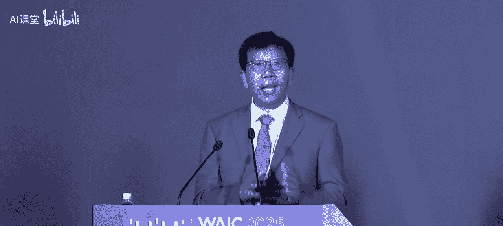

好，感谢钱校长的精彩分享。高建岭为我们系统阐述了他对这个大道模型与教育创新的原创性思考。那么后面两位呢，还有两位呃，但是呢因为他们由于各种原因呢嗯不能来到现场。

一位呢是这个世界经济合作组织教育与技能师司长。被誉为披萨支父的安德烈亚斯。他呢因为日程的原因啊，他提供了视频。第二位呢是我们本来请来要到现场的芝加哥荣誉大学教授首席研究员jamesvans。

但是呢呃很遗憾，由于这个这个航班的延误，他目前还在飞机上啊，所以呢我们把他们两位的视频呢提供在我们这个呃这个上海智能教育研究院的微信号上到时候呢大家都可以去看呃，这个vans来了之后呢。

他还会以其他的方式跟我们呃老师和学生进行交流。好，这个在刚才的一个多小时里面呢，我们共同经历的一场精彩的思想碰撞。从战略科学家的敏锐洞察到国际组织负责人的一个全球视。

从技术前沿的深度剖析到社会科学的创新应用。各位专家的分享呢既有高度又有深度更有温度，让我们深刻感受到智能教育不仅仅是技术的创新，更是思想的解放和育言放式的这个重塑。

那么让我们再次呃感谢我们各位专家的呃精彩的报告。那么主旨报告的环节呢到此结束。呃，我们把组织权呢交给我们的整体主持人，谢谢大家。

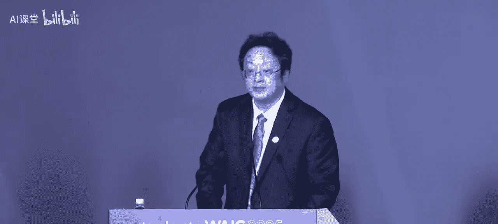

🎼感谢施校长的主持，以及专家们的精彩演讲。智能教育垂泪大模型如何能够真正的落地课堂重构教学。这个过程当中又会面临怎样的现实挑战以及解决的路径呢？那么接下来在我们的圆桌论坛环节当中，就会一一知晓答案。

让我们掌声有请本环节的主持华东师范大学上海智能教育研究院副院长江波教授，掌声有请。😊。

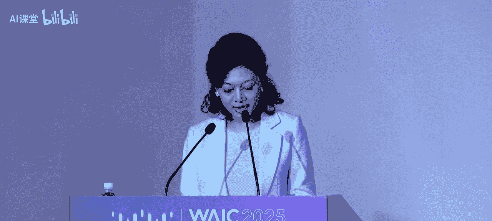

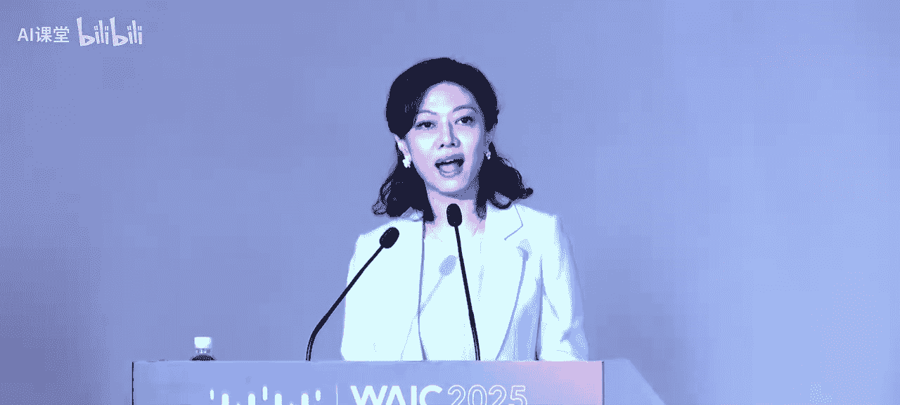

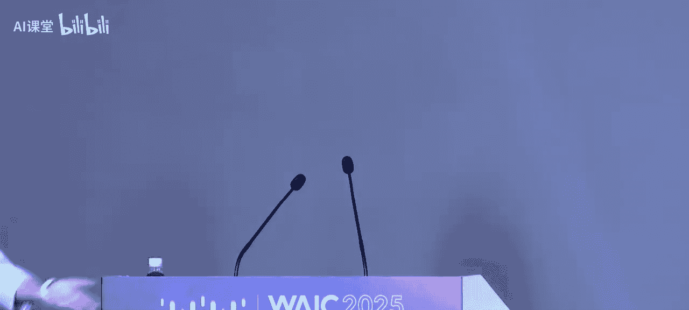

🎼呃，尊敬的各位领导，各位嘉宾，大家好，我是华东师范大学的江波。那么从刚才三位国内的顶尖学者对于人工智能对于大模型与教育的这些独到见解中啊，我相信大家都有很深的一个感受。就是大模型现在对于教育的影响。

人工智能对于教育的影响，不仅仅是一种重塑啊，不仅仅是一种赋能了，而是具有颠覆性和重塑性的意义。那么在接下来的圆中论坛环节呢。

我们非常高兴的邀请到三位啊分别来自教育研究技术研究和区域管理的三位嘉宾来和我们一起分享，他们对于教育大模型与教学重构的一些独到见解。下面让我们有热烈的掌声，有请三位重量级嘉宾登场。

他们分别是北京师范大学智慧学习研究院联习院长联合国教科文组织人工智能与教育教教授黄荣怀教授。

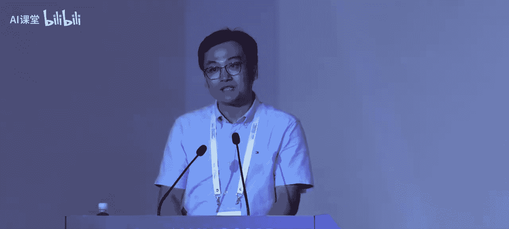

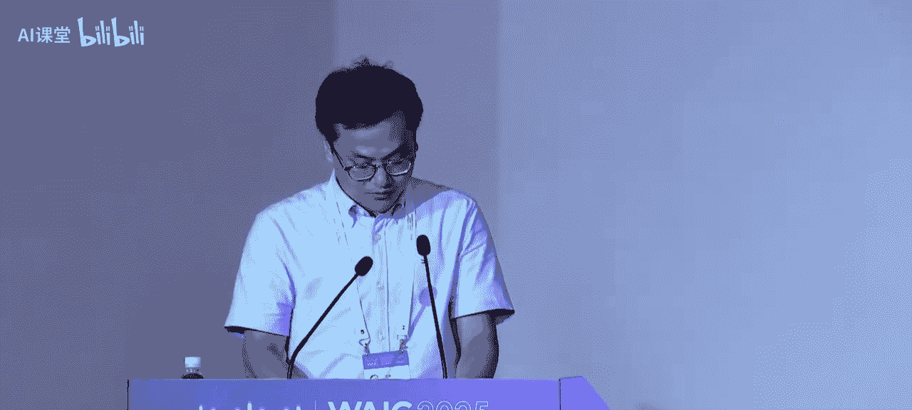

🎼上海呃交通大学副教授，上海创智学院全师导师刘鹏飞教授。🎼欢迎彭友教授，上海市虹口区教育局局长孙磊局长。🎼请呃请三位专家就助。呃，三位嘉宾好，刚刚啊周院长也展示了我们用我们的起创innopar大模型。

那么在学科教学和跨学科的教学的两个场景中的一个应用。其实人工智能，尤其是大模型技术的突飞猛进啊，也引发了我们很多人对于人机协同教学的这个畅想。所以今天啊我们来探讨的第一个问题。

就是说呃到底什么是人机协同的教学。那首先我想请问黄老师，因为黄老师是教育技术领域，国内非常自深的一个专家啊，呃也也对于人机协同的教学，对于大模型呃人工智能如何重塑教育有很多的一独到的见解。

那么我想请问一下呃黄老师，就您认为啊现在的这个教育大模型，它对于老师的观念，教学的观念和理念到底有哪些冲击，以及在这些冲击下，我们经常谈的人机协同教学的这种性形态，它到底是一个什么一个样态。

我想请教您这两个问题。会会很非常高兴啊这个。发布大模型。我特特别喜欢这个名字啊，这个起创起的挺呃非常好。这个英文词也好记。In the spark。呃，我觉得某语英语的人听起来也能理解他是啥意思。

刚才发布以后，我觉得还是一个。非常靠谱的一个模型。又一次见证了国内教育，特别是面向基础教育的大模型的这么在新的一个阶段。我们也特别期待这个模型能够开源，能够让大家来使用。

那么今天谈的其实谈的我们的教育变革，其实我在想。最根本的问题还是要回到我们今天的学生。到底该学什么？怎么学？我们的老师。该教什么？怎么教？因为可能不仅仅是大模型的事，涉及到整个人工智能对于教育的变革。

过去有计算机技术，有互联网技术，它是一个一脉相承的。如果从学的内容来说，我在想，从早期的书本知识。到我们数字化阶段谈到的，比如说学生在课堂上面讨论学生的作品，也可以当做学习的材料来说的话。

它也是知识共享。那么到今天的人工智能，我在想他未来的学习应该是一种正创共享的一种学习，或者把它做新的一种学习观。那么今天学生怎么学？我们过去谈的比较多的，可能有很多的主义啊、行为主义。

但在我们大部分的课堂教学的团的都是建构主义。但今天可能我们更多的是智联建构。也就是说我们今天的学生的学习方式，可能要和人工智能一起和大模型和智能体和各种工具一起去学习。

这个建构过程可能跟过去还真的完全不一样了。那么从教什么怎么教来说，这里都等位问题就更大。从基础局来说，我们有课标，有教材。但实际上它的核心载体还是课程。我们的过去的课程相对封闭的。

但今天我们可能更多的是要一种开放人通的这么一种方式。这个课程要发生变化。尤其当在高校流的这种变化可能就会更快一点。那么教学的话一定是人机协同教学的方式。人家校教学，我们三年疫情实想到我们的所有老师。

所有的学生都不能到课堂的时候，我们都在进行学和教，实际上我们的数字技术已经有一点点的助理在起作用了。我们的邮件发现我们的会议系统，我们的记录。但今天的协同教学可能形式可能不太一样。

我们将来可能会有三种典型的形态吧。第一种我们叫数字人数字发生。我们有一个数字人的形式虚拟形象去听你去讲过。我们现在很多专家讲这种方式，可能还有一种就是实体的物理化的一种机器人，这个可能也是存在的。

当然未来长远来说可能是数字男生，有每个老师可能在一个形平台里头可能真有他的一个完整的知识情感，这里头慢慢慢可能进化出来，甚至某种意义上这位教师去去世以后，他的内容还可以持续进行教学里头可能会起作用。

我想这是一种形式。那么从这里头我们可能会有这种典型形态。目前基本上还在原始的把它当做工具使用。嗯，要进到第一个阶层，那就至少会用一个智能体一类智能体。我们说的双师如果说我们两类或者三类更多在一起的。

可能会有更多的这种形态在存在。我在想在不同的地方，我们已经看到无论是大学职一院校。中学都能见到这种形态。其次在我们国家来说，我们的老师也好，生已经见怪不不怪了。嗯，实际上这个已经慢慢变成他的基本形态。

我先说这些吧。好吧好的谢谢黄老师。黄老师刚才讲的三种形态啊，开始有智能体，然后数字人然后的软硬结合其实有一点就这种巨深智能的这种理念在里面。那我想呃鹏飞老师，我想就是刚才呃黄老师讲的这些三种形态。

你认为现在的这个人工智能技术，尤其大模型技术，他在多大程度上能够支持刚才黄老师讲的这些这些各种形态的学习。那你觉得目前还有哪些不足。嗯，好唉，多谢提问。呃，我首先是这样。

其实现在大模型在很多在互动这些事项已经做的其实非常好了。我自己在在交大上课，其实很多时候已经用大模型产品帮我去设计很多不管是互动性的课件。😊，还是概念性可动可执行的交互式的一些解释。

其已经可以搬到课堂上去去用了。我觉得到现在目前为止，尤其今年半年看起来大模型主要的进展，在教育的体现。一个就是可交互性过去没那么好，现在可以好了。而且这种可交互性其实是有点像唉你人可以打断它。

然后他可以循序渐进的去引导你去做这样的一些事情，这在过去之前可能是不太能看到的。还有一个比较大的突破，其实现在很多大模型也是全模态，过去可能是文本进模型最强，但是如果语音进的话，可能没那么强。

但现在其实语音也可以了。语音如果打通的话，那交互性会更加强，甚至像嗯有些老师做了像那拟人性的这种语音大模型要放进来之后，其实可交互性又更强。那这样的话，学生在整个呃在知识注入的过程中或者学习的过程中。

这个交互性体验感更强的时候，他学习的这个可接受程度也会越来越高，相当于大模型已经会用你最喜欢的方式。用最通俗的话帮你讲最深刻的道理。那这个时候你在接受程度上会比较好。那如果说还有什么不足的话。

我觉得就是现在其实如果在讲更加深刻的道理的时候，如果可能传统的老师，我们会非常努力的，我们讲记忆学习，我们会非常认真的备课。然后背一晚上的课或者一周的课，把这个东西讲的更加的通俗易懂。

然后期待着学生可以学习的更好。但这件事情上大模型很难的问题，让他拆解的还不是很好。可能还需要认知水平能力上的一些提升。还有就是非常长时间的互动。哎。

我放一个数字人在这里能不能4545分钟一节课全部帮我撑着去和学生互动。这个事情可能现在完成的也不是很好，可能需要大模型持续的不管是长上亚文能力或者是这种mem记忆能力做的可以更好。

而现在看起来可能人还要在这里老师还要在那里办一个协调者的角色，去帮他辅助更好的完成这样一件事情。对对，其实龚伟老师刚才讲了两个大模型很关键的一个是长上畅下。😊，长上下文，还有一个长期的记忆。

可能这个现在是我们的一个读点问题。好，那我想接着就是请教呃孙局啊，因为虹口啊去年啊就今年做了一个智能体举证，好像是200多个智能体啊，那可以看出。

就是虹口在认为智能体这个东西是现在大模已型切入教学的一个很关键的一个点啊。所以我想请教一下，就是啊虹口区在推进这样的一个工作过程中，你看到了它对于我们教学中产生了哪些变化啊。呃，感谢大会邀请呃。

能够有机会啊呃介绍我们虹口作为这个一个区域性的教育系统。我们在这个人工智能教育方面的一些认识和这个探索。实际上面我们的这个主要做法呃，从我们去年年终向市教委汇报这个人工智能实验区的时候啊。

我们就提出了这么一个观点。对于一个区域性教育系统来说呢，我们是从大模型转向小模型。这个去年的年终的时候啊，呃这个小模型的概念实际上后面发展的很快。在去年年底呃。

应该说在我们整个全国的教育系统已经有了一个专业术语，就是教育智能体了。对。那么我们是怎么来认识的呢？首先我们是呃系统内的全体的这个学校和老师。我们有两个认知和观点，大家应该要形成共识。我们是这么做的。

一个呢就是人工智能已经这个广泛和深度的融入了我们的生活的方方面面。呃，应该说我们的教育也不例外。这是首先一个最根本的认知，也就是你是回避不了的。其次呢，人工智能和教育它是一种互相促进发展的关系。

这种关系呢他是积极的。这种认知呢，我们觉得在教育系统的学校和老师建立是非常重要的。有了这样两个前提以后呢，我们需要考虑的就是怎么来主动把握人工智能和教育的融合。那么在这个上面呢。

我们觉得最切实可行的一个抓手，就是让人工智能在一线教学当中能够常态化的有效应用。所以这个目标任务就非常精细了。有了这样一个目标任务以后呢，我们觉得实施这样一个目标任务。

对于我们虹口这样一个区域性教育系统，它就有三类主体。从区域为单位来说的话，就需要顶层设计和有效的保障。那么以学校为单位呢，就需要组织和实施。那么还有呢就是我们的教师。我们从教育工作的角度来说呢。

就是教师个体的应用。我们把工作的关注点和重心呢放在教师的这个个体的应用上面。因为我们这个觉得呢这是解决我们人工智能和教育啊，最后一公里的问题。它是能够直接产生效益的。

那么人工智能大模型呢呃特别是最近这半年，这个他的这个能力进展是非常快的。但是就我们课程教学的专业性而言。呃，还不能够尽如人意。实际上课程教学是非常专业的，我们又不能让我们的孩子在学习的过程当中。

因为要体验人工智能，我们老是去试错。因此，在这种情况下面呢，就需要我们有非常精准能够执行任务的人工智能的工具，也就是教育智能体。那么这个教育智能体呢，我们是通过我们自己的老师和学校开发。

他自己开发自己使用这样的一种方式来推进的。我们觉得这是非常有效的一个路径。我们原来呢每一所学校里面都有这个信息化专员，我们把它转化为了AI专员。通过老师培训老师的方式。

我们联合了很多的大学以及我们的呃一些头部企业，来共同的培训我们的老师来研发我们老师自己在课堂里面直接使用的教育智能体。应该说效果非常好。就是您刚才讲的，我们通过2个100天的这样的一种工作。

目前呢已经是做到2。0版的教育智能体有200多个，是普遍在课堂里面常态化应用的。那么随着这些教育智能体的应用呢，会连带出来很多的一些新的管理上的问题。

所以我们在今年年初制定了虹口区的深圳市人工智能学校应用的管理办法。在这个当中呢，对如何规范使用、科学使用啊，包括伦理审查等等，是做了明确的规定。同时呢也建立了虹口区深圳市人工智能应用管理的平台。

我们简称为汉字系统。我们的这些智能体都是在这个平台上面，它既是一个创制人工智能教育智能体的一个平台，也是一个管理平台。那么同时呢我们在今年年中也在前不久。

我们在自己举办的第三届北外滩教育论坛上面也发布了创制教育智能体的指南。那么通过这一系列的工作呢，应该使得我们虹口的这一块工作啊，有一个扎实的推进。对呃非常非常激动啊。

因为看到这个虹口为了这个中小学推进这个智能体，还有专门的一个指南，研制专门的这样的一些文件。我觉得这个对于一些老师来讲是非常具有指导性的啊，因为在在我们教育技术研究中，就是怎么去运用这个技术。

其实我们教育技术里。里面的一个研究的热点。那教育智能体作为现在一个新的形态。黄老师，您觉得现在这个这种教育智能体啊，它在一些老师的应用中到底存在一些呃，当然他有很多积极的方面，是不是也会存在一些呃难点。

或者是老师不会用或者不会见一些一些问题呢？这个。老师不会用。或者说用不好。这个现象是别人存在的。因为整体来说，实际上我们都没有准备好。因为实际上这一步人工智能来，确实技术有了一些些的一些突破。

再加上资本的一些推进。嗯，国际的各种格局的变化。嗯，必能推进社会方方面发生变化。整体上对我们教育呢有一种倒逼的这种方式。我感觉就是教育应该再从容一点。好歹我们的国家领导人，我们的国际政府。

包括校长们都很重视这件事。所目前在推动这件事情应该说还是非常有成效的。但你整体到了一个具体课堂，到了一个具体的教育教学的一个环节的时候，这个问题肯定是存在的。我觉得有几个方面吧。第一个方面。

首先是我们教学的行为习惯，以及我们的思维惯性。比如说我们用一个老师就他小学举例来说，比如说让学生老师去准备一个圆的概念面积周长。这个在小学里头应该是几堂课的形式。但如果人智能体去帮忙的时候。

他可能做出来的就是变成一个整体的。如果这个老师只是习惯于传统的一堂一堂课，按照我们的教材，按照我们教育员搞定的一级个单元教学的时候，他自能适用不了，这里头是必然是存在的。那么同学对我大学课程也是一样。

我老师讲一个概念讲的很好，50个同学托你给老师提个概念，从大模型里头问个概念。黄老师，这个跟你都不一样。😡，如果我驾驭不了这件事情，我就慌了，这是必人存在的事情。这还有一种行为习惯。

比如说我们在班级的同学里头，班主任来说的话，这个班很好，这个班不那么好。我们其实老是有一些习惯性的唉对这个班队一些判断。有会习惯性行为，那么用大模型去做的时候，这里头用新的工具，它就很难去区分。

所以这个作为行为习惯，我觉得这是一个方面确实是存在的。第二呢就对于技术和技能这个层面上，社学技能，这个差别性还是很大。如果说又有比如说我们村中小学老师来说，教学效果要很好。

有这个比如说特级教师啊、高级教师，同时又很好的一些技术技能的话，他们驾育的很好。往往这些人同志们就在一些好的学校，但对于我们的边于农村啊，特殊学校啊，这些情况有问题就比较复杂。

这用起来确实是技能方面也是个问题。对于第三个嘛，我们今天的大模型坦率说还没到真的能到课堂里头去。我们哪怕一个简单的，我用一个投影，一个资源传送到一个反馈的机制里头，我们有很多的技术。

但你到了课堂上那个行为，它完全是不一样的。所以这个里头就是在这个里头是需要产业界也好，需要我们的个开化的人，还要去迭代。再加上游戏内容坦率说，通用模型里头有很多内容时。不健康的、不安全的、不可信的。

我们为为什么做教育大模型的好处就是保持它的权威性。刚才我们袁老师谈到的要加值退休，特别同意。因为尤其基础教育这一块，少去是没有判断能力。所以这个里头其实我们要走的路还是特别特别长的。毕竟里面太广。

再加上各种问题还在持续不的过程中间，但的来说，这个方式这个趋势我们看还是很好的，是值得期待的。也对我们整个教育职能的发展应该是有很好的这个推进作用。好吧，对因为现在这个教育智能体的应用。

对老师的教学理念观念对教师的能力，本体知识的能力还有I素养都提出了一个非常非常高的一些要求。那孙局你们在虹口区推广这个整体区去推广智能体的时候，也是不是遇到了哪些现实的一些困难。

然后这些困难从你区域层面是怎么去破除的呢？呃，确实是这样，就是在一线实践过程当中啊，的确会碰到很多困难。那么其中最重要的呢呃，我觉得还是老师对于新技术的呃认识理解。和这个应用能力水平的问题。呃。

实际上面，任何一个领域，新技术进来，他都会有一个过程。那么在这个过程当中，怎么样能够让我们的老师，特别是我们的学校能够平稳有序的呃，并且有效的来进行融合和实施。那么首先还是要解决我们学校和老师的。

我认为还是原认知的问题，这也是我们教育本身的问题。如果老师和学校对AI的魅力，他有充分的体验。这个问题就自然解决。所以在这个方面呢，我们主要还是通过这个做中学做中推的方式。呃，我们提的这个工作路径呢。

就是从小课程到大课程。我举个例子，我们一所学校的语文老师。他要上这个语文教材里面的戏剧课。那么有我们中国的京剧啊，这个粤剧啊，那么他呢也是通过人工智能去选了四段语料。呃，包括音视频在里面呃。

是人工智能提供给他的，但是他看了很不满意。然后在这个互动的过程当中，他和这个机器之间，他这个提示词啊，它就越来越精准。那么最终呢，这个人工智能体提供给他的这个四段语料是大大超乎他的想象。呃。

完全突破他原来的本体知识。那么实际上他的这个备课啊就大大加强了。所以在这个方面呢，老师就充分体验到了人工智能。对于我们课程实施，包括备课，包括课堂教学组织，包括作业批改，包括对学生辅导这方面的这个作用。

那么应该说呢，他的这个关键呢是效率革命。我们认为这是第一个阶段，就是当学校和老师在运用人工智能或者人工智能进入学校以后。在工作的效率上发生了显著变化。那么大家觉得这个事情是管用，有用的。

就愿意去积极推进。我觉得这个问题呢是比较重要的。好的，因为刚刚两位老师都提到了教育大模型智能体在现实中用到的一些问题。我想这些问题可能是我们技术层面可能还有些问题没有没有解决。那彭飞老师我想请教。

就是您觉得就大模型在教育中应用。他未来可能他还有哪些技术的壁垒或者短板。你觉得是需要去突破的O呃非常感谢一个问题。其实刚才两位老师觉得说的有一点非常有共鸣。

就其实我觉得现在就是非非人工智能专业老师在使用AR他们和他们的认知在技术上的认知差其实要远大于技术本身带来的不足的技术差。所以其实不管说大模型现在有哪些技术不足。

其实觉得最重要一点就是其实老师们在对AR技术最前沿能力的边界的了解，能做到怎样一个程度上可能是所有事情的关键。因为我举个例子，就现在大家都知道上一周啊最好的模型像。谷歌或者是豆包。

他们在做数学IM竞赛这个水平上已经可以拿到金牌水平了。是第一个。那我们其实前两天也做了另外一个事情，就是我们用AR本身就可以设计关于模型新架构的一个新的科学发现了。

这两个都是非常非常感觉非常不太可思议的一个就是最难的解问题的能力拉最高还有个就是类似于科学发现这个正常hu要去做，可能要持续三个月到6个月以上的时候，AR可以发现一个架构比人还要好。

就这是当前模型最强能力的边界。在这个边界在倒推。唉，那我这个时候像刚才黄老师也说，那学生还要学什么呢？这这个时候学生要学什么学生要学什么是更重要的，然后反过来在在再倒推。那我老师要教什么。

就其实本章就想说当前老师对最前沿AR技术边界的呃认知差可能我现在看起来最重要的一个一个一个一个点，我自己是23年回国后，然认知交大啊当时是在国内第一就第一个首首次开。😊，那个大语言模型的课的。

而且是给开到这个大二的本科生呃，就直接上这个课。然后当时会有很多人老师有反对的声音觉得哎这个事情好早啊，学大语言模型学A呀，好像要很久之后呃才可以。但是呃当然有幸于这个也是华师大的一个校友，老师的坚持。

我们直接就给大二学生就开这个课，我觉得效果非常好。因为这其实不只是在上课，就在补认知，认知差要补上来了，其实课程内容本身也没有那么那么的重要了。所以我这个这个事情我觉得是很关键。

我自己在一线训练最强的大模型，同时另外一个角色又是在培养可能呃比较优秀的一波学生嘛，一个是探机，一个是归基，我自己在每天培养的过程中自己能觉得相互会启发培养人的方法。

培养学生的方法会启发到我去训练更好的大模型。比如说训练大模型的时候，我要激励他，不能直接去告诉他去做什么，举个例子，如果现在我们用大模型，我让大模型帮我去设计一个。😊，整体按照如下的12345个步骤。

这是你一种告诉他的方式。还有一种方法就是你要告诉他你想设计什么，但你不要具体告诉他怎么做，后者往往会取得更好的效果。就现在大模型已经这样了，不要告诉他怎么做。因为你告诉方法可能不是最好的。

你影响他的发挥了。就现在现在大概是这样，反过来训练模型的时候，我们会发现培养这个规迹啊。大模型的时候也会反过来启发我去培养更好的学生举个例子，现在大模型之所以这么强了，之所以可以解M了。

就是因为去年2024年9月份之后有一个叫做fr time的算法，大模型你只要给他足够长的思考，他就能解决更难的题目。

于是我告诉学生说你们每天尽量的每一周都留出一天到半天的时间把自己关在一个比较封闭的一个地方努力去思考，不要和别人聊自己和自己思考边思考边写下来，边思考边记录下来。这样你的能力可以再有一个式的一个上升。

一定是这样。因为对于AR模型来说也是这样的。所以这个其实是有。😊，比较好的一个相互的过程。其实未未来在我看来，也许都不一定要需要教室。就咱们真上课也不一定需要教室，就是总之要站在最前能力边界上。

然后再去想一下下一个教教育的方式应该是什么，培养的可能是么学生更重要的是思辨能力。更重要的是他会问会问问题的能力。更重要的是是第一性原理。更重要的是可能是你知道什么是被需要。因为在未来AR模型。

当你说出你需要了什么时候，他已经可以解决很多事情了，解决问题本身没那么难了。最重要是你你要知道什么被解决。你要你要知道什么需求是在哪里。所以这些放到一起的时候，回过来再去思考，我们要培养学生。

什么事情可能会更好不需要教师也需要另外一种教师。那最后最底层可能就是一帮最最年轻的做AR前沿的学者和一一帮非常资深的我觉得教育的前辈一起去这个事情可能会更好效果。对对。

其实刚刚鹏飞老师讲的其实就是一个教学的重构。因为你学什么要改，所以教师的能力要改整个教学都要去重构。那么我想最后问呃三位嘉宾各一个问题啊。

就是我还是想鹏飞老师就你认为从现在的这个技术迭度迭代的这个速度看未来三年这个大模型，尤其是教育大模。😊，这一块可能会哪一方面最先实现一些突破。嗯，我觉得呃最先突破很多。现在我能看到的从技术方面。

我非常确定的是模型的intelligence就模型的智能会进步的非常非常快。就是这个体前一个就是他解题ing能力。还一个就是他能思考时间越来越长。

简单来说就是他未来AR模型可以把科研re这个事情都可以做的更好，都可以做的更好。所以这个事情可能在未来1到3年，甚至可能不需要三年1到2年就可以做的很好的时候。

我在想这个东西如何对我们去啊就我自己要上课带学生的时候，我要怎么去重构他。我能想到了一点，就是我现在给学生上课，我就说啊你们现在觉得发论文很重要。可是我会告诉你三年之后，你比博士还没毕业之后。

可能你的论文都不是你写的了AR绝对可以写可以的比你们更多新科发现比你写的更快。然后我会我会我启发告诉他未来可能会有的样子，并且有意识的去培养他们更好了，去利用好。😊，大模型至少他的认知。

我可以尽快的给他去补齐，让他一定努力的去融入。我觉得就是人机共创，最后一定是人机共创的时代。所以未来我觉得可能努力课堂会要发展的样子，可能提供一个更好的环境。在这个环境里。

让学生最快的认识到模型能力的边界在哪。未来1到3年的样子是什么？你们人机共创能创出什么，什么能力是最重要的。对，简单想象一下，可能是这样。好的，那呃孙局，你认为就是在虹口有再去推进这个教育智能体的时候。

后面的路径啊，因为要重构教学，这个路径会怎么去升级。呃，是这样，我们在宏观的方面呢，认为这个呃人工智能教育啊呃在虹口呃应该是会呃经历三个阶段。第一个阶段就是我刚才讲的效率革命。

让大家觉得这个事情是管用有用的。特别是基于现在的办学职校和教育教学这么一个环境下面。到第二个阶段呢，是流程再造，是对我们现在的学校管理以及我们的课程教学。啊，通过人工智能进行流程再造。

当然第三个阶段的话呢，我们认为呢就是基于现在人工智能时代的新教育，它应该会产生，它应该是一种模式创新。当然，不管怎么样，就教育领域而言，人永远不会因为人工智能的产生而消失。教育领域我们的最本源的。

我们最根本的任务是培养人啊，这一点呢我觉得呃我们是非常坚信的。那么最近两三年的话呢，我们会基于我们人工智能矩证的建设，引导我们的学校和老师，从单个的教育智能体应用呢向多个智能体协同来拓展。

同时呢从教育智能体向教育锤备模型来发展。好的好，那最后一个问题，我想请黄老师来总结一下，就是这种人机协同教学新形态啊，要重构这个教学。你觉得从学校来讲，它最重要的一个。决定性的这个点，一个因素。

一个要素，你认为是什么？未来三年可能在一个大的变革期。这个变化的这个维度空间方式跟过去肯定完全是不一样。我在想可能还有两个是声音，可能还针得警惕或者是要思考。第一就是。我们在国际上聊天讨论问题的时候。

我们努力在造一流的机器人。但有可能我们培养出二流的机器人，将我们的学生。这样类的不可能三角的问题就是大规模高质量构性化。这里头能不能够帮忙去解决这些问题。而实际上，作为学校来说，我在想。

第一就是鼓励第一线的老师有创新者。一个学科或这个年级去做，我们叫一级变革，到全校的整体面叫二级变革。其实这年是有规律的。我想按照他的规律一步一步去走去探索，会找到他对系统变革的正确的道路。好吧。

好的好的呃，由于时间关系啊，就是非常感谢三位嘉宾的一个分享，分别从理念、技术和实践三个层面给我们分享了大模型对于教育教学重构的一些新的思路，对我们我相信对于今天在座的各位老师也非常有启发。

那么由于时间关系，我们今天的这个论坛圆周论坛就到此结束。我们再次感掌声感谢三位嘉宾的参加。🎼好，感谢姜教授和三位嘉宾的精彩对话。今年4月份的教育部是等9个部门关于加快推进教育数字化的意见有出台。

为落实其中的要积极参与全球数字教育治理遴选数字教育全球示范案例，打造具有全球影响力数字教育品牌的要求。华东师范大学在今年的5月份发起了智能教育在中国人工智能赋能基础教育示范案例的征集活动。

短短一个多月的时间，一共受到来自全国31个省市自治区、直辖市特别行政区千余份优秀案例，覆盖学前教育、基础教育、高等教育特殊教育以及职业教育等各个领域。

那么接下来我们就有请教育部哲学社会科学实验室华东师范大学智能实验室主任张志教授对优秀的案例的征集情况做一个整体的分析。并发布智能教育在中国基础教育案例、十大热点与未来趋势，掌声有请。😊。

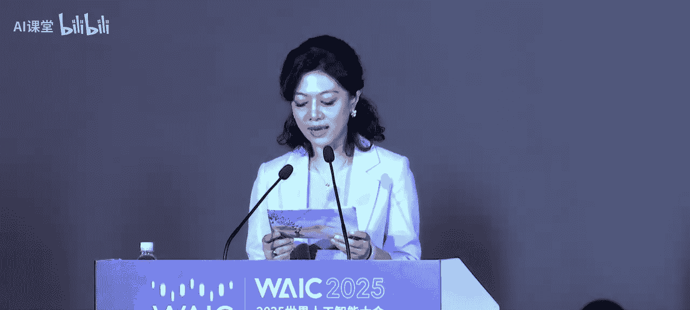

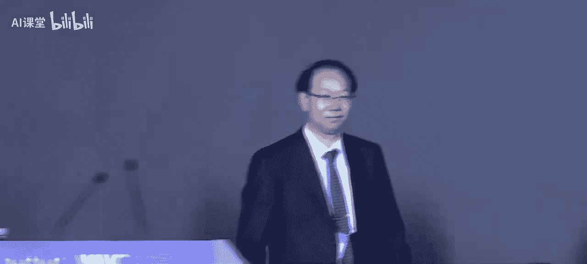

各位嘉宾，大家下午好。刚才主持人已经介绍了，在今年的4月份的时候，教育部关于推进。

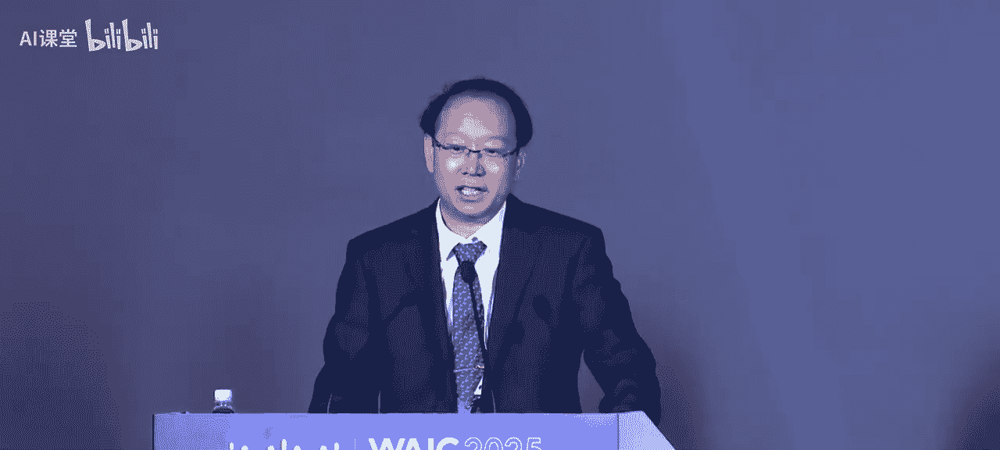

进一步推进教育数字化转型的意见当中，提出了要积极参与全球数字治理遴玄数字教育全球示范案例，打造具有全球影响力的数字教育品牌。那么为了响应这项工作呢，华东师范大学以2025年世界人工智能大会为契机。

携手世界经合组织建交大学未来学习中心等相关部门共同举办了智能教育在中国人工智能赋能技术教育示范案例推优活动。那么这项活动呢，得到了各界的积极响应很多教师、学校教育局学院等积极参与。

共在一个多月的时间里面，共征集了1080份优秀案例。这一案例呢涵盖了全国31个省自治区和直辖市。其中，东部和南部沿海城市呢反应更为积极。那么对这些案例呢。

我们主办方依照价值引领、技术创新、可推广性和成效验证四个基本的原则，组建了13个专家评审组采取多轮合议评审机制，最终遴选出197项优秀案例。对这些案例呢，我们做了一个全景的扫描。

主要是根据大数据词语词频分析和剧类分析。对于我们整个智能教育在中国的现实途景做了一个具体的分析。这些分析呢，根据词云，我们可以进行这些判断。第一个是从实践背景和目标来看。

主要是聚焦智能实代人才的培养要求，响应教育政策与改革方向，推动教育理念与方法创新。在这个当中大家可以看出来，核心素养数字素养是大家提到最多的一些词语。那么从热门的实践内容来看呢。

主要是关注了技术驱动教学模式创新、技术赋能教学提质、军校以及技术助理、教学资源开发、分层教学、项目化学习、微课等也是大家比较关注的热点。那么从常用技术来看呢，在这个所提交的案例当中。

大部分的案例都提到了生成式人工智能、智能企、教育、智能终端与环境等相关的技术。从实践主题和协作机制来看，教师仍然是在这个当中发挥了主导作用。除此之外，正常学研用的协同机制和协同生态逐渐形成。

合作是智能教育发展的关键。在这个案例当中得到充分的体现。从保障条件来看呢，在我们所有的案例分析扫描当中，大家会发现，伦理规范、隐私保护是大家提到最多的一些关键词。当然还有从实践成效来看。

大部分的案例都体现了推进教育公平与质量提升，促进学生综合素质发展，提升智能教育的社会影响等这些领域，可以看出来，智能教育在中国教育大地上得到普遍的应用。从整个价值来看。

聚焦了中国教育发展的痛点、难点和关键点，从价值取向上来看，是非常符合我们国家的教育发展现实的。😡，那么对于这些案例评审的基础之上呢，我们进一步通过大数据分析和人工智能的挖掘。

对于中国教育在智能教育在中国的实践热点啊进行了一些个挖掘分析。这些实践热点呢，我们从这个十大方面进行到概括。其中。突破传统教学范式的师生机互动教学等这十大场景，它的得票是最多的。

也是从我们整个既采取了这个人工智能的分析，也采用了人工智行的一个评价方式相结合。我们评选出智能教育做中国十大热点的场景。这十大热点场景呢，它的得票情况也完全也不是完全一样的。

但是最低的也有一个有39个案例体现了这个特征。接下来我根据这个整个的热点情况一次做个分享。第一项就关于突破传统课堂范式的师升机互动教学。这一点在今天的专家讲座当中也充分体现了刚才我们的郑清华院士。

包括我们刚才这个圆桌会议当中的，我们黄荣环教授都对于师生机互动教学这样一个生态给予了充分的肯定。在未来的学习当中，教师会成为学习的设计者组织者服务者陪伴者。😡，的守门员。

那么学生呢将是在老师和人工智能教师的共同的帮助下，实现自主的自主探究和知识的主动建构。那么人工智能将成为认知增强工具、智能学习培练。所以这就打破了传统教师讲、学生听的课堂教育范式。

构建了对话型的探究式的创试性的课堂。这些在对于传统的课堂范式的重塑，起到一个决定性的意义。这一点呢，有238项案例对此做出了描述。第二个是关于助力教师发展的智能备课和智慧研究。在这方面呢。

有151份案例对此做了抛析。其中，在智能备课方面呢，从内容准备资源制作、习题设计和以学定教的个性化分析等方面提供了赋能作用，从智能研究方面。

从虚拟沉浸式研教研数据驱动的精准教研、多主题协作教研以及个性化教师培训等这些领域。😡，充分的实现了技术赋能，在极致增教在教师专业发展等方面，促进教师的角色转型和世界的专业发展，这是第二大领域。

第三个热点呢是重塑育林生态的智慧校园建设和治理。这方面呢应用非常广泛，其中涉及到教园的角角落落方方面面，从教务管理、学生管理、教师发展、家校沟通、校园生活，以及平安校园等多个维度。

提供了丰富的案例和场景。这些呢也是体现了我们人工智能，不仅解决教育教学，还解决教育治理和学校服务等非常丰富的应用实践。😡，那么第四个热点呢是AI赋能的心智人才培养的跨学科项目化学习。

这一方面呢可以看出来，这个人工智能不是经用来提分的，还是在心智人才培养方面提供了更多的一种想象力。比如说在跨学科项目化学习，在人工智能素养、创造力、合作精神为你解决。

以及这个科学素养等方面提供了非常丰富的案例。这些案例呢为我们在智能时代培养心智人才提供了更多的一种想象空间。那么第五个场景呢第五个热点场景是提升个性化学习效能的智能学练系统。

这个智能学练系统大家也可以看出来，围绕作业管理作为辅导学科自身应学习、语言学习等有大量的案例体现了在这些方面，其中有85个案例，体现了与此相关的占比达到7。87%。比如说我这里面也可以看出来。

在作业管理方面，从作业批改作业设计、作业辅导方面都有非常丰富的应用。从这个语言学习来看呢，又包括很多。这里面呢我可以举一两个例子啊。比如说成都期中。

他们这一次提交的案例是AR驱动的作业智能化管理默持学霸。在这个末质学办当中呢，他们提供了关于这个智能的错题管理。精准的资源推送个性化的辨识训练的一个助学系统，同时还构建了备课智能题探索教学智能化升级。

😡，这一方面呢给我们的专家评审提供了非常深刻的印象。除此之外，华东师范大学第四附中，他们借助于华师大自研的小花师作为辅导系统来赋能作文的教学和语文学习习作。这方面呢也有非常丰富的应用案例。

其中在作文智能批阅，生成个性化评语、提供精准的修改方向等全面的赋能教师和学生，也得到大家的普遍的共识，感觉到这是一个非常优秀的案例。那么第六个场景呢是促进学生据深认知的虚拟式、沉浸式教学。

这方面呢主要是在知识学习概念建构、虚拟实验、虚拟实性和虚拟实训和数字人文等这些领域，由于这种这个虚拟场景的一种沉浸式的学习体验，带给大家更加丰富的高效的认知环境。这方面呢也有很多非常丰富的应用案例。

其中这个案例呢。啊，涉及的有71个，占比达到6。57%。那么在这里面呢，他们共同的作用就是促进了巨深认知，保障安全性，降低体验成本，增强互动性，提升有效性方面，为我们打开了另外一扇窗户。

这里面我还可以看一个案例。福建泉州一中。他们借助于AR加VR的虚拟融合新课堂。他们在对于概念建构方面构建了沉浸式的细胞微观世界场景。同时通过虚拟的科学家的助教，再加上我们的作业精准的事实反馈。

从而为学生带来一种全新的学习体验，极大的提升的认知效率和科学探究的热情。那么第七个呢是赋能学校特色的智能评价系统研发和应用。在这个领域里面呢，有涉及到61个相关的案例。这些案例呢从评价理论的构建。

包括评价模型和评价指标体系的构建，能为我们提供了一种新的一种探索。其中在学生学业评价综合素质评价，学校质量评价等领域提供了非常丰富的应用实践。为我们在教学评价方面提供了我们更多的应用示范。

这里面其中比较典型的就是我们杭州市建览中学。他们这一次提交的多模特、智能驱动、初中生无育并职综合素质评价。在这里面，他们首创了学校大脑。

以多模特数据融合技术整合课堂学习学业和情感等12类237项动态指标，建立九大维度和这个学生个性化成长成熟度的评价体系。他们以数据评价为。😡，基础以数据沉淀为基础，以智能针智能诊断为引擎，精准干预为出口。

来以评价驱动学生成长。这方面给我们评审组以非常深刻的印象，这样这也得益于我们建南中学多年来在数据沉淀和教育大脑研发当中的一个长期的一个积累。😡，第八个呢是关于落实中小学人工智能教育的技术实践和校本实践。

其中大家可以知道，人工智能教育呢既包括用人工智能的教育，也包括关于人工智能的教育，怎么样把人工智能素养落在实处，从内容到方法从模式到环境方面，在这一次案例评量当中，有59份案例体现了这一点。

其中包括市区事变的教学内容，以应用为导向的教学方法，以及具有校本特色的实践模式和因地制宜的学习环境，都给我们专家以深刻的印象，也体现了在我们中国大地上人工智能教育的蓬勃开展。

以及各行各业对于人工智能教育的重视。😡，第九大热点呢是护航学生身心健康发展的智能应用。刚才我们华中工师大前应工校长也专门分享了我们华中师大在心理健康辅导方面的一个具体的人工智能应用。其中。

在智慧体育智慧心理健康方面有非常多的应用场景。这些场景呢也体现了人工智能在赋能教育教学方面，它的场景想象力是非常多元的。为我们教育教学提供了非常多的场景。其中，在这个智慧体育方面。

如何结合人工智能技术可穿戴技术等来提供更加智能化的评测终端和智能锻炼的引导系统。包括体实健康检测运动指导和健康水平的提升等为我们提供了非常丰富的一种优秀的案例。在智慧心理方面呢。

如何把智能技术应用于多模特的心心智感知网络，非接触的情感感知和行为雷达，以及情感状态的识别，以及心理健康的陪护等。这个方面呢，我们刚才我们钱校长介绍了华时在在这方面的一个非常典型的应用场景。

在全国范围内，这样的案例还很多，一共涉及到42份相关的案例。😊，那么第十大热点呢是支持询政教学的课堂智能分析。就是除了刚才说辅助教辅助学，还有辅助研。其中在这个课堂询证分析方面呢。

一共有39份案例与此相关。占比达到3。2%。其中这个案例场景当中呢，主要是课堂分析系统的研发以及多模的数据的采集分析，课堂智能分析与反馈，包括以此带来的基于课堂分析询证的教研活动，有非常丰富的应用实践。

其中我们在课堂分析评价模型。😡，以及多模的数据的分析算法和分析技术等方面提供了非常多的一种应用。比如说我这里面举一个案例，在这次案例评论当中。

宝山区以学习为中心的人工智能课堂分析群众系统的构建以及区域教师行动。他们就提出了一种就是基于。😡，主动学、深度学、互动学、高效学和多样学的5维课堂评价，从关注教走向关注学，并且基于计算教育学。

构建了这样一个人工智能课堂分析群证模型。这个案例呢在全国有100多所学校正在采用相关的技术来进行课堂的教研活动以及教师的专业发展推进行动。这是我们对于我们这个十大热点的分析。除此之外呢。

还有100多项案例都不再是这十大热点之外之内，也体现了我们中国教师、中国的学校在人工智能赋能学校发展当中，非常丰富的创造实践和我们的教育的智慧。这方面呢。

我们对于未来我们开创更多的场景和更复杂的应用提供了这种可能。当然在这个基础之上呢，我们下一代的技术会是什么？我们也通过人工智能分析，以及文献和专家打针的方式。

共同预测了下一个三年会有什么技术是我们流行的。😡，是我们最渴望得到的。在这方面呢一共有六大趋势。第一大趋势就是围绕智能向善的教育智能教育治理体系完善。这是我们各界以及从理论到实践。

从人工智能到专家都非常认同的。所以人工智能不仅要推进人工智能，还要同步推动人工智能教育的治理。第二个，关于情感计算和学习陪伴技术。这是我们未来可能知识的获得越来越容易。但是怎么样能够让学习情感的陪伴。

成为人工智能赋能我们的一个典型的场景。这是我觉得还是大家非常渴望的技术。现在我们这个陪伴的功能以及情感的计算，这是我们下一代很多教师最渴望的技术。第三个是教育大模型与教育智能的研发，这方面。

刚才我们这个圆桌起段，也大家对此提出了非常多的一个这个应用的渴望。第四个就是智能教材的开发和应用。在我们中国大地上呢，教材还是非常权威的。😡，非常重要的。那么下一代的教材长什么样。

如何能够真正的赋能我们的学生成长？这方面呢是这是我们大家非常渴望得到的技术。第五个就是学习者模型和学习管理系统的构建。学习管理系统呢在我们地平线报告当中也多次提及。其中，关于学习者模型。

针对不同的人如何支撑他学习，如何让学生在个性化发展当中，它的打造最优化路径的规划，这方面是我们这个各界最渴望得到的技术。当然，这个学习管理系统呢，也是未来我们人工智能在教育大模型应用当中的一个热点领域。

第六个就是支撑智能治理的教育大脑的构建。刚才我们北邮大学呢专门体现了他们的学校的教育大脑。但是我相信更多的教育大脑，从区域层面到学校层面到学科层面会有非常应非常丰富的应用场景。

我们也渴望更多的教育大脑能够在辅助教师在帮助学生成长。😡，方面发挥更大的作用，这是我们未来3到5年可能技术的流行色，也希望能够得到大家的认可，并且让我们的产学园各界共同的开发相关的技术。

为我们开拓更加丰富多彩的更加符合价值取向的人工智能教育开辟新的一个突破口。以上是我的分享，谢谢大家。😡，好，非常感谢张教授的分享。在报告当中啊，我们也能看出来。

对我们的理论研究和未来的实践探索也是带来了很多的启发。今天呢我们在这里同时要向大家来预告，今后华东师范大学将把智能教育在中国打造为教育加AI领域优秀示范案例推选的品牌活动。今年呢将聚焦的是基础教育。

明年呢是高等教育。然后后年呢我们再回归到基础教育，以此节奏循环开展持续挖掘不同学段的数字化优秀案例的征集，打造具有全球影响力的数字教育品牌。

今年首批征集的千余份首届呃我们说刚才讲到的啊这些基础教育的案例当中，经过业内权威专家组的多维度高标准的专业评审，最终评审出一批具有鲜明特色和示范引领价值的优秀示范案例。

并邀请到了部分案例的负责人莅临现场。接下来我们将会为这些获奖案例代表颁发获奖证书。有请一下11所学校。😊，🎼代表上台，他们分别是安吉儿童村幼儿园。

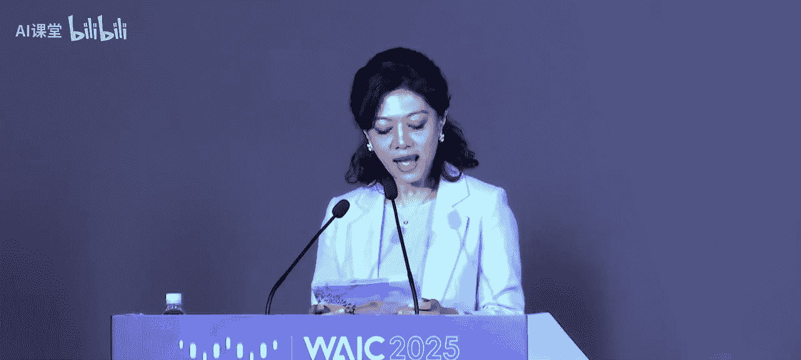

🎼无锡市连园街小学，广州市荔湾区方村小学新东学校华东师范大学附属浦东临港小学、青山县第二中学、合肥市第四中学、无锡市辅仁高级中学、成都市综北中学、上海市张燕中学上海市曹阳职业技术学校。

以及深圳市南山区龙远学校，有请华东师范大学本科生院副院长冯超教授，教育学部副主任陈双叶教授为他们来颁奖。🎼掌声有请。🎼好，我们。🎼请颁奖嘉宾和我们的获奖单位一起合影留念。🎼好，我们向中间靠拢。🎼好。

来321。🎼我们一起留下难忘的瞬间。🎼好，再一次祝贺获奖单位，感谢两位颁奖嘉宾，谢谢请入座。😊，🎼好，接下来我们表彰的是推动区域智能教育发展的优秀组织奖。

他们是福建省泉州市教育局、浙江省杭州市上城区教育局、辽宁省沈阳市和平区教育局、辽宁省大连市教育学院、广东省广州市荔湾区教育发展研究院、上海市浦东区教育局、上海市宝山区教育学院、四川成成都市第七中学、河北省衡水中学。

请获奖单位依次上台。我们有请华东师范大学教育学部党委书记颜合影事，华东师范大学上海智能教育研究院党总支书记张凯先生为他们颁奖。掌声有请。🎼好，来我们请两位颁奖嘉宾和我们的获奖单位一起合影留念。

大家向中间靠动。🎼好，我们来看中间的位置，请摄音老师给个手势。好的，大家看中间321。🎼好，再一次祝贺我们的获奖单位，大家微笑一下。😊，🎼感谢颁奖嘉宾祝贺。🎼当前呢全球的竞争啊聚焦在人工智能领域。

人才储备也成为了关键的变量。人工智能作为引领未来的战略性的技术，人才培养的根基就在于我们今天所讨论的青少年阶段的通识教育。我国要在新一轮的科技革命当中占据主动，急需培养大批量的人工智能素养、全新人才。

华东师范大学主动谋划，积极响应，策划了大中小一体化人工智能通识教材的编辑和出版。接下来我们就将进入的是大中小一体化的人工智能通识教材发布仪式。让我们用热烈的掌声，有请发布嘉宾上台。他们是。

🎼华东师范大学校长助理本科生院院长吕长虹，华东师范大学终身教授教育学部主任袁振铎，华东师范大学上海智能研究院院长、上海创智学院全实导师周爱民。🎼华东师范大学出版社党委书记社长王健。

华东师范大学计算中心主任原主任郑俊，深圳市南山区教育局南山区教育局党组成员、二级调研员陈登福，深圳市南山区教育学院副院长石颖奇、华东师范大学上海智能教育研究院副院长江波，掌声有请。🎼好。

我们有请各位领导移步到我们的启动。🎼好，各位领导都站在位置上了。🎼我们大家把手一起放在启动柱上。🎼我们全场倒数，请看大屏幕。🎼激动。🎼感谢各位，我们一起来见证了大中小一体化人工智能通识教材的正式发布。

感谢各位领导，谢谢请入座。😊，🎼刚才我们说到呢大中小一体化人工智能通试教材的发布，他为不同学龄年段的学生们提供了系统学习人工智能知识的宝贵资源，填补了大中小学在人工智能学习连贯性上的空白。

有助于构建分层递进，螺旋上升的教育体系，全面培育我们学生在知识技能思维等价值观方面的人工智能素养，也为我国在人工智能时代，培养兼具科技创新能力和社会责任感的复合型人才，筑牢基础了。

青少年是我们发展的未来人工智能在青少年群体当中的普及和教育，也是我们十分关心的议题。那么接下来我们要掌声有请上海市科技艺术教育中心、科技教育部主任林君秋为我们带来托取未来学习者AI时代的科学教育再设计的分享。

掌声有请。尊敬的各位领导、专家、教育同仁，大家好。很高兴在今天这样一个盛会里和大家分享AI浪潮当中，上海青少年校外科技教育的一些探索和实践。我想先请大家看一段两分钟的视频。

看看今天的学生已经可以用AI工具做出怎样的作品。😊。

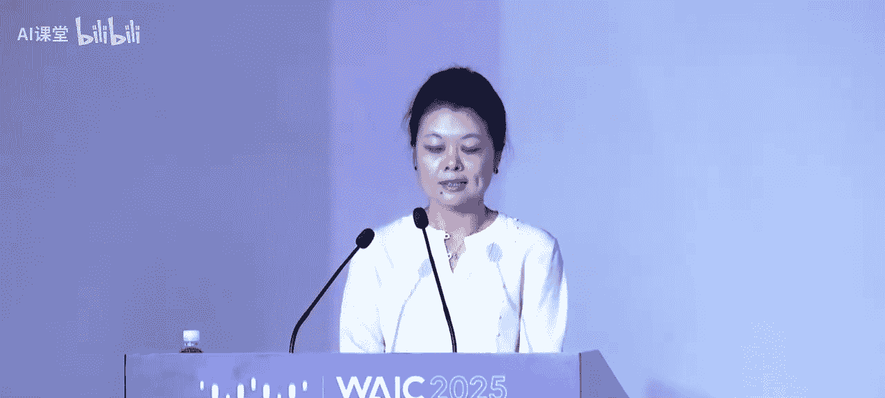

🎼我觉得AI主要是生产出来的意义是帮助人类去更好的生活，把AI去彻底融入到这个交通系统。好的AI智能视觉系统，也可以借助城市管理平台。AI是现在大势所需望通过对模型的不断改进，人民百姓的生活更加美好一。

在刚才的视频当中，我们看到学生在用AI谱取作画设计智能设备挑战算法任务。他们在与AI共同创造。那作为教育者，我们不只是欣赏他们的成果，更要思考这些成长是在什么样的教育结构当中被托举起来的。

而人工智能的快速发展，又对我们的教育体系提出了哪些新的挑战。我们一直在关注AI时代教育面临的三种结构性的关系张力。第一是校内与校外。在人工智能这些新兴的领域，很多学生第一次训练模型，第一次完成项目。

常常是在课外和校外。校外教育早已成为连接真实世界，驱动能力跃圈的重要场域，与校内教育形成了双圆共寓。第二是普及和拔尖AI技术发展迅猛，工具人人可用，但高质量的产出仍然是少数，让普及成为个性发展的起点。

让拔尖从面向人人当中逐步脱颖而出。我们需要让每个孩子都有机会被点燃。第三是经典与前沿。我们经常说先打基础再谈前沿。但是现实是在AI工具的帮助之下，学生已经在使用他们尚未系统学习过的这些技术解决真实问题。

他们不是学完再用，而是以用导学。这三组关系实际上是在共同指向一个问题，就是我们已经是否建立起能够支撑AI教育的良好机制，让学生的创造力不再依靠偶发而转化为系统性的成长。这些年。

上海校外科技教育在不断探索应对这些结构性问题的方式，其中最具代表性的是长三角青少年人工智能奥林匹克挑战赛这一平台。但它并不是唯一的载体。更重要的是我们逐步构建起来的，面向青少年AI教育的校外教育体系。

早在2018年，上海市科技艺术教育中心就在市教委的指导下，在全市范围内组织以算法探索创新应用为核心的人工智能教育活动。当时的校内课堂教育主要聚焦于概念和原理，真正的动手实践场景，往往是在校外。

校外的科技老师们一边自己学习，一边一起研究哪些内容可以通过项目驱动和课程设计进行校为，将前沿技术与学情现状慢慢连通。这67年，正是技术迅猛发展的时期，我们也顺势构建了一条内容持续演进的链路。

从规则驱动走向数据驱动，再走向任务优化与多模态智能，始终围绕学生的真实能力成长路径来进行机制设计，教育内容在不断升级，范围也逐步扩展到长三角。在这一过程当中，大量校外的教师是第一代引导者。

他们没有现成的教材，没有教学范式，靠项目摸索，靠比赛打磨，靠学生的反馈来更新。可以说，今天我们看到学生在赛场上的从容与创造。背后，正是这些年校外教育体系，默默搭建起来的学习支架和成长路径。

AI教育强调任务及课堂。我们以赛事为载体，构建真实问题驱动的学习机制。做法一，构建真实的学习机制，回应校内和校外之间的衔接不畅。围绕项目促进主动学习，评价关注完整的学习过程。优秀的成果不止于颁奖。

还进入孵化、交流、课程转化等延伸。这是以赛促学、以赛促评、以赛促反馈的三大关键要点。赛事不是课外的延伸，而是问题驱动、实践探索过程评价、反思升级的完整认知流程。做法2，构建多轨成长的机制。

回应普及和拔尖之间的认知锻炼。我们设计了三类梯度任务。如AIGC绘画和音乐创作这一类的普及任务，降低门槛激发兴趣。如AI应用开发这一类的挑战任务，引导学生跨学科建构。

如自动驾驶大模型调优这一类的突破任务，进一步面向现实问题进行挑战。这样的三类任务，让每位学生都能在合适的坡道上自我挑战，实现由兴趣到能力、由能力到突破的螺旋上升。做法3，构建资源组织机制。

回应经典和前提前沿之间的内容脱节。AI时代，教育更关注资源怎么成为教育结构的一部分。学生要把基础知识应用于真实的任务，关键需要一个能够转移知识问题和技术的中介系统。

我们将赛事平台打造为一个连接多方的枢纽，连接真实社会问题与学生的解决能力，整合高校的技术能力、企业的问题意识、教师的课程组织力，嵌入项目化学习的认知链、资源链和评价链。AI奥林匹克更像是一块磁场。

吸引并组织高校企业、教师和学生形成共创系统。平台的价值不仅在于内容丰富，更在于改变了学习的场域结构，更新了认知的认识深成逻辑，重塑了教师和学生的角色关系。人工智能的到来，不只是技术革命。

他要求我们在教育上构建新的逻辑、新的组织形式和新的激励方式。我们不是在做一场更酷的比赛，而是在进行一场更深的教育变革。如果说让世界充满AI是技术的主张。那么让每个学生都能生成未来，应该是教育的担当。

让学生在未来的世界当中有能力与AI协作，有判断力，面对技术，有创造力，定义未来，让每一个孩子都能在被托举的过程中成为未来的塑造者，谢谢大家。好，感谢林主任的精彩分享。

接下来呢我们把舞台交给腾讯青稞实训营，有请这个青稞的学品牌负责人靳楠女士，掌声有请。

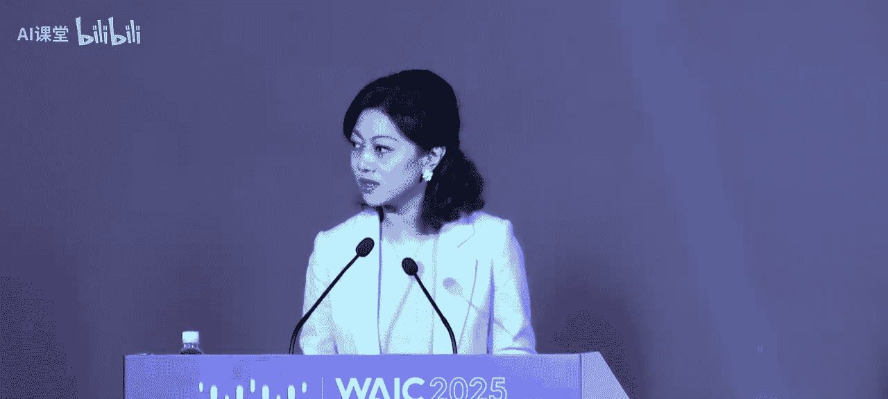

尊敬的各位领导、专家、教育工作者们，大家下午好。我是来自于腾讯青少年学堂的晋楠。首先非常感谢主办方华东师范大学和上海创智学院的邀请。😊，能够让我们来参加本次论坛。

向各位介绍腾讯在青少年AI盈利教育方面的创新实践。首先呢我想分享一个案例。在世界人工智能大会期间，上海的一群科技少年们也开启了一场前所未有的AI探索之旅。请看大屏幕。min里额上海科创营的顺利举办。

离不开上海市教委、徐汇区教育局的指导和支持。下一代的科技教育需要社会各界的共同努力。而腾讯以用户为本，科技向上为使命愿景，所以更当仁不让。在响应政产、学研、协同共创的基础上，我们一直在探索一种模式。

一种面向青少年的实训教育模式，可以更加助力学校教育、家庭教育和企业实践教育的深度链接。而今天我们交付的答案，就是我们的腾讯亲科实训、营地教育模式。那什么是具有腾讯特色的亲科实训呢？请看大屏幕。

那这个体系是怎么构建出来呢？首先其实是基于腾讯的多元创新基座。首先我们是腾讯学堂，面对于全体学生的重要窗口，依托腾讯学堂20年的人才培养以及和知识沉淀经验。通过我们创新的学练屏一体化任务式ssp的系统。

将腾讯最前沿的课程和实训课题，转化为对学生更加精准集中而且会有启发性的深度培养。同时呢通过营化管理系统的创新，不仅大幅提高了开营和课题研发的效率，而且实现了像每日多地同时线上线下同步开营的可能性。

其次呢，我们将腾讯的各种产品技术的成果。通过金科实训营的教研模式，将系统化的沉淀为我们的课题，还有知识能力地图，同时最后混员大模型的加入，重构了我们的技术底座，推动青少年从学AI到用I学的创新升级。

基于这样一个基座。我们打造了一站式营戏平台TcaM承载了从营前赢周营后的专权服务流程和管理。同时沉淀了腾讯特色的主题营教研教务能力，聚合了腾讯的科学家各领域的专业工程师，而且携手了学校科研教研等单位。

共同支持并引领青少年的创新学习和成长。那这些基础能力助力我们六大营地提供了标准的充足的阳光土壤和养料，不仅助力我们从中学生到大学全学段的长线培养。也为我们同家长、教师和教育单位的共创提供了可能性。

通过标准化的一地解决方案。我们开放同政府、学会、学校、教育单位的公益合作，也期待于诸位一同为社会的下一代贡献力量，谢谢大家。各位领导，各位嘉宾，至此呢，本次论坛今天下午的议程已经全部呈现了。

明天呢在华东师范大学普陀区的校区内将会有分论坛，将会有更多精彩的内容等着大家，期待与大家明年继续相约，感谢您，谢谢。😊。

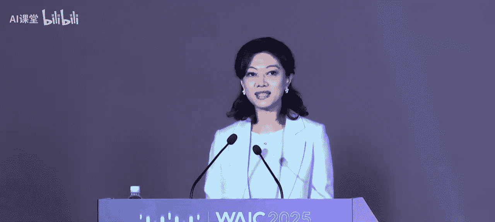