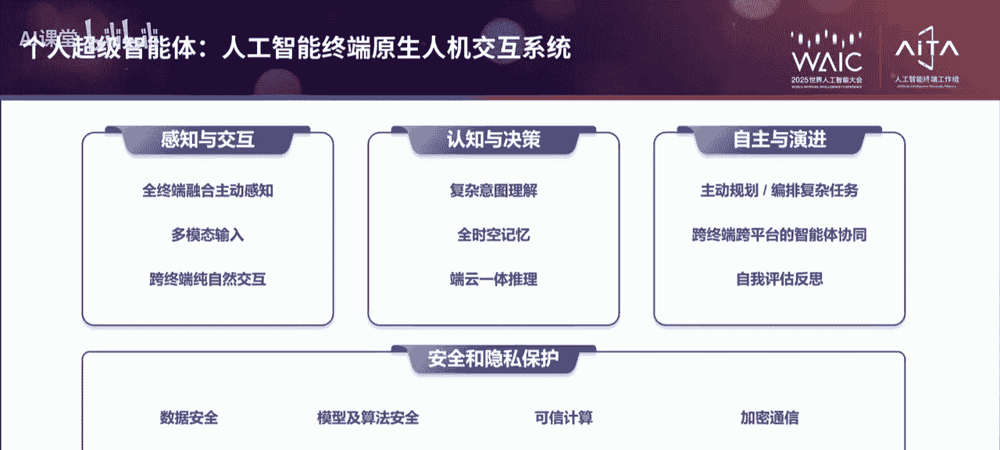
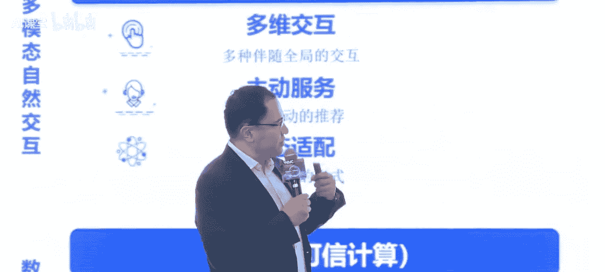
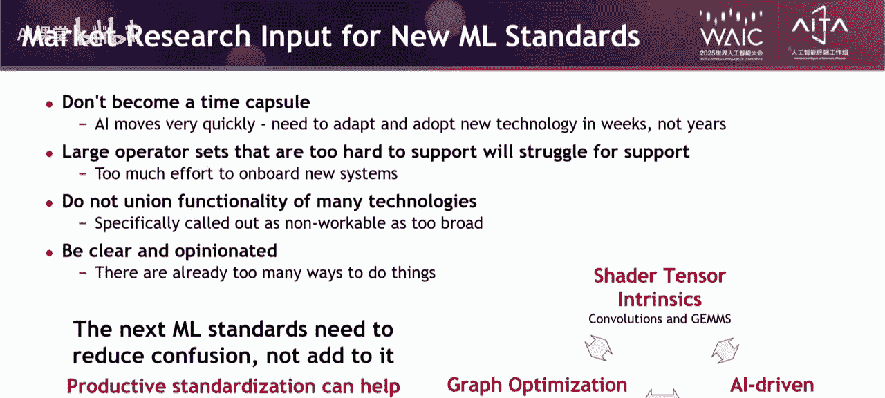

# 【2025 WAIC 世界人工智能大会—主论坛】人工智能全球治理高级别会议  Ai、开源、教育、Ai普惠、赋身智能、神经网络、超级智能 p08 8、人工智能 终端产业 发展论坛 -BV1Gx8gz3Er5_p8-

线上的观众朋友们，大家下午好。智智联万物端起未来。欢迎大家参加人工智能终端产业发展论坛。我是中国信息通信研究院总工程师敖丽，非常荣幸担任本场论坛第一阶段的主持人。2024年以来，人工智能终端快速发展。

成为人工智能工程化落地的重要载体。人工智能手机PC人工智能智能眼镜、玩具等创新产品层出不穷。大模型与终端产品的加速融合，启动了终端产业乃至消费电子产业新一轮变革周期，也成为新的消费增长点。今天。

我们齐聚上海这座充满活力的创新之都共同探讨人工智能终端产业发展趋势，和生态构建路径。本次论坛由人工智能终端工作组主办，邀请了主管部门领导产业链各环节重点企业和行业专家。

共会人工智能终端产业发展的宏伟蓝图。下面我宣布论坛正式开始。首先让我们欢迎此次到会的主要嘉宾，他们是全国政协委员、研究员及高级工程师王江平。工业和信息化部电子信息师副市长徐文丽。

中央广播电台总台中央广播电视总台技术局副局长赵桂华。上海市经济和信息化委员会副主任汤文侃。因为时间关系，以下嘉宾一并介绍后，大家鼓掌欢迎。他们是教育部科技师信息化处副处长潘论凯。

文化和旅游部产业发展师产业促进处副处长刘洋，济南市工业和信息化局局长魏斌，广东省工信厅电子信息处副处长陈世胜出席本次论坛的还有来自复旦大学、上海人工智能研究院等高校和科研院所的专家学者。

以及华为联想、oppo、阿里巴巴、应伟达、中心科大讯飞、vivo、上海六联智能等企业的领导。欢迎各位嘉宾的莅玲。接下来让我们以热烈的掌声欢迎全国政协委员、研究员及高级工程师王江平为论坛致辞。

大家掌声欢迎。尊敬的各位请业家朋友，各位领导，大家下午好。今天呢我们齐聚一堂，共同。讨论。AI终端。呃，星期玉。以及AI终端的发展方向。呃，首先呢我也想。这个。

代表我个人吧对啊中央广播电视总台啊教育部、文化旅游部等有关部门以及上海市的长期支持啊表示衷心感谢。为人工智能终端产业辛勤付出的业见啊各方面的代表表示请求的慰问。今年以来。大模型能力。迭代突破。

把推理成本。大幅度的降低，人工智能正从技术公关向商业化落地。引引进发展。党中央国务院高度重视啊人工智能的发展。习近平总书记在4月份到上海考察的时候强调。我国数据资源丰富。产业体系。完备。市场空间巨大。

发展人工智能前景。🎼管控。要加强政策支持和人才培养。努力开发。更多。安全可靠的。优质产品。今年的政府工作报告呢也专门指出。要持续推进。人工智能加行动。将数脂技术与制造优势。市场优势更好的结合起来。

🎼支持大模型广泛的应用。大力发展。智能网联新能源汽车。人工智能手机。和电脑、智能机器人等新一代智能终端。和智能装备。那么作为。产业。月圈的突破口。消费升级的一个催化剂。数食融合的连接器。AI终端呢。

正在成为人工智能技术逻地应用的一个关键载体。他会。重塑人机交互范式。云博市。拓展。消费。这个服务消费的边界。深度赋能千行百业。我国是。全球最大的。消费电子生产工。出口国和单一的消费市场。2024年。

我们国家。电子消费电子的产业营收。达到了8。18万亿元。占据了电子信息产业的。半笔江山。为我们探索人工智能技术的落地啊，实现商业化的。应用电定的。非常重要的产业基础。在。正常学烟的共同推进下。当前呢。

我国人工智能终端的产业呈现了啊这个。三个家几个加学的开始。第一个家属啊就是。技术迭代。家属。啊，特别是。专车大模型的。这个压缩技术。这个。算你智能化的升级技术。这个芯片的。这个高密度的封装技术。还包括。

端云协同的技术。以及。这个从芯片啊到模型，到端到云的。多维度的全链条的。这种安全策略。等一系列技术的迭代进步啊。对我们人工智能终端的这个发展奠定了坚实的技术基础。第二个是应用家属逻地。

除了AI手机、AIPC以外。还有一系列的。AI终端啊，比如AI眼镜，AI玩具、AI电器。啊，学习机等。这些产品啊不断的涌现。百花齐放。我们预计啊未来AI终端呢还会进入制造业。制造业的一些装备啊。

医疗领域的这个医疗中医疗装备也不是。啊电话。据不完全统计。今年。上半年。已有近20家品牌。陆续发布了AI眼镜新品。特别是618期间，京东平台的AI眼镜的成交量同比增长高达7倍。第三个家属啊就是。

就是AI终端的标准加速构建。人工智能终端的这个是一个新生事物啊，概念新。热度高，为凝聚行业共识打造协同生态。工信部呢正在联合相关部门。指导研制人工智能终端的。分级系列国家标准。这里边就包括了啊构架呀。

总体要求啊，移动终端啊PC还有电视等领域依计。今将会在今年年内啊如如续发布。朋友们啊，各位企业家，在座啊都是人工智能终端领域的中坚力量。希望大家充分交流，形成活力。紧抓人工智能终端变革的机遇。

推动产业创新发展。啊借此机会呢。我想就这个。这为终端的。啊，健康发展提及的希望。我建议。第一是要促生态发展。统筹推进产业协同。充分发挥啊人工智能终端工作组的这个桥梁纽带作用。联合上产业链的上下游。

建立常态化的沟通机制，围绕啊关键技术关键部件。这个关键问题。开展联合研研究。打破啊跨企业跨平台的技术和生态壁垒。形成优势互补。和协同优化的作用。这个生态啊非常重要。特别是AI终端的生态。

是什么样的一种生态生态啊？对于我们走AI终端走的多远，走的多深，可以说。具有基础性的作用。所以我们要高度重视。我们中国的自主AI生态AI终端生态的发展。第二是要强创新。好。丰富这多元化产品的供给。

对要对照这个用户的需求啊，聚焦高品质差异化的创新。不但是在经典终端。要乏力，要要创新，然后在于新兴行业的终端啊，刚才比如我说到的。工业终端、医疗终端。这些这个信息。这个创新。要对。

手机呀可穿戴设备这些产品啊进行。迟老化啊智能化的改造。聚焦投入环节和前沿方向，加快关键技术短板攻关。呃，刚才呢，我听说我们这次会议啊要发布。这个人工智能终端。高价值场景优秀案例的明选意识。

这个工作我觉得非常有必要啊，我们就是要通过这种。这个赛马机制啊。大家必血敢帮啊。🎼这个思想碰撞。啊产生新的啊这个应用。形成一个技术领先、体验优良的啊人工智能终端的。产品系列。第三呢是要稳根基。

加快出台征级标准。这个人工智能终端呢，本质上他还是一要有一个。终端的就一个智能化的这样一个概念。那么智能化就有一个分歧啊逐步提升的一个过程。所以推动。人工智能终端的这个标准体系工作。啊。

分级工作来牵引我们这个行业向和规划啊规模化发展。第四啊要重用做应用，培育消费新心智新认知。和心习惯。啊，探索跨行业跨领域的合作，促进人工智能终端在智能制造、智慧教育、文旅、视听等领域的示范应用。呃。

我们。回顾一下呀这个。移动互联网时代，我们的这个终端之所以。可以发展起来。就当时主要有。两个非常重要的应用。其中一个就是这个这个。🎼支付啊，移动支付。这种技术的应用快速的催生了这个传统终端。

传统智能终端的这个发展。那么新一代AI终端的发展。我们需要什么样的一个颠覆性的技术呢？这就需要我们去探索啊，现在来看。这种应用啊还没有出现，现在还只是在以前的应用的基础上去进行优化挖掘。

迫切需要一种杀手级的啊颠覆级的这种应用。来推动。AI终端的。这边快速的发展，掀起。A终端的换机场。所以我们要线上线下啊相结合来宣大加大宣传的力度，鼓励消费者采购人工智能终端的优品名品。提高公众对。

AI终端的认知度和接受度。再次感谢啊各位的积极参与和关注。我相信呢在大家的共同努力下，我们一定能够推动人工智能终端产业。啊，这个创新有序。快速的发展，谢谢大家。

🎼感谢江平委员的精彩致辞和宝贵指导。刚才江平委员用三个加速啊，这个总结了一下我们现在人工智能啊终端产业的目前的一个发展的现状。同时从我们的生态啊，我们的创新，我们的基础和我们的应用四个方面。

对未来我们人工智能产业的方向啊提出了4个这样的方面的一些指导。那么再次感谢江平委员，下面有请上海市经济和信息化委员会副主任汤文凯为论坛致词，大家掌声欢迎。Yeah。副市长桂华副局长。各位企业家朋友们。

各位媒体。呃，大家下午好，很高兴呢和大家一起啊相聚在2025年的世界人工智能大会上。在此呢，我代表上海市经信委对莅临现场，还有在线上的各位嘉宾表示诚挚的欢迎。

也向长期以来关心和支持上海终端产业发展的各界同仁表示衷心的感谢。大家知道，当前啊以人工智能为代表的新一轮产业变革，正在全球蓬勃兴起。世界发达国家、全球领先的企业呢也纷纷的加入了人工智智能终端的产品创新。

上海呢也正式按照习近平总书记的工作要求，着力发展集成电路、人工智能等三大先导产业。抢抓AI技术变革带来的新一轮智能终端产业发展的新机遇。近年来呢，上海也是通过全方位多层次的要素保障和综合服务。

已经建成了完善的智能终端产业链。我们在芯片方面，上海是国内产业链最完整、产业集中度最高、综合技术能力最强的地区，产业规模呢也占到了全国的将近4分之1。在显示方面，车载显示的产量呢居全球的前列。

在microLED方面的，已经实现了全球最小尺寸和最高亮度。在新一代通讯方面，5G和6G的人才上海占到全国的将近50%。地轨卫星的千帆星作已经加快部署。物联网通信的模组出货量呢占到全球的第一。

在智能终端方面，上海每一分钟就有4辆汽车，40台计算机。44部智能手机。7。5万块集成电路下线。在上海呢也拥有全国前三大手机的ODM企业。记天我看看我名单里面就有我们来自于这些企业的代表。

这个全球的我们说这个沃电代工的企业的手机当中有70%是来源于我们上海的。工业机器人上海占全国的比重。产值呢达到了6分之1，产量呢占到了全国的1%。还有包括我们讲的新型的汽车中端，汽车新能源汽车的产量。

上海也占到了全国的10分之1。在人工智能方面，我们上海的AI的人才。占到了全国的将近3分之1。规上的企业呢已经超过了400家，应该说从底层芯片到计算的机群，从语料数据到基础的模型。

上海已经实现了从前沿研究到锤类应用的全产业链的系统布局。下一步呢，刚才江平部长也做了提了四点方面的要求啊，我们也深刻领会啊加以贯彻。我们呢也会抢抓东东端侧的AI的这个发展机遇。

进一步加快支持人工智能终端的新形态、新场景和新应用的创新。我们做好几个方面工作。首先呢一个是全链条要加速前沿技术的融合创新。我们要提升端侧芯片的AI处理能力，强化终端的软硬件系统能力。

要支持超高清的视听，信息显示下一代通讯、汽车、电子这些重点领域域的创新发展。第二呢，我们则是要全力于打造上海的品牌智能终端。

我们要聚焦在AI的PCAI的手机和AI的新终端巨生智能这些领域里面要打造一批人工智能终端的上海名牌。今天我们也看到我们几个兄弟省市的同志也来，缺乏有品牌的终端，一直是我们上海产业发展人。

🎼我们也希望借这一次的AI发展机会。弯道换道超车吧，能实现上海在终端产业领域里面。🎼我们新的发展。第三呢，我们则是要全方位强化营商环境的优化。🎼我们要发布新一轮的智能终端行动方案。这个部里已经发布了。

我们紧接着要跟进，要支持企业高效搭建公共的技术服务平台。要充分发挥产业人才和资本的优势。要推动上下游协同发展。尤其是要依托行业协会的社会组织，要打造上海智能终端的朋友圈。朋友们。

产业创新发展和生态建设需要积聚各方的智慧和资源。在此呢，我也衷心感谢我们工信部。广电总局对上海长期以来的信任和支持。尤其这一次我们工信部电子师把这一次还有我们新通院啊，把这样的一个论坛放到上海来举办。

这也是对我们上海终端产业发展的信任，也是对我们的鼓励。我们也诚挚的欢迎啊全球的朋友们共赴五江之约，在上海投资兴业，共同打造全球的电子信息产业高点。最后呢预祝本期论坛取得圆满成功，谢谢大家。

张主任热情又令人振奋的致辞，也感谢敖总工精彩的主持，很荣幸为大家主持接下来的论坛环节。女士们先生们，下面我们进入场景革命环节。在人工智能终端领域，场景创新是推动变革的核心引擎。

接下来我们将有5位行业领袖带来精彩的主题分享。首先让我们以热烈的掌声欢迎复旦大学大数据研究院副院长薛向阳教授，他分享的主题是大模型驱动的工业智能体研究与实践。薛教授将深入解析工业智能体技术的创新与应用。

掌声有请。喂喂。尊敬的各位领导啊，各位嘉宾。啊，我今天很高兴啊，有机会在这边做个汇报啊也是。这个论坛组织方跟我讨论说，因为这个主题是终端啊，我想了半天，我想让我稍微讲的大一点叫自能体。

因为呃终端我们都是有形的对吧？大家看得见摸得着的智能体呢也可能是一个软件，对吧？是这个，所以呢我想大一点。当然我们在这个领域里面也是刚开始探索。嗯，所以也不一定能够讲的很深入啊，所以请大家报呃理解啊。

那么。那么我大概讲三个方面，一个是简单的说说这个趋势啊。就目前呢我们这个主要是大模型2022年这个合AI大模型以后啊，到现在也就是3年左右的时间，大家可以看到啊，除了在对话领域里面大家已经用的非常多了。

那么它更重要的一个趋势啊，就是往公益领域里面去发展渗透和应用。所以我想嗯主要还是讲后面呢啊，这个那么什么叫智能体，因是什么是工艺智能体。那么目前啊这个在我们制造领域里面啊。

制能体这个词并不是个新的名词啊。这个在我们学术界已经很多年了，但是大模型加世以后的这个智能体，那么发生了很大的变化。那么呃我们可以看看，就目前的制能体至少我们谈自能体涉及到几个层面啊。

一个是呃智能感知层。啊，你能够接收数据对吧？能够有传感器，那么这是一个主要组成部分。那么更重要呢是决策层。那么特别是我们今天有大模型以后，那么在决策这一块，那就比以前要强很多。

这是呃也是为什么我们今天说今天的智能体和以前做的智能体不一样的地方，可能这边是非常重要的。当然我们还有执行层啊，特别是有像机器人，像自动驾驶汽车，对吧？那执行层是很关键的。

当然我们还可以协同未来不是一个智能体对吧？是一堆或者一群在解决啊一些工作，所以呢他可能还需要这个群体系统，当然还需要支撑。我想时间关系我就跳过去了。那么呃从我们工艺制能体来看。

主要还是解决我们工艺生产过程中的啊，主要是什么呢？就是要实施感知，对吧？还要能够做推理，做决策。关键呢还有个安全执行。然后呢，这些环节要形成个闭，这样的话才能够在我们的采线上面对吧？开展工作。

完成生产任务。那么这个可能是它的个很重要的变化。所以我们可以看到今天这个我们叫代理型的AI或者是因为叫I那么这个可能是最近啊这个一两年发展的很大的趋势。🎼那么这个我也过了时间关系啊。

这个是我们国家呀在2023年。其实这个大风前出来已就一年左右。那么就有些部门已经开始研究这个叫风衣智能体了，也提出了一些白皮书。那么大家感兴趣可以网上去搜啊。那么目前国内外很多这个大的厂商都在。

🎼开发啊这一呃各种各样的应用的智能体。所以我想前面就过掉了啊。我想主要今天花点时间还讲一讲我们自己的一些。探索这个。而且都是在传统行业。这个是我们在呃市经新委的支持下啊。

我们做了两三年就和总体24G呃2他是什么呢？他是做这个体路建设的这么一个公司，所以这是非常传统的一个公司啊。但是呢他们在这个人工智能赋能方面或者数字化转型。那么今天回过头来看。

我们用智能体去包装这个做的事情，我觉得也是比较合合适的。那么我们可以简单看看。这是在工地上面啊，现在建筑企业，像中2世纪这样的企业，它的这个人工智能的赋能啊应用方方面面要多学要。所以我们跟他们一起合作。

紧密合作大概有三四年了吧，对吧？我们是帮他从每个细节做起啊，你比如举个例子，像这个叫AR配料，什么叫配料呢？最简单的应用就是切钢筋啊，原来这个钢筋都是切钢筋的时候拍脑袋。那最后呢就可能多剩一点。

所以我们现在可以给他做到就是剩的最少，因为肯定会剩一点，对吧？可以剩的最少。所以和人工比起来的话，大概可以省个2%到3%。那么大家想象一下，一个工程起来以后，你面的钢筋是很主要的成本。

如果你给它省个2%，那就是存钻，对吧？存钻，所以这就是一个典型的一个应用场景，当然这个也不是很复杂啊，你只要根据这个工程的算量啊，跟他说多少钢筋怎么去买多长多长长度的钢筋都可以事先都给它定下来。

所以我觉得这是个很好的应用，还有比如说这个在建建设过程中啊，每个步骤里面，比如说这这个直检啊，比如说我钢筋是不是捆扎的到位，对吧？这个工艺是不是到位。

那么现在我们都可以用手机拍拍照或者一些专门的一个采集设备拍拍照，然后后面就可以做数据分析，来控制它建设过程中的这个工程质量。那么像这个建模是什么呢？就是他工程刚开始的时候，从建设计公司给他一堆图纸啊。

这个图纸都是打印好的，就是PDF那种啊，并不是说是那个马上就能读出来。那么它就会涉及到什么原来都是人工预读，现在我们可以拿大模型给它读图纸，把图纸里面关键参数把它读出来。

甚至呢还可以把图纸把它这个三维的这个模型给构建出来，那么这就是一个人工智能大模型的一些应用，还有一项管控管控主要是工地上的人员和设备的安全行为，对吧？它是不是在一个这个安全的范围里面活动设备。

特别是像24G这样的它是沿线建设很多，所以他在挖掘机挖的时候，对吧？那个正在运行的铁路有多少距离等等，这些都是要做这个实时的监管的。所以我们跟他们做了一些这样的工作，下面我简单过一过。

你比如说这个图纸都是两维图纸对吧？一般你除了把图纸中关键的参数读出来，海要呢能够帮他构建出三维图形。🎼所以这个还是挺难的。你想嘛我们能够拿到的都是两维的三色图，对吧？

从三色图两维的把它构建成三维的那种三维模型，这个并不是一件很容易的事情。我们人去做这件事情也有一点难度的。所以那我们今天可以用大模型的做这样的事。那么啊这是从这个呃图表里面。

就图纸里面把这个各种各样的这个叫我们叫算量，能把它读出来，不仅仅读出来，还能帮他做校验。因为有的时候在图纸收集过程中，人工是有错的啊，比如他数不字就写错了。那我们可以做校验啊。

把他那个错误的地方给他给他挑出来等等这件事情都是可以做。现在。那这个是个什么呢？是一个对这个可能播放的。播放不了，反正就什么意思呢？这个就是你看那边有个挖掘机啊，我们可以一个监控摄像头。关注那个挖掘机。

然后那边的大的画面呢就是一个仿真的或者数字孪撑的。所以大家可以看什么呢？就是一方面你挖掘机在这施工。那另外呢我们在后面的大屏上有个三维仿真的这么个场景，这两个就是平行场景。所以这边的一举一动。

那边就可以实时的为什么要做三维孪身呢？我要关注比如说它挖掘机的那个那个挖斗，它的空间位置在哪？注意啊，你拍的是两维的。但是我们把它三维的空间位置给它给它这个反推出来。那你马就清楚啊。

它那那个起路线啊有多远，它的施工是不是安全。那这个东西都可以在一个三维的啊这样一个沙盘上面做一个实时的展示。所以我们可以看到这个也是一个典型的这个建筑场地里面保证安全的一个应用场景。哦。

可以看大家可以看啊，那边是摄像头对着他拍的啊，然后那边就是个三维仿问出来的。所以那个上面每个呃空间位置我们都会时时把它显示出来。所以这个也是一个很好的一个应用。当然对人也是一一样啊。

这个是设备的一个安全行为的。那么这是我们做的另外一个，这个就带身体了，前面很多都是算法啊。那么这做什么呢？就做焊机啊，就是现在特别是对这种飞标的啊，大量的比如说在核电啊，在船厂里面好多弓件啊。

它不是标准化，而且呢这个那个那个也很少啊，没有规模，那这个时候怎么办？那么当然哎有人说有焊接功能，对吧？但是很多时候焊接功能也不够用，所以我们就在用完全机器人来做这种取得焊接功能的这些工作。

那这个就靠视觉对吧？然后还靠这个动作，能够把它构建一个闭环的，而且你还要控制焊接质量。好，那么时间关系我就少说点啊，下面我想再花一点点时间。

一个就是呃虽然我们可以看到大模型在工业领域里面已经有很多成功的应用，但确实还是很难的啊。就是大模型本身还要提升啊，今天我们说大模型幻觉大大模型的信息不及时，对吧？

更重要的我觉得工业智能体里面大模型最大的问题就是什么？缺乏物理直觉。这个我想大家可以去思考一下，就是我们今天的数据的训练大模型的时候，它是缺乏物理的直觉。所以下一步就是特别是工业智能体面。

我们怎么把让它具有物理直觉这个能力加上去。那我想未来可能对我们工业智能体可能更加有用。🎼好，这个我就算了，这个不说了，就是我们还要进一步的完善整个技术体系。当然最后这个也是嗯这个大家可能要担忧，对吧？

这个发展的这么快，对吧？未来我们人力怎么办？我觉得这个确确实实是啊，这个不管是工益自能力还是各种各样的能力正在取代我们人的工作。当然我们也很乐观，就是什么，也会创造很多新的工作。

所以可能未来我们更加重要的是啊，怎么去用好的西。🎼啊，只要我们能够还能用到工资呢。那我想我们的工作总还是有的对吧？好，我就说这么多时间关系，谢谢大家。非常的感谢薛教授。实际上每次您说过过。

我简单带过的时候，我们都希望您能够展开一些。因为虽然时间关系，但是这样的机会太难得了。朋友们，下面是我们重磅仪式启动的时间。😊，当前，人工智能终端应用领域渗透到国民经济各行业。

有效赋能行业数字化、智能化转型，服务人民群众更美好生活。为加快推动人工智能终端产业高质量发展，探索终端产品创新应用，促进优质产品推广。

培育新的消费增长点、工信部、商务部教育部、文旅部、中央广播电视总台五部门计划联合开展2025年人工智能终端高价值场景优秀案例遴选，并在今天论坛上正式启动这项工作。请看大屏幕。照。I。🎼のす。🎼我种。

人工智能终端高价值场景优秀案例的遴选工作，将系统性的挖掘人工智能终端的标杆实践，为产品创新和落地提供强大动力。后续工作请大家关注主管部门通知以及工作组的微信公众号。

我国各地方大力支持人工智能终端产业发展，积极开展产业链打造和生态建设工作。在上海市经信委的支持下，上海市本地企业将搭建开放协同的产业生态平台。上海智能眼镜产业联盟将在今天正式成立。下面进入启动仪式。

请看大屏幕。Yeah。🎼们掌声有请联民的代表企业单位登台，他们是上海人工智能研究院总工程师王思。😊，🎼阿里巴巴集。🎼智能终端业务。🎼宋刚。🎼不懈现实。

上海科技有限公司副总裁王丽如、舜宇奥来春纳光学技术上海有限公司堂副总经理陈远，上海奔牛光电科技股份有限公司总计王莹。😊，🎼上海前妙写建输有限公司总地休息。😊，🎼龙神科技上海股份有限公司产品总监韩超。😊。

🎼瓷光展运上海科技股份有限公司智能穿戴产品线总经理李斌，上海隆旗科技股份有限公司和穿戴业务部副总陆总，上海原起云宇宙产业数据中心主任，观注海英。😊，🎼各位请将手放到我们屏幕上的起动场。🎼同样的朋友们。

让我们再一次倒数。😊，🎼3。Yeah。朋友们让我们再一次以热烈的掌声祝贺上海智能眼镜产业联盟正式成立，期待联盟汇聚各方智慧，共促协同发展，谢谢大家。😊，让我们再次回到精彩的分享环节。

接下来演讲的嘉宾是华为终端副总裁朱董东先生，他的发言题目是智慧办公，引领未来，共建鸿蒙新世界，掌声有请朱总。🎼尊敬的。作为领导。大家想。这阳龙信今天能够代表华公司那能够来分享一些。对于人工智能。看吧。

这啊。特别有。来来来中担。啊，这样好多了哈，这个感谢大家哈。我这个我在华为的话，主要是负责这个平板电脑和电脑的业务啊。😊，🎼这个电脑业务的话，现在对华为来说，我们现在这个涵盖面就比较广了啊。

这个不光以前我们还做这个叉86电脑，那现在就是主要以这个新创电脑和这个鸿蒙电脑为主。那今天呢我这边呢也是以鸿蒙电脑啊作为这个主要的场景来介绍一下华为在终端人工智能发展的上面的一些思考。

因为电脑呢相对来说体积比较大，算力也比较强啊，从终端人工智能的角角度来讲的话，可能是一个比较合适的设备来作为我们未来这个几年的这个人工智能在终端设备上发展的一些思考的一个很好的载体。啊。

那首先呢这个我们华为的这个鸿蒙操作系统呢，从2012年开始呢，我们就踏上了这个研发自主操作系统这么一个历程。那最早的这个操作系统呢是1个IOT的操作系统。嗯，到2019年呢。

因为大家众所周知的这个宏观环境哈。然后呢，鸿蒙1。0系统呢正式诞生。然后呢，从2021年开始呢，我们基本上是以一年一个版本的节奏呢，然后再进行全面的升级。那去年呢我们发布了这个鸿蒙的5。0啊。

然后这个鸿蒙的5。0呢，就是实际上就是我们从这个操作系统从内核的话是不仅是完全自主可靠，且我们把OSP给去掉了。所以真正的这样的话这个系统的这个架构呢在全球的这个操作系统领域呢。

我们就真正实现了一个系统啊，然后统一的生态。那么在我们6月份刚刚结束了这个华为的这个开发者大会上呢，我们又发布了面向开发者的这个鸿蒙6。0的版本。那全新的这个开发者的这个版本上面呢。

我们推出了全新的这个开发者的工具。啊，然后呢能够提提升了30%左右的这个效率提升。同时呢而且呢我们实现了这个鸿蒙应用程序的AI开发。

那华为鸿蒙呢已经迈入了一个以这个无处不在的AI与深度协同为核心的新纪元。这不仅呢是一个技术的迭代，而且呢也是我们这个整个操作系统里面的一个革新。呃。好。然后呢。

我们华为呢大的这个全场经验理念呢叫1加8加N啊，一是我们的手机。8呢是围绕手机的8个主要的设备，以及在外围的话，就是我们的各种各样的这个外围的IOT的设备。那这个设备呢现在所有的1加8加N的设备呢。

我们全部实现了以鸿蒙操作系统为底座来构建统一的生态。而且呢我们现在这个生态的发展速度呢非常的快速，目前呢已经有超过1。3亿的设备接入啊，而且目前呢社区呢已经有将近9000位社区的贡献者。

而且涵盖了1200多款的这个软硬件为用户呢提供这个全场景的智慧体验。我们在今年5月8号呢正式推出了鸿蒙电脑。嗯，然后在6月6号呢，我们正式开售了鸿蒙电脑。大家都知道我们一共推出了两款电脑。

一款是这个超高端的折叠电脑。就是我现在在用的这款啊，还有款呢是普通形态的这个电脑。呃，应该说从6月6号开始销售到现在一个多月的话，整体销售情况是远超我们预期的啊。也在此呢我也非常感谢啊。

全国这个消费者对我们的这个信任，以及给予我们的支持。我现在预计可能到今年年底，我们的折叠电脑单款机型可能会在中国2万家以上的超高端笔记本里面可以占据超过50%的市场份额啊。

我大概算了一下这个数字应该是没有什么大的问题。然后另外呢，我们在6月6号发布的时候呢，当时我们说有2500个应用已经上了鸿蒙电脑。那我们到今天为止的话，这个数字已经突破了3200个。到今年年底的话。

我们预计会有超过1万个。🎼纯学的鸿蒙的应用配上鸿蒙电脑啊，所以说我们的整个生态的发展速度也是非常快速的啊，包括这个头部的互联网厂商都给予我们很大的支持。在此我也非常感谢合作伙伴们对我们的这个。

鼎力的支持啊。那这个鸿蒙电脑操作系统呢？是基于我们的这个鸿蒙的操作系统。那大家都知道这张图的话，我们在很多发布会上已经这个修了很多次了哈。因为这张图的话其实体现了我们从跟技术的领域，全面的重构了。

包括内核，包括文件系统，到全场景互联到图形站到大模型到智能体，所有的东西全部是全站自主资源啊。😊，然后呢，我们在鸿蒙电脑上呢又做了全面的增强，带来了更加流畅，而且更加这个安全的体验。其中呢。

我们鸿蒙电脑的系统呢我们是内置了大小模型的啊，我们鸿蒙电脑它本身就有1个7B的端侧的大模型。而且我们在云测的话有一个大模型，然后做同样做支撑。后面我会讲。同时呢我们也内置了推理框架。

所以呢通过我们自研的电脑芯片呢，我们能够提供稳定的NPU和CPU的算力，保证了鸿蒙电脑上的整体的AI体验。而且鸿蒙的AI呢是系统级的AI这点非常的重要。所以呢我们可以提供分层分级的AI的开放能力。

开发者呢可以集成AI控建AI的原子化能力，包括ag的能力，让应用呢更加的智能。那我们华为终端呢是以鸿蒙操作系统为底座，围绕这个鸿蒙智行啊，就是我们的这个这个5个界的车啊。然后这个鸿蒙办公啊。

也就是我这块啊这个平板和包括这个电脑啊，包括这些东西啊，运动健康就是我们的手表啊，然后还有包括穿戴设备影音娱乐以及鸿蒙之家啊，就是那个华为的这个自选家的这个业务五大场景来构建整个智慧的全张金体验。

但是这边呢大家可以注意，就我们未来的话，它的底座都是鸿蒙操作系统，且整个生态是统一的啊。我们可以看到从左边这张图呢。

大家可以看到我们华为呢从这个芯片到操作系统到AI的框架AI的语言大模型到云测的端到端的布局呢，都通过垂直整合来发挥系统性的优势。而统一的云测和端侧的AI框架语言和算子呢。

结合我们ho蒙万物互联的这个能力基因呢，我们可以在手机、电脑、平板、车机等多类型的终端上带来一致的AI的这个能力和体验。AI的技术呢在终端产品落地时候呢，一般都经历这个应用层的集成I啊。

这也是我们看到现在普遍这个AI的这个端测能力的这个体现啊，基本上就是装个APP啊，叫应用的I。然第二呢就是我们讲的这系统融合I我应该说现红是基于系统合能力来构建。

然目前来大家这发展较快的是我们中心全新的操作系统啊那目前呢我们个鸿操作系统呢已经进入到的阶段3大家看到的鸿蒙6。0版本啊，已经进入中心全新操作系的阶段了。所以呢这个阶段的这个操作系统呢。

我们原生智能的这个系统框架当中呢，统一的这个AI的子系统呢，使得我们整个操作系统的各个组件的内部和彼此呢都能够灵活高效的使用AI技术。同时呢类至于操作系统内的这个系统级的AIag，使得原生智能操作系统。

它不仅仅是一个操作系统，而且呢能够理解用户能够自主闭环的用户的任务。而且能够智慧的常驻在你的后台啊，成为理解你和了解你的真正的超级的智能体。那在刚刚结束的这个华为开发者大会上。

我们发布了这个鸿蒙的智能体的框架。以多样化的这个交互路口呢，包括高效可信的通信协议，以及丰富的这个开发工具生态呢。嗯，包括这个全链路的安全防护呢，我们构建了一个开放灵活可演进的智能体。

加上鸿蒙应用开发平台。我们坚信呢这个鸿蒙智能体的框架呢将加快我们的整个生态伙伴的创新的脚步。而且呢在多种设备和多种场景当中，我们的鸿蒙的应用的智能体都能实现个性化、主动化、可信赖和一致的智慧体验。

这一点还比较重要，就是我们整个框架呢也支持多智能体的协作作业啊。所以说我们可以有多个应用和多个服务呢可以联合完成一个复杂任务。这个智能体不一定是华为的，就可能是我们的第三方的智能体。

但是可以跟我们华为的这个开放的链接接起来以后呢，可共同来完成一个任务啊。而且呢这个不仅仅仅限于一些单一功能的执行，它可以去理解，相对来说更加复杂的复杂的指令啊。

然后通过这种全方位的这种呃鸿蒙操作系统下的这种智能体和我们的鸿蒙应用的这种交互呢，我们呢就可以构建一个具备自主决策以及同样具有协作能力的AI的这个生态体系。

能够为我们的这个应用和这个智能体的开发者呢提供架构以及框架的整个支撑啊。那我们的整个鸿蒙的AI和这个鸿蒙系统的这个深度结合呢，包括生儿智能的这个设计理念呢。

我们打造了真正触手可及的这个智能化的数字生产力。鸿蒙电脑端侧呢，我们具备了一个就刚具备了大模型，而且呢我们云测呢是把盘古和引擎的双引擎做了整合。所以呢在我们的主要的电脑的使用场景当中。

包括办公啊、学习啊会议啊当中啊，我们整个体验和这个创新的交互模式的话，应该是和传统的这个电脑产业相比的话还是有非常大的不同啊。大家如果这个使用过鸿蒙电脑或者去我们的体验店体验体验一下的话。

家就发现我们的鸿蒙电脑和这个传统的电脑的差异还是较大的啊，应该说用户能够感觉到这个系统级的AI真正给你们带来的这个便利和全新体验。那我们的鸿蒙的这个AI呢在这个鸿蒙电脑上呢，我们重点构建了4个能力哈。

这边写了叫全新交互高效办公知识空间以及这个随行操作啊，我们。11点点简单的这个介绍一下。那这个全新交互呢，实际上呢就是我们这个整个交互路口的话做了这个非常简化的以直觉式的方式的这个处理。

所以说呢你通过比如说小一小叶啊，你叫一声啊，或者说你在这个。我们的那个硬件上面都有这个专门的这个智慧键按一下啊，或者说在这个菜单栏里面点一下，或者呢右键呢发起一下，就可以马上进入到这个AI啊。

而且呢这种交互模式的话，就相对来说更加的直觉，更加的简单，更加的高效。这样的话，我们能够使得AI能够快速的导入到你在任何的这个成绩当中的这个工作和学习当中。第二是我们的这个小易会计哈。简单来讲。

这个小易会计的话就是。😊，我们多人开会。到最后大家都要形成一个会议纪要啊，那么整个过程的话，我们不需要人干预的啊，然后而且是不需要联网的啊，我同同样这个不需要人干预，也不需要联网啊。

我们会把你们每个人说的话都记录下来。然后总结分析，然后呢，最后呢形成纪要再分发给相关的人。然后所有的动作全都是端到端自主执行，且不需要联网啊，因为它是通过端侧的模型去运作的。然后呢，同时呢。

我们的这个知识空间。啊，我们的这个知识空间呢也是一个不需要联网啊，依赖于这个端侧执行的这么一个这个功能。这功能的话就是可以把你的电脑里面啊，包括平板里面的所有的材料，你只要说一句话。

我想看哪年哪月大概是什么内容的一个材料。然后它可以在非常短的时间里面，然后就给你搜索出来，而且给你呈现出来。甚至你可以直接说我要把这几个材料做一个关联，然后总结提炼，它也可以直接给你完成。

我们把它叫做知识空间啊，然后这些的话就是我们全盘的内容和知识的这个智能搜索和管理。那最后一点呢，就是我们跟现在的其他的这个APP级的AI不一样的。🎼那大家通过这个直接对小易发指令。

可以对电脑的硬件做各种各样的修改啊，包括各种模式，包括息屏，然后包括图标，包括光标的各种更改。然后包括各种设置啊，全部可以通过这个语言的指令完成。因为它是基于系统级的AI，它不是一个第三方的APP。

所以我们可以对硬件的话，所有的这些功能，然后通过这种方式然后进行调整。那最后呢就是在云测呢，这刚刚都讲的时端侧的哈那在云测呢，我们是具备了这个盘古和deep seek的帮引擎的这个融合架构。

而且呢我们可以根据问题的内容呢，我们可以自动的去切换引擎。😊，同时呢联合了这个我们的中金数据啊、中国大百科啊等等权威机构呢，我们建立了这个双重的校验的这个功能。最大程度上我们能够去缓解AI的幻觉啊。

让整个回答呢更加的可信。同时我们还实现了应用级的协作啊，大家可以看到像我们指令直达一句话的话，我们就可以生成整个AI的PPT包括思维导图啊，这个是我们跟三方进行合作的。

所以从从大家看到我们在这个电脑上的整个AI的话，我们是在第三方的开放方面前的话，我们应该做的还是非常的不错的啊，开放加协同。那我们的自研的这个端侧AI呢，是基于我们电脑的。算力芯片和这个端侧的AI能力。

那同时呢我们也支持这个第三方的模型路端啊，然后这块的话呢，我们为第三方呢提供了整个算力的开放模型的调度，芯片级的调优，以及呢让应用在端侧AI方面的体验呢能够更加进一步啊。

所以说后期我们将进一步把这些开放侧的能力呢进一步向第三方开放的更多，样使得有第三方更多的智能体的应用能够快速的接进来。那这一块呢，我们叫。鸿蒙智能体啊，这个就是大家看看大家可以看到我们这次在6。

0的发布里面的话，就是我们专门发布的这个鸿蒙智能体。鸿蒙智能体的话绝大多数都是第三方的啊。那这个智能体呢它呢是在垂域领域的话，相对来说它的专属知识和这个工具的话会做的更加的出色。

那我们呢通过这种系统的智能体和我们的应用智能体。我们把它叫做应用智能体进行整合以后呢，就能够为用户提供更加综合更加专业的整个服务体验。那首批呢50多个鸿蒙的智能体应用智能体呢已经在手机上面上架了啊。

包括京东助手啊、微博呀，然后深行啊等等。后期呢我们的鸿蒙电脑也将把部分的应用智能体整合到电脑上面这样的话我们会聚焦在这个会议啊、文档啊创作教育等等领域。这样话也就是说大家以后用这个我们的鸿蒙电脑的话。

它不仅有这个交易等我们的这个系统级的智能体，还会有很多厂商的各自各家的应用。🎼的智能体。那最后呢是我们的这个原服务啊。原服务呢其实就类似于微信的小程序。

那我们将AI的能力呢也下达到了这个原服务的这种微信小类似于微信小程序的这种简洁快捷的这个小程序的这个当中啊。所以说呢朱总请注意一下时间。好，我知道马上讲完啊。

所以呢我们这个生在伙伴呢能够用最低的成本呢实现这个生儿智能。嗯，AI呢的确是新一轮的这个科技革命和产业的这个核心驱动力。那这个发展水平呢，我们是直接关系到这个国家在全球战价值链当中的地位。

🎼所以呢我们认为呢实现自主可靠的跟技术具有战略性和全局性的意义，是保障国家安全、产业安全和科技自主的关键所在。那推动AI的终端产业的高质量发展呢，我们AI终端的发展和能力呢。

我们认为应该构建在自主可控的国产算力基础上啊，更深呢才能叶茂。当然我们也要正视差距啊，取长补短。因为从整个AI的整体架构上来讲的话，统一的云测和端测的框架断子算法以及云测的各种资源优势啊等等。

这方面的话，我们跟国际呢相比的话还是有很大的这个改善和成长的空间。🎼但是我们认为端侧的算力呢不等同于竞争力。所以呢我们不应该陷入到这个为算力论的这个陷阱当中。真正的检验AI的终端能力呢，应该以人为本。

围绕用户的体验和感知去定义整个AI的这个分级的标准。我们相信呢AI的这个发展呢应该是于。人协作服务于人啊，因此呢用户的体验呢是检验AI的能力的唯一标准。

🎼消费者对于终端的AI能力呢有更加清醒和更加直观的感觉呢。同时也为了让产业界对于AI的终端能力的演进呢达成统一的共识呢。所以我们牵引这个终端系统的智能化呢。

就提出了这个终端智能化体验的L1到L5的这个分级的这个标准。🎼那面向这个人工智能的第四次的这个工业革命呢，智能终端以海量的规模成为链接最终用户的关键的这个路口呢具有不可替代的产业地位。

在工信部领导的这个指导下呢，人工智能终端工作组呢去年年底成立啊，我们华为呢非常荣幸的担任了这个工作组的组长。我们也希望广泛的团结整个产业链。

整个上下游去推动AI终端啊相关的学术组织标准组织产业组织、开源社区和生态的发展，积极的探索协作创新，做大产业规模啊，共同推动这个整个智能终端的产业的可健康的这个持续的发展。

🎼那鸿蒙智能体的时代呢已经开启了，我们也非常期待与广大的鸿蒙开发者呢共同合作，持续的推动鸿蒙智能体技术的创新与整个生态的构建，为用户带来服务和服务不间断的智慧新体验，共创鸿蒙万物智联的未来新世界啊。

感谢大家。不好意思啊，超时了一点点，谢谢大家啊。非常的感谢朱总，让我们对进化后的小易也充满了期待。在此呢提醒一下我们的论坛呢精彩纷呈亮点多多。所以后续啊每一位演讲嘉宾请控制您的时间，虽然不舍。

但我也会在还有3分钟结束的时候给大家友情的提醒。接下来演讲的嘉宾是联想集团副总裁阿木先生，他分享的主题是开放创新，开启AI人机交互新世纪，让我们有请。😊，🎼各位尊敬的领导，各位来宾，呃，大家下午好。呃。

我叫阿布里科木阿布里米提，大家可以叫我阿木。呃，今天下午呢我想跟大家分享的这个主题呢，就是如何通过开放。协作和创新来去开启一次人工智能的人机交互的新纪元。那我的这个题目呢可能。🎼要从一个很更大的局开始。

🎼就是关于我们到底在谈论什么课题。尽管人工智能终端的概念是从前年第一次进入公众视野，去年做了诸多的尝试，探索实践和发展。那么我们还依然还是有必要看一下，我们正在经历的是一个小事还是大事。

🎼接着终端呢已经经历了个人化的终端，已经经历到两次的待机的革命。那现在呢我们是正在经历第三次的产业待机革命。第一次呢是个人终端进入了功能终端，主要是实现本地服务。

这时候呢主要是由本地的操作系统作为一个第一界面来提供基础的工具性的功能。这时候主要依赖的是单机通用计算。那之后呢随着互联网络的这个技术的迅猛发展，我们就进入了互联网终端。

但是这时候呢大家习惯于把这类终端叫智能终端啊，但实际上它最大的变化是联网能够去触及到全球的几乎零成本的内容。所以这时候的互联网类的这个终端，从电脑到手机到后来的IOT等等，都是来提供在线服务为导向。

这时候呢主要的入口开始增加到了桌面的浏览器，以及在移动设备当中的各类的应用APP的在线服务应用。呃，它所依托的计算架构也发生了重大改变，开始进入了分布式的移动计算。🎼为主的这个算力的发展方向。

到了现在呢，随着人工智能技术的再一次席卷全球，开始在终端领域释放它的魅力。那这次呢人工智能终端所要去解决的一个问题是要建立每一个人的真正意义上的归基的分生，或者是你的一个双胞胎。

让他以懂你和知你的方式来主动表现出他的判断认知决策和行动。这跟前两代的工具属性的终端有本质的差别。这时候呢需要的新的交互就是个人的超级智能体交互。🎼它所承载的也相对应的计算架构。

也变成了混合的易构的以AI计算为核心的计算架构。那其中我们提到的第一个个人超级智能体，个人超级智能体呢就是一次人工智能终端这个产业时代才原生的一个全新的人机交互系统。这个系统已经不再是原来的操作系统。

OS以基础的硬件资源管理调度配置和保障运行为目的，而是要能够让上层的智能体得到顺畅快速的运行来交付这个智能体的体验。它包括四个方面，第一个呢就是要感知与交互。🎼那能够进行全终端的主动感知。

多模输入跨终端的纯自然交互。第二个呢，还得具备认知和决策的能力，能够对复杂的意图进行准确理解，调度全时空的长短期记忆和端用一体的推理。最后呢实现自主眼镜，能够主动规划编排。

跨终端的调度各类的其他的专属的垂直的智能体，并且还能根据每一次的结果，自我评估、反思和进化。而且由于这过程当中在反复的进行个人数据的调用分析、推理、生成反馈和这个位藉。

所以呢安全隐私变护保护也变得非常非常重要，尤其是全程的可信推理计算，是摆在我们面前的新的战略课题。

🎼那第二个方面呢，人工智能终端还需要有一个全新的混合的易购AI计算的架构。这里面有两层含义。第一，它首先是易购的异购的意思呢就是我们任何终端当中的通行的通用计算串行的CPU还是GPU的大规模并行计算。

还是专为神经网络计算而打造的这个专属芯片NPU根据不同的AI需求，要动态分配来完成不同的优先级的这个计算资源的调度。另外方面呢也表示是端云混合计算。之前的终端呢确实也已经形成了分布式计算。

但在AI时代呢，就这个更加明显，要根据AI的任务的需求，要自动的通过调度来去聪明的选择通过端测的算力，还是云测的AI算力，完成某次或某一类的意图的请求。那这样的一种混合异购AI的算力呢。

也为终端的计算架构升级，这个提出了一个新的。呃，这个要求。那我们呢这个还刚刚开始。🎼整个这个不是一个结束，不是一个繁容器，而是刚开始。但是我们现在正在经历一个全新的摩尔定律。新摩尔定律就是人工智能终端。

由于算力和模端侧的算力和端测模型能力，以几乎6到8个月一个代季的方式在快速互相促进发展。我们真今天正在经历端侧智能的一个指数级的跃升阶段，这个跃升甚至比过去几十年的终端侧的摩尔定律的速度还要快。

而且还要还要不可预测。所以呢我们叫人工智能终端即将持续的会面临一个新的摩尔定律来催生，需要我们整个产业要快速的相互协作来去这个跟跟上这个节奏。🎼那么对于联想来讲呢。

就围绕这样一个洞察以及长期的这个实践呢，也也提出了自己的一体多端的一个战略架构。那从前年开始就不断的这个落地实践。这个一体多端，就像刚才一样，就是最重要的两个人工智能终端的特性。

上层呢就是打造一个个人超级智能体一种全新的人机交互系统，它本身并不是对操作系统OS的替代，而是它将OS作为基础资源，在它之上给用户带来一个新的人机交互界面，这个叫天启个人超级智能体。

它是一个主动感知洞察意图的先职，它是一个伴随全局多模交互的一个无界的体验，也是没有定型的UI界面。根据你的需要不断的变换的一种灵动的形态。它里面有长景应用，有各类的黄金功能，我今天就不展述了啊。

还包括提供模型广场AI空间。🎼还给你提供个人知识库的管理维护以及超级互联等等。它依托的另外一个大的大的内容呢就是终端自生以易购AI算例来去升级的各类电脑、手机平板级。🎼其他的这个生活相关的智能终端。

但是他要以一个可信的个人云空间和终端配合，才能将强大的AI算力发挥到极致。那左建立开放的智能体开发者生态，又要全程守卫用户的数据和隐私。那其中的一体是一个一个新的一个开放架构。

首先当然他提供的是一个超级智能体的体验。刚才所介绍的那所谓超级智能体呢，就是用户只需要跟他交互，他能够进行这个从资源到应用到智能体的权限的调度来完成对这个意图的这个回复，更重要的是是开放架构。

天启各超级智能体从这个去年年初诞生起，他就遵循了这四大开放架构。第一，跨平台，不论是windows操作系统，安卓操作系统，或者基于安卓的各类模改操作系统，还是国产的统信麒麟这样的操作系统。

甚至可能包括未来鸿蒙这样的。🎼操作系统他要具备开放的能力，这样用户才会真正的信任任何时候都能触达到它。第二个是跨终端的。他天生就要在PC手机、平板、家居等各类设备当中无所不在。

它的服务才是连续的而不中断的。第三个是端云一体的，既有端侧模型，也有云端模型。既要有端侧的知识库，也要有云测的知识库，既要有端侧的短期记忆，也要云测的长期记忆来去提供智能体所需要的基础的资源。

第四个方面，必须是开放互联的，也要靠千千万万的智能开发者，智能体开发者才能将场景丰富起来。只有开放才能够让超级智能体有超级的体验，这样一个开放架构呢，也让他有了很强的生命力。🎼那另外一方面呢是多端。

那很简单，将天禧个人超级智能体嵌入具备易购AI算力的设备，就实现了原有设备的全面的升级。同时打造新的AI的新物种。这个呢就是多端的一个发展进程。其中举一个例子啊。

呃比如说AIPC从去年的4月份发布到现在，联想AIPC已经非常成功的引领了PC的第三次待机升级。第一次是互联网电脑，电脑终于不是指敲字打字了。第二个呢第一个是多媒体电脑。第二次是互联网电脑。

它能联网去触达内容消费内容。第三次就是这次人工智能的电脑AIPC。🎼真正具备五大特征的一个真ARPC，而不只是简单的算力的改造，也不是简单的给它预装一个应用，或者是将操作系统得以优化。

而是各方面都能够面向人工智能终端方向发展。到目前为止，联想的在中国为例，在中国笔记本电脑中已经超过20%的笔记本电脑都是具备五大特性的人工智能电脑。它的NPS用户净推荐值。

也就是用户对他的喜爱度已经超过了40分。然后呢，它的活跃已经超过了50%以上用户每天持续不断的使用天启个人超级智能体。这在非常大的程度上给了我们一个信心。人工智能终端不仅是技术上的突破。

也受到了用户的广泛的认可，让我们持续的不断的在加速。🎼那这个呢过程当中呢，联想也做了两个非常重要的推进。这个呢是我们的一个实践，一个心得。第一，一定要坚持人工智能的终端的原生技术创新。

不是对原有技术改造，要敢于站在人工智能终端的定义上做一些原来完全没有课题，没有条件，也没有需求的一些新的技术。来推动整个这个终端的这个产品和业务都能高质量发展。比如第一个在多模态自然交互。

以前的智能终端或互联网终端，是没有这方面的课题的。我们要的就是图形界面操作的特别丝滑。哎，这个没有任何延时。但这是上一代的终端的一些体验。而在人工智能终端当中，我们要的是多模自然交互。

它能够通过多种维度可以提供主动服务，可以动态的适配，你的不同的使用环境等等。它完全背后是有一套这个智能体来去伴随。第二个呢是端侧的推理加速。原来也没有这样的课题。当一个端侧。

🎼模型能在终端当中以最低的功耗最快的速度和准确的响应的时候，就需要推理加速。那联想呢也做了X推理引擎，这个花了这个几年的时间，包括能够自适应，能够进行算法的大量的优化，还包括兼容不同类型的推理引擎。

实现最优的不同算力平台的这种推理能力。第三个，比如说数据安全隐私保护。原来的数据只进行存储。现在的数据你要提供提示词，提示词会被调调用来打开模型的参数对它进行运算。

而且还要把你的个人的文档打开要进行运算，数据不再只是存取，而是拿来计算，要被处理。这时候呢就需要有非常强的可信计算的环境。那联想呢也是跟自己这个火山引擎共同联合研发，已经在5月份正式落地了。

这个端云的这个全程可信计算的一套技术，来保障用户的个人数据在提示过程。

🎼中推理过程中，传输过程时间有两都能够全程的得以保障，尤其是在推理过程当中，让用户彻底的消除顾虑，不会被拿来作为模型的新的数据的一部分。第四个呢还包括个人的数据库怎么办？

如何覆盖用户的各种不同形式的文档，精准的搜索到准确的回答，以及端云一体的能够调度。这些技术都是在人工智能终端的全新的原生技术。联想一直致力去投资和发展这些技术。

另外一方面呢就是一个心得呢就是一定要坚定的推进开放协作的发展路线，不能形成封闭的垂直的这种整合路线。这对于整个产业的发展是不利的。我们的体会也是非常非常深。

恰恰是因为我们跟超过2000个智能体开发者持续的合作打磨。恰恰是因为跟国内几乎所有的主流的模型和这种智能云和智能平台的这种开放的。🎼合作恰恰是因为跟国内外的各类主流的CPUGPU的这种算力。

以及各类操作系统公司之间的开放合作，才成就了天禧个人超级智能体，成就了AIPC的成功，也成就了一体多端战略能够这么快速的发展。所以开放协作成为了人工智能终端的一个非常好的一个起点。所以呢基于这些实践呢。

也是有一个这个号召，也是一个我们的一个期待。一方面，应当开放协作的推进人工智能终端。这包括三个方面，智能体的生态要开放共建。🎼不能不能全部拢到自己麾下或者全部或变成自己的流量，让其他的厂商无利可图。

第二个，一定要在算力和系统当中要开放兼容，不能形成单一算力或者算力和系统相互绑定，无法解耦，导致其他的终端产业者无法参与这个技术创新。那每一代的终端的发展，我们都看到开放体系。

最终会成为终端产业发展的主流的力量，放量的这个主要的这个手段。第三个呢就是跨品牌终端的开放互联，目前是个特别大的一个难题。用户没有办法连续的享受到超级智能体的体验。

就是因为他手中不可能全都是一个品牌的设备。但如果跨品牌的终端不能开放互联，用户的体验始终会打折。那么只有终端的推广和这个普及，也就会受到很大的制约。

这个呢是联想也特别愿意来去和其他的这个友商们一起来推动这个方面的突破。另外一方面的创新。🎼发展一个是场景体验的中心。场景的体验不是靠终端厂商完成。

是靠千千万万的智能体开发者和原有的应用的智能化改造的开发者来推进。第二个呢就产品自生。一方面升级现有的传统的终端。另爱方面呢还要去推动像眼镜啊、机器人啊等等这种原生的AI的新物种。

第三个方面是模型技术算力技术，推理加速技术等等。这些基础的技术要进行长线的联合的投资，来逐一的攻破，来建立在中国的人工智能终端在全球的技术竞争力。🎼那这个呢是我们的一些体会。那么最后呢基于这样一个体验。

那个我们整个联想呢还在发展的这个高速发展的起步阶段。未来的很长一段时间，人工智能终端都会取得连续不断的令人难以想象的突破。那我们也是希望整个产业界能够共同的以开放的精神和创新的这种引领。

来去开启AI人机交互的新纪元。好，谢谢大。开放协作创新发展。感谢阿木先生的精彩精炼的分享。接下来有请oppo智能助手助理总经理万宇龙先生，万总带来的分享主题是大模型时代智能终端的AI进化论掌声有请。😊。

呃，尊敬的各位嘉宾呃，各位同行朋友们，大家好，我是来自oppo的王玉龙。啊，今天非常开心能在呃世界人工智能大会的舞台跟大家来分享一下我们在大模型时代呃智能终端的一些AI的进化论呃一些深入思考。

那AI技术本身飞速发展，智能手机也在经历一场呃前所未有的变革。那oppo作为全球的呃智能终端的厂商，也正在积极的拥抱这这场变化啊，致力于去呃致力于去推动AI技术。

🎼喂啊呃正在呃积极的呃去推动AI技术在移动终端的创新和应用。🎼那从市场数据来看，呃，全球AI的手机市场的份额正在呃持续的攀升。啊，消费者对于呃智能手机AI功能的一些需求在日益的强烈啊。

AI已经从一个可选的功能在转转变为用户构机的一个决策因子。那市场的变化不仅在反映呃技术本身的一个成熟，也更体现了用户对于呃手机智能化的一个深层次的一个期待。那在这样的一个背景下，呃。

我们如何去把握AI技术的发展的脉络，将先进的AI技术能够融入到呃用户呃使用手机的方方面面，成为了摆在我们呃终端厂商面前的一个非常重要的课题。🎼那回顾oppo等整体的一个发展历程。

我们可以看到清晰的一条技术创新的轨迹。2008年，然后oppo发发布了第一款音乐手机，标志着中呃oppo智能终端的一个起点。2013年的诞生。

实现了软硬服三位一体同年我们也推出了第一款拍照手机展现了oppo在影像技术的一个专注和投入。那在2023年，我们随着泛的呃X6呃实现了影像全注摄的一个技术突破。那到2024年初。

我们推出了第一款呃真正意义上的AI手机。那这些关键的呃节点不仅记录了我们oppo的一个呃这个产品成长的轨迹。那与此同时也体现了我们始终在紧跟技术发展的趋势啊，持续的在创新啊。

每一步都在为今天AI手机的诞生，奠定了非常坚实的基础。🎼那基于深后的技术积累和呃对市场的这个准确判断，oppo明确了我们的自己的战略定位，我们致力于成为呃手机时代的贡献者跟普及者。

这个定位体现在三个层面。第一个是在服务层面，我们希望能够重构用户获取服务的方式，让I成为连接用户和各种服务的这个智能的桥梁。那另外一方面就是在交互层面能够通过I技术来推动更加自然的对话式的人机交互。

让人机沟通，变得跟我们跟身边的朋友一样轻松自然。那最后在产品层面，我们希望能够构建一个I native的来铸造全新的用户体验，这不仅仅是一个技术创新，也更是对未来I生态的我们的重新的定义。

那么AI手机到底应该具备哪些核心能力呢？我们认为真正的AI手机应该实现用户的三层架构的重构。第一层就是用户认知的外延，能够帮助用户去快速的获取知识和信息啊，成为用户的第二大脑啊。

辅助用户去做做出更多的决策。那第二层价值是在于说创造力的增强。🎼能够帮助用户去完成高质量的写作，提升用户的这个表达能力啊，以及实现高品质的图像跟视频的创作。还有一些高效的呃音频的呃和文档的一些摘要。

那第三层是成为用户的情感化的链接啊，能够推动界面从GUI啊VUI和LUI去转变啊，让要让人机交互变得更加自然，同时在交互观程中去记住用户的偏好，然后让呃用户能够get呃得到一个更加专属的个性化体验。

同时实现更拟人的自然表达，让人机呃AI助手更加贴近人性。🎼那通过深入的去分析用户的需求，我们发现用户在手机上最关心的AI场景主要会包括以下几大类。第一大类就是影像的体验。

通过AI消除啊AI去反光等这样一些呃功能我们的用户的拍照和编辑的体验能够达到前所未有的一个水平。那第二类就是高效的办公学习啊，包括通话摘要啊日程管理文案创作等等，能够大幅提升用户在学习工作场景的效率。

那第三大类就是生活娱乐啊，能够让通过旅行规划啊代接电话啊，包括这样一些AI功能呢，让AI能够深度的参与到用户的日常生活。啊，此外，整体的系统智慧流畅啊，作为基础的一个支撑，也能够覆盖到像系统设置。

一方应用授权跨应用的一些操控等等。保障整个系统的AI体验无缝流转。🎼那为了实现这些目标呢，oppo率先在行业里面提出了呃这个系统级AI的理念，变将AI的能力啊，真正的集成到了系统操作系统底层。

让AI整体成为系统的这个神经中枢。那AI不再是一个孤立的功能模块，而且能够跨应用去跨场景去为用户提供一些智慧的服务。通过系统级的AI，然后oppo引领整个行业进入了一个全新的AI时代。

AI不再是一个附加的功能啊，更是手机的一个核心能力。去年10月份我们就发布了呃行业领先的一键问凭功能啊，能够呃无论在相机的界面还是在应用的界面啊。

都我们都可以让用户通过简单的一个按键就能实现针对屏幕进行随时随时的问答，实现问啥都能行。🎼然后与此同时，系统GII离不开软硬件的深度的融合。oppo在这一块里念还有一个叫做AI快人一步啊。

今年4月份的时候，我们在新发布的这个旗舰手机上也推出了一个叫一键闪记的功能啊，用户可以随时随地去记录屏幕上看到的内容，以站式的去去进行一些记忆的管理。同时AI也能够智慧的识别呃，我们屏幕上的日常。

帮助用户去管理呃生活。🎼那AI影像领域，我们的AI技术不仅能够帮助用户去在拍照的时候提供智慧化的一些呃这个优化，同时也能够在后期处理上发挥非常重要的作用啊，无论是运动场景的这个智智能抓拍。

还是呃路人抢镜时候的AI消除还是录人路灯折射时候的这个AI去反光。oppo的AI技术都能够为用户去提供一个专业级的一个影像编辑体验，让每一个用户都能成为一个呃非常优秀的摄影师。然后在生产力场景。🎼啊。

我们也呃无处不在的去提升用户的一个效率。无论在会议中的这个会议纪要，还是在文档的呃这个自动摘要生产，oppo的AI生产力工具都在能够为用户去节省大量的时间啊提升工作整体的一个效率。

我们甚至在这个快节奏的时代里面，时间就是最宝贵的资源。然后AI的技术能够帮助用户更好的去管理和利用时间。🎼与此同时，在生呃生活娱乐方面啊，我们的AI呃也进行了很很好的一个场景化的结合啊。

让从专属的旅游攻略啊，到一句话点外卖啊，然后oppo的AI技术深入到了用户的呃生活的方方面面。我们希望通过这些智慧的呃服务，能够提升用户的一个生活便利性啊，能够帮助用户去呃带来更多的生活乐趣和惊喜。

🎼在技术创新方面，我们在手机行业也首发了深度执行功能，能够真正帮助用户完成很复杂的一些操作操作研究工作啊，那这种功能的实现其实非常依赖强大的大模型的用规划上下文的理解和应用协调的一个能力。

通过深度执行用户只需要通过自语言去表达啊AI就可以帮他完成呃，从理解规划到执行的全流程的一个工作。实是真真正实现所得所说即所得的一个智慧体验。🎼那在打造AI体验的同时，我们坚持一个重要的理念。

就是不同价位的手机。我们都致力于提供品质如一的AI服务。这意味着我们无论是旗舰机型还是终端机型呃，用户都能够享受到oppo先进的1个AI技术，通过技术的优化和成本的控制啊。

让更多的用户能够在呃体验到AI带来的便利和乐趣。这也是我们对于AI普惠的一个坚定的承诺啊，与此同时，我们始终相信啊AI的真正最大的意义不在于登顶多少榜单，而是在切实的去改变啊多少普通人的日常生活啊。

我们技术的创新呃，最终的目的是服务于人我们更关注啊如何让AI技术能够真正融入用户的生活，解决实际问题。🎼为了支撑这些AI能力的实现，oppo也嗯构建了一个非常完整的端到云的技术架构啊。

这里面不仅包括基础设数据平台啊，讯推框架，也包括啊端云协同的智能体平台啊，包括呃一些大模型的定制和一些路由等等。通过系统级的入口啊原生应用和快应用等这些入口啊以及多模态的交互。

将大模型本身涌现圈出来的能力，快速的去扩达用户。啊，当然我们在自然语言理解啊，计算机视觉和语音等这样一些AI领域也做了很深入的一些研究和应用。通过这样一套完整的技术站，能够持续的打造。

并且推出创新性的AI功能和服务。🎼那与此同时，我们认为真正的系统级AI啊一定要是通过底层去定义和实现的啊，从呃从硬件到软件，从终端到云整体的一个全面系统。那在芯片层面啊。

我们会跟顶级的这个芯片厂上一起来合作，优化我们的AI模型和算法的调度和使用。在终端层面啊，我们也构建了高效的端侧的呃推理引擎。在云端，我们也部署了强大的AI训练和服务平台。

这样一种新端云三三维一体的这个架构设计来确保了AI服务的呃高效性、稳定性和拓展性。🎼那在大模型端侧化方面啊，我们也构建了AI新加AI端的呃这个整体的新的解决解决方案。啊。

通过自研的动态呃量化加速和这个芯片级的内存压缩优化方案以及自研的变行一码加速方案啊，整体使得我们端侧大模型的推理性能提升了8倍啊，同时我们在端侧的上下文长度也提升了8倍。

同时端侧的初初次初字速度也提升了8倍。🎼那通过跟芯片合作方呃合作方的一些联联合攻坚，我们最终刷新了端侧AI性能的一个上行。在最新版的呃芯片平台上，端侧的模型我们可以支持到188K的场超长上下文。

同时峰值的出资速度也达到了每秒呃200个token啊，这样突破的意义在于说呃让原本需要在云端处理的大模型的能力，能够在呃手机端就能高效的运行，保证呃用户隐私OK的同时。

为更多的场景化应用奠定了非常坚实的基础。🎼那在行业首发的这个深度执行能力背后，是我们自研的一套mar agent的框架。这个框架包含了多个关键的关键的组件。

包括呃这个负责任务规划的planning的这个模块啊，包括负责推理的深度思考模块，以及负责呃智能体路由的这个智能体调度模块啊，通过这些组件的协同的手机能够理解用户非常复杂的这个意图啊。

去拆解合理的这个步骤，并且协调协调各种呃呃一13方的资源去完成这个任务，真正实现呃听得懂到做得到的一个跨越。🎼那回顾过去，oppo已经实现了超百项AI技术从实验到使用的这个转化。我们不仅在技术创新上啊。

然后完成了重要突破，更在产品化上啊，然后在市场化上去去积累了非常丰富的经经验。那展望未来，我们希望始终坚持以用户为中心的这个创新理念啊，持续投入AI的技术研发啊，推动AI手机向更高水平的呃方向去发展。

推动AI技术的普及和使用。🎼那呃最后用oppo的使命，科技为人以善天下来结束我今天的分享。我们始终相信，不不管是过去的硬科技还是现在大模型，那技术的发展和我们呃整个行业的合作。

是永远都是致力于去为用户去创造更加美好的体验。那希望我们跟同行一起携手啊，一起铸造更加美好的呃创新。啊，谢谢大家。谢谢oppo万总的精彩阐释。下面我们有请阿里巴巴智能信息事业群智能终端业务总裁宋刚先生。

他将聚焦AI终端在穿戴场景的革新应用。主题为自研驱动生态共创AI眼镜，重塑穿戴智能新范式，掌声欢迎。谢谢。😊，尊敬的各位领导，各位来宾，现场的各位专家、媒体朋友们。以及现场观看直播的观众朋友们。

大家下午好。我是阿里巴巴智能信息事业群智能终端业务负责人宋刚。很荣幸今天在这里给大家分享阿里巴巴在智能硬件方面的创新。同时我也会给大家带来我们在AI眼进方向自研过程中所取得的实践和成果。去年云栖大会上。

阿里巴巴集团CEO吴永明说过。AI最大的想象力绝不是在手机屏幕上做一两个超级app，而是接管数字世界，改变物理世界。我们也看到人工智能在经历了飞速的技术迭代之后，已经从文本智能向多模态融合的范式牵移。

从频内智能到穿戴智能的转变。我们认为AI眼镜。会是穿戴智能方向最重要的产品形态，它将会成为人类的另一只眼睛和耳朵。其战略价值主要体现在首先，眼镜出于人类的头部生态位。而头部设备可以捕获80%以上的。

人体感知输入。其次，它具有极强的场景穿透力。能同时覆盖办公生活以及移动场景。AR眼镜作为下一代人机交互的感官中枢。将会催生个人数据量的急剧攀升。有望成为即智能手机之后最重要的个人移动入口。

那么为什么AI眼镜还没有普及呢？毕竟行业还处在初级阶段。产品体验仍然。没有那么好。比如还不够智能。续航时间短。还不够舒适、美观等等。正因如此，阿里巴巴通过自身的研发投入。

依托哇偶在高端硬件领域的多年积累，加上夸克基于千问大模型所研发的多模态及锤直领域AI能力，结合夸克强大的个人数据处理能力。打造真正实用好用的AR眼镜。我们还通过生态构建与合作伙伴的协同。

推推动产业链各方共同努力，将AI眼镜真正带入大众消费市场。接下来我将与在座各位分享我们在AI眼镜方向的最新实践成果。Wow， park glasses。🎼我们一起来看看他的样子。🎼。

Y眼镜除了具备常规AI眼镜所支持的音乐、电话、翻译、纪要等功能，我们用它重新定义了AI眼镜的新标准。他是一个真正的随身超级助理。它是一个全天候多场景可使用的智能终端，它还是一副美观舒适的好眼睛。总之啊。

他是一副真正意义上好戴好用的超级眼镜。接下来我来和大家分享一下，我们是如何打造这副眼镜。一副超级眼镜，首先还要戴着好看，戴着舒服。现有的AR眼镜啊多数存在镜腿粗壮是吧，镜框厚重的情况。

我们通过定制双音圈大字模的小型化的扬声器。设计超载一体化FPC运用高哲设的镜片加镀膜工艺，并进一步去缩小。拨导区域的光山面积。使得我们的Y眼镜镜腿更细，镜框更窄，更薄，镜片看起来也更加的通透。其次。

我们在娃眼镜的鼻托和耳弯接触面采用了仿身曲边的设计。实现压力均匀分布。同时，将设备中心精准的控制在眼镜结何中心的位置。实现了佩戴时的最佳平分感。而且我们还采用钛合金一体化的。一起成型的镜腿。

结合这个弹性几轮转轴的设计，在保证轻量化的同时，实现了运动场景下的结构包裹稳定。娃偶眼镜真正实现了科技时尚与美观舒适的完美结合。接下来我们再来看看玩偶眼镜的续航能力。为了让用户彻底摆脱电量焦虑。

我们采用高通L one。旗舰设计芯片加低功耗的鞋处理器双芯设计。再搭配安卓加tos双系统。实现动态的资源调度。即大幅提升了重灾场景下的功效。又有效降低了待机场景下的功耗。这还不够。

我们在双电池系统上带来了创新的换电设计。通过热插拔进腿，让用户快速更换主电池。搭配一个可随身携带的耳机盒大小的换电仓。实现了24小时续航，全天候使用。一副好戴好用的超级眼镜，更是一部随身佩戴第视角相机。

在拍摄上，目前行业最大的痛点就是在暗光下。噪点偏高，动态范围不足。成片率低。为了解决这一难题啊，我们自主研发了super安光处理算法，通过绕与多帧融合，与自适降噪有效降低了。

暗光下的噪声显著提升了图像性噪比。下面我们通过两张图片来对比一下。左侧就是我们修er算法处理后的表现。比如湖边的这个植物。暗光的这个细节更清晰，天空的噪点也得到了比较好的意制。

Y眼镜还具有稳定高清的视频能力。我们借助陀螺仪检测线性角速度进行实时运算处理。对抖动画面进行运动补偿，实现精准防抖。我们来看一下。右边就是我们防抖之后的这个效果。我们还在云端部署了AI超分插针算法。

让用户轻松获取4K60帧的专业视频素材。说完了拍摄，我们来聊一聊显示。一副超级眼镜应该看得见。带显示功能的AI眼镜能扩展更多的交互场景。极大的提升信息展示效率和使用体验。

我们针对Y偶眼镜构建了一整套完整的显示解决方案。首先是显示位置的设计。阿里巴巴人因工程研究团队针对多层以下的用户注视点分布做了大量的研究，最终确定了避开主市区的。最佳饲养角。既保证了观看舒适。

也最大程度的减少了对现实世界的干扰。我们还采用双光机显示设计，支持合像距可调，无论近景远景室内外都能选择最优的显示距离。而市面上的单光机产品普片因为这个辐臭冲突的问题，极易导致眼疲劳。同时。

vi偶眼镜在细节上也下足了功夫。我们设计了一整套的这个银辉美学UI，专门定制了最适合镜烟显示的字体。较好的保障了显示的识别度，同时提升了视觉舒适性。更好的满足了用户在翻译、提词、导航等场景的使用体验。

一副超级眼镜是一个真正的随身超级助理。由夸克AI能力加持的YO眼镜，真正实现了从技术语音指令到自然对话系统的跨越。首先，听得清，我们采用5个麦克风加一个鼓传导的阵列设计。即使在噪噪声环境也能精确唤醒。

搭配夸克语音大模型、口音、方言也能识别，其次听得懂。我们自演了master agent。大模型中控系统可以自主分解复杂指令，实现多意图多能对话。最后答的好。得益于夸克大语言模型的加持。

向通用问答摆个闲聊的场景。都能轻松搞定。我们还搭配了多个超拟人音色，满足不同用户的需求。🎼我们通过一段视频来了解一下夸克同学。🎼提醒我一个小时后周会下午飞北京。🎼已创建10点周会日程。

几点提醒你回北京呢？下午4点。😊，🎼好的。😊，好。在AI图像问答方面，我们也带来了新的成果。首先是看得清，我们在端侧采用了图像模糊检测算法，结合superro降噪技术，提升了识别率和准确性。

其次是想一块。通过自适应压缩算法定制高效的意图识别模型，让我们的系统端端耗时，较行业优化了36%。最后答的好，我们利用夸克多模态大模型，结合百亿级的图像检检索能力，能够快速识别对话环境。

支持快问快答和专业讲解。🎼下面我们通过一个视频来了解一下夸克同学介绍一下这件青铜器。🎼这是西周青铜鼎，现藏甘肃省博物馆，为西周时期青铜礼器鼎身文这个鼎是什么时候出土的？

🎼甘青铜鼎于1972年在甘肃灵台洞山西周墓出土。好。玩眼镜作为一个真正意义上的AI随身入口，我们还通过阿里巴巴自由生态构建，加行业合作，满足用户的更多场景需求。我们联合了集团内部的生态。

构建起覆盖搜索导航支付商旅垂直场景的AI能力矩阵。突破了AR眼镜当前面临的生态困境。以高德地图为例，通过定制镜眼显示导航系统，我们在Y眼镜上实现了骑行步行场景下的导航指引。我们一起来看一看。

夸克同学导航去西湖雷峰塔。😊，🎼前方20米左转。好。我们也正在将这套系统共享给整个行业。除了导航，我们还联合了阿里生态的支付宝，实现了眼镜，直接扫码支付，联合了淘宝，实现商品搜索比价和点外卖功能。

我们还联合了飞猪定制蓝牙眼镜中的商旅行程提醒。🎼我们一起来体验一下玩偶眼镜带来的智能便捷。夸克同学扫码支付298。好的，向A咖啡支付298元，请说确认支付或取消确认支付。🎼夸克同学搜同款。

为您找到同款小香风套装，价格为1168元左右。好。除了生态构建与传统眼镜行业的深度整合，也是AI眼镜突破用户体验瓶颈的关键。我们将会联合全球领先的眼镜品牌。

通过技术、渠道、服务以及C to M定制的能力整合。重塑智能眼镜的产业价值链。未来我们还将持续探索AI眼镜在教育、健康办公等场景的深度应用。以上就是阿里巴巴在智能眼镜领域的战略实践与分享。我们坚信。

通过技术自研加生态共建的双轮驱动，不仅能解决行业长期存在的一些问题，重塑行业新标准。更将推动智能穿戴设备从工具走向AI入口。最后，选择上海作为AI眼镜探索的起点。

既是因为这座城市汇聚了全球顶尖的人工智能创新资源，更是看重其作为科技与时尚融合的产业优势。在次请允许我代表阿里巴巴向在座的各位领导、专家以及合作伙伴致以诚挚的谢意。我们期待以此次大会为契机。

与行业同仁共同定义智能终端新时代的技术标准与商业范式。以更前沿的AI技术赋能消费场景的智慧升级。为用户打造更便捷、更智能的生活体验。最后，预祝大会圆满成功，谢谢大家。🎼谢谢宋总带来的精彩分享。

相信一款对我们生活工作都充满着依赖的产品已经诞生了。让我们再次将掌声送给在上一个环节分享的5位专家。接下来呃分享环节，我们将共同探讨的话题是生态共建，聚焦技术创新标准制定与安全体系。

共同绘制智能终端可持续发展的蓝图。🎼首先分享的嘉宾是来自英伟达开发生态系统的副总裁newtrit先生。

他演讲的主题是eploying acceleratedce AIthe role of open standards，他演掌声欢迎mister newtrit。

Hello everyone it's a real honor to be here today my day job is Zinvidia but today I'm going to be talking with my role as the president of the Chrons Group which is an open standards organization that has many members here in China I'm going to give just a taste of the kind of discussions and questions that we have in the standards community to hopefully get your input。

 your participation and to show how the standards conversation can be a very important threat in building global cooperation。

So who is Cols， we are a 25 year old nonprofit organization， we are a standards consortium。

 we have many members around the world。Google， Apple， Samsung， NVdia， Huawei is on our board。

 and we have a particular focus。🎼We focus on very low level APIs。

For connecting software stacks into acceleration hardware。Acceleration for things like 3D graphics。

Fmented in virtual reality， camera and sensor hardware and general computation and of course。

 the big use case for general computation acceleration now of course is AI。

Its such an important use case。We've taken care to try to reach out to the industry to find out what the AI industry。

🎼From open standards。Acceleating。🎼Machine learning and artificial intelligence。

 We have actually an ongoing market research studied that the QR code there。

 please participate and give us your input。One of the most significant early。

Results from the market research is that launching AI products。🎼Models。🎼But taking way too long。

 there's a lot of friction in the industry。And it requires way too much expert engineering。

🎼Get products outdoor。🎼And this is particularly。🎼Relevant， I think。

 to the AI terminal discussions that we're having here， inferencing。Yes。

Machine learning that needs to be deployed on many different devices using many different hardware architectures。

 using many different models， training frameworks。It's just taking too long to get these models fully accelerated at the sufficient levels to create compelling products。

 We need to remove some of the friction naturally deploying。Machine learning in volume。

🎼So inferencing and AI terminals is really driving the need for cross vendor cooperation for getting AI acceleration。

Another interesting data point from the market research that we've been doing as well。 Okay。

 you want。Howder acceleration for your inferencing your machine learning。

 how much acceleration is enough。🎼We're finding that people want to typically achieve around 80% of the theoretical maximum that their hardware is capable of。

Ideally， up to 95%， everyone realizes you can never get to 100%。🎼50% is not enough we need。

Good tools， compilers， frameworks。🎼Quickly get。🎼Performance。

Any type of hardware to that 80%10th mark。🎼The problem is getting harder and harder as more companies ship。

Different machine learning accelerators and devices。

🎼The diversity of hardware on which we're trying to accelerate these models is increasing。

🎼It's giving more work， not less work。🎼To the machine learning developers。And there's a lag。

 the field is so fast moving。🎼But typically， the compilers， the frameworks。

🎼And the runtime are lagging 6 to 12 months behind the latest。🎼Models has they're been trained。So。

Can standards help？It's an interesting question for standards because standards shouldn't appear too soon。

You don't try to create standards when the field is still developing so fast you're in R&D。

You need to standardize when there's enough proven technology。

🎼You can have consensus between different vendors。The question is， are we there for AI。

 I think probably we are。🎼But again， that's what we're trying to get。From the industry。

So what is the stack we're trying to accelerate， this is a very simplified。Diagram。

 you have the various NL authoring frameworks。🎼That we use various compilers and runtime。

 which in turn use various operators and exchange formats， but in the end。Every stack。

 everyL stack goes down into acceleration APIs that are executed。

🎼At runtime and a whole there's a whole selection。呃。🎼Perhaps the best known is Ka from Nvidia。

But Microsoft has their API。🎼AD has a Rockham API。Apple has their metal API。

 but then there are some open standards。Valcon， which is a GPU API， OpenCL。

 which is a heterogeneous computing。AI。🎼And sickle。

 which is let you get to harder acceleration through C plus。There's last three on the left。

🎼Non proprietary。They're not owned。🎼Conrolled by any single。🎼Owned by a standard author， which。

To be the coronos group。🎼A coronos group is the only standards organization right now that has。

🎼No proprietary。🎼Accceate。Accelator APIs。🎼So what are the kernels？Acccerate APIs， we have two levels。

 There are high level As and languages， Sickle， the C plus plus slang is a modern。

🎼GPU shadaving language， Open Vx。🎼based。🎼Coordinator and enemy the effort is neural network exchange for。

But then to the lower level。🎼Apis， you call them the how APIs， hardware abstraction layer。

🎼API is very close to the hardware， Vulcan for driving GPU hardware， open sale。

 for driving any type of。🎼Both being fed by its theory， which is an intermediate representation。

🎼Pilots can compile to and those small kernels and shaders are executed by the runtime A。

So how are frameworks reaching down into those acceleration API as well。

 as this slide is meant to show， it's complicated。There's a whole wrath of。🎼Runtime， libraries。

 compilers。🎼Every many of them in openken source， not all of them。白。

🎼Ecosystem that in the middle there has evolved because people need to optimize。🎼And customerスマ。

How their。🎼Machine learning models are running on a particular hardware target。

You can see that each of the vendors。🎼Or projects in the middle。

 currently you're having to support multiple back ends。

🎼Because often there's a proprietary API for reaching a particular piece of hardware。

To optimize a particular market。This is。🎼Multiplying the support important。Everyone working。Space。

Yes。No。🎼Priary， the cross vendor， cross platform APIs to be an effective。🎼We greatly reduce。

🎼this whole ecosystem and streamline the deployment of machine learning。

One of the most promising techniques for getting good performance quickly。

From a machine learning model is a multilevel lowering compiler。

 where you start with a graph that uses operators， you go down through various levels of intermediate representation to you generate hardware code。

🎼There are optimization gaps in the stack we're trying to figure out where we can best focus。

🎼For operation on building the standards that we need。

There's a lot of confusion and complexity steam， operator set domain。

Industry to come to consensus on what your operator set should be。

 do we need better domain specific languages for programmable operators？Do we need？

🎼Representations in the lower level Ir so we can optimize automatically。 Do we need to build more。

Tensor intrinsics into the low level API。So the compilers have a more effective target。

🎼All these are， we think yes to many of those， but again。

 we're trying to get your input and feedback from the industry。Why is it so hard。

 why is it so hard to reach this speed of light performance。

 it turns out that everything is very hardware specific。Dpend depends on the chip set you're using。

 you're going to find that the data movement is different。They use different graphs。

 they prefer different operators。🎼Every time you hit a different piece of hardware。🎼Right now。

 you're going to have to do a lot of reenger on your stack。 And that's what。

🎼Standards are trying to solve。 Also， if we have an optimization problem。What technology out there？

🎼That could be useful to help us automatically optimize these stacks of course， it's AI。

🎼You should be using AI to help in the optimization of these stacks。A lot of people， for example。

🎼Looking at a kneeing performance optimization where you define a search space。

 you try a number of coding permutations。Using a cost model， an ML。

 a machine learning driven cost model。🎼See which one actually might may perform the best。

You actually compile and run and use feedback into the cost model to optimize it over time。

Questions how can standards help this process， Well。

 maybe if we standardized how the hardware is explaining its capabilities and its architecture。2。

🎼The optimization stack， we can really enable these stacks to move and be optimized for different hardware platforms much more easily。

🎼Thank you for inputent feedback on whether this would be useful for the industry。

Other market research as we try to figure out how to really bring better standards into this whole domain of machine learning and AI terminals。

🎼Big feedback is。Not a big surprise。 things are moving so fast， don't become left behind。

 don't create a standard that will be out of date in six months。

 So any new standards that you create are going to need to be flexible and extensible。

The other big input is it's just too complicated， there's too many ways of doing these things。

So don't build standards that adjust taking all the different technologies and add them all together。

 that's going to make things even worse， we need to help build the industry consensus on how we can simplify。

🎼This whole state。

🎼Some of the ML standards that Colonel is working on today， we have NEF， which is the。

Look at Exchange format it has a new script program for custom operators， the slang language。

 which is a shading language， which is perfect for applying machine learning to traditional graphics。

Neurural graphics。Ne to compress textures。And neural materials。

 should we expand that to have more explicit tensor operations， the Sp or V has just had a new graph。

Optimization layer added， B and openCL are continually adding new Tensor intrinsic。

 the dream from the hardware vendor's point of view is that we can implement one or two APIs and IRs and we get all of the machine learning stacks running optimized on our hardware。

So Colonos has been working on this for many years， 25 years。

 and we have many Chinese members and Chinese members are very welcome。Eourged to join Colels。

 but we recognize。Time zone difference， the language difference。

 and maybe it's too much to ask people to join。 So we've just established the China Compute Advisory panelel。

Pnel switches。Free to join organization here locally that will let you interact with the key working groups that are working in parallel compute and machine learning。

 another QR code there， you're welcome to get in contact。🎼Youll be welcome to join。

 and we will be able to connect you directly with the working groups that are working。

So that it for my presentation。Please get involved Corronos is trying to help the industry。

 a lot of companies in China are already members， let us know what your requirements are。

 take the survey， join the China Comp Advisory panel。

 give us your feedback and again I think this is a problem we all share。

🎼We are going to be able to have。🎼Healthier， faster moving。🎼Machine learning industry。

 if we all work together to solve these low level optimization problems。Thank you。 Thank you， Mr。

 Nechit。接下来让我们有请中兴通讯高级副总裁、终端事业部总裁尼菲先生，他的分享主题是从GUI到LUIAI多维自然交互新范式，掌声欢迎。好，大家下午好。🎼喂，好，我是中心的倪飞。呃。

我今天跟大家分享一下我们公司对AI的一些看法啊。因为AI其实着眼点比较多，我们就从交互这一个点去跟大家分享一下一些心得吧。🎼大家都知道，其实智能手机，包括智能终端的交互，其实对整个行业的变化影响特别大。

我们上一个所谓的iphone时刻，就是因为交互的巨大变化，从触控交互又换了按键交互带来了一个革命性的变化，重塑了整个智能终端行业。那么从现在AI出现之后，会对我们的交互产生什么样的变化。

其实是我们所有终端从业者特别关心的一件事。🎼那么有一句话说叫历史不会重复啊，但是会押运。所以登历史上面看一看的话呢，可能呢对我们未来的发展有一些呃参考。大家可以看看，在2007年苹果发布之后呢。

也就是触控交互发布之后呢，在2010年是一个颠覆点啊，就是触控手机的全球发货超过了50%。并后边就一路的那个发展的故事大概都很清楚了。就是整个的按键交互的功能机就彻底被智能机去替代掉了。

那么我们认为LUI也就是 interface为什么未来会带来很大的机会啊？其实也就是因为AI技术的变革带来了一些体验红线的突破。其实大家都知道ri在2011年就已经发布了。但并没有让语交互成为一个主流。

大家用过都知道用一段时间调一段时就了啊，就觉得这个不行了，其实就是因为当时的语音控制技术其实很多体验红线都没有得到突破。但是大模型为基础的AI技术让很多体验红线得到了突破。像这些点我一一展开了。

🎼那么由于这样的一个情况出现之后呢，我们认为LUI这种新的人际交互范式可能会带来一些新的变化。🎼首先是呢因为对自然语言这个理解能力的提升，包括对人的意图能力的提升，包含对我们整个上下文能力的把控。

所以说呢我们现在的交互在AI方面的交互会带来更加的智能贴心，也跟随心自然。因为用户和AI终端之间不是被动式的一个发布任发布任务的这样的一个过程，而是互相之间能有一个互动，甚至我们的AI的操作系统。

AI的这个能力能够主动。🎼其实有一些简单的案例啊，包括前面其实我们很多同行也都给大家展示过，包含通过我们现在的LUI这种语音交互，我们可以对屏操作。啊，包含我们看到任何的情况。

我们可以让他自己给我们写好评。比如说记录，比如说对屏操作导航等等等等。甚至未来的我们在想象未来的这个UI的界面会不会跟现在的这种意义那个app为为基础的这样的界面发生巨大的变化。

其实前段时间也有很多人在交流这件事。甚至有人提出了未来会自己生成每个人独特的个性化的一个UI界面。然后这里面有可能是LUI作为基础，也会结合一定程度的。🎼这个就是刚刚刚我说的。

我们的因为有的AI的出现呢，我们的交互其实不是一个单向的。它对你的理解，对你个人数据和场景的理解，它会对你进行超前的服务的提供。比如说我们举了个简单的例子。

他知道你的行程会对你提醒你的行程的登机口啊、日期啊，包含对你的一些记录的一些提嗯摘要啊推荐等等等等。我认为这都是只是开始啊，未来可能会有更多更超乎我们想象的体验的出现。🎼当然了。

这个交互如果想出现颠覆呢，我觉得目前的技术还没有到真正的一个技术临界点。也就是为什么大家一直说新的iphone1刻为什么还没有出现？我觉得技术方面还是有很多需要解决的地方。

首先呢大家看到就是就说是语音交互这样的一个流程。大家天天讲，其实有两个场景其实依然没有解决好，又是一个语音据实的问题。这个后面的本质技术就是声纹识别的问题。非常高效的声纹识别。

以及针对不同方言的高效的声纹识别。其实现在行业并没有做到完美。🎼第二个就是语音打断，就是嘈杂环境下的语音打断。你如何能识别到你的声音，指令得到精准的是精准的这个执行。

这也就是叫开放声场下的像音频降噪技术。现在其实也没有得到完整的解决。然后这2块的话呢，我们中信通讯也在做很多深入的这个研发。未来也会给大家展示一下我们新的这样的一个体验的技术。🎼第2款呢。

从中长期来看的话，有了LUI的话，相当于AI给我们提供了一个耳朵和一个嘴巴。那多模态的能力未来应该给他提供眼睛，这样的话他才能够根据场景给你提供更强的服务能力。这个呢我们认为未来也会逐渐逐渐往前演进啊。

包含空间智能。🎼还有一个就是现在想提供这个能力啊，纯靠端测也不行，纯靠云端也不行。因为在云端的话，虽然算力更强，但是有实时性的问题。在端侧呢，它其实也有计算能力上限的问题，以及功耗的问题等等等等。

所以呢未来一定是新端云三个维度的整合，才能提供一个完整的解决方案。当然，中信通讯本身就具备从算力芯片呃，智算芯片到云端到智能终端的整体的解决方案。啊，这块的话，未来的里面的这个整合和互相的互动啊。

其实有很多复杂的场景。另外一个就是数据啊，其实好的这个模型都是好的数据训练出来的那未来对我们个人消费终端来看的话，个人数据肯定是最重要的一个数据，同时还涉及到隐私的问题。那么针对个人数据和云端数据。

他们的能力的分工以及隐私的保护都是越来越重要的一个场景。但是我就不展开了，我相信很多终端厂商，基本每个终端厂商都在考虑这样的问题。另外一个就是关于智能体，这个讲的也是很多的一个概念啊。

嗯对于中兴通讯来说呢，我们有自己的新云的系统级的智能体。当然了，也有很多第三方的智能体。大家都每个公司，每个互联网厂的每个终端厂商都会面对跟不同的智能体打交道。那对我们来看的话，由首先我们终端厂商。

中新通讯会推出我们的星云的系统级的智能体。第二，我们在端侧的一些垂语的智能体。比如像游戏和影像。因为这两个对实时性的要求特别高。这两个业务。对实行这度特别高的话，我们就认为他应该在端侧进行执行。

和云端区分开，当然一些大的推理的能力，应该放在云端进行一个统一的一个协同。最终呢通过我们这种像MCP和A toA的这样的一个协议和架构，形成一个统一联动，为用户提供一个无缝的解决方案。🎼当然了。

全新的交互范式呢一定会推动很多的新的硬件出现啊，虽然目前还没有看到能够替代智能手机出现的产品，但是机会越来越大，包含今天也有分享的像智能眼镜这样的产品，我觉得它一定会带来更多的机会。

🎼我们理解像以前的设备是以设备为中心的每一样设备做一件事。那未来呢随着AI能力的泛化，我们可能是以场景为中心。在不同的场景里面，我们身上的多个设备能产生联动，为你提供更好的一个体验。当然了。

像一些新品类啊，包含像宠物啊、眼镜啊、陪伴机器人等等等等。现在都很火啊，我也不展开讲了，大家应该都很清楚。通讯通讯在今年的人工智大会上也会推出类似的产品。这些产品呢我认为依然在路上，在迭代过程中呃。

离成为替代智能手机的这样的一个品类可能还有一段距离。但是呢技术的迭代是无止境的，我相信在未来一定有机会出现一个全新的一个iphone时刻，在大模型技术的加持下。🎼当然了，我们在想这个AI和人际关系。

这也是一个大家讨论的话题。我看昨天好像有那个人工智能支付吧，刚刚做这个展会也讲了，叫做这个jeffrey先生说了这个对于这个人工智能是不是会替代人类这样的一个问题。

大家都在讨论这个问题我觉得我也不展开这个问题本期也没有答案啊。但我觉得从目前来看。🎼至少从现在来看啊，从我们的体验角度来看，嗯，AI已经成为了一个我们的一个环境智能体啊。它通过我们的各种各样的感知。

未来甚至泛化的一些设备，包括像在家庭的设备，包含像在穿戴型的设备，以及智能手机作为一个算力中心。它能够成为一个实时在线的一个服务体，无需我们主动唤醒。第二个呢。

我们的这个机器呢服务于人的不仅仅是不仅仅是以前的指令单项的指令了，而有可能是主动的判断我们的意图，甚至判断我们的上下文进行一个主动的。🎼第三个呢，有可能让我们的人类呢能回归创造力的本位。

从操作机器呢到决策与创新。这个呢就是我最后结尾啊，就做技术真正的那个使命是帮助人类成为自己有点拗口啊。其实我想了一句话，就是大家都在讨论说AI会不会让未来很多人类没有工作了。

我们的小孩现在读书为了什么啊，出来之后是不是就没有工作了。因这里面可能有很多机会，因为我举一个简单的例子。上周我跟行业的一个96的一个博主千万粉丝的博主交流了一下。

有100多人的这个团队啊拍各种各样的视频。我说AI模型出现之后，生成视频能力越来越强，你们未来怎么办？他说肯定会出现这样的替代的。但是呢这种情况下就要考验我们这个人类更强的idea和创造能力。

就像迪卡尔说的思顾我在相信I工具的出现可能让我们释放出更多牛马般的这样的一个工作，能够真正的聚焦于更高维度的创新吧。这可能是我们的机会。我也不是特别清楚跟大家一起探讨，谢谢。😊，🎼谢谢倪总的分享。

感谢倪总带来的探讨。人工智能终端的发展离不开大模型能力的快速提升。接下来分享的是科大讯飞股份有限公司副总裁赵翔先生，他分享的主题是大模型赋能人工智能终端发展，掌声欢迎。😊，各位嘉宾，各位朋友。

大家下午好，非常高兴的能够代表科大讯飞来参加这次论坛。呃，AI到底能帮我们做什么？我们认为呢改变世界的不仅仅是AR技术本身。而是产品，是产业。所以呢我今天的这个谈论的主题呢。

其实就是谈论我们的人工智能技术，特别是大模型。究竟是如何赋能我们的人工智能的终端的发展？那么我们先谈技术，从技术开始。从1956年的美国的达特毛斯会议到现在过去大概有70年时间了。那么最近的这次浪潮呢。

是第四次的世界人工智能浪潮。那这次浪潮呢，是基于2022年11月30号掐GBT3。5的发布到现在。这次的浪潮呢，大家认为是这次的浪潮最大、最猛烈，也最能够改变世界。

那么从202年到现在过去的两三年的这个时间呢，其实国内外的AI的大模型的厂商都在一路狂奔。🎼那么我们发现呢，就是在过去的2到3年当中有三个技术趋势，实际上是驱动了我们人工智能的进一步的发展的。

从我们从这张图从下往上看，第一个是以ja面内为代表的。多模态的原生的方案，事实证明有效。第二个是MOE的架构已经成为标配了。第三个呢是基于强化学习的长思维链的推理能力持续提升。

所以这三件事情逐步打破了我们人工智能能力的上限，不断的往前奔。同时呢行业应用呢不断的加速。反过来，随着行业的不断加速，通过数据的联漪效应，反哺我们的AI的核心技术继续往前狂奔。

🎼那么科大讯飞也是跟其他的我们国内外的大模型厂商一起呢在呃持续升级。那么从今年的1月15号，我们也发布了呃星火的深度推理的模型差一。到现在，其实也就是昨天我们刚刚升级了我们的深度推理的大模型。

那么我们来看一下我们的深度推理大模型的表现。首先，因为美国实体侵单的原因，科大讯飞呢是唯一的一个基于全国产算利的全民开放的大模型。那么在这样的大模型下面呢，我们不断的旁这个进步。那么呃在三个维度方面呢。

我们取觉得取得了最大的非常大的进步。第一个是幻觉。我们的幻觉实际上已经把幻觉的比例降到了10%以下。第二个是我们的从今年1月15号开始的同传的翻译的大模型进一步得到了升级。一会我会介绍一下详细情况。

第三个呢是在我们的行业的。🎼复杂的场景的任务上，我们取得了进一步的进一步。在教育、医疗、企业及应用上面取得了不断的进步。举个例子来说，今年刚刚过去的6月份的这个高考高考的数学试卷。

我们当时的老的版本呢呃满分是150分，我们答了全国卷达了140分。呃，但是我们的最新的版本呢，把当时我们做错的一套最后一道题目，也是考考倒了很多的国内外大模型一道题目呢。我们这次的版本呢终于做对了。

那么呃接下来我们说一下收完技术，我们说一下我们的这个产业。现在我们的产业处于一个什么样的状态。🎼那我的我的结论是，我们是属于2025年将是全民的AI和全行业的AI的元年。我们的AI从原先的。

早期的尝鲜者开始逐步跨入早期大众，也就是说实用主义者开始。纷纷使用。那么这个鸿锅我们是在我们正处于这个鸿锅跨域的这个阶段，从全球的人工智能的投资的同比增长比例，中国的智能的算力的规模的同比增长的比例。

以及2024年的大模型的公开招标同比增长了比2023年增长了15倍。可以看出，我们现在正处于当下跨越鸿沟这个阶段。那么随着大模型的发展，智能终端的形态呢越来越多。

除了刚才几位我们的同行也介绍的基础的智能手机、笔记本的设备，包括现在他家特别热的这个以眼睛为代表的可可穿戴的设备，到很多的陪伴机器人、汽车巨生智能的这些创新的产品。那么呃，这些产品实际上呃。

基于现有的技术和能力的模块，最终我认为呃，一方面是说我们的产品呢就是风起云涌，各种产品平台非常多。但我认为现在的问题是什么？除了产品非常多，这个风起云涌以外。

它同时也是说我们很多的AI产品呢经常会有时候会昙花一现。也就是有你看很多的产品过了半年一年，可能这个产品就销声匿迹的核心关键问题。我认为还是要打造，或者说是要去对我们的AI的大模型的应用的场景措施。

做深刻的分析和，去真正解决老百姓真正能够看得见摸得着的那些高频刚需的场景才是关键。所以我们说这个人工智能现在就像水和电一样，会改变未来人类的社会，它其实可以复航人类的各行各业。

那么我接下来呢就是以科大讯飞，我们自己的所思所想。我们的真实的实践来从三个这个场景来介绍我们是怎么做的。这里面包括了学习办公和这个翻译啊。那我们首先来看下我们的学习。

学习呢就是我们有一个理念叫因材施教的理念。其实因教失效这个词呢是两。500多年前，孔子提出来的那他为什么当时提出这个理念是他认为我也是这么认为，每一个孩子都是天才。每一个孩子他的擅长的点和弱是不一样的。

但是这件事情呢跟现在的国内外的大规模的教育，小班是20到30个人，大班是40到50个人这规模或教育心是矛盾的那去怎么解决。我们认为是说唯一解决的方式就通过AIAI的智慧教育去系统的构建，不是以老师。

而是以学生为中心的创新的教育学的这个体系。所以我们运用了科大科大讯飞的各类的感知和认知的人工智能技术从每一个学生他的学情的个性化采集到每一个学生他有一份学报告。

到给每一个学生制定相应的学习规划的路径到最后给每一学生学不同的内容，给他给他教不同的内容。所以这个里面呢我们是做了一些工作的。那么在。过去刚刚就昨天发布的那个差一的我们的这个新版本上面。

我们发现在这个作业批改，这里面不包括的不仅仅是说是英文呃呃主观题，包括语文作文的这个作文批改，也包括了数学的解答的这个题目的步骤的批改。到我们的个性化的这个辅学。

包括说呃我们的科普的知识问答到英语的个性化的这个口语的练习啊，我们都取得非常大的进步。所以呢落地到我们今天讲的这个智能终端，我们的这个有为代表就是我们的AI的学习机。那在学习上面呢。

就是我我我希望孩子做花少量的时间做一分题。然后我给他一个学型报告，找到他的精准的薄弱项，然后我们针据他这个精准薄弱项，不要去盲目的刷题，而是针对他的精准的薄弱项。我们给他来推我们自研的题优课。

那么在这个题优课过程当中呢，一边这个上课一边呢同时还会弹出相应的引导式的提问的问题。引导。🎼学生去回答过程上教学过程当中可能出现的问题。然后他点进之后呢，还能够跟这个老师互动。那这样的话呢。

就是一种引导式的这个学习。那最后学完之后，我再给他推，他这个同一个知识点的，他到底巩固了没有像类似的全国的这个题目，然后推推给他他学的时候呢，我们还可以通过我们在这个平板上的一个超超级的这个虚拟人。

这个帮他去做这个呃这个作就是辅导。那么就相当于说是一个真正的就好像是有一个真人老师在旁边一样带着他在学习。所以这是我们的一些长处哈。那么第二个呢就是我们这个刚刚在昨天发布了我们的这个同传大模型。

所以大家也可以看到是说我们的外宾也带着我们的这个同传的耳机啊，也感受一下，这个回头给我提下意见哈，就是大家也可以看到是我们现在展示的就是我们的这个讯飞的同传的这个翻译的效果啊。

那么我们可以做到像母语一般的这个交流啊那么他的。🎼这个叫翻译质量，我们对它是有定义的，包括翻译的准确率，翻译的完整度。翻译的语言本身的质量呢，我们现在能达到90分。

然后我们的响音速度从开口说话到翻译有2秒的时言。同时呢我们的这个发音呢就不再像机器人那样去这个机械的发音，而是像一个虚拟人一样，根据我们对翻译的语义的理解啊，就像一个真人在说话一样去发音。

同时呢我们也可以做到专业的精神。因为在翻译里面有很多的除了日常用语以外的，像医疗啊，这个制造业啊、金融啊等等这些专业术语。我们在所以在我们的大模型库里面。

我们有8万个专业的词汇来满足那些专业这个翻译需求的这个用户啊，他能够理解我们的这个意思啊。那么呃除了这个翻译呢，就是之外呢，其实大家看到说我们我们其实在呃。🎼所以我们这个翻译场景呢。

实际上是在呃全世界的各种盛会啊，从2022年的北京冬奥会，包括到本次的世界人工智能大会。我们是这次的这个盛会的我们的这个翻译的这个合作伙伴啊。那么回到我们的这个智能终端，其上我们有我们的翻译机。

这个翻译机呢，其实今天是场地比较大。如果是我们是一个10到20的小型的会议场所，其实也完全可以通用我们的翻译机实现今天图案的功能。我在上面讲带一个领夹麦。那线线下的这个就是我们的所有的字幕都会呈现出来。

然后其他不懂这个比如说这个外就是外语的同学呢，他一看到就是可以既可以看字幕，也可以呢扫一个嘛，在他自己手机上看到我们的翻译的结果，也可以带一个耳机听到这个合成播报的这个声音。

当然我们这个产品连接我们的这个电脑在线上线下这个在线上这个学网课啊，包括听这个线上的视频，也都是可以同声翻译的，也是没有问题。那么除了翻译机以外呢，我们觉得是说在。

办公这个场景也是大模型用一个非常重要的场景。那么我们呢是我们的水墨屏的这个办公本呢，实际上是我们有离线的大模型呢，是这个这次呢也是做了这个升级。那么我们的离线大模型呢覆盖的功能，有中英文的离线的。

没有网络下的这个转写啊，转写成文字，有离线的翻译，有离线的不同声不同的人发发言的这个叫多人的识别，然后也有离线的会议纪要。那么现在的这个离线我们的这个识别能力，以中音为例啊。

我们已经可以接近云端的水平了。具体数字就是达到能够98%以上的这个转写的准确率，这是非常高的。同时呢在在线呢我们也升级的就是我们的所有的会议纪要都是自适应的生成会议纪要的。根据你所当时的开会的这个场景。

到底是工作会议还是汇报还是讲座还是培训还是演示，我们的会议纪要会根据这个场景的不同，跟你的格式，包括内容都是个性化定制的。所以呢这也是极大的提高了我们的办公。🎼的这个呃效率啊。

那么我们的办公本的这个叉5呢，也是本周刚刚发布的。接下来再发布的我们的这个S6的录音笔呢，也会有这样的一些能力啊。🎼那么呃说完了这个我们的这个智能终端呃，给消费者来到的好处。我们的核心的技术。

最后呢我还是想提一下是。🎼这个我们的AI的智能终端对整个经济这个提振的作用啊。那么整个国民经济这个现在还是有下行的压力的。那么通过我觉得通过我们的AI的智能终端的这个高速发展呢。

我们说的说GDB的增长的三驾马车，一个是提消费。这个整个这个上半年今年的整个全国中国的这个社费交易总额是呃25个亿，同比增长5%啊。那么国普的这个促消费呢，总共1。41。4万个亿。

我算了一下这个国普的这个销售额大概占整个全社会的总共6%左右。那么呃这个AI智能终端呢，从我看了一下这个呃2024年的数据啊，总共是3860亿。但这个里面还不包括像PC手机和汽车这个三大件。

在除了这三大件以外，AI智能终端，其实比23年同比增长了27%啊。所以大家要看到是说我们在这个新消费领域，我们的AI的智能终端的增速是非常高的。所以我我也是呼吁啊，我们各级政府。

包括我们这个在座的所有的同行啊，在AI智能终端上面要加速发展。同时呢也希望得到国家和政府的更多的支持哈。另外一个呢就是我们的出口啊，就是我觉得I中的智能中出海呢也是大有可为的。

我这里列的是这个左边这张图是这个扫地就是全球的扫地机在Q一的市场份额，大家可以看到，排名前5名的前四名，全全是中国公司。而且这四个中国公司加起来已经超过了全球的扫地智能扫地机的这个半壁超过50%了。

所以我们的扫地机应该说中国企业是出海是非常成功的。那作为科大讯飞来呢，我们也在出海啊，那么其实我们出海因为刚刚这个出海。其实我们还是内心是有一些忐忑的。

所以呢我们就把我们刚才说的那个水墨平的智能办公本呢在韩国扫试了一把一开始还不敢大规模开始做怕做做失败。但后来呢就是我们所以我们就选择了一个韩国的最大的一个众筹平台叫。

🎼这个平台呢做了一下我们的这个呃众筹。结果呢一做不错不知道。一做呢发现是说这个韩国人特别喜欢。其实我其实硬件产品跟中国是大陆销售的是一模一样的。

但是我是在韩语的AI的技术和我的交互上面做了一些呃韩语的本地化，韩国的本地化，我就做了这么一件工作，其实在这个韩国就卖爆了，它已经是这个今年上半年就是在韩国最大的这个这个平台上面。

我们的这款产品是这个排行第一的单品，是我们的这个单品的冠军啊，所以呢这也是给了我和我们其他的这个中国企业非常大的信心。所以我就觉得说整个的中国智能智智能终端啊，就是无论在提振国内消费，还是为了出海啊。

就是我们整个的这个应该是大有可为的。所以呢就是呃这个现在是这个我们说是叫百年这个卫浴之大机遇啊。这个所以呢我是希望跟在座各位一起啊，大家携手啊，就是呃特别是在。🎼我们这个人工智能这个日新月异啊。

这个突飞猛进的这个这个这样的情况下面呢，和大家一起携手呃，解放生产力，呃，释放想象力。最后呢大家一起呢用人工智能来建设美好世界，谢谢。感谢赵总的精彩分享。在AI深度融入终端的浪潮中。

终端安全已成为释放技术潜力、管控衍生风险，守护数字新人的根基所在。下面我们掌声有请vivo手席安全官鲁金辉先生，他将为我们带来打造可信可控可审计的AI终端安全体系。掌声欢迎。尊敬了。尊敬的各位领导。

各位来宾，大家好，我是vivo鲁金辉。很荣幸今天在此与大家交流一下vivo在AI终端安全方面的一些思考和实践。呃，AI终端已经成为智能手机的重要引进方向，而安全不仅是我们产品设计的底线。

更是我们用户信任的核心。近年来，新一轮人工智能技术具备了强大的生成能力、自然语言交互和广泛的应用场景，将人际关系推向了新的发展阶段。

作为一家以设计驱动聚焦智能终端和智慧服务的科技公司vivo深耕通信行业，以用户导向的科技创新赢得了全球60多个国家和地区的超过5亿用户的信赖。呃，过去的次年呃，vivo手机的年出货量在中国市场排名第一。

并且收获了众多权威机构的认可和荣誉。2023年，基于vivo的创新战略。vivo发布了蓝科技技术品牌，这包含了南京芯片技术站蓝海续航系统。嗯。蓝海续航系统蓝星大模型呃及蓝通影像呃。

包标志的vivo从单点的创新迈向全站协同，从硬件驱动走向软件与AI的一体化。在蓝科技的基础上，vivo正式推出了蓝星智能，这这不仅是1个AI助手。

蓝星智能更是将大模新技术与手机操作系统深度融合后的个人智能。以蓝星大模型为技术底座。蓝星智能可以理解用户的个人情景和偏好，为用户提供个人化的专属服务。同时。不好意思啊。同时。

蓝鲸智能全方位守护你的隐私安全，通过系统深度柔合，为用户构建。更自然、符合直觉的交互，带来更智能温温暖的体验。我们相信一款好的AI产品不仅要聪明，更要值得信赖。我们在隐私保护上，始终坚持底线思维。

安全不应该是附加功能，而应该是产品的设计基因。为我提出并践行三大隐私保护原则。数据最小化、透明可控端测处理。这些原则不仅体现在具体功能中，列如端侧的语音识别、加密相册、人像处理权限控制等。

也体现在我们从立项到上线的每一个开发流程中，我们建立了隐私影响评估保护机制、用户数据流审计机制等等，从组织上来保护数据隐私和隐私合规。在人工智能时代，手机厂商面临四大挑战。

硬件与系统安全、模型安全、数据隐私安全以及日益复杂的合规监管要求。随着AI算力逐渐下沉到端侧，单靠传统操作系统的权限管理，已经无法满足安全需求。因此，我们需要从芯片级到操作系统层面。

构建一条全站的安全防护链条。AI模型本身也遇遇呃，不好意思。哎模型本身也。AI模型本身也面临越来越多的安全风险。比如，通过模型逆向分析，攻击者可以从模型参数中还原训练数据，利用头毒攻击和对抗样本攻击。

攻击者通过精心构造输入来干扰模型判断。因此，我们不仅要做模型防护，更要推进可信AI体系建设。AI的本质离不开数据，数据安全是用户最敏感、最关注的部分。调研数据显示。

超过半数的专业人士视隐私为当前最大的挑战。48%的用户在过去一年中至少经历过一次安全事件。85%的消费者已经采取了主动的保护措施，但是仍然有75%认为自己做的还不够啊。

并且有26%的调查对象感到缺乏监管。这要求AI终端必须强化隐私优先本地优先最小暴露的设计原则。最后是监管挑战，AI监管政策正在快速演进，法律框架也在加速迭代啊，多方合作的责任边界也在变化。

比如模型中模型调度中，谁来负责数据的合规以及技术创新与合规要求的平衡等，这都是我们面临的巨大挑战。为应对这些挑战，我们提出了叉d6V安全模式，它分别从芯片、设备、云数据模型与人6个维度出发。

贯穿AI的全生命周期，从硬件可新根到模型可验证机制，再到用户控制权和企业履则，构建起覆盖AI全生命周期的安全闭环。我们首先从新开始，硬件安全是整个AI执行链的底座。

我们通过芯片层可执行环境筑牢硬件可新根。我们重点依托DESE等可行执行环境来保障AI模型和数据的运行环境不被恶意篡改。同时，我们要支持模型在芯片测的。加密加载、熔断保护和物理隔离，确保即使系统被攻击。

敏感的计算数据也无法被窃取。第二个关键点是端AI能力在端侧的调用必须遵循最小权限原则。我们要推动AI杀枪机制，也就是让每1个AI能力运行在受限可控制的环境中，同时，通过语音链路权限可视化。

可以让用户清楚的知道哪个AI模型基于什么意图，访问了哪些数据，做到用户可看见也关得掉。第三部分是云。在模型更新、用户数据、汇聚、推理优化等场景中，我们要构建一个云端的可执行环境。

同时上云数据处理的方式也要可验证。这就要求我们部署PCC架构，也就是私密云计算这样的一个架构，结合联邦学习同泰加密多方计算等技术，实现敏感数据不出端。模型能力端音协作，保障跨区域跨主体的数据合规性。

第四个维度是数，也就是数据安全。我们要强化数据最强化原则。AI该知道的就让他知道，不该知道的一点不能处理。要部署本地的数据加密机制，敏感数据识别引擎，以及通过差分隐私数据脱明等隐私增强技术。

确保AI处理的数据既有效又合规。第五点是模及模型本身的安全啊，我们不能只盯着数据和权限啊，模型本身也可能是攻击入口，比如被投毒的模型，被植入后门的模型，或者被对抗样本绕过的模型啊。

我们需要模型的指纹验证，需要相应的投图这个防投毒机制，包括类似于C to P的这样的可信生成标记的这样的一些标准，确保每一个模型的调用，都可控和追溯和审计。最后也是最核心的一点是人啊。

AI终端安全不只能靠不能只靠技术，必须回归到用户可控和企业履责。我们要让用户可以很方便的关闭AI回溯AI的行为，撤销AI的操作。同时，企业内部也要建立AI能力的清单制、合规评估制、高管的责任制度。

以确保企业在监管日日趋严格的环境下合规运行。综上。我们通过新端云数魔人6位一体来构建1个AI终端安全防线的全景图谱。我们通过AI安全委员委员会发布白名单。

第三方审计机制来推动落地我们的插代安全范式的执行，通构建一个可信的AI终端体系来赢得全球用户的信任。安全不应该是企业单打独斗。AI时代，手机终端的安全的发展，不仅依赖于企业自身安全体系的构建。

更需要以开放的姿态融入到产业生态的建设。啊，通过产业链协同创新来推动行业安全能力的整体提升。为我结合自身在安全领域的研究积累及实践经验，积极主导和参与了智能终端安全相关的。

国际和国内标准的立项提案和编制。目前，vivo已累计参与制定了超过200项安全和隐私保护相关的国际标准、国家标准、行业标准和团体标准以其。同友商一起，共同提升我们行业整体的安全与隐私保护水平。

最终让广大消费者获益。截止2024年底，vivo总共获得了12类网络安全与隐私保护的相关认证。同时，vivo也在ITU37PPCCSAtauffAIAAITA等国际和国内组织中积极贡献。

携手多方力量来积极参与到产业安全生态的共建。人工智能的终端的竞争将是信任力的一个角逐。安全能力将成为手机厂商核心的差异化要素。我们希望与各方携手打造一个技术可信赖。

用户可安心、监管可信任的、可信、可控、可审计的安全、AI终端安全体系，一起让AI释放更多的潜力，也更值得信赖。谢谢大家。🎼安全是重中之重，感谢vivo卢总带来的精彩演讲。那么朋友们至此。

我们今天的主题分享环节告一段落，让我们再一次把热烈的掌声送给所有的分享嘉宾。下面我们进入圆桌对话环节。对话的主题将聚焦两个方面，一是人工智能终端产品形态与应用场景创新前景。

二是人工智能终端产业发展的关键挑战与破局路径。首先让我们掌声邀请本环节主持人，中国信通院两化所副所长黄伟先生。同时让我们邀请以下专家参与圆桌论坛，他们是上海人工智能研究院总工程师王子凯。

上海六联智能科技有限公司董事长曹亚莲，小度科技首席架构师技术副总裁黄荣生，人形机器人上海有限公司运营总监朱星，中国电信股份有限公司研究院评测中心副主任陈桂峰，掌声有请各位嘉宾上台。🎼大家下午好。

🎼Yeah。🎼作为大模型。🎼，🎼创新。🎼We。升级拓展应用场景的纵深，深化产业生态协同，是行业关注的焦点议题。今天呢我们也是有幸邀请到5位行业专家啊，那个共同探讨这一话题。呃。

刚才呢我们这个主持人也介绍了啊，我们这个6位分别是呃这个这个王王志凯总工程师啊，曹亚莲董事长黄荣生总裁啊，朱星啊，这个朱总，还有这个陈桂峰主任啊，欢迎各位专家啊。

那24年以来呢这个AI手机AIPCAI眼镜啊，这些产品呢确实呃也在快速发展啊。那人工智能的这个终端的新品据我们统计呢是超过百款啊，应用场景呢也是逐步渗透到我们的呃生产生活啊学习各个领域呃，客观来看呢。

这个AI终端产品和功能呢还处于初级阶段。创新水平呢也存在这个参差不齐的情况。啊，包括刚才我们也有嘉宾提到就是相当多的一部分产品啊，由于没有满足用户的核心需求，也导致呢生命力不足啊。

没有办法形成持续的增长。那今天呢我们要探。好的，第一个话题就是人工智能终端的产品形态与应用场景创新前景，就是呃哪些AI终端产品和应用场景的创新潜力更大，能够为用户带来更多的体验的提升啊。

那我们呢呃首先呢有请我们这个呃王志凯总工啊为我们分享他的观点。🎼刚才这个在各位专家主题分享的时候，也其实也讲的很好，就是可以尝试做做一些垂类的场景啊，比如说教育和医疗。

医疗也是一个天然需要收集持续多模态数据。🎼啊，呃各种各样的我们医院里面的电子病历，其实也是打着各种各样时间戳的持续的数据。那我们可穿戴的设备，无论是手环还是戒指还是眼镜或者是其他的装备。

其实也是可以帮我们源源不断的收集这些持续的数据，那可以多做一些异常的检测啊呃这个预测以及根因的分析，比如说做睡眠呼吸障碍的判断，比如做认知障碍的判断，我认为这个方向未来会诞生出各种各样的应用。

还有就是教育，我认为。🎼无论是K12还是学历教育，还是继续教育，呃，可穿戴设备和教育结合应该有很大的场见力。举一个简单的例子，在一些高频的需要人和人之间互动的场景啊，这种场景里面的能力的训练。

天然需要是天然需要各种各样的中专设备去收集。🎼呃，服务生的服务的质量啊，以呃以及呃被服务人员的服务体验的反馈啊，这些信息都可以从终端设备收集上来说，反馈给呃我们呃各种各样的智能的模型，提升模型的性能。

以提升我们一些服务的质。🎼这两个场景我认为是还是很有潜力的啊，可以从场景。好的，感谢王总啊，接下来有请这个呃曹亚连曹总分享他的观点。呃，六年科技呢一直致力于这个智能终端。那我们在这个尤其是AIPC呃。

开始之前，我们在PC以及这个服务器行业耕耘了15年。也是这次上海政府指定的这个人工智能这个PC的这个主要的建设者。那我们在这个今年我们在全球100多个国家，我们就出。

PC类的我们就加服务器就超过1000多万台。那我们今年看到的一个整个数据，就是说今年的这个AIPC可能到1。2个亿。也就是说整个AIPC跟过去来比，经有了个大幅度的提升。

当然也看到了就是因为d的这个门槛的这个降低，导致可能大家使用这个PC加智能体的这个方式会越来越接近。那么。这个智能终端，它整个算力的提高。

那尤其是我们在看到在中国的这个CT就是china technologyin特在3年前提供了这个AIPC的整个原型从link开始，整个世界就开始往这个IPC里面在走。那整个智能体就是全部拉起来。

那我们在消费类的部分呢，我们看到就是说不管是一体机台式机盒子以及迷你Pworkt server都在往AI转型。那么它这个整个智能终端的在消费类的这个是一个爆发式成长。那么在工业的里面。

我们看到的就是说尤其是像我们最近发布了两款，一个是AI的助手，我们已经出了将近100多万台。那包括现在我们有一个叫企业智能体这个知识平台。那么这个呢就相当于就是很多企业用了我们的知识体。

将现在的医疗教育。而像现在的这个建筑，他们用了这个智能体以后，很快。比方说有些律师，他用了这以后，他这些数据呢就没不方便在这个网上或者是通用的大模型里面去拿到。但反而放到端侧以后，发现这个就全面包发。

而且运用应用呢特别广泛。所以我们看到就是说一个在工业类，一个是在这个消费类，包括现在我们在这个PC和车文里面全面的在爆发。好的呃，感谢曹总。接下来呢有请黄荣生黄总分享。🎼啊。

那个首先感谢那个黄锁这个问题，就我特别喜欢这个今天的这个题目。因为这个今天我们讨论的是什么？我们讨论的是场景。对吗？因为我们呃至少我的观察，其实进入AI这个时代以来哈。

其实有一个我觉得是一个蛮重要的一个洞察和改变，是什么呢？是我们讲AI的终端，它肯定不是。🎼功能的叠加，它一定是场景的重构。所以这也是我为什么特别喜欢今天这个题目的原因。我是来自小杜啊。

小杜一直是在做啊智慧生活啊，所以在我们的视角里面，到底哪些场景能够是我们的AI终端发挥重要价值的呢，毫无疑问。我觉得家庭是一个非常重要的场所啊，回到场景有哪些？很多我觉得像我们的刚刚提到的我们的教育。

孩子的家庭教育，有看护啊，有安防，有家庭娱乐。我觉得这些都是我们在日常生活中在家庭这个场域里面高频发展的场景，所有这些都可以通过我们的AI来进行重构。啊，这也是小度一直在做的。我多提一个啊。

所有我觉得这些场景的重构。其实有一个非常关键的点，是怎么去融合，多设备的协同的能力，而不是单体的智能。所以这也是我们另外一个我们的看法啊，就是所谓的AI的终端，它一定会从单体的职能迈向协同的智慧啊。

这是我们的一个观点。我举个例子，就像我刚提到的家庭的看护啊，我们有老人肯定需要看护，我们有小朋友可能我需要他在家干嘛，对吧？但是显然我小朋友在家干嘛，它不是一个我们的摄像头单一的摄像头能够检测感知到的。

并且做出行为判断。所以它一定是需要我在家庭这个环境里面，所有的传感器，能够形成一个虚拟的啊，我们叫它agent或者智能体啊，我们进行感知认知决策执行。

这样才能好才能在啊这个看护这个场景下很好的完成我们的任务啊，这是整体以上是小度在整个场景的方面的一些看法。感谢黄总的发言啊，接下来我们有请这个朱总发言，非常感谢啊。🎼非常高兴能有机会参加这个论坛。

跟大家分享一下呃一些一些观点啊。我来自那个呃人形机成上海有限公司啊，我们公司呢也是国家地方共建的人形机成创新中心。那么我们聚焦的这个。平台吧，应该说现在还不能算产品，就人心机器人。

人心机器人呢应该说是呃未来呃最重要的AI终端形态之一。那么从技术上来讲呢，我觉得人心机器人目前呢应该说有两个比较重大的进展啊，一个是它的认知能力啊有很大的提升。应该有大模型的加持。

所以人心机器人在呃语义理解，在环境感知在任务规划方面，相对于上一代的机器人。🎼有种传统的基于自动控制算法机型来讲有非常大的一个跃迁。那这是第一个第二个呢就是在运动能力方面。🎼呃。

因为有这个模仿学习和这个强化学习这种算法的加持。所以人机机器人在操作能力和这种行走能力啊，这种动态的行走能力方面呢，相对于前一代机器人来讲也有很大的进展。🎼那正是因为这两个进展呢。

所以说人心机神的应用场景呢也在逐渐的打开。呃，目前来讲呢，已经有两个场景大家都已经看到了嗯。呃，都已经是怎么说呢？已经相对比较成熟，一个是教育科研。

另外一个呢就是那个导导览交互这个场景其实大家都看到像像那个智援呀，像。这个语数啊，他们做的都还是不错的。那么其他的场景，比如像呃。🎼泛工业的泛商业的，以及包括家庭类的产觉得也是逐步的在在进入吧。

但是因为受限到整个人间整体的这个这个这个产品力呢，我觉得呃距离这种高阶的应用还是有一定差距。所以这个场景呢应该是慢慢在打开。但是我相信啊随着这个产品的快速迭代。因为技术发展非常快。

前面各位这个领导专家都讲到了，就感觉到技术现在处于一种爆发期，速度发展非常快。在这样的爆发的这种大背景下，我觉得人心基层呢也会加速定加速迭代。那么进入场景的速度也会逐步加快。好的呃。

感谢朱主任的精彩发言。最后呢，我们请中国电信研究院的这个程主任为我们分享。啊，谢谢黄总。就是首先因为前面听了各位专家的分享，也是收获颇多。就是针对这个问题呢，我个人是这么理解。首先第一个呢。

现在其实从终端产业角度而言，它已经导就过了这个高速发展的一个新增市场的一个阶段。那么对于存量的换机市场而言，什么样的因素能够驱动用户换机。

那我们看到现在看来其最大的这个增量的因素就来自于这个AI那么AI的话也带来一些新的形态，新的场景和新的体验。那我个人觉得大家比较关注的应该是一些就是最核心是这个入口型的终端。

因为大家一直在抢占这个用户的入口。那从我们的观察角度来看呢？在个人市场我们看到就是一个是首当其冲AI手机。因为现在手机的增换机。刚才提到最大的驱动就是来自于这个AI的加持。

那么第二个呢今天分享的这个AIPC。那么第二个在家庭市场呢，我们也看到就是英文讲到入口呢，我们认为就是第一个它确实是入口。第二呢，它有一定的规模和这个渗透率。那在家庭场景下。

我们看到呢就是在这个AI中频。我们觉得这是一个可以去深耕的一个一个一个品类。第三个呢，在这个正企市场。那么随着DS的这个兴起，我们看到这个企业一体机。

应该说是现在对于行业客户而言去使用AI能力的一个比较大的入口。那从这种场景和体验角度呢，我们觉得刚才在这个产品专家分享到，就是第一个呢就是在这个交互的体验的增强。那么多模态肯定是一个最大的趋势。

那么第二个呢就是在这个能力上，那么从这个AI加到AI原生到系统I到现在这个智能体。那我们看到就是说这个端测能力的AI能力的增强，应该说是一个呃最核心的一个一个一个增长点。

第三个呢就是从APP到今天大家谈的这个智能体的兴起。那我们看到这三个方面的引进呢，使得最终我们从这种AI中端脑从这种一个机器，到它主动去理解我们的行为。理解我们的意图，到最后成为我们一个。

无论是数字人也好，是数字伙伴也好。那我们觉得从这个角度都将是一个未来一个比较主要的一个一个增长点啊。好的，感谢程主任的这个分享。呃。

刚才呢几位专家呢也是分别从这个家居啊、手机啊、PC包括机器人啊等等这个呃各个场景给我们分享了他们对未来这个产品以及场景的这个潜力的一个判断呃，那我们也知道啊就是要打造这种优秀的产品和功能呢。

也需要硬件软件数据通信啊，各方面呢去协同配合。要形成优秀的产业生态呢，也需要整机企业、软件企业应用服务企业、科研院所等产学沿用的通力合作。

那接下来呢我们的第二个话题呢是人工智能终端产业发展的关键挑战与破局路径啊，就当前AI终端的这个技术产品生态中还存在哪些卡点堵点啊。

以及呢如何去打通这些卡点读点啊我们有请这个几位专家在为我们分享他们的判断啊，首先呢我们有请这个王总先谈谈您的看法，我认为工号肯定是点。这7纳米下面会跑一亿的。很好大。刮所刮能就能感觉到非常热了。

也可以多做一些像。在在。内存上面？这算子。我做一些NPU项目。另外一方面。嗯。云云云端的算力部署的是大的模型，做意图识别，做各种各样的事，就质量非常好。但端侧的模型参数量太小了。呃，很多情况下。

端测模型的能力其实有很大的。🎼这种情况下可以多做一些蒸馏，多多做一些学习。🎼呃，让云端的模型在少数环境下根据用户的数据得出一些精确的结果，然后让端侧的模。比如说端测眼镜上的模型。

或者说端测眼镜盒里的模型啊，去学习云端的这些模型。🎼不断提升。呃，G二T。好的，感谢王总。下面有请这个曹总分享。呃，6年这个过程里面发现整个。呃，人工这个不管是入口还是软件跟硬件跟云的厂商的结合。

包括现在目前后续的这个整个算力的发展啊，都是一个很大的瓶颈啊，包括运用里面。那么现在其实今天的这个会议就开的很好。那因为我们在全球将近有100多个国家的这个销售和销售网点。

那我们全球将近有1000家客户。那么这些客户呢都回到千行百业。所以我们最近呢在建立一个就是不管是芯片。还是现在算法还是客户都组成一个新的生态链。那刚才其实我们也看到了，不管是像呃联想啊，还是我们现在。

在海外，我们用的是美国的像英特尔为主的呃新的芯片，我们跟MD呃MV的都有很深的合作。那我们在国内，我们跟赵鑫、龙鑫、飞腾，然后呢，脂肪展内。我们在这个过程里面呢，把中国的这个芯片啊。

确实也带到了全世界100多个国家。那我们也。在这个千行百业里面呢，去跟他们建立起算法和软件的统一。目前我们在全球大概有100多家核心的这个软件服务商。

同时我们现在目前呢针对这个这个新的1000家的客户里面呢，我们做这个各种千行百业的这个。所以我们今天如果说过去我们传统，不管是PC还是服务器，还是智能的硬体，我们如果卖的是硬件。

那么今天我们可能说不仅仅卖的是硬件和软件，我们更应该说其实我们卖的是解决方案，是给他们一个。硬件和软件和算法，最后落地场景的这个AI的一体机。那么这个也是我觉得今年我跟上海政府来共同work这下一步。

如何把传统的PC或者是传统的一体机，传统的服务器通过今天的AI算的在全世界。然后我们千方百业去生根发发芽下去。好的啊，感谢曹总，下面有请黄总发言。那个。🎼呃，回到咱们产业发展的卡点和读点啊。

我自己的感受和体会是这样的，就是我们现在明显的能感觉到我们我们的AI的能力啊，或者说是智能感的程度再向上，就会碰到很多的。天花板或者叫瓶颈，这瓶颈来自于哪儿？来自于我们的很多在应用内容服务生态上的割裂。

我记得那个刚刚听那个联想阿木总啊，其实也提到了这个特别是我们不同品牌间很难。就像我们现在很容易用各种AI工具制定一个上海旅游攻略，但是你能够买票吗？你能够下单吗？你做不了，所以最后的用户体验是什么呢？

它还是必须要在各自的APP不同的应用生态里面去跳转，我觉得这个是制约了整个产业发展最重要的一个堵点。因为我刚刚也表达了哈，就是我们后面的智能感的水平提升一定是来自于互联。

然后回顾啊这个互联网的发展的历史。你看我们的PC互联网当时一个最核心的精神，就是从英文来讲，就是free。free它有两方面的含义，第一个是自由。第二个是免费，但很不幸。

我们在移动互联网阶段时代这两个东西都没有了，都所有东西都是数据孤岛服务孤岛。每个厂商都想自己建自己的生态。但是我觉得现在到了AI这个时代，似乎有一定的转机。我们看到哦模型都是开源的。啊。

free的那个至少免费的这部分出现了。所以我们也很期待啊真正的自由的那部分也能出现。而且我现在发现现在大家其实都喜欢那个讲开放。🎼但往往啊就是想的是什么呢？别人开放我来用。然后这个正好趁此机会啊。

我也说一下小杜啊，小杜在上周发布了小杜的MCPserv。意味着什么？意味着市场上所有的。智能体都可以基于MCP的协议来操控小度的设备。

来将小度的设备以及小度设备背后1700家互联的IOT的品牌商都可以放在你的智能体的功能里面无缝的使用。我觉得这个是小度做的一个努力。我们希望未来是一个不是一个竞争思维主导的世界。

而是一个共生思维主导的世界。因为只有共生才能。促使更高智能感的AI终端啊，这是我的观点啊，谢谢大家。好的，感谢黄黄总的精彩发言。下面有请这个朱总分享。嗯，这样啊就是那个人心机器人呢。

它是一个复杂智能系统。应该说是相对于现在的AI终端来讲，它的复杂度是最高的。因为它面临的这个挑战会很多啊，我我归纳了一下，就是主要的瓶颈呢，目前有3个。嗯，第一个呢就是呃核心零部件。

核心零部件包括它各种组件，包括核心算法。呃的的提升和完善嘛，这里面就包含了这个一体化关节。包括这高精度的传感器。把灵巧手包含主控，主控就是各种就其实就是一个小计算小计算单元了。你面看记录含有芯片。

那么还有包括它这个。核心的一些算法，包括它的电呃电池、能源系统都需要提升啊这些。这些组件呢，它现在目前来讲都是处于这个怎么说呢？科研样机到产品化的一个中间阶段。所以呢它是高度定制化的。

这样的话也导致了这个整机的成本会很高。因为它没办法量产嘛，没法达到规模效益。所第一个就是它的核心零部件需要提升。第二个呢，我觉得主要品颈来自于这个。这个这个这模型的能力。啊。

特别是模型的放化能力需要提升。现在的一个模型往往只能解决一个问题啊，甚至一个模型只能加载到一个机器上啊，你换一个本体，这模型可能就要重新训重新训，或者你换个环境，换个场景模型要重新训。

那这里面最大的问题可能就是数据啊数据呢因为是巨生智能，它的数据采集跟那个互联网的文本或者是互联网图像都不太一样。它的采集成本非常高。我们现在看一下一条高质量的这个数据采集，具体个动作。

比如抓就抓桌子上那个那瓶水的动作，的一个数据采集，那本可能都高达10块钱左右啊，但涉及到时间涉及到人涉及到机器的磨损。如此类的，所以就身数据的采集呃是一个很大的挑战。那导致他的模型的训练。

目前可能还没有达到所谓的scanning law的要求。所以模型的方范能力是受到很大的这个限制。那第三个呢，我觉得就是这样，就是呃因为呃刚才说了，去呃人形机器人呢是个复杂的智能系统。

它涉及到很多的软硬件，那涉及到软件间的配合，就是大量的接口学标准化。现在呢其实是没有认真去去把这些接口打开的，都是一个。怎么说呢，高度的这个封闭的系统都没有标准化。另外一个呢，对于整机这种性能的评测。

功能的评测和智能水平的评测，也没有一套标准的体系。这个我觉得也是需要就要完善的。那么针对这三个瓶颈化呃三个重要的瓶颈呢，呃就是我们认为啊就刚才可能那个黄总也提到了，就是开源。

开源可能是一个非常好的这个解决手段。那么我们这个中心啊作为国家级的创新平台，呃，也肩负着这种技术溢出的任务。我们当然是首先是要做原创性的工型技术研发。那研发完了之后呢，更重要的是把这技术不能整个产业啊。

避免大家重复造轮子。那么。通过开源就能很好解决上面三个问题。那么我们呢也呃应该说是这个敢为天下先吧，我们也建立了全球首个呃全尺寸全站的软硬件全站的人机型开源社区，叫open loan。啊。

大家可以关注一下。那这里面呢我们有高质量开源的这个算法，有数据，还有我们的软硬件设计啊，包括硬件设计图是我们全部都开源了。🎼呃，通过这个手段呢，我们希望能够快速的提升我们国家的人形机器人的这个研发水平。

我希望大在座的各位啊有兴趣一起来加入社区，一起开源共创啊，谢谢大家。好的，感谢朱总。下面有请陈主任发言。呃，首先这个问题我觉得是一个。非常复杂的问题。因为这个产业上下游各个环节非常多。呃。

我就不系统展开。我想从一个从一个对比来呃谈一些这个认知吧。就是我因为现在我们讲的是AI终端嘛，那么AI终端可以认为是一个手机的一个新的一个革命性的升级。我把这个升级呢跟我们传统的手机。

从3G到4G或者4G到5G的升级做一个对比。那我们来看一下之间的这个差异性。因为我觉得这个差异可能对于这个。整个生态的发展有这个这个构建有一定的这个帮助。第一个呢就我们从技术和标准的迭代的这个角度去看。

那我们大家都知道，就是在移动通信领域，它有这个十年一代或者说接近十年一代这么一个一个惯例。大家做的方方法是标准先行。有这种体系化的标准的牵引，它是非常严谨和完善的那我们回头再来看一下AI这个领域。

AI这个领域，我们现在看AI终端非常火。其实我们很多时候从去年的时候大家都不知道什么是AI终端。什么样的标准才能是AI终端？那是因为AI的技术，它我们来看它的技术模型、数据集。

它是以月周日或者实时在进行更新。那我们这种的话呢，往往是这种引领性的厂商，它的事实标准更远远先于这个标准组织的这个标准。那么这个带来的就是一种标准的这个不统一或者割裂。当然还有一个一个问题。

就大家刚才这个专家提到的，就是我们可能制定一个标准，6个月或者一个月之后就过时了。那这是一个标准层面的一个我认为是一个难点或者一个一个一个卡点吧。那么第二，我们从这个场景的角度去做这个对比分析。

那无论是4G到5G3G到4G，那它的这种场景定义以及功能体验的升级其实相对确定性的，当然也有不确定性。它会认为是相对确定性的。但是我们回来看AI这个角度，AI这个角度。

我们大家都在说现在AI应该深入到我们的学习。生活生产的这个叫什么叫毛细血孔。那么说AI加每一个功能，它的定义，它的实现，它的场景都是不一样的。

这个场景的复杂度相比我们传统的这个手机的升级应该说是呃应该是几个数量级的布置，这是一个复杂性和场景的问题。那么第三个方面的对比，就是我们来看这个呃量化评测或者评估这个角度。那我们在移动通信领域来。

我们来看的话，其实它是相对客观的。因为它的基础的理论就是以数学公式为基础的。那么说在这种基础的科学情况下呢，我们做的这种测评也好，评价也好，它它是以客观指标为主的。也是相对可控的。

那我们回到看这个AI这个领域，AI领域，我们现在评价什么？我们关注的是体验关注是场景，它有客观的。但我觉得更多的是一种主观的评价。那么从主观的体验评价角度，那这是一个一个一个大家非常知道的一个。

体系性的一个难题。并且我们看到从工具角度，那么在移动通讯它有完备的这个仪表产业生态。那我们从AI的这个评测角度，我们的这种仪表工具系统应该说是相对缺失的那所以我们今年的话，中国电信这边也是呃非常荣幸啊。

能够参加到这个人工智能终端工作组里面去。跟大家一起能够去做这个AI的这个定义。AI终端的定义和这个标准。那我们觉得呢就是当前阶段加快大家凝聚共识，能够形成一个这种相对统一的技术路线和一个标准的牵引。

对于我们整个产业生态的这个发展，我们觉得是一个呃最大的一个一个点。那么第二个方面想简单提一下，就是这个评测这个事情。在任何一个技术的这个升级跃迁的时候，从1到N的阶段里面，其实评测的它所。

带来的这个牵引作用是非常重要的。那么在这个AI终端评测，我们也看到我们的工作组里面，接下来在标准做完之后，就是这个评测认证这个事情。那我们中国电信这边也做了一些一些实践。那我们也简单做一个分享吧。

就是我们今年517的时候，在这个江西南昌。我们也发了我们的依据IT mark这个依据IT mark最核心的就是我们想面向这个AI终端去量化评估它的这个能力和体验。那我们也是。目前的话呢。

我们是主要包括几个方面，一个是这种这个呃场景智能的评评估，一个是这个智能体评估。还有一个是AI芯片的评估。那么在这个里面呢，我们也是跟业内的主流的厂家，包括呃华为啊、OV啊，包括这个荣耀啊，包括三星。

我们都进行了深入的合作。在这里面我们关于工具层面，我们也跟合作伙伴进行了这个研发这个自动化测试系统。那我们这些实践呢，我们觉得未来都可以输入到我们这个人工智能终断工作工作组里面去。

都把我们的这个实践和经验或者一些教训，能够加快这个进度的这个这个形成啊，我进行分享这行。🎼好的呃，感谢陈总的发言啊，也再次感谢各位嘉宾的精彩分享啊，为我们带来了很多有价值的思考啊。因为这个时间也不早了。

最后呢我们也想请各位这个专家啊，就是用非常简短的语言为我们这个呃展望这个产业的发展描绘啊未来的愿景啊，我们首先有请王总呃，我们国内有非常强大的生产。😊，世界范围内。围绕着移动中国不可能的市场。

🎼期待在未来一段时间里面，论是高校研院所，还是呃零部件企业，还是呃整机厂，还是呃分销商，能够在我们新通院的指导下，多做多做一些标准，围绕着智能工作的标准。好，有请曹总。AI我觉得更多的是效率革命。

我觉得仅仅从生活公司以及我们的全行业的这个工业革命。那么这就是真正的第四次工业革命的来临。🎼希望他能够真正的把中国的制造和中国的产品带向新仪的的。全世界的这个全球化。方总啊。

我我希望啊我们的AI的终端不再是冷冰冰的机器，而是成为能够连接物理世界和服务的人类伙伴。诉讼。好呃人形机器人啊作为呃最重要的II终端形态之一，呃，一定有一定会有很光明的未来。

它的应用场景应该说是最广泛的。但是呢他确实面临着很大的挑战。呃，怎么说呢？就是。道阻且长啊，行则将至。嗯，跟各位在座同仁一起努力吧啊。有请那个陈主任。呃，坚持到现在了，我相信一定是AI终端的忠实粉丝啊。

呃，我个人是这么想，就是呃。第一个就是说呃。无终端被AI这个阶段应该说是一个正在加速到来。那么在当前的话，我个人认为就是业界已经形成一个共识，就是我们体验AI最核心的载体就是AI终端。

那么AI服务跟AI终端的深度融合，应该成为一个产业共识。也就是说终端及服务，那么终端及体验，这个应该是我们。也是是现实，也是一个趋势。那我相信在这个新的这个AI终端生态里面去。

我们各方都能找到自己的位置，我们一起去进化。好，感谢呃各位专家的美好愿景。呃，相信呢在各方的共同努力下啊，人工智能中端产业呢呃必将迈向新的台阶。啊，本轮圆桌对话呢到此结束。

也再次感谢各位嘉宾与线线上的观众的这个参与。好，谢谢大家。谢谢谢谢，非常的感谢黄所长和五位嘉宾精彩的圆桌对话，为我们带来的前沿洞察与战略思辨以及祝福，谢谢感谢大家。😊。

这场对话呢也让我们看到了生态共建的路径，正从共识走向世界。尊敬的各位领导、各位嘉宾、女士们、先生们，从供企未来到场景革命，再到生态共建。我们一起聆听了各位专家在人工智能终端领域的真知灼见。

感谢所有出席此次论坛的领导嘉宾与参会者，愿今天的思想激荡，引领我们在变革新时代中砥砺前行。至此，2025世界人工智能大会人工智能终端产业发展论坛圆满结束各项环节，谢谢大家。😊，祝大家周末愉快，谢谢。😊。

