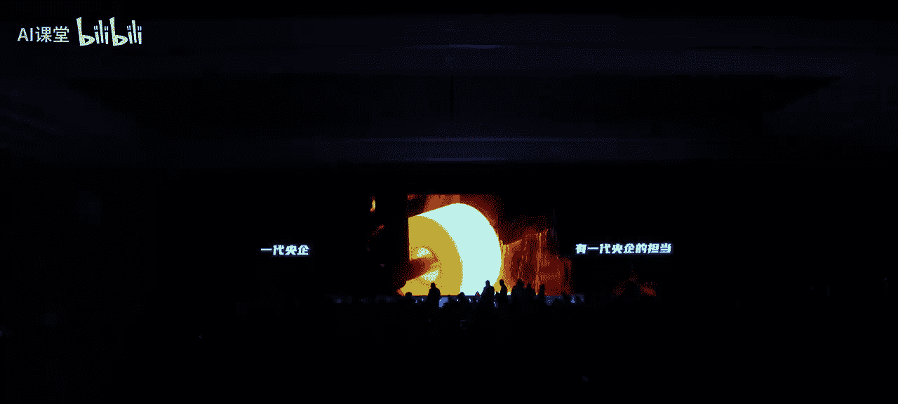
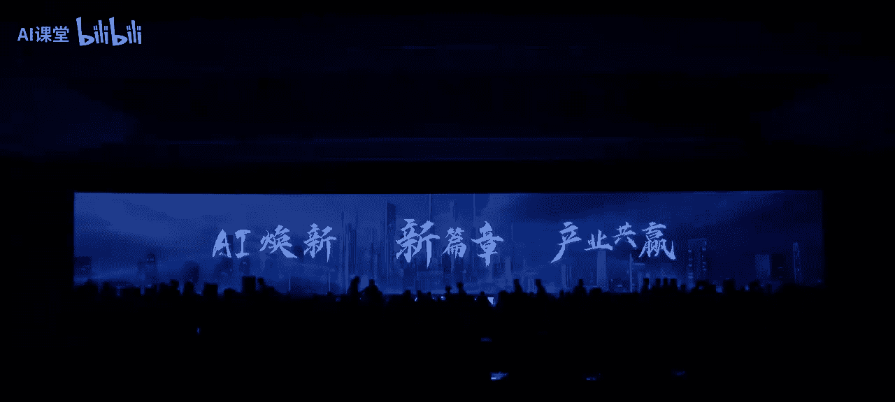
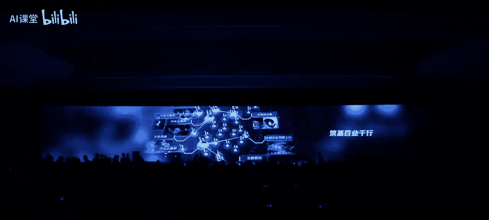
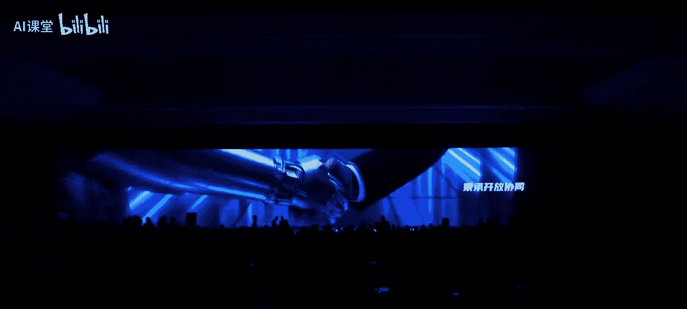
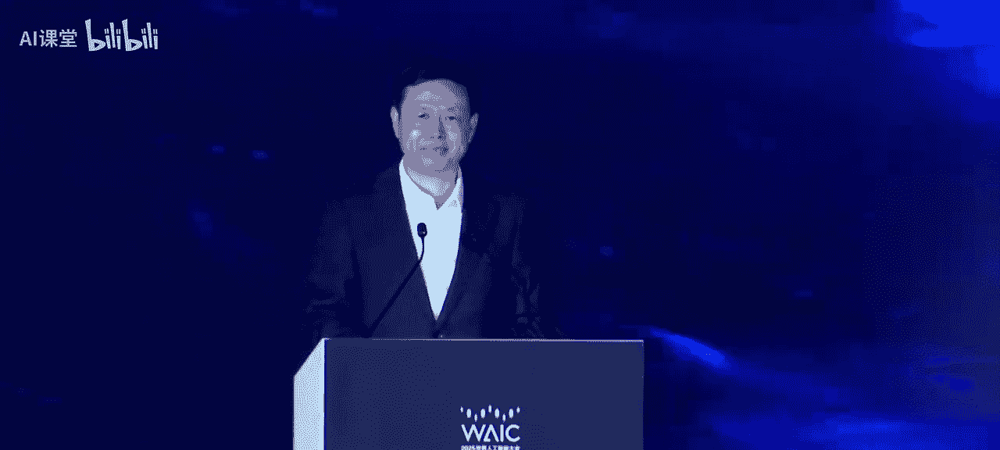
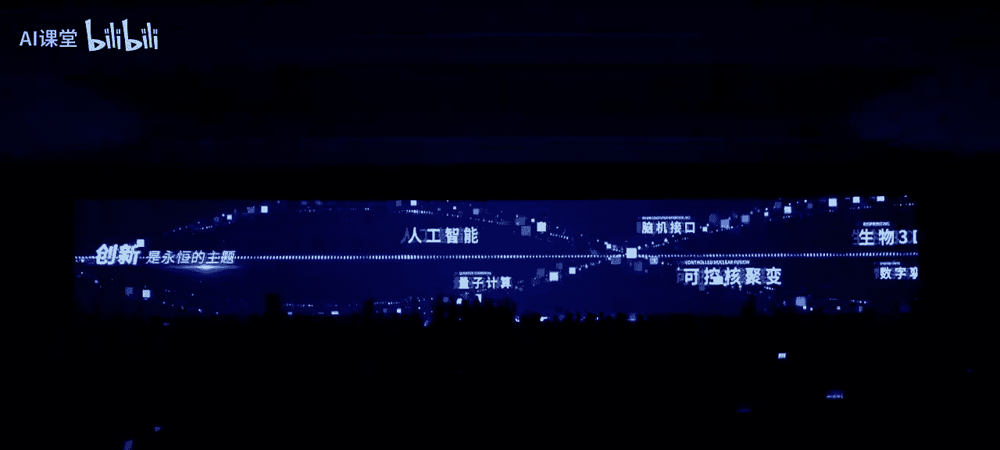
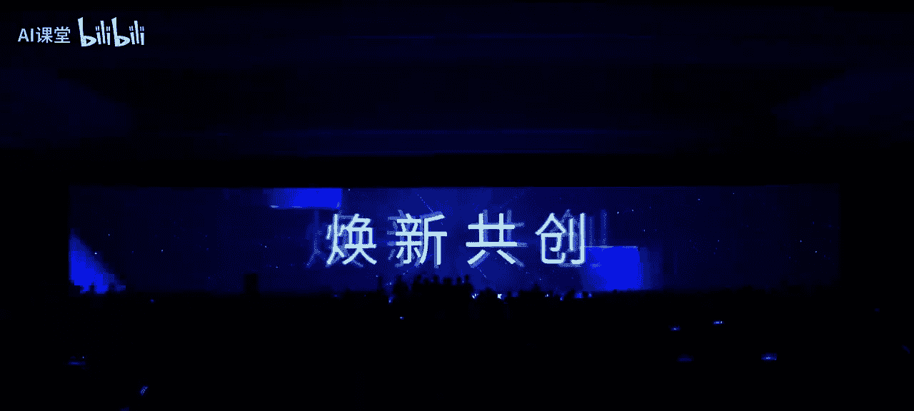
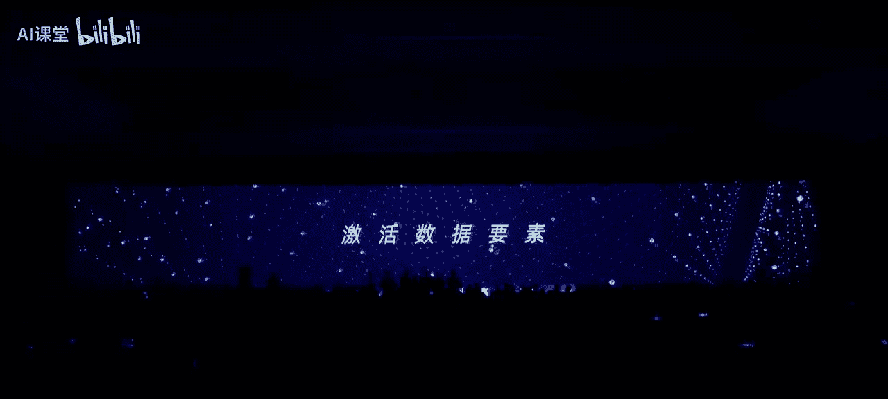
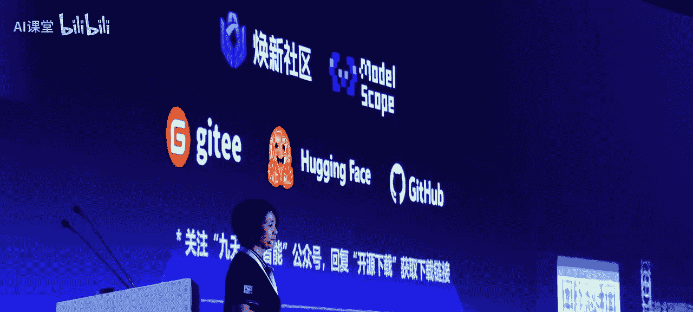
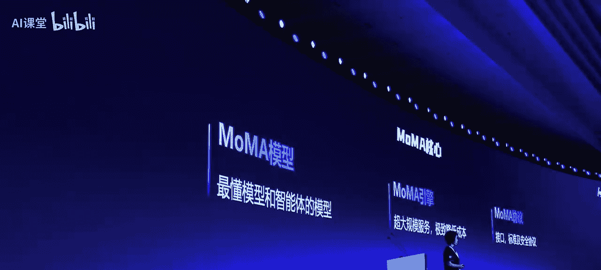

# 【2025 WAIC 世界人工智能大会—主论坛】人工智能全球治理高级别会议  Ai、开源、教育、Ai普惠、赋身智能、神经网络、超级智能 p09 9、“AI焕新 产业共赢”企业人工智能产业发展 -BV1Gx8gz3Er5_p9-

🎼一个时代有一个时代的使命。

🎼一代央企有一代央企的担当。

🎼央企血脉中。🎼流淌着创新基因。🎼以科技为比。🎼以创新为目。🎼共同书写AI换新产业共赢的新篇章。

换新破戒。治力。万物。🎼以算力突破技术穹顶。🎼用模型跨越科技天堑。🎼让数据点亮价值未来。🎼唤新无尽。🎼志启万业。

🎼深耕树脂重器。🎼驻及百业千好。🎼专注国际民生，守护千家万户。

🎼重塑科研赛事，智起时代新品。🎼秉承开放协同。

🎼共建产业生态。🎼写五州之首。时代愁头。🎼科技的火种。🎼逐梦航程。🎼用科技之光照亮逐梦征程。🎼用创新之力，澎湃复兴伟业。😊，浦江潮友智慧星河，尊敬的各位领导，各位来宾、女士们先生们，大家下午好。😊。

欢迎各位来到AI换新产业共赢企业人工智能产业发展论坛的现场。我是上海电视台主持人周俊夫，在浦江之畔，欢迎各位。😊，我们本次论坛是由世界人工智能大会组委会主办。

中国移动承办、中国石化、中国电信、中国联通、中国电子协办。🎼习近平总书记在中共中央政治局第二十次集体学习时指出，要充分发挥新型举国体制优势，坚持自立自强，突出应用导向。

推动我国人工智能、朝着有益、安全、公平方向、健康有序发展。为深入贯彻落实这一重要指示精神，中央企业正携手并进，依托各自优势，合力构建开放共享的AI产业生态。

推动AI技术在国家关键行业重要领域的深度融合与规模化应用。本次论坛旨在搭建一个汇聚智慧碰撞思想，促进协作的平台，共同破解AI产业发展难题，加速AI价值释放。

我们也热情的欢迎线上线下的朋友们共同参与这场思想的盛宴。欢迎大家登录咪咕视频APP关注中国移动9天人工智能中移科学视频号观看线上直播。那么本次论坛也得到了社会各界的大力支持。今天现场也是高朋满注。首先。

请我为大家介绍今天莅临现场的各位领导，他们是国务院国资委党委委员副主任李振主任，欢迎您。え。上海市委常委、常务副市长吴伟先生，欢迎您。

中国科学院院士、西湖大学交叉科学中心主任、国家自然科学基金委员会交叉科学部首任主任汤超先生，欢迎您。那么出席今天论坛呢。

还有来自各级政府、各中央企业、各行业企业、高校、科研运所、行业组织的领导和专家以及媒体朋友们，再次欢迎各位的莅临，欢迎。🎼首先让我们用热烈的掌声有请国务院国资委党委委员、副主任李振先生为今天的论坛致辞。

有请您。尊敬的吴伟副市长。唐朝远是。杨杰董事长，果平董事长，各位来宾朋友们，大家下午好。很高兴参加AI换新产业共赢企业人工智能发展论坛。在此，我仅代表国务院国资委对本次论坛的举办表示热烈祝贺。

对各部门、上海市及社会各界长期以来给予中央企业的大力支持，表示衷心的感谢。习近平总书记强调，面对新一代人工智能技术快速演进的新形势。要充分发挥新型举国体制优势。坚持自立自强，突出应用导向。

推动我国人工智能朝着有益、安全、公平方向、健康有序发展。国院国资委高度重视主要负责同志靠前指挥，连续两年召开中央企业AI家专题推进会，建设首批国资央企战略性、高价值场景库。

发布首批30个央企行业高质量数据集成成果。组织成立4个行业数据产业共程体，推动央企建立了4个国产万卡自算集群，不断升级9天星辰远景通用基础大模型，全面布局1916个重点行业80余个800余个场景。

取得积极成效。央企AI加专项行动开展以来。国资央企深化与各方协同合作，秉持汇聚众志、换新共创的核心理念，打造人工智能换新平台及开源社区，充分发挥央企场景优势，牵引产业链上下游，聚力构建开放产业生态。

深化AI科技创新。产业发展和赋能应用一会儿要正式对外发布。当前，人工智能正加快重塑全球产业格局，推动人工智能与实体经济深度融合，是必修课和必选项。本届大会主题是智能时代同求共济。

国资央企要围绕服务大战略，紧盯前沿发展态势，发挥资源和场景优势，坚持发展和安全并重，实现技术紧追加应用领航双向发力，协同各方力量，共同推进人工智能高质量发展。借此机会，我提三点希望和倡议。

一是进一步落地战略性、高价值应用，释放场景承受效应。要强化顶层设计，深度融合实体经济，挖掘建设战略意义强、经济收益高、民生关联紧的战略性、高价值场景。

打造人工智能加科学、生物医药、新材料研发、新型工业化、智能机器人等应用标杆。积极开放场景，同提共达共商共促，助力传统产业提质增效，开辟在新和未来产业新赛道，加快AI赋能千行百业。

推动盆景式试点落地到雨林市规模应用。二是进一步夯实基础底座供给能力，筑牢产业发展基石。要深度结合国家算利需要，统筹规划，适度超全布局，建设自算集群。对外提供更多普惠高效算利服务，要强化核心技术攻关。

加速构建自主可控、灵活调用的模型能力矩阵。基础模型紧跟前沿，行业模型深入垂直领域，打造差异化发展优势。要加快数据汇集管理，处理加工和多模态标注，发挥数据产业共同体作用，破题数据开发利用和开放共享新范式。

三是进一步建设完善开放生态，激发创新源头活水。要强化开源社区建设运营，在保障核心安全的前提下，面向中小企业、高校院所、科技爱好者。开放央企AI能力，分享应用经验，降低全社会AI创新门槛，提升社会影响力。

要积极深化创新合作，以接绑挂帅、定向开放、合资并购等方式推动产业外延发展。要加快人工智能走出去，加快与国际各类共同体。共建高能级合作平台，深度参与制定全球人工智能治理规则。

面向全球南方国家进行技术普惠和成果共享，讲好中国故事，拟合全球智能鸿沟。各位领导，各位来宾，人工智能带来前所未有发展机遇。国院国资委将一如既往的支持鼓励中央企业勇当我国自算基础设施的重要供给者。

人工智能。赋能千行百业重要破题者。产业体系布局的重要组织者。也期盼各方凝聚共识，集聚众志，汇聚合力，携手为我国人工智能产业发展谋新篇开心局贡献更大力量。最后，预祝本次论坛取得圆满成功，谢谢。

感谢感谢李真先生的精彩致辞，把掌声送给您，请您入席就座，谢谢。接下来让我们掌声有请上海市委常委、常务副市长吴伟先生，致次有请。尊敬的李正主任唐涛院士、杨杰董事长、苟平董事长。

各位来宾、女士们、先生们、朋友们，大家好，很高兴和各位相聚在AI加换新加产业共赢的人工智能产业发展论坛。共商人工智能时代产业高质量发展。首先，我仅代表上海市委、市政府。

向出席本次论坛的各位嘉宾表示热烈欢迎，向长期以来关心支持上海人工智能产业发展的各界人士表示衷心感谢。今年4月底，习近平总书记在上海考察时指出。人工智能技术加快迭代。正迎来爆发式发展。

上海要总结好以大模型产业、生态体系孵化人工智能产业等成功经验，加大探索力度，力争在人工智能发展和治理各方面走在前列，产生示范效应。上海牢记总书记嘱托，将人工智能作为重点发展的先导产业。

加快打造敏捷高效的人工智能创新策源地、赋能百业大模型垂类应用示范地，开放融通的产业生态集聚地。年轻活跃的创新创业，首先首选地和智能向善的治理合作先行地。持续推进人工智能产业跑出加速度。今年上半年。

我市人工智能产业同比增长12。3%，成为带动经济增长的重要引擎。近年来，中央企业突出发展新植生产力，在产业科技创新中发挥了骨干中间作用。展望未来，我们将围绕国家战略部署和人工智能技术发展趋势。

与中央企业和各类经营主体一道，持续夯实基础支撑，深化融合应用，完善生态体系。共同推动人工智能产业高质量发展走深走实。我们将进一步强化底座支撑能力建设，加快布局智能算力基础设施。

推进高性能算力框架和通用大模型体系建设，完善公共数据资源流通机制，支持中央企业和各类经营主体深度参与我市智算公共服务平台建设，共同为各类主体提供优质算利保障。我们将进一步推进关键领域的融合应用。

深入实施数模魔术生成。工程聚焦自动驾驶、巨生智能、科学智能等关键领域，以及制造金融教育等重点行业，打造高效能生产力工具。欢迎中央企业和各类经营主体拿出最强技术、最优场景。

与我们共同打造更多可复制、可推广的示范标杆案例。我们将进一步构建开放协同的创新生态。支持中央企业和各类经营主体深化于我市大院大所、国家实验室、高校科研机构以及重点产业链链组企业的战略合作。

加强与政府引导基金战略母基金、市场化风险基金的投资联动、共同营造支持颠覆性技术发展、潜力股企业成长的最优发展生态。各位来宾，上海将持续打造一流的营商环境，为中央企业和各类经营主体在沪发展提供更有保障。

助力各类经营主体在人工智能领域取得更大突破，共同书写智能未来的美好篇章，谢谢大家，感谢感谢吴伟先生的精彩致辞，谢谢，您请入席就坐，感谢。🎼朋友们，接下来我们进入高位引领环节。

掌声有请中国科学院院士西湖大学交叉科学中心主任、国家自然科学基金委员会交叉科学部首任主任汤超先生为我们带来AI for life science主题分享，有请您。啊，大家好。

非常高兴能有机会在这里跟大家分享。😊，AI加life science。啊，这方面我对这方面的现状前景，还有他可能会遇到的挑战啊的一些理解。哦，这是我的一个简简单的一个一个提纲吧。

那现在这个AI呢在过去几年就是井喷式的爆发，确实开创了一个新的时代。那去年的诺贝尔奖也给了这个啊两个诺贝尔奖都给了AI。一个是AI for science，就下面的就怎么把AI拿来。

推动科学研究、科学发现。但是呢可能更重要的是上面那个。就是AI背后的科学基础，没有这个长期的积累，现在也不可能有现在井喷式爆发。所以这个这你啊呃去年的物理奖呢。

就给了这个hofield跟hinton hintinton今天上午在开幕式还做了报告。这就是确实是一个时代的开始。那说到AF for life science，大家首先想到的肯定就是af fold是吧？

也就是说，现在我们可以把基因的序列。这个DNA序列放到阿 fold里面，它可以告诉你它产生的这个蛋白质的结构是什么。为什么这很重要呢？因为蛋白质是生命的基本的工作单元啊，基本工作单元。

我们把一个个基本的工作单元搞清楚，这点非常重要。他也非常成功呃，但是呢我要跟大家说的就是。他虽然非常成功啊，但是确也是万里长征的第一步。为什么呢？因为首先它的数据啊非常好，量非常大，而且精确。

线性的序列啊，基因序列非常精确。24亿条蛋白序列。他的任务呢也相对来说比较简单，他就是要预测给定一个基因序列，它的蛋白的三维结构是什么？啊，这个任务是相对的明确的，相对简单的，它的原理呢也是清楚的。

因为那个蛋白质的三维结构啊，就是它的最低的能量能量基态啊，自由能态。所以这个物理化学上呢也已经搞清楚了。所以呢这确实是万里长征的第一步。但是这一步非常非常重要，是一个里程碑啊，他也开启了一个时代。

那下面以后的AI for life science呢。会开启更大的啊更更大的突破，但是呢也会带来一些挑战。好，那这个现在这个AI for life science，比如刚才说的af food是吧。

它带给了我们什么呢？他带给了我们很多东西，举个例子，就是药物设计啊，因为我们现在很多药物靶点呢都是靶向蛋白的。你知道它的结构以后，如果你知道一个基B基因，你知道一个疾病和某个基因，某个蛋白相关。

然后你知道这个蛋白结构，你就可以设计小分子啊来靶向这个蛋白啊，这个在这方面呢这个阿呢起了巨大的作用。那最近这个呢呃诺贝尔奖得主啊也是因为阿它得奖之一啊，ddbaker。

他把这个这个阿e fold的这些东西啊，把它推广。它不光可以阿 fold只能预测蛋白的已有的结构，它能够一些无须的结构。它看见什么有结构的蛋白，这种蛋白也很多也很重要。它可以设计小分子来靶向这种蛋白。

啊，所以把这个应用场景呢大大的往前又推了一步。还有就是我们也经常听到的这个啊导机接口，也是AI forlife science是一个很重要的前沿。那在好几年前呢。

斯坦福大学他们就通过AI和读出人脑上面的一些电磁波来用意念来控制，可以写字。啊，他可以写出一个个字母来，这就是一个完全用一一个人，他自己的手啊都已经不能够动了，他就瘫痪了。他就想着这个字应该怎么写。

怎么写，所以一个个字就写出来了。哎，回去一下。啊，这个是这个啊我们国家最近的一个呃一个一个工作。就是也用意念的。来可以来玩这个游戏啊，可以来这个啊来来来来写汉语啊。

所以这个也是呃AI这一个很重要的一个进步。以后有了老机接口呢，这个东西就更容易了啊就更容易了。那还有就是这个这个AF life science啊，有很大的临床应用，现在已经把它用在很多方面了。

比如疾病机制的发现，新药的研发啊，这个合成生物学、生物的合成健康监测、早期预警、疾病诊断。那现在在比如在这个医学诊断方面啊，这个AI已经相当于专家级专家级水平了。就这个图像你要专家去看这个有没有癌症呢。

这个癌症发生到什么地步啊，现在AI已经是达到专家级水平了。那这个在过去几年呢，这个大模型呢出现了。那这个生命科学大模型呢也是迅速的迭代啊，从分子到细胞到组织不同的层面大模型。大家可以看到。

我们国家呢在这里面还是走在比较前面的啊。那现在这个再举一个例子，就是现在全球68%的生物制药公司啊。都在部署AI模型来做蛋白质结构预测啊，药物分子模拟等过程。

那呃估计呢今年这个全球AI医疗产业规模是200亿美元。那到2030年呢，按估计是要大于1600亿美元。那那边这个也是一个例子，就是以前啊没有AI的时候，我们发现一个新药。

把这个新药通过各种各样的这个实验临床，然后到用在病人身上。那可能需要10年的时间，10亿美元啊，现在通过AI呢可能可以大大的缩短几年就行了，而且百万美元就行了啊，当然这只是一些个例啊。

这个还没有说广泛的这个啊啊呃成为一个一个范式，但是呢已经是一前景已经是非常好了。那这个刚才是些现状，那前景是什么样呢？前景呢就是说我举几个例子吧，就是以前你看我你现在去看我们的生物实验室。

大概就是这样的，就是做纺式的啊，很多很多机器，很多人很多学生在那这个这个做各种各样的实验。😊，然后工作呢十分繁琐，效率也低。而且这个质量这个整个质量这个这个呃指控啊管理啊也都是非常的这个参差不齐。

那今后呢，其实现在这个已经开始了，就有可能和AI形成闭环成为成为一个全自动化的一个效率很高的一个自动做实验。AI自动分析。然后又自动实验验证，又进一步提出假设，然后AI又做实验啊，成就完全成为一个闭环。

这样就会大大加速。生命科学的发现。还有就是虚拟细胞啊，大家知道细胞是生命的最基本单元。我刚才说蛋白质是生物功能的最基本的单元，但蛋白质是死，它不是生命，细胞是生命，最小生命单元是细胞细胞可以复制。啊。

可以自我复制，可以一直生存下去。那有了AI呢，我们就可以做成一个虚拟细胞。就理论上把细胞里面发生的所有的。生命过程啊，它的化学反应，它对外界的响应。都用AI给模拟出来。那模拟出来，那这个用处就很大了啊。

比如最简单的就是说我们可以去生成药物，就是说假如我们要有有某些疾病，我们知道这个细胞的哪些地方出了问题，要靶向哪些蛋白或者哪几个蛋白，我们就可以去这个啊啊生成这个药物。还可以预测活性呃毒性。

现在这个药物毒性是一个很大的问题。为什么很多药过了很多年做临床实验又失败了呢？就是很多时候有毒性有副作用。这个东西要通过大量的细胞实验，动物动物实验，甚至到最后的人体实验才能够完成。

那有了这个虚拟细胞呢，我们只要把这个想象的药放在这个想象的细胞里面就知道它对这个细胞有没有毒性。那我们现在这个呃呃呃北京大学在成都有一个呃研究院啊，我们也是在做这个AFlife science。

我们现在呢就是跟中移动在合作啊，我们用我们在生命科学方面的优势。用我们自己设计的各种数据产生的各种数据和9天基础大模型结合，然后来微调，然后用到这个垂直领域，然后来做一个虚拟细胞。

还有就是这个啊刚才说虚拟细胞，你完全可以做一个数字人呢，对吧？就是你有各种样的数数据啊，基因组，你的你的基因转入组蛋白质组，各种主学大啊呃大规模的数据，加上影像数据，加上你的电子病例，你过去的病史。

还有你的行为啊，你平时生活习惯，这些东西呢都可以把它放到AI里面，然后来一个数字的这个孪生啊，就是你呢在计算机里面也有一个你。这样就可以监测，实时监测你的健康状况，你大概会出什么问题，你应该。

注意什么东西啊，这个就是说当然就是说这肯定就会完全的这个改变我们的这个啊啊这个医疗的一一个一个模式，是吧？但是呢也有很多挑战啊，这些挑战我们也必须面对。那挑战呢这个挑战之一就是说。

阿 fold的成功只是在最基本的分子层面的成功啊，我们这个生命系统呢是从原子分子、大分子、细胞器、细胞、组织器官、器官系统到人体一个各个层次，各个尺度耦合在一起的一个一个体系。这个尺度啊跨越10个量级。

然后每个层次呢都有自己的结构，都有自己的逻辑，而且他们互相影响啊，所以这是一个很大的挑战。还有啊就是说如何整合这个多尺度多模态的这个数据啊，这个数据呢也不是说单一的生命数据是各种各样的，怎么样把它整合。

怎么样把它对齐。现在呢有一些尝试，但是本质上呢还是没有解决。还有就是说生命是动的，是运动的，它是动态。我在讲话的时候，我我的很多细胞都很忙啊，是吧？脑袋也在动，心脏也在跳，它是一个整个运动的啊。

这些是这个那个是呃现成发育的这个这个图，这个是这个呃果蝇发音的基因表达的图，它整个是运动的，怎么样把这些东西。放到AI里面，让AI能理解它，来理解其中的因果关系。还有就是说这个呃啊架构啊。

现在大模型这个架构transformer是吧？这个架构确实很成功，在处理这个自然语言，而且现在也看见他在处理其他的各方面呢，也是有巨表现巨大的成功。但是。啊，但是在处理生命系统这个方面呢。

我觉得这个这个这个原来这个模型呢还是需要还是需要优化的啊，可能是不够的。我们需要新的模型。因为这个生命科学的数据啊是高度非线性的啊，多模态的，而且是运动的。所以这个东西呢就是用另外一句话来说呢。

就是生物数据与自然语言呢非常不同。就生命的语言与自然语言非常不同，需需要新的模型架构。那还有就是观察观观测手段和数据的局限性。我们自然语言的数据太多了，我们随便说句话，就是个自然语言，是吧？

互联网上到处都是。那生物的数据现在虽然很多啊，我们有测序啊，有成像啊、单分子啊、基因编辑啊、主主学啊。带来大量的数据，但是它确实还是局部的碎片化的。有很大的意制性，很大的噪声，还有质量问题。

所以现在有点像这怎么呢？有点像现代呃高科技版的这个盲人摸象。我们对生命科学啊就在局部啊某一个层次，某一个方面我们都可以看得很清楚啊，有很多数据，但怎么把它给整合起来，变成一个啊啊活着大象。

这个还是现在有点束手无策。还有这个在我们国家尤其严重。从今天上午，还有刚才领导讲的，杜其其实都强调了这一点，就是我们的数据缺乏共享机制。啊，我们我们的数据库建设严重的滞后美国跟欧洲。还有一个很大的挑战。

就是我们对生命的基本原理缺乏认识啊，缺乏认识。就是我刚才说的，我们现在都说大大语言模型，那什么是生命的语言？啊，我举个例子。就是如果这个大家呃学过热力学的应该知道。

就是如果有一个瓶子里面有很多分子器在碰撞了。大是你要仔细去看这些分子的话，它很杂乱无章啊，碰来碰去好像没有什么规律，是吧？反过来呢，它其实是有它自己的规律的，它有压强，有压力，有温度。

你可以把这个微观运动啊总结成一些宏观的变量。这些宏观的变量呢，它就有很简洁的语言规律可以表述出来。而我们对于生命科学呢看到的更多的是右边。缺乏的是左边啊。

所以我们现在生命科学大模型呢学的更多的是右边的东西。所以你可以想象，要它达到左边的层次呢，还是需要啊动点脑筋的。这就是另外一个例子，就是说我们现在比较熟悉的，比如说计算机吧。

他最微观的呃运动就是电子运动嘛。电子跑来跑去是吧？如果一个外星人来了，他想看看计算机是怎么工作的，他就去看电子怎么运动啊。比如他看的很清楚，他看了半天可能也琢磨不出来计算机是怎么工作的，是不是啊？

因为我们在不同的层次都有这个计算机的语言，我们有欧姆定律，有如逻辑门有编程语言啊？所以呢我们不能只盯着最下面这个东西。😊，觉得什么东西把它给放到我们的大模型里面去，都能够成功。好。

那这个东西是跟什么东西耦合在一起呢？就是说我们不光要把数据放进去，用AI来预测很多东西。我们更多的是下面要把这个AI的这个黑箱子打开，来发现这个规律，发现生命科学的语言，这样我们才能递推。

才能更好的创造出下一下一代的模型架构，才能发现更多的。更多层次的不同的生命科学的原理，从而做更好的预测。好，最后就是政策建议。这个AF forlife science是吧，我我前面其实这几个方面都讲了。

我就总结一下，就是说。这个这个生命科学呢生命上有不同的层次是吧？分子细胞器官人体简单说四个层次。然后呢，我们要有一个新的不断迭代的人工智能的模型架构。这个要针对生命语言的生命现象的语言逻辑。

针对它的自组织层级涌现、反馈机制、适应性等特征，构建呃构建它的一个这个这个啊模型框架。然后生物资源是生物数据资源体系是同样重要的啊，非常非常重要。就整合来整合不同来源的数据啊，建立数据共享机制。

选择性的产生高质量的新的数据集啊，原有的数据肯定是不够的。然后就是多模态多层级的一个融合。然后最后就是说不不断的来发现生命的语言，生命的原理来把它嵌入到我们的这个模型构架里面。

那这个就是说刚才我已经说了这个数据生态体系的建设呢啊尤其重要。啊，这个我就不不不不一一说了，因为时间关系是吧？这个就是在这里面这个啊在下一面一个呢，就是说我们现在正在建各种各样的大模型嘛。

生命科学大模型，这个是一个本质上是一个交叉学科的问题。就说一定要用人工智能啊，这个这个就是AI方面的，还有垂直领域方面的。比如在生命科学方面的，包括物理的数学的啊，是要大家联合公关，大家都来共同推动。

这个不是一个单一学科的问题，这是一个大交叉的问题。然后这样呢，我们才能打造持续可发展的AF science体系啊，这个就是说这又是一些我一些建议哈。我我我在这方面不是我对政策建议方面不是专家哈。

我就是我就比较这个抛砖引玉。就是可能就是这个啊避免很多重复建设吧，需要。然后我们需要长线布局，一定不能短视啊，一定要长线布局。😊，然后这个因为这是个国企央企的一个一个一个论坛哈，这个我也呼吁一下。

可以优化薪酬机制，可以吸引更多的优秀人才到呃国企央企。然后呢，刚才领导也说了，上午这个呃李呃李强总理也说了，我们一定要坚持开源的一个生态建设。然后我是大学的，然后我也在国家基金委啊啊担任职务。

所以我对教育还是觉得很重要。因为这个整个这个后劲啊还是要靠教育。所以我们这个交叉学的人才培养也是非常重要的。我们要培养下一批，既懂AI，也懂生命科学啊，这是AI加生命科学。

如果AI加其他的科学叫也懂那个那个科学方面的人才。现在是说AI的和生命科学的两边合作，当然可以做。但是以后我觉得做的更好的，做的更顺的是两个都懂的啊，这个这些青年人。

然后我们也可以通过国家项目来组建这一些团队啊，通过立项建立各种各样的这个人才梯队啊，当然因为我在做交叉学科很久嘛，大家呼吁的最多的就是说我们要改变我们的这个人才评价考核机制啊。

现在我们是还是以学科这个为中心。这个比较多。好，我就讲到这里，谢谢大家。好，感谢感谢汤圆师带来精彩的分享，把掌声送给您，谢谢，请您入席就坐，感谢。😊，🎼好，朋友们，接下来我们进入央企力量环节。

我们先邀请三家中央企业为我们分享他们推进AI加行动走深走实的优秀实践经验与丰富的成果。首先让我们掌声有请中国移动通信集团有限公司党组书记董事长杨杰先生。

进行主题为深入实施AI加行动全面赋能产业换新升级的分享。有请您。尊敬的李振副主任汤朝院士、苟平董事长、各位领导，各位嘉宾，大家下午好。

非常高兴和大家相聚黄浦江畔。共同研讨AI换新产业共赢的发展蓝图。呃，借此机会啊，结合中国移动的产业实践和大家分享几点思考。第一，勇立潮头，把握AI的变革方向。习近平总书记指出。

人工智能是新一轮科技革命和产业变革的重要驱动力量。将对全球经济社会发展和人类文明进步产生深远的影响。当前，人工智能不断取得突破式的进展。技术能力、经济效益。两个规模效应持续释放。

在语言理解、图像识别、高效学习等方面比肩甚至超过人类的水平。并以前所未有的速度深度融入经济社会的各个领域。开启了碳硅融合的文明新形态。创造广阔的发展新机遇。一是智能倍增，激发社会发展的新红利。当前。

以传感器、处理器、存储器和控制器等物理硬件为躯体。以计算智能、感知智能、认知智能和运动智能。为神经中枢的硅基生命，正迎来群体性的有限。未来，随着AI的智能终端、智能网联车、智能机器人等载体的广泛普及。

归及个体的数量有望超过全球人口的总量。成为社会劳动力和治理资源的重要组成，形成新的人才红利，出现新的360号。二是时空倍增，释放数十融合的新潜能。随着巨深智能世界模型、AI自主眼进等前沿方向的持续突破。

AI等新代信息技术能够更加实施精准的映射现实世界，孕育数字孪生工厂、元宇宙实验室等全新的场景。未来数字空间的容量有望达到全球陆地面积的数倍。推动社会发展的边界，从有限的物理世界到无限的数字时空拓展。

显著增强人类认识世界，改造世界的能力。三是效能倍增，点燃智能经济的新引擎。个性化的智能体、人机协作生产、分布式交易等新业态正在推动形成超大规模的协同创新网络。

驱动全社会资源配置的效率和创新速度的指数级的提升。加速智能经济的蓬勃兴起。未来智能经济。将成为数字经济的。高阶形态。有预测表明，智能经济有望推动全球GDP年增长率提高一个百分点。

为新智生产力的发展注入持久的动力。第二，奋己争先，筑牢数质发展的根基。信息通信业是支撑经济社会发展的战略性、基础性、先导性的行业。一直以来，作为信息通信领域的中央企业。中国移动立足不同的发展阶段。

积极发挥扁担效应，服务经济社会转型升级。在互联网加的时代。一头挑起了信息制造业，一头挑起了互联网产业。切实推动信息技术融入工作生活等方方面面。5G加的时代，一头拉动投资，一头促进消费。

不断加速信贷信息技术，从消费侧向生产侧的全面渗透。进入AI加的时代，中国移动贯彻落实国家人工智能家的行动要求。在国务院、国资委等上级单位的统筹指导下，进一步强化担当作为，发挥新的扁担效应。

在赋能经济社会数字化转型升级中，承担更大责任，展现更大的作为。一方面，牵引科技创新，突破一批AI原创的成果。一是加快大模型的攻坚，自主研发大模型跟技术，打造具备多模态能力。

行业深度赋能特质的9天通专大模型矩阵。并获评2024年度的央企十大国之重器。二是增强大算力的供给，建成了13个全国性区域性的计算中心节点。打造多个超大规模的制算集群，实现制算的跨地域灵活调度。

三是推动大数据的汇聚，构建支撑数据安全、高效流通的数联网。积电涵盖了24个行业，超过20万亿tkens的高质量的数据集。另一方面，带动产业创新，培育多元的AI的原生服务。一是推动AI加产品的规模落地。

依托海量的数据，丰富的场景优势，打造灵犀智能体，推动全量产品和服务嵌入AI为超过10亿的个人客户2。8亿的家庭客户提供新型智能信息服务。二是加速AI加DICT融入行业转型升级。

面向能源、水利农业等重点领域与中国石油、中国、中化等10多家央企开展了深度合作，落地超1000多个AI加DICT的项目。三是构建mice平台，赋能全社会协同创新。汇聚国内外优质大模型超300个。

数据集超过50个，应用工具超3万个，提供数据算力、讯推一体化的服务，形成龙头企业引领带动大中小企业广泛参与的AI产业发展的新格局。第三，换新共赢，开启碳硅融合未来。站在人工智能引进的关键节点。

中国移动将全面升级AI加行动计划，持续深化AI供给者、汇聚者、运营者的定位，不断推动科技创新和产业创新的深度融合，加快构建一流的人工智能全战能力，为经济社会高质量发展贡献更大的力量。第一。

着力锻造一流科技创新成果。一是突破核心能力，推动9天基础大模型升级为3。0版本。公关百万级的上下文解析、多模态、复杂任务的推理、行业知识深度理解等特色能力，打造技术领先、好用易用、自主可控的模型基座。

在今天的大会上，我们将发布全新的架构啊，具备万亿参数的。MOE大模型，同时推动多模态结构化的数据、语音等大模型的全面升级。二是创新技术架构，自主研发多模型和智能体聚合服务引擎模马。

实现大小模型、不同模态、各类工具链和智能体的自主选择最优配置，切实满足客户对AI低成本、高性能、优体验的需求。那么我们这次在大会的展厅啊，也设置了陌妈的演示专区啊，也欢迎大家现场去体验。

三是探索前沿领域，铆定AGIASI的长期愿景，重点布局智能体的网络、世界模型、AI自主眼镜等前沿方向，确保AI不仅能做事。还能做更复杂、更具创造性的事。第二，着力锻造一流的产业换新服务。

一是赋能千行百业。构建元宇宙数十融合的训练场。推动碳硅混编班组数字孪生工厂成为企业的标配，加速自主运行智能决策、全局优化的智能制造落地。二是惠集千家万户。

布局AI智能终端、智能网联车、智能机器人等新兴领域，丰富内容创作、健康养老、教育学习等智能服务，使人人都能拥有智。既智慧又贴心的归机伙伴。三是服务千城万村。打造智慧城市超能、创新高效精细的人机共治模式。

有力的支撑数字政府、智慧城市、数字乡村等多层次治理体系的构建，助力公共服务效能和科学决策水平的系统提升。第三，着力锻造一流的。研发创新载体。

一是成立中医九天人工智能科技有限公司暨九天人工智能研究院进步集聚高端人才创新资源，加速原创性技术突破、标志性成果的产出，培育壮大人工智能领域的国家战略科技力量。二是组建巨深智能产业创新中心。

打造开放协同创新平台，一体化贯通软硬件研发、应用转化、生态运营全过程。努力引领巨深智能产业的新赛道。三是设立人工智能安全治理研究中心。锻造安全治理的核心能力，健全AI伦理准则、全流程的监管框架。

助力构建中国特色人工智能治理体系。四是创建AI加新型工业化创新研究院。沉淀行业共性技术底座，打造行业标杆应用，更好的发挥AI对新型工业化的赋能作用。第四，着力锻造一流的开放合作生态。

一是构筑智能共创平台。设立AI训练评测产业创新的三大基地，组建国际科学智能联盟，加速跨产业跨学科的融合创新。二是打造AI换新社区。在国务院、国资委等上级单位的指导下。

联合国资央企AI产业链伙伴牵头建设并运营国家级AI开源开放的创新载体，面向全社会提供算力调度、数据处理、模型、讯推、应用开发的全流程的服务。带动国兴国模技术生态成熟。三是强化产业投资布局。

丰富链涨基金、直投等产投协同模式、系统布局、新型计算、计算、具深智能等前沿领域，推进参股企业供需对接能力共建，助力产业链上下游协同突破。回顾历史，作为第一次工业革命的核心技术，蒸汽机。

一方面通过齿轮的升级，实现了功率、稳定性等性能的显著的提升。另一方面，通过杠杆的引入，成为能够在工厂制造、铁路运输等多个领域广泛应用的通用动力源。进而带动社会生产力的显著提升。如今。

作为第四次工业革命的核心驱动，AI的发展正处在技术加速突破、应用全面落地的重要拐点。中国移动愿携手各界，打造AI加时代的新齿轮新杠杆。共创AI技术无人区，共育产业创新的试验田。共建探硅共生的新秩序。

谱写人工智能、赋能高质量发展的新篇章。为信息化推进中国式现代化贡献更多的力量。啊，最后预祝本次论坛取得圆满的成功，谢谢。感谢感谢杨肚市长的精彩分享，把掌声送给您，请您入席就坐，谢谢。😊，🎼朋友们。

下面让我们掌声有请中国石油天然气集团有限公司党组成员、总会计师周松先生进行主题为坚持自立自强、突出应用导向，全力打造人工智能加一流企业的分享，有请您。尊敬的李正副主任汤超院士、杨杰董事长、苟平董事长。

各位领导，各位专家，大家下午好。很高兴有机会分享中国石油推动人工智能科技创新与产业创新深度融合的主要做法和应用成效。我发言的主题是坚持自立自强、突出应用向导，全力打造人工智能加一流企业。当前。

新一轮科技革命和产业变革深入发展，全球能源与化工领域进入了科技创新密集活跃期，正在向更高效、更清洁、更智能的方向发展。中国石油立足国家所需、产业所需、企业转型所急，积极抢战创新发展新赛道。

深入推进以昆仑大模型为核心的人工智能加行动。着力以技术突破、模型普及、数据流通和生态繁荣，加速实现产业的优化升级。一、强化战略引领，全力打造高质量发展新动能新优势。

中国石油深入学习贯彻习近平总书记关于人工智能的重要论述，准确把握数字化、网络化、智能化、深入发展的时代大势，完善顶层设计，加强工作部署，深入推动人工智能赋能产业换新。一是加强顶层设计。

我们明确了深层厚重大气谦和的大模型建设总体原则，创新提出了四层架构设计理念，构建了1加4加N的架构体系，明确五大目标任务，设计了。实域百景千应用的全景视图，形成了三阶十步建设的方法体系。

二是优化战略布局，将数字石油纳入了公司的战略体系，布局实施信息化补强、数字化赋能、智能化发展三大工程，加快推动传统产传统产业加AI和AI加新兴产业协同发展。三是加强组织领导，定期召开领导小组专题会议。

组建了人工智能研究机构及工作专班。我们每三个月定期建立了定期的发布和迭代更新的机制。2、聚焦富能主业昆仑大模型建设取得了一系列标志性成果。中国石油与三家合作伙伴经过了多轮极致攻关。

昆仑大模型实现了高水平落地应用，成为首个通过国家备案的能源化工行业大模型。一是高标准训练行业大模型，采用混合装家模型MOE架构。融入能源化工领域、多元易购数据等多种技术方案。

形成了3000亿参数语言44亿参数的视觉，800亿参数的多模态的行业大模型，持续迭代勘探全领域专业大模型，创新研发，炼化持续专业大模型，昆仑大模型的知识问答、深度推理。

多模态内容理解与生成、科学计算等能力大幅提升。二是高质量构建能源化工行业的数据集。建立了行业专业场景、三级数据及管理机制，按需制定数据采集以与标注的规范73项。

研发用于解决复杂数据解析难题的专用数据处理工具。优化数据清洗标注与增强流程。我们数据集的规模达到了500TB行业知识的问答队100万个，行业推理问答队25万个。三是高价值落地应用场景，围绕突出主业。

体现价值、知识密集、语料丰富、技术可行五个方面，统筹开展创新突破示范应用。规模运用目前研发形成了能源化工行业代表性的场景。100个。地球物理勘探是我们找油找气的核心技术手段。

也是中国石油人工智能加行动的重要突破口。在地震处理方面，我们自主研发训练地震正反眼大模型，地震波波动方程求解效率提升了5倍，建模效率提升了10倍，游其勘探项目周期缩短超过20%。在地震解释方面。

以国内七大盆地5万平方公里、150TB3维地震资料为基础，训练形成具有构造解释、凤洞体预测、圆心体识别等功能的地震解释专业大模型。精准断裂识别是寻找油戏的关键。传统的断裂刻画受复杂构造和专家经验的影响。

工作量大，效率低。大模型可以清晰的解释，断裂与组合关系，效率提升10个百分点以上，显著增强了复杂区块油气勘探能力。风洞体识别是海象、碳酸岩岩等地层勘探的重要任务。传统方法。

凤洞体刻画受生层超生层大量干扰信息和低性噪比影响，识别的准确率低，大模型能够有效过滤干扰，清晰显现。裂缝的孔洞信息准确率达90%。在测警方面。公关多模态，多维度数据处理复杂。

多盆地多地层专家解释经验、传承困难等长期我们面临的难题，构建了万景一点的高质量数据集，训练具备储存划分。流体性质识别等功能的测警处理解释专业大模型。

在单井全流程处理解释中投入应用储存的关键参数预测识别精度超过了85%，工作时效提高了30%。以上这些技术的深入应用，有望将地质木礁评价效率提升10倍，为加大游戏勘探开发力度提供高效技术支撑。

复杂油气储存、人工改造和智能抽油烟机井生产优化等是油气厂开发的核心工作。这个工作在我们的大庆是看得非常明显的。在储存改造方面，实现改造参数与目标储存的最优匹配和自动推荐，储存改造设计效率提升3倍。

地质工程双甜点识别精度提升15%，堵塞预警准确率提高5%，单井累计产量提升10%。在抽油烟机井生产智能优化方面，围绕抽油烟机井远程管理、适时生产优化和无人值守需求，对抽油烟机井工矿数据进行微调与训练。

实现工矿智能诊断、单井智能计量和生产参数智能优化试点区块工矿诊断准确率达到95%以上，作业维护成本下降20%。生产实力提升10%。炼油化工是石油行业价值呈现的关键领域。

也是中国石油围绕产业链部署创新链的重点方向。在长减压装置智能运营方面，适时预测质量参数、优化装置的工艺操作参数，缩短长减压装置切换调整时长30%。精准控制加热炉等装置的温度，减少循环水蒸汽消耗5%。

动态诊断和预测大型动设备故障，预知性检修率提高5%，设备维修费用降低2%。在乙烷之乙烯装置工艺优化运行方面，构建了事时质量预测系统。

汽油干点、航煤98%点以及炼解炉出口温度等关键工艺参数预测精度均在95%以上，有效降低质量分析频次和人工成本，提高乙吸收率0。2个百分点。基于试点验证，单条产线经济效益超千万元，年减碳超15万吨。

在新材料研发方面，构建高性能橡胶大模型，开发全链路橡胶材料研发智能体，攻克分子结构设计、配方性能预测工艺在线控制等关键技术，突破传统人工试戳模式，对组分配方和工艺流程研发的局限。

橡胶分子结构设计及配方筛选效率提高20%，推动能源化工行业AF science取得突破。3、坚持价值驱动，努力在人工智能加具体实践中走在前列。面向未来，我们将全面贯彻党中央国务院决策部署。

认真落实国务院国资委AI加专项行动工作要求，深入推进人工智能科技创新产业发展和赋能应用，不断培育壮大新智生产力。一是着力攻坚行业大模型，牢牢把握人工智能技术和能源化工行业应用发展动态。

优化完善主攻方向和实践路径，持续提升中国石油在人工智能领域的技术应用能力。二是着力构建高质量行业数据集，充分发挥中央企业智慧能源数据产业共同体牵头单位作用，健全数据安全保障机制。

加快建立数据治理、数据及建设、数据流通等方面的统一技术标准，构建多方协同、共建共治的生态体系。Yeah。三是着力深化场景建设与应用，注重发挥数据资源丰富，产业体系完备，应用场景多样等优势。

驱动技术到产业的双向赋能，推动人工智能从单一领域的优化，向跨领域的融合与创新发展，打造形成一批具有行业示范性的创新应用。各位同仁，面对百年变局和科技竞争的时代大考，中国石油将以昆仑大模型为纽带。

与行业伙伴共建数字生态，共运创新动能，共筑自胜未来，为我国人工智能产业发展做出新的更大贡献。谢谢大家。感谢感谢周总的精彩分享，您请入席。

🎼接下来让我们掌声有请中国电子信息产业集团有限公司党组成员、副总经理王桂荣先生登台，进行主题为建设行业高质量数据集释放人工智能产业价值的分享。有请。好，尊敬的李正主任。唐朝院士。杨杰董事长，苟平董事长。

各位领导，各位嘉宾。呃，很高兴啊参加本次论坛。呃，我发言的题目呢是建设高质量数据集，释放人工智能的产业价值。今天呢重点汇报三方面的观点和中国电子在这方面的三方面的实践。第一个观点呢就是呃所有的产业界。

应该领导们都认识到的数据价值在信息化的时代。在数字化的时代，到了今天的智能化的时代，越来越重要。过去在信息化的时代，我们就提到了12分数据的重要性。那么现在看来，智能化的时代。

数据将在2028年公开数据耗尽。那么我们看呃数据训练，我们从。这个训练的s这个叫skiing law的变化，从这个算力。到训练里边的实验的要求。现在看，最关键的是数据质量的要求。

我们看数据也用到冰山一角，公开数据在海平面上面。那更多的数据的价值，还有未来数据对人工智能的要求，那么远远的还没有发掘出来。但是呢我们同时要看到我们当前人工智能的发展还存在一些问题。

那么这个我引用了一些数据啊，有来自于华为报告、腾讯研究院和信通院的报告。那总体上结论就是。行业大模型，行业AI的发展。完全或者是基本依赖于这个行业这个企业的信息化的发展程度。

我们看到过去几年受各种因素的影响，很多企业，很多机构信息化的投入在减小，信息化的项目也在减少。实际上这个与AI的要求是不太符合的。第三个观点呢，我更想表达的是AI的应用，更加依赖于数据的质量。和数量。

那么当前看来，主要存在两个问题。第一个问题是高质量数据集建设存在技术问题。这个技术部分电梯也不完全是技术问题。实像刚才唐朝院士讲了，共数据共享的问题。那么从简单从技术上来看。

我们存在建设数据集的质量差的问题，周期长的问题，成本高的问题，也存在规模小的问题。我们各行各业各个企业建设了很多的数据集。呃，说是行业数据集，其实是企业数据集。那么同时呢我们再看投入的问题。呃。

当前的投入，我我这个数据啊有的是来自于deep seek，有的我问了豆包，有的问了其他的大模型，也有参考了一些我们一些企业的组织。那15%投在数据上，百分之。呃，25投在算法和应用上。

大概百分之六十到70，实际上是在算力上。有一些企业干大模型，把80%的钱投在了算力上。那么结果是什么呢？结果是。这个并没有发挥。或并没有得到预期的结果，就是有一个wind啊数据统计的显示。呃。

做AI行业大模型的企业里边有79%，他认为是失败案例。但是这个失败案例我的理解是过去期望值很高。过去对AI的期望很高，但实践下来呢又没有达到预期的成果啊，并不是他完全不成功啊。

那么实际上这个原因造成的啊有两方面，一方面呢就是期望高。第二个方面，实际上我前上面一句话，打造的行业模型实际上不到基础模型增益的10%，就是得到的增益太少。那原因是什么？

原因还是没有训练出来你这个行业的行业模型的原因，就是数据的问题。我想这是给大家汇报的三个观点。那基这个三个观点呢，呃中国电子呢汇报一下我们过去几年的实践。那重点呢也是数据。

首先第一页片子呢汇报一下呃中国电子在AS方面的布局。呃，AI的布局呢可以分为很多层啊很多层。我今天的汇报简化一下，有4层基础软硬件，中国电子在干。那么基础大模型，中国电子一直没有干。

在行业数据及和行业大模型上，我们主要在干。那么行业应用上，我们也做了一些设计。那基于这个布局呢，我们这个这段时间以来啊，总结发布了中电缘起。呃，这样1个AI的解决方案。那么也是围绕着我们自身布局的能力。

同时呢我们感觉到AI是一个大的生态。所以我们自己在没有的地方，我们跟芯片我们跟云生云商啊，包括我们呃移动云天翼云联通云哈。那么还有我们的技术大模型啊，今天讲的飞天啊这个这个星辰啊啊呃等等呃合作。

还有远景合作。那我们是希望呢为客户提供一个呃整体的有竞争能力的解决方案。那下面呢我就展开三方面的汇报。第一方面呢是中国电子的软硬件产品啊全面升级拥抱AI过去呢大家都知道。

我们是有一个PKS啊有这么一个说法。呃，飞腾的芯片麒麟的操作系统和安全啊，前新的安全。那么这几年来我们做了全面的升级。从芯片方面有桌面。芯片有AI的能力，集成了这个NPU的算力。

还有服务器的芯片也研发出了AI的芯片呢，实际上我们已经规模出货。啊，那么服务器里边也基于飞腾的最新的芯片呃加国产的GPU组成的AI的服务器，还有是400G的网口的AI的交换机就是适合AI训练的交换机。

这两个产品，服务器和交换机呢已经在一些客户里边啊得到了呃商用的拓展，就是不是一个案例，两个案例哈，有十几个案例已经在用。那么同时呢操作系统数据库围围绕人工智能做了全面的升级。

那么升级的AI能力为面向本地的支持哈，面向向量数据库的支持。这是我们在软硬件的升级。第二方面呢，重点汇报一下。中国电子在国资委的指导下承担的这个高质量数据级的任务。那么重点呢我们的体系是1加1加1啊。

建设高质量数据集。那么很多。很多专家领导都说数据集。今天呢我展示了一下，因为我在讨论材料里边发现很多的人没有见过数据集啊，数据集这个所以展示了两个。

我们是把原始的数据加工成文字的问答对和图文的问答对的这个数据集，加工成数据集里边有一组工具。啊，有一组评测的数据指标，最后形成一一份我们自身的合成的能力。那中国电子在做这个数据集的时候，追求三个价值。

第一个更快一点就自动化。第二个是更多一点。合成数据。第三个是更全一点。刚才这个院士也讲到，唐山院士也讲到，我们现在。包括上午啊有一个院士，有一个领导来讲呃，数据共享的问题啊，更全一点就数据共享的问题。

怎么把跨企业主体的数据变成跨一个行业的数据。那么第一个就是自动化加工更快一点。呃，安全一点。那么我们从劳动密集型走向知识密集型，把算子。这里边流程很多，关键是算术的开发，把行业的知识。变成算子。

变成自动化。那么总体的结果来看呢，把过去100个人或者30个人干30天的工作，现在是三个人干3天，而且呢质量上能提高30%。我们有一个案例呢，就是161条的数据自动化率达到了90%。

第二个呢就是我们的安全能力。呃，大部型在训练里边也存在很多问题，有三个安全数据泄露的问题。业务中断的问题，还有一个是依赖误判的问题。那么我们把关键的数据放在一个轰炸里边，然后呢从权限从数据的可控里面啊。

从风险控制上进行一些处理。第二个呢是数据合成的问题。201828年公共数据没有了怎么办？那么要做数据合成，数据合成呢还能破解一些数据稀缺数据隐私数据标记难的问题。那么数据合成技术啊各方面都来讨论。

那中国电子呢采用知识引导和与对齐的技术。那么生成了4000万对的呃万的图文队。那么这个图文队呢，这个数据也得到了呃上级的认可啊，质量还是比较高。我们是希望在未来的训练里边能够为各行各业做出贡献。

第三个呢是更难一点的，就是行业模型训练的融合问题。呃，刚才讲我们现在都是企业级的小模型多一点。所以呢我们训练出来得到的结果比基础模型高了不到10%，那怎么办？需要联合训练。联合训练呢一直在探索，实际上。

当前并没有一个成熟解决方案，中国电子正在研发。那我们希望三季度能够推出来解决多元。多元数据主体共建大模型的问题。那主要的特点呢是我们数据不处你企业的控制范围。还是你的数据还是你控制。

但是我们把模型的权重进行合并。合并完了以后，多家企业共建一个大模型，谁的数据都拿别人都拿不走，谁的数据别人也看不见，中国电子也看不见。但是呢这样的话，但有一个。这个这个前提还是有的。

就各企业要采用相同的积模啊，同时进行一定控制下的训练。那么在这里边，中国电子也有一个评测能力，也会在整个多元数据里边得到应用。那第三个方面呢，汇报一下中国电子在呃信息化方面与AI融合。

前面汇报了我们的软硬件能力的。拥抱AI那么我们有数据能力进行提升，有行业大模型。那最终呢我们要体现在AI的agent和传统的信息化应用的全面整个方面。过去的信息化是。架格也很多。

我今天就把最上层拿出来看。就是GUI的一个讲一个展示页面，是图形交互，我们是鼠标的点击的。那么现在的大模型A正态来了以后是语言的交互模式。LRUI那么将来在正在做的智能体agent要把它融入啊进来。

那当期我们认为是把agent要融在信息化系统里面。所以这个也是说如果信息化系统不行。信息化系统的技术打的不好，是很难融入，很难发挥大模型的能力。那么我们也有一个案例。

这个案例呢呃是在一个航司表达了我们把它的企业的知识PDF的也好，word的也好，excel的也好，还有一些数据库的也好，通过呃知识库的加载和拆分和向量的提取，能够在这个数据问答里边起到了比较好的作用啊。

今天我看有一个企业家来讲，它的数据分析90%用到了AI那中国电子在这方面也取得一些比较好的时间。实践成果也希望能为我们广大的客户的这个信息化的升级和智能化的结合做出我们的贡献。好。

最后呢欢迎各位领导和各位嘉宾到中国电子的展厅莅您指导。好，谢谢大家。好，感谢感谢王总的精彩的分享，谢谢您请入席。感谢。😊，接下来我们将进入激动人心的产业赋能发布环节。

为进一步构筑我国人工智能科技创新的战略载体，推动人工智能跨产业跨学科深度融合，激发全社会AI创业热情，释放AI创新活力。我国相关部委指导国务院国资委统筹推进。中国移动牵头建设，聚合央企合力和产业链力量。

共同打造了面向全社会的AI开源开放、创新平台、人工智能换新社区。那么今天，社区将正式发布。首先啊让我们通过一个短视频来全面了解人工智能换新社区，请看大屏幕。

🎼科技是破局的钥匙。🎼创新是永恒的主题。

🎼习近平总书记指出。坚持自立自强，突出应用导向。🎼推动我国人工智能朝着友谊、安全、公平方向、健康有序发展。🎼响应总书记号召，万新社区以汇聚众植。🎼先共创为目标。

🎼坚持开放协同，共建共治。🎼中立。🎼安全合规。让国家战略资源。🎼成为科技创新和产业创新的智慧沃土。🎼汇算力汇聚专属千卡国产算力，破解中小企业算利难题。🎼展模型央企行业模型优先开放。🎼构建积极梦想生态。

🎼据数据开放高质量数据集，打破数据孤岛。🎼激活数据要素。

🎼无产。🎼携手国产欺片厂商，加速国产化研发进程。场景。传递央企。🎼场景。🎼推动供需精准对接。🎼实现同体共。🎼新社区。🎼以开放之思。🎼英才。🎼重击之持。🎼时代。🎼邀全球伙伴。

🎼おしだ。🎼共会科技未来图景。🎼让中国智慧为人类文明进步。🎼注入拥。🎼好，朋友们，下面让我们用热烈的掌声有请首批共建单位代表共同发布人工智能换新社区发布嘉宾有中国移动总经理党组副书记何彪。

中国石油总会计师党组成员周松，南方电网副总经理党组成员吴晓晨，中国电信副总经理党组成员黄志勇，中国联通副总经理党组成员郝立谦，中国电子党组成员副总经理王桂荣，GTI主席、中国移动科技委副主任高同庆。

智源研究院理事长、北京大学教授黄铁军、国创中心总经理熊友军，中国信通院副院长魏亮，中新通讯高级副总裁张万春，华为公司副总裁孙。🎼宝成百度公共事务体系副总裁徐然，腾讯云副总裁刘玉勋。

阿里云智能集团副总裁庞孝刚，海关公司副总裁高明。🎼穗源科技创始人董事长CEO赵立东、天树智鑫副总裁邹轩，摩尔县城创始合伙人执行总裁王东。

木溪副总裁陈建明、智朴华章董事长刘德兵、硅机流动联合创始人、首席产品官胡建，海天瑞声联合创始人CEO李科、绅士科技合伙人、高级副总裁李琴，掌声有请各位登台有请。🎼同时。

我们还将特别邀请到国务院、国资委党委委员、副主任李振先生见证发布，有请各位。🎼来有请各位嘉宾登台。🎼有请各位嘉宾移步到我们的发布关注之前。🎼好，请各位发布嘉宾将各位的右手放到我们的发布关注之上。

🎼朋友们，我们一起来倒计时。🎼3。🎼2。🎼一请发布。🎼朋友们让我们用热烈的掌声祝贺浣新社区正式发布。来请各位嘉宾，我们一起目视前方合影留念。🎼好，再次感谢各位，谢谢谢谢各位嘉宾为我们发布了换新社区。

请各位若席就坐，感谢。😊，🎼好，接下来我们将继续发布，为建设国资央企战略性高价值场景库，充分发挥需求规模大、产业配套全、应用场景多的优势。

国务院国资委遴选出首批战略意强经济收益高、民生关联紧的40个场景，涵盖了能源电力、工业制造等16个重点领域。那么接下来我们先来通过大屏幕来揭晓首批中央企业、人工智能、战略性、高价值场景，请看大屏幕。

🎼Yeah。

🎼，🎼这些场景是从众多优秀实践当中遴选出来的标杆典范，代表着人工智能技术深度赋能行业加速转型发展步入了新阶段。那么接下来我们将有请央企代表嘉宾分批上台，共同为我们开启这一价值篇章。

展示这些引领未来的精彩实践。朋友们，让我们掌声有请中国传舶中国移动、中国远洋海运。🎼中旅集团、中核集团、航空工业集团、中国电科、中国石油、中国石化、中国海油、国家广网集团、国家电网、南方电网、中国华电、国家能源集团、中国电信、中国联通、中国电子、中国一汽、中国保姆。

有请各位登台，有请。🎼同时，我们掌声有请国务院国资委规划发展局副局长胡武杰女士，中国国际技术智力合作集团有限公司党委副书记、董事、总经理王晓梅女士登台，与企业共同发布。有请。🎼好。

有请二位领导移步舞台中间，和我们首批中央企业人工智能战略性高价值场景的代表一起合影留念。我们再次把掌声送给各位。🎼再次祝贺各位。🎼好，谢谢请二位领导留步，感谢我们的企业代表，请各位入席就坐。

请二位领导分别步入舞台的两侧。🎼谢谢。😊，🎼好，接下来我们掌声有请。🎼中国钢研、中国煤炭科工、中国中化中粮集团通用技术集团、中国建筑、国投招商局集团、华润集团、中国商飞、中国节能。

🎼中国有色中冶集团、中国中车集团、中国铁建、中交集团、国药集团、中国航信、中国物流、中国铁塔掌声有请各位登台，有请。🎼好，我们再次有请二位领导和我们的企业代表共同发布。有请。🎼好。

请二位领导再次移步舞台中心，和我们的企业代表一起合影留念。🎼来，我们一起目视前方。🎼把热烈的掌声送给各位。🎼好，再次感谢各位，祝贺各位，谢谢请各位入席就错，感谢。😊，🎼谢谢。😊。

🎼中国移动深入贯彻落实党中央关于加快发展新一代人工智能战略部署，面向人工智能科技未来新的发展定位，主动深化战略布局，加速推进人工智能科技创新，重组成立研发运营一体的新型专业化机构。

中移九天人工智能科技有限公司暨九天人工智能研究院。那么接下来我们通过一个视频，一睹中移九天公司九天研究院的风采，请看大屏幕。🎼AI浪潮澎湃激荡。🎼5000年文明沉淀的高度。🎼让我们每一次眺望都穿越时空。

🎼在中国的答卷上。🎼我华人工智能的未来新章。中国移动。勇担人工智能国家队使命。🎼成立中移9天公司和9天研究院。🎼锚定世界一流AI科技创新公司定位。🎼为培育新智生产力贡献央企中坚力量。

🎼中银九天公司九天研究院。以一流的AI核心技术原始创新。🎼构筑国家战略科技力量。🎼以一流的大模型搭平台。🎼为战略领域和关键行业提供全方位基础供给。🎼以一流的摸马引擎。🎼荣聚产业合力。

🎼共汇AI全要素运营蓝图。🎼向内伸直智慧基因。🎼加速数字化运营。🎼创新智能原生产品。🎼锻造中国移动AI加发展的价值倍增器。🎼对外升华智慧赋能。🎼创新智能服务反式。🎼构建开放供应生态。

🎼铸就千行百业AI加跃迁的核心驱动力。🎼9天，以中国科技创新力量与定义未来的先行者创造智能时代的。🎼新天地。🎼善志者。动于9天之上。好。

🎼就像我们在视频当中刚才所看到的在中国的答卷上破画人工智能发展的未来篇章。朋友们，那么接下来我们就将进入中医9天人工智能科技有限公司暨九天人工智能研究院揭牌仪式。

让我们用热烈的掌声有请国务院国资委党委委员副主任李振先生，中国移动通信集团党组书记董事长杨杰先生，登台为我们共同揭晓，有请二位。🎼来，有请二位移步到我们的。🎼幕布两侧。🎼现场的朋友们。

我们一起来倒数三声321请揭牌。🎼好，让我们把掌声送给中意9天人工智能科技北京有限公司9天人工智能研究院正式亮相。🎼好，谢谢再次感谢二位领导，谢谢请二位入席就坐，感谢。😊。

🎼中国移动在构筑经济社会智能化引擎方面取得了重大的突破，那么更显著加速了AI加战略，在各行各业的深度融合与广泛的应用。接下来让我们掌声有请中国移动通信集团首席科学家冯俊兰博士。

为我们发布中医9天公司G九天研究院的最新创新成果，掌声有请。非常高兴，也非常感谢刚才呃两位领导呃在这个舞台上呃，正式宣布了9天人工智能有限公司和人工智能科技公司和9天研究院的成立。

那我们也是经过12年的发展。在这过程中得到了呃在座的各位领导和线上的各位领导、专家科研院所，我们的合作伙伴，我们的客户的大力支持和厚爱，非常非常感谢大家的陪伴。

那今天我也非常有幸给大家汇报一下我们最新的一些技术的进展。😊，首先刚才杨董事长也提到9天系列大模型的这样一个全面升级。那我解释一下，升级到3。0，它意味着什么？啊，9天的模型分为各种类型。

包括语言的、多模态的混合的，还有我们的结构化数据的，也包括多种尺寸。呃，从EB到万E。啊，也包括多种类型的模型架构，包括稠密模型以及MOE的模型。那我们全面升级到3。0。

那9天的模型继续维持了它延续了它之前的几个明显的特征。第一就是高安全、高可控、全国产、覆盖全行业。那我们呃比人工智能技术发展更快的是我们的测评。

那测评的数据及测评的方式也在翻新月异哈呃指导着引领着AI的发展。那我们也去对标了业界先进模型最近发布的这些榜单。那给大家简单看一下，因为数字都是比较冰冷的哈。第一部分就是他综合的语言的理解能力。

第二部分是他的数学能力代码能力，以及我们的深度推理能力。上午呃亨博士也提到推理是智能的一个核心哈。还有就是GUI智能体，就是我们在手机端还有我们在外部端及操作界面完成任务的这样一个能力。

那9天也是在呃多个榜单上取得了非常优异的成绩。那我们和业界很多优秀的模型，在许多方面也还有差距。😊，呃，接下来我讲一下我们在视觉方面的几个榜单，包括图的理解，视频的理解。呃，比如我举个例子。

像OCR bench，它就是来测量在你一个呃视视频和你的图片当中，怎么去准确的把文字拿出来的这样一个能力哈。那我们目前所公关的很多能力，也是我们在各个行业深层落地当中遇到的一些非常实际的问题。

需要去解决的这些幻觉的问题。呃，刚才的榜单呢，大家可以搜索9天公众号，就可以下载刚才的榜单的很多细节啊。接下来我给大家讲一下里面的一个特色。刚才我讲到安全可控全国场全行业。

那里面的一个非常重要的特征就是可控。不管你驾驶着飞机还是你驾驶着汽车，不管你的汽车多么好。它其中很重要的特性就是它要一定要能够被你非常精准的控制。那我们知道现在大模型的其中的一个呃很大的问题。

就是它的幻觉。我们经常说人工智能经常让我们眼前一亮，同时也经常让我们眼前一黑。那我们在行业的生成落地当中，我们是不能够容忍呃这些呃一黑的这些时刻，幻觉的时刻，高概率的发生的。所以我们在语言的可控生成。

视觉的可控生成，还有我们结构化数据的这个生成当中呃专项的做了很多的公关。那因为展示这些技术，可能呃不像交互智能那么容易。所以我接下来就用视觉可控给大家感受一下什么叫。😊，可控。大家看第一个哈，这个球。

我们经常说世界向我们走来，世界能不能向我们所期待的轨迹向我们走来哈，这样你可以画一条线指定它的运动的轨迹。第二个，大家现在看到的是个原视频，就是可爱的这个rait。然后现在是它的续写。

然后这个方向也是现在AI的进展的一个很重要的一个领域，就叫open的 AI就是以前我们的AI都是在有限世界中学习。我们现在用AI来探索呃，像人类进化一样去探索你不可知的未来。😊。

第三部分是用我们呃我们通常比如说我们拍视频，我们拍图片，我们会控制我们的相机，我们的位置。这里就是来通过相机的角度，就是模拟相机的角度来控制你要去生成的这个视频。呃，大家看到这是一匹呃美丽的白马哈呃。

然后可以把白马王子从这个图片中删除掉，这样这也是一种控制前景的方式。第四个部分就是我们可以去换实体，就是在你前景中的实体去更换。大家可以想象在我们的很多产业环节当中，这个可以替代掉我们很多的设计师。

我们很多核心的需要高可控的一些呃产用景。那接下来我想呃今天的主题也是换新平台，刚刚发布了换新平台啊，然后我们这么多年的人工智能的技术发展，也非常得益于我们大量的开源技术。

那这次我们也是专门为呃开源做了三款呃9天的基座模型。那因为我们的呃基座模型已经在大量的商业场景中落地。所以这个这今天我刚才讲到的我们开源的模型是专门为开源社区打造的啊。

那我们呃今天呃已经在开源社区放了我们的结构化数据大模型。😊，也就是我我们在我们大量行业中，我们行业留存的很多数据，包括刚才汤老师讲到的很多数据，它是以数值形态存在于我们的数据表、数据仓库。

我们的数据库数据服当中的那怎么从这些数据中提取智能，并用智能化的技术来更好的做数据分析，数据的感知，那就是结构化数据的模型啊，数据模型和代码模型。那这三个模型，我们说既然要开源。

它就要是搜他那这个三个呃这个模型也是做到业界最好啊，后面我们在8月份呢也会呃有专门的技术讲解给大家解析模型背后的技术。那同时我们也开源了我们结构化数据的呃评测数据数据集以及它的评测体系。

行业场景的这样一个数据的评测体系。然后刚才讲到刚才刚刚发布了换新社区哈，那这些模型和呃数据还有评测体系也开还有代码，也开源在这些大家非常熟悉的这些社区上面。

啊，大家可以扫码就可以呃关注这些模型的一个细节和下载的地址。因为呃写在这个片子上也比较难记住哈。所以我们大家如果关注9天公众号就可以拿到。

然后我们后面也会做呃每一个模型都会有详细的技术报告和后面的那个技术解析。😊，呃，接下来大家也看看说那我们做了这些模型，它用在什么地方哈。😊，我们在座的很多的合作伙伴也在现场呃，那我们现在9天的模型。

9天的平台，服务了我们国家非常多的重点行业重点领域。我们的政府医疗金融等等方面哈呃也期待在呃今天9天跨入一个新的时代，也是一个新的台阶之后，能够更好更广的跟大家合作。

那接下来前面同上讲到的我们的mo码技术，我给大家讲一下什么是momamoma就是mixmix of models and agents，就是模型和智能体的一个一个混合。

那为什么要做这个那中国移动在呃我们走向通用智能化时代中，我们有三个定位，一个是智能的供给者，那要供给模型供给基础平台，供给基础算力，供给数据。第二个就是做汇聚者和运营者。

那我们怎么我们相信将来智能化一定成为一个泛在普世。非常低成本的这样一个服务。那么怎么把运营者做好？我们讲一下moma技术就来支撑这个的哈，我把moma的定义给大家念一下啊，后面会有白皮书出来呃。

Moma也就是模型与智能体聚合及服务的引擎。通过标准化的接口，自动感知、探索各类模型智能体和工具，实现动态路由智能规划精准的调度，提供高准确、高安全、高可靠、高效能的大模型推理服务。

那把刚才我讲到的各种模态，各种尺寸的9天模能混合在一起。我们在我们规模化的业务中，可以看到推理成推理速度，也就是推理成本的大幅下降。啊，那尤其在数学代码这些点型场景当中，它的速度提升达到134%。😊。

呃，那mo马的核心包括三个部分，一个是mo马模型，就是最懂模型和智能体的模型，就来他来探索呃学习每一个模型和智能体的呃智能边界。呃，什么是他最擅长的，以及它的成本以及他所熟悉的他所适余的算网资源。

那第二部分就是mo马的工程引擎。第三部分就是mo马的协议呃。

那这个就是我们在有大量的模型哈，现在大家知道在h face上，我们的开源大大模型的开源模型大概有100多万。我们的大小模型有几千万。那你我们就处于这样一个模型的海洋当中。

那我们怎么去了解我们海洋中当中的每一滴水，每一个生物。那9天这个我们就会基于基座模型来探索我们这些已经在各种社区，还有我们在商业环境中的这些模型。然后通过这样一种探索的过程来动态的构建模马模型。

这个模马模型就会做刚才说的很好的去路由探索规划监控和辅助。那在工程方面呃，和业界，比如说大家用的比较多的react引擎，它的比较的话，我们会呃更加快速。然后它是一个分层的路由，呃。

也是去中心化的一种管理模式，它也会动态的去洞察和辅助监控。然后给大家演示一下，在真实的场景当中，moma是一个什么样的呃发生的一个作用哈。大家呃看大概呃几十秒的这样一个视频，感知一下。😊。

🎼帮我查一下周六上海的天气。🎼白天天气小雨，夜间天气小雨。🎼帮我定个日程，25号北京出发去上海参加WAIC27号返程。🎼好的，已经安排25号15点55分出发去上海，提前10分钟提醒。

🎼订北京到上海的机票，顺便推荐几本适合长途飞行看的科幻小说。🎼海底两万里，如乐凡尔纳的经典之作，充满奇幻色彩的冒险旅程，生成一张蓝色科技感的背景。

🎼图片的中间加上蓝色发光粒子星球楷体配文AI换新产业共赢。🎼用HTML创建关于以上内容的介绍网页。那后面大家看到右侧的某马展示，就是在使用过程当中，你会看到你真实的成本，对算网资源。

对算力模型的一个成本的要素。呃，接下来我呃在刚才呃前面的介绍材料，还有董事长的介绍上面，我再补充给大家解释一下9天中移9天人工智能科技有限公司以及9天人工智能研究院的一个定位和愿景。啊。

那我们也希望我们去把基座模型和基础平台做好。呃，希望9天公司也是公司给我们的定位，成为一流的自主创新成果转化的这样一家科技型公司9天研究院能成为一流的AI核心技术的原始创新之地。

那新随着这个新的公司新的成立，我想过去的一切都是序曲。今天我们走入新的篇章，我们以更新更领先的一种机制，更灵活的一种机制，就更优秀的人才，更广阔的平台，呃，更开放的合作，更大的热情。

期待跟大家走向更远的未来。那呃善志着动于9天之上，人工智能不只是冰冷的数据也不只是冰冷的。最后呃给大家欣赏一个呃9天团队和9天模型合作的一个小片子，希望大家喜欢，谢谢大家的关注和支持。😊。

🎼秋天中最亮的星。🎼能否记起？🎼曾与我同行，消失在风里的身影。🎼我祈祷拥有一颗坚定的心灵。🎼会闪良的。🎼眼轻。🎼给我一往无前的勇气。🎼越过迷雾去拥抱。🎼我找不到探寻的。🎼每当我迷失在。🎼Oh。

🎼9点中最亮的星。🎼情之引。🎼抱紧。好，再次把掌声送给冯博士带来精彩的分享，再次感谢，谢谢。😊，那么在新一轮的科技革命与产业变革的浪潮当中呢，我国将如何集众制谋合力。

在日趋激烈的人工技能科技竞争当中赢得更大的优势。加快实现AI加的变革性作用，是我国产业界要共同回答的战略性问题。接下来让我们进入圆桌论坛环节，一起围绕汇聚众智换新共创来开展高峰对话。

在这儿为大家介绍即将登台的分享嘉宾。🎼他们是北京智源人工智能研究院理事长、北京大学计算机学院教授黄铁军先生。

国家地方共建巨深智能机器人创新中心总经理熊友军先生、穗源科技创始人、董事长、CEO赵立东先生、绅士科技合伙人、高级副总裁李琦女士。有请各位。

同时我们也特别邀请到了GTI主席、中国移动科技委副主任高同庆先生来主持圆周论坛，掌声有请各位登台，有请。🎼有请各位。🎼好，下面我们把主持的话筒交给高通庆先生。好。呃，尊敬的咱们各位专家。

还有我们在座的各位领导，各位来宾，在场的各位这个同志们。呃，这个时间呢是我们的这个圆桌论坛。那么非常高兴我能够和四位专家、企业家和老师能够在一起来共同围绕着我们论坛的主题，也就是AI换新产业共赢啊。

这个今天下午我们这个论坛的主题，大家一起来探讨，围绕着AI这个主题。围绕着下午我们一系列这个活动，我们为什么要这么去做，怎么能够把这些落实好，能够真正。让中国能够在AI。啊，这个时代。

能够成为更加丰富多彩、更加精彩的中国。所以这是我们今天这个圆桌论坛这个拍al我们。我想我尽我的权力和各位专家的专业嗯和精彩能够呢达到这样一个目的。呃，因为我们四位专家呢。

我想我怎么介绍都不会有我们各位专家自己的介绍精彩。因为来自不同的地方，不同的行业，有做研究的呃，很自深的行业的影响力很大的，也有做企业的，也有新型的研发机构，也有我们在商场里面，在这个领域深耕多年。

都有很深刻的体会。我想还是请各位他们嘉宾呢能够自己和大家打一个招呼。啊，同时呢也隆重的介绍一下我们自己，有请。好，谢谢谢谢高总哈。我是黄铁军，我在北京大学计算机，现在计算机学院哈。

原来计算机科学技术系呃工作差不多20年嗯。😊，呃，在18年呢到现在在北京智源人工智能研究院呃，做了呃这一波人工智能的，特别是大模型的浪潮中呢，呃也做了一些工作。所以今天特别高兴能这个呃换新平台啊。

今天发布来一起呢来这个跟大家做一个交流。好，谢谢嗯。😊，感谢黄老师有请哦，大家好，我是来自于北京人形机器人创新中心的熊友军。呃，北京人形机器人创新中心呢是一家新型的研发机构。

主要是承接国家在人形机器人和聚生智能这个领域里面的一些战略部署。然后呃为行业呃提供一些共性的关键的核心技术的一些呃创新呃呃做一些技术创新。同时呢把这些技术呃创新的技术呢向行业进行开源开放。

争取呢是在呃国家的这个在未来的这个聚生智能这个领域，能够呃让我们中国的巨生智能产业产业，能够在这个行业里面占领一个制高点。好，谢谢。呃，大家好，高总好，那个我是来自穗源科技的赵立东。

穗源科技是一家呃开发人工智能芯片，特别是云端人工智能啊训练和推理芯片的公司。2018年3月份成立，到今天7年多的时间，我们开发了四代产品啊，最新一代产品呃正在进行测试。呃。

也会呃特别是针对这个呃训练和高性能推理。然后这种集群化的这种训练。我们的产品不光是芯片和板卡，已经开始在超节点这样一些高密度机柜和高密度服务器方面呃进行合作，全套的软件站。

所以希希望以后也能够有机会跟呃中移动一起，事实上现在已经有一些合作。但是跟这个9天大模型，我刚才在台底下听下来呃非常激动人心，能够尽早的适配，然后服务于行业。高总好，那我来自于绅世科技啊，叫李琴。

那么声世科技呢成立于2018年，绅世科技是AF science的引领者与践行者，在绅士科技发展的过程之中呢，也得到了汤院士，包括黄老师的呃不同的指导和支持。那非常感谢今天在座的各位专家领导和嘉宾们。

那么另外呢，其实绅世科技的创始人啊，在2018年创立绅世科技之前呢，其实也创立了这个我们的国际化的开源社区啊，这个呃科学智能的dep modeling的开源社区。

那么今天呢绅世科技很荣幸作为咱们换新社区的AF science专区的共建者来参与到今天的活动里来。😊，好，刚才四位这个都介绍了各自自己，并且介绍了自己所真心从事多年的这个行业以及未来的一些想法。

我想呢呃今天非常难得。我们四位加上我啊，我们5个能够大家呃在一起，这结构也非常好，有做最底层算力的。我们卫东董事长那做芯片。那么也有做模型，在业内非常有影响的做模型的，也有做生态。

也有做平台各个方面都比较全。那么我们呢我想呃围绕着AI我们就展开讨论。那么呃前两天呢美国政府美国特朗普政府颁布了AI的这个action的计划书，就是行动的计划书。

那么这个计划书呢一时在全球引发了高度热议。这热议，我看了以后。呃，总体感觉就是美国内部既影响他效率的所有的可能，他希望全部打掉。那么。迅速的走向全球，实现AI域的一个高技术的霸权。

所以看完之后呢呃可以说可以预见的就是在人工智能领域。那么这个竞争呢应该会更加的白热化。所以我们这一次世界人工智能大会在上海召开，我想也正好就那么前后差不多啊，黄老师是吧？差不多的时间。

所以这样一个时间呢，那么我们想呢就是针对这个行动计划书。我想请各位老师呢就开源开放这个问题，如何开源开放啊，让中国的人工智能能够更加快速的能够蓬勃起来，能够让中国得到更好的发展。

请各位老师发表你们的政治灼见。有请黄老师。哎，谢谢高总刚才提到啊，就是最近这几天美国又发布了人人工智能行动计划。呃，这当然也是整个人工智能国际竞争特别激烈哈，越来越激烈的又一个又一个重要的这个实践。呃。

所以在这样的一种呃白热化的竞争的情况下，呃，到底是开源开放还是封闭这件事情呢呃我想不同的国家，不同的公司一直在这个纠结啊，就是大家选什么样的道路的问题。呃，我认为呢我的观点很清楚啊。

一定是开源开放才会最终取得这个呃这个成功。呃，咱们国家呢是2017年发布的新一代人工智能发展规划规划里边的有四项四项原则，其中一项就叫开源开放。呃，之后呢那个有有有这个期刊啊邀请。

我还写过一篇文章题目2019年哈就叫坚定开坚定开源开放原则铸成新一代人工智能。就是呃理由啊实间有限，我就最我可以把黄老师那篇有为我拜读过其实就是。😊，开源开放是中国人工智能科技界的伟大觉醒。

刚才翻译过来是嗯。呃，简而言之呢最主要的有两条。第一个呢就是这一次人工智能的最重要的特点。我说的这个绝对点就是黑箱，大家不要期望人工智能变成一个像传统的逻辑啊规则都能给你解释清楚。

所有的这这就违违背了这次人工智能的最最基本的，它就是一个大型神经网络，根从根本上讲是不可能彻底解释和这个这个理解的。所以在这种意义下，你要搞个你如果不开源开放啊，搞个黑箱，你让这么多企业。

让这么多用户去用这个逻辑上是是不通的。所以一定最终大家信任的运行的开人工智能哈，这个大特别是大模型一定是这个开源开放的。第二个呢，谁封闭，谁就会变成自己的这个小圈子，但是最后成功的一定是大圈子。

人类哈人类命运共同体。我们要所有的人都有机会去去去去创新才有可能这个取得这个呃最主流的将来最主流的认可。所以我觉得呢不管怎么竞争哈，国际上这些我我这个最最基本的原则，咱们不能这个。😊，呃呃。

不能不能不能摇摆哈，而且开源开放也不仅仅是开放这个权重哈，要开放代码，开放数据。当然这里边有隐私啊，但然有很多技术问题要处理，还要开放这个技术细节，还要这个我我想咱们换新社区啊，开放场景，开放实践。

让更多的这个大家放心的这个能尽可能的这个这个放心的啊去去去去应用。我觉得这个呃呃一定要这个坚持这样的一个观点，坚持下去，我们一定会胜利。😊，好的，那个。我们北京人星经济创新中心呢。

作为这个国家的呃国家和地方共建的一个聚生智能机器的呃一个创新中心呢，我们一直坚持说开源开放是一个对整个产业的生态这生态的建设，对技术的这个迭代，对人才的培养这个方面都具有非常好的正向的这个作用。啊。

首先我们说技术这个角度来说啊，就是呃开源开放呢，能够加快这个技术的迭代，能够降低开发者的这个开发的成本。呃，这个方面，所以我觉得是非常从技术的这个角度来说是非常非常好的。呃。

另外呢从这个产业的这个生态建设方面呢呃开源开放呢能够让更多的这个开发者，能更多的高校或者更多的科研机构，不用从最底层的这个角度做起。而是站在这个呃一些前期的呃更多的这个前期的工作的基础上。

站在巨的基本上可以做一些垂直领域的一些一些工作，能够尽快的形成一些产业生态。我觉得这个是从这个角度来说呢，是非常非常呃对行业有非常帮助了。那另外一个第三个呢，我觉得从人才培养的角度啊。

因为开源开放之后呢，可以吸引更多的开发者呃，也可以形成一个比较好的像这个一个交流的一个平台一些氛围。然后呢能够加快这个人才的培养。这这对那个提升我们国家的这个人才的这个呃。呃，这份供给啊。

我觉得就有非常好的帮这个这个帮助作用。所以我们觉得就是呃开我们说开源开放呃，一定是有这个有有这个对呃相对封闭来说是有很多的这个帮助作用的。所以我们我们觉得会这个对产业对技术对人才的培养。

对整个国家的这个计生智能和机器的这个文艺机器的这建设，还有这个呃人工智能建设就有非常好的作作用。所以我们觉得会持续的会坚持下去这个方向啊，好。呃，人工智能我想呃大国之争哈是一场我们不能输的这个竞争。

然后我从国产AI芯片的角度哈，我一直觉得我们前进的道路上有两座大山。呃，需要需要翻阅，一个是高端芯片制造，另外一个是生态垄断的市场生态。呃，高端芯片制造我就不多说了。呃，今天谈生态这一块。

我觉得我们要坚持开源开放。因为市场的垄断呃如果我们不打破市场的垄断，不打破这种依赖，我们永远无法赢得这场竞争，我觉得这是一个战略性的问题。另外当我们跟我们作为一个追赶者啊，去跟这个呃。

领先者进行竞争的时候，特别是在生态方面，我们如何赶上和超越这里头有一个这个战术的问题。那开源开放会使得我们的应用能够以更普惠的一个方式落地。普为什么叫普惠哈？普就是我们说普及，当你需要的时候。

你能获得会是说价格便宜。当你需要的时候你能付得起。那今天我们看到在今天整个。包括咱们中国人工智能这整个的AI芯片的市场。啊，既不普也不会。所以我们需要打破这样一种呃这样一种垄断局面的时候。

开源开放恰恰是我们手中的一个武器。我举例来讲。Deep sick。在春节之后突然爆火，然后但第真正摆在后面的不光是广大的消费者在用deept，而是更多的企业在利用开源的deeps进行二次开发，三次开发。

所以不不远的将来，我们会看看到很多企业级的针对行业，针对不同应用场景。的蒸馏版的deeps的一些版本出现，这样会不但大大降低这个呃整个的呃开发的门槛，同时会加速应用的落地。

不管是AF industrydutry还是AF金融IAF医呃生物医学等等。所以因为deept就是春节刚出现的。所以我觉得应该是要给他一点时间进行开发迭代，再开发再迭代，这样会大大加速我们中国应用的落地。

其实前不久，美国国会把美国科技界的包括芯片，包括应用的这个CEO叫到叫到国会做听证会，问到一个问题，就是说谁最终能够在AI领域。成为领先者，而且持续的领先者。其中一个回答。

非微软的总裁回答说谁的应用最多，谁会领先世界。所以在这一点上，我们中国是有。应用的优势的，我们有广大的这个这个互联网人群，我们有广大有很多的数据，我们还有更多的人才。所以在应用这一块。

我们10到100从来都一或者1到10，从来都是我们呃最擅长的部分。所以我觉得我们要利用开源开放，加速应用的落地。这样实现这个追上和超越。好的，那提到这个开源开放啊，以及包括最近的卷啊。

其实我也有一些自己的理解啊。首先关于卷啊，刚刚大家都提到美国发布了他的相关计划其实今天上午呢出现在咱们呃人工智能大会的主论坛的。除了刚刚啊这个汤院士介绍的新盾之外。

也还有一位啊他其实是呃前谷歌的CEO啊，斯密特斯密特去年的8月份啊，他在斯坦福做了一场讲座啊，我相信可能在座的很多嘉宾都看过那个讲座，那个讲座后来被下架了，他里边提到了两个观点啊，第一个观点。

他说本来人工智能其实就应该非常卷啊，谷歌为什么落后了，谷歌落后的一个非常重要的原因，斯密特的原话叫一直在讲这个work and life balance啊，在讲工作与生活的平衡。因为你不卷。

你就跑不过初创的企业，所以企业之间很卷，产业界很卷，国家之间一样很卷。斯密特去年8月份的这个他的讲座上，他还提到了一件事，说他认为呢未来的人工智能的竞争就是发生在中美两国之间啊，就是大国的竞争。

是强国的竞争。而且他当时认为美国与中国有差不多领先十0年的这样的一个差距啊，那如我我并不认为有这么大的差距啊，但是呢我们怎么去追赶去超越那一定非常重要的事情就是开源开放啊，刚刚啊赵总也提到了。

我们中国有很好的优势和很好的场景，开源开放本身就是一件众人石材火焰高的事。我们其实也看到了产业界有很多因为开源开放成功的先例啊，比如说最早的时候，苹果的IOS先推出来了。

那安卓为什么到现在可能加载安卓机器的数量远远超过了IOS那就是因为安卓做好了开源开放这件事情。那因此呢在咱们中国结合咱们非常好的一个场景，咱们央国企这么丰富的场景，跟技术和产品去做对接。咱们。

换新社区的建设是非常非常有必要的啊，能够去加速开源开放这件事情。那么第三点啊，前面呢我也把介绍了啊，说是从17年开始。

其实我们的创始人在运营deep modeling的这个国际化的F的社区啊ep modeling当时是把deep learning深度学习scale的这种不同尺度的建模做了一个结合。那经过这些年的运营呢。

其实现在已经有20多个国家的数万名的开发者成为了deep modeling社区的一个成员。那在这个过程之中呢，我们也感受到了，如果我们要去啊做一件开源开放的事。

其实除了像我们今天提到的换新社区的他的这个数据模型算力之外，也还有很多我们共同要去做的未来的事情。那么可能一方面呢是我们说到啊这个咱们的一些接口标准和协议啊，那怎么去更好的去做开源开放。

比如说现在的MCP啊，咱们是不是换新社区未来可以更好的去。支持。那么对于所有的贡献者，我们怎怎么更方便的去做贡献者的认证和评价啊，那对于贡献上来的不同的这个各方面的成果啊，他的这种评估的体系是什么？

它的反馈的体系是什么？以及针对这些我们共建开源开放的知识，如何更好的去做共享。我想这都是未来我们需要共同去做的事情。以上这个四位。呃，专家呢对开源开放。因为我想第一个问题。呃。

其实上午我也是听了这个谷歌这个演讲之后，前面呢一直大家对开源开放有人今天上午还有一位先生问我说为什么闭园的总比开源的好，说好东西是不是自个先留着，那在半开玩笑，那么我想把这个作为第一个题目是对的。

其实是我们整个这个产业，四位专家表达的意思就是它是一个我们发展的一个基本逻辑。啊，发展的不光是我们西方也一样。全球都这样啊，凡是开源开放的，我们都能够发展好。能够不断的成就他人，也能够成就我们自己。呃。

刚才大家都谈到了一个在开源开放的前提下，我们接下来就生态的问题。就生态的问题，就生态到底怎么建，如何把这个生态能够繁荣起来？我们一直在讲如何做生态。那么我想就如何做生态。

能不能够也请我们四位专家和企业家能够发表一下你们的真知灼见。因为这也是今天中午有人不停的问，说您天天说生态，生态在哪？什么是生态，如何干生态，是生的还是熟的？啊，在这个在这方面呢？我也想借今天的机会呢？

请我们几位专专家的真知灼见，能够对我们如何构建生态有所帮助。还是先请黄老师好好，高总，谢谢。这个生态哈。但凡成功的事一定是生态型的这个中国移动成功，就是整个移动通信和后来这个信息服务。

现在智能服务是一个起到了一个一个枢纽一个一个平台性的作用。呃，当然说的人工智能啊，之前我们也讲生态啊，这开源开放社区都也都有很多。但是前几年讲生态的时候更多的是偏技术性的。

就是让开发者怎么来这个这个交流，然后这个代码刚才说开源的模型，那那是一段时间，从去年开始咱们国家这个推动AI加对吧？AI在各个呃行业去应用。呃，那么这一年多时间呢。

我觉得这一块发展还是还是特别特特别快的。就是至少我觉得几乎所有的企业大家都想到要用AI来来改变来换新啊，就是都都想到这一点。但是呢到底怎么把这个一个这么一个新的技术，这个用用好，其实呢还。😊。

在一个摸索探索过程中，有的走的快一点，但是大多数我觉得还是还是呃可能说观望吧，有点保守。但但差不多也就是想法多，这个动作少的这么目前啊这么一个状态。

所以我觉得呢这个咱们今天讲生态的有像换新平台这样一个这个从企业从应用角度这个更更更深入的来推动开放开放。我想更深入的意思不是说这个仅仅从技术上，而是从应用上，从实践上这个来来来推动这个开放特别特别重要。

刚才那个冯老师那个PPT大家看到那个画面里边那么多企业，对吧。😊，我觉得呢这个有有这么一个平台之后啊，我特别期望的呢就是就是。实践就是你怎么用AI解决问题的这种应用实践。

能够呢越更多的越来越多的通过这个平台来展示和这个分享。呃，为什么呢？就像刚才说大家都想用AI，但是到底怎么用？其实那个呃经验哈现在还处在一个积累过程中，我觉得啊虽然各行各业咱们央企国企。

包括咱们很多企业，虽然这个大家行业不同，但其实共性是很多的。只要是企业，你想开发票你开不开，对吧？所有的企业都要开发票，都有财务，都有管理，都有这个对自己原有数据的一些分析。

都有不能说都有大部分都有对吧？感知。我觉得这些都是很很有共性的。😊，那做的好的一些一些一些做法，案例，以及背后的技术模型，通过这么一个平台开放出来。我就很快就很多企业就会就会这个借鉴哈，就会参考。

然后这样能加速特别快的加速加速咱们AI加这样的一个政策的落地。😊，但是更重要的我觉得啊就是因为我来自己大学哈研究研究机构，我觉得呢我们特别期望呢上面这个应用生态丰富之后。

能对下边的技术呢起到一个更大的带动作用。因为你你你研究半天不就是想想想在现实中用嘛。所以上面的这个应用这样的一个这个这个发展起来之后。

从应用刚才讲的这个到这个下面的这些软件硬件这个芯片整个的一套体系就就就就就活了活了就是生态，就是我们做研究，然后在这应用能能能得到验证。应用又提出更多的需求，这一个循环起来，咱们生态就就起来了。

所以在这个意义上讲啊，就是你要你说中国美国去比，肯定是某些方面我们都有有优有劣。但是呢我相信谁的生态发展的这个良性发展能迭代的快，谁就谁就有未来。你说一些局部的一些技术啊。

包括比如芯片那些我觉得都不是那都不是。😊，根本问题。你大家回顾一下历史上所有的产业，不是说一定是某个技术最优势的，他就他就最后一定成功。往往不是这样。而是呢整个的这个这个生态体系建设的好的。

才能这个占领这个这个领先领先的地位嗯。好，我就说这些谢谢嗯。😊，对，关于生态的建设啊，其实我们呃在聚生智能机器这个领域里面呢，我们也一直在说要建生态。我结合我们的一些时间呢，我说几个关键词。

第一个呢我觉得说应该是互补。互补什么叫互补呢？实际上就是说生态建设里面其实包括产业链其实蛮广的。呃，我们现在看到了很多呢就是大家内卷的比较厉害。一个公司发布了一个模型，然后呢。

另外一公司呢就马上也自己也在发布一个模型。然后这样在国内很多时候就会形成了百模大战千模大战。或者像我们在居生智能机器人这个领域有的公司发布了一个一款这个机器的硬件。

然后呢也有很多公司呢也开始发布同样这个硬件。这样呢就造造成大家很多的这样这样就是一个类卷。这样我觉得这是这是啊一种一种现象就是就是不互补。实际上在这个产业链上。

我们觉得除了像这个呃硬件呃居生智能这个领域啊，除了硬件以外，还有还有机器人的还有这个大佬呃，就是我们所的AI大模型，还有小脑还有运动控制方面一些东西，还有数据集等等。其实有大量的这个工作需要做的。

所以我觉得只要大家说呃早远这个前全产业链。然后大家相互互补而不去于竞争的话，我觉得这个就更容易性的。生态啊，这是一方面。第二方面呢就是我想要说的就是是不是要有一种一种全产业链的这种概念。

然后要有一种上下上下游合作和协作的这种这种这种态度啊呃就是。有时候呢就是要做一个生态的话，绝对不是一个公司或者是一个企业啊的一个使命。而且应该说大家能相互呃有一个呃领军的企业，或者像我们的央企。

我们的国企今天就特别好。我们的央企国企这个站出来。然后呢再呃把这个整个产业链这个都串起来。然后呢，大家围绕着一个这种这种领域，然后去把它。先把这些短板把这些呃空的这个地方能够补起来。

我觉得这样更应用形成生态啊，不不是这样单打独斗。我觉得还有一个第三个三个关键词呢，我觉得就是应该是呃垂直啊，就是我是我觉得就是要形成生态的话，一定是有商业的，我觉得商业的这个呃产业应用落地啊。

是它的最终的目标，而且呢也是能够带来商业回报的一个很重要的一个方面。如果说的我们只是谈这个开源开放而而开放，谈这个形成生态而形成生态，而不是瞄准应用，不是瞄准呃形成商业闭环的话。

我觉得这样可能啊很难持久，也也很难吸引大量的人来加入到你这个生态里面。所以我觉得一定是瞄准在垂直领域里面找到一个点。能够商业化的个点。然后呢，大家一起来集合攻关，这样形成把这个整个链条打通打透。

然后呢尽快能够落地，能够产业化，能够带来商业的这个价值。这样的话我觉得才最终能够形成说这个生态能建起来。开源开放，开源开放，然后也才能可持续啊，商业回报我觉得是非常非常重要的一个牵引啊，我就说这么多。

那个。我完全同意刚才那个黄教授说的哈，这个要赢得这场竞争呃，我们要赢得生态呃生态。因为我们是做这个AI算力基础设施的，所以从我们的角角度呢，生态有两个纬度。第一个纬度呢就是所谓的技术生态。

所以我们特别是现在哈这个训练模型越来越大。高性能推理的参数跟训练模型的参数量一样大，变得也是越来越大。所以我们看到整个AI基础设施走向的是一个集群化系统化。

所以这时候我们看到的整个的这个所谓的技术站或者说生态长成这种样子。最底层是芯片。接下来就是这种高密度的服务器，或者说叫超节点super node，再往上就是网络。即使你芯片单颗芯片的能力再强。

当你万卡集群的时候，你网络如果是瓶颈，你整个的算力仍有效算力仍然无法无法发挥。在网络之上就是这种所谓的分布式计算，开始进入软件，分布计算上面开始是这种大模型。模型上面就是锤类的应用。所以这整个的技术战。

我们要能够把它打通，这样这个生态才通。简单的说就是我的算力和模型的开发要共同开发。然后呃在我开发芯片的时候，我开发软件站的时候，跟模型的算子开发要同步进行。否则的话就是你万卡集群建成之后。

又要花6到9个月去开发算子去适配大模型。我们应该要把它并行起来。然后在其中，未来的产品不是单卡，也不是单机，而是超节点。黄仁新说，未来英伟达的产品都是以超节点作为一个产品的基本单元。

所谓超节点就是一个高密度机柜，里头里头的三十几颗或者七十几颗GPU是全互联。哦，我们我们的第四代产品的超节点也也做出来了。呃，现在已经在跑模型了，所以这是一个很重要的。

就是超越了原来的单卡或者单机这样一个。我们希望跟事实上我们跟呃中移动也在这方面啊在进行那个合作。在这个硬件打通的同时，更重要的是跟软就我芯片的软件站和大模型的软件站要打通。这里头除了模型的算子开发以外。

还有就是相关的分布式计算的软件，还有相关的一些这个呃。应用软件的对接就加速。所以这个如果同步进行，我们整个贯通这个整个的这个呃呃链条就会达到非常好的效果。也就是说，当我集群建成的同时。

我的大模型也可以开始训练和推理。呃，这是一个一个生态一个维度。另外一个纬度。刚才呃也提到了，我觉得要想可持续性的推动整个的这个应用的发展，我们就要完成从技术产品的闭环到商业化闭环的这样一个跨越。

换句话说，你的所有的赋能也好，所有的这个技术也好，你要能够赚钱实现经济效益。这才能真正实现它的本身的价值，才可持续性发展。所以在这一点上，也是需要。基础设施、模型开发商，还有应用商一定要相互配合。

共建这个生态，然后实现这个可持续性长期的发展，实现商业化的这个效益。非常好，其实这之间的一个密切的配合关系。你最终才能实现商业闭环，有商业闭环才能够推动他不断的钱，要不然是很麻烦的。有请。李总好的。

我觉得理解生态这件事情呢，其实我们最关键的是跟产业链本身来结合。回到产业链的两端。一个是这个我们说的需端啊，那么在这个需求方这块，其实今天是一个非常好的，我们觉得看到了非常好的一个尝试。

咱们这么多的央国企发布了场景啊。需求方在人工智能这件事情上啊，在我们看来一定要积极的开放自己的痛点场景和需求啊，真的找准自己的痛点场景和需求。实际上最懂自己痛点的就是咱们的需求方啊，所以咱们需求方呢。

尤其是包括央国企，真的是今天非常高兴的看到了，就大家都是一个积极探索的态度。然后另外呢可能需求方呢还要有一点一定要有包容和试错的心态。就我们做这件事情，人工智能一定是要多快好省的带来价值的。

但是在早期我们开始的时候，不妨可以更包容一些啊，其实这也是我们说的技术成。速度曲线呃，它发展的一个揭实的一个发展规律。一开始人工智能并不能解决所有的问题。那么另外再回到供给端啊，那供给端所有的企业啊。

那做人工智能的企业，不论是做算法算力还是模型的那都应该躬身入局，去解决真实的问题，去进入到真实的场景里，我们经常说非常多的场业，他行业，它其实是呃宽可能只有一米，但是深千米的近啊。

那么这样呢所有的AI公司啊，都应该真正去了解啊场景去了解需求，而不是每天在关注我的技术有多么的高大上，而是一定要回归到啊，也是刚刚其实啊熊老师提到的本质商业的本质啊，包括刚刚赵勇提到的。

我们是不是真的为客户创造了价值。我觉得这是供给端啊一定要去关注的问题。我们如何让客户唉做这件事情更节省时间了啊，成本降低了它的效果更好了啊，每次我们在为客户提供解决。方和技术的时候。

一定要去询问这个问题。那么连接这两端的，其实就是中间啊，我们说我们非常关键的生态。那在生态里面呢，其实换新社区今天是一个非常好的探索和尝试。那生态构建的过程之中呢，不仅仅是社区的建设本身，还有运营啊。

我们怎么去做好运营，其实是非常关键的那中国移动呢有非常丰富的运营经验是世界最大的运营商之一啊，所以我们也看到，就是将来非常期待跟移动一块去运营我们的换新社区。那可能在不同的垂类的场景和行业里。

其实运营会有不同的特点。比如说针对这个啊大的企业的，针对央国企的，针对央国企里边的可能产业线的工人的生产线上的，以及包括科学家们的，他都需要用不同的方式去做场景的运营和推广。

那我觉得也是接下来大家要去共同探索的地方。刚才李总提到了，从生态其实延伸到了一个平台的运营问题，对吧？那么延伸到平台以后，那么这个平台作为今天发布的换新平台。那么这个换新平台。央企为什么要干个换新平台？

这个换新平台应该对整个中国经济社会发展当中AI它能够发挥什么样的作用，应该去牵引什么？央企的责任是不是体现在这个平台上等等一系列的问题就摆到了我们的面前，大家怎么去理解，怎么去推动怎么去用好这个平台。

其实从开源开放，到我们这个到了这个生态生态。其实这个平台就是一个生态的具体实践。就是一个具体时间。那么下面呢我想呃有这么说到了场景，说到了平台。那么最后我们还有十几分钟的时间。

我想请四位专家呢呃能不能够就是就我们如何打造场景。啊。如何打造场景？如何运营好这个平台呃，提出你们非常宝贵的意见，能够呢为我们下一步的工作，对我们每一个在座的是不管是。建平台呢，我想建平台只是第一步。

运营好这个平台才是最关键。要不然这个现在央企的最后没人去一年都不去。那这个平台毫无意义，对吧？毫无意义。国际上很多成功的平台，国内叫模模特是吧？

国际上有这个哈genface等等这些这些开放的这平台运营的都是非常成功的。怎么能够把我们自己这个具有央企特色中国央企特点，中国特色的平台运营好，这是我们的一个关键。那么有请各位专家提出真直灼见。

请华老师。呃，我我觉得啊今天这个换新换新平台这个开开放开启。呃，实际上应该说智能时代哈，一个中国我们央企的这么一个一个一个一个答卷哈，就是当然这是刚刚开始写刚刚这个启动。

但是呢在整个刚才说的生态中发挥特别重要的作用。😊，呃，不仅是对中国的企业哈，我们很多企业，这个央企、国企、民企、各各类企业，也对我们这些这个大学科研机构都我希望哈他这个能起到特别大的带动作用。😊，呃。

我举个例子啊，因为要不是这么说，其实我们我们中国哈在现在很多领域，中国的就是世界的啊。你说这咱们的电信5G对吧？然后这个呃通信5G国家的电网对吧？

我们反正大概70个国家都用中国的这个呃国家电网在在在做支持。然后这个高铁对吧？然后近几年的汽车，所以在这些大的产业推动这个发展过程中，其实我们对中国来说，我觉得是一个巨大的机会，我就从大学来讲哈。😊。

你看我们我是学计算机的哈，我80年代上上学，我们那时候想都不想你学啥上来对吧？这个汇编语言这个叉86对吧？808680286，然后操作系统啊，当你学这些的时候，我们想都不想，就是美国定义的技术体系。

因为教科书就是这么写的。你中国也没有，就是你没有你你是一个就是我们没有中国方案，我们只能是这个用这个用这个这个现成的。但是到了智能时代，如果有刚才说的这些这个这么大的应用，中国用国际国外用哈，整个体系。

😊，那底下的这些技术应该怎么写啊？现在的计算题应该怎么写啊？计算的指令应该怎么写啊？计算的这个操作系统应该怎么教啊？😡，那大学啊就是我觉得我们就有了一个在抓住这么一个时代的机会，把整个这个技术体系。😡。

重新定义，本来它就在一个发展过程中，本来就要优化，对吧？本来就要这个创新。所以我觉得这是个巨大的一个巨大的这个机会。那回到创业换新社区，实际上是它不仅仅是说我们这个企业应用实践。

它背后的这一套这个这个这个技术，以及对中国在智能时代。我们怎么发挥更大的作用，呃，特别特特别重要。所以我觉得呢这个企业合作，产训院合作国际国内合作，要还是要一定要统筹考虑。

这背后呢当然要需要大家共同努力啊，要要要做做贡献，做应用，然后甚至很多时是竞争。这我觉得这都是这就是平台。😊，OK呃，我觉得像回顾一下我们过去像呃个人电脑的时代，智能手机的时代，呃。

我觉得像中国的一些我们国内的一些呃产业的优势啊，更多的被认为是我们更擅长于做呃做生产制造的做提供硬件的生态，做生产，做制造，做这个硬件这个领域里面呃，呃，我觉得现在在人工智能时代呢。

其实我们有更多的可能性有更多的机会。向这个产业的这个更高端去去走，然后去呃争取这个。像利润率更高，然后技术含量更高的这种这种产业生态去去建设。呃，像比如说像刚才我们这个机器这个领域里面，呃。

现在有开始更多的像这个呃机器的小脑。然后运动控制这个领域，像这个大模型一及交互呃，像这个居生智能体这个这个方向去去发展。所以呢其实像我们也开始在配合这个换新社区。

在呃把我们现在掌握了一些像更高端的像这个居生智能体，向像这换新社区进行开放，把我们掌握了居生智能数据集啊，开通过欢新社区，然后开放给这个行业。

我们未来呢我们还在呃开放这个像我们的一些运动控制这种架构体系。这样争取我们希望说能够能够除了呃发挥我们国内在。这个硬件这个领域里面这个呃产业的优势以外呢。

我们希望说能往产业的这个更更高的这个层次往后方面去构建我们国家在这个居生智能这个领域里面的一些产业的优势。这是我觉得我们呃我们希望说能够推动这个行业呃，抢占一些行业的高制高点嘛，就这个意思OK。

我觉得中移动作为央企啊，有独一无二的这个就是先天优势啊。这个中移动叫网络运营商有形的网络这么多年建了很多，但我觉得更有价的是这个无形的网络。因为他对客户的触达，对用户的触达，对他们应用的理解，啊。

是一个非常大的一个一个就范围非常广啊，所以今天看到就是能在这个基础上建这个9天研究院啊，持续开发这个9天大模型，我觉得这是一个这是一个就是伟大征程的第一步啊，我感觉因为后面有无穷的想象空间。

所以所以才叫链主嘛，所以我们作为算力算力这个基础设施，开发商哈，我们是希望紧跟链主。然后做好我们的工作。呃，因为刚才提到的哈整个贯通从底层到最上层的应用。

我觉得中移动一定能利用好这个无形网络的巨大的潜力的这样一个价值。然后。在大模型开发，然后在垂类开发，在赋能各行各业这方面一定是有很大的作为。所以我我这第一呢就非常非常非常兴奋听到这样一个新的发布。

另外也非常期待着后后面能有更多的合作啊，紧跟链主啊完成这个征程。好的，刚刚高总提到运营这件事情哈。其实呢因为咱们换新社区啊，一方面背靠着就是在国资委的指导之下去这个成立的，有非常好的央国企资源。

其实运营很重要的，它是它的资源本身，对资源的一个比较好的使用啊。那我们觉得换新社区的资源禀赋是非常好的。另外就是对运营这件事情的理解。移动作为运营商有非常丰富的运营的经验啊，那可能在我们看来呢。

运营一方面是除了像今天发布的换新社区的这种线上的平台和社区之外，其实它还有非常重要的是线下的连接啊，跟各个不同行业的线下连接啊，经常去开展一下线下的链接啊，这样的话呢能够把不同领域的开发者。

不同行业的开发者能够连接起来。那么第三个呢，我们觉得这个运营啊，其实不仅仅是在国内啊，我们在国内打造了这个我们的标杆啊，打造了我们的一些场景啊，其实很重要的。咱们这次这个。

世界人工智能大会的有一个非常重要的主题叫全球共济啊，怎么我们还能去做更好的国际化运营，这也是我觉得可能后续大家共同要去推进的。好，刚才四位针对这个如何打造围绕着生态，如何去打造更多的场景。

那么如何把这个我们在国资委领导下构建的这个换新平台能够运营好？啊，真正把这一步国资委在人工智能上，国资央企的担当和使命的承载的这样一个换新平台，能够把它真正发挥作用，成为中国发展人工智能的一个中坚力量。

啊，也就是说，市场的活力加上国企的实力，能够形成推动人工智能在中国发展的真正的力量。所以这是非常关键的。刚才四位都做了非常好的提了非常好的意见和建议。那么我想呢因为时间呢也差不多了。

我大概做一个非常简单的小结，其实我们就这样几句话，一个呢开源。开放是人工智能发展的必然逻辑啊，所以在这个问题上毋庸置疑啊，毋庸置疑。大家看到，凡是成功的都是开源开放的啊。第二个呢就是生态构建。

是我们成功必须的一个自然法则。这个法则没有办法去回避它。呃，四位专家所提到的这些各种各样的案例，大家可以看到，包括成功的案例，不成功的案例，其实会有更多。那么。这个生态的构建是必须的。

而且在生态构建的过程当中，才能够让大家都能有商业成功，都能够互补，都能够结构更去合理。不管是软的还是硬的上游的还是下游的啊。第三个呢就是场景。因为今天是发了40个央企的场景，其实呢我们还可以有更多。那。

但是有一条中国优势在哪里？可以某种意义上讲，在场景上的优势，可能其他国家未必能够赶得上。啊，那么技术进步，我这里我也呃借咱们今天这个平台，除了我们去满足式的，就是大家提出问题，我们去搭建这样一个场景。

还有因为技术进步，我们可能也能创造一些场景。嗯，这就是最新的需求理论带给我们的。所以对于我们来讲，场景是我们中国的优势，我们有责任有任务，把这个场有义务，把这个场景能够更加丰富的打造出来。

用场景去驱动我们整个人工智能。产业的发展。啊，第四个就是针对平台。那么这平台重在运营。其实原来这个平台因为我是比较了解这个平台的过既往的。原来我们是7家。

那么国资委非常坚决的把这个平台在运营了一段时间之后，成为整个国资央企的换新平台。那么这个换新平台，我想。不是说央企自己在这个平台上玩，而是通过央企的带动。央企的力量能够让整个。换新的力量进入到这个平台。

不管是上的还是用的，不管是相互之间，还是由平台而往下，还是由A到B端到端。所以对于这个平台的运营，我们可以说既充满了信心，也充满了期待。真正能够把这个平台变成。具有中国特色央企特点的换新平台啊。

那么时间呢还差3分钟。最后呢我想呃咱们最后啊这个非常感谢我们四位专家，包括也是我们的企业家，大家在各自不同的这个角度，针对我们人工智能领域的发展。呃，所今天给我们的真挚灼见。

也为我们今后的发展更加坚定的信心，也为我们今后的发展，提供了非常珍贵的意见和建议。我想人工智能这个时代是我们每个人。非常难得的可遇不可求的一个企时代。那么我们赶上了这样一个时代，我们紧紧的就要拥抱住他。

它会给我们带来很多意想不到的东西。那么这种机会虽然有各种各样的困惑，但是我们应该坚信他一定带给我们是不一样的辉煌啊。让人在人工智能时代有更美好的生活，啊，能够更加公平的生活和工作。

能够更好的去获取更多的知识，会更加方便。啊，前两天在一个论坛上我演讲的时候，最怕的就是这个时代不要人工智能制造了新的更大的差距。而哦是在那个AI for good那个呃国际电联的那个会议上。

他应该给我们创造了更多的公平啊，更多的公平和更多的机会。所以今天我们这个论坛的目的。这个原桌论坛也在于此。共赢产业共赢啊，换新，这是我们大家共同的希望。在这儿呢，我想我们呃叫我5个人，我们共同祝愿。

我们。人工智能的明天会更加的美好。好，谢谢。好，谢谢。让我把热烈的掌声送给5位嘉宾，我们再来一起照个相吧。好，我们来合个影。来来来，有请摄影老师。😊，That。好，那么先由这个珍贵的合影。

我们在这儿也要感谢各位朋友莅临我们今天的企业人工智能产业发展论坛。我们整个论坛到这儿已经告一段落了，再次感谢各位朋友们再会，谢谢。😊。

