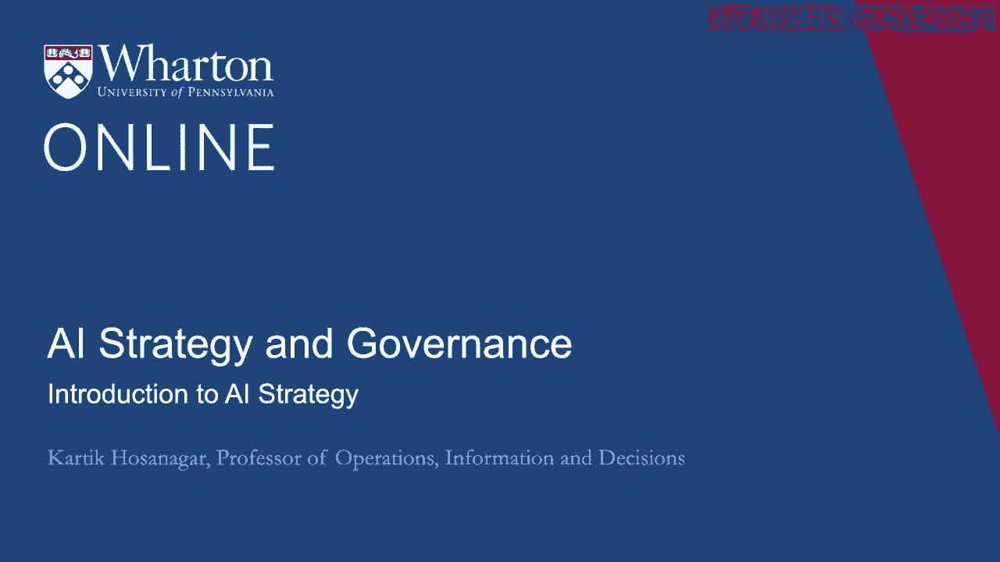
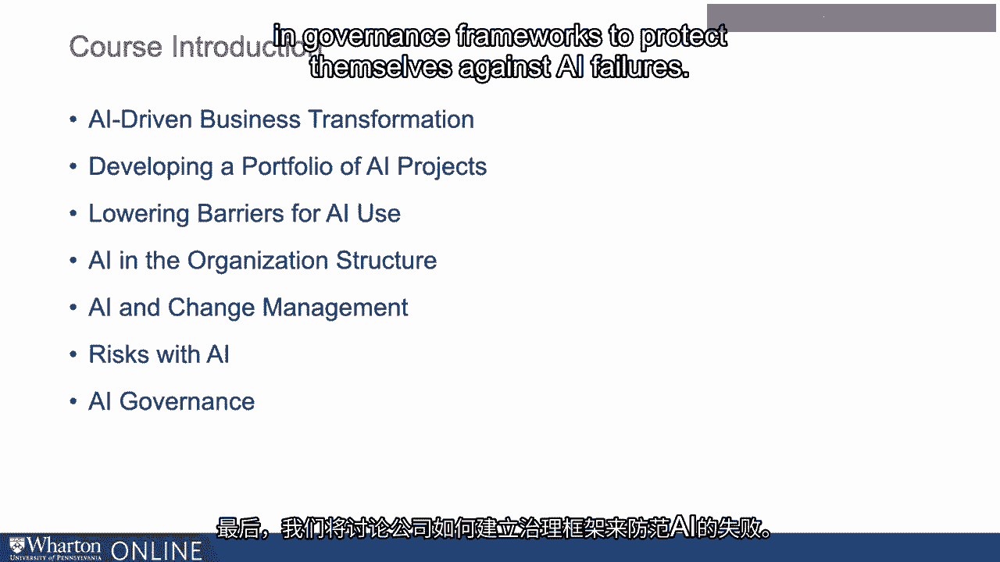

# P101：AI战略简介 🧠

在本课程中，我们将学习人工智能战略与治理的核心内容。课程将涵盖AI驱动的商业转型、成功策略、组织行为、变革管理、潜在风险以及伦理治理框架。

---

## 🚀 AI驱动的商业转型

我们将首先探讨人工智能如何驱动商业转型。许多公司早期的AI计划未能达到预期效果，我们将分析其失败原因及应对方法。

成功的企业通常采用特定策略来利用AI获取竞争优势。这些策略包括规划长期项目组合与实施短期速赢项目。

---

## 🔧 降低AI使用门槛

接下来，我们将了解机器学习的民主化如何降低各行业应用AI的技术与资源门槛。

我的同事桑尼·坦贝将阐述企业在部署AI时所需的四大关键输入要素。

以下是这四大要素：

*   **软件**
*   **人员**
*   **计算资源**
*   **数据**

企业需要思考如何以正确的方式将这四大要素有机结合，以发挥AI的最大效能。

---

## 🏢 AI与组织结构

在讨论了基础要素后，我们来看看AI在组织结构中的作用。

具体而言，我们将分析当前成功应用AI的组织有哪些共通的行为模式与结构特点。

---

## 📈 AI与变革管理

上一节我们介绍了组织结构，本节中我们来看看AI与变革管理的关系。

我的同事林吴教授将重点讨论AI在业务流程重组中的关键角色。我们将一同探讨AI实施过程中面临的一些主要挑战。

---

## ⚠️ AI的风险与挑战

任何技术都有其风险，AI也不例外。我们将探讨AI算法可能出现的失败方式。

这些失败不仅带来技术风险，也会对公司运营和声誉产生实质性影响。

因此，课程最后将聚焦于公司如何建立有效的治理框架，以防范和减轻AI失败带来的负面影响。

---

## ⚖️ AI伦理与治理

我的同事们，凯文·伍尔巴克教授和桑尼·坦贝教授将深入讨论AI伦理的基本原则。

议题将涵盖人工智能的可解释性及其相关的法律问题。

---

## 📝 总结

本节课中，我们一起学习了人工智能战略的全貌：从商业转型与成功策略，到降低应用门槛的关键要素；从组织结构与变革管理，到潜在风险与挑战；最后，我们了解了建立AI伦理与治理框架的重要性。这些内容为系统性地理解和应用AI战略奠定了基础。