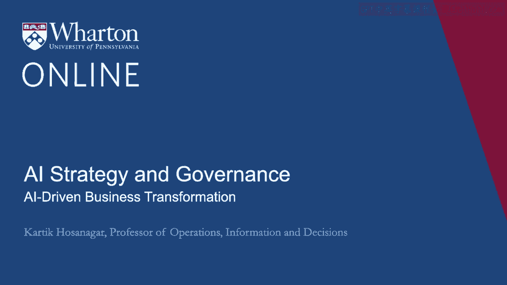
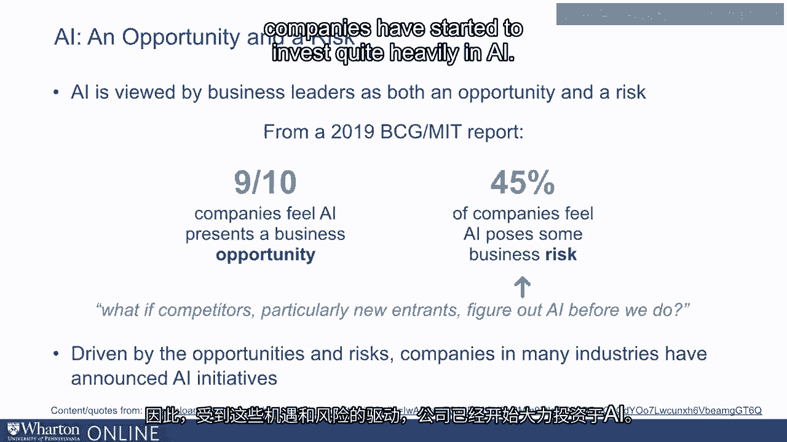
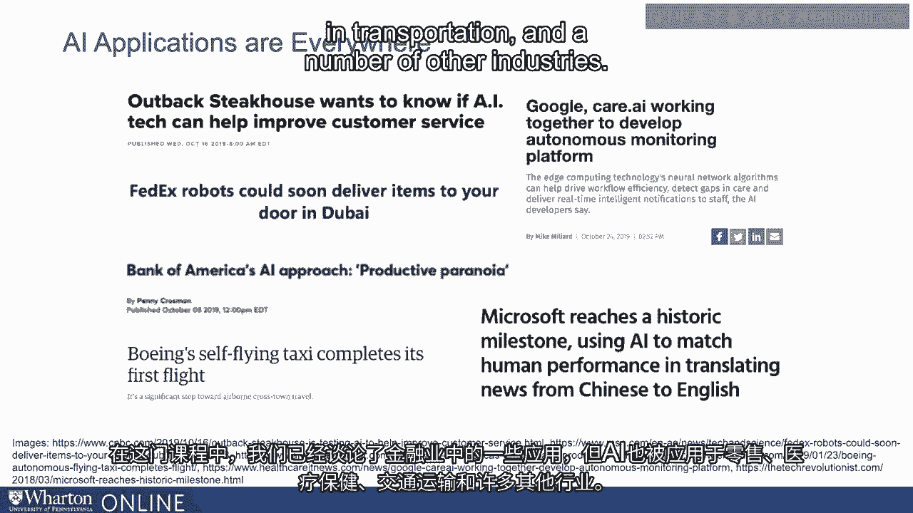
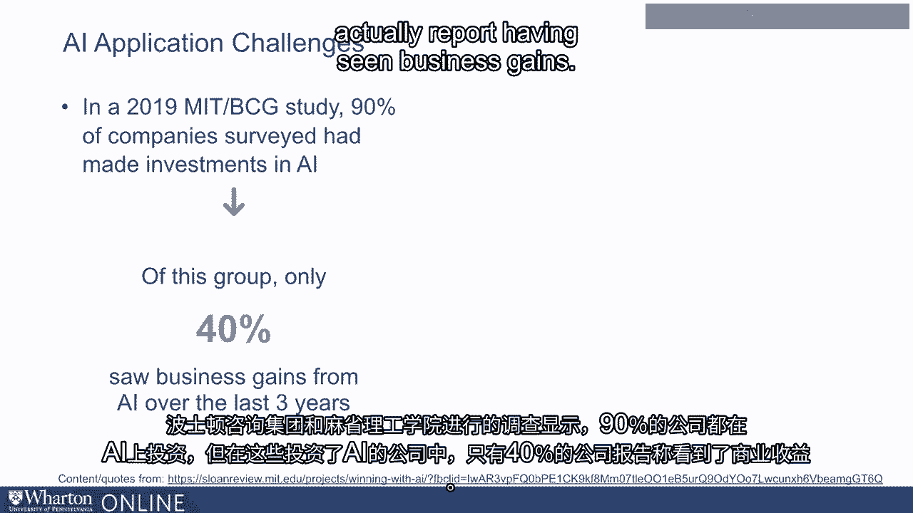
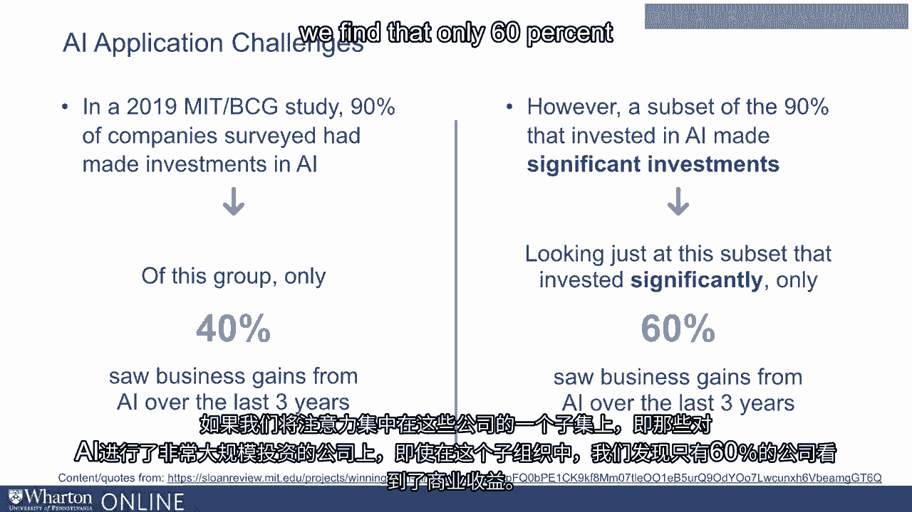
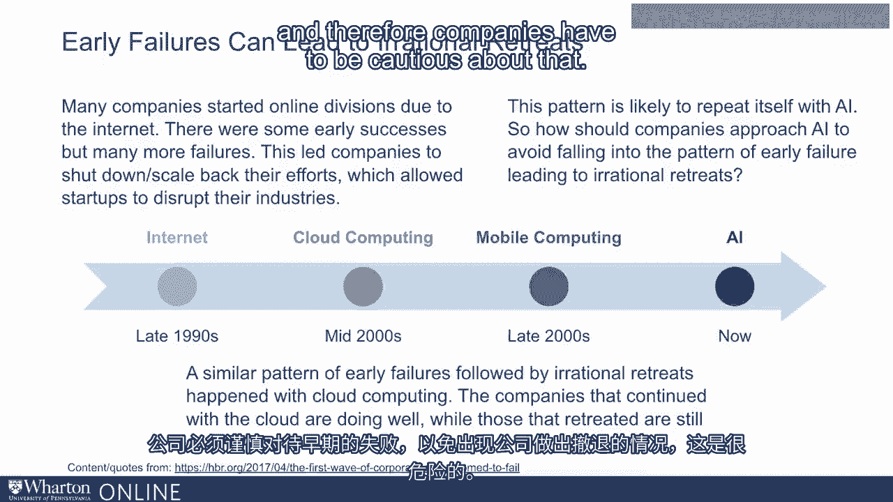

# 课程 P102：AI驱动的业务转型 🚀

在本节课中，我们将学习人工智能如何驱动业务转型。我们将探讨AI带来的机遇与挑战，分析当前企业投资的现状与潜在风险，并理解为何需要审慎的战略规划来确保AI投资的长期回报。

---

## AI的机遇与风险认知

上一节我们介绍了课程概述，本节中我们来看看商业领袖们如何看待AI。当前，商业领袖普遍将AI视为一个兼具巨大机遇和潜在风险的双刃剑。

波士顿咨询集团和麻省理工学院近期对众多大型公司高管进行的一项调查显示：

*   十分之九的公司认为AI是一个重要的商业机会。
*   与此同时，45%的公司将AI视为潜在的商业风险。

这种风险主要源于竞争对手可能更有效地利用AI技术，从而在市场上取得领先优势。在这种机遇与风险并存的认识驱动下，各行业公司已开始进行大量投资。

---

## AI的广泛应用与投资回报现状

在认识到AI的重要性后，企业纷纷开始行动。AI技术目前已在金融、零售、医疗、交通等众多行业中得到广泛应用。

然而，早期的热情投资并不总能转化为实际的商业收益。同一份由BCG和MIT进行的调查报告进一步指出：

*   90%的公司已经在AI领域进行了一些投资。
*   但在这些投资的公司中，只有40%报告看到了实际的业务收益。

如果我们聚焦于那些对AI进行了非常重要投资的子群体，情况略有改善，但依然不理想：

*   只有60%的重要投资者看到了业务收益。

换言之，许多早期的AI投资尚未产生预期成果。这引发了一个重要担忧：早期的失败可能导致企业非理性地全面撤退，从而错失长期机遇。

---

## 历史教训与通用技术的启示

这种因早期挫折而撤退的模式在技术发展史上屡见不鲜，其后果往往是严重的。我们可以回顾几个历史案例：

*   **20世纪90年代末的互联网**：许多公司投资建立在线部门，期望很高。早期回报不佳导致互联网泡沫破裂，不少公司关闭了在线业务。为此撤退付出的代价是巨大的。
*   **21世纪00年代中期的云计算**：一些公司因安全或合规问题而撤回投资。而那些坚持下来的公司则获得了商业敏捷性，在长期竞争中占据了有利位置。
*   **21世纪00年代末的移动计算**：也经历了类似的模式。

AI与上述技术有一个关键共同点：它应该被视为一种**通用技术**。这意味着：

`AI 的影响范围 ≈ 多个不同行业`

因此，如果因为早期应用中的挫折就选择从AI领域撤退，可能会犯下与历史上类似的战略性错误，使企业在未来陷入被动。

---

## 结论与前瞻

本节课中，我们一起学习了AI驱动的业务转型所面临的现实图景。我们了解到，尽管AI机遇广阔且应用广泛，但早期投资的高失败率是一个不容忽视的挑战。历史经验表明，对通用技术因早期挫折而撤退是危险的。

因此，企业必须采取审慎而坚定的策略。在接下来的课程中，我们将探讨公司可以采用的战略框架，用于规划AI投资并确保这些投资能在中长期内产生可持续的回报，从而成功驾驭这场由AI驱动的业务转型。