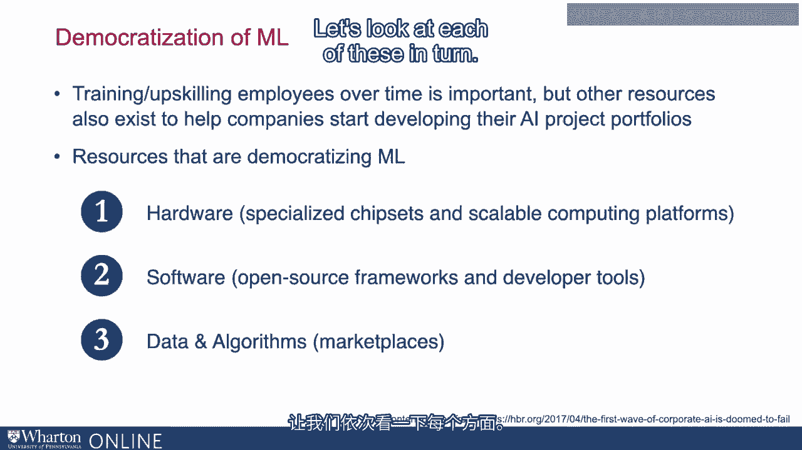
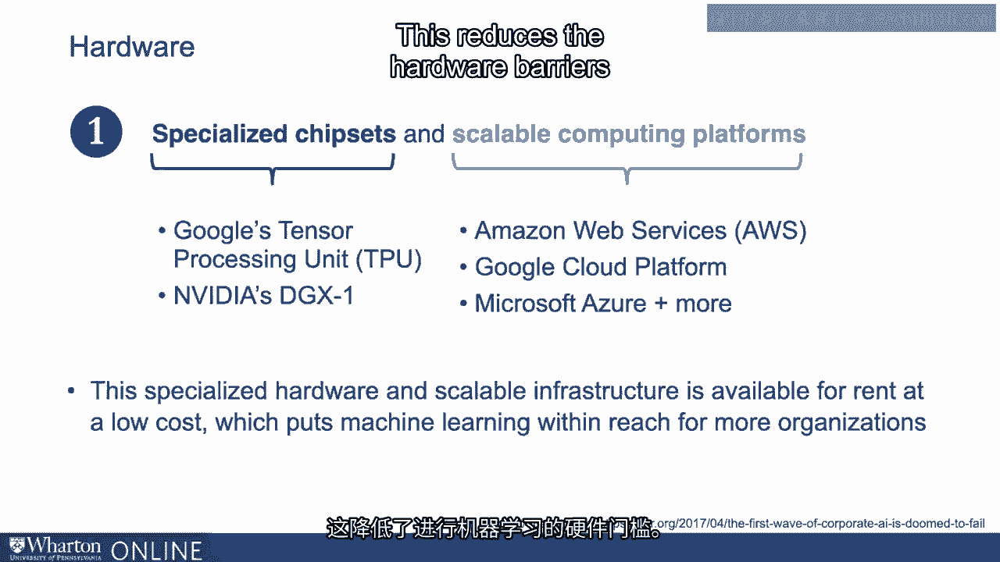
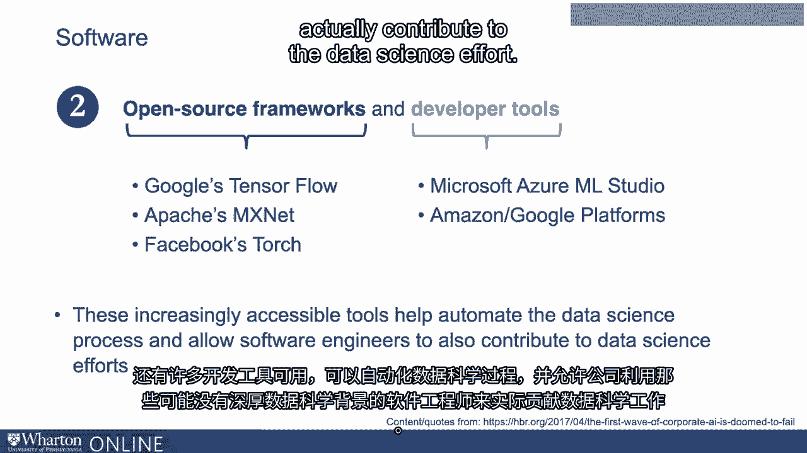
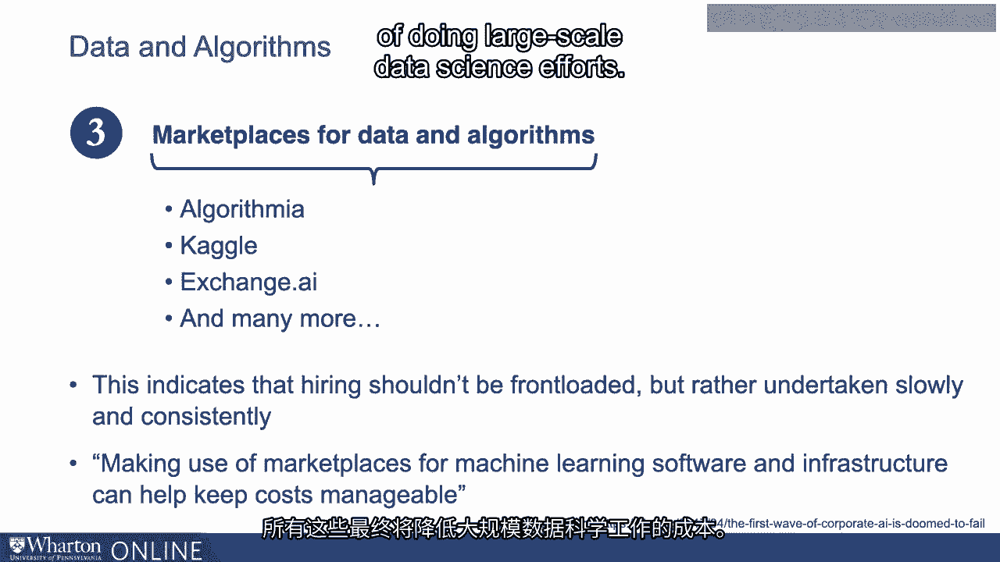

# 课程 P104：降低AI使用壁垒 🚧

在本节课中，我们将探讨机器学习民主化的趋势，了解硬件、软件、数据和人才等关键要素的门槛如何降低，从而使各类组织都能更容易地启动和发展其人工智能项目。

---

在上一节中，我们介绍了谷歌等大型科技公司如何利用AI重塑自身并获得丰厚回报。这些公司拥有充足的资源和内部工程能力。本节中，我们来看看规模较小的公司或缺乏技术基因的大型组织，如何也能抓住AI机遇。

好消息是，一场“机器学习民主化”的转变正在发生。它使得各种组织能够获取开展AI驱动业务转型所需的能力、资源和资产。所谓民主化，主要体现在**硬件**、**软件**、**数据**、**模型**和**人才**这几个方面。

---

## 硬件门槛的降低 💻

大规模机器学习通常需要定制化的硬件支持。例如，用于高强度机器学习的处理器（如GPU）就与传统CPU不同。对于公司而言，自建这类定制硬件和基础设施的成本可能非常高昂。

以下是降低硬件门槛的关键因素：

*   **云计算平台**：亚马逊、谷歌、微软、阿里巴巴等主要云服务商已经构建了可扩展的机器学习计算平台。
*   **按需租用**：企业无需进行巨额前期投资，可以按需以较低成本租用这些计算资源。

这极大地降低了进行机器学习的硬件入门成本。

---

## 软件与工具门槛的降低 🛠️

上一节我们看到了硬件获取变得更容易。本节中我们来看看软件和工具方面的进展，它们进一步简化了机器学习流程。

许多开源框架（如TensorFlow, PyTorch）的涌现，使得获取机器学习工具变得非常容易。此外，还有众多开发者工具可以自动化数据科学流程，让那些没有深厚数据科学背景的软件工程师也能贡献力量。

以下是可资利用的工具类型：

*   **开源框架**：例如TensorFlow, PyTorch, Scikit-learn。
*   **自动化工具**：例如 `AutoML` 平台，能自动进行模型选择和超参数调优。
*   **可视化工具**：帮助理解和呈现数据与模型结果。
*   **来源多样**：这些工具既来自微软、亚马逊、谷歌等大公司，也包括H2O.ai等开源工具以及DataRobot等其他供应商的工具。

最终，这些工具使得公司无需构建复杂的自定义软件，就能轻松入门机器学习。

---

## 数据与模型门槛的降低 📊

成功应用机器学习离不开优质的数据和模型。现在，获取这两者的途径也变得更加便捷。

市场上出现了专门的数据集和算法模型交易平台，企业可以下载或购买所需资源。

以下是相关市场示例：

*   **数据与算法市场**：Kaggle平台提供了丰富的数据集和算法竞赛。
*   **云平台市场**：亚马逊、Snowflake等主要云计算平台也在积极创建数据市场和算法市场。

所有这些发展都在降低开展大规模数据科学工作的成本。

---

## 人才门槛的降低 👩💻

最后，进行数据科学工作离不开数据科学家。目前，资深数据科学家的成本可能仍然较高。

但随着越来越多工程师和数据科学家接受培训，人才供给增加，其成本也在逐渐下降。所有这些趋势共同作用，意味着在您所在行业应用机器学习的门槛正在迅速降低。

---

## 总结与建议 📝

本节课中，我们一起学习了机器学习民主化在硬件、软件、数据、模型和人才五个方面如何降低AI的应用门槛。

其核心启示是：在人工智能领域，采取**缓慢而稳定的投资策略**，而非一次性巨额前期投资，将在长期内产生更好回报。未来几年，这些门槛预计将继续下降，使得企业启动或扩展其AI项目变得越来越容易。

**核心趋势公式可概括为：**
`AI应用门槛 = (硬件成本 + 软件复杂度 + 数据获取难度 + 模型开发成本 + 人才稀缺度) ↓`