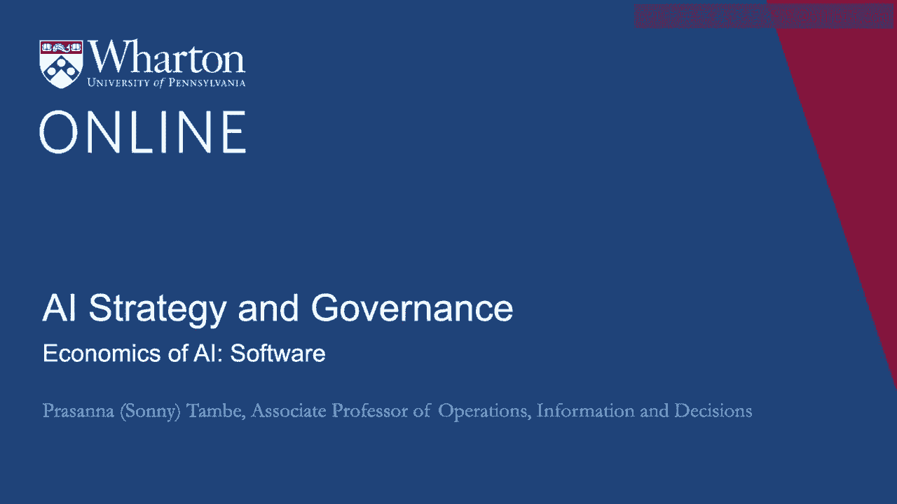
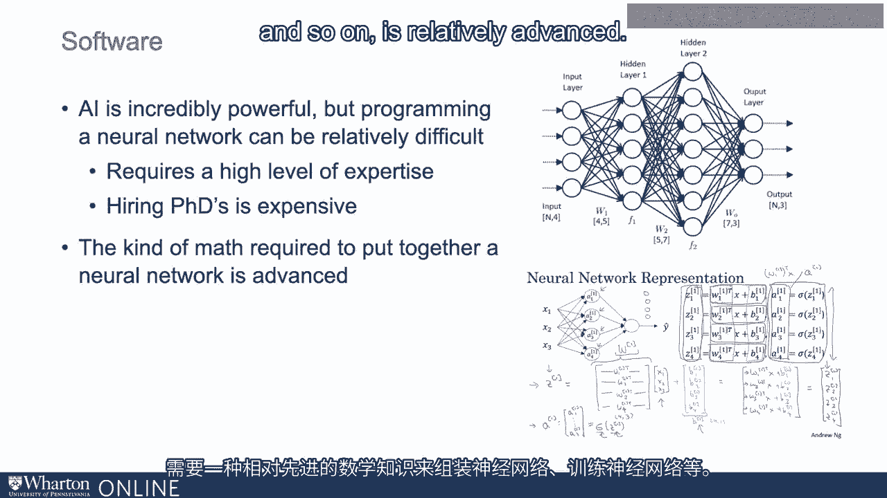
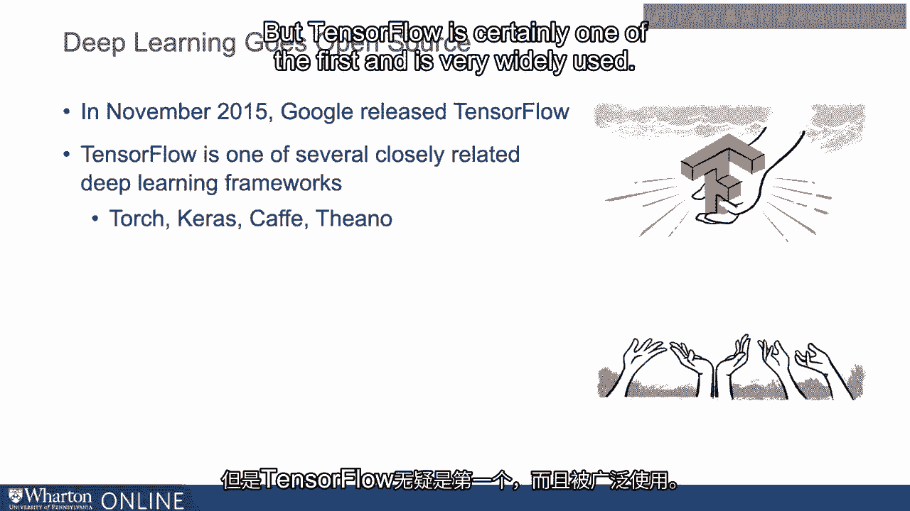
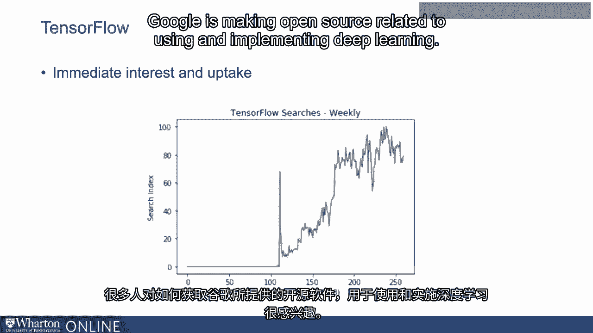
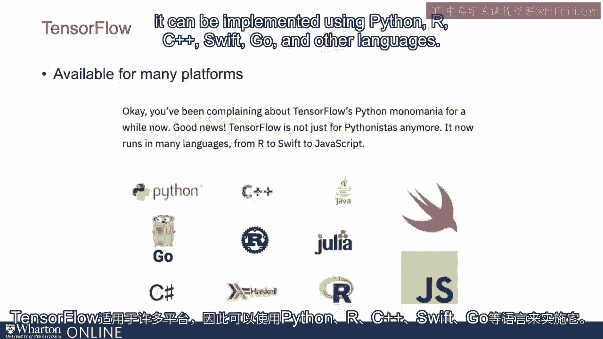
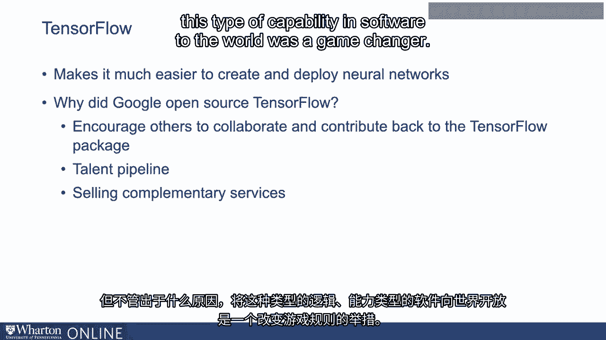

# 课程 P105：AI软件的经济学 💰

在本节课中，我们将要学习人工智能（AI）领域中的一个关键方面：其核心投入要素的经济学原理。我们将探讨软件、技能、计算资源和数据等关键投入的成本变化，以及这些变化如何影响AI领域的竞争格局和未来发展。

---

当我们思考人工智能如何与经济学及市场竞争相互作用时，必须考虑AI的一些关键投入要素。

这些要素包括：
*   实现机器学习和人工智能所需的软件。
*   开发AI所需的专业技能。
*   构建和运行模型所需的计算资源。
*   训练模型所需的数据。

接下来，我们来谈谈这些投入要素的成本。这些成本本身正在不断演变，这可能会对未来AI的经济学意义及其对竞争的影响产生深远作用。

## 软件：从昂贵专有到开源普及 🔓

上一节我们介绍了AI的关键投入要素，本节中我们来看看第一个要素——软件。人工智能无疑是一个极其强大的工具，机器学习在其功能方面也非常强大。然而，编程神经网络等工作相对困难。

这需要高水平的专业知识，聘请相关领域的博士成本高昂。构建神经网络所需的数学知识、训练神经网络等技术都相对复杂。使用神经网络进行预测涉及大量的数学运算。

因此，在某种程度上，AI的商业应用曾受到相对较高的成本限制，即组合构建基于深度学习的预测模型所需的软件价格昂贵。

几年前发生了一次重大转变，导致成本大幅下降，那就是深度学习的**开源化**。我指的是，包括谷歌在内的几家公司，在代码层面上向公众免费提供了他们的深度学习基础设施。

以下是关于开源软件的说明：
*   如果“开源”对你来说是一个新概念，它指的是软件可以免费下载、使用，甚至可能由你贡献代码给他人使用。

一个早期的著名例子是谷歌在2015年11月发布的 **TensorFlow**。TensorFlow是一个软件包，它编码了谷歌在机器学习和深度学习领域的许多知识。如今，TensorFlow是几种密切相关的深度学习框架之一。

你可能还会听到 Torch、Keras、Caffe 等名称，它们本质上包含了大部分相同类型的智能技术。但 TensorFlow 绝对是首批推出的框架之一，并且被广泛使用。

TensorFlow 由谷歌发布后，其受欢迎程度和接受度立刻飙升。许多人对如何获取和使用谷歌提供的、与深度学习相关的开源软件表现出浓厚兴趣。

TensorFlow 支持多种平台，可以用 Python、R、C++、Swift、Go 等多种语言实现。

它的核心作用是让创建和部署神经网络变得容易得多。这本质上将一项可能需要博士级别专家才能完成的任务，转变为一项目标然不简单、但所需培训时间更短的任务。

现在，拥有硕士学位的人就能在比以前快得多、简单得多的基础上进行开发。当然，这引出了一个关键问题：谷歌以及其他做了同样事情的公司，为什么要开源 TensorFlow？他们为什么会将如此强大的工具提供给包括竞争对手在内的所有人？

对此有很多潜在的答案：
*   可能是为了鼓励其他人协作、交流并为 TensorFlow 包本身贡献代码。
*   可能与人才管道有关。有时公司开源软件是为了吸引希望与优秀代码库合作的人才。
*   他们可能有兴趣销售互补的服务（例如云服务）。

但无论出于何种原因，这种逻辑或能力以开源软件的形式提供给世界，是一个游戏规则的改变。它使得其他人更容易使用这种软件，并以此为基础，为他们自己的应用程序开发深度学习引擎。

---

在下一节视频中，我们将讨论这对开发深度学习应用所需的技能概况意味着什么。

本节课中我们一起学习了AI软件经济学的关键转变。我们了解到，深度学习的开源化（以 **TensorFlow** 等框架为代表）极大地降低了软件获取成本，使得更广泛的开发者和企业能够利用先进的AI技术，从而改变了整个领域的竞争动态和发展速度。