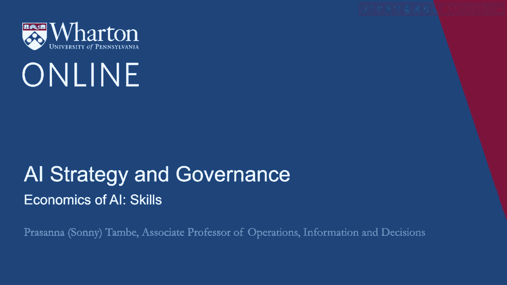
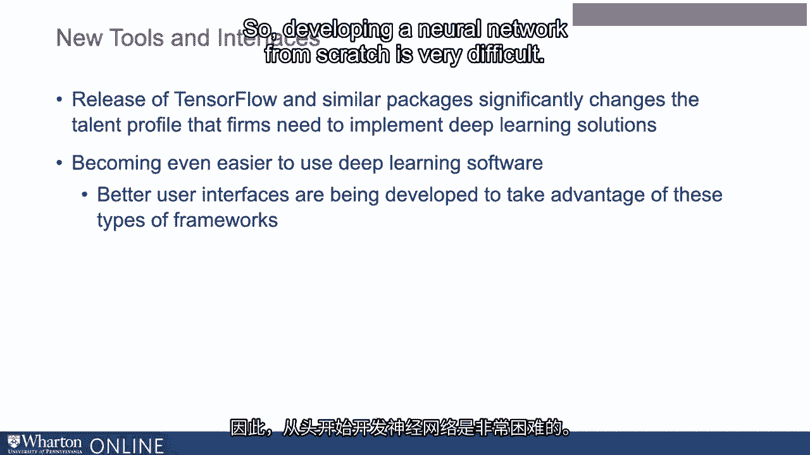
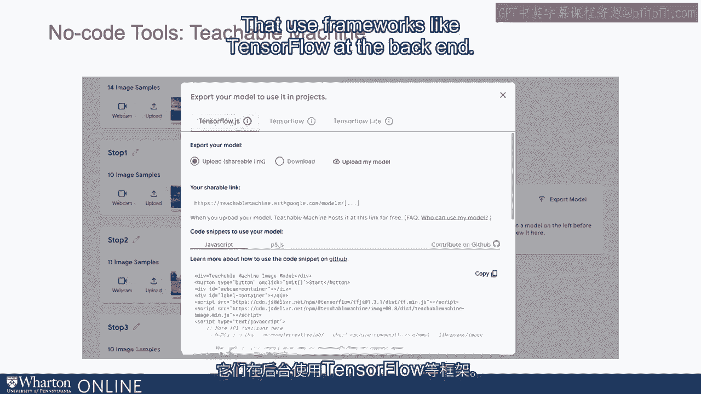
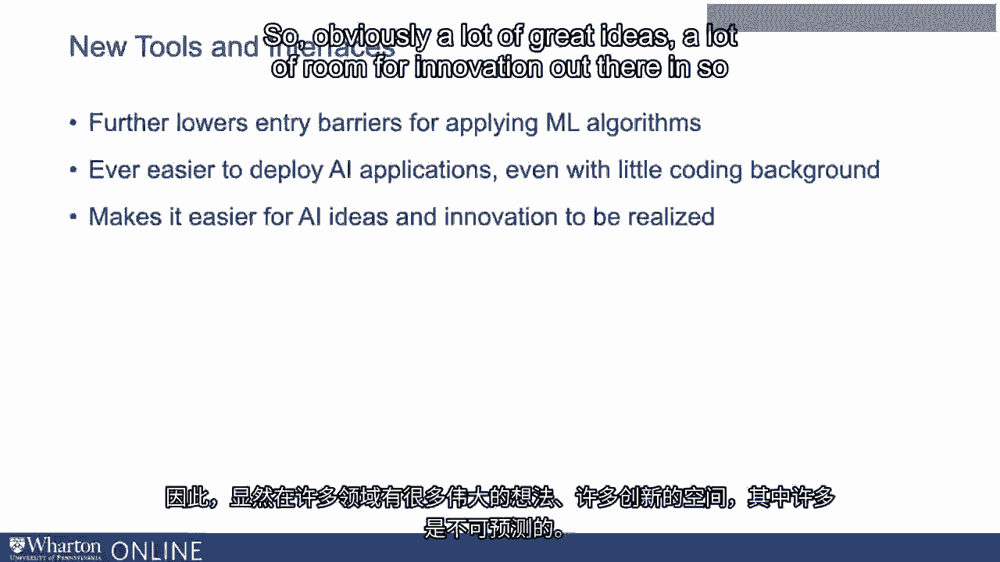
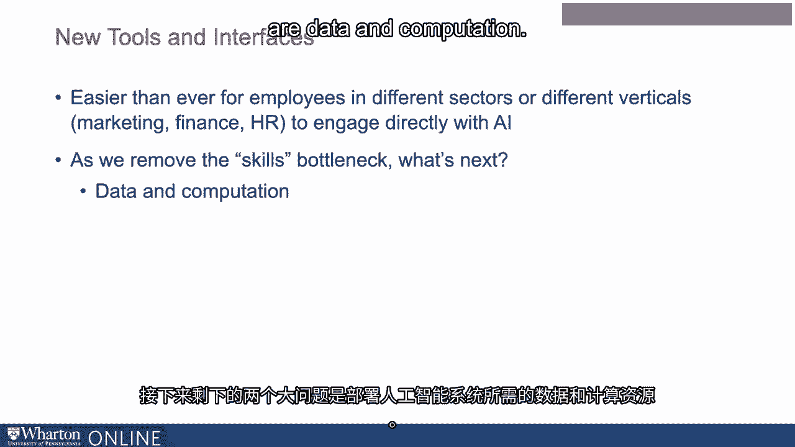

# 课程P106：AI技能的经济学 📊

在本节课中，我们将探讨TensorFlow等软件框架的出现如何改变了AI领域的人才需求，并分析其如何降低技术门槛，从而推动人工智能的普及和创新。

---

TensorFlow及类似软件包的发布，显著改变了企业实施深度学习解决方案所需的人才结构。

此外，使用这些类型的软件变得越来越简单。因为越来越好的用户界面正在被开发，以利用这些框架。

因此，从头开始开发神经网络是非常困难的。这些软件包通过代码使得访问变得更加容易，但新界面正在被开发，让人们可以访问这些类型的框架，有时甚至不需要使用代码。

有多种无代码工具，如谷歌的Teachable Machine。这些框架正在被开发、研究，并介绍给世界。

---

上一节我们介绍了AI框架如何降低使用门槛，本节中我们来看看它们如何具体实现这一点。

使用像TensorFlow这样的框架作为后端，使得人们非常容易构建基本的机器学习框架。可以用于不同的任务，并部署这些任务。

这反过来又将进一步降低应用机器学习背景的入门门槛。部署这些应用程序变得越来越容易，即使对于技能相对较少的人，或者甚至完全没有编码背景。

这就是其中一大优势，使得人工智能的想法和创新更容易实现。显然，有很多优秀的想法，以及创新的空间。

---

理解了工具带来的便利性后，我们来看看这对行业意味着什么。

而且在许多行业中，许多都是未预见的。历史上一个大瓶颈当然是，从想法到实现，机器学习领域需要大量的软件。

正在提供的新工具和技能，以及正在提供的新框架，使得从想法直接转化为实现变得比以往任何时候都容易。

实际上实现这些想法的价值，对于员工来说，这将比以往任何时候都更容易。在不同的行业、不同的领域，市场营销、金融、人力资源可以直接与人工智能进行互动。

这消除了重要的瓶颈，使其更接近于人人可用的目标，使事情更接近于实现目标，为企业的各种任务提供可用性。

---

所以随着我们消除技能瓶颈，软件变得更易于使用。因为使用软件所需的技能越来越少，接下来，剩下的两大要点是什么。

以下是部署人工智能系统所需的主要资源：

*   数据
*   计算

我们将接下来讨论这些。

---

本节课中我们一起学习了AI工具（如TensorFlow）的演进如何重塑了人才经济学。核心在于，**高级框架和可视化工具**的出现，极大地降低了技术门槛，使得更多非技术背景的人员能够参与AI应用的构建与部署。这打破了从创意到实现之间的关键瓶颈，将AI的潜力带到了更广泛的行业和人群面前。