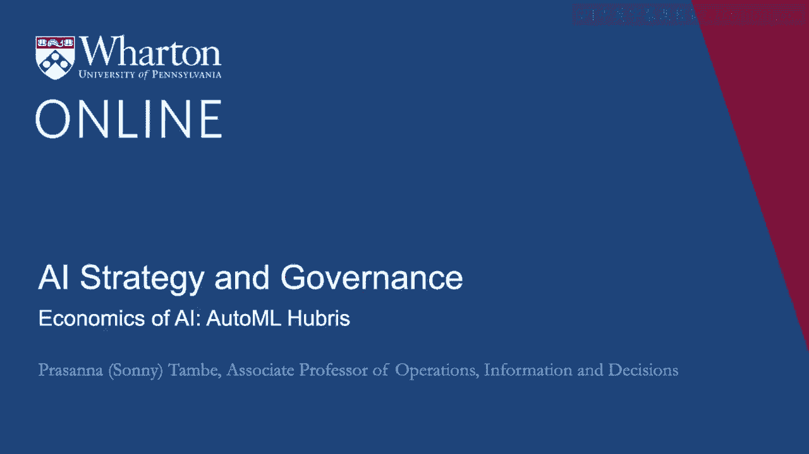
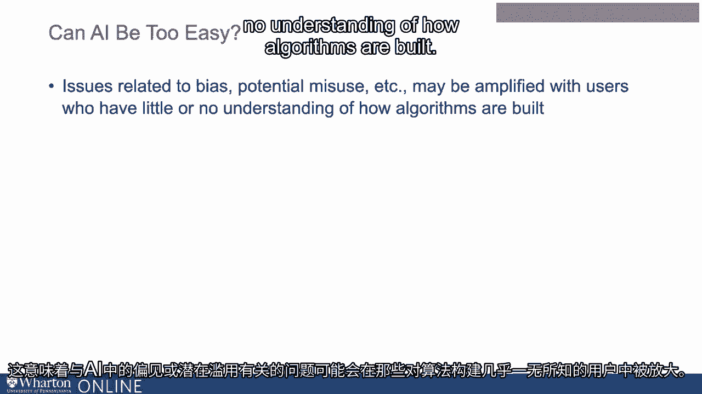
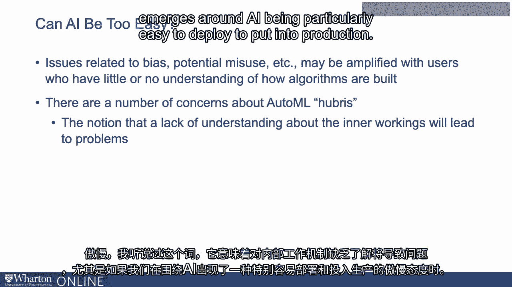
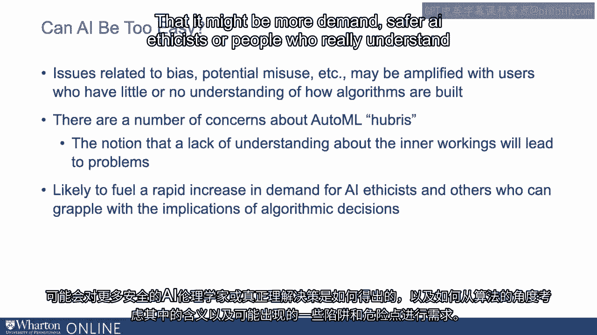

# 课程 P110：自动机器学习的傲慢经济学 🤖💰

在本节课中，我们将探讨自动机器学习（AutoML）工具的兴起及其带来的“傲慢经济学”问题。我们将分析这种技术简化如何可能加剧AI应用中的偏见、误用和治理挑战。

---

## 概述

自动机器学习等工具的推出，使得开发AI应用对几乎所有拥有强大数据集的人来说都变得极其简单。这引发了一个核心问题：人工智能在某种意义上是否变得过于简单了？

## 简单化带来的风险

上一节我们提到了AI开发的简单化趋势。本节中我们来看看，这种简单化可能意味着与人工智能的偏见或潜在误用相关的问题会被放大。

对人工智能内部运作的理解不足，可能会加剧使用者面临的问题，尤其是当他们对算法的运作机制一无所知时。

## 构建者与使用者的认知鸿沟

以下是构建这些复杂工具的工程师与最终使用者之间存在的关键认知差异：

*   任何构建算法的人都必须深入理解数据的内部结构。
*   他们需要了解数据问题可能出现的位置，以及预测引擎可能面临哪些与数据相关的挑战。
*   他们清楚算法可能产生偏见或误导性的结果。

然而，借助自动机器学习，模型构建和部署变得如此简单，以至于一个严峻的问题随之而来：我们能否在部署之前，投入足够的关注来理解算法究竟在做什么？

## 治理与责任的挑战

从用户的角度出发，关注算法行为并实施有效治理至关重要。我们必须确保没有将不当的、可能导致社会伤害的算法投入生产环境。

关于自动机器学习“傲慢”的问题——即对其内部运作缺乏理解却盲目使用——引发了许多担忧。这种傲慢尤其在人工智能变得特别容易部署和投入生产时，将导致严重问题。

## “傲慢”催生的新需求

如果我们围绕人工智能发展出一种普遍的傲慢态度，可能会推动能够应对其影响的专业人员需求迅速增加。

以下是可能随之兴起的新兴领域或角色：

*   对更专业的人工智能伦理学家有更高的需求。
*   对真正理解决策过程的人才有更高的需求。他们需要能够剖析算法**`output = model.predict(input_data)`** 背后的逻辑，理解它是如何得出结论的，并思考这从算法的角度意味着什么，以及其中可能存在哪些陷阱和危险点。

## 总结

本节课中，我们一起学习了自动机器学习（AutoML）带来的“傲慢经济学”现象。我们探讨了技术简化如何可能降低应用门槛，但同时加剧了偏见、误用和治理风险。我们认识到，在AI易于部署的时代，深入理解算法决策过程、加强伦理审查和治理变得比以往任何时候都更加重要。

谢谢。

[BLANK_AUDIO]