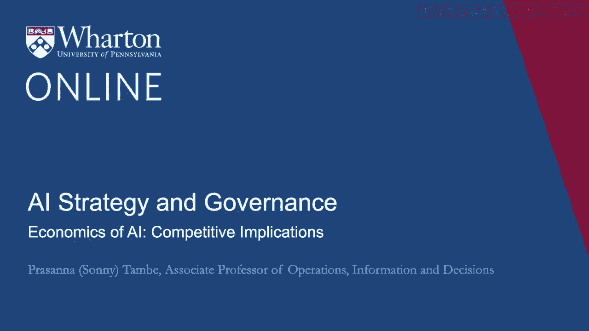
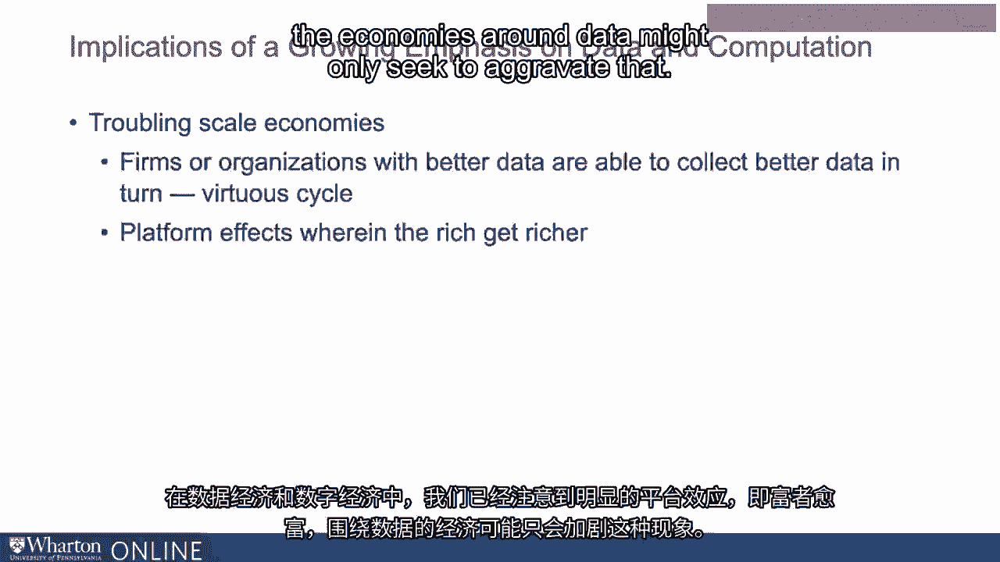
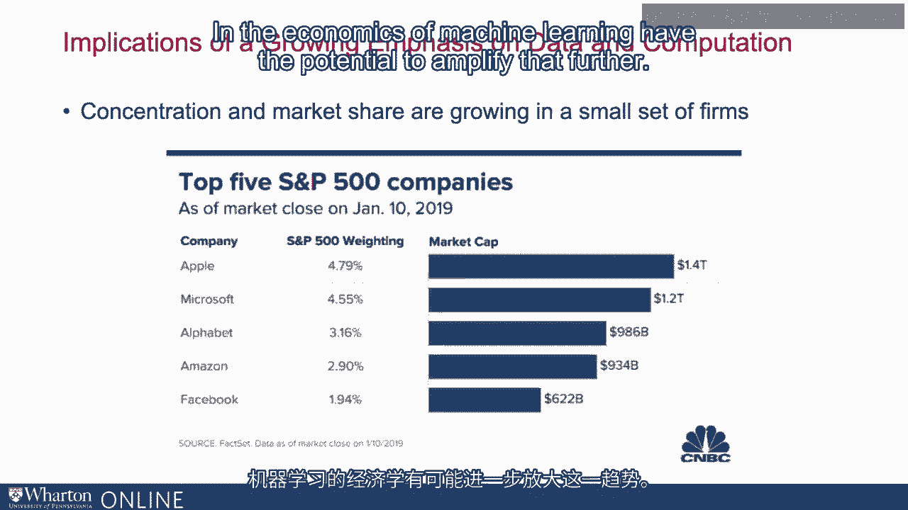
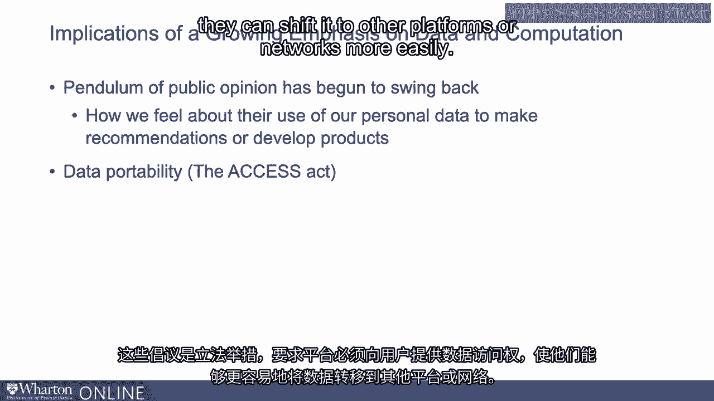
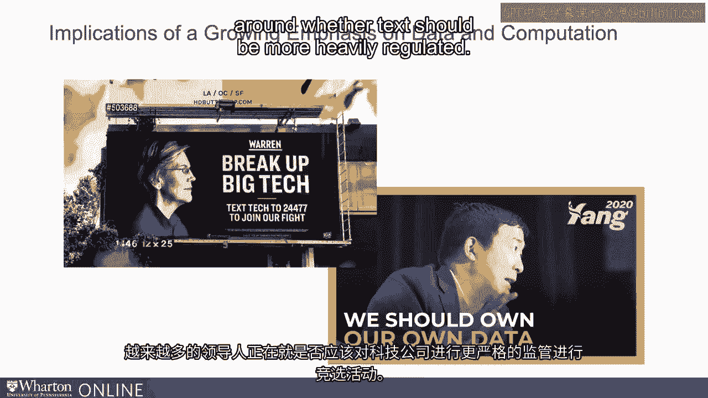
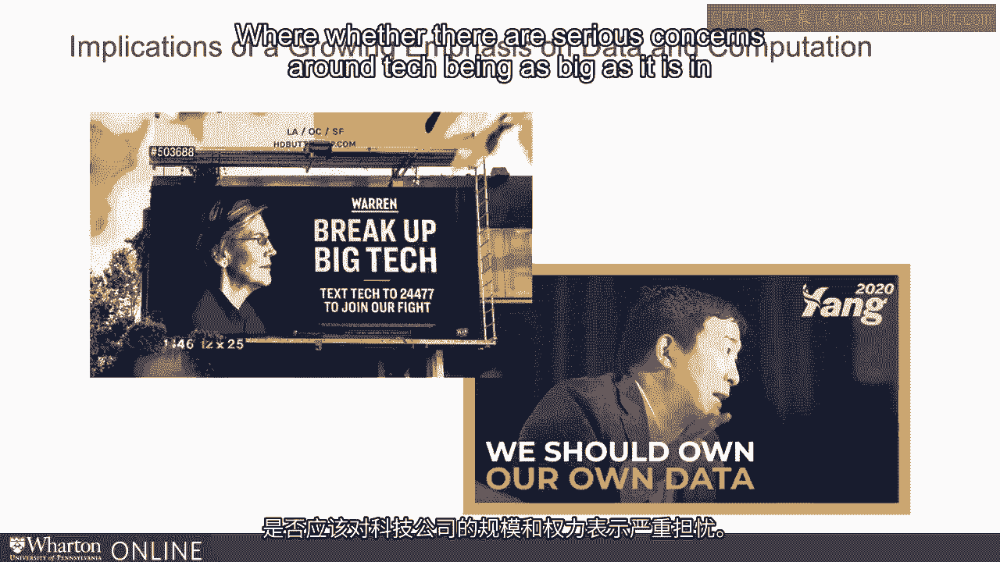

# 课程 P111：AI的竞争影响经济学 📈



在本节课中，我们将探讨人工智能，特别是机器学习，对经济竞争格局的影响。我们将分析数据如何成为关键资产，以及它如何加剧市场集中度，并讨论由此引发的政策与监管思考。

---

## 数据与计算的规模效应

上一节我们介绍了AI的经济学背景，本节中我们来看看数据和计算在其中扮演的核心角色。在算法决策中，数据和计算能力的影响至关重要。



数据经济中存在显著的**规模经济**效应。这可以用一个简单的良性循环来描述：
```
拥有更多/更好数据 → 训练出更优模型 → 吸引更多用户/产生更多数据 → 进一步优化模型
```
这种循环使得已经拥有优势数据的公司或组织能够持续巩固其领先地位。在数字经济中，大型平台是这一现象的典型代表。

---

## 市场集中度与“富者愈富”



上述数据规模效应的直接影响是加剧了“富者愈富”的现象。数据经济很可能强化这一趋势。

在过去十年左右的时间里，我们确实观察到市场集中度在不断上升。经济收益日益集中在少数技术密集、数据丰富的公司手中。机器学习的潜力进一步放大了这一问题。

---

## 公众认知与政策钟摆的摆动

由此产生的一个副产品是公众舆论的转变。近年来，公众对于科技公司如何使用个人数据的看法开始发生变化。



这些数据曾被用于产品推荐或开发，但现在，公众和政策制定者的观点有了些许调整。人们开始更加关注数据关系及其背后的权力问题。

因此，围绕数据可移植性等议题，已经出现了一些立法倡议。

以下是相关立法倡议的主要方向：
*   要求平台必须向用户提供对其自身数据的访问权限。
*   使用户能够更轻松地将数据转移到其他平台或服务。



---



## 监管呼声与数据所有权之争

越来越多的政治和商业领袖开始质疑，技术是否应该受到更严格的监管。对于技术公司规模过大、权力过度的担忧日益严重。

这种担忧同样体现在对公司规模和权力的讨论上。现在，一些领导者正在围绕数据所有权的问题展开讨论。


核心争议点在于：
*   数据是否真的应该属于收集它们的平台？
*   数据是否应该属于提供这些数据的用户？

---


## 总结

本节课中，我们一起学习了人工智能对经济竞争的深远影响。我们探讨了数据的规模效应如何导致市场集中度加剧，并了解了公众舆论和政策“钟摆”如何开始向加强数据权利与监管的方向摆动。竞争影响、政策考量以及监管挑战，都随着我们步入以数据和机器学习为核心的经济时代而不断增加。