# 课程 P113：组织架构中的 AI 策略 🏢

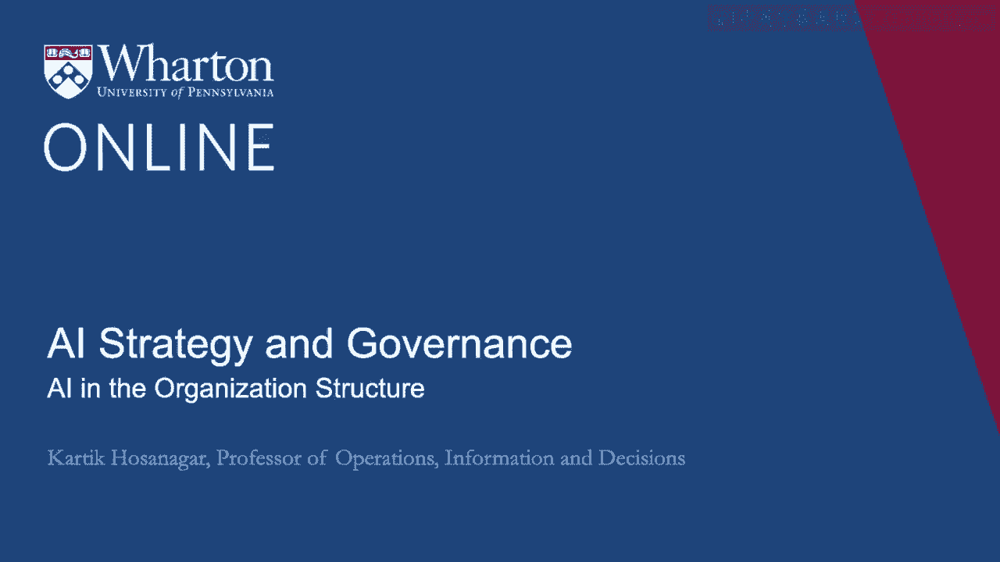

在本节课中，我们将探讨管理者如何将人工智能整合到组织战略中，以实现最大效益。我们将基于 BCG 和 MIT 对高管的调查，分析那些成功从 AI 投资中获得回报的公司所采取的关键策略。

---

## 📊 AI 策略整合

上一节我们提到了构建 AI 项目组合的重要性。本节中，我们来看看如何将 AI 策略与更广泛的组织目标相结合。

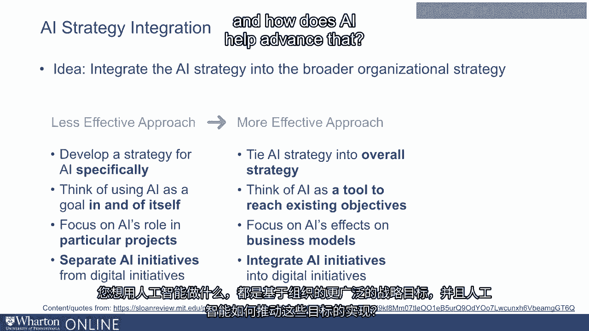

调查发现，许多公司为 AI 单独制定策略，将其视为一个独立的目标。相比之下，更有效的策略是将 AI 概念化，并置于更广泛的组织战略背景下。这意味着，无论你想用 AI 做什么，都应基于组织的整体战略目标，并思考 AI 如何帮助推动这一进程。

当然，在短期内，从不太整合、不太雄心勃勃的目标开始是可以接受的，这有助于建立共识和获取初步的 AI 技能。但即便如此，你仍需确保有一些与整体长期策略相整合或对齐的长期倡议。

---

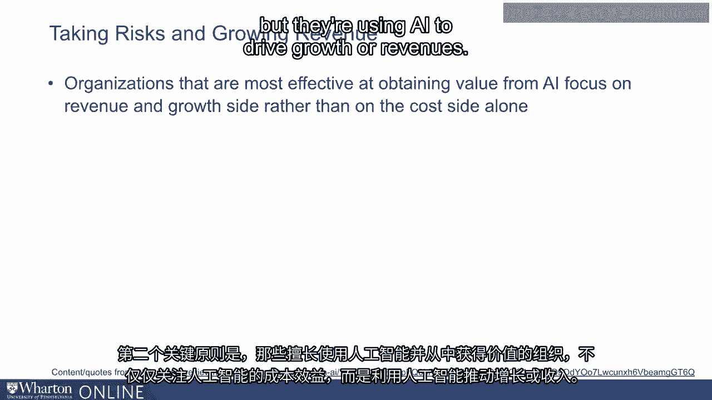

## 🚀 超越成本节约：驱动增长

仅仅将 AI 视为降低成本的工具是一种不太有效的策略。能够从 AI 中获得价值的公司，不仅关注成本效益，更利用 AI 来驱动业务增长或增加收入。

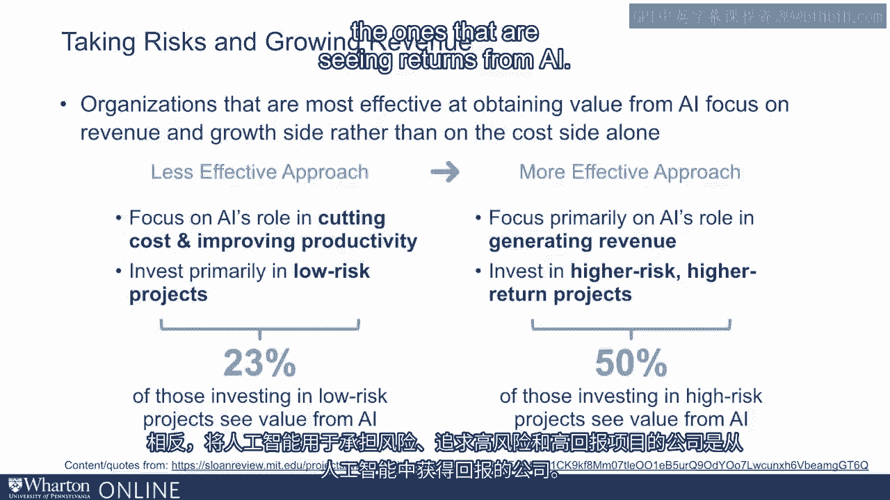

因此，那些愿意利用 AI 承担更高风险、追求更高回报项目的公司，才是真正从 AI 中看到显著回报的组织。

---

## 🗃️ 关键基础设施：数据整合

为了在 AI 上取得成功，拥有合适的基础设施至关重要，其中最重要的是数据基础设施。

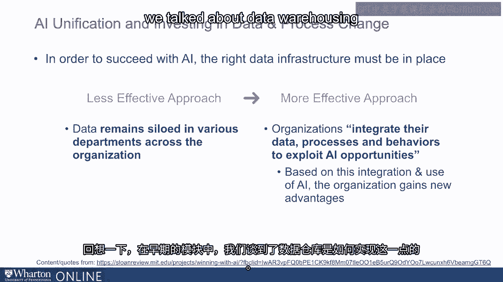

以下是数据整合的关键点：
*   真正取得成效的公司，是那些努力在多个部门间整合数据资产的组织。
*   如果数据仍然被各个部门孤立使用，整个组织不太可能从 AI 中获得显著收益。

回忆早期课程，**数据仓储**是实现整合的一种重要方式。其核心公式可表示为：
`整合数据 = 数据源1 + 数据源2 + ... + 数据源N -> 统一存储库`
这个过程涉及将来自不同来源的数据整合到一个易于访问的统一存储库中，用于分析应用。投资建设这样的数据基础设施至关重要，否则你只能获得关于客户或组织本身的非常分散的视图。

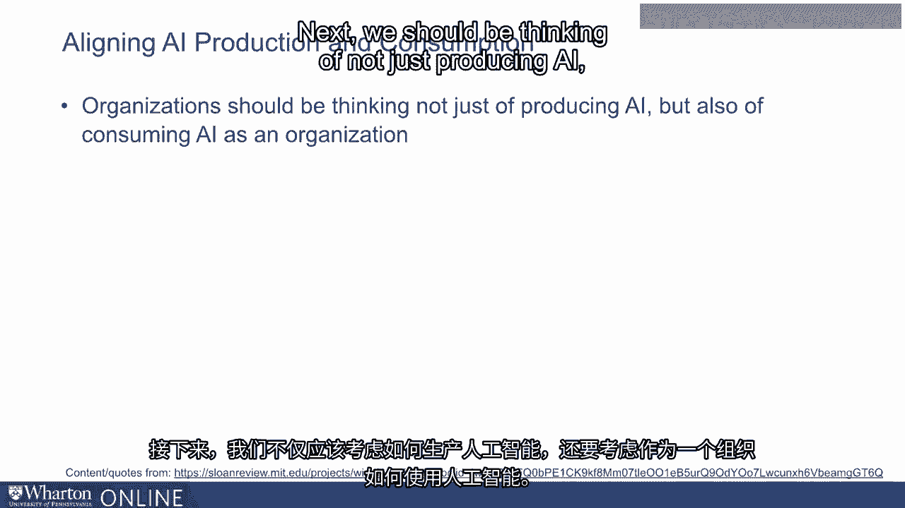

---

## 👥 培养 AI 消费者：数据驱动型管理者

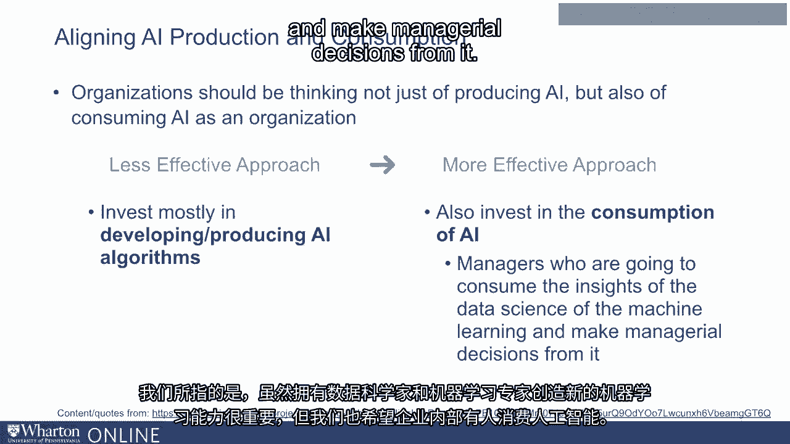

我们不仅应该考虑生产 AI（如开发模型），还应该考虑组织如何消费和使用 AI。

这意味着，虽然拥有创造新机器学习能力的数据科学家和专家很重要，但我们同样需要“消费者”——即在业务中利用 AI 洞察的经理。他们需要能够理解数据分析的结果，挑战其假设，并将自己的领域知识融入其中。

为了做到这一点，你需要培养具有“数据基因”的经理。这可能涉及对现有管理人才进行一定程度的再培训，使他们能够与数据科学家紧密合作，并基于数据科学和 AI 的洞察做出管理决策。

---

## 🧠 投资人才：普及 AI 知识与技能

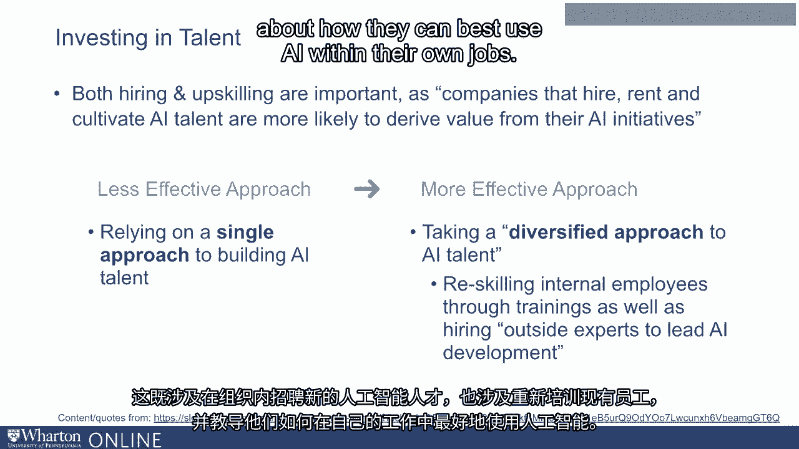

投资人才是一个反复强调但至关重要的原则。如果只有一个由四到五个数据科学家组成的孤立团队，我们无法在 AI 上取得广泛成功。

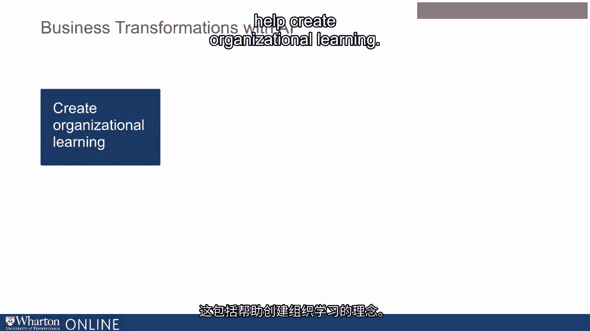

你需要在整个组织中普及 AI 知识、理解和洞察力。这包括两方面：
1.  在组织内招聘新的 AI 人才。
2.  重新培训现有员工，教会他们如何在自己的工作中最佳地利用 AI。

---

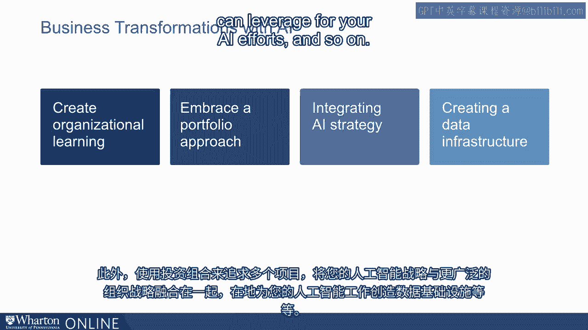

## 🔄 总结与过渡

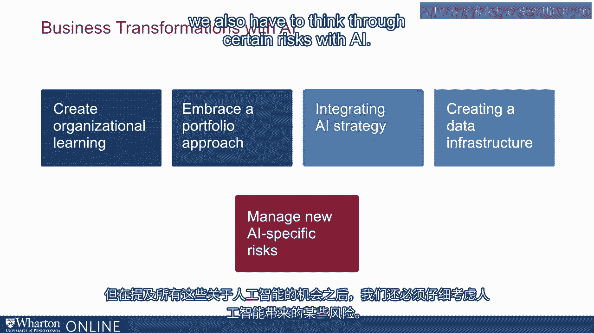

本节课我们一起学习了帮助组织转型、成功运用 AI 的几项关键原则：
*   **整合策略**：将 AI 战略与更广泛的组织战略结合。
*   **目标导向**：利用 AI 驱动增长，而非仅仅节约成本。
*   **夯实基础**：建立整合的数据基础设施。
*   **培养消费**：让管理者成为 AI 洞察的消费者。
*   **投资人才**：在全组织范围内普及 AI 知识与技能。

这些原则共同帮助创造组织学习，并通过项目组合来管理多个 AI 倡议。然而，在拥抱所有 AI 机遇的同时，我们也必须考虑其特有的风险。在接下来的课程中，我们将讨论这些 AI 风险，以及如何创建一个治理框架来管理它们。