# 课程P116：人工智能与流程创新 🚀

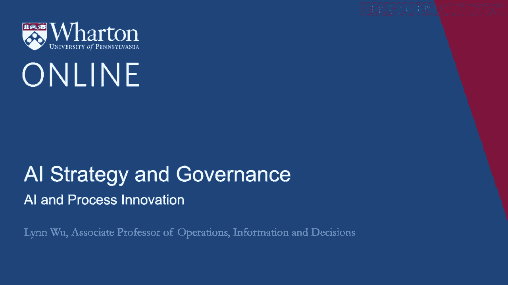

在本节课中，我们将探讨人工智能如何帮助企业改善业务流程并利用数据驱动创新。我们将通过具体案例和数据，理解AI在流程优化中的关键作用。

---

## 概述：大数据与AI的机遇

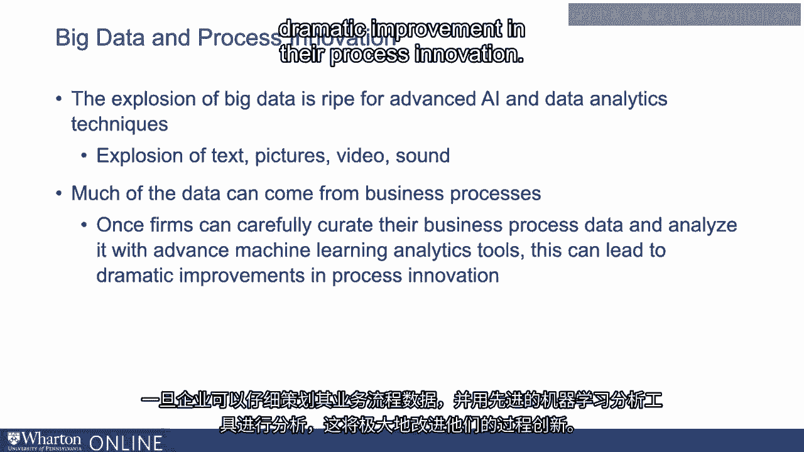

大数据时代的到来为先进技术提供了巨大机遇。社交媒体、移动设备每时每刻都在生成海量的文本、图片、视频和声音数据。尽管许多数据来自用户，但同样有大量数据源自商业流程本身。一旦公司能够系统性地整理这些业务流程数据，并运用机器学习等先进分析工具，就能为流程带来显著的改进与创新。

---

## AI优化流程的实例：谷歌数据中心

上一节我们介绍了大数据背景下的机遇，本节中我们来看看一个具体的应用案例。

谷歌运营着全球规模最大的数据中心之一，其能耗极高，需要为超过10万台服务器提供冷却。由于计算负载波动以及外部温湿度变化，保持服务器低温是一项复杂挑战。过去，这项工作主要由人工监控各种传感器并操作冷却设备来完成。

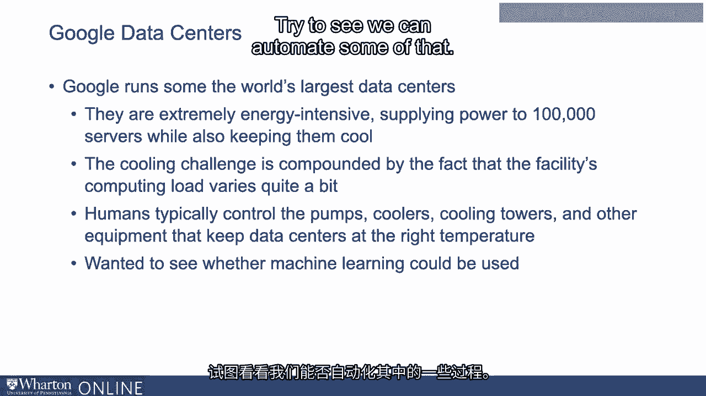

谷歌的解决方案是，利用数年的历史数据（包括计算负载、传感器读数、环境因素等）训练一个大型**深度学习模型**。该模型本质上是一个**强化学习算法**，用于自动控制所有冷却设备。

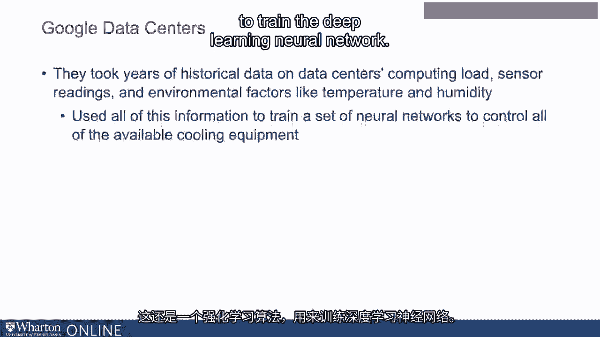

**核心模型**可以简化为一个函数：
`冷却策略 = f(计算负载, 传感器数据, 环境因素)`
其中，函数 `f` 由深度神经网络学习得到。

效果非常显著：启用AI控制系统后，能效（PUE）急剧提升，系统关闭并恢复人工控制后，能效又回到了原先的水平。最终，该系统帮助谷歌数据中心实现了**40%的能源使用减少**和**15%的相关开销改善**。

---

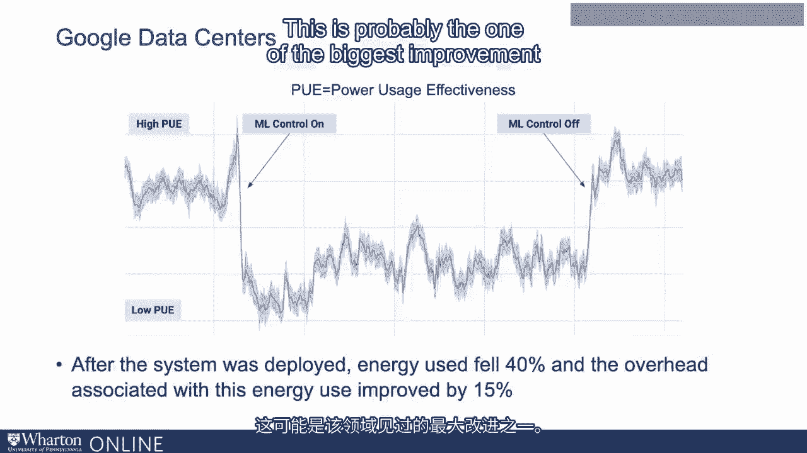

## 流程创新的广泛应用

除了数据中心，AI驱动流程创新的例子还有很多。以下是几个典型领域：

*   **电商与零售**：亚马逊等公司利用机器学习优化产品推荐和库存管理，通过预测用户行为（如点击、购买可能性）来提升转化率。
*   **网络安全**：像Deep Instinct这样的公司，利用流程数据训练模型，以在安全漏洞发生前更有效地检测恶意软件。
*   **金融保险**：保险公司运用机器学习分析客户数据，以改善风险评估和客户支持服务。

所有这些案例的成功，都源于公司能够捕获业务流程中的数据，并应用合适的**算法**来优化现有流程。

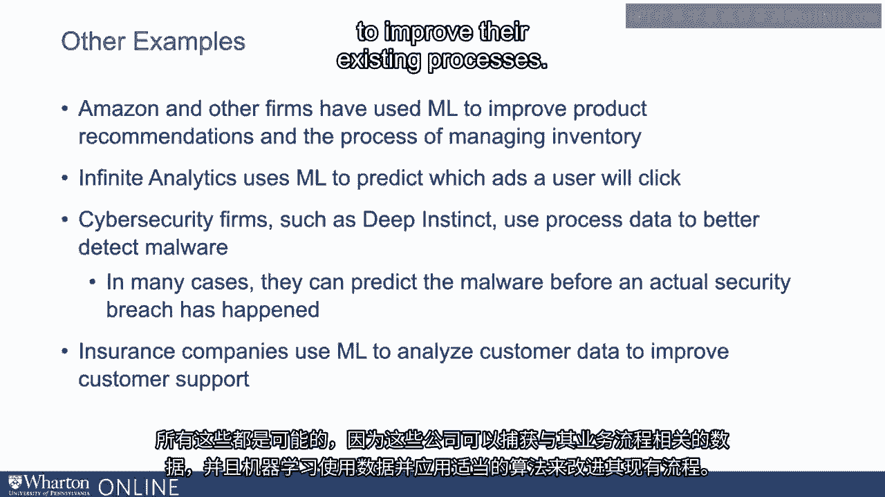

---

## 实证研究：AI投资与流程导向的关系

前面的案例展示了可能性，但要判断这是否具有普遍性，我们需要更广泛的证据。为此，我们与麦肯锡合作，对超过300家公司进行了一项大规模调查。

调查中，我们通过一系列问题来评估公司的“流程创新导向”。例如：

以下是用于评估公司流程导向程度的部分问题：
1.  贵公司是否具备对业务流程进行渐进式改进的强大能力？
2.  贵公司的核心活动是否包含流程开发、质量管理或改进？
3.  贵公司的商业领袖是否积极致力于完善现有流程和系统？

我们将得分高的公司标记为“流程导向型”公司。其分布符合预期的钟形曲线，说明并非所有公司都同等地关注流程创新。

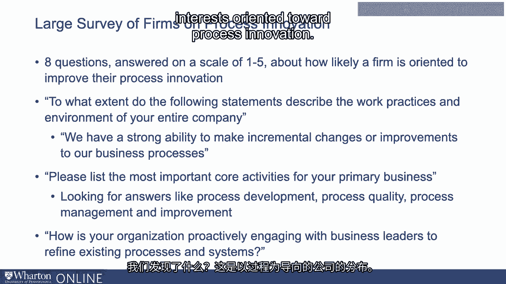

同时，我们通过分析公司员工的简历数据，来衡量其在**数据分析**和**人工智能**上的投资。我们关注以下几类技能关键词：

以下是用于衡量AI与数据分析投资的关键词类别：
*   **数据分析**：商业智能、数据驱动、数据整合等。
*   **算法技能**：A/B测试、机器学习、自然语言处理、神经网络等。
*   **系统与工具**：云计算、Hadoop、MapReduce等。

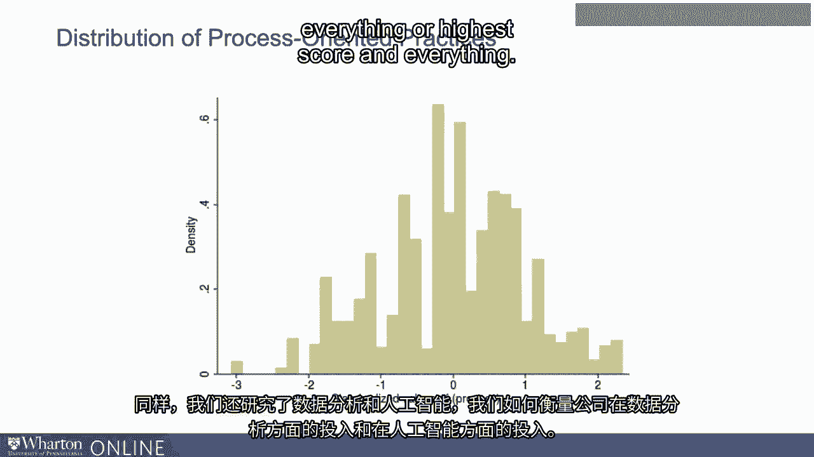

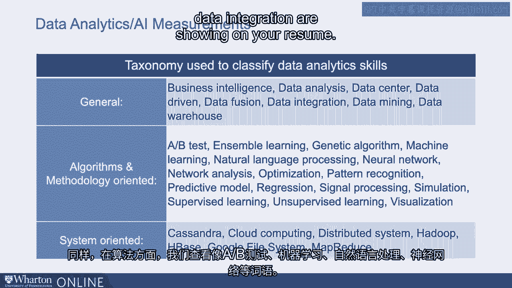

数据显示，近年来，具备这些技能的员工数量显著增长，尤其是AI技能的增长更为迅猛。

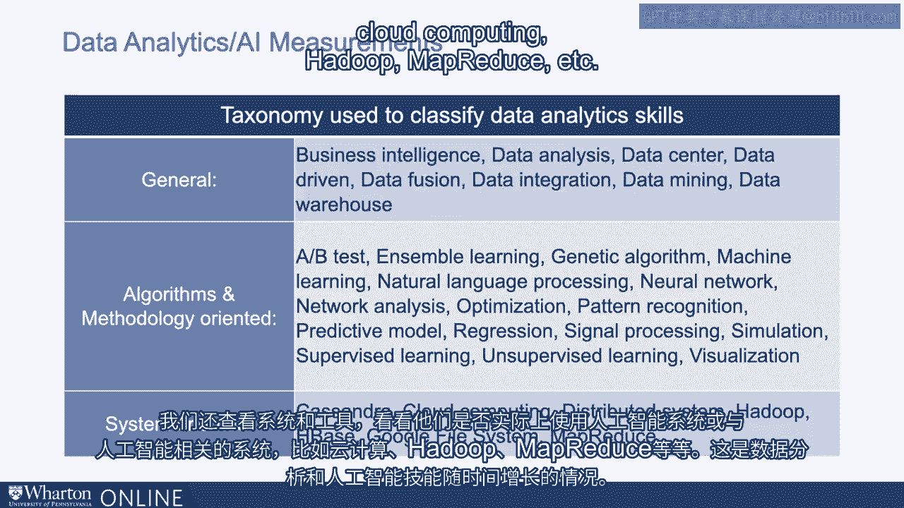

---

## 关键发现：协同效应与生产力提升

结合以上两项评估，我们得出了核心发现：

研究发现，**数据分析与人工智能能极大促进基于流程的创新**。更重要的是，只有那些**同时投资AI工具并专注于流程改进**的公司，才能获得显著的生产力提升。

具体数据表明：
*   在AI工具上投资每增加一个标准差，与**7%的生产力增长**相关。
*   如果一家公司只投资AI，但不关注流程改善，则无法获得这7%的增长。

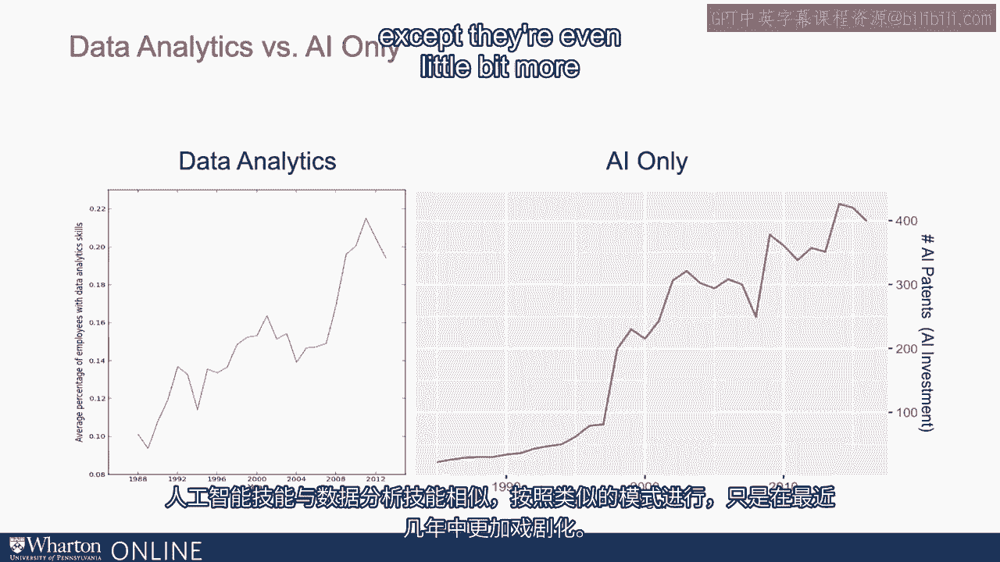

这解释了所谓的“AI创新悖论”：仅仅拥有AI技术不够，必须将其应用于具体的流程优化，才能释放最大价值。

---

## 总结

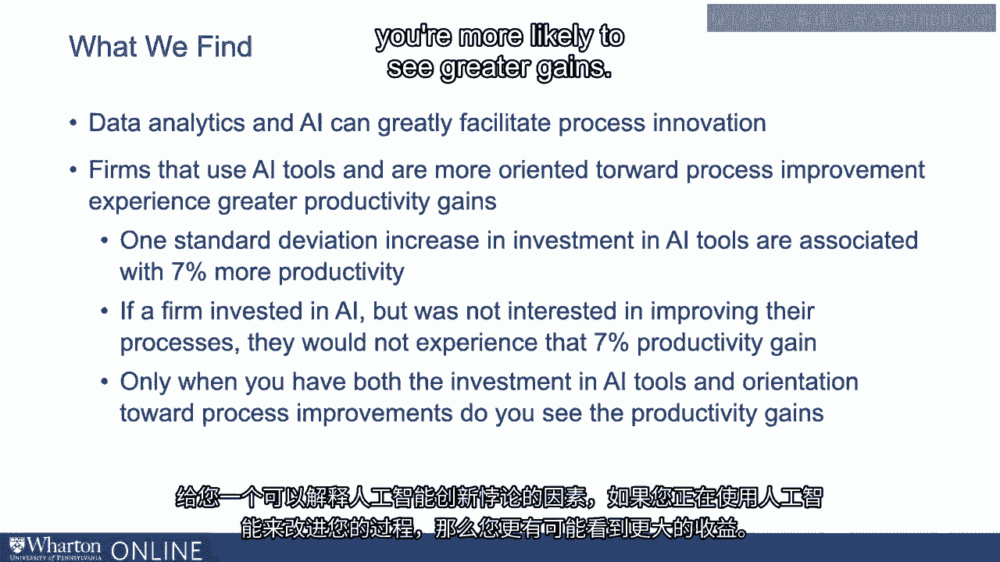

本节课中，我们一起学习了人工智能如何驱动流程创新。我们从谷歌数据中心的案例出发，看到了AI在解决复杂流程问题上的巨大潜力。随后，我们通过广泛的调查数据证实，**AI投资必须与流程导向的企业文化相结合**，才能转化为实实在在的生产力提升。对于希望从AI中获益的公司而言，明确流程改进目标与投资AI技术同等重要。

---
**课程资源**：GPT中英字幕课程 - BV1Ju4y157dK