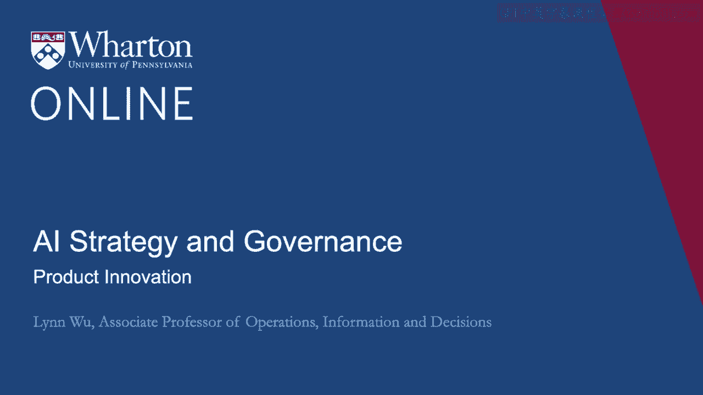
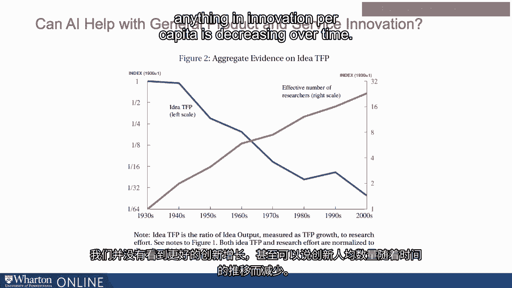
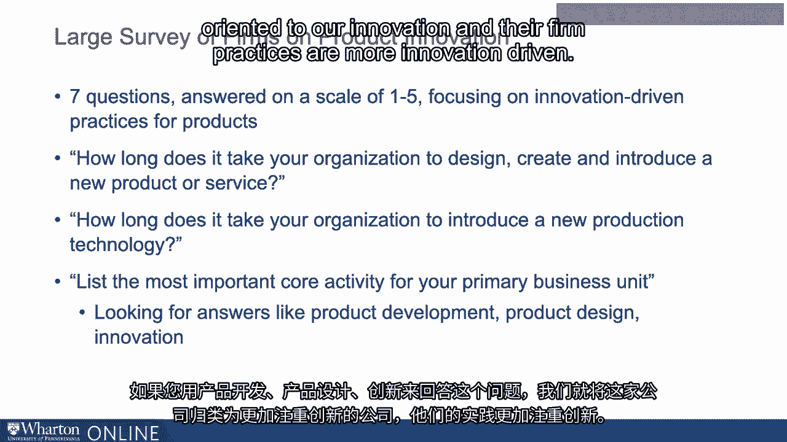
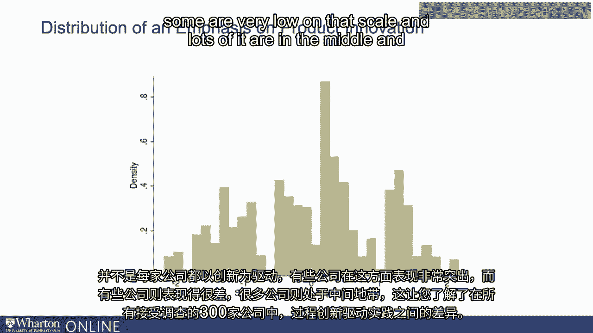
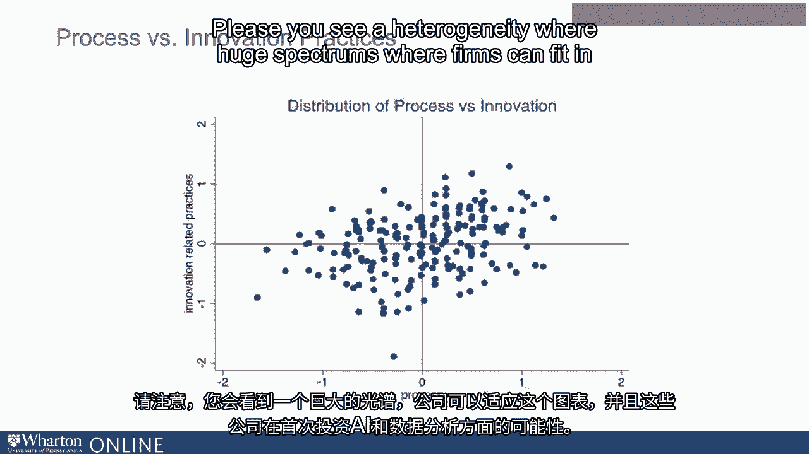
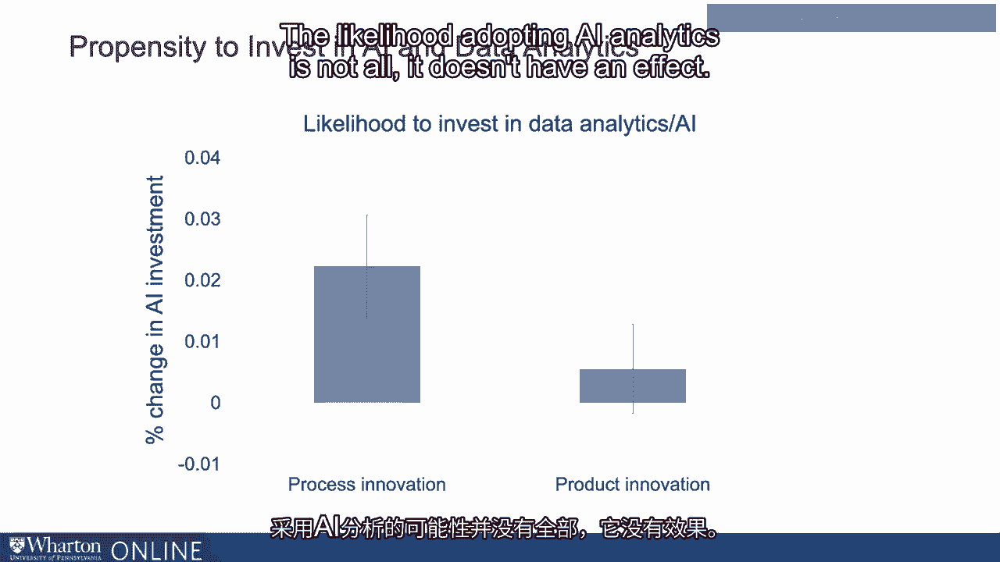
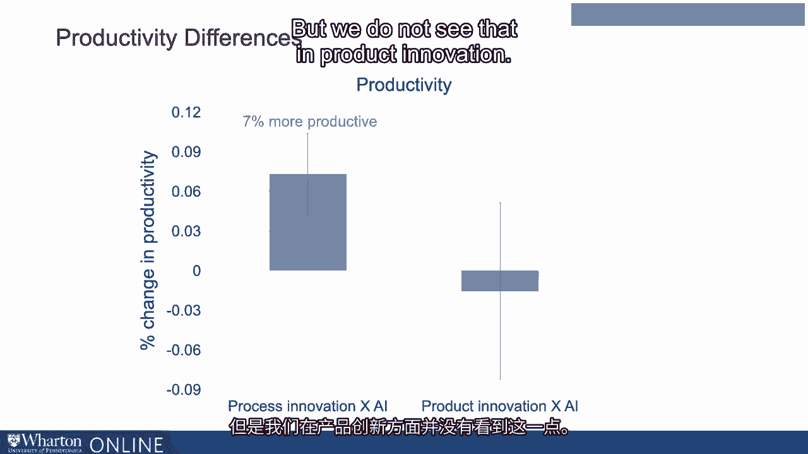
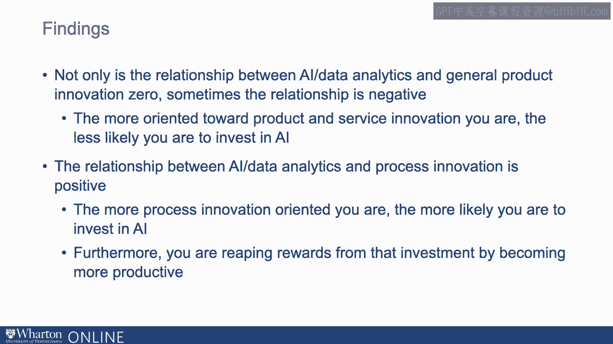

# 课程 P117：产品创新与人工智能 📚

在本节课中，我们将探讨产品创新，并分析人工智能与数据分析在其中扮演的角色。我们将通过一项大规模调查的数据，揭示企业在流程创新与产品创新上的不同表现，以及人工智能投资与这两类创新实践之间的关系。

---

在上一节中，我们讨论了流程创新。本节中，我们来看看产品创新，或者更具体地说，人工智能和数据分析如何帮助你确认并创新新的产品和服务。

记住我们之前提到的创新悖论：我们看到对人工智能和数据的投资在不断增长，然而，我们并未看到创新统计数据的相应提升。在某种意义上，我们没有看到更好或更多的创新。如果有的话，人均创新正在随着时间的推移而减少。

为了理解这一点，我们进行了一项大规模调查，以了解发生了什么。在早期的调查中，我们展示了人工智能在流程创新方面能有很大帮助。我们能否在产品和一般服务中看到相同的情况？

我们提出类似的问题，但这里我们真正想要聚焦的是关于产品的创新驱动实践。

以下是调查中涉及产品创新的核心问题：
*   你们组织设计、创建、引入新产品和服务需要多长时间？
*   你需要多长时间来创新或引入新的生产技术？
*   在一个主要业务单位中，最可能的核心活动是什么？

如果你对最后一个问题的答案是产品开发、产品设计或创新，我们将这家公司归类为更加面向创新的公司，其实践更驱动于创新。

再次，我们看到直方图，并非每个公司的创新都是驱动的。一些公司在这个尺度上非常高，而一些公司则非常低。其中许多处于中间位置。

这让你了解流程创新驱动实践与产品创新驱动实践之间的差异。在我们调查的300家公司中，这是一个显示分布的图表。

*   在 **x轴** 上，我们有流程导向的实践。
*   在 **y轴** 上，我们看到与创新相关的实践。

可以看到它分布在四个象限中。一些公司在两者上都很高，一些公司在两者上都很低，还有混合的情况。一些公司更偏向于流程，而对创新的关注较少。一些公司更关注创新，而对流程的关注较少。你确实看到存在异质性，存在巨大光谱。

公司在这个图中可以适应的位置，以及这些公司的可能性，最初投资人工智能和数据分析的情况。

*   在第一个柱子中，我们查看你的公司是否非常注重流程。你投资数据和AI的可能性有多大？我们看到一个标准差的过程创新的增加，有大约 **2.22%** 的公司更有可能采用AI和数据分析。这确实影响了非常显著的统计数据。
*   但如果你看看产品创新。在同一标准下，得分为1.0的偏差增加了你采用人工智能的可能性。如果你的产品导向，这基本上没有影响。

似乎如果公司真的对产品创新感兴趣，采用人工智能分析的可能性是零。它没有影响。

这真的很有趣。这可能与某些创新悖论有关。我们之前看到的内容。让我们也看看这如何转化为生产力。

如果你这么做，如果也许人工智能没有帮助，且没有投资人工智能，这是一个正确的决策。在这里我们关注对改善产品创新感兴趣的公司。他们也在人工智能上投资，并与其他公司进行比较，那些以流程为导向并投资于人工智能的公司。

在这个图表中我们看到，当一家公司同时投资于人工智能，并且非常注重流程时，得分为1.0的偏差变化与 **7%** 的生产力提升相关联。我们在之前的视频中看到了这一点。

并将其与产品创新进行对比。产品创新和人工智能基本上确认，投资于大量人工智能技能和产品以及基础设施，同时也非常关注产品的创新，他们实际上并没有看到生产力的提升。

但这里我们只是测量所有产品创新。我们还没有区分产品类别中的哪种创新。但总体来看，我们确实看到对流程导向感兴趣的公司和对产品导向感兴趣的公司之间存在差异。

一家非常关注改善流程的公司，在使用人工智能和分析方面看到显著改善。但我们在产品创新中并没有看到这一点。

所以这个重要发现是，不仅存在人工智能与分析之间的关系，一般的产品创新是零。有时这种关系甚至可能是负面的。也就是越倾向于我们的产品，服务形象越明显，他们实际上更不可能投资于人工智能。

我们看到这种关系对流程并不成立。从某种意义上说，更多的流程创新，你的公司更可能进行投资，你越有可能投资于数据分析和人工智能。此外，你还在通过提高生产力来获得这项投资的回报。

所以我们确实看到了流程与产品之间的创新差距。但再一次，这仍然是一个非常粗略的划分。我们将看看产品创新中的细分。

---

本节课中，我们一起学习了产品创新与人工智能应用之间的关系。核心结论是：调查数据显示，专注于**流程创新**的企业更可能投资人工智能并从中获得生产力提升（约 **7%**）；而专注于**产品创新**的企业，其人工智能投资倾向与生产力回报之间并未显示出显著的正向关联。这揭示了当前企业创新实践中存在的一个“创新差距”。

在下一个视频中，我们将进一步探讨在产品创新中，人工智能具体在哪些方面有效，哪些方面不起作用。