# 课程 P120：如何组织AI与数据技能以驱动创新 🧠

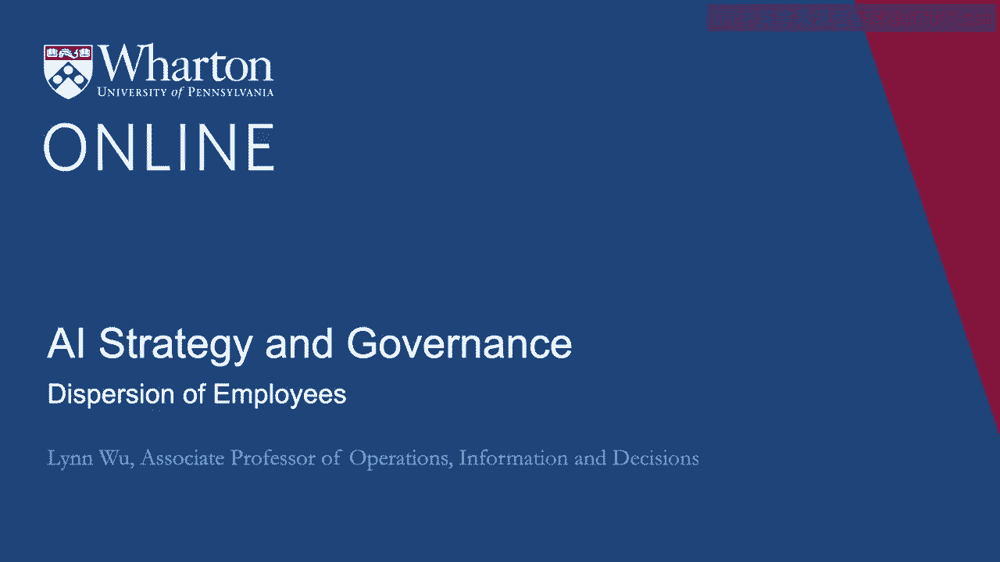

在本节课中，我们将探讨企业应如何构建其人工智能与数据分析能力，以最大化创新产出。我们将聚焦于三个核心问题：需要何种技能、这些技能应来自何处，以及如何最佳地组织这些技能。

---

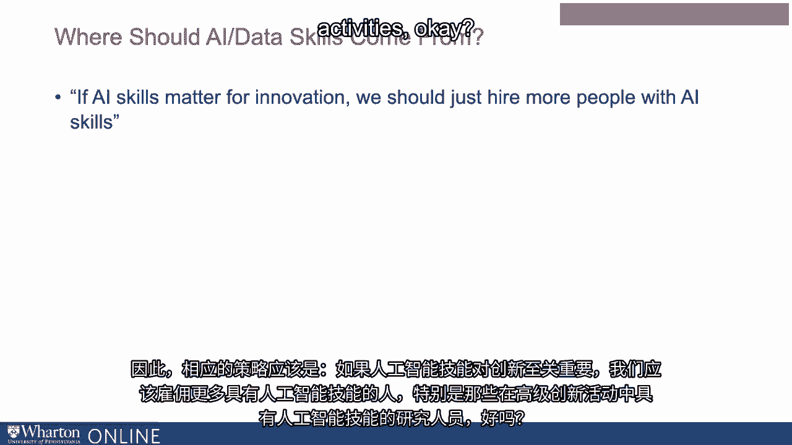

在上一节中，我们学习了如何构建创新以充分利用人工智能与分析。我们发现，人工智能可以补充去中心化的创新模式，从而提升公司的重组创新能力。

本节中，我们将讨论公司应关注的具体技能类型。

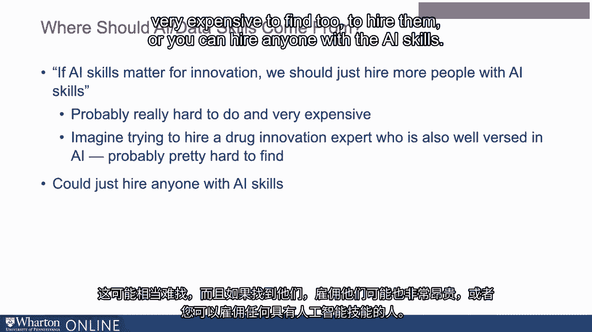

一方面，市场对人工智能与数据分析技能的需求非常高。数据显示，这些技能在过去十年中显著增长。

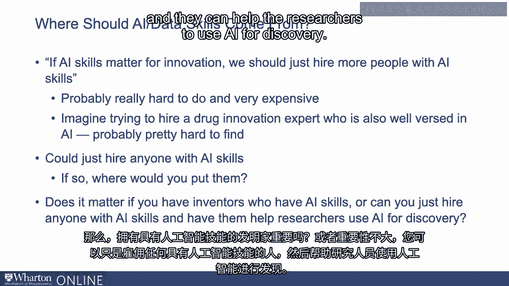

因此，一个直接的策略是：既然人工智能技能对创新至关重要，我们就应该雇佣更多具备这些技能的人才，尤其是那些同时是研究人员的AI专家。

然而，这种做法可能非常困难且成本高昂。要找到同时精通特定领域（如药物研发）和人工智能的专家非常罕见，雇佣他们的代价也可能极高。

另一种策略是雇佣任何具备人工智能技能的人。

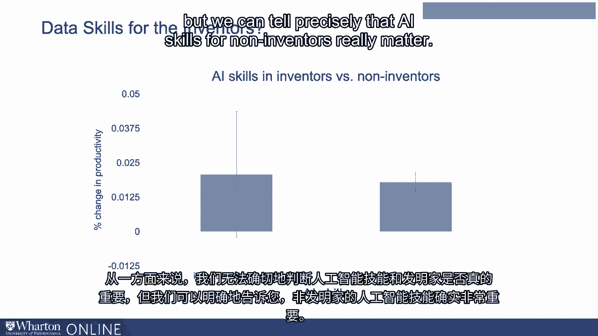

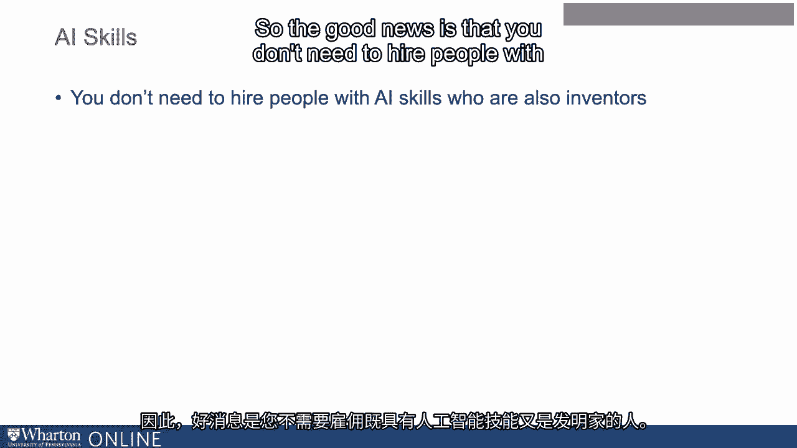

那么，随之而来的问题是：应该将他们安置在何处？拥有人工智能技能的发明者是否至关重要？还是说，只要雇佣懂AI的人来辅助研究人员进行发现就足够了？

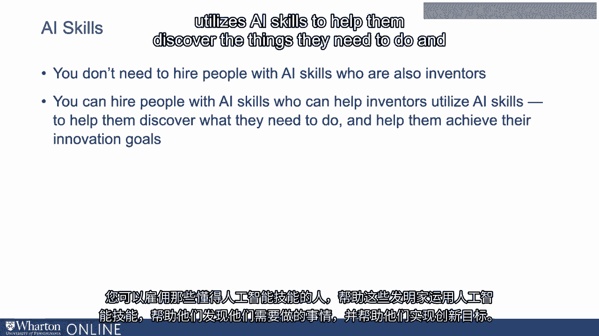

为了解答这个问题，我们进行了一项研究。我们比较了两种员工：**同时具备AI技能的发明者** 和 **公司中具备AI技能的非发明者员工**，并分析他们对AI产出和生产力的贡献。

以下是我们的发现：

*   关于同时具备AI技能的发明者，其数量虽然庞大，但实际影响难以精确判断。
*   然而，具备AI技能的非发明者员工，其贡献非常显著，几乎与具备AI技能的发明者一样强，尽管他们的发明技能本身可能较低。

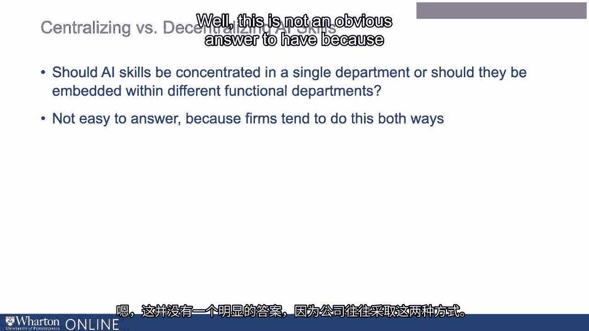

因此，虽然我们无法断定发明者的AI技能是否绝对重要，但我们可以明确地说：**非发明者的AI技能确实非常重要**。

这意味着一个好消息：你无需强求雇佣那些身兼发明家与AI专家的“双重人才”。

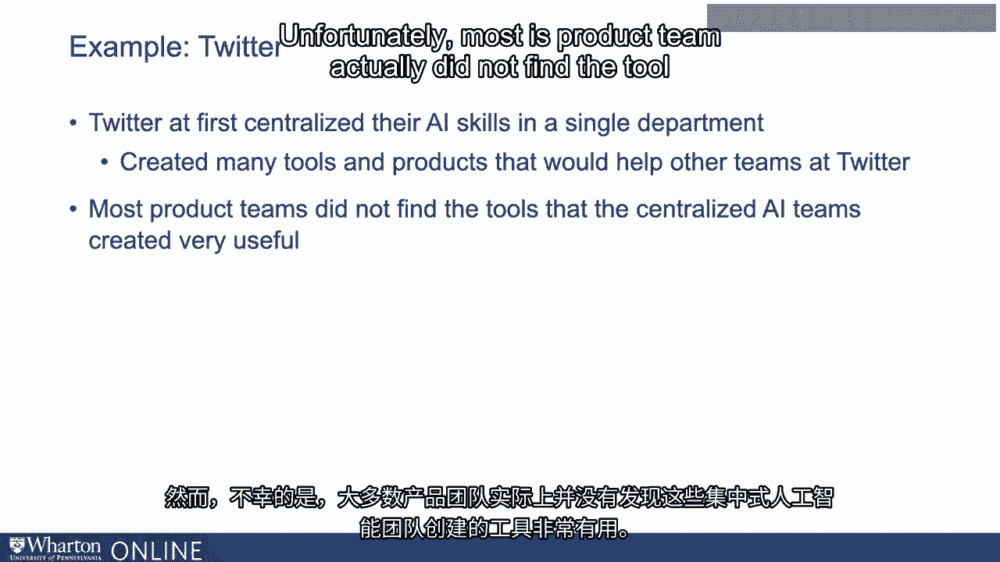

你可以广泛招聘具备AI技能的人员，让他们辅助公司的发明者，利用AI工具来发现机会并实现创新目标。

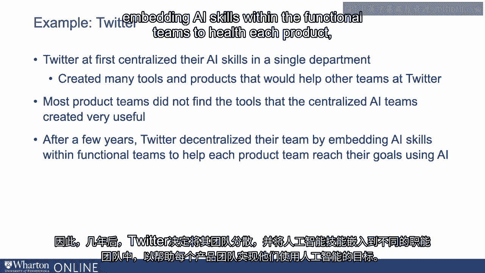

---

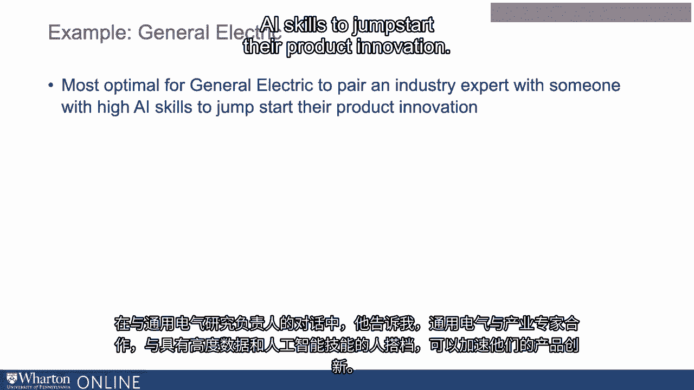

既然我们明确了可以广泛聘用AI人才，下一个关键问题就是如何组织他们。

AI技能应该集中在一个统一的部门（如传统的IT部门），还是应该分散嵌入到各个具体的职能部门或产品团队中？这并非一个显而易见的答案，因为不同公司采取了不同的做法。

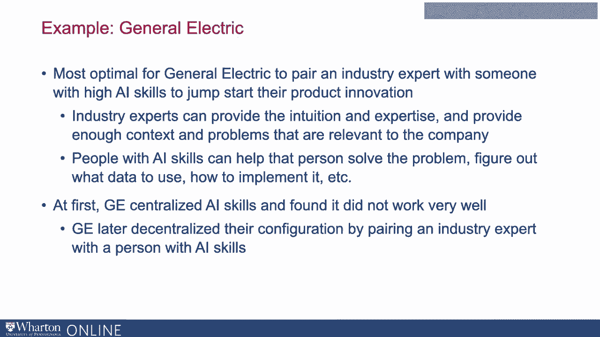

以下是两种组织模式的案例：

*   **集中化模式**：例如，Twitter最初将其AI技能集中在一个部门，类似于组织IT技能的方式。他们开发了许多工具，但大多数产品团队并未实际采用这些工具。集中化的AI团队被认为效用有限。
*   **去中心化模式**：几年后，Twitter决定改变策略，将AI技能分散嵌入到各个功能团队中，以帮助每个产品更好地利用AI。不仅科技公司如此，通用电气（GE）也有类似经历。GE发现，将行业专家与具备高数据和AI技能的人员配对，是启动产品创新的最优方式。行业专家提供直觉和专业背景，而AI专家则帮助厘清数据和应用方案。因此，GE也从早期的集中化转向了去中心化的配置。

那么，这仅仅是Twitter或GE的个别情况吗？我们对此现象进行了更广泛的研究。

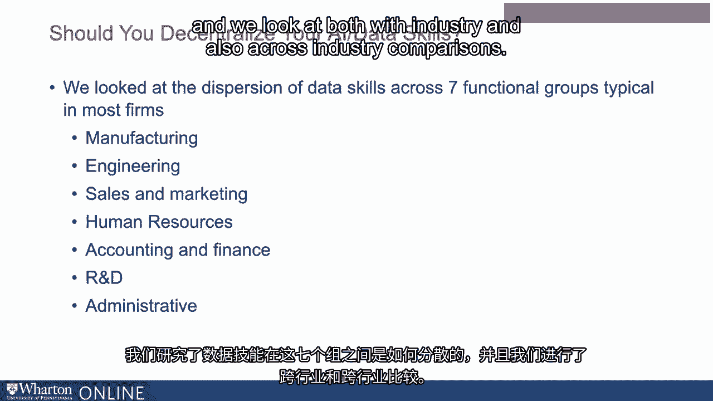

我们考察了七类典型职能部门中数据技能的分布情况，包括：制造、工程、销售与市场、人力资源、会计与财务、研发以及行政管理。

我们同时关注了行业内和跨行业的比较。我们调查了约600家公司，询问他们在以上七个职能中使用数据分析的频繁程度。

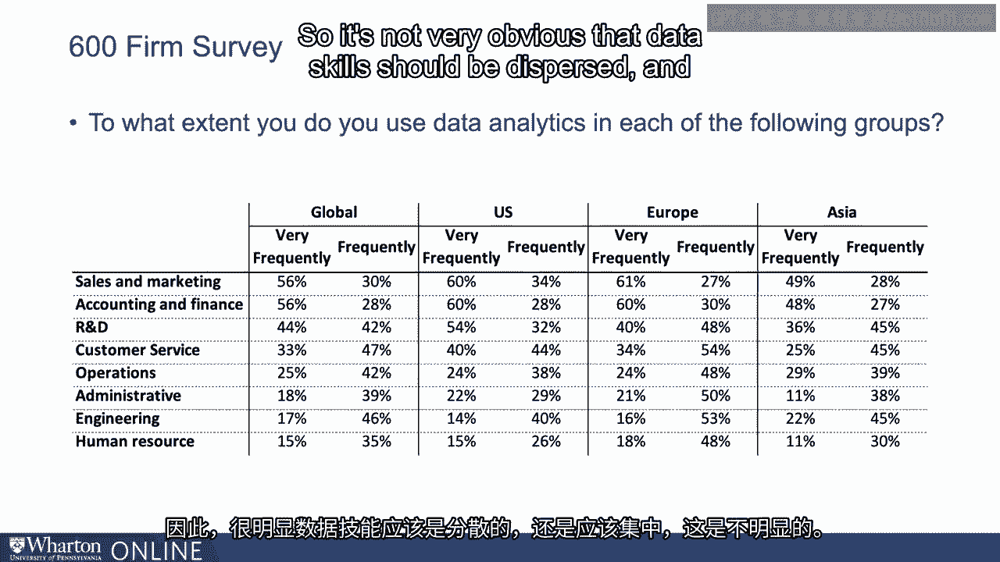

调查结果显示，不同国家（美国、欧洲、亚洲）之间在技能分布上没有显著的异质性。因此，“数据技能应分散，而数据本身应集中”并非一个普遍明显的结论。

然而，**行业之间确实存在差异**。我们计算了“数据分散得分”：得分高意味着数据技能在七个职能间分布均匀；得分低则意味着技能高度集中在一两个部门。

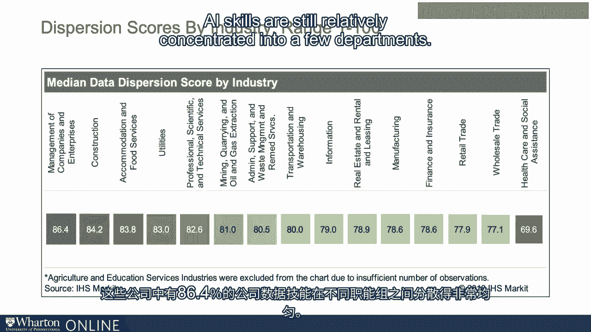

数据显示，企业管理行业的分散得分最高（86.4%的公司得分高），意味着其数据技能高度分散。而医疗保健和社会系统行业的得分非常低，表明其AI技能仍相对集中在少数部门。

此外，按区域看，欧洲公司的分散性略高于美国，亚太地区居中。不同地区和行业间的得分确实存在聚集现象，且方差很大，这表明企业在如何组织数据技能上尚未形成统一共识，存在很大的异质性。

---

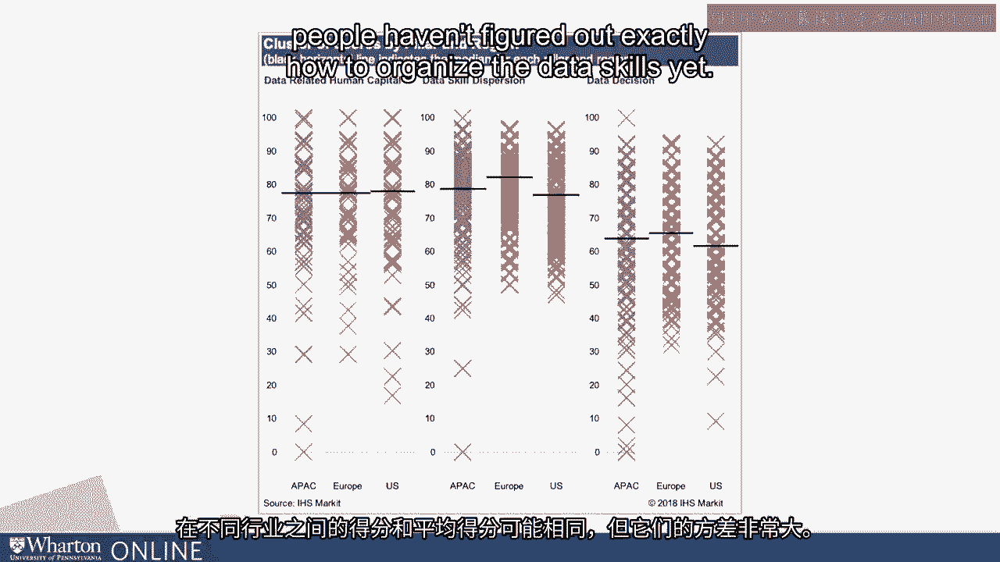

那么，分散化究竟是否对公司有利？我们进一步研究了分散程度与公司效能的关系。

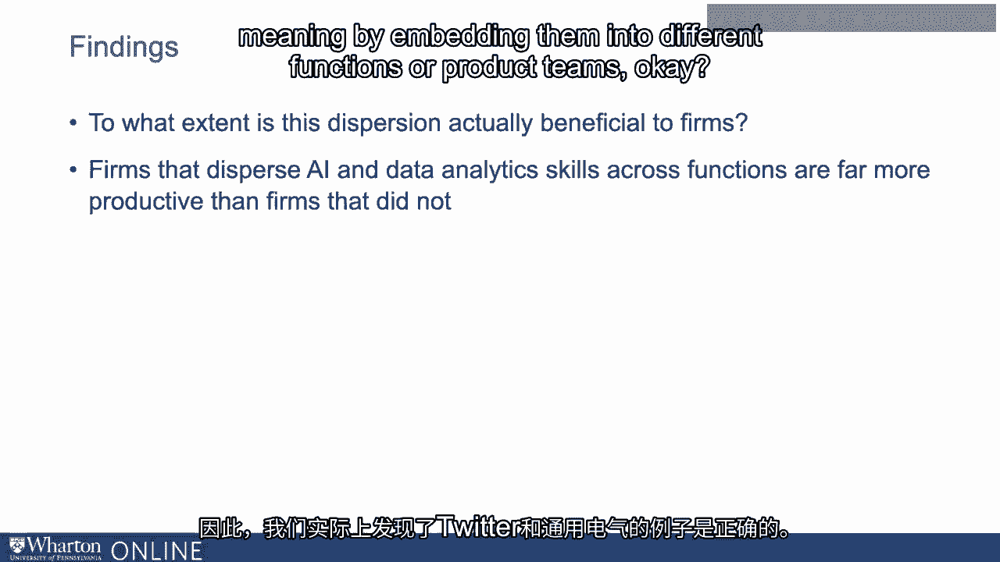

我们发现，Twitter和GE的案例具有普遍意义。**当公司将AI和数据技能分散化，嵌入不同的职能或产品团队时，这些公司比未这样做的公司更有效、生产力更高**。

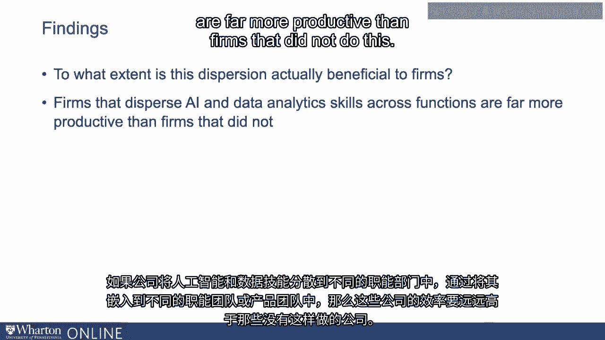

平均而言，数据分散得分每增加一个标准差，对应的企业价值大约提升**3-5%**。考虑到我们样本中公司的平均规模（约107亿美元），这相当于**3.2亿至5.34亿美元**的价值变化。因此，尽管百分比增幅看似不大，但转化为具体金额后，影响是实质性的。

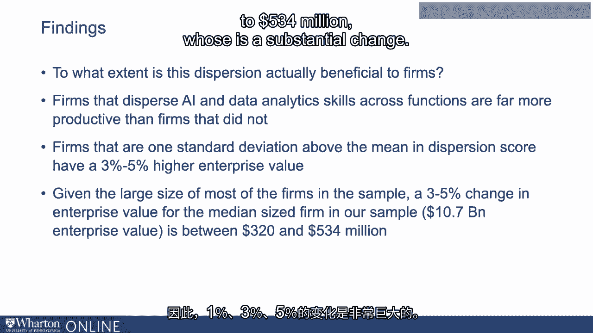

---

本节课中，我们一起学习了如何为驱动创新而构建AI与数据能力。我们明确了非发明者的AI技能同样至关重要，这降低了企业招聘“双重人才”的难度。更重要的是，我们通过研究和案例发现，**将AI和数据技能去中心化，嵌入到各个业务职能部门中，而非集中管理，能更有效地提升公司的创新产出和企业价值**。组织这些技能的方式，是释放其创新潜力的关键。