# 课程 P121：人工智能时代的管理实践变革 📊

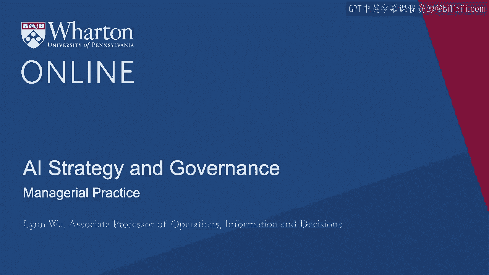

在本节课中，我们将探讨人工智能和机器人技术如何深刻影响企业的管理实践与员工构成。我们将基于一项覆盖加拿大的全国性研究数据，分析机器人采纳如何改变就业结构、管理角色以及公司内部的决策方式。

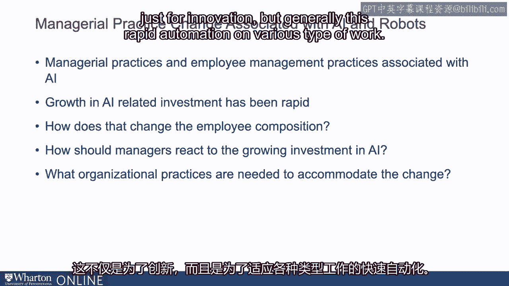

---

## 🔍 机器人采纳的现状与影响

上一节我们讨论了公司的组织结构和技能，本节中我们来看看其他管理实践和员工管理。与人工智能相关的实践，实际上是由人工智能及其相关领域的快速增长所驱动的。过去几年，相关投资增长非常迅速。这种增长如何改变员工的构成？管理者又应如何应对对人工智能日益增长的投资？

为了适应这一变化，公司需要采取哪些实践？这不仅仅是为了创新，更因为快速的自动化正在影响各种类型的工作。

你可能在大众媒体上听过许多关于机器人、人工智能可能对就业和管理实践造成巨大冲击的讨论。例如，有观点认为人工智能和机器人会摧毁大量工作岗位，而我们尚未做好准备。

这类观点出现在《外交事务》、哈佛商业评论等刊物，甚至影响了政策制定者。欧盟曾提出“机器人税”的构想，在2020年的总统竞选中，德布拉西奥也著名地提议征收机器人税，比尔·盖茨也曾建议机器人应像人类一样被征税。

这些讨论虽然引人注目，但我们实际上并不清楚人工智能的确切影响程度。机器人确实影响就业，但管理实践需要在多大程度上进行调整以适应这些变化？在讨论任何政策影响之前，我们首先需要确凿的事实，来了解人工智能和机器人如何改变工作的性质。

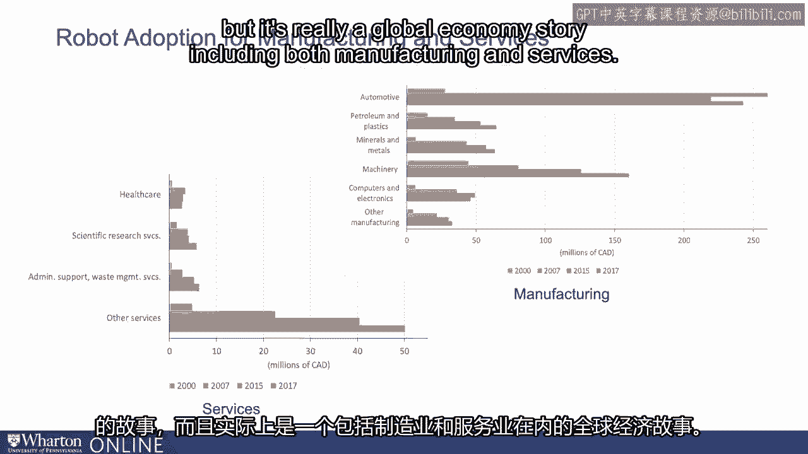

为此，我们在加拿大进行了一项全国范围的研究，详细捕捉了特定公司中所有的机器人采纳情况。这项研究使用了税收数据和人口普查数据，这意味着几乎所有公司都因合规要求而参与，覆盖率约为加拿大公司的80%至90%。

研究发现，与制造业相比，**服务业的机器人采纳正在迅速增长**。这与我们过去的认知不同——机器人不仅影响制造业，也正快速进入服务业，尤其是在近几年。当然，制造业仍是机器人最大的采纳者之一，但在医疗、科学研究等其他服务领域，增长也非常迅速。

因此，这不仅仅是一个关于制造业的故事，而是一个涉及制造业和服务业的全球经济现象。

---

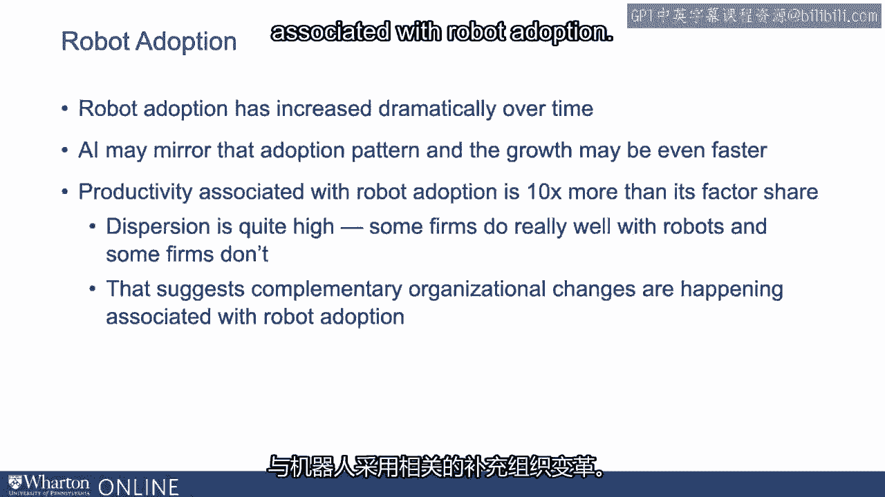

## 📈 机器人采纳与生产力提升

我们看到，机器人或人工智能的采纳在一段时间内显著增加。人工智能的采纳模式可能增长更快，因为它属于新一代技术，正变得越来越主流。

在我们的研究中，我们发现与机器人采纳相关的**生产力提升相当显著**，提升因子约为10倍。这意味着，如果你采纳机器人并保持运营平衡，你应该能获得相当于机器人价值数倍的生产力回报。这类似于资本投资的回报率。

然而，这种提升的分布并不均匀。一些公司在使用机器人方面表现得非常好，而另一些则不然。这表明，与机器人采纳相配套的**组织性变革**正在发生，且对成功至关重要。

---

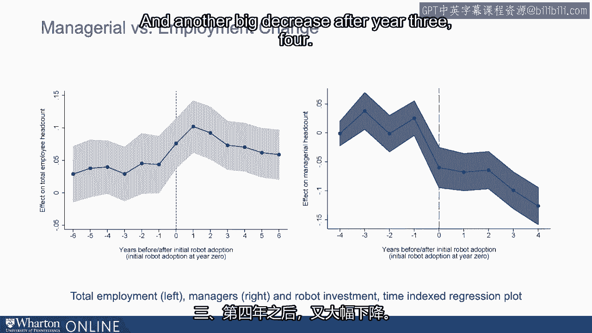

## 👥 机器人对就业与管理岗位的差异化影响

让我给你一个关于机器人和就业现状的概念。我们将其分解为对总就业和对管理者的影响两个方面。

与“机器人会消灭所有工作”的流行说法相反，左图（事件研究图）显示，在公司引入机器人之前，就业数量基本稳定。在引入机器人当年（零点），就业开始增加，并在两三年后持续上升，即使在五、六年后仍保持高于最初的水平。

**因此，总体而言，机器人实际上增加了就业。**

但这种效果并不是均匀的。如果你看看右侧的图表（衡量管理岗位数量），你会看到几乎完全相反的模式。在引入机器人之前，管理岗位数量稳定。但在引入机器人当年，管理类就业大幅减少，并在一两年内保持低位，之后在第三或第四年进一步下降。

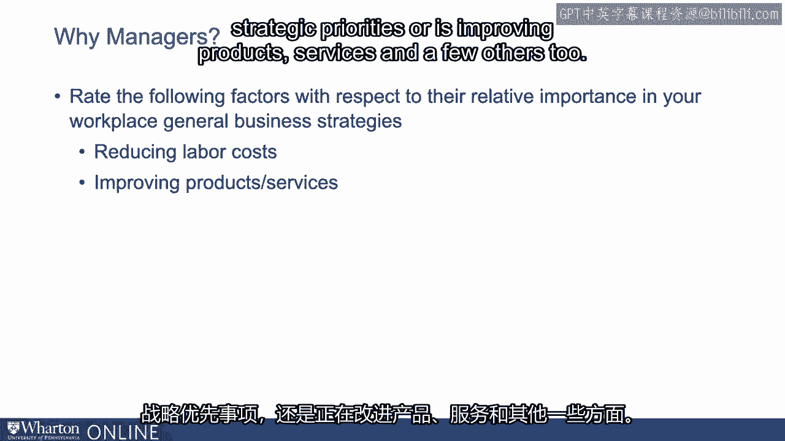

**那么，为什么机器人会增加总就业，却减少管理岗位？**

这似乎违反直觉，因为管理者的定义就是管理他人。我们怎么能用机器人替代他们？机器人真的能成为我们的管理者吗？这里到底发生了什么？

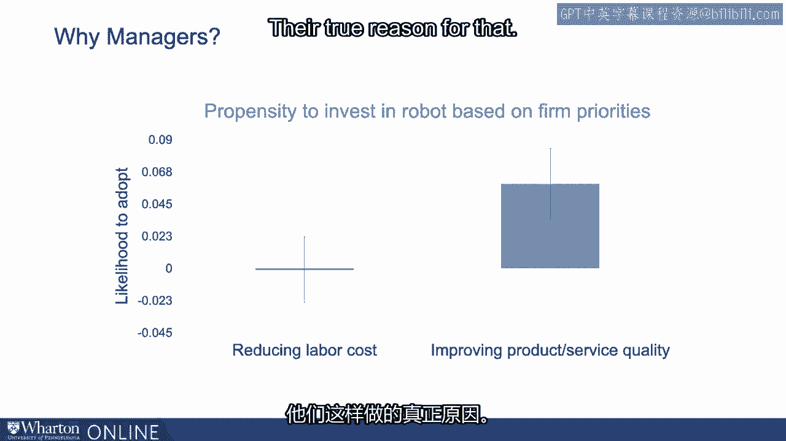

---

## 📊 管理岗位减少的深层原因

这种变化并非统计偶然。下图比较了采纳机器人的公司（蓝线）与未采纳的公司（红线）中，管理者与员工的比例随时间的变化。可以看到，采纳机器人的公司逐渐降低了这一比例，而未采纳的公司则基本保持不变。

**那么，为什么管理者会减少？**

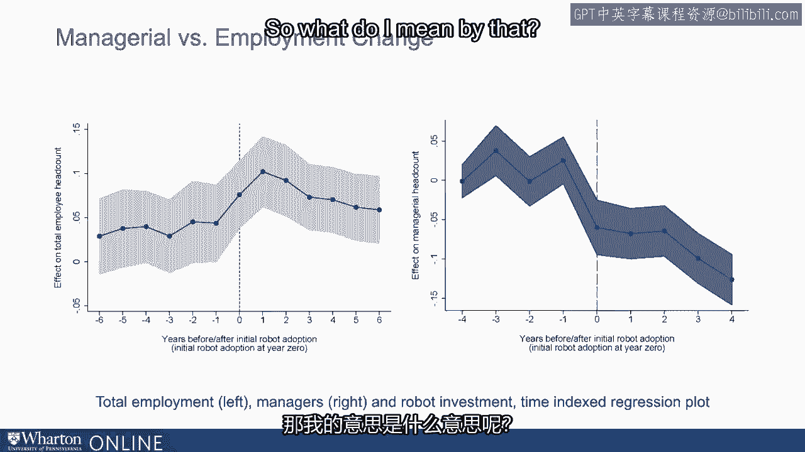

一个可能的猜测是管理者成本高昂，因此公司为削减成本而首先裁减他们。但我们的调查数据并不支持这一点。我们询问了公司其商业战略的相对重要性，包括“降低劳动成本”和“改善产品/服务”。

分析发现，“降低劳动成本”作为战略优先事项，与机器人采纳倾向**几乎没有关联**。然而，将“改善产品/服务”作为坚定战略优先事项的公司，其机器人采纳倾向**显著更高**。

**因此，驱动机器人采纳的不是成本削减，而是提升产品与服务质量。**

那么，为什么人工智能和机器人会对管理岗位产生如此深远的影响？真正的原因如下：

首先，回顾之前展示的图表，管理岗位在机器人引入初期显著下降，两年后趋于平稳，然后再次下降。由机器人和人工智能推动的自动化技术，可以接管许多**监督性工作**，例如考勤打卡、任务完成度追踪等。这些工作相对容易通过技术进行管理，从而减少了对从事此类监督工作的管理者的需求。

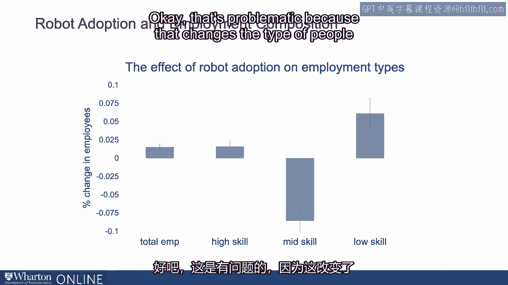

但技术无法接管全部，甚至大部分管理职能。两年后的第二次下降，很可能是因为**就业构成发生了根本性变化**。

---

## 🧠 就业技能结构的变化

我按技能水平将总就业细分为三类：
*   **高技能工人**：拥有大学或研究生学位。
*   **中技能工人**：高中毕业后拥有一些技能认证（如两年制学位、职业认证）。
*   **低技能工人**：只有高中学历或更低。

观察机器人对这三类工人的影响，可以发现显著差异：
*   对**高技能工人**的需求显著上升。
*   对**低技能工人**的需求也有较大增加。
*   然而，对**中技能工人**的影响是**非常大的负数**。

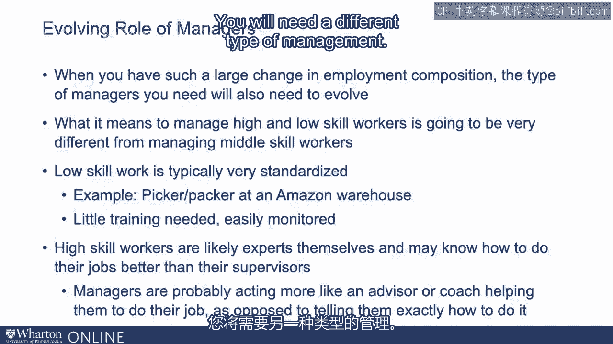

尽管机器人提高了总就业，但其效果是异质的：它积极影响高技能和低技能工人，却**非常负面地影响中技能工人**。这改变了管理者所需管理的人才类型。

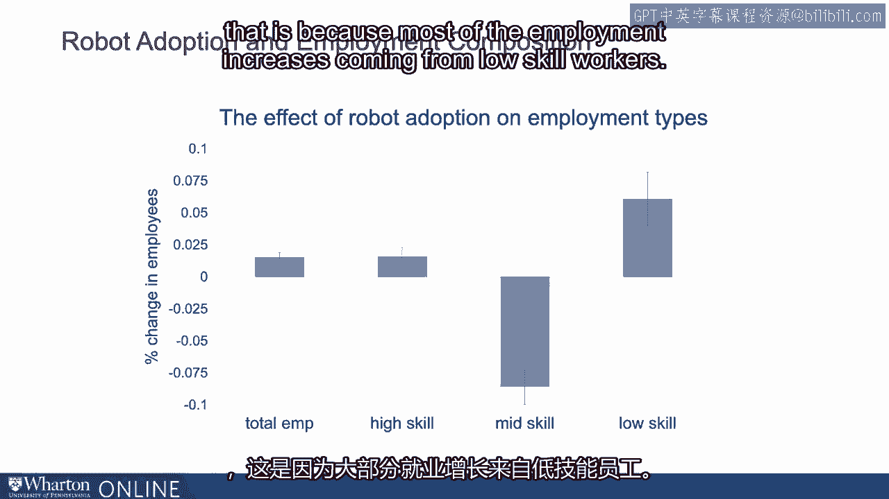

---

## 🎯 管理不同类型员工意味着什么

当就业构成发生如此大的变化时，所需的管理者类型也需要进化。
*   **管理低技能工人**：他们的工作通常非常标准化（如仓库拣货、打包），易于通过技术监控和追踪，因此可能不需要很多监督者来指导具体工作。
*   **管理中技能工人**：这通常需要更多的直接监督和培训。
*   **管理高技能工人**：这些员工本身就是专家，可能比管理者更了解如何完成工作。因此，他们的管理者可能更像**顾问或教练**，帮助他们达成目标，而非指导具体操作。

因此，由于就业构成向更多低技能和更多高技能工人转变，而中技能岗位减少，平均而言，**管理者数量会减少**。更重要的是，**所需的管理技能和风格也发生了根本变化**。

---

## 🏢 随之演变的企业实践

企业的运作方式正在改变，以适应或协同机器人采纳。具体来说，我们考察了三种不同的企业实践：

以下是三种关键的企业实践变化：

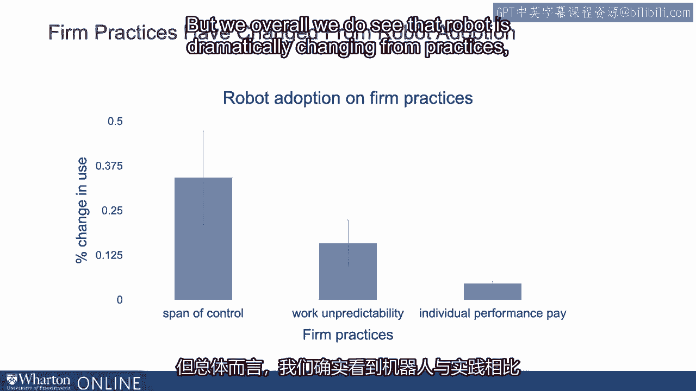

1.  **控制范围扩大**
    平均而言，一个经理能管理多少人？由于员工总数增加而管理者数量减少，**控制范围（每位经理下属的员工数）显著增加**。我们通过独立调查也确认了这一点。

2.  **工作可预测性提升**
    如果你考虑到机器人正在处理所有可预测的任务（AI是极好的预测工具），那么留给工人的将是更多**不可预测的部分**。数据显示，在引入机器人后，工作的可预测性确实大幅提升，表明工作性质正在变化。

3.  **绩效薪酬增加**
    机器人可以减少生产过程中的方差，因为它们能持续、精确地工作。这使得个人的具体贡献更容易被准确衡量和归因。因此，在引入机器人后，**与个人绩效挂钩的薪酬有所增加**。

这些实践仍在不断演变，但我们确实看到机器人正在显著改变企业的运作方式，尤其是在人员管理方面。

---

## 🤝 决策权的重新分配

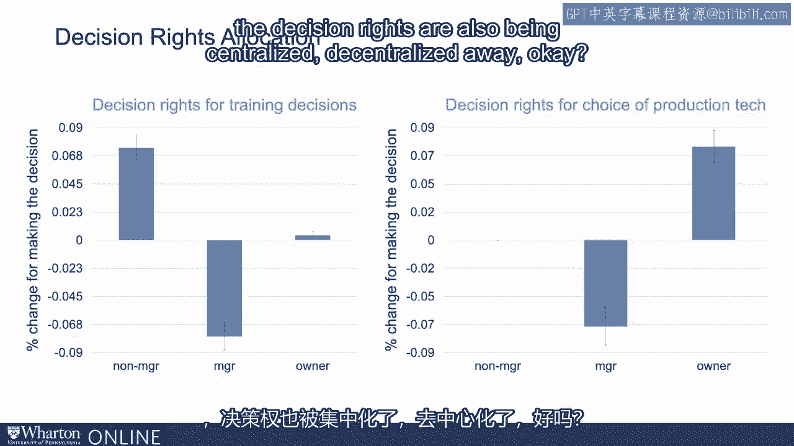

最后，这种戏剧性的变化不仅涉及人员，还涉及**决策权的分配**——即公司中谁为哪些任务做决定。

以下是两个关键的决策权变化示例：

*   **培训内容决策**：在机器人采纳后，关于“员工应该接受什么培训”的决策权，从**管理者**显著转移到了**员工自己**手中。高层管理者的决策权变化不大。这体现了决策权的去中心化。
*   **生产技术选择决策**：关于“使用什么生产技术”的决策权，也从**中层管理者**转移到了**CEO/高层管理者**手中。这体现了在某些关键决策上的集中化。

因此，管理者的数量不仅在减少，他们的**职责和决策权也在以复杂的方式被重新分配**（某些方面去中心化，某些方面集中化）。

---

## 💎 总结与启示

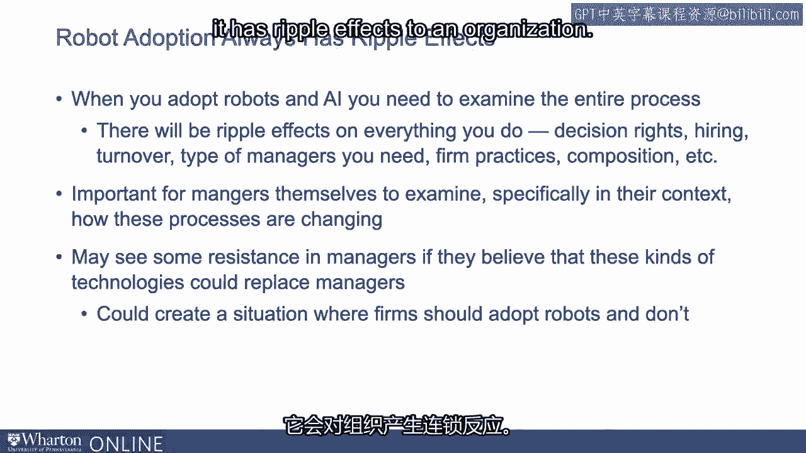

本节课中我们一起学习了人工智能和机器人技术如何重塑管理实践。这个故事比想象中更微妙。机器人并非直接替代管理者，而是通过改变**就业的技能构成**和**工作的性质**，间接地改变了所需管理者的类型和数量。

关键结论如下：
*   采纳机器人技术的公司**提高了生产力并雇用了更多人**。
*   未采纳的公司在同一行业内可能面临更大的竞争压力和就业损失。
*   机器人采纳后，公司雇佣的人员类型（更多高技能和低技能，更少中技能）与之前截然不同。
*   这导致**管理岗位减少、控制范围扩大、工作可预测性提升、绩效薪酬增加，以及决策权重新分配**。

因此，采纳机器人和人工智能不是一个简单的技术插入过程，它会对组织产生连锁反应，影响雇佣、决策、薪酬等各个方面。对于管理者而言，深刻理解这些变化，并持续审视和调整自身的管理实践以适应新的环境，至关重要。

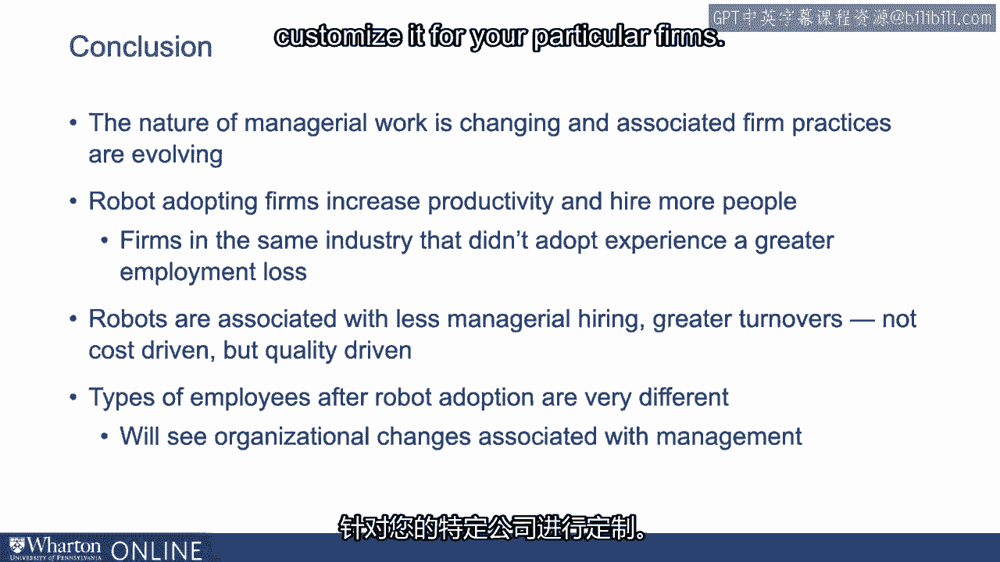

谢谢。

---