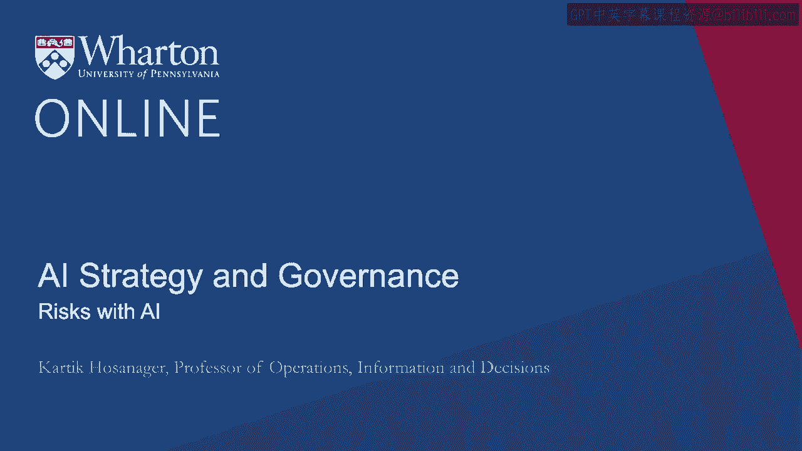
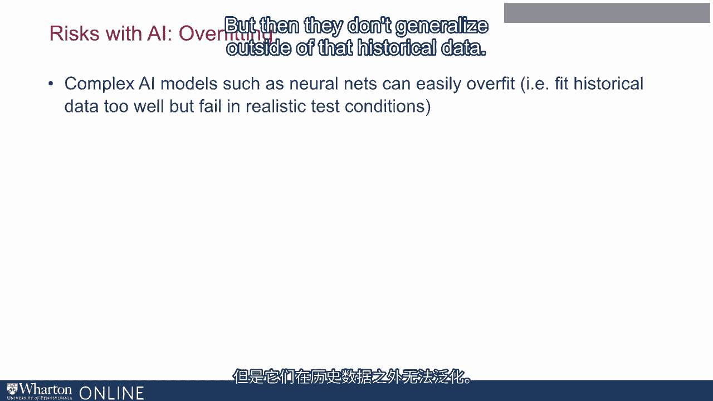
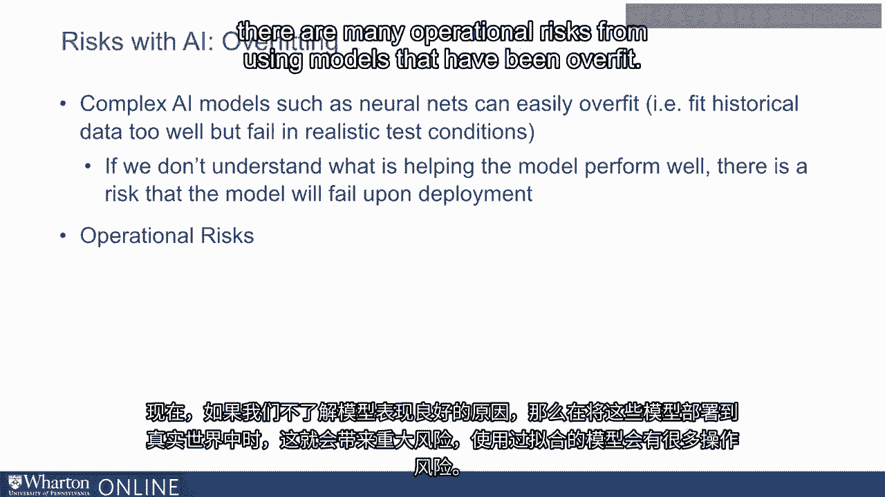
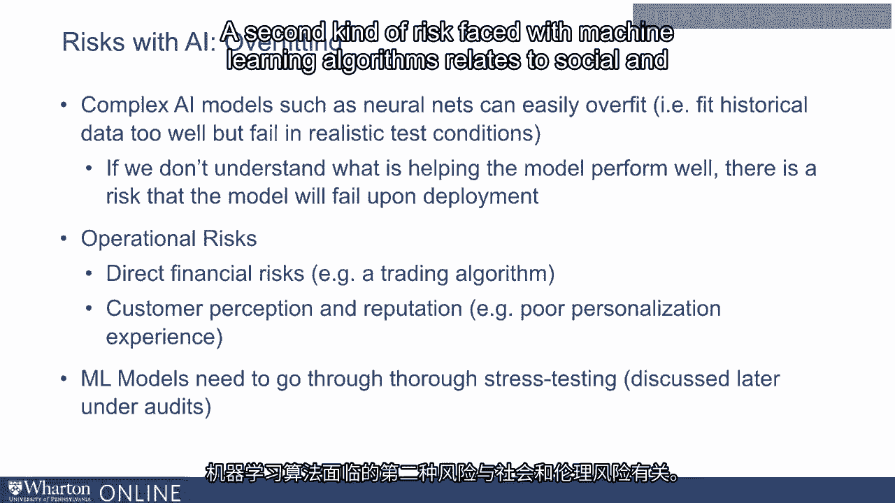
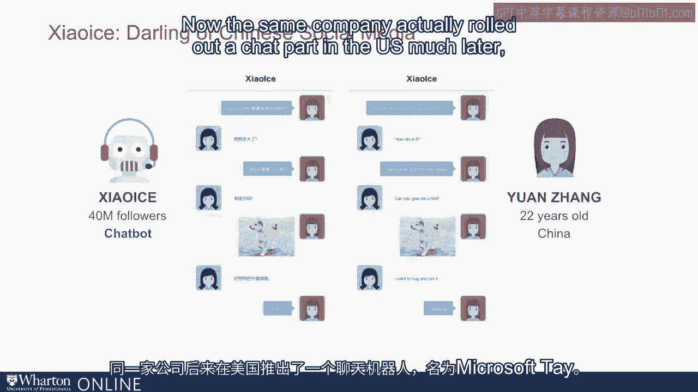
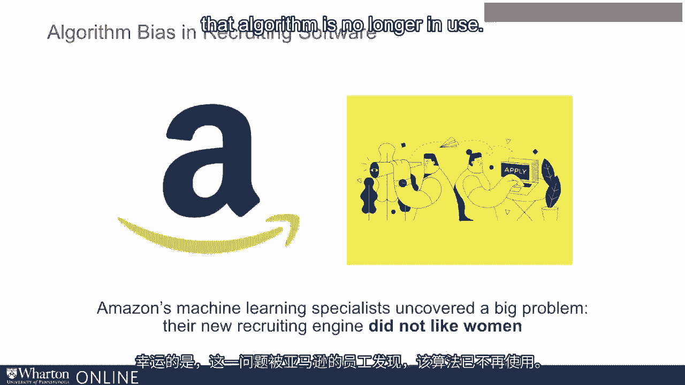
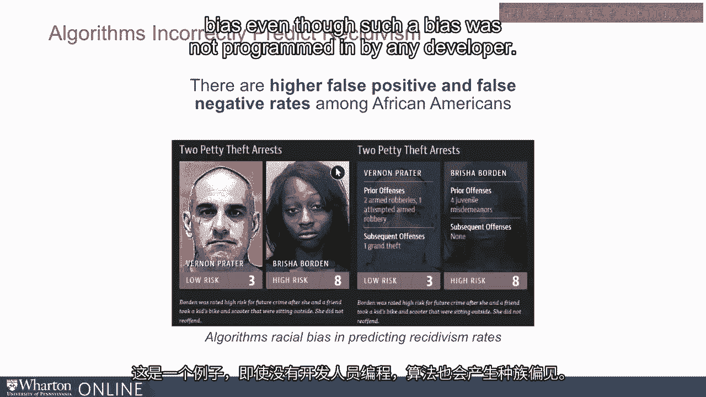
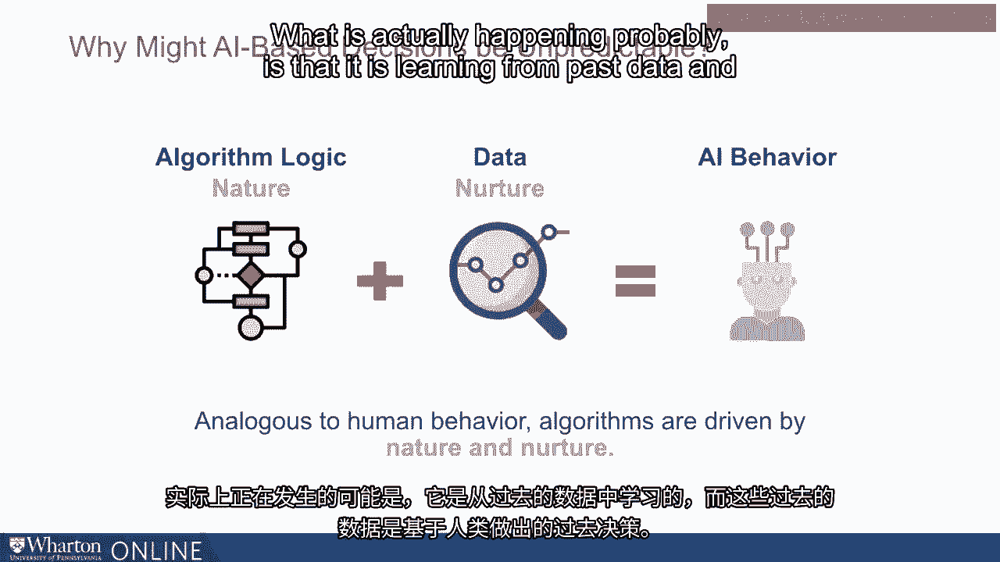
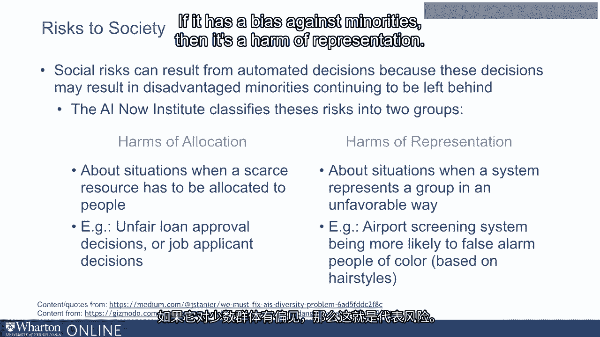
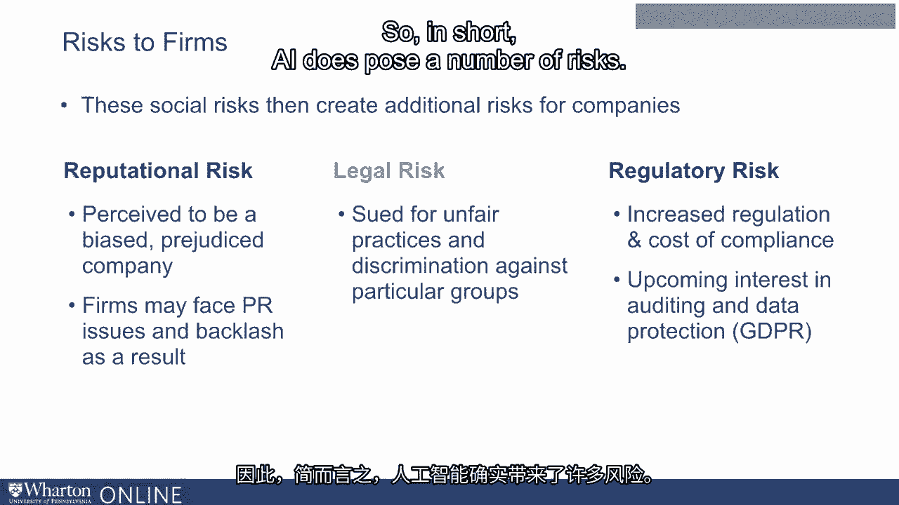

# 课程 P123：AI的风险 🧠⚠️

在本节课中，我们将要学习人工智能（AI）和机器学习（ML）在实际应用中可能面临的主要风险。我们将从统计风险开始，然后探讨更广泛的社会与伦理风险，并理解这些风险为何会产生。

***

## 统计风险：过拟合

上一节我们介绍了课程概述，本节中我们来看看第一种风险——过拟合风险。许多复杂的高级机器学习模型，例如神经网络和梯度提升，容易对训练数据产生过拟合。这意味着它们往往能非常完美地拟合历史数据，但在面对新的、未见过的现实情况时却会失败。

这是因为这些模型通常参数过多，能够拟合非常复杂的模式，以至于“记住”了训练数据中的噪声和特定细节，而非学习到通用的规律。因此，它们在历史数据之外并不能很好地泛化。

如果我们不了解模型表现良好的真正原因，当我们在现实世界中部署这些模型时，就会带来显著的操作风险。

以下是使用过拟合模型可能产生的一些操作风险示例：

*   **财务风险**：例如，一个基于机器学习的股票交易算法如果过拟合，可能做出错误的交易决策，直接导致财务损失。
*   **客户认知与声誉风险**：例如，一个与客户互动的聊天机器人或个性化推荐算法，如果在实践中运行不佳，会损害客户体验，长远影响客户保留率和公司声誉。

简而言之，尽管存在许多统计风险，但它们实际上可以通过测试来识别和管理。因此，对机器学习模型进行严格的压力测试至关重要。这包括进行之前提到的验证，也包括其他多种测试方法。

***

## 社会与伦理风险

上一节我们讨论了可量化的统计风险，本节中我们将探讨更具挑战性的社会与伦理风险。为了说明这一点，我将分享一些研究中的实例。

在我的研究中，我采访了一位名叫袁瑾的22岁中国生物技术专业人士。她有一个非常有趣的习惯：每晚睡觉前，她会与一位名叫邵平的中国社交媒体名人聊天，进行有趣且充满玩乐的对话。邵平在中国拥有四千万粉丝。

然而，当我深入挖掘时，我意识到邵平并不是一个人。邵平实际上是微软研究院创建的一个聊天机器人，在中国取得了很大成功。后来，同一家公司在美国推出了一个类似的聊天机器人。

它被称为“微软 Tay”。遗憾的是，Tay 上线后参与了性别歧视、充满种族主义和法西斯主义的对话，迫使微软在24小时内将其关闭。

有趣的是，同一家公司推出的两个相似聊天机器人，却得到了如此不同的结果。这反映出机器学习算法面临的挑战，以及在部署之前需要进行大规模、多场景压力测试的必要性。

另一个与机器学习相关的挑战是其**在简历筛选中的应用**。像亚马逊这样的大公司每年可能收到数十万甚至数百万份简历。人工筛选在规模上非常困难，因此许多公司尝试使用机器学习来筛选求职者。

然而，路透社的一则新闻报道，亚马逊发现其最初的简历筛选算法存在性别偏见。幸运的是，这一算法被内部人员发现，因此不再使用。但这表明，即使像亚马逊这样的大公司也不得不面对算法偏见的问题。

他们设计了一个基于前沿机器学习技术的算法，但它仍然存在性别偏见。

几年前，ProPublica 报道了一则新闻，关于在美国法庭中使用的算法。这些算法旨在帮助法官和假释官进行保释、判刑和假释决策。它们会评估被告的历史，预测其再次犯罪的可能性。

调查发现，该算法错误预测黑人被告未来犯罪的可能性，是错误预测白人被告的两倍。这是一个典型的例子：尽管开发者没有故意编程任何偏见，但算法却在结果中产生了种族偏见。

***

## 偏见从何而来？

显然，随之而来的问题是：为什么这些偏见会出现？为什么简历筛选算法会显示性别偏见？为什么判刑算法会存在种族主义倾向？为什么聊天机器人会发表种族主义言论？

当我们设计人工智能系统时，主要有两种方法：基于规则的方法和基于机器学习的方法。因此，驱动AI系统行为的因素，部分源于程序员编写的逻辑或规则（在专家系统中），部分源于模型从数据中学到的模式。

这与人类行为有相似之处。我们认为人类行为由“天性”（基因）和“教养”（环境）共同驱动。心理学家将一些问题行为（如酗酒）部分归因于天性，部分归因于教养。

在AI中也是如此。如果你观察AI的问题行为，“天性”和“教养”同样在发挥作用：
*   **天性**：是程序员为AI创建的规则和算法逻辑。
*   **教养**：本质上是AI用于学习的数据。

**如果训练数据中存在偏见，那么AI系统也能识别并学会这些偏见。**

因此，当简历筛选算法表现出性别偏见时，实际发生的情况可能是：它正在学习过去的历史数据。而这些历史数据记录了人类招聘者过去的决策——他们邀请了谁面试，雇佣并晋升了谁。如果过去的决策中存在（即使是无意识的）性别偏见，那么这种偏见就被“编码”在了数据中，并最终被AI模型捕获。

当我们思考基于AI的决策及其风险时，许多问题往往源于数据中预先存在的偏见。

***

## 风险的影响与分类

那么，这些风险具体会带来哪些影响呢？首先，社会面临许多风险，特别是当AI系统基于有偏见的数据进行自动决策时，可能导致少数群体继续被边缘化。

AI风险通常可以分为两大类：
1.  **分配性危害**：这涉及必须将稀缺资源分配给人们的情况。例如贷款审批、招聘决策（简历筛选算法决定谁获得面试机会）等。算法决定了谁将获得这些有限的资源。
2.  **代表性危害**：这指的是系统以不利或刻板的方式代表或对待某个群体。例如，机场的人脸识别或行为筛查系统，如果对特定少数族裔群体有更高的误报率，就是一种代表性危害。

这两类都是非常重要的危害，值得我们高度关注。

这些不仅仅是社会风险，也对公司构成了直接威胁，因为社会风险会转化为组织的声誉、法律和监管风险：
*   **声誉风险**：公司如果被视为有偏见，将面临公关危机，可能导致客户流失。
*   **法律风险**：公司可能因歧视性做法而被客户或雇员起诉。
*   **监管风险**：当监管机构认为你的算法存在歧视或造成社会风险时，会施加更严格的法规，带来合规成本。例如，欧盟的《通用数据保护条例》（GDPR）除了关注隐私，也包含了关于自动决策的条款，其中“解释权”就给企业带来了新的合规要求。

***

## 总结

本节课中，我们一起学习了人工智能的主要风险。

我们首先探讨了**统计风险**，核心是**过拟合**问题，即模型在训练数据上表现完美但泛化能力差，这会导致财务和声誉等操作风险。管理此类风险的关键在于进行严格的验证和压力测试。

接着，我们深入探讨了**社会与伦理风险**。通过聊天机器人（如微软Tay）、简历筛选算法和司法判决算法等实例，我们看到AI可能复制并放大数据中存在的**性别、种族等社会偏见**。这些偏见并非总是程序员有意为之，而常常是模型从带有偏见的历史数据中学到的结果。

最后，我们将这些风险的影响归纳为**分配性危害**和**代表性危害**两类，并指出它们不仅危害社会公平，也会给企业带来声誉、法律和监管层面的实际风险。

那么，如何管理这些风险呢？我们将在接下来的课程中进行探讨。