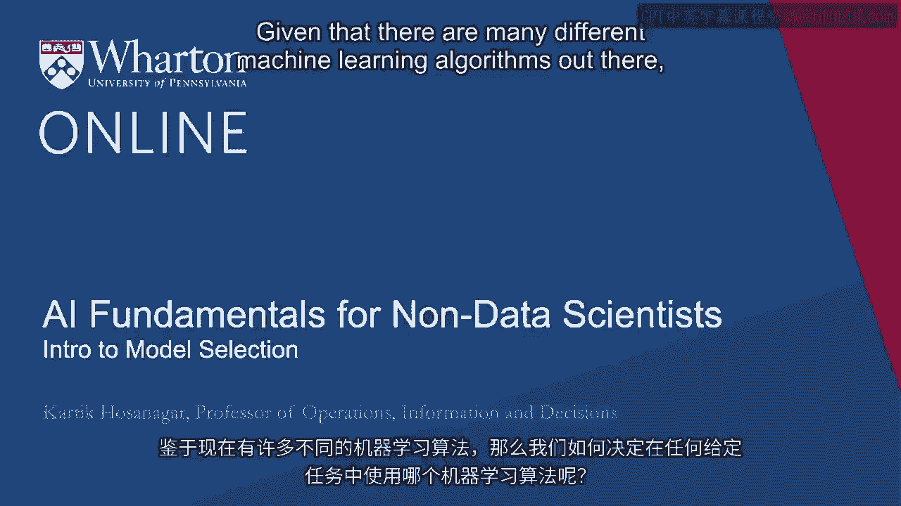
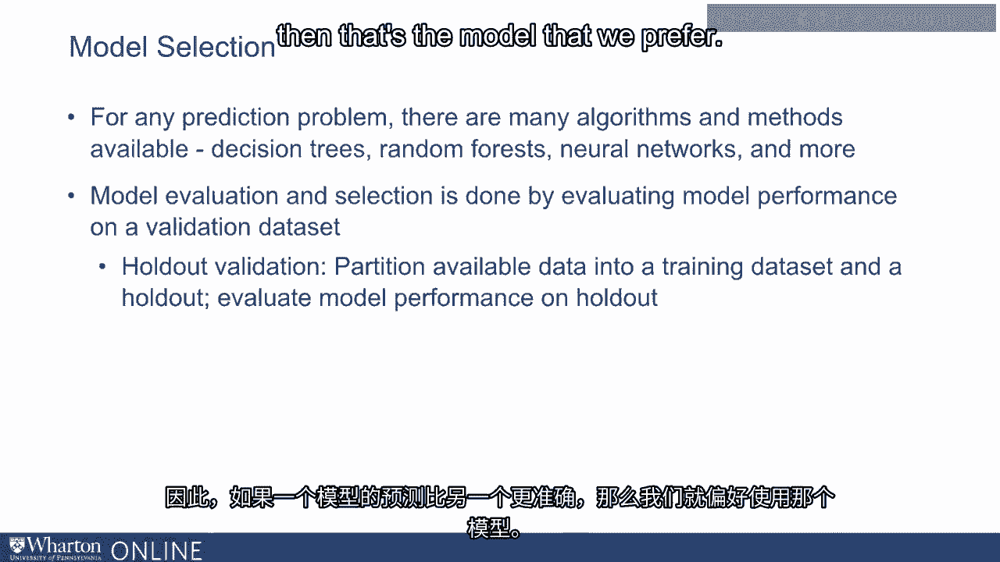
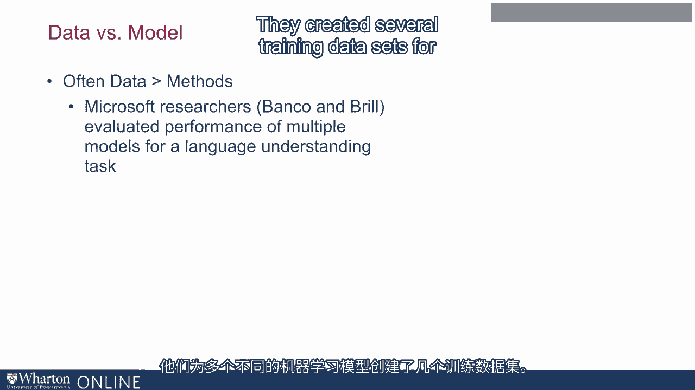
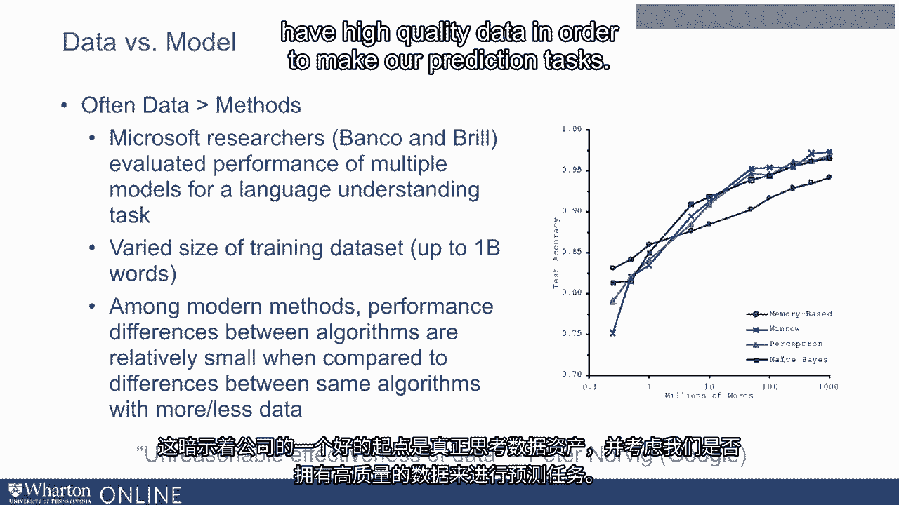

# 机器学习基础课程 P13：模型选择入门 🧠

在本节课中，我们将要学习如何为特定的机器学习任务选择合适的算法。我们将探讨评估模型性能的核心方法，并理解数据与模型孰轻孰重。

---

鉴于存在许多不同的机器学习算法，我们如何决定在特定任务中使用哪一种呢？

在实践中，我们通过评估不同机器学习方法在**验证数据集**上的表现来进行选择。假设我们有一个包含输入和对应输出标签的大型训练数据集。

验证的核心思想是将整个数据集划分为两部分：**训练数据集**和一个**保留数据集**（即验证集）。我们首先在训练数据集上训练模型。模型训练完成后，我们使用它来对保留的验证集进行预测，并评估这些预测的准确性。如果一个模型的预测比另一个模型更准确，那么我们更倾向于选择这个模型。

---

上一节我们介绍了基本的验证集方法，本节中我们来看看一种更稳健的变体——**交叉验证**。

交叉验证的思想是将数据集分成多个部分（例如10份）。以下是其基本流程：

1.  首先，我们将第1部分作为验证数据集，使用第2到第9部分来训练模型，并在第1部分上测试模型性能。
2.  接着，我们将第2部分作为验证数据集，使用第1、第3到第9部分训练模型，并在第2部分上评估性能。
3.  我们会对每一个部分都重复这个过程，轮流将其作为验证集。

最终，我们会得到多个性能评估结果，通常取其平均值作为模型性能的最终估计。这种方法的核心主题是：给定一个大型数据集，我们从中创建多个保留子集。我们在其余数据上训练模型，并在这些未参与训练的子集上评估其性能，从而更可靠地估计模型的泛化能力。

---

在选择了评估方法后，另一个关键问题是：公司应该投资于**更好的数据**还是**更好的机器学习模型**？

两者都很有价值，但在实践中，我们常常发现**数据胜过精巧的算法**。微软研究人员Banko和Brill进行了一项关于语言理解任务的研究。他们为多个不同的机器学习模型创建了规模不一的训练数据集：有些模型只能访问约50万字的小型数据集，而另一些则可以访问包含10亿字的大型数据集。

评估结果显示，当比较不同算法在**相同数据量**下的性能差异时，其差异相对较小。然而，当**相同算法**在**更多数据**与**更少数据**下进行比较时，性能的提升则非常显著。

简而言之，**为一个合理的机器学习算法提供大量数据，通常比为一个精妙的算法提供少量数据效果更好**。谷歌的Peter Norvig常提及此观点，称之为“**数据的非理性有效性**”。

这表明，一个良好的起点是：公司需要认真审视自身的数据资产，思考是否拥有高质量、足量的数据来支持预测任务。一旦具备了优质的数据基础，再去调查针对当前任务的更优机器学习模型才是值得的。但通常，一切始于数据集。

---

**本节课总结**

在本节课中，我们一起学习了：
1.  **模型选择方法**：通过划分**训练集**和**验证集**来评估和比较不同机器学习模型的性能。
2.  **交叉验证**：一种更稳健的评估技术，通过将数据分成多个部分并轮流验证，以减少评估结果的随机性。
3.  **数据与算法的权衡**：认识到高质量、大规模的数据集往往比选择更复杂的算法更能提升模型性能，即“数据的非理性有效性”。

理解这些基础概念，是构建有效机器学习解决方案的第一步。