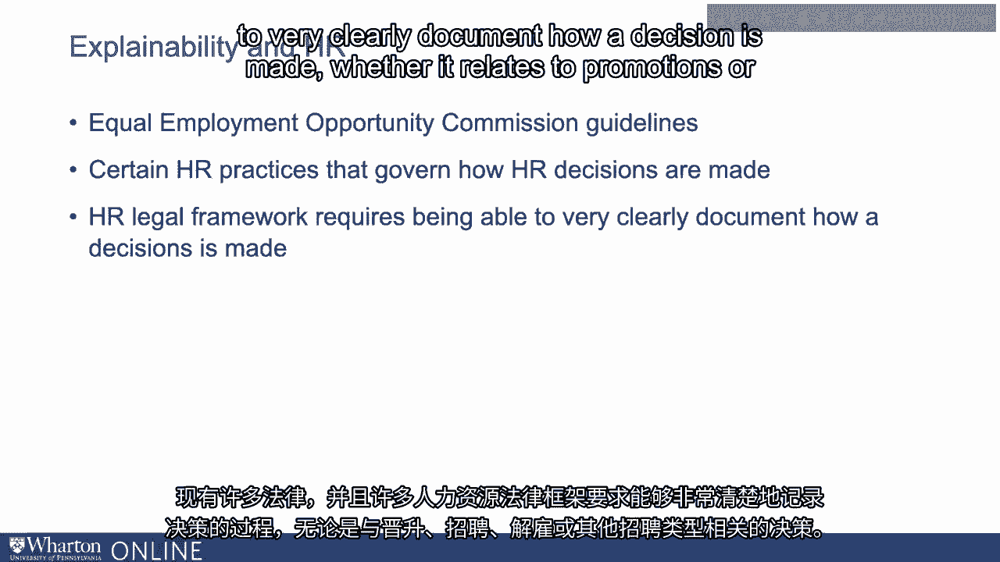
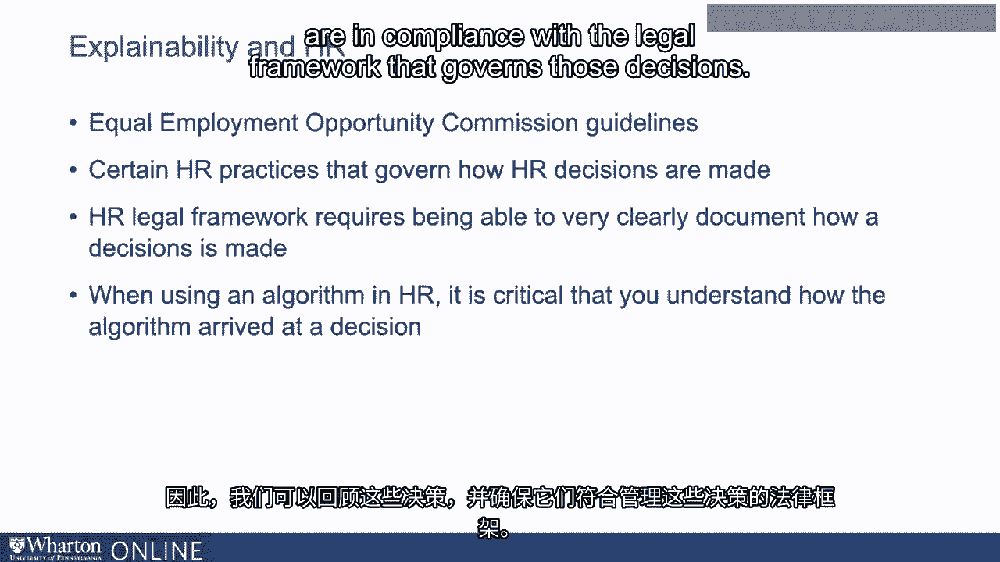

# 课程 P131：可解释性为何重要？—— 四个关键领域示例 🧠

在本节课中，我们将探讨“可解释性”在人工智能和机器学习中的重要性。我们将通过四个具体领域的例子，理解为什么算法的决策过程需要清晰、可解释，以及这对法律合规、安全与信任至关重要。

---

## 什么是可解释性？

可解释性是指能够解释或理解一个算法是如何得出结论的。

在特定决策中，理解其背后的逻辑至关重要。

---

## 可解释性为何重要？

接下来，我们来看看可解释性在哪些具体场景下显得尤为重要。以下是四个关键领域的示例。

### 1. 人力资源与法律合规

在人力资源领域应用算法时，决策关乎个人职业发展，因此必须清晰透明。例如，有像平等就业机会委员会这样的机构，规定了招聘和雇佣的指导方针。许多人力资源实践和法律框架要求能够非常清晰地记录决策是如何做出的。

该决定可能与晋升、招聘、解雇或其他雇佣相关行动有关。因此，在这种情况下，当你为人力资源使用算法时，至关重要的一点是：你必须非常清楚地理解这个算法是如何得出决定的。这样我们才能回顾和重新审视这些决策，确保它们符合管理这些决策的法律框架。

### 2. 自动驾驶系统与安全问责

另一个重要例子是自动驾驶系统。人工智能在自动驾驶汽车中有大量应用，系统需要处理不断涌入的复杂数据。

在路上，自动驾驶车辆会做出许多决策。可以想象，如果出现问题，比如发生事故或有人受伤，在自动驾驶车辆的背景下，公司能够回顾并准确理解出了什么问题、导致事故发生的原因以及需要修复什么，这一点非常重要。

同时，从公关角度，也需要能够解释问题所在以及出现问题的原因。出于这个以及其他原因，一些在自动驾驶汽车领域的公司已经成为可解释人工智能及其应用方面的领导者，致力于让这些框架更加开放，并将其提供给其他公司。

### 3. 数据隐私法规（如GDPR）

第三个例子涉及数据隐私法。你可能听说过GDPR（一般数据保护条例）或CCPA（加利福尼亚消费者隐私法案）。

一些新的隐私法规，比如GDPR，规定当算法做出决策时，一旦做出决策，其逻辑必须能够向受决策影响的人解释。

因此，如果做出的决策影响到你，人们有权要求对所涉及的逻辑给出有意义的解释。这只有在所使用的算法是可解释的算法时才有可能。所以，在符合该条例的背景下使用机器学习算法时，根据欧盟的全球数据保护条例，所使用的算法必须满足相关要求。这些算法确实需要是可解释的，以便公司遵守此类立法。

### 4. 客户服务与金融信贷

最后一个例子是客户服务领域，特别是在金融贷款、医疗保健或贷款处理的背景下。

如果客户前来申请贷款，而你使用算法来决定是否批准，那么并非所有客户都符合贷款要求。你显然需要关注这一点，并且不能仅仅告知某人通过或未通过筛选。

在贷款资格测试中，你希望能够准确反映出影响结果的因素。这种决策类型需要大量背景信息，尤其是在做出影响个人的决策时。人工智能系统的可解释性对于其成功采用至关重要。

---

## 总结

本节课中，我们一起学习了可解释性的定义及其在四个关键领域的重要性：
1.  **人力资源**：确保招聘、晋升等决策合法、公平、可追溯。
2.  **自动驾驶**：在发生事故时厘清责任，确保安全并维护公众信任。
3.  **数据隐私**：遵守GDPR等法规，保障用户对算法决策的“解释权”。
4.  **金融信贷**：向客户透明解释信贷决策的原因，建立信任并满足监管要求。

核心在于，可解释性不仅是技术需求，更是法律、伦理和商业成功的基石。