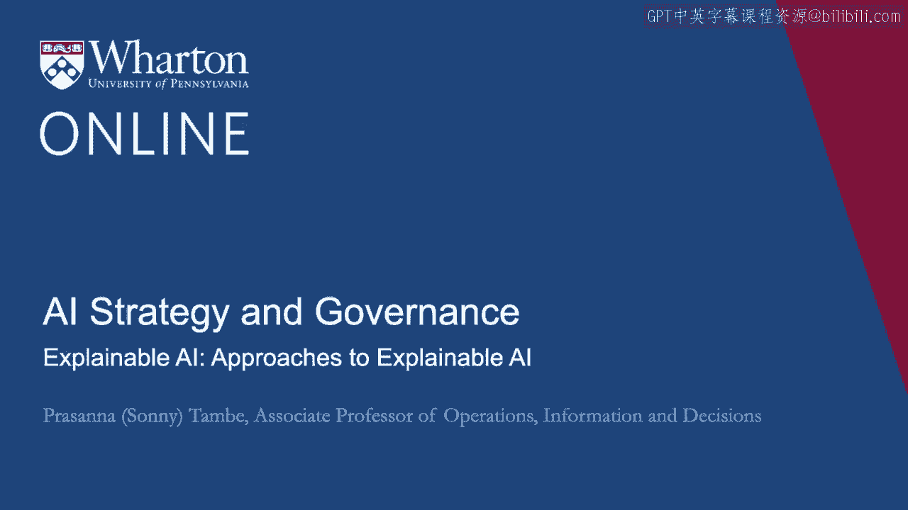
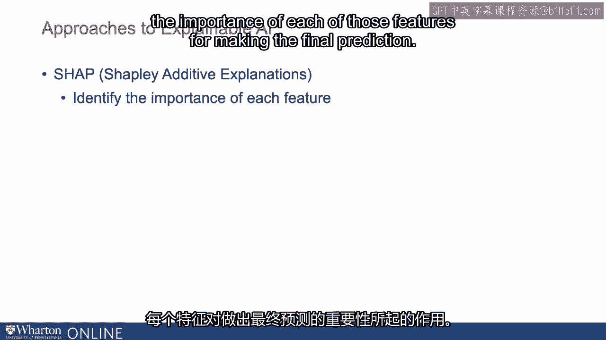
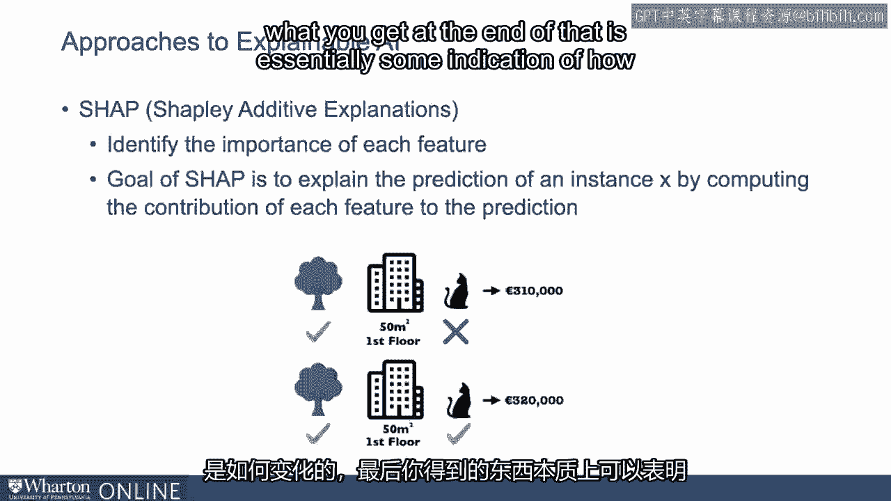
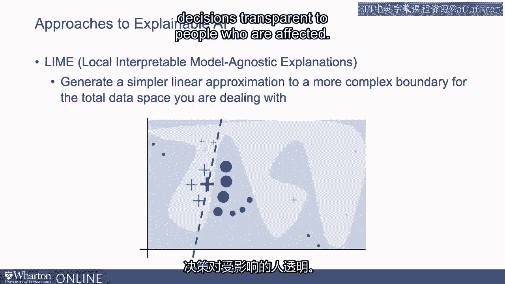
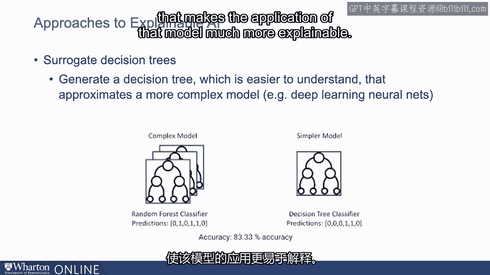
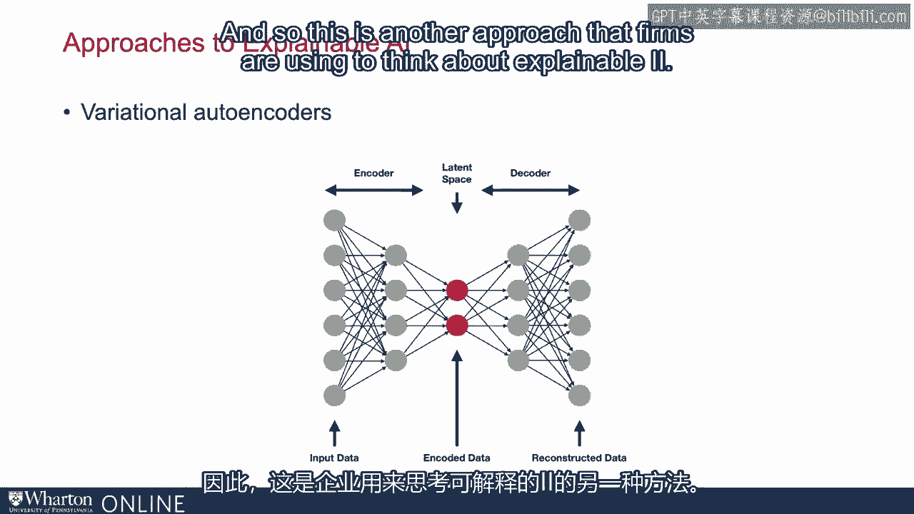
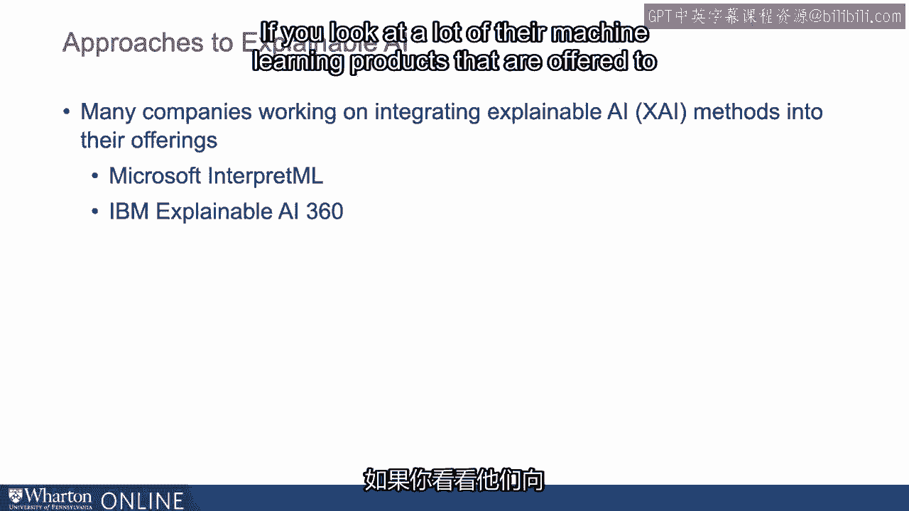

# 课程 P133：可解释AI的几种方法 🧠



在本节课中，我们将学习几种使人工智能（AI）算法更具可解释性的主流方法。理解这些方法有助于我们洞察模型如何做出决策，这对于建立信任和确保公平至关重要。

---

## 概述

我们将介绍四种核心方法：SHAP、LIME、替代决策树和变分自编码器。每种方法都从不同角度出发，旨在揭示复杂模型内部的决策逻辑。



---

## SHAP：量化特征贡献 📊

上一节我们概述了可解释AI的重要性，本节中我们来看看第一种具体方法——SHAP。



SHAP的全称是Shapley加法解释。其核心思想是，当模型使用多个变量进行预测时，SHAP可以量化每个变量对最终预测结果的重要性。

其目标是：通过计算每个特征对单个预测实例的贡献来解释模型的输出。它会系统地替换掉不同的特征，观察预测结果如何变化，从而得到每个特征重要性的指示。

以下是SHAP方法的关键点：
*   **功能**：识别并量化每个特征在特定预测中扮演的角色和影响。
*   **示例**：在一个人口统计预测模型中（考虑性别、年龄等特征），SHAP会告诉你哪些因素对最终决策最为重要。
*   **输出**：提供关于哪些输入特征对结果至关重要的清晰解释。

**核心公式/概念**：SHAP值基于合作博弈论中的Shapley值，为每个特征 `i` 分配一个贡献值 `φ_i`，所有特征的SHAP值之和等于模型预测值与平均预测值之差。

---

## LIME：局部近似解释 🎯

理解了全局特征重要性后，我们可能会想：对于某个具体的预测，模型在局部是如何思考的？LIME方法正是为此而生。

LIME的全称是局部可解释模型无关解释。其思想是，在复杂的全局模型决策边界附近，为一个特定的预测实例生成一个更简单的、可解释的局部近似模型（如线性模型）。

想象你有一个包含众多客户的数据空间，而用于预测的模型非常复杂。LIME的作用是“放大”到与目标实例相似的一小部分客户数据上。在这个局部范围内，它能提供一个清晰的解释。

以下是LIME方法的关键点：
*   **工作原理**：在目标数据点附近采样，用一个简单的可解释模型（如线性回归）去拟合复杂模型在这个局部区域的输入输出关系。
*   **优点**：即使复杂模型整体难以理解，LIME也能为单个预测提供直观的、基于相似实例的解释。
*   **应用**：它可以帮助向受决策影响的用户透明地解释：“与您情况相似的人相比，是这几个因素导致了不同的预测结果。”

**核心代码/概念**：
```python
# 伪代码示例：LIME 的核心思想
explainer = lime.lime_tabular.LimeTabularExplainer(training_data, mode='classification')
explanation = explainer.explain_instance(instance_to_explain, complex_model.predict_proba)
```



---

## 替代决策树：全局可解释性 🌳

LIME提供了局部视角，但有时我们需要理解模型的整体行为。这时，替代决策树就派上了用场。

这种方法的思想是训练一个全局的、易于理解的决策树模型，来近似模仿一个复杂黑盒模型（如深度学习网络）的决策逻辑。

可以想象，一个深度神经网络非常复杂。替代决策树的理念是创建一个能模仿该网络输入输出行为的决策树。由于决策树的结构（一系列“如果-那么”规则）比深度学习模型更容易解读，因此可以用它来解释复杂模型。



以下是替代决策树方法的关键点：
*   **目标**：用一个可解释的模型（决策树）作为复杂模型的“代理”或“替身”。
*   **结果**：用户可以通过分析这棵决策树来理解复杂模型整体的决策规则和重要特征。
*   **价值**：使得原本难以解释的模型应用变得更具可解释性。

---

## 变分自编码器：提炼可解释特征 🔍

最后，我们来看一种从数据表示层面入手的方法——变分自编码器。



变分自编码器是一种生成模型，它能将高维、复杂的原始数据（如图像、文本）编码（压缩）到低维的潜在空间。这个潜在空间中的关键特征往往比原始数据本身更具可解释性。

其流程可以理解为：原始数据输入模型，在得到最终预测输出之前，经历了一个中间步骤——数据被简化和提炼为一组核心的、可解释的潜在特征。公司可以利用这些提炼后的特征来理解和解释模型的决策依据。

以下是变分自编码器方法的关键点：
*   **机制**：通过编码器将数据压缩为潜在变量，再通过解码器重建数据。学习到的潜在变量代表了数据的核心特征。
*   **可解释性应用**：分析这些潜在特征与最终决策之间的关系，从而理解模型关注的是什么。
*   **地位**：这是业界用来实现可解释AI的另一种重要思路。

**核心公式/概念**：变分自编码器优化的是证据下界（ELBO）：
`ELBO = E[log p(x|z)] - KL(q(z|x) || p(z))`
其中，`z` 是学习到的潜在特征。



---

## 总结与行业展望


本节课中，我们一起学习了四种使AI系统更具可解释性的方法：
1.  **SHAP**：量化每个特征对预测的贡献。
2.  **LIME**：为单个预测构建局部可解释模型。
3.  **替代决策树**：用可解释的树模型全局近似复杂模型。
4.  **变分自编码器**：从数据中提炼可解释的潜在特征。

这些方法各有优缺点，目前是可解释AI领域非常活跃的研究方向。许多领先的科技公司，如微软、IBM等，正积极地将可解释性功能整合到他们的机器学习产品和服务中（例如云平台上的AI服务）。提供模型输出的可解释性，对于AI技术在金融、医疗等关键行业的广泛应用和采纳至关重要。