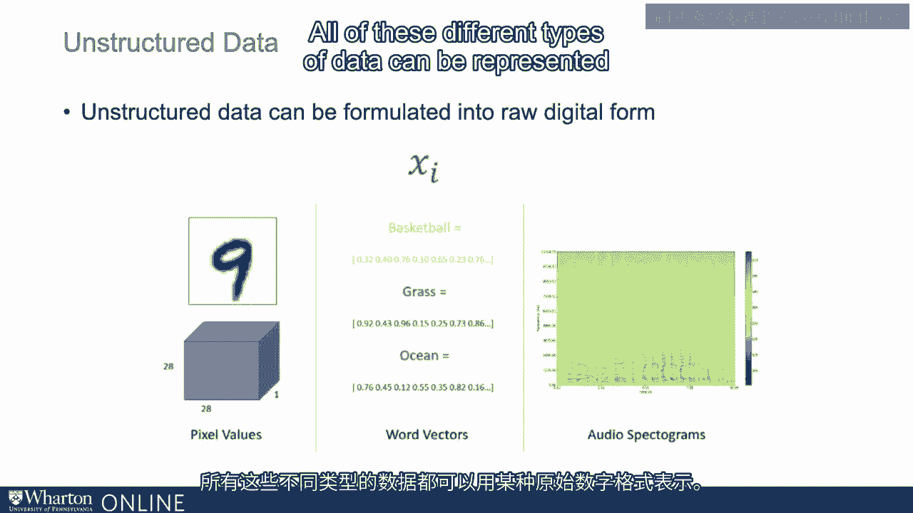
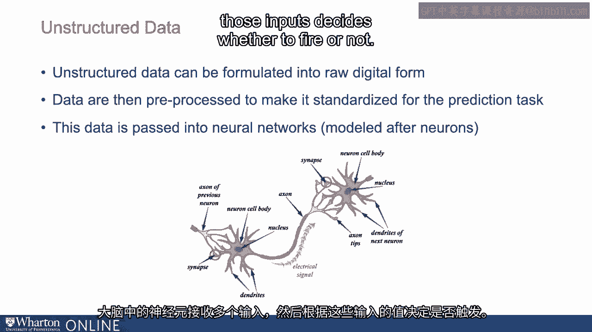
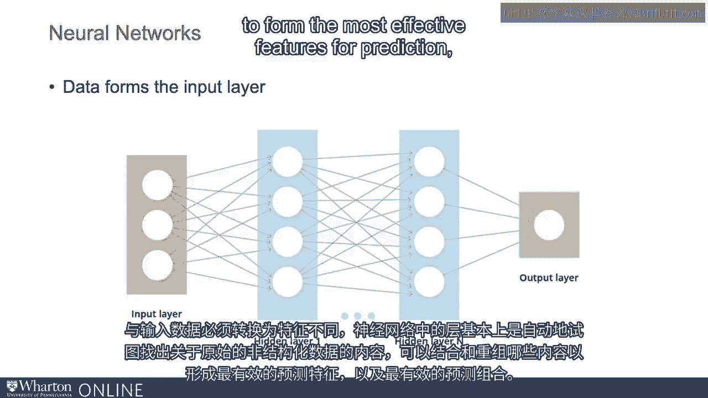
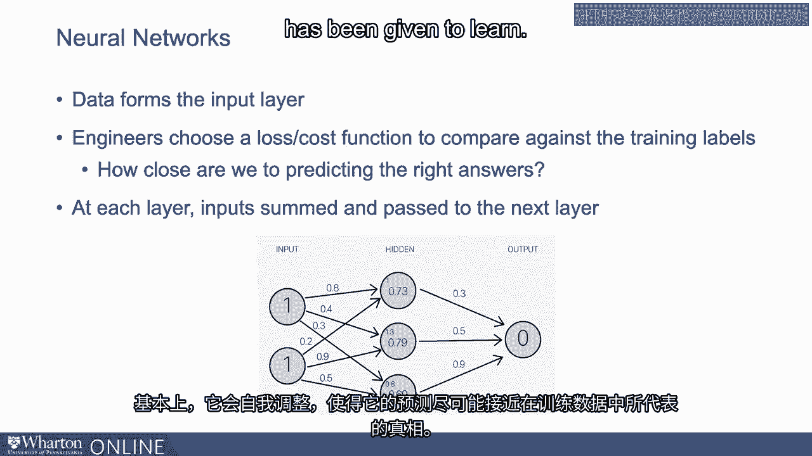
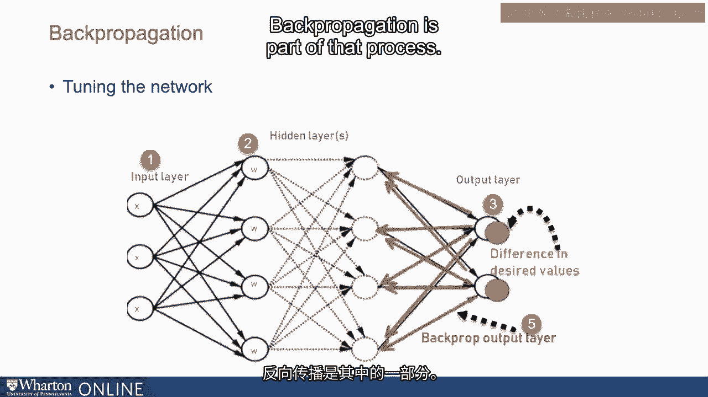
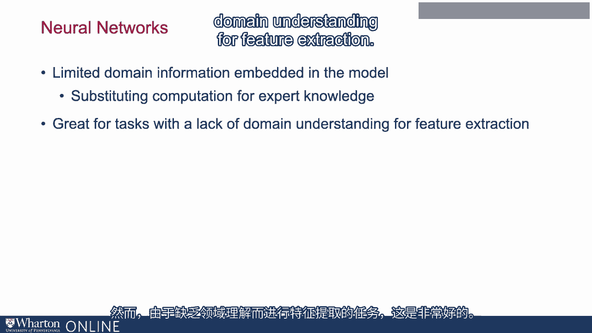
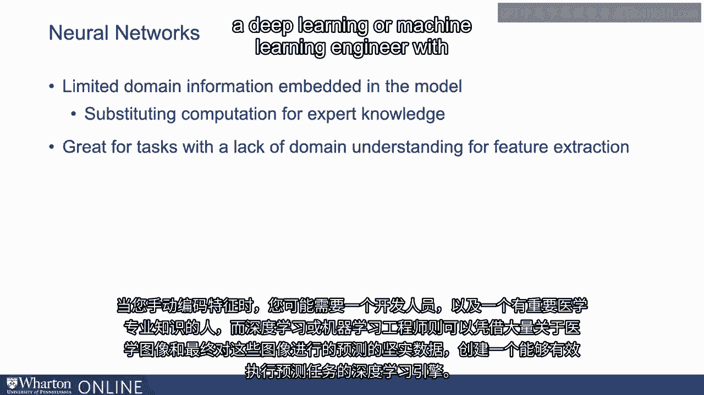
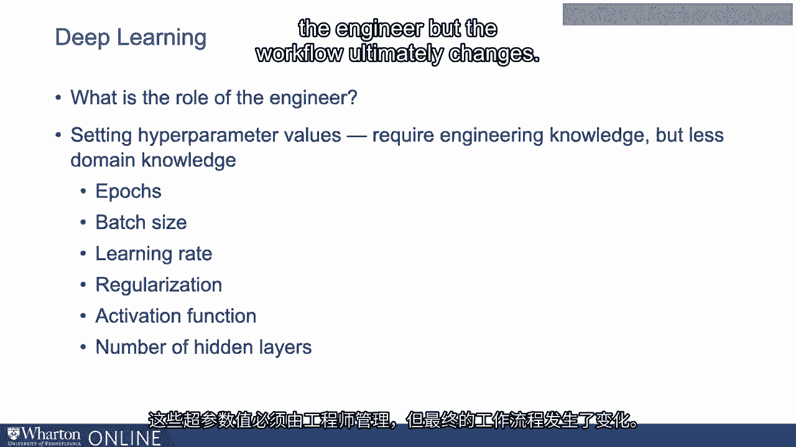
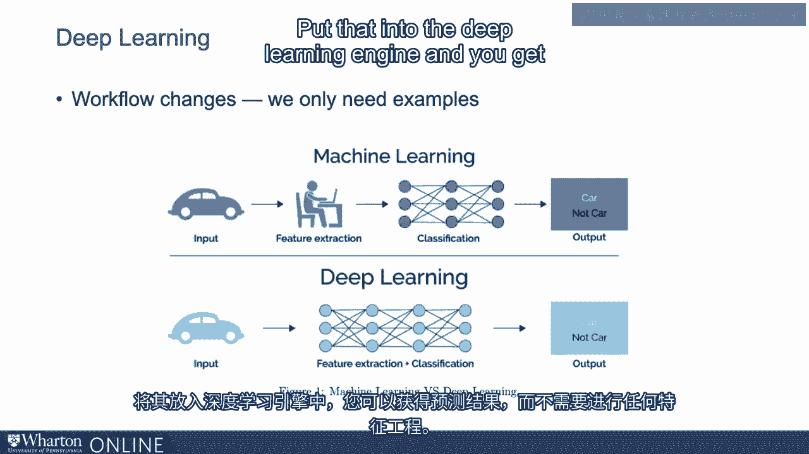

# 课程 P16：深度学习的工作原理 🧠

在本节课中，我们将学习深度学习的基本工作原理。我们将了解深度学习如何处理原始的非结构化数据，神经网络如何模仿人脑神经元进行决策，以及它如何通过自我调整来学习预测，从而省去了传统机器学习中繁琐的特征工程步骤。

---

我们已经讨论过，深度学习可以直接使用原始的非结构化数据进行预测。我们不需要经历特征工程步骤，不需要将数据转换为单独的列、变量或特征。对于非结构化数据，我们可以从其原始的数字表示形式开始。

首先，我们讨论的任何非结构化数据，包括文本、声音和图像，始终可以以某种数字形式表示。例如，音频可以表示为频谱图，图像数据可以通过像素表示，文本可以通过词向量表示。因此，所有这些不同类型的数据都可以用其原始的、本地的数字格式来表示。

数据随后会经过某种预处理，使其在预测任务中标准化。一旦数据标准化，它就会被传递到一个叫做神经网络的结构中。我们之所以称之为神经网络，是因为它的模型本质上是基于对神经元的模仿。大脑中的神经元接收多个输入，然后根据这些输入决定是否触发输出。

类似地，深度学习中的神经网络在某种程度上非常相似。构成深度学习基础的神经网络，其输入层接收的就是我们讨论过的原始本地数据。就像神经元一样，神经网络会查看输入的数据，然后根据数据的值，决定是否触发其输出，或将输出设置在某个水平。因此，你可以将神经网络想象为一系列决策点、节点或神经元，输入数据从一侧进入。

神经网络由一系列层组成，这些层在进行某种观察，查看输入数据的不同组合。因此，输入数据不需要预先转换为特征。神经网络中的层会自动尝试从原始非结构化数据中找出特征，并将这些数据以各种方式组合和重组，以形成对预测最有效的特征组合。

这种情况的发生，是因为工程师选择了一个**损失函数**或**成本函数**，用来与训练标签进行比较。这只是一种衡量我们离预测正确答案有多近的方式。例如，在医疗诊断图像的案例中，你拥有大量带有正确答案（即医生确诊患者是否患病）的医疗图像数据。

神经网络将尝试处理这些图像数据。网络中的各层会尝试找到使用原始像素数据进行预测的正确组合，预测结果将是这个人是否患病。既然我们已经知道训练数据中的正确答案，我们就可以开始比较预测的准确率。**损失函数**或**成本函数**就告诉我们模型的预测与真实情况之间的距离。

神经网络将开始反复进行前向和后向的调整，重新排列节点上的值和权重。网络的不同部分会开始自我调整，直到达到一个点：原始输入数据被组合、加权并传递到预测层后，其错误被最小化。本质上，它将自我调整到预测结果尽可能接近训练数据所代表的真实情况。

你可能会听到一些与神经网络相关的术语，比如**反向传播**。反向传播是调整网络参数的过程。这些网络通常被称为前馈网络，而反向传播指的是数据向前传递后，不同类型的信息在网络中前后传递，以便网络可以从数据中学习如何以最优方式进行配置来进行预测。因此，反向传播是该学习过程的一部分。

深度学习或神经网络的一个好处是，模型中需要嵌入的领域专业知识信息非常有限。这意味着，你是在用计算能力来替代专家知识。例如，在医疗诊断图像的深度学习案例中，我们所做的是将图像数据传递给深度学习引擎，它将学习如何预测患者是否患病。

相比之下，在我们之前讨论的特征工程步骤（浅层学习）中，需要有人获取图像，并研究如何从中选择和编码出个别特征。这是一个非常耗时且困难的过程。而这种深度学习方法所需的领域信息要少得多，但它确实需要相当多的计算资源。不过，由于省去了需要领域理解的特征提取任务，这仍然是一个巨大的优势。

所以，当你手动编码特征时，可能需要开发人员和具备显著医学专业知识的人员。而采用深度学习方法，机器学习工程师主要需要大量带有可靠标签的医学图像数据。

最终，基于这些图像数据做出的决策，可以自己创建一个能够有效执行预测任务的深度学习引擎。一个常见的问题是，在这种新范式下，工程师的角色是什么？在之前的特征工程案例中，工程师的重要性在于能够从原始数据中提取出单独的信息片段。例如，处理原始图像，提取出毛细血管宽度或颜色阴影等特征，这需要图像处理技术专长。

在这里，你不再需要进行特征工程，那么工程师做什么呢？事实证明，在深度学习方法中，仍然有许多设置工作需要工程师来完成。这些设置被称为**超参数**，需要工程知识来调整，但通常对领域知识的要求较低。

以下是需要工程师决定的一些关键超参数：
*   **Epochs（训练轮数）**：模型遍历整个训练数据集的次数。
*   **Batch Size（批大小）**：单次训练迭代中使用的样本数量。
*   **Learning Rate（学习率）**：控制模型根据损失梯度调整其权重的速度。
*   **Regularization（正则化）**：防止模型过拟合的技术。
*   **Activation Function（激活函数）**：决定神经元是否被激活的函数，如 `ReLU` 或 `Sigmoid`。
*   **Number of Hidden Layers（隐藏层数量）**：神经网络中除输入和输出层之外的层数。

工程师必须决定这些多种设置，以使网络能够表现良好。这些超参数值必须由工程师管理，但整体工作流程最终发生了变化。

再次强调，特征提取在深度学习中不是一个重要步骤。在没有深度学习的工作流程中，我们有输入数据（如图像），然后有一个耗时的处理过程是从这些数据中提取单独的列变量或特征，再将其放入分类或预测步骤，最后得到输出。

而在深度学习方法中，你没有特征提取的步骤。你可以直接从标注良好的原始非结构化数据开始，放入深度学习引擎，就可以得到预测结果，而不需要做任何特征工程。这再次省去了昂贵且不确定的特征工程过程。

---

在本节课中，我们一起学习了深度学习的工作原理。我们了解到，深度学习可以直接处理原始的非结构化数据，通过模仿神经元的神经网络结构自动学习有效特征。网络通过**损失函数**和**反向传播**机制自我调整，以最小化预测错误。这种方法减少了对特定领域专家知识的依赖，但需要工程师精心调整**超参数**。最终，深度学习通过将原始数据直接映射到预测结果，简化了传统机器学习中繁琐的特征工程流程。