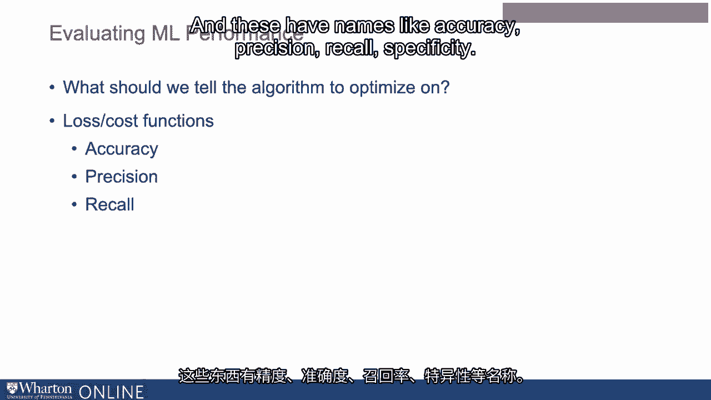
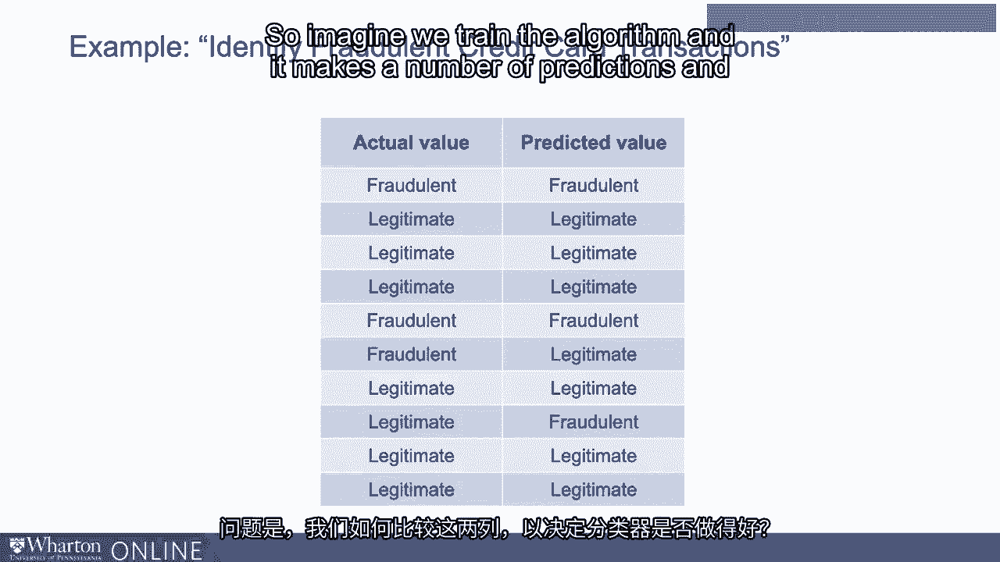

# 机器学习基础课程 P18：评估机器学习性能 📊

在本节课中，我们将要学习如何评估机器学习算法的性能。构建算法时，我们不仅需要关注它是否能做出预测，更重要的是要判断其预测的好坏。这涉及到选择正确的评估标准，因为不同的应用场景对“好”的定义可能截然不同。

当我们谈论构建或训练机器学习算法时，有多种方式来考量其表现优劣。算法试图根据我们提供的带有标签的示例进行学习。核心问题是：我们应该告诉算法去优化什么目标？是尽可能多地预测正确，还是需要优化其他方面？例如，在商业应用中，正确预测和错误预测可能带来不同的成本与收益，这会直接影响我们构建有效算法的方式。

在构建算法时，存在许多可供优化的损失函数或成本函数。这些函数有不同的名称，例如**准确率**、**精确率**、**召回率**和**特异度**。

---

## 为什么需要这么多评估指标？ 🤔

上一节我们介绍了多种评估指标的存在，本节中我们通过一个例子来看看其原因。

想象一个旨在识别欺诈性信用卡交易的应用程序。这是机器学习的一个热门应用。在这个场景中，你拥有训练数据，其中包含了交易是否欺诈的正确答案（即“实际值”）。你的算法会对交易做出“预测值”，判断其是欺诈还是合法。

问题在于，我们如何比较“实际值”和“预测值”这两列数据，以判断分类器的表现好坏？这并非简单地追求正确答案的数量最多，因为在此背景下，我们需要从成本和收益的角度来考量。

例如，错过一次欺诈交易（漏报）的成本可能非常高。因此，你可能会决定，可以容忍一些误报，但绝不能漏掉任何欺诈交易。另一方面，如果错误地将合法交易标记为欺诈（误报），可能导致有价值的客户体验受损。优化“不漏报”和“减少误报”这两个目标在某种程度上是相互竞争的，构建算法时必须做出权衡。

**精确率**、**召回率**和**特异度**这些不同的术语，正是为了捕捉在预测任务中，犯不同类型错误时存在不同成本与收益的这一概念。这对于决定如何训练算法以及我们关心什么至关重要。

---

## 核心评估指标详解 📈

在理解了评估指标的多样性后，本节我们来看看一些具体的损失函数及其计算方式。

以下是几个关键的分类评估指标及其定义：

*   **准确率**：模型预测正确的样本数占总样本数的比例。
    *   **公式**：`准确率 = (TP + TN) / (TP + TN + FP + FN)`
*   **精确率**：在所有被模型预测为“正类”的样本中，实际也是“正类”的比例。它关注预测的**准确性**。
    *   **公式**：`精确率 = TP / (TP + FP)`
*   **召回率**：在所有实际为“正类”的样本中，被模型正确预测出来的比例。它关注对正类的**覆盖度**。
    *   **公式**：`召回率 = TP / (TP + FN)`
*   **特异度**：在所有实际为“负类”的样本中，被模型正确预测为“负类”的比例。
    *   **公式**：`特异度 = TN / (TN + FP)`

> **术语解释**：
> *   **TP**：真正例（实际为真，预测为真）
> *   **TN**：真负例（实际为假，预测为假）
> *   **FP**：假正例（实际为假，预测为真）-> **误报**
> *   **FN**：假负例（实际为真，预测为假）-> **漏报**

以欺诈检测为例：
*   追求高**精确率**意味着：当系统报警说“这是欺诈”时，很有把握它是真的欺诈（减少误报，避免打扰好客户）。
*   追求高**召回率**意味着：尽可能抓住所有的欺诈交易（减少漏报，避免资金损失）。

---

## 总结 🎯

本节课中，我们一起学习了评估机器学习性能的核心思想与方法。我们了解到，不能仅用“正确率”来简单衡量算法好坏，而需要根据具体应用场景选择评估指标。在欺诈检测的例子中，我们看到了**精确率**和**召回率**之间的权衡关系。理解这些概念，能帮助我们在训练模型时选择正确的优化目标，从而构建出真正符合业务需求的机器学习算法。