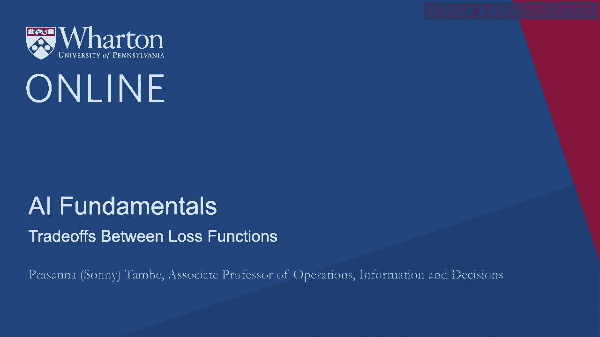
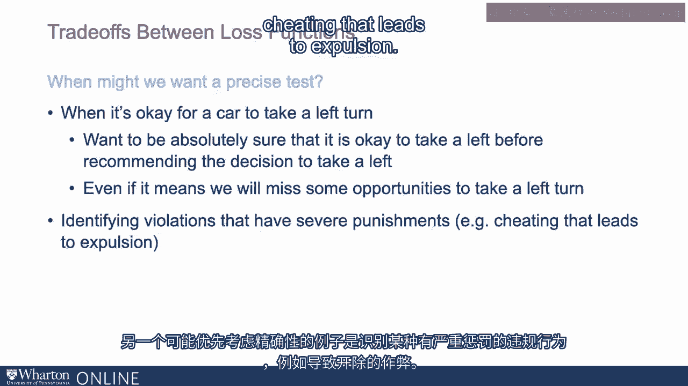

# 机器学习基础课程 P20：损失函数之间的权衡 ⚖️

在本节课中，我们将要学习在机器学习模型的评估中，如何根据不同的应用场景，在精确度（Precision）和召回率（Recall）等指标之间进行权衡。理解这种权衡对于构建符合实际业务需求的模型至关重要。

## 核心问题：假阴性与假阳性的成本

上一节我们介绍了评估指标的基本概念，本节中我们来看看如何根据具体场景选择侧重点。关键问题是，在我们考虑的特定应用或商业背景中，假阴性和假阳性的相对成本是什么？

## 何时需要高召回率（高敏感性）的测试？

以下是需要优先考虑召回率（即希望尽可能减少假阴性）的应用场景：

*   **医疗筛查场景**：例如，算法正在筛查一种非常严重的疾病或某种类型的癌症。我们希望绝对确认不遗漏任何患有该疾病的人。即使这可能会导致错误识别一些没有患病的人（假阳性）。
*   **安全预警系统**：例如，二战期间发展的雷达系统，用于探测来袭飞机。我们担心敌方攻击，并希望有一个可以探测所有潜在威胁的系统。我们不介意几个误报，但希望确保不遗漏任何实际发生的攻击。

在这些情况下，我们可能想要一个高度敏感的测试，即优先考虑召回率。

## 何时需要高精确度的测试？

上一节我们介绍了高召回率的场景，本节中我们来看看另一个方向。以下是需要优先考虑精确度（即希望尽可能减少假阳性）的应用场景：

*   **自动驾驶决策**：例如，开发一个算法用于预测汽车何时可以安全左转。我们可能希望在推荐左转决策之前，绝对确认左转是安全的。即使这意味着我们可能会错过几次左转的机会。核心要求是：**只要算法预测可以左转，就必须确保左转实际上是安全的**。
*   **严厉违规判定**：例如，识别某种会导致开除等严厉惩罚的作弊行为。我们可能想在实际做出算法判定之前，极其确定某人确实违规。即使这意味着我们可能会漏掉一些实际发生的违规情况。我们希望有一个非常精确的测试，以确保不会错误地指控某人。

在这些情况下，我们可能想要一个高度精确的测试，即优先考虑精确度。

## 总结

本节课中我们一起学习了在机器学习模型评估中如何进行权衡。核心在于分析具体应用中**假阳性**和**假阴性**带来的不同代价：
*   当**遗漏正例（假阴性）的代价非常高**时（如重症筛查、安全预警），应优先优化**召回率（Recall）**。
*   当**误报正例（假阳性）的代价非常高**时（如自动驾驶决策、严厉处罚判定），应优先优化**精确度（Precision）**。

理解这种权衡是设计有效、负责任的人工智能系统的关键一步。