# 课程P3：大数据概述 📊

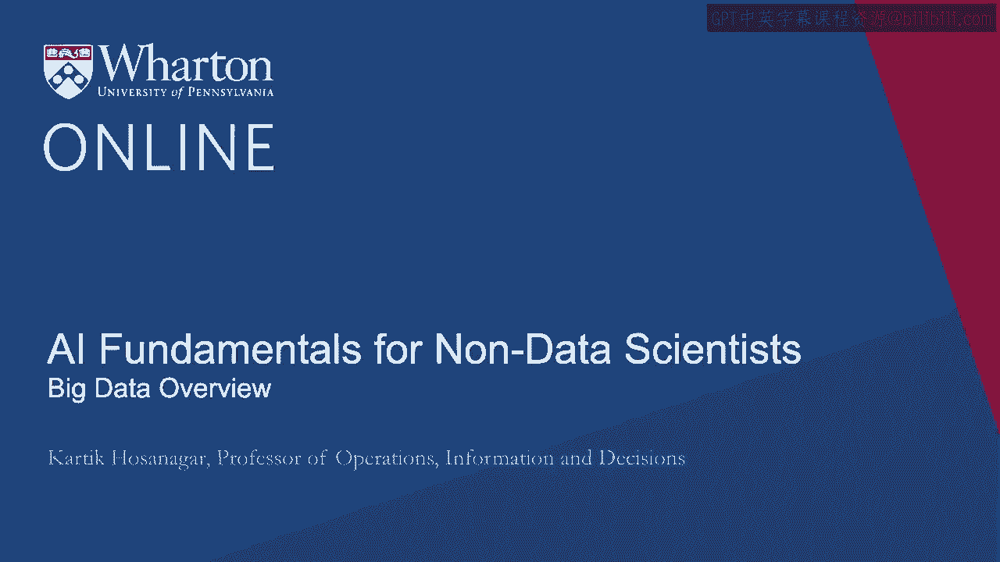

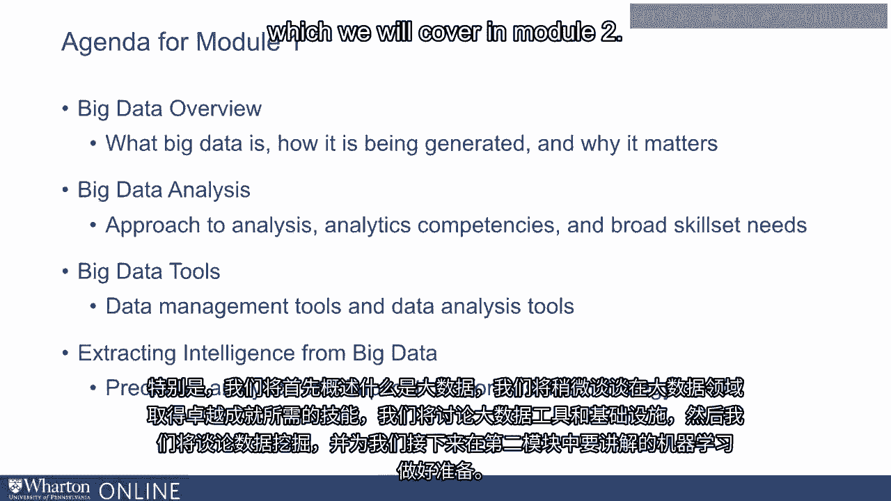

在本节课中，我们将要学习大数据的基本概念。我们将探讨大数据的定义、核心特征、其重要性以及在不同行业中的应用。通过本课，你将理解为什么大数据在当今世界变得如此关键。

---

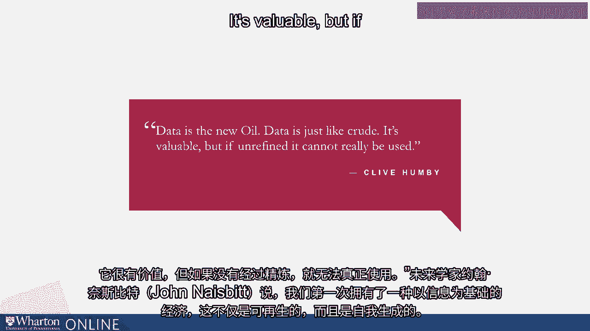

## 什么是大数据？

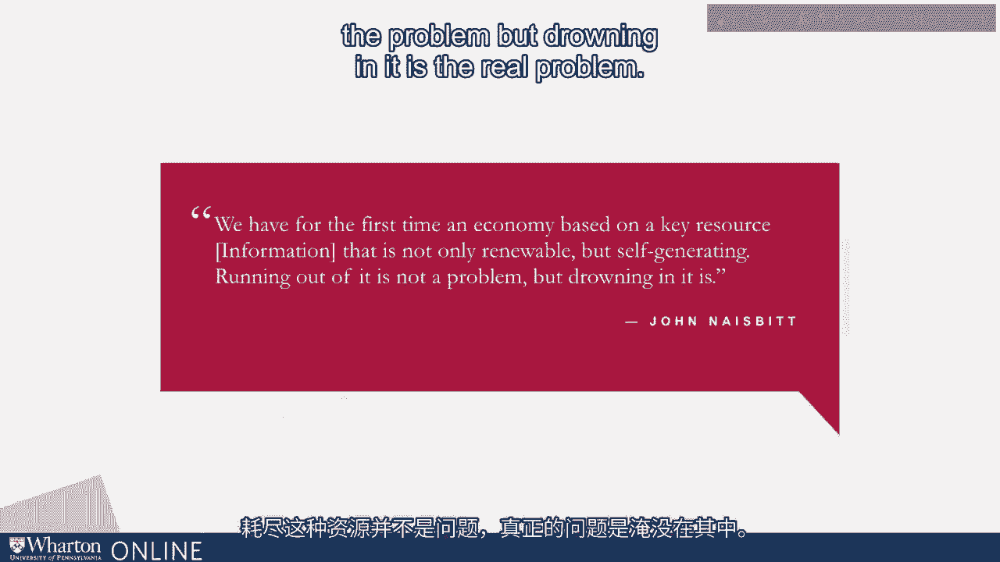

上一节我们介绍了课程目标，本节中我们来看看大数据的定义。

数据是一个存在已久的概念，但近年来对其重视程度日益增加。我们常听到“数据是新石油”或“数据就像原油，它很有价值，但如果未加提炼就无法使用”这样的说法。

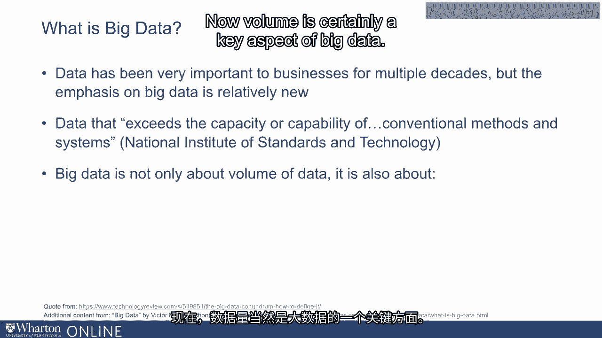

未来学家约翰·奈斯比特指出，我们首次拥有一种基于关键资源——信息的经济。这种资源不仅是可再生的，还能自我生成。因此，资源枯竭不是问题，真正的问题是如何处理海量信息。

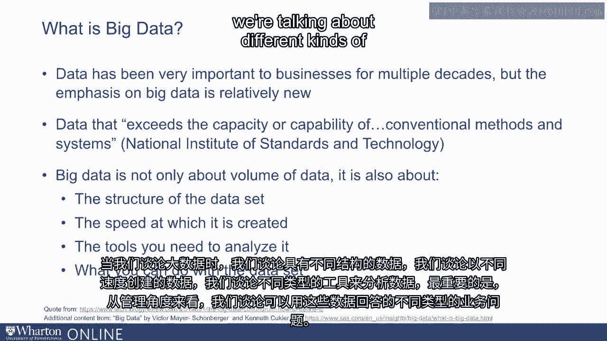

数据对商业的重要性已持续数十年，但对“大数据”的关注则相对较新。顾名思义，大数据涉及海量数据。美国国家标准与技术研究院将大数据定义为：数据量超出了传统方法和计算机系统处理能力的范畴。

然而，大数据不仅仅关乎数据量。

---

## 大数据的核心特征：三个V

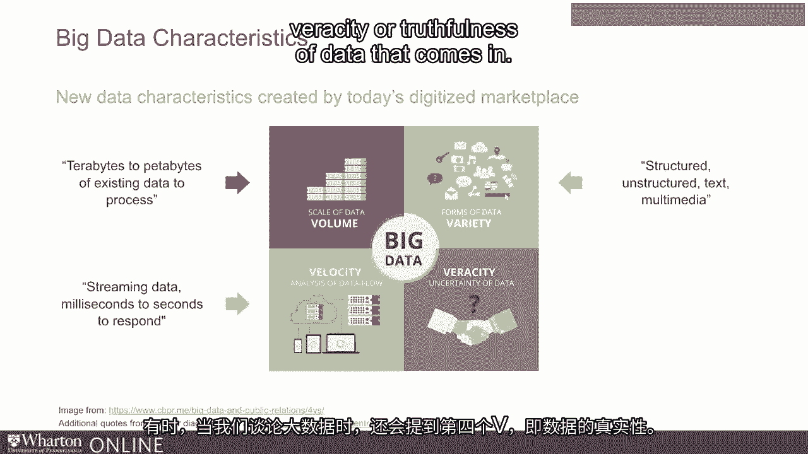

当我们谈论大数据时，我们指的是具有特定特征的数据。以下是描述大数据核心特征的三个“V”：

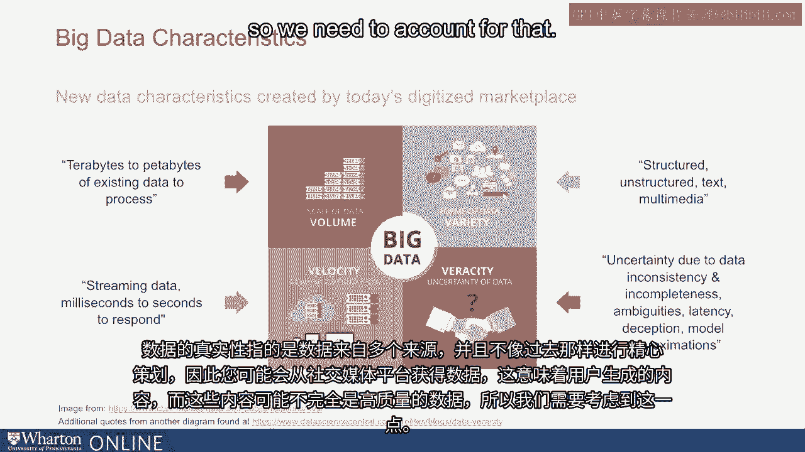

1.  **体量 (Volume)**：指巨大的数据量。我们谈论的不再是TB或PB级的数据，而是那些无法放入个人电脑或在Excel中直接打开分析的数据。
2.  **多样性 (Variety)**：指数据类型的多样化。我们不再只处理结构化数据（如Excel表格），而是包括文本、音频、视频等非结构化数据，这些数据中隐藏着待提取的智能信息。
3.  **速度 (Velocity)**：指数据生成和流动的速度。数据持续不断地实时流入，我们需要能够即时分析数据并做出决策。

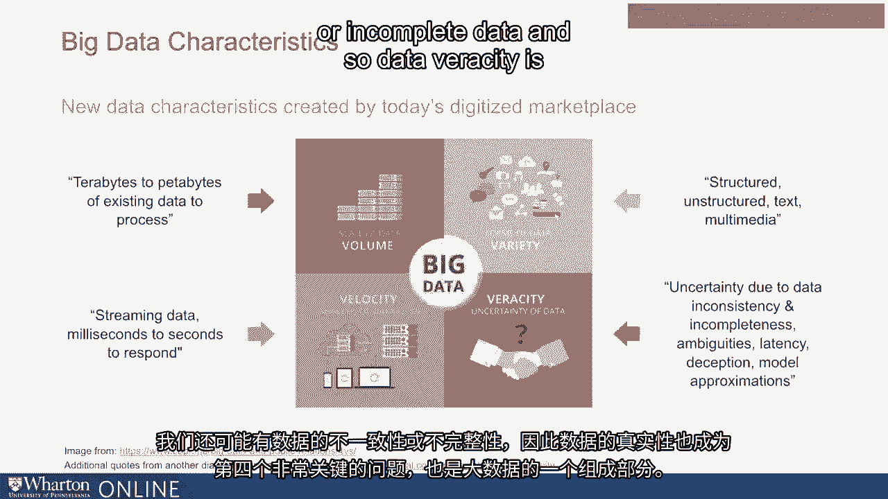

有时，大数据还会提到第四个“V”：

4.  **真实性 (Veracity)**：指数据的质量和可信度。数据来自多个来源（如社交媒体上的用户生成内容），可能未经筛选，存在不一致、不完整或质量不高的问题。确保数据的真实性是大数据面临的关键挑战之一。

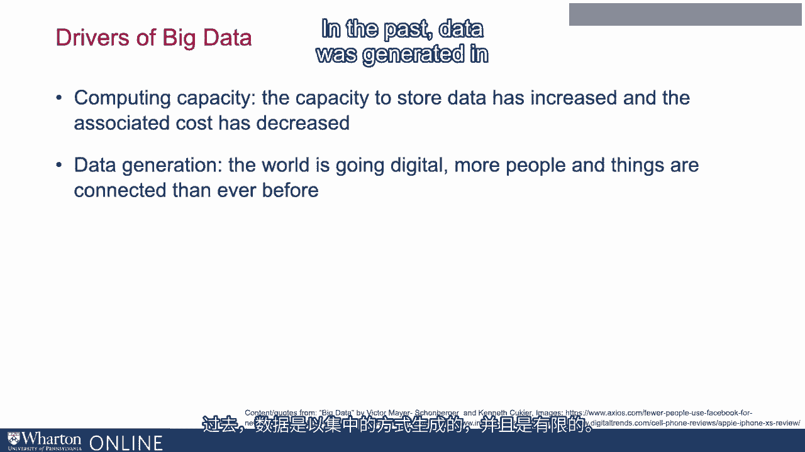

---

## 大数据为何在当今兴起？

一个自然的问题是：为何大数据在近年才受到如此重视？原因主要有两点：

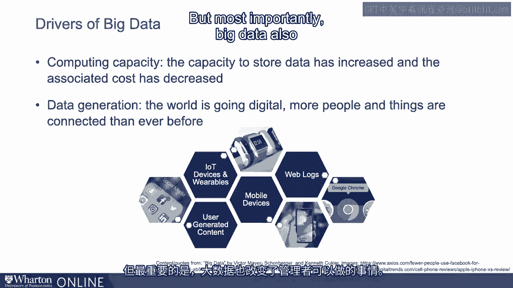

1.  **计算能力的指数级增长**：我们存储和处理数据的能力飞速提升，使得十年前不存在的大数据工具如今成为可能。
2.  **数据生成方式的转变**：过去，数据以集中、有限的方式生成。如今，数据以去中心化的方式爆炸性增长，来源包括用户生成内容、移动设备和成千上万的传感器。

这种转变不仅带来了数据量的激增，更重要的是改变了管理者能做的事情。

---

## 大数据的价值与应用

大数据使管理者能够提出以往无法提出的新问题，并能更好地回答旧有问题。

**提出新问题的例子**：市场经理为新产品设计营销活动时，过去依赖直觉或小规模调研来决定强调产品的哪个特性（如电池续航、设计或用户界面）。现在，他们可以分析社交媒体平台（如Twitter、Facebook）上的大数据，了解顾客真正欣赏产品的哪些方面，从而精准制定营销信息。

**更好回答旧问题的例子**：信用卡欺诈检测。过去，欺诈通常在交易发生很久后才被发现，造成巨大损失。如今，借助大数据工具，公司能在交易发生后即时分析，判断是否存在欺诈行为，实现更快、更大规模的检测。

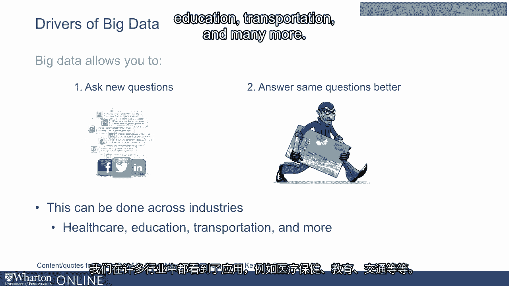

大数据的价值不仅限于金融服务业，其应用已遍及多个行业：

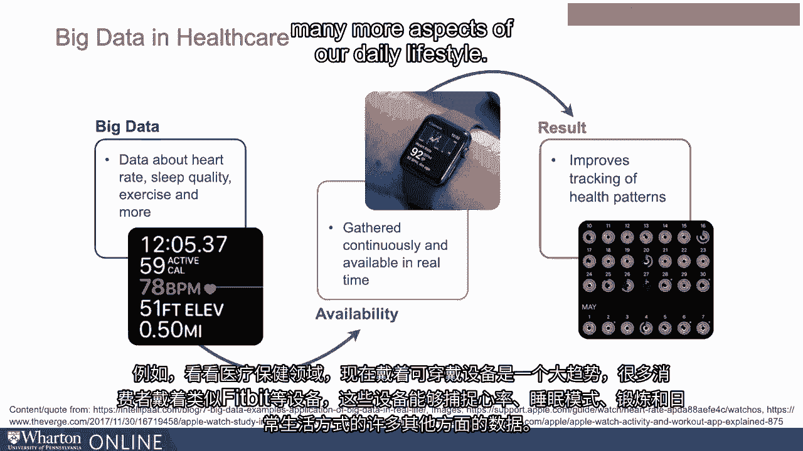

*   **医疗保健**：可穿戴设备（如Fitbit）能捕捉心率、睡眠模式等数据，帮助消费者采取行动改善健康。
*   **交通运输**：道路传感器捕捉交通模式、事故等数据，并实时提供给移动设备（如谷歌地图），帮助用户更好地规划路线。

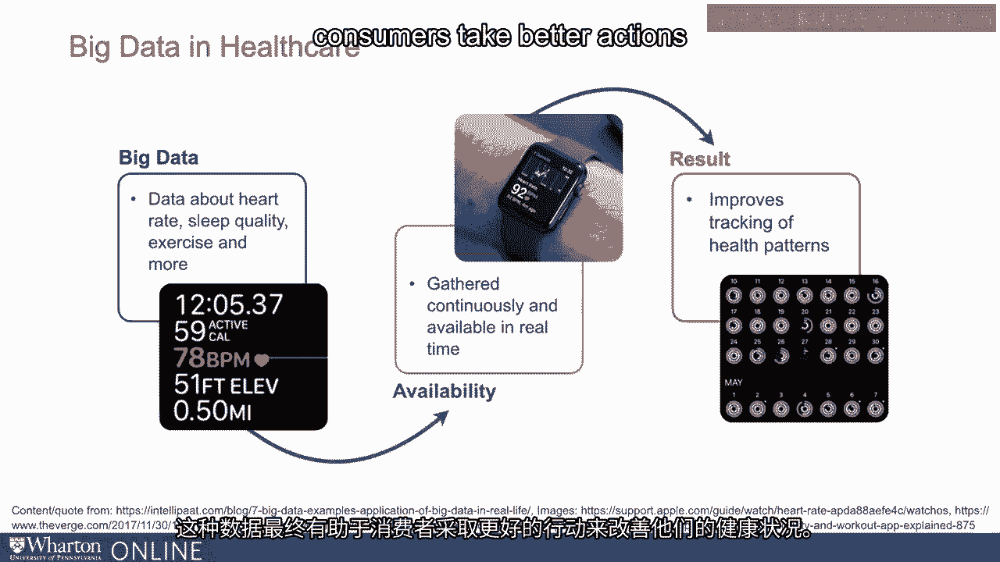

在后续课程中，我们将深入探讨大数据在各行业的更多应用，以及机器学习如何从这些数据中提取智能信息。

---

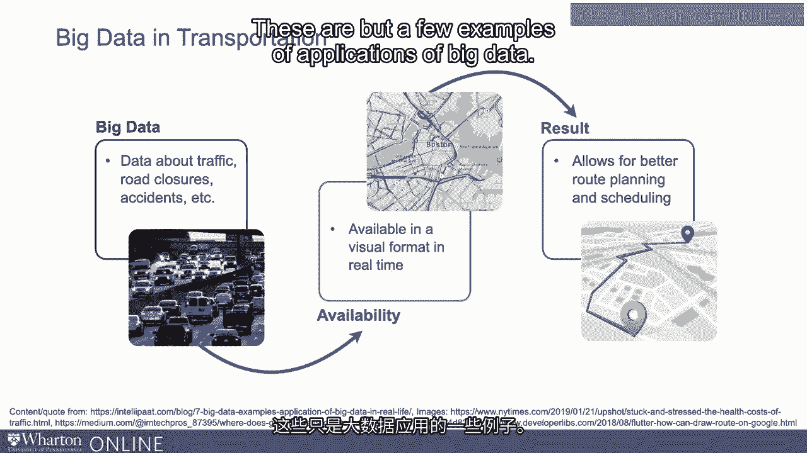

## 总结

本节课中，我们一起学习了大数据的基本概念。我们明确了大数据不仅指海量数据，更由其**体量、多样性、速度**和**真实性**等核心特征定义。我们探讨了大数据兴起的两个驱动力：**计算能力的提升**和**数据生成方式的转变**。最后，我们通过市场营销和欺诈检测等例子，看到了大数据如何赋能管理者，并了解了其在医疗、交通等领域的广泛应用。理解这些基础，是进一步学习大数据工具与技术的第一步。