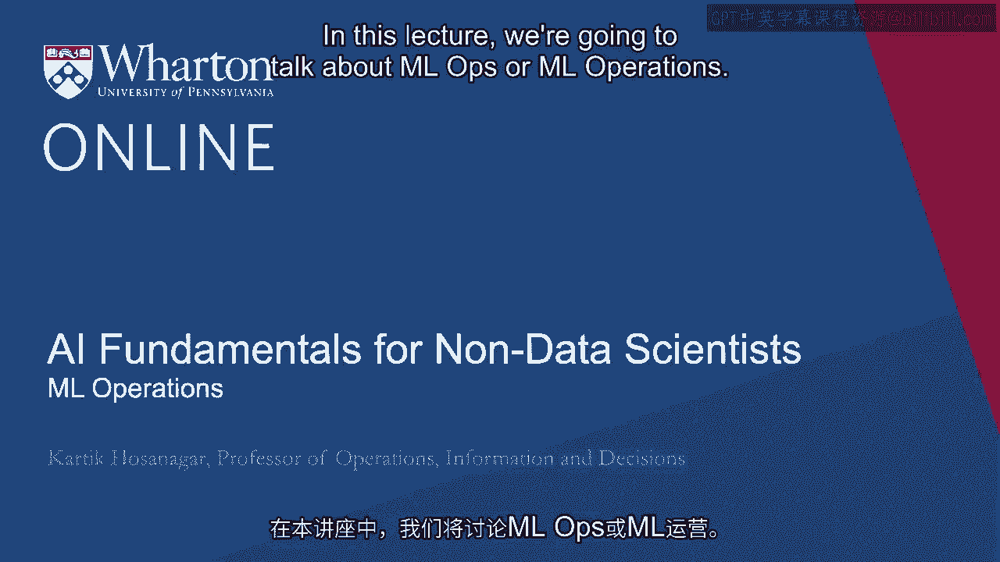
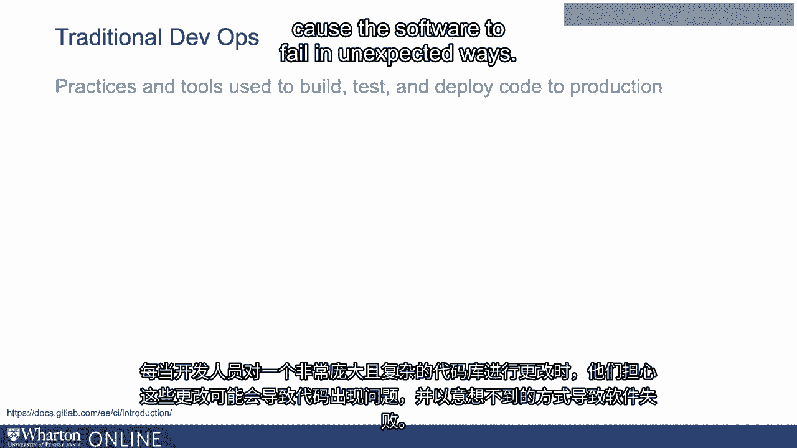
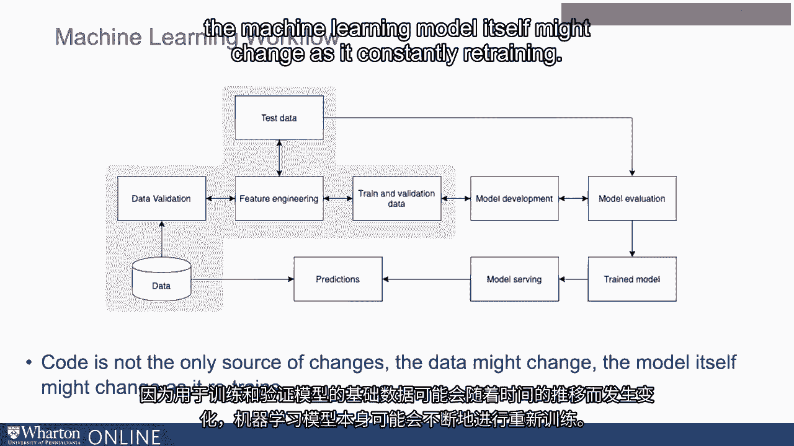
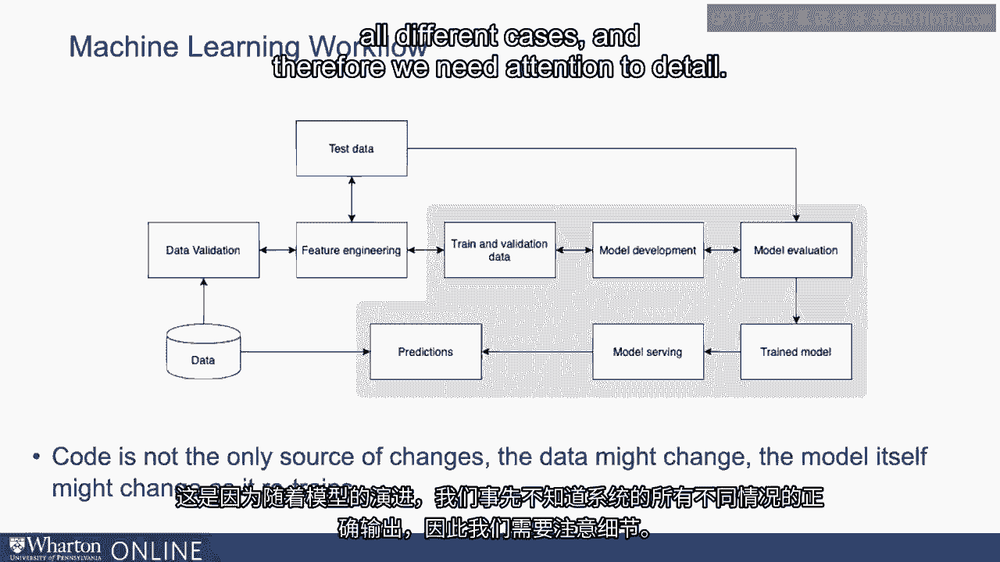
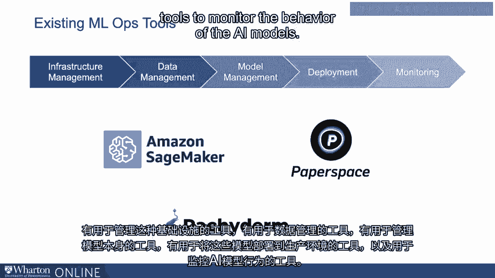
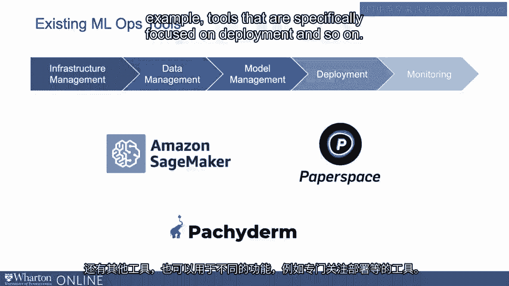

# 课程 P31：机器学习运维 (MLOps) 🚀

在本节课中，我们将要学习机器学习运维（MLOps）的核心概念。我们将从传统的软件开发运维（DevOps）入手，探讨其在机器学习领域的延伸与独特之处，并了解相关的工具和实践。

---

## 从 DevOps 到 MLOps 🔄

在与数据科学家合作时，你可能会遇到“MLOps”这个术语。这是一个有用的概念，但在深入讨论 MLOps 之前，先了解“DevOps”（开发者运维）会很有帮助。DevOps 是软件世界中一个已存在并被频繁使用的术语。

DevOps 是指开发者用于**构建、测试和部署**代码到生产环境的一系列实践和工具。当开发者对一个庞大且复杂的代码库进行更改时，最大的担忧是这些更改可能会引入问题，导致软件意外失败。

因此，我们需要一种更系统的方法来管理软件变更。这种方法通常涉及创建一个新的代码分支，在不影响主分支（即生产代码）的情况下进行修改。在合并回主分支并最终部署到生产环境之前，需要使用自动化测试来验证这些更改。

---

## 传统 DevOps 的核心：CI/CD ⚙️

传统 DevOps 有两个主要组成部分：**持续集成** 和 **持续部署**，合称为 CI/CD。

*   **持续集成** 指的是创建主代码分支、进行更改、推送、测试并最终合并更改的实践。
*   **持续部署** 指的是在代码最终被推送到生产环境之前运行的一系列测试。

因此，标准的 CI/CD 流程可以概括为：**开发 -> 测试 -> 合并 -> 部署**。

---

## 机器学习系统的独特挑战 🤖

上一节我们介绍了传统的 DevOps，本节中我们来看看机器学习系统的开发。机器学习模型的开发同样需要谨慎关注细节，但与传统 DevOps 有一些关键区别。

在机器学习系统中，**代码并不是唯一的变化来源**。用于训练和验证模型的底层数据可能会随时间变化，机器学习模型本身也可能通过持续的再训练而改变。

此外，在任何机器学习系统中，机器学习模型的输出也需要进行验证和质量检查。这是因为随着模型的演变，我们无法事先知道系统在所有不同情况下的正确输出是什么。因此，我们需要对模型的行为和输出给予额外关注。

---

## MLOps 的工具生态 🧰

市场上有许多被数据科学家和开发者使用的 MLOps 工具。MLOps 的范围非常广泛，涵盖了管理机器学习全生命周期的各种工具。

以下是 MLOps 工具生态的主要类别：

*   **基础设施管理工具**：机器学习通常需要定制硬件，例如被称为 GPU 的处理器。存在专门管理这类基础设施的工具。
*   **数据管理工具**：用于管理和版本控制训练数据。
*   **模型管理工具**：用于跟踪、版本控制和注册机器学习模型。
*   **部署工具**：用于将训练好的模型部署到生产环境。
*   **监控工具**：用于监控 AI 模型在生产环境中的行为，确保其输出符合预期。

市面上有许多工具，例如亚马逊的 **SageMaker** 提供了一个集成的平台来处理许多上述功能。此外，还有像 **PaperSpace** 这样的平台，以及 **Pachyderm** 这类专注于数据流水线和模型管理的专业工具。当然，也存在许多专注于单一功能（如专门部署）的工具。

这些工具对于数据科学家至关重要，能确保他们构建的大规模机器学习应用能够稳定、可靠且无故障地运行。

---

## 总结 📝

本节课中，我们一起学习了机器学习运维（MLOps）。我们从传统的 DevOps 及其 CI/CD 流程讲起，理解了其系统化管理代码变更的核心思想。接着，我们探讨了机器学习系统引入的独特挑战，即数据、模型和输出的动态变化。最后，我们概述了支撑 MLOps 实践的广泛工具生态，这些工具帮助管理从基础设施、数据、模型到部署和监控的整个机器学习生命周期。掌握 MLOps 是确保机器学习项目成功从实验走向生产的关键。