# 课程 P32：AI产品中的数据挑战与策略 🧠

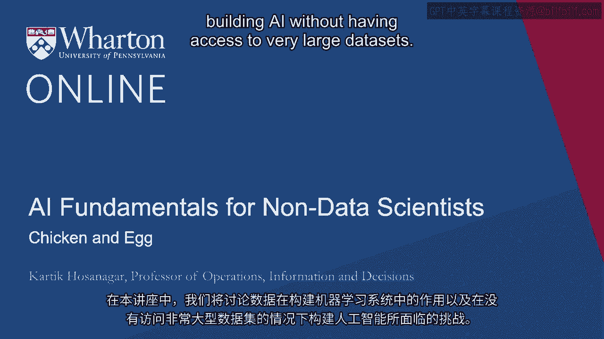

在本节课中，我们将要学习数据在构建机器学习系统中的核心作用，并探讨当缺乏大规模数据集时，如何启动和推进AI产品开发。我们将分析“鸡生蛋还是蛋生鸡”的经典困境，并介绍五种实用的解决策略。

数据是训练现代AI系统，特别是监督学习系统的基石。然而，许多有前景的AI构想面临一个根本性挑战：没有数据就无法构建有效的系统，而没有有效的系统又难以获取数据。这个问题在金融服务、医疗等数据敏感的领域尤为突出。

## 数据的重要性与“鸡蛋”困境 📊

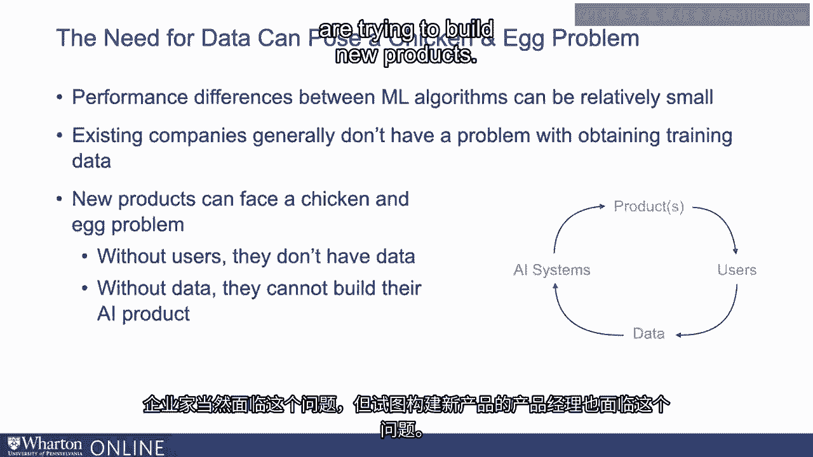

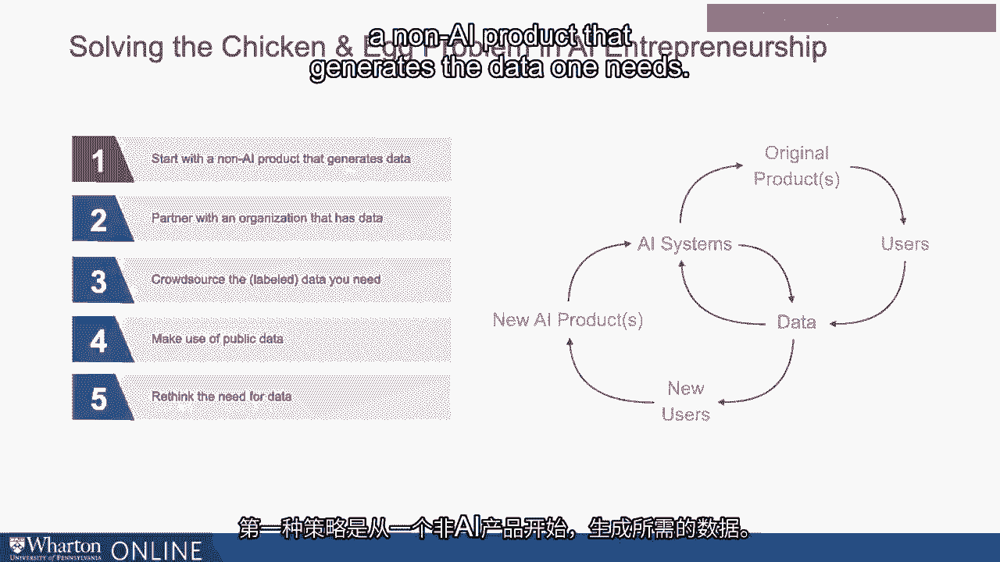

在之前的课程中，我们讨论了不同机器学习算法之间的性能差异。实际上，**对于同一算法，使用大量数据与少量数据训练出的模型，其性能差异往往远大于不同算法之间的差异**。这意味着，获取正确类型且足量的训练数据，通常是项目成功更关键的因素。

现有公司通常拥有历史数据来启动其“AI飞轮”，但新产品或初创公司则可能陷入困境：没有用户，就没有数据；没有数据，就无法构建吸引用户的AI产品。这不仅困扰着企业家，也同样是产品经理在开发新产品时需要解决的核心问题。

## 解决“鸡蛋”困境的五种策略 🛠️

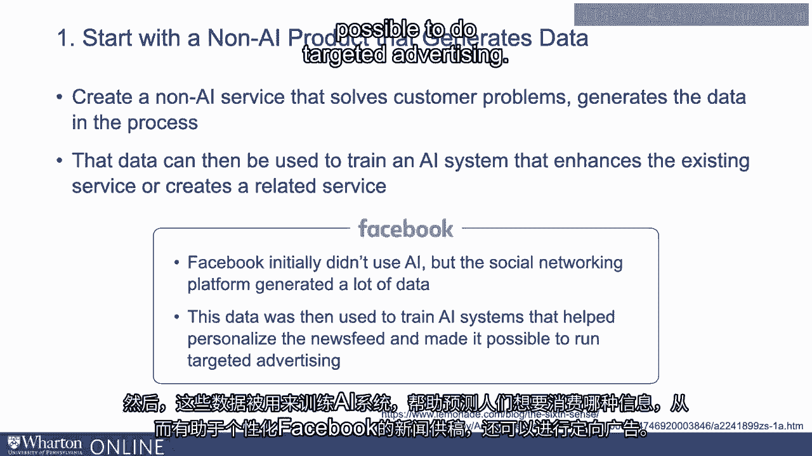

上一节我们明确了数据匮乏的挑战，本节中我们来看看五种可以打破这一循环的策略。

### 策略一：从非AI产品起步

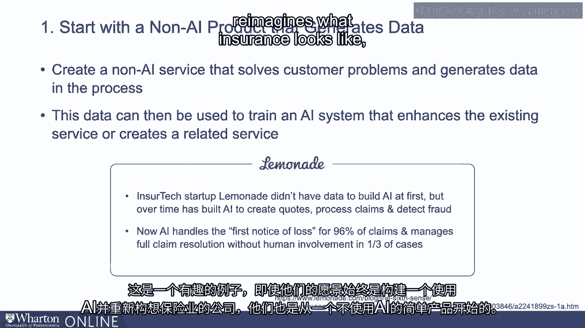

第一种策略是先创建一个能解决用户问题的非AI产品或服务。这个产品本身可以生成后续训练AI系统所需的数据。

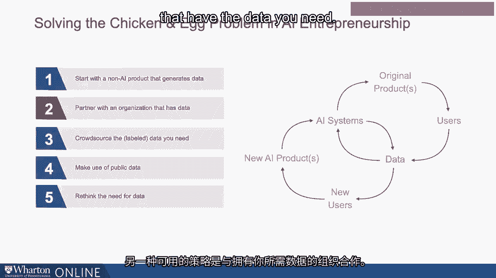

以下是两个典型案例：
*   **Facebook**：最初是一个纯粹的社交网络平台，专注于帮助人们建立连接。随着用户增长，平台自然生成了海量社交数据。这些数据后来被用于训练AI系统，以个性化新闻推送和实现精准广告。
*   **Lemonade**：这家保险科技公司最初提供了一个用户友好的数字化保险产品，并未使用复杂AI。在积累了足够多的用户和数据后，他们逐步引入AI能力，如今已能用AI自动化处理绝大部分保险报价和理赔流程。

### 策略二：与数据持有方合作

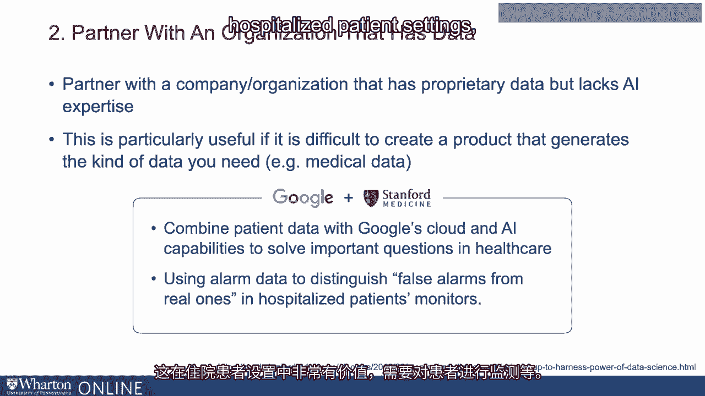

当你难以自行生成所需数据时，可以考虑与拥有数据但可能缺乏AI专业知识的组织建立合作关系。

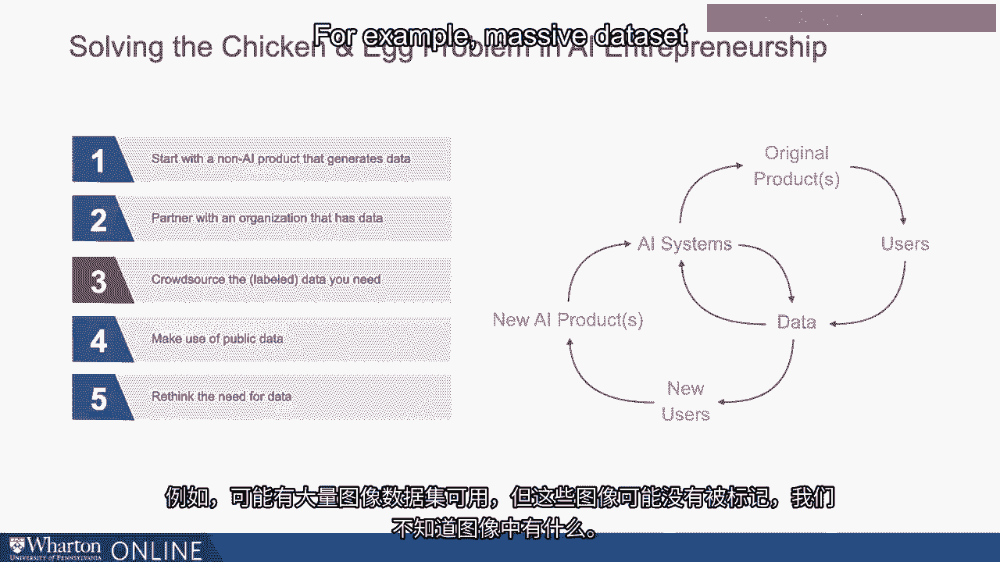

这种方法在医疗等数据获取门槛高的领域特别有用。例如，**Google与斯坦福医学的合作**：谷歌利用其AI能力，结合斯坦福医院的患者数据，共同开发了能更准确识别医院监护环境中真实警报与误报的AI系统。

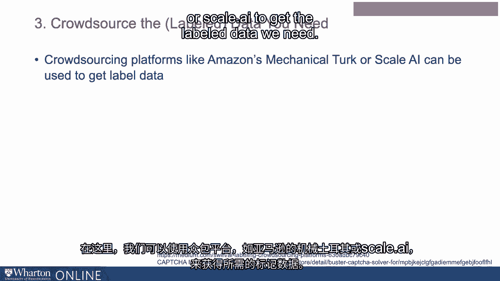

需要注意的是，潜在合作伙伴可能更倾向于与大型科技公司合作。因此，寻找合适的伙伴并创造性地思考合作模式（例如与特定行业的中小型企业合作）至关重要。

### 策略三：众包数据标注

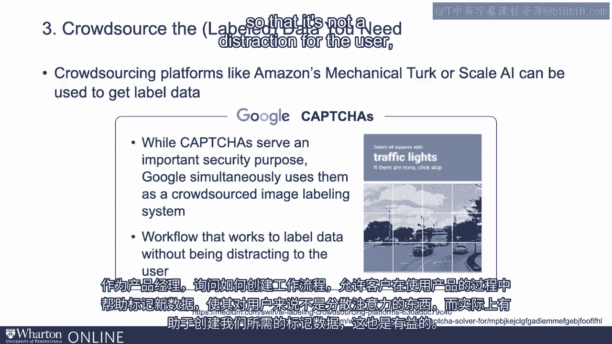

在许多情况下，原始数据（如图片、文本）是大量存在的，但缺乏清晰的标签。这时，可以利用众包平台来获取标注数据。

以下是获取标注数据的两种方式：
1.  **利用专业众包平台**：例如使用Amazon Mechanical Turk或Scale.ai等平台，雇佣人力对数据进行标注。
2.  **设计产品内标注流程**：更巧妙的方式是将数据标注融入用户的产品使用流程中。例如：
    *   **网络安全产品**：运维工程师在处理警报时，标记其是否为真实威胁或误报，这个过程就产生了高质量的标注数据。
    *   **音乐推荐服务**：如Pandora，用户通过“点赞”或“点踩”来反馈推荐结果，这些行为本身就是对音乐的标注。

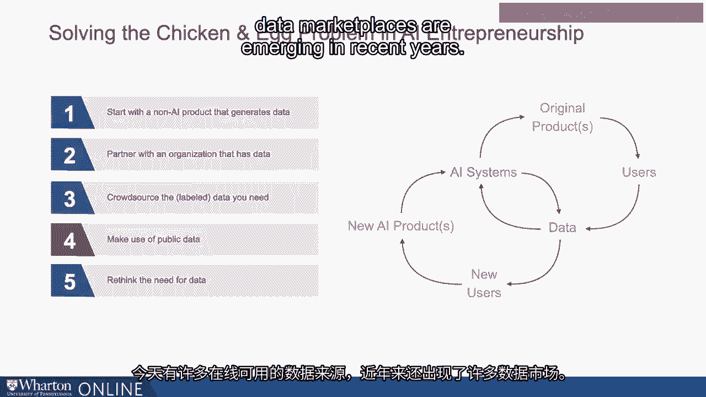

### 策略四：利用公开数据与模型

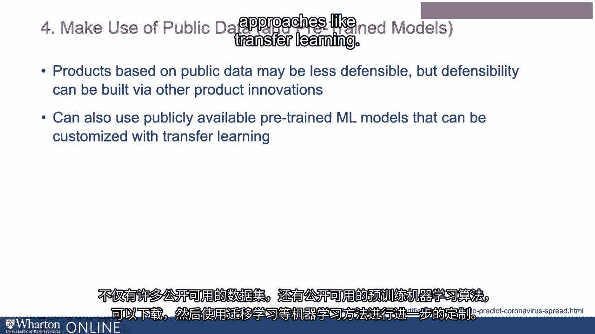

在尝试获取私有数据之前，应首先探索公开可用的资源。如今，网络上有许多高质量的数据集和预训练模型可供使用。

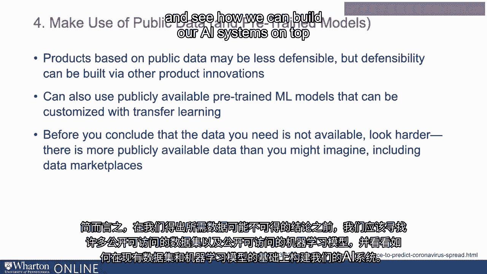

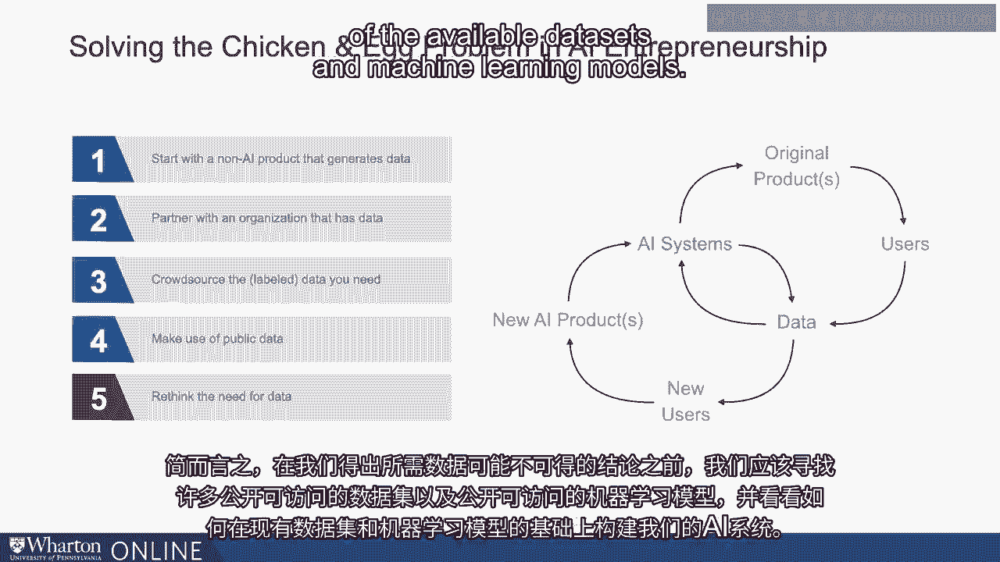

尽管完全基于公开数据构建的产品可能面临较低的竞争壁垒（因为对手也能获取相同数据），但产品的防御性可以通过其他创新（如独特的算法、优秀的用户体验或特定的业务逻辑）来构建。此外，可以利用**迁移学习**等方法，基于公开的预训练模型，使用你有限的私有数据进行微调，从而快速构建定制化AI能力。

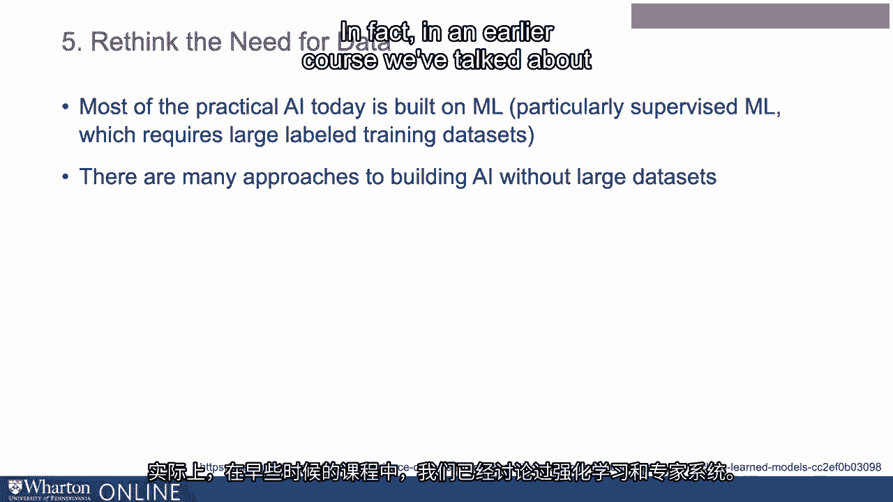

### 策略五：重新思考对数据的需求

虽然当前大多数实用AI基于监督学习，但并非所有AI都需要大型标注数据集。我们可以考虑其他不严重依赖大数据的方法。

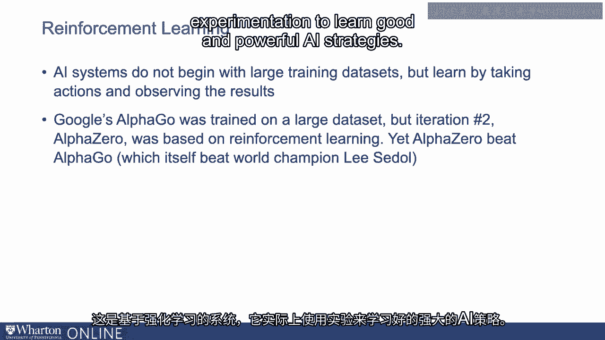

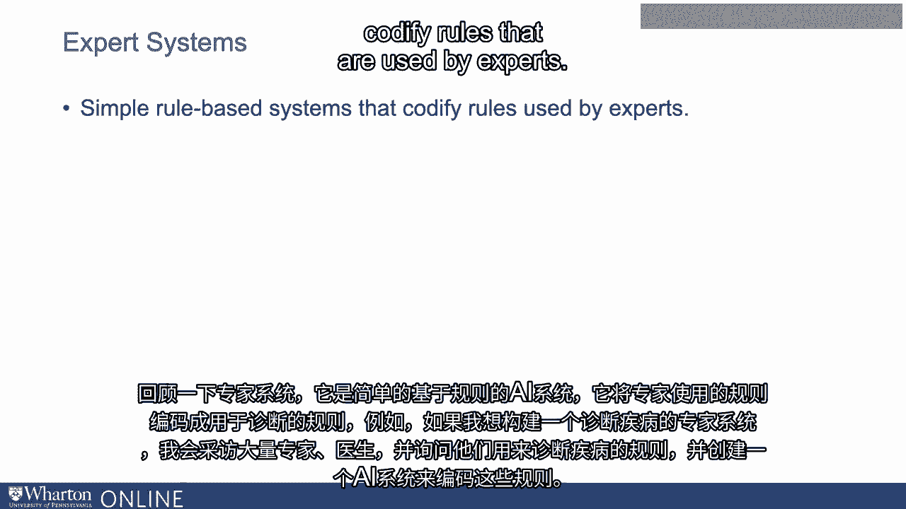

以下是两种替代路径：
1.  **强化学习**：这类算法通过与环境的交互进行学习，通过“试错”来优化策略，无需预先准备大型静态数据集。例如，DeepMind的**AlphaGo**和**AlphaZero**就是通过自我对弈的强化学习，掌握了复杂的围棋策略。
2.  **专家系统**：这是一种基于规则的系统，通过编码领域专家（如医生）的知识来构建。虽然其性能可能不及基于海量数据训练的深度学习模型，但在早期阶段，一个设计良好的专家系统可能“足够好用”，能够吸引首批用户，从而为后续收集数据、构建更复杂的机器学习系统创造条件。其核心是`if-then`规则集合。

## 总结 📝

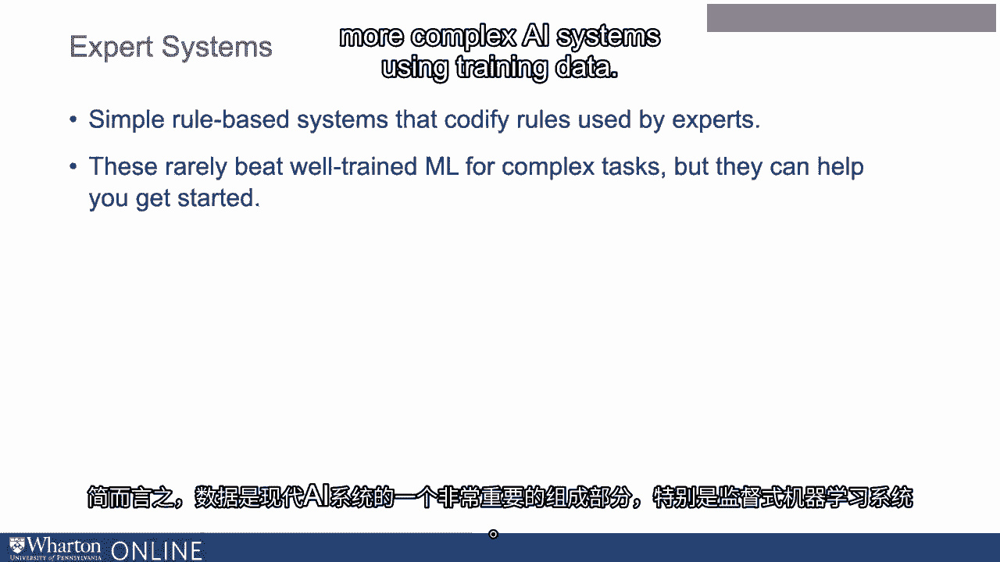

本节课中我们一起学习了数据在AI产品开发中的核心地位以及应对数据短缺的多种策略。我们认识到，一个强大的AI战略必须包含周密的数据管理、收集和标注计划。然而，当数据访问成为瓶颈时，不应轻易放弃雄心勃勃的AI项目。

我们可以通过从非AI产品起步、寻求合作伙伴、众包标注、利用公开资源，甚至转向强化学习或专家系统等方法来创造性地启动项目，逐步积累数据，最终打破“鸡生蛋还是蛋生鸡”的困境，推动AI飞轮转动起来。