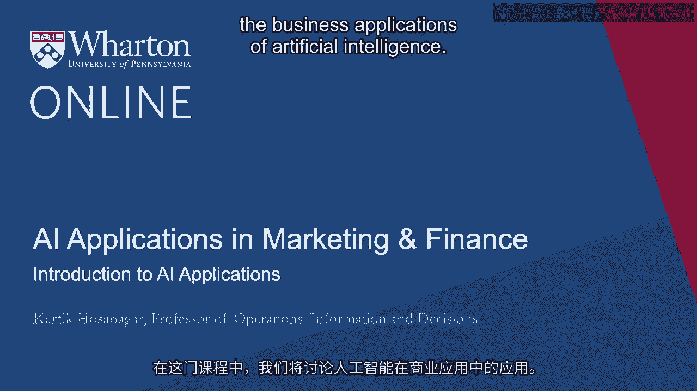
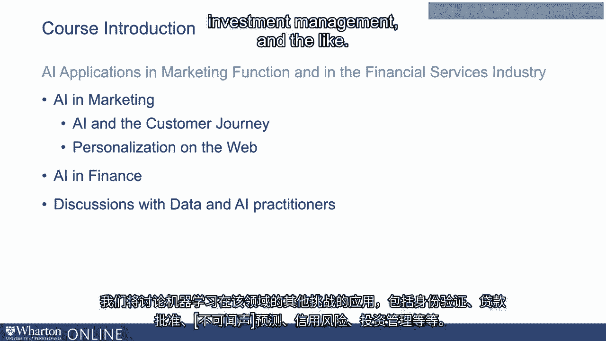

# 课程P34：人工智能的商业应用 🚀



在本课程中，我们将探讨人工智能（AI）在商业领域，特别是营销和金融服务行业中的实际应用。我们将了解AI如何作为一项通用技术，影响多个行业和职能，并通过具体案例理解其运作方式与价值。

---

## 人工智能作为通用技术 🌉

在之前的课程中，我们讨论了人工智能，特别是机器学习，如何表现出成为通用技术的早期指标。

人工智能作为通用技术的意义在于，我们需要认识到大多数行业都可能因其而发生变化。我们看到人工智能职位广泛分布于医疗、金融、制造业、IT咨询、教育等多个行业。同样，人工智能也正在影响这些行业内的多个职位职能，范围从营销到人力资源和人员管理。

---

## 人工智能在营销中的应用 🎯

本节我们将重点讨论人工智能在营销功能中的应用，特别是在金融服务行业的背景下。

我的同事拉古教授将首先探讨人工智能与客户旅程的关系。具体来说，他将解释客户旅程是什么，以及人工智能如何在旅程的不同阶段提供帮助。他将通过一些案例研究，帮助我们理解人工智能在此领域的相关性。

接下来，我将讨论人工智能在个性化中的作用。我将从推荐系统的简要介绍开始，例如我们在亚马逊上看到的“购买此商品的顾客也购买了”功能，或者Netflix和Spotify的内容推荐。

以下是推荐系统的一个基础示例：
```python
# 一个简单的协同过滤推荐逻辑示意
def recommend_items(user_history, all_users_history):
    # 基于用户历史行为与其他用户行为进行匹配，找出相似用户喜欢的物品
    similar_users = find_similar_users(user_history, all_users_history)
    recommended_items = aggregate_preferences(similar_users)
    return recommended_items
```

我将探讨不同推荐系统面临的具体挑战，我们如何利用人工智能应对这些挑战，以及个性化在影响消费者参与度方面的潜在作用。

---

## 人工智能在金融服务行业中的应用 💳

现在，让我们将目光转向人工智能在金融服务行业中的具体应用。

我将首先讨论诸如信用卡欺诈等问题，以及机器学习如何应用于欺诈检测。我们将探讨机器学习在该领域应对的其他挑战，包括身份验证、贷款承保、客户流失预测、信用风险评估和投资管理等。

例如，一个简单的欺诈检测模型可能基于交易特征的异常评分：
```
欺诈概率 = f(交易金额、地点、频率、设备指纹...)
```
其中，函数 `f` 通常是一个由历史数据训练得到的机器学习模型（如逻辑回归、随机森林或神经网络），用于计算某笔交易是欺诈交易的可能性。

---



## 实践者视角：在企业中利用人工智能 🛠️

最后，我们将从数据和人工智能从业者的角度出发，探讨他们如何在企业内部有效地利用人工智能技术。这将帮助我们理解从理论到实践的跨越。

---


## 总结 📝

在本节课中，我们一起学习了人工智能作为通用技术的广泛影响，重点探讨了其在营销个性化（如推荐系统）和金融服务（如欺诈检测、风险管理）等领域的具体应用。通过理解这些案例，我们可以更好地认识到人工智能如何改变商业运作模式并为不同行业创造价值。