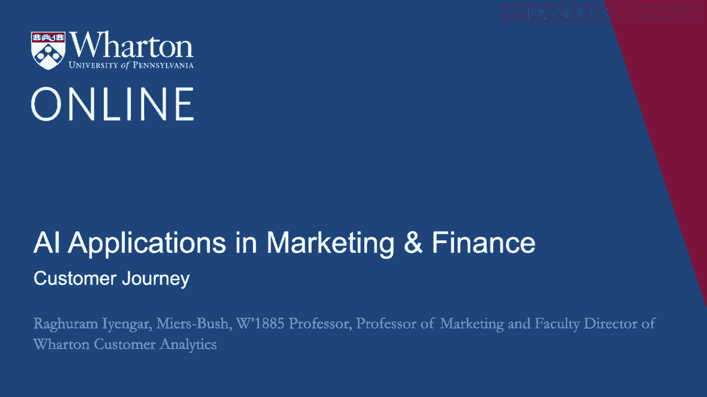
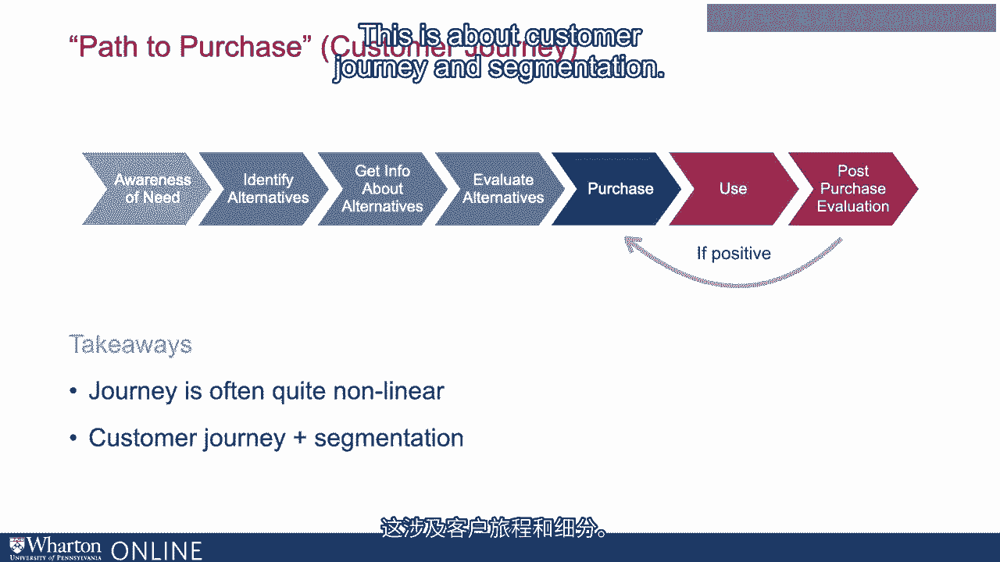
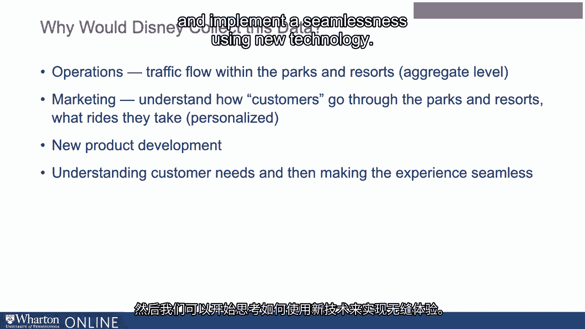
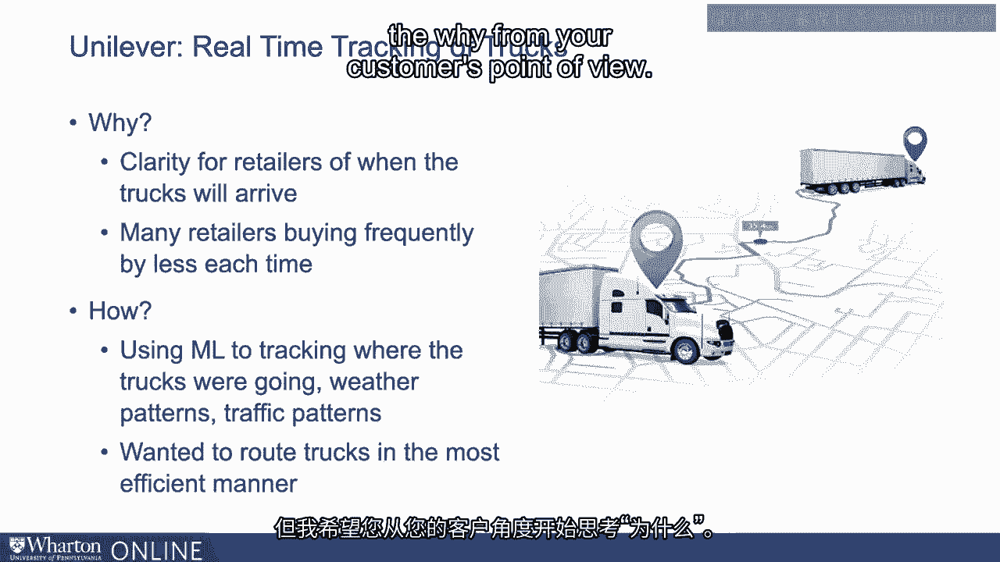
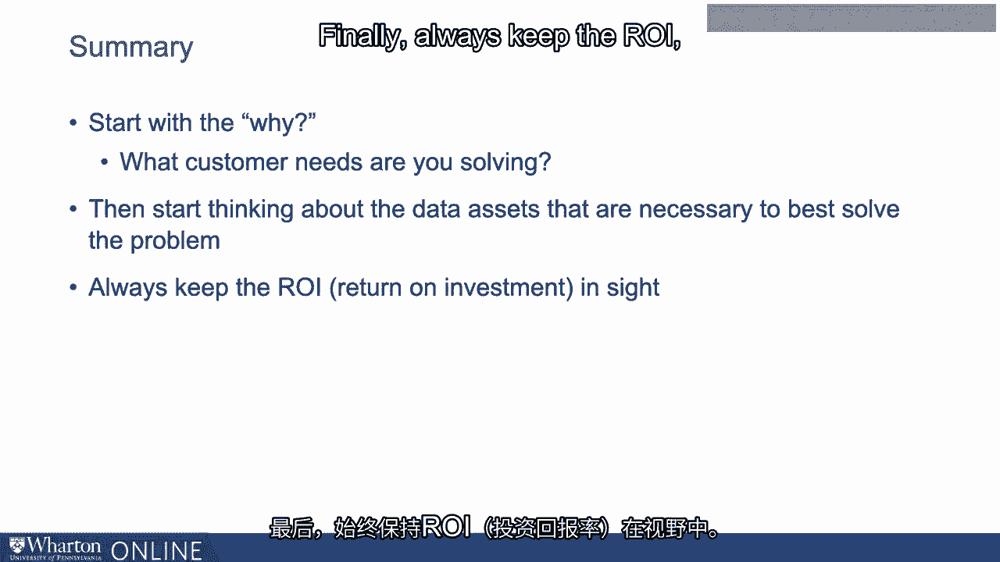

# 课程 P36：客户体验与AI应用 🧭

在本节课中，我们将学习如何从客户旅程的视角来思考人工智能（AI）的应用。我们将探讨客户旅程的非线性特征，并通过迪士尼和联合利华的实际案例，理解如何识别客户需求，并利用技术（如大数据和机器学习）来创造无缝的客户体验。

---

## 理解客户旅程 🗺️

在之前的模块中，我们讨论了许多AI应用。思考AI应用的最佳方式是聚焦于客户需求。而要理解客户需求，最好的方法就是剖析他们的“客户旅程”。

一个典型的客户旅程始于对需求的认知。例如，你开始考虑购买一件新毛衣。接着，你会查看“考虑集”，即市场上哪些公司能帮你找到一件好毛衣。然后，你开始仔细评估所有不同的选项，并可能最终做出购买决定。购买后，你会回顾这次体验，积极的反馈会带来满意，而消极的体验则可能让你重新开始寻找。

然而，在当今时代，这个旅程远非线性。客户可能在Instagram上看到朋友的毛衣，访问网站，查看评论，并在旅程中的任何一点因产品不可用而重新开始。这种非线性特征，虽然看似复杂，却为AI应用提供了巨大的机会。无论是通过语音、视觉还是语言技术，AI都可以在客户旅程的各个节点提供帮助，满足他们的需求。

---

## 客户细分与个性化机会 🎯

上一节我们介绍了客户旅程的基本概念，本节中我们来看看客户旅程的差异性。幻灯片提示我们，每个人的客户旅程都可能大不相同，这引出了“客户细分”的概念。

“没有两个客户是相同的”这一想法，不应仅仅被视为挑战或限制，更应被看作一个巨大的机会。人工智能与各种可能性相结合，能够实现高度定制化。关键在于能够识别客户处于旅程的哪个阶段，并了解他们的具体需求。这种洞察力正是创造价值的机会所在。

为了更具体地理解，让我们来看一些例子。

---

## 案例研究：迪士尼的魔法腕带 🏰

让我们以一个广为人知的例子——迪士尼——来具体分析。许多人都去过迪士尼度假区或听说过它。迪士尼投入巨资开发了一项围绕“魔法腕带”的技术。

幻灯片中的人物佩戴的正是魔法腕带。这条腕带能为客户提供便利，同时也为迪士尼收集大量信息。例如，客户在抵达前可以将住宿信息、无现金支付功能以及心仪的游乐项目选择录入腕带。它甚至可以替代传统的“快速通行证”。

从迪士尼的角度思考，他们为何要投资这项技术并关心这些数据呢？以下是几个关键原因：

以下是迪士尼利用魔法腕带数据的几个方面：

1.  **运营优化**：度假区内的客流管理是一大挑战。通过数字化收集家庭游客的动线、项目偏好等数据，迪士尼能实时了解各区域的客流情况，从而更高效地进行运营管理。
2.  **市场营销与个性化**：了解客户对哪些游乐设施感兴趣、他们的期待是什么，有助于迪士尼提供个性化的推荐和营销信息，极大提升客户体验。
3.  **新产品开发**：这些数据能揭示游客的潜在需求。例如，与迪士尼的流媒体平台Disney+相结合，可以探索全新的互动体验或产品开发方向。

更广泛地说，这个案例启示我们，应少纠结于技术本身，多思考客户旅程：客户的需求是什么？如何让他们的体验更无缝？然后，我们再思考如何利用新技术来实现这一目标。

---

## 案例研究：联合利华的货车追踪 🚚

上一节我们看了面向消费者（B2C）的迪士尼案例，本节中我们来看看一个企业对企业（B2B）的例子——联合利华。

联合利华作为大型消费品公司，为其送货车队实现了实时追踪。这看似与迪士尼的魔法腕带应用迥异，但让我们先从根本问题出发：他们为什么这么做？

联合利华的客户主要是零售商。零售商希望清楚了解库存位置和到货时间。此外，许多零售商倾向于更频繁地下单，但每单数量更少。在实现货车追踪前，这对联合利华的物流来说是沉重负担。

因此，联合利华要解决的核心客户需求是：提升供应链透明度与物流效率。那么，他们是如何做的呢？机器学习等技术在此发挥了作用。

联合利华的做法类似于为货车打造了一个“优步”系统。他们追踪货车路线，并结合天气、交通模式等数据，目标是：

*   **公式/目标**：`最大化准时交付次数` 且 `最小化重复出行与空驶里程`。

最终，他们通过优化路线，不仅减少了碳排放，还增加了单次货车运输的货品量，实现了双赢。

请注意我们提问的顺序：“为什么”永远是第一个问题，它定义了客户需求。然后，“如何”利用技术来实现解决方案。管理者应始终从客户视角出发进行思考。

---

## 管理问题框架与总结 📝

在深入探讨客户旅程的其他方面之前，我们先简要总结一下已讨论的内容。以下是一套管理者在考虑新技术应用时应提出的问题框架：

以下是关键的管理问题：

1.  **为什么（Why）**：你正在解决什么客户需求？（无论是B2C还是B2B场景）
2.  **谁与障碍（Who & Obstacles）**：站在客户角度思考，他们面临的主要障碍是什么？
3.  **如何（How）**：需要哪些数据资产和技术来解决这些问题？
4.  **投资回报率（ROI）**：始终关注解决方案带来的投资回报洞察。

很多时候，管理者容易对最新的“闪亮技术”感到兴奋。保持对趋势的了解是好的，但一旦开始思考投资回报率（ROI），就能更冷静地决策资金应该投向哪里，以及在全面投资前，哪些地方应该先进行试点测试。

---

本节课中，我们一起学习了如何通过客户旅程的视角来规划和评估AI应用。我们认识到客户旅程是非线性的，且因人而异，这恰恰是进行个性化创新的机会。通过迪士尼和联合利华的案例，我们掌握了从“为什么”（客户需求）出发，再到“如何”（技术实现）的分析方法，并最终要始终以投资回报率为导向进行决策。记住，技术是工具，满足客户需求、提升客户体验才是核心目标。