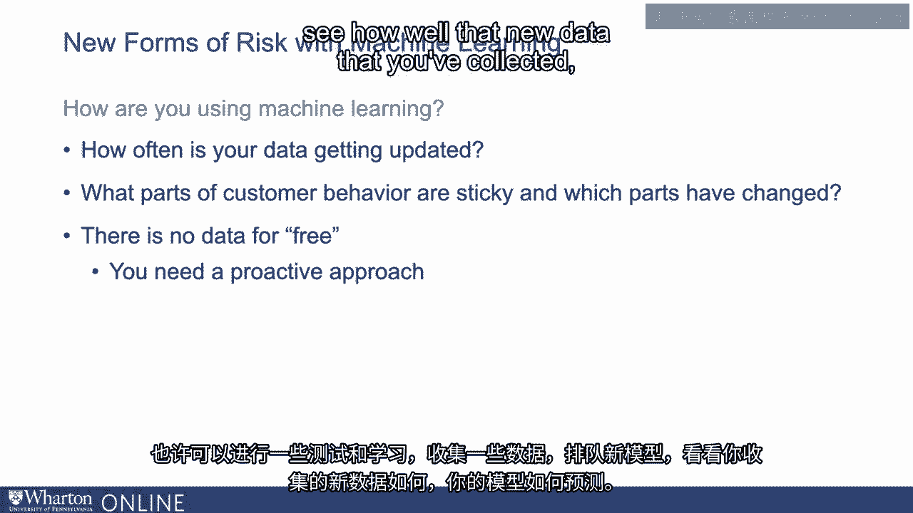

# 课程 P39：利用机器智能识别新的风险形式 🧠

在本节课中，我们将探讨在应用机器学习和人工智能技术时可能遇到的风险与挑战。我们将通过具体案例，理解数据来源、隐私保护以及模型更新等核心问题，帮助你建立对AI应用潜在风险的全面认识。

---

## 理解数据来源的风险

上一节我们介绍了课程主题，本节中我们来看看数据来源可能带来的风险。机器学习模型的输出质量高度依赖于输入数据的质量与代表性。如果训练数据存在偏差，模型就会继承并放大这些偏差。

以下是两个来自亚马逊的典型案例，用以说明数据偏差的普遍性：

*   **案例一：AI招聘工具的性别偏见**：亚马逊曾开发一个用于筛选软件开发职位简历的AI工具。该工具以公司现有员工的简历作为训练数据。由于历史原因，亚马逊的软件开发人员多为男性，导致训练数据存在性别不平衡。结果，该AI工具学会了**对包含“女性”相关词汇（如“女子学院”）的简历给予较低评分**，从而产生了对女性的歧视性偏见。这个案例表明，问题往往出在数据本身，而非工具。

*   **案例二：Prime服务的“种族歧视”算法**：亚马逊在考虑向美国波士顿地区扩展Prime服务时，使用算法分析不同邮政编码区域的盈利潜力。算法发现，围绕低收入社区罗克斯伯里（Roxbury）的周边区域更具商业价值，因此决定**向罗克斯伯里周边区域提供Prime服务，但跳过罗克斯伯里本身**。这形成了一个“甜甜圈”状的服务覆盖图。尽管从纯商业角度看可能有其逻辑，但该决策因涉嫌基于社区经济状况（常与种族相关）进行歧视而引发巨大争议。这个案例揭示了算法决策可能忽视社会公平，带来伦理风险。

这两个例子提醒我们，在利用客户数据进行预测时，必须首先审视数据的代表性和普遍性。

---

## 关注数据集与隐私问题

理解了数据来源的风险后，我们接下来关注数据集组合与客户隐私这一重大问题。全球各地如欧盟的GDPR和加州的隐私法案等，都对数据保护提出了严格要求。

在利用客户数据进行旅程匹配、定制化或个性化服务时，必须确保不侵犯用户隐私。一个常见的误区是认为“匿名化”数据就绝对安全。

以下是一个关于Strava公司的案例：

Strava是一款运动社交应用，用户可以在上面分享跑步、骑行等活动的路线。该公司发布了一份“全球热图”，**聚合了数亿用户的匿名活动轨迹数据**。理论上，这些数据无法识别到个人。

然而，有人将这份热图与公开的谷歌地图进行叠加分析。结果，他们成功**识别出了一些位于阿富汗等敏感地区的美军基地和巡逻路线**，因为那些区域出现了异常密集的运动轨迹。这暴露了军事人员的活动规律，造成了严重的安全隐患。

这个案例的核心教训是：**即使单个数据集是匿名的，当它与其他公开或私有数据集结合时，也可能重新识别出个人身份或泄露敏感信息**。因此，保护隐私不仅要考虑自身数据集，还需警惕数据聚合带来的风险。

---

## 模型与数据的持续更新

最后，我们来看看模型使用过程中的动态风险。这与数据本身有关，但更侧重于数据的时效性和应用场景的演变。

你使用的数据可能是一年或两年前的，而客户行为、市场环境和竞争格局却在不断变化。因此，你需要思考：

*   客户购买产品的频率和旅程是否发生了变化？
*   旅程中的哪些环节保持了稳定（“粘性”）？
*   哪些环节因为新技术或新竞争者的出现而发生了改变？

机器学习模型并非一次部署就一劳永逸。数据不是免费的，意味着持续收集新数据、测试新模型需要成本与主动性。

建议采取“测试-学习”的敏捷方法：**不断收集新数据，启用新模型进行验证，并评估模型在新数据上的预测表现**。你实践得越多，就越能理解机器学习模型在获取新数据后需要如何“更新”，以及旧模型在何处需要调整。

---

## 课程总结

本节课中，我们一起学习了在应用机器智能时识别新风险形式的三个关键方面：

1.  **数据来源风险**：训练数据若存在历史偏差（如性别、地域），会导致模型产生歧视性输出。核心在于审视数据的代表性和普遍性。
2.  **数据隐私风险**：“匿名化”数据在与其他数据集结合时，仍可能泄露个人身份或敏感信息。必须综合考虑数据聚合效应，严格遵守隐私法规。
3.  **模型迭代风险**：市场与客户行为持续变化，模型必须随新数据的输入而持续更新和验证，采用“测试-学习”的敏捷方法保持预测有效性。

保持对数据质量、隐私保护和模型时效性的主动关注，是负责任且有效地利用机器智能的关键。