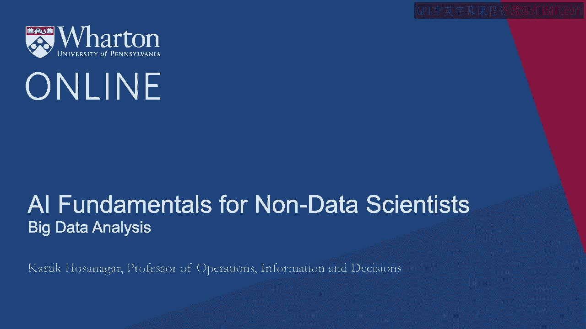
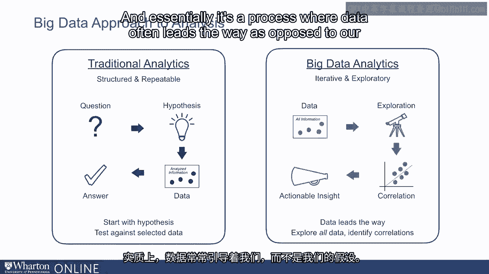
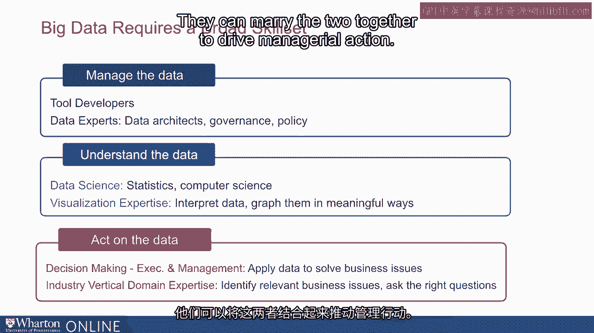
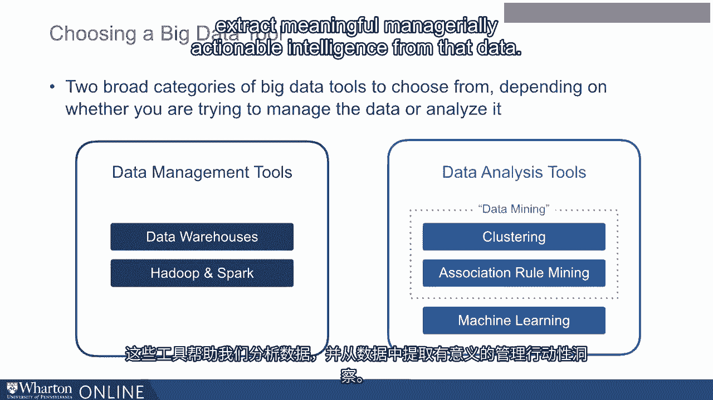

# 课程P4：大数据分析 vs. 传统分析 🆚

在本节课中，我们将探讨大数据分析与传统数据分析的核心区别，并了解企业实施大数据分析所需的新技能与工具组合。

---

## 概述

大数据分析与传统数据分析在方法和目标上存在显著差异。传统分析通常是假设驱动的，而大数据分析则更具探索性和迭代性。这种差异直接影响了组织所需的技能和工具。

---

## 大数据分析 vs. 传统分析

上一节我们概述了课程内容，本节中我们来看看大数据分析与传统分析的具体区别。

传统数据分析通常始于一个具体的管理问题或假设，由统计学家或数据科学家提出。其核心目标是分析数据以验证该假设，从而确认或否定其正确性。整个过程是**假设驱动**的。

相比之下，大数据分析更具**探索性**。它通常从数据本身出发，而非一个具体的假设，并伴随着广泛的商业问题。通过探索性分析，我们旨在发现数据中的模式、关系或相关性，这些发现可能暗示某些商业洞察。有时，这些洞察甚至会促成新假设的形成，进而进行更正式的假设检验。简而言之，大数据分析是一个**数据引领方向**的迭代探索过程。

---

## 大数据分析所需的新技能

理解了方法上的差异后，我们来看看实施大数据分析需要组织具备哪些新的技能或能力。这些技能主要可分为三类。

以下是三类核心技能：

1.  **管理数据**
    这项技能关乎如何有效地组织数据，以便后续进行分析。它可能涉及采购第三方数据管理工具，也可能需要内部的数据专家（如数据架构师或首席数据官）来制定数据治理政策，并设计数据在本地或云端的组织架构。

2.  **理解数据**
    这项技能涉及使用工具从数据中提取智能，大致属于**数据科学**的范畴。它包括：
    *   进行传统分析的统计学家。
    *   应用机器学习、数据挖掘等现代技术的专家。
    *   数据可视化能力，因为关键不仅在于分析，还在于能以有意义的方式构建故事并呈现洞察，让所有利益相关者都能轻松理解。

3.  **基于数据采取行动**
    这是管理者的核心技能。它要求管理者能够运用数据分析的洞察来辅助决策。这需要两种子技能：
    *   **数据技能**：管理者需能解读数据科学家的分析，并能在适当时刻挑战分析结果，因为数据洞察有时可能具有误导性或存在虚假相关性。这要求管理者具备基本的数据科学知识，以理解分析的局限性。
    *   **领域专业知识**：数据通常展示的是过去的模式，需要具备相关领域知识的管理者提出正确的问题，并将数据洞察转化为实际行动。

因此，在数据时代最成功的管理者，往往是那些既能理解数据，又具备深厚垂直领域专业知识，并能将二者结合以推动行动的人。

---

## 大数据分析所需的新工具

除了新技能，大数据分析也需要新的工具组合。从功能上看，这些工具主要分为两类。

以下是两类核心工具：

1.  **数据管理工具**
    这类工具主要用于帮助组织收集、存储和管理公司内的所有数据。

2.  **数据分析工具**
    这类工具帮助我们分析数据，并从数据中提取有意义、可管理的智慧与信息。

在下一节课中，我们将更深入地探讨数据管理工具的具体内容。

---

## 总结

本节课中，我们一起学习了大数据分析与传统分析的本质区别。传统分析是假设驱动的，而大数据分析是数据驱动的探索过程。这种转变要求组织培养**管理数据**、**理解数据**和**基于数据行动**的新技能，并配备相应的**数据管理**与**数据分析**新工具。掌握这些是企业在数据时代取得成功的关键。